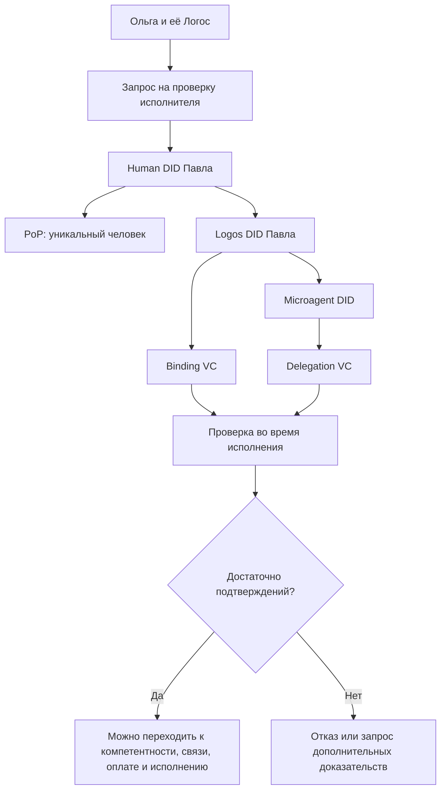
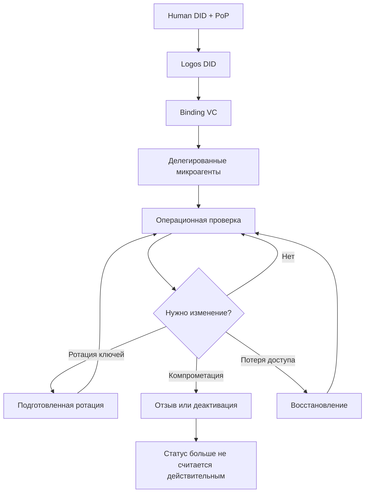
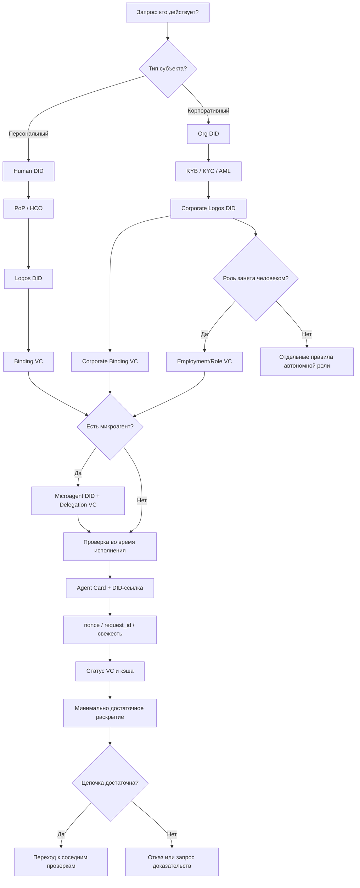

# УРОВЕНЬ 1 / ИЗМЕРЕНИЕ 01: ИДЕНТИФИКАЦИОННОЕ

> **Уровень:** L1 — Агент  
> **Измерение:** D01 — Identification  
> **Учебная редакция:** v2.0  
> **Главная тема:** как понять, кто действует в цифровой среде, кто им управляет и можно ли проверить эту цепочку

---

## Ключевой вопрос

**Кто ты в глобальной системе и как ты верифицирован?**

---

## Краткое описание измерения

Логос (англ. Logos) не может быть просто именем в интерфейсе.

Если агент получает задачи, обращается к другим агентам, запускает микроагентов, предъявляет учётные данные и может участвовать в сделках, контрагенту нужно проверить не только саму карточку профиля, а всю цепочку: кто действует, от чьего имени и с какими подтверждениями.

Идентификационное измерение отвечает за проверяемую модель субъектов, ключей, учётных данных, делегирования, статусов и восстановления.

Эта глава отвечает на несколько практических вопросов:

1. Кто именно является субъектом: человек, его персональный Логос, микроагент или корпоративная роль?
2. Как связать человека и Логос так, чтобы связь была проверяемой, но не раскрывалась всем подряд?
3. Почему человеку, Логосу и микроагентам нужны разные идентификаторы?
4. Какие способы идентификации подходят для постоянных агентов, краткоживущих микроагентов и журналов аудита?
5. Как доказать, что за корневой идентичностью персонального Логоса стоит уникальный человек?
6. Как проверять идентичность во время исполнения задачи, а не только при регистрации?
7. Как отозвать, восстановить и защитить идентичность, если ключи, учётные данные или микроагенты скомпрометированы?
8. Чем корпоративная идентификация отличается от персональной?

---

## Мини-глоссарий

| Термин | Простое объяснение |
|--------|--------------------|
| **Логос** | Цифровой двойник субъекта, который действует в пределах делегированных прав и не становится отдельным юридическим лицом. |
| **Персональный Логос** | Логос конкретного человека; его корень доверия — проверенный человек. |
| **Корпоративный Логос** | Роль внутри юридического лица: наружу действует роль, а не само юридическое лицо как отдельный агент. |
| **Децентрализованный идентификатор (DID)** | Глобально различимый идентификатор, который контролируется субъектом и проверяется без единого центрального реестра. |
| **DID Document** | Машиночитаемое описание DID: ключи, контроллеры, сервисы и отношения проверки. |
| **Human DID** | DID человека; корень субъектности для персональной модели. |
| **Logos DID** | DID персонального Логоса; долговременная агентная идентичность. |
| **Microagent DID** | DID микроагента; отдельная идентичность специализированной части Логоса. |
| **Org DID** | DID организации; корень доверия для корпоративной модели. |
| **Corporate Logos DID** | DID корпоративной роли, которой владеет организация. |
| **Проверяемое учётное данное (VC)** | Подписанное цифровое утверждение, которое можно проверить по издателю, субъекту, содержанию и статусу. |
| **Binding VC** | VC, связывающее человека и персональный Логос. |
| **Corporate Binding VC** | VC, связывающее организацию и корпоративную роль. |
| **Employment/Role VC** | VC, показывающее, что личный Логос сотрудника занимает корпоративную роль. |
| **Delegation VC** | VC, фиксирующее делегированные права и ограничения. |
| **Уровень автономности (LOA)** | Шкала того, насколько самостоятельно Логос может действовать. |
| **loa_ceiling** | Верхний предел автономности, который владелец или организация разрешает конкретному Логосу. |
| **Доказательство уникальности человека (PoP)** | Проверка, что за корневой идентичностью стоит уникальный человек, а не множество поддельных профилей. |
| **Sybil-атака** | Попытка создать много поддельных субъектов, чтобы обойти правила среды. |
| **HCO** | Механизм повторных проверок человечности во времени. |
| **Доказательство с нулевым разглашением (ZKP)** | Способ доказать факт, не раскрывая исходные данные. |
| **Избирательное раскрытие** | Предъявление только нужной части данных, а не всего набора сведений. |
| **Несвязываемое доказательство** | Доказательство, по которому разные проверки нельзя легко склеить в один профиль поведения. |
| **Trust Registry** | Реестр доверия: список проверяемых субъектов, аттестаций или статусов. |
| **Trust Graph** | Граф доверия: сеть связей, показывающая, кто кому доверяет и почему. |
| **TRAIN** | Механизм глубокой проверки доверия до корневого авторитета и применимых политик. |
| **MCP** | Протокол подключения агента к внешним инструментам и системам. |
| **A2A** | Протокол взаимодействия агента с агентом. |
| **Agent Card** | Машиночитаемая карточка агента: адреса, интерфейсы и сведения для обнаружения. |
| **AIP/IBCT** | Профиль проверки полномочий для одношаговых и многошаговых агентных взаимодействий. |
| **JWT** | Формат токена для передачи утверждений между системами. |
| **A-JWT** | Токен, привязанный к конкретной конфигурации агента и рабочему процессу. |
| **JWS** | Подписанный формат сообщения или документа, позволяющий проверить целостность. |
| **Biscuit** | Токен с логикой ограничений, полезный для цепочек делегирования. |
| **Datalog** | Логический язык правил, на котором можно проверять ограничения полномочий. |
| **Bitstring Status List** | Способ проверить, действует ли VC, отозвано оно или приостановлено. |
| **DID-KR** | Набор идей для расширенного восстановления DID через социальные, временные и пороговые механизмы. |
| **KYB** | Проверка юридического лица как бизнеса. |
| **KYC/AML** | Проверки клиента и противодействия отмыванию средств; для организаций применяются как часть корпоративной верификации. |
| **SCID** | Самосертифицирующийся идентификатор, полезный при переносе истории DID между доменами. |

---

# 0. Гипотетический пример

Представим цифровую среду, где заказчик может поручить задачу не человеку напрямую, а агенту другого участника.

**Ольга** — владелица небольшого бизнеса. Её Логос ищет исполнителя для проверки договора поставки.

**Павел** — специалист, у которого есть персональный Логос. Этот Логос предлагает выполнить проверку и при необходимости запустить отдельного микроагента для анализа длинного документа.

Для Ольги недостаточно увидеть карточку: "юридический помощник Павла". Ей нужно понять, не подменён ли агент, действительно ли он связан с Павлом, не действует ли микроагент без полномочий и можно ли проверить актуальный статус его учётных данных.

До этой главы в общей архитектуре уже есть сама задача и контекст взаимодействия. После идентификационной проверки подключатся другие слои: компетентность покажет, имеет ли агент право и способность анализировать договор; коммуникационный слой проведёт обмен сообщениями; экономический слой проверит оплату; правовой и репутационный слои определят последствия результата. Но первый вопрос проще и строже: **кто сейчас перед нами и как это проверить?**

## Проверка 1. Кто является корневым субъектом?

Сначала среда проверяет, что у Павла есть собственный `Human DID` и что этот корень связан с проверкой уникальности человека.

Это не означает, что Ольга должна увидеть паспорт Павла или всю биометрию. Ей достаточно проверяемого факта: за корневой персональной идентичностью стоит уникальный человек, а не набор искусственно созданных профилей.

## Проверка 2. Как персональный Логос связан с человеком?

Дальше проверяется `Logos DID` агента Павла.

`Logos DID` не должен быть просто похожим именем. Он должен быть связан с `Human DID` через `Binding VC`, где видно, кто контролирует Логос и какой верхний предел автономности разрешён этому экземпляру.

## Проверка 3. Не раскрывается ли лишнее?

Связь между человеком и Логосом нужна для ответственности, но опасна как универсальный маркер слежения.

Поэтому Ольга должна получить только достаточное доказательство связи, а не полный набор сведений о Павле, всех его профилях и всех действиях его агентов.

## Проверка 4. Кто действует внутри задачи?

Если Логос Павла запускает микроагента для разбора договора, среда проверяет не только главный `Logos DID`, но и `Microagent DID`.

Краткоживущий микроагент может получить лёгкую идентичность, а устойчивый микроагент — отдельное долгосрочное делегирование. В обоих случаях важно одно: микроагент не становится самостоятельным субъектом вне цепочки Павел -> Логос Павла -> микроагент.

## Проверка 5. Что видно во время исполнения?

Когда агент Павла делает вызов к Логосу Ольги, проверка не заканчивается карточкой обнаружения.

Каждый важный вызов должен нести свежий идентификатор запроса, доказательство владения ключом или сессионное доказательство, ссылку на цепочку полномочий и проверяемый статус учётных данных. Повтор старого доказательства должен отклоняться как попытка повторного использования.

## Проверка 6. Как меняется корпоративный случай?

Теперь представим, что Павел работает не лично, а занимает роль "юридический аналитик" внутри организации.

Тогда наружу может быть обращён не персональный Логос Павла, а корпоративная роль с собственным `Corporate Logos DID`. Организация подтверждается через `Org DID` и KYB, а связь Павла с ролью показывается через `Employment/Role VC`.

## Главное из примера

**Идентификация не отвечает на вопрос "хорошо ли агент выполнит работу". Она отвечает на более ранний вопрос: кто именно действует, от чьего имени, по какой цепочке полномочий и можно ли это проверить без лишнего раскрытия.**



---

# Содержание

1. Что именно идентифицируется
2. Архитектура персональной идентичности
3. DID-методы и выбор стека
4. Уникальность человека и защита от поддельных субъектов
5. Жизненный цикл идентичности
6. Внешний контур доверия и проверка через инструменты
7. Проверка идентичности во время исполнения
8. Приватность и безопасность идентичности
9. Идентификационная модель корпоративного Логоса
10. Связь и границы с другими измерениями
11. Итоговая модель целиком
12. Короткое резюме главы
13. Вопросы без ответа

---

# 1. Что именно идентифицируется

Прежде чем выбирать технологии, нужно понять, какой субъект вообще отвечает на вопрос "кто ты".

В цифровой среде действует не один плоский профиль. Есть человек или организация, есть Логос как агентная идентичность, есть микроагенты как специализированные исполнители, а в корпоративном случае есть ещё роль внутри юридического лица.

## 1.1 Логос как цифровой двойник субъекта

Логос (англ. Logos) — это цифровой двойник субъекта, способный автономно действовать в пределах делегированных прав: взаимодействовать с другими Логосами, участвовать в сделках, накапливать цифровой капитал и нести последствия действий в рамках заданной правовой модели.

При этом Логос не становится самостоятельным юридическим лицом. В правовом смысле он остаётся системой, инструментом или представителем своего субъекта.

## 1.2 Что означает глобальная система

Глобальная система в ключевом вопросе — это управляемая цифровая децентрализованная экономическая среда.

Она устроена как система систем: внутри неё могут быть организации, юрисдикции и платформенные контуры со своими правилами. Поэтому идентичность Логоса должна быть:

- различимой за пределами одной платформы;
- проверяемой программно;
- переносимой между совместимыми системами;
- связанной с правами и ограничениями субъекта;
- пригодной для отзыва, восстановления и аудита.

## 1.3 Два типа Логосов

В этой главе различаются два типа Логосов.

| Тип | Кто является корнем доверия | Как доказывается базовая легитимность | Что важно не спутать |
|-----|-----------------------------|----------------------------------------|----------------------|
| **Персональный Логос** | Человек с `Human DID` | PoP подтверждает уникальность человека | Логос не равен человеку, но управляется им. |
| **Корпоративный Логос** | Юридическое лицо с `Org DID` | KYB подтверждает организацию | Корпоративный Логос — роль внутри юрлица, а не цифровой двойник самого юрлица. |

Разделы 1-8 объясняют персональную модель. Корпоративная модель отдельно собрана в разделе 9, потому что у неё другой корень доверия и другая логика уникальности.

## Главное

**Идентификация начинается не с технологии, а с ответа на вопрос, чей субъект сейчас действует: человек, его Логос, микроагент или корпоративная роль.**

---

# 2. Архитектура персональной идентичности

Персональному Логосу нужна идентичность, которая не зависит от одной платформы и может предъявляться разным контрагентам. Для этого используются децентрализованные идентификаторы (англ. Decentralized Identifiers, далее — DID) и проверяемые учётные данные (англ. Verifiable Credentials, далее — VC).

DID отвечает на вопрос: "какой субъект перед нами?"

VC отвечает на другой вопрос: "какие свойства, связи или полномочия этого субъекта подтверждены?"

## 2.1 DID и VC работают вместе

DID сам по себе похож на проверяемый адрес субъекта. Он разрешается в `DID Document`, где описаны ключи, контроллеры и сервисные сведения.

Но адрес ещё не говорит, кем субъект является, кто его контролирует и какие у него права. Эти утверждения добавляются через VC в модели:

```text
эмитент -> держатель -> проверяющий
```

Поэтому идентификация Логоса строится не вокруг централизованного реестра, а вокруг криптографической привязки, предъявления учётных данных и проверяемой цепочки делегирования.

## 2.2 Почему нужны два постоянных DID

Персональная модель использует не один постоянный DID, а связку:

```text
Human DID -> Logos DID
```

`Human DID` отвечает за исходную субъектность человека, PoP и первичный контроль.

`Logos DID` отвечает за долговременную агентную идентичность: на неё накапливаются делегированные права, учётные данные, внешние аттестации и контекст доверия.

Связь между ними закрепляет `Binding VC`. В нём важны как минимум две идеи:

- роль Логоса относительно владельца, например `PrimaryLogos` или `WorkLogos`;
- `loa_ceiling`, то есть максимальный уровень автономности, который владелец разрешает этому экземпляру.

> Человек остаётся корнем субъектности, а Логос получает собственную проверяемую агентную идентичность.

## 2.3 Иерархия микроагентов

Логос может делегировать часть работы микроагентам. Их нельзя оставлять безымянными, если они получают собственные полномочия или действуют в проверяемой цепочке.

Базовая иерархия выглядит так:

```text
Human DID
  -> Logos DID
       -> ephemeral Microagent DID
       -> persistent Microagent DID
```

Краткоживущий микроагент может использовать лёгкий `did:key`, потому что ему не нужна долгая история. Устойчивый микроагент должен иметь собственную долговременную идентичность и делегирование через `capabilityDelegation` или эквивалентное VC, чтобы его действия можно было проверить и при необходимости отозвать отдельно.

## 2.4 Портативность между системами

Идентичность должна быть переносимой не только в теории.

Это означает, что DID должны разрешаться универсальными резолверами, а VC-портфель должен переноситься между совместимыми системами. Логос не должен становиться заложником одного провайдера профиля.

Юридически значимая идентификация, электронные аттестации и квалифицированные подписи регулируются отдельным нормативным контуром. Здесь они важны как граница совместимости: идентификационный слой должен быть готов к таким требованиям, но не описывает весь правовой режим.

В примере с Ольгой и Павлом это означает: Ольге не нужно верить названию профиля. Её Логос может проверить, что `Logos DID` Павла действительно связан с `Human DID`, что связь предъявлена через VC и что микроагент не вышел за пределы делегирования.

## Главное

**Персональная идентичность строится как цепочка `Human DID -> Logos DID -> Microagent DID`. DID задаёт проверяемого субъекта, а VC объясняет его связи, права и статусы.**

---

# 3. DID-методы и выбор стека

Один DID-метод не решает все задачи сразу.

Постоянному Логосу нужна долговременная и проверяемая идентичность. Краткоживущему микроагенту нужна лёгкая идентичность без лишней реестровой нагрузки. Для аудита и нормативных сценариев может понадобиться проверяемая история изменений.

Поэтому правильная модель — составной стек, где каждый метод отвечает за свой класс потребностей.

## 3.1 Постоянная идентичность

Для постоянного Логоса нужен DID-метод, который поддерживает долговременную проверку, работу с VC, статусы учётных данных и внешнюю инфраструктуру доверия.

В этой роли основным кандидатом остаётся `did:cheqd`. Его ценность не в названии метода, а в наборе возможностей вокруг постоянной агентной идентичности:

- устойчивый идентификатор для агента, который должен быть обнаружим и проверяем вне одной сессии;
- связанная инфраструктура для DID, VC и статусов учётных данных;
- совместимость с внешними реестрами и графами доверия;
- возможность хранить связанные ресурсы идентификационного слоя.

## 3.2 Проверяемая история изменений

Иногда недостаточно знать только текущее состояние DID. Для аудита, нормативной проверки или переноса между доменами важно видеть историю: когда ключ менялся, кто подписал изменение, была ли подготовлена ротация, сохранилась ли непрерывность идентичности.

Для таких случаев рассматривается `did:webvh`. Он полезен не как замена постоянной агентной идентичности, а как дополнительный слой для сценариев, где важны:

- журнал DID-изменений только с добавлением новых записей;
- подписанная цепочка записей;
- подготовленные ключи для ротации;
- внешнее свидетельствование изменений;
- переносимость истории через SCID при смене хоста.

Ограничение важно: даже если спецификация уже выглядит зрелой, для конкретного промышленного профиля всё ещё нужно решить, где выигрыш от проверяемой истории оправдывает дополнительную сложность.

## 3.3 Краткоживущие микроагенты

Краткоживущему микроагенту не всегда нужна тяжёлая постоянная идентичность.

Если микроагент живёт в пределах одной задачи, не накапливает репутацию и не требует долгосрочного отзыва, подходит `did:key`: идентификатор выводится из ключа, не требует отдельной регистрации и хорошо работает как лёгкая исполнимая единица.

Если же микроагент получает устойчивые права, отдельную лицензию, собственную историю действий или риск адресной компрометации, ему нужна долговременная идентичность и отдельное делегирование.

## 3.4 Рекомендуемая карта выбора

| Потребность | Подходящий метод | Почему |
|-------------|------------------|--------|
| Постоянный персональный Логос | `did:cheqd` | Нужны долговременность, VC, статусы и внешний контекст доверия. |
| Краткоживущий микроагент | `did:key` | Нужна лёгкая идентичность без регистрации и долгой истории. |
| Устойчивый микроагент | `did:cheqd` + делегирование | Нужны адресный отзыв, трассируемость и проверяемые полномочия. |
| Аудит, история, перенос между доменами | `did:webvh` | Нужна проверяемая история изменений и переносимость. |

## 3.5 Совместимость со стандартами

Стек должен оставаться совместимым с актуальной линией `W3C DID Core v1.1`.

На уровне структуры не видно необходимости перестраивать отношения DID, контроллера, документа и сервисов. Но пока стандарт проходит финализацию, правильная позиция — считать текущую модель совместимой и одновременно мониторить финальный статус контекстов, сериализации и требований выхода из стадии кандидата.

В истории Ольги это выглядит просто: для Логоса Павла нужен постоянный DID, для одноразового микроагента — лёгкий DID, а для спорного аудита может понадобиться проверяемая история изменений. Один метод не обязан закрывать все три задачи.

## Главное

**Стек DID выбирается по роли идентичности. Постоянный Логос, краткоживущий микроагент и аудит изменений требуют разных свойств, поэтому один универсальный метод был бы архитектурным упрощением.**

---

# 4. Уникальность человека и защита от поддельных субъектов

Если среда допускает экономические действия, ей нужно защищаться от ситуации, где один злоумышленник создаёт много поддельных субъектов и получает нечестное преимущество.

Для персонального Логоса такая защита начинается не на уровне каждого агента, а на уровне человека.

## 4.1 PoP привязывается к Human DID

Доказательство уникальности человека (англ. Proof-of-Personhood, далее — PoP) должно применяться к `Human DID`.

Это снимает важное противоречие. Один человек может иметь рабочие профили, персональный Логос и микроагентов, но проверка уникальности всё равно относится к корневому человеку, а не к каждому агентному экземпляру отдельно.

Практический смысл такой:

- уникальность проверяется на уровне человека;
- `Logos DID` получает проверяемую привязку к уже проверенному человеку через `Binding VC`;
- политика квот, ограничений и защиты от множества поддельных субъектов может опираться на `Human DID` как на корень.

## 4.2 Биометрические и криптографические PoP-механизмы

PoP может строиться разными способами. Для этой главы важен не конкретный поставщик, а класс решения: механизм должен подтверждать уникальность человека и по возможности не раскрывать исходные биометрические или личные данные.

Например, возможен профиль, где биометрическая проверка порождает ZKP-аттестацию: проверяющий видит факт уникальности, но не получает саму биометрию.

Полная криптографическая механика таких доказательств принадлежит соседнему слою безопасности. Здесь фиксируется только идентификационное следствие: персональный Логос должен опираться на уникального человека, а не на самодекларацию.

## 4.3 Почему одноразовой проверки мало

Одноразовая проверка человечности не решает все риски.

Человек мог пройти PoP, а затем потерять контроль над ключами. Инструменты автоматизации могли захватить доступ. Старое подтверждение могло стать неактуальным для чувствительных операций.

Поэтому вводится идея HCO: повторные, ограниченные по частоте и криптографически привязанные проверки человечности. Они не заменяют PoP, а поддерживают уверенность во времени.

> PoP отвечает: "за корнем был уникальный человек". HCO добавляет: "мы продолжаем проверять, что это свойство не деградировало".

## 4.4 Практическая формула

Для персонального Логоса цепочка верификации читается так:

```text
PoP -> Human DID -> Binding VC -> Logos DID -> Delegation VC -> Microagent DID
```

Если какая-то часть цепочки отсутствует, проверяющий не должен автоматически доверять следующему звену.

```text
если Human DID не имеет PoP-основания:
    не считать персональный корень уникальным

если Logos DID не связан с Human DID через Binding VC:
    не считать агентную идентичность подтверждённой

если Microagent DID не имеет делегирования:
    не считать микроагента уполномоченным
```

В примере с Павлом Ольга проверяет не "одного Павла в мире вообще", а пригодную для среды цепочку: уникальный человек -> его Логос -> конкретный микроагент. Это защищает и Ольгу, и других участников от множества искусственных исполнителей под разными вывесками.

## Главное

**Для персонального Логоса уникальность доказывается на уровне `Human DID`, а доверие переносится дальше через `Binding VC` и делегирование. PoP — это не бейдж агента, а корневое основание цепочки.**

---

# 5. Жизненный цикл идентичности

Идентичность нужно не только создать. Её надо обновлять, отзывать, восстанавливать и переводить в аварийные режимы.

Если жизненный цикл не описан, даже сильная начальная проверка превращается в хрупкое состояние: ключи стареют, доступ теряется, полномочия меняются, а компрометированные идентичности продолжают выглядеть действительными.

## 5.1 Создание

Создание персональной идентичности состоит из трёх шагов:

1. выпускается `Human DID` и привязывается PoP-основание;
2. выпускается `Logos DID` с указанием `controller = Human DID`;
3. выпускается `Binding VC`, подтверждающее связь человека и Логоса.

После этого могут появляться делегированные микроагенты и дополнительные VC.

Такой порядок удерживает различие между субъектностью и агентностью: сначала доказывается корневой субъект, затем создаётся контролируемая агентная идентичность.

## 5.2 Ротация и деактивация

Ключи могут меняться. Иногда это плановая гигиена, иногда реакция на компрометацию.

Поэтому жизненный цикл должен поддерживать:

- подготовленную ротацию ключей, чтобы смена ключа не создавала уязвимое окно;
- деактивацию DID, когда идентичность нужно закрыть или вывести из обращения;
- аварийный механизм при длительной потере контроля, недееспособности или смерти владельца.

`did:webvh` полезен там, где нужна проверяемая история таких изменений. `did:cheqd` важен там, где требуется адресная деактивация и работа со статусами.

## 5.3 Восстановление доступа

Восстановление не должно сводиться к одной фразе "есть доверенные хранители".

Более гибкий подход задаёт `ERC-7093`: в политике восстановления могут участвовать разные типы идентификаторов, включая `WebAuthn`, `DKIM`, `OpenID`, ZKP и другие формы удостоверения. Это снижает зависимость от одной точки отказа и позволяет менять политику восстановления без полной перестройки идентичности.

Главная мысль: восстанавливается не просто кошелёк или ключ, а способность субъекта снова доказать контроль над своей цепочкой DID/VC.

## 5.4 Расширенные кандидаты восстановления

`DID-KR` рассматривается как более расширенный кандидат для восстановления. Он объединяет несколько классов механизмов:

- социальное восстановление с ZKP;
- временной аварийный путь для длительной неактивности;
- пороговое или многостороннее восстановление для более строгой криптографической защиты.

Но зрелость такого стека пока не должна подаваться как безусловный промышленный минимум. Более осторожная позиция: использовать совместимые политики хранителей как практическую основу, а `DID-KR` держать в наблюдаемом резерве до дальнейшего созревания.

## 5.5 Рекомендуемый профиль жизненного цикла

В учебном виде профиль можно собрать так:



Вопросы наследования, правовой передачи полномочий и аварийных правил платформы находятся за пределами этой главы. Здесь важно одно: идентичность должна иметь управляемый жизненный цикл, а не жить как неизменяемая запись.

## Главное

**Идентичность считается надёжной только тогда, когда у неё есть путь создания, ротации, отзыва, деактивации и восстановления. Без жизненного цикла DID превращается в статичный адрес без операционной безопасности.**

---

# 6. Внешний контур доверия и проверка через инструменты

DID и VC дают основу, но сами по себе они не отвечают на все вопросы доверия.

Подпись VC показывает, что документ действительно выпущен определённым эмитентом. Но она не говорит автоматически, доверяем ли мы этому эмитенту, какой политике он подчиняется и не отозвано ли учётное данное.

Поэтому поверх идентификаторов нужен внешний контур аттестаций, статусов, реестров и графов доверия.

## 6.1 Зачем нужен внешний слой аттестаций

Для Логоса важно не просто иметь DID, а уметь предъявить проверяемый контекст доверия:

- какие VC связаны с агентом;
- кто их выпустил;
- действуют ли они сейчас;
- доверяем ли мы эмитенту;
- есть ли путь доверия до корневого авторитета или политики;
- какие права ограничены областью применения.

Внешний контур вокруг `did:cheqd` рассматривается как один из способов собрать такие операции вместе: создание и обновление DID, выпуск и проверка VC, операции реестра доверия, статусы и ограниченные разрешения.

Это не означает, что внешний контур становится единственным источником истины о существовании Логоса. Он служит слоем публикации, проверки и распространения доверительного контекста поверх собственной модели идентичности.

## 6.2 Реестр доверия и граф доверия

Статический реестр доверия отвечает на вопрос: "есть ли этот субъект или аттестация в доверенном списке?"

Граф доверия отвечает на более богатый вопрос: "кто кому доверяет, по какой цепочке и в каком контексте?"

Для агентной среды это различие важно. Логос может иметь валидное VC, но проверяющий всё равно должен понять, надёжен ли эмитент, применима ли политика и не изменилась ли цепочка доверия после отзыва или обновления.

## 6.3 Глубокая проверка доверия

Механизм `TRAIN` добавляет к обычной проверке подписи рекурсивную проверку до корневого авторитета, соответствие политикам и проверку якорей доверия. Он также полезен как мост между DID/VC-слоем и уже существующими цепочками доверия вроде DNS/X.509.

В учебном виде проверка делится на два шага:

1. Проверить криптографическую валидность DID и VC.
2. Проверить, доверяем ли мы цепочке эмитентов, политик и якорей, которые стоят за этими данными.

> Валидная подпись доказывает происхождение документа. Доверие требует ещё ответа на вопрос, почему этому происхождению можно верить.

## 6.4 Инструментальная проверка

Для агентной работы важно, чтобы идентификационная проверка была не ручной процедурой, а исполнимым процессом.

Протокол контекста модели (англ. Model Context Protocol, далее — MCP) может выступать как операционный мост: агент вызывает инструменты, которые разрешают DID, получают список VC, проверяют реестр доверия и запускают глубокую проверку цепочки.

В простом виде процесс выглядит так:

```text
whois -> list-credentials -> verify-trust-registry -> TRAIN
```

Эта глава не описывает весь протокол инструментов и оркестрации. Её интересует только то, что проверка идентичности и доверия может быть встроена в исполнимый контур, а не оставаться статичной записью в профиле.

## 6.5 Дополнительные реестровые профили

`ERC-8004` может использоваться как дополнительный реестровый или профильный слой для сред, где важна совместимость с EVM-подходами.

Но он не заменяет DID-модель. Его правильнее понимать как вспомогательный слой обнаружения, профиля или привязки, который может работать рядом с основной цепочкой DID/VC.

Когда Логос Ольги проверяет Логос Павла, он не ограничивается вопросом "подписано ли VC". Он проверяет статус, эмитента, доверительный путь и применимую политику. Только после этого идентификация становится пригодной для следующего шага сделки.

## Главное

**DID и VC дают проверяемую основу, но доверие требует внешнего контекста: статусов, эмитентов, реестров, графов и политик. Подпись — это начало проверки, а не её конец.**

---

# 7. Проверка идентичности во время исполнения

Регистрационная идентичность отвечает на вопрос: "кто этот агент вообще?"

Но во время исполнения нужен более точный вопрос: "кто действует сейчас, с какими правами, в какой сессии и по какой цепочке делегирования?"

Агентная среда не может полагаться только на статическую карточку обнаружения. Идентичность должна проверяться прямо в момент вызова.

## 7.1 Одношаговые и многошаговые цепочки

Для одношагового взаимодействия достаточно компактного профиля: вызывающий агент предъявляет токен, проверяющий подтверждает подпись, сессию и полномочия.

Для многошаговой цепочки этого мало. Если Логос делегирует микроагенту, а тот вызывает другой сервис или агента, нужно проверить не только последний токен, но всю цепочку делегирования.

`AIP/IBCT` предлагает два класса профилей:

- компактный режим на `JWT` для одношаговых MCP-вызовов;
- цепочный режим на `Biscuit` и `Datalog`, когда важно проверить ограничения по всей цепочке.

Это хорошо совпадает с иерархией `Human DID -> Logos DID -> Microagent DID`: сама архитектура уже содержит делегирование, значит проверка во время исполнения должна уметь читать ограниченные полномочия, а не только статический DID.

## 7.2 Привязка токена к реальному агенту

Токен может быть украден или повторно использован вне контекста.

Поэтому полезен профиль `A-JWT`: токен привязывается к конкретной конфигурации агента, рабочему процессу и доказательству присутствия агента в сессии. В нём важны такие поля и идеи, как `agent_checksum`, привязка к рабочему процессу и per-agent PoP.

Такой подход снижает риск:

- повторного использования старого токена;
- выдачи себя за другого агента;
- использования полномочий вне разрешённой области;
- подмены исполняемой конфигурации при сохранении старого идентификатора.

## 7.3 Agent Card как карточка обнаружения, а не доказательство сама по себе

Протокол взаимодействия агентов (англ. Agent-to-Agent Protocol, далее — A2A) использует `Agent Card` как базовую карточку обнаружения и метаданных.

Но карточка обнаружения не должна сама считаться доказательством исполнимой идентичности. Для промышленного профиля ей нужны дополнительные привязки:

1. `agent_did` или эквивалентная DID-ссылка на актуальный `DID Document`;
2. подпись карточки через `JWS` или аналогичный механизм целостности;
3. ссылки на `Binding VC`, `Delegation VC` или другие учётные данные полномочий;
4. сведения об интерфейсах и адресах для достижимости;
5. ссылка на статус VC, например через `Bitstring Status List` или эквивалент.

Такая карточка остаётся носителем метаданных, а исполнимая идентичность подтверждается отдельной проверкой DID, VC, статуса и цепочки полномочий.

## 7.4 Практический профиль вызова

Для важного A2A-вызова проверка может выглядеть так:

```text
1. Разрешить DID и получить актуальный DID Document.
2. Проверить подпись Agent Card.
3. Связать карточку с вызывающим DID и сессионным контекстом.
4. Подтвердить владение ключом или сессионное доказательство.
5. Проверить Binding VC или Delegation VC.
6. Проверить request_id или nonce, timestamp и свежесть доказательства.
7. Отклонить повторный request_id или nonce.
8. Проверить статус VC и кэшированных артефактов.
```

Универсальное окно свежести не задаётся раз и навсегда. Его нужно настраивать управленческой политикой, потому что разные задачи имеют разные риски, задержки и требования к повторному использованию данных.

DID-документы и статусы можно кэшировать, но кэш должен сбрасываться при ротации ключа, отзыве или приостановке учётных данных. По умолчанию лучше передавать ссылки на артефакты, а не встраивать полный набор VC в каждый вызов.

В примере с Ольгой это означает: даже если карточка Логоса Павла найдена, каждый чувствительный вызов всё равно проверяется заново. Старое доказательство нельзя просто повторить в новой сессии и выдать за актуальное.

## Главное

**Во время исполнения проверяется не только "какой DID указан", а вся текущая ситуация: сессия, свежесть, карточка, ключ, полномочия, статус и цепочка делегирования.**

---

# 8. Приватность и безопасность идентичности

Идентификация должна быть проверяемой, но не должна превращаться в систему постоянного раскрытия личности и поведения.

Главная трудность в том, что связь человека и Логоса одновременно нужна для ответственности и опасна как универсальный маркер отслеживания.

## 8.1 Риск связываемости Binding VC

`Binding VC` связывает человека и его Логос. Если одно и то же доказательство раскрывается каждому проверяющему, оно может стать универсальным коррелятором.

Тогда разные контрагенты смогут связать между собой действия одного человека, даже если им не нужно знать полную историю его Логосов.

Основные риски:

- связываемость между проверяющими;
- отслеживание действий в разных контекстах;
- деанонимизация по повторяющимся поведенческим паттернам;
- раскрытие лишних связей между человеком, Логосом и микроагентами.

## 8.2 Избирательное и несвязываемое раскрытие

Правильная цель: доказать нужный факт, не раскрывая всю связь целиком.

Для `Binding VC` предпочтителен профиль, который поддерживает избирательное раскрытие и несвязываемые производные доказательства. В этой роли сильным кандидатом являются подписи `BBS+`.

`SD-JWT` полезен для некоторых сценариев выборочного раскрытия, но для `Binding VC` он слабее там, где требуется именно несвязываемость между разными проверяющими.

При этом `BBS+` не следует подавать как окончательно закрытый навсегда выбор. Его нужно сопровождать мониторингом статуса стандартизации и независимых реализаций.

## 8.3 Чем атакуют агентную идентичность

Идентичность Логоса атакуют не только через кражу ключа.

Типовые классы угроз:

| Угроза | Что происходит | Что должно помочь |
|--------|----------------|-------------------|
| Подмена агента | Злоумышленник выдаёт поддельного помощника за доверенного агента. | Проверка DID, подписи карточки и цепочки VC. |
| Повтор старого доказательства | Старый токен или доказательство используется в новой сессии. | `nonce`, `request_id`, timestamp и проверка свежести. |
| Наследование лишних прав | Микроагент получает больше прав, чем ему делегировали. | Ограниченное делегирование и проверка всей цепочки. |
| Злоупотребление кэшированным VC | Отозванное или приостановленное VC продолжает приниматься из кэша. | Проверка статуса и сброс кэша при отзыве. |
| Компрометация микроагента | Микроагент пытается выдавать себя за более доверенный субъект. | Отдельная идентичность микроагента и адресный отзыв. |
| Недобросовестный проверяющий | Проверяющий собирает больше данных, чем нужно. | Избирательное раскрытие и минимизация данных. |

## 8.4 Минимальный базис безопасности

Минимальный базис идентификационного слоя включает:

- отдельную ограниченную идентичность для каждого значимого агента или микроагента;
- краткоживущие учётные данные там, где это снижает риск повторного использования;
- изоляцию сессий;
- повторную авторизацию при повышении привилегий;
- PoP или эквивалентную привязку на уровне конкретного агента или сессии;
- проверяемую цепочку делегирования для многошаговых сценариев;
- адресный отзыв скомпрометированного микроагента, а не только корневого `Logos DID`.

## 8.5 Что не нужно раскрывать

Ольге не нужен полный профиль Павла, если она проверяет только допуск Логоса к конкретному взаимодействию.

Ей может быть достаточно фактов: агент связан с проверенным человеком, действует через актуальный `Logos DID`, предъявляет достаточное `Binding VC` или `Delegation VC`, а статус этих данных действителен.

Полная биография, все рабочие профили, все прошлые взаимодействия и исходные данные PoP должны оставаться скрытыми, если они не нужны для конкретной проверки.

## Главное

**Хорошая идентификация не означает максимальное раскрытие. Она означает минимально достаточное, проверяемое и по возможности несвязываемое доказательство нужного факта.**

---

# 9. Идентификационная модель корпоративного Логоса

Персональная модель отвечает на вопрос: как агент связан с человеком.

Корпоративная модель отвечает на другой вопрос: как агентная роль связана с юридическим лицом и конкретным исполнителем.

Здесь важно не спутать три вещи: организацию, роль и человека, который эту роль занимает.

## 9.1 Организация -> роль -> исполнитель

Корпоративный Логос — это не цифровой двойник самого юридического лица. Это роль внутри юридического лица.

Иерархия выглядит так:

```text
Org DID
  -> Corporate Logos DID
       <- Employment/Role VC <- личный Logos DID сотрудника
```

- `Org DID` принадлежит организации и верифицируется через KYB.
- `Corporate Logos DID` принадлежит роли, которой управляет организация.
- Личный `Logos DID` сотрудника занимает роль через `Employment/Role VC`.

Организация может владеть несколькими корпоративными ролями. Например, одна роль может быть обращена к закупкам, другая — к продажам, третья — к юридическому анализу.

## 9.2 KYB вместо PoP

PoP подходит человеку, но не подходит юридическому лицу. У организации нет человечности, которую можно проверить биометрически или через challenge.

Поэтому корневой субъект корпоративной модели проверяется через KYC/AML/KYB: регистрацию юрлица, бенефициаров, правоспособность и допустимость деятельности.

Это меняет природу защиты от поддельных субъектов. В персональной модели действует принцип "уникальный человек". В корпоративной модели действует принцип "проверенная организация".

## 9.3 Корпоративная роль как внешняя идентичность

Когда сотрудник работает в корпоративной роли, наружу обращена роль: её `Corporate Logos DID`, карточка обнаружения и полномочия.

Scope роли определяется корпоративной лицензией и описанием роли, а не личными квалификациями исполнителя. Личные квалификации могут использоваться для матчинга сотрудника с ролью, но финальное назначение остаётся решением организации.

Общий идентификационный слой при этом переиспользуется: DID-методы, микроагенты, жизненный цикл, проверка во время исполнения, приватность и модель угроз остаются применимыми.

## 9.4 Occupancy: как человек занимает роль

Связь между личным Логосом сотрудника и корпоративной ролью фиксируется через `Employment/Role VC`.

Оно показывает:

- какой личный `Logos DID` занимает роль;
- какой `Corporate Logos DID` является ролью;
- на какой период или при каких условиях роль занята;
- кто выдал подтверждение;
- как отозвать связь при увольнении или смене роли.

Отзыв `Employment/Role VC` не должен уничтожать личный Логос человека и не должен уничтожать саму корпоративную роль. Он прекращает именно занятие роли конкретным исполнителем.

## 9.5 Corporate Binding VC

Связь "организация -> роль" закрепляет `Corporate Binding VC`.

Оно похоже на персональное `Binding VC`, но с другой семантикой:

- `role` указывает корпоративную роль, например `CorporateLogos` и конкретное назначение;
- `loa_ceiling` задаёт верхний предел автономности, делегированный организацией роли;
- scope полномочий задаётся корпоративной лицензией.

Важно различать два VC:

| VC | Что связывает | Зачем нужно |
|----|---------------|-------------|
| `Corporate Binding VC` | Организацию и корпоративную роль | Показывает, что роль действительно принадлежит организации. |
| `Employment/Role VC` | Личный Логос сотрудника и корпоративную роль | Показывает, кто сейчас занимает роль. |

Оба не должны раскрываться каждому проверяющему без необходимости. Требования избирательного и несвязываемого раскрытия применимы и здесь.

## 9.6 Ответственность и репутация

Действия в корпоративной роли атрибутируются организации как владельцу роли, при сохранении аудиторской цепочки до человека-исполнителя через `Employment/Role VC`.

Корпоративная роль не накапливает личную репутацию человека. Репутация роли или организации и личная репутация исполнителя должны оставаться разведёнными.

Это нужно, чтобы сотрудник не переносил всю личную историю на корпоративную роль и чтобы организация не скрывала ответственность за роль за личным профилем сотрудника.

## 9.7 Автономные корпоративные роли

Корпоративная роль может работать без человека-исполнителя: как автономный агент организации под `Org DID`.

Такой режим допустим как архитектурная возможность, но требует отдельных правил. Если нет человека, который занимает роль, исчезает occupancy-цепочка аудита до исполнителя. Тогда отдельно нужно определить ответственность, человеческий надзор и защиту от злоупотреблений.

## 9.8 Практический вывод

Для корпоративного Логоса ответ на ключевой вопрос звучит иначе, чем для персонального:

- "кто ты" — корпоративная роль с `Corporate Logos DID` под верифицированной организацией с `Org DID`;
- "как ты верифицирован" — KYB организации, `Corporate Binding VC` между организацией и ролью, а при занятии роли человеком ещё и `Employment/Role VC`;
- общий технический слой идентичности совпадает с персональной моделью, но корень доверия и правила уникальности другие.

В расширении примера Павел может действовать не как частный специалист, а как сотрудник организации. Тогда Ольга проверяет не только его личную цепочку, но и корпоративную: организация подтверждена, роль принадлежит организации, а Павел действительно занимает эту роль в момент взаимодействия.

## Главное

**Корпоративный Логос — это роль внутри юридического лица. Его корень доверия — проверенная организация, а связь с человеком-исполнителем оформляется отдельно через занятие роли.**

---

# 10. Связь и границы с другими измерениями

Идентификационное измерение задаёт проверяемую цепочку субъектов и полномочий. Соседние измерения используют эту цепочку, но не подменяются ею: компетентность решает, что агент умеет; коммуникация проводит обмен; безопасность задаёт средовую защиту; правовой слой интерпретирует ответственность.

| Измерение | Связь | Граница ответственности |
|-----------|-------|--------------------------|
| **L2/D07 (Безопасность и мониторинг)** | Использует PoP, ZKP, избирательное раскрытие, HCO и средовую защиту от множества поддельных субъектов. | Настоящее измерение фиксирует идентификационное следствие; криптографическая инфраструктура, мониторинг и принудительное применение правил находятся у L2/D07. |
| **L2/D08 (Нормативно-правовое)** | Внешние правила идентификации, электронных аттестаций, KYC/AML/KYB и совместимости с eIDAS задают нормативную рамку. | Настоящее измерение показывает, где эта рамка касается DID/VC; полная правовая детализация находится у L2/D08. |
| **L1/D06 (Правовое)** | Правовой статус Логоса как системы, инструмента или представителя влияет на ответственность за действия. | Настоящее измерение не присваивает Логосу самостоятельную правосубъектность; правовая квалификация принадлежит L1/D06. |
| **L1/D02 (Компетентностное)** | Персональный Логос получает объём прав из человеческих квалификаций, а корпоративная роль — из корпоративной лицензии; матчинг сотрудника с ролью опирается на компетентностные доказательства. | Настоящее измерение связывает субъектов и роли; смысл квот, аттестаций и доменных способностей принадлежит L1/D02. |
| **L1/D09 (Социальное / Репутационное)** | DID Логоса служит якорем для репутационных аттестаций; корпоративная роль не должна смешиваться с личной репутацией исполнителя. | Настоящее измерение задаёт идентификационный якорь; расчёт, хранение и интерпретация репутации принадлежат L1/D09. |
| **L1/D07 (Автономность)** | `Delegation VC`, `LOA` и `loa_ceiling` определяют пределы самостоятельности и допустимые микроагентные идентичности. | Настоящее измерение показывает, где эти ограничения прикрепляются к идентичности; полная политика автономии принадлежит L1/D07. |
| **L1/D04 (Функционально-инструментальное)** | MCP используется как канал инструментальной проверки DID, VC, статусов и доверия. | Настоящее измерение описывает идентификационную проверку; полный runtime инструментов и оркестрации принадлежит L1/D04. |
| **L2/D04 (Коммуникационно-протокольное)** | `Agent Card` и A2A-вызовы несут сигналы идентичности во время взаимодействия. | Настоящее измерение задаёт, что надо проверить; транспорт, маршрутизация, шлюзы и производительность принадлежат L2/D04. |

## Главное

**Граница проста: эта глава отвечает за проверяемую идентичность и цепочку полномочий, а соседние измерения используют её для компетентности, коммуникации, безопасности, права, репутации и исполнения.**

---

# 11. Итоговая модель целиком

Вся модель собирается в один поток: сначала определяется субъект, затем проверяется корень доверия, потом связь с Логосом, делегирование, статус, приватность раскрытия и проверка во время исполнения.



Эта схема не заменяет соседние измерения. Она показывает, что они получают на вход: не просто имя агента, а проверяемую цепочку субъектов, полномочий и статусов.

## Главное

**Итоговая единица проверки — не профиль, а цепочка: корневой субъект -> агентная идентичность -> делегирование -> статус -> свежесть -> минимальное раскрытие.**

---

# 12. Короткое резюме главы

1. Логос — цифровой двойник субъекта, но не отдельное юридическое лицо.
2. Персональная модель строится вокруг цепочки `Human DID -> Logos DID -> Microagent DID`.
3. `Human DID` несёт PoP-основание, `Logos DID` несёт долговременную агентную идентичность, а `Microagent DID` ограничивает специализированного исполнителя.
4. `Binding VC` связывает человека и Логос, но должно предъявляться без лишнего раскрытия.
5. Один DID-метод не подходит для всех случаев: постоянный агент, краткоживущий микроагент и аудит истории требуют разных свойств.
6. Жизненный цикл идентичности включает создание, ротацию, деактивацию, восстановление и отзыв.
7. Подпись VC не равна доверию: нужны статусы, эмитенты, реестры, графы и политики.
8. Во время исполнения проверяются сессия, свежесть, полномочия и цепочка делегирования, а не только карточка агента.
9. Приватность требует минимально достаточного и по возможности несвязываемого раскрытия.
10. Корпоративный Логос — это роль внутри юридического лица; его корень доверия — организация, а занятие роли человеком оформляется отдельно.

## Главное

**Идентификационное измерение превращает вопрос "кто ты?" в проверяемую цепочку субъектов, ключей, учётных данных, полномочий, статусов и ограничений раскрытия.**

---

# 13. Вопросы без ответа

1. **Как окончательно закрепить промышленный профиль A2A-карточки?** Нужно зафиксировать обязательный набор DID-ссылок, подписей, ссылок на учётные данные, статусов, свежести и правил повторного использования для чувствительных вызовов.
2. **Как описать полный жизненный цикл корпоративного Логоса?** Базовая модель организация -> роль -> исполнитель задана, но отдельно нужно определить стадии регистрации, передачи, ликвидации организации, найма, увольнения и смены ролей.
3. **Как управлять автономными корпоративными ролями без человека-исполнителя?** При отсутствии occupancy-связи исчезает аудиторская цепочка до человека, поэтому нужны отдельные правила ответственности, человеческого надзора и защиты от злоупотреблений.
4. **Когда `BBS+` можно считать достаточно зрелым промышленным профилем для Binding VC?** Архитектурно он лучше подходит для несвязываемых доказательств, но решение должно зависеть от статуса стандартизации и зрелости реализаций.
5. **Когда `DID-KR` можно переводить из наблюдаемого кандидата в базовый стек восстановления?** Его модель гибкая, но перед фиксацией нужны зрелость спецификации, реализаций и политик применения.
6. **Как зафиксировать финальную совместимость с `W3C DID Core v1.1`?** Текущая модель выглядит совместимой, но профиль контекстов, сериализации и финальные требования стандарта нужно пересмотреть после завершения стадии кандидата.

## Главное

**Открытые вопросы не меняют основу модели. Они уточняют промышленную настройку: карточки вызова, корпоративный жизненный цикл, автономные роли, зрелость privacy/recovery-стеков и финальный статус DID-стандарта.**
