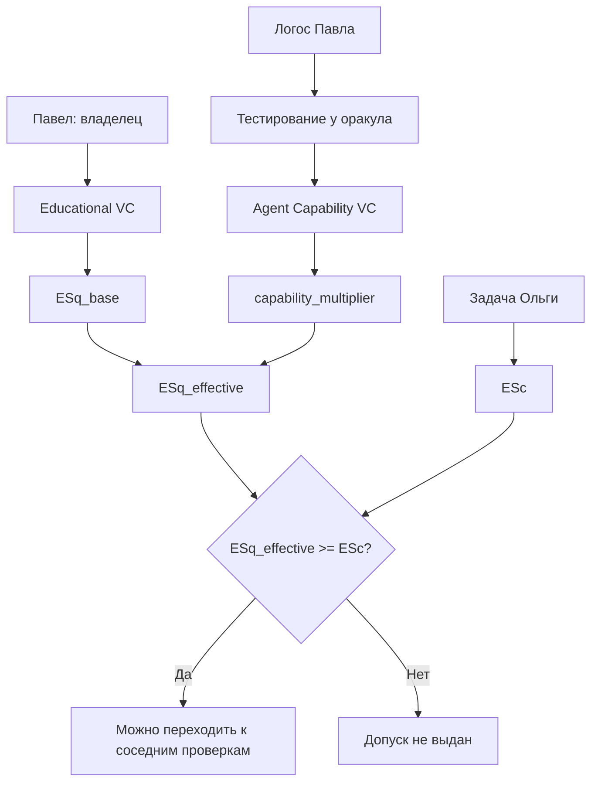
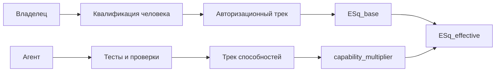
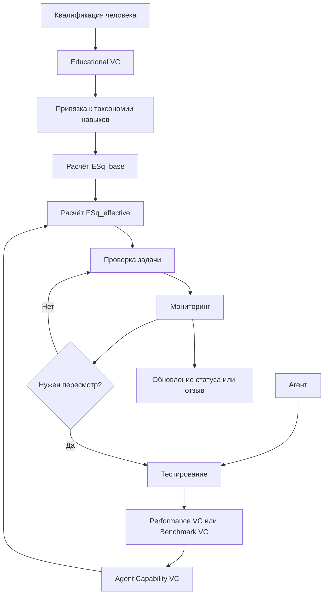
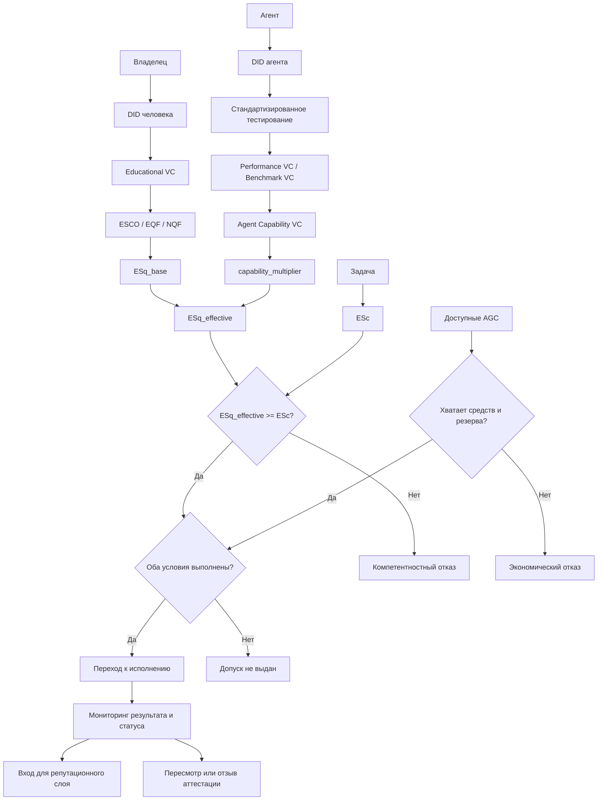

# УРОВЕНЬ 1 / ИЗМЕРЕНИЕ 02: КОМПЕТЕНТНОСТНОЕ

> **Уровень:** L1 — Агент (свойства Логоса)  
> **Измерение:** D02 — Competence  
> **Учебная редакция:** v2.0  
> **Главная тема:** как доказать, что агенту можно поручить задачу именно этого класса

---

## Ключевой вопрос

**Что ты знаешь и какие навыки у тебя есть, и как ты это подтверждаешь?**

---

## Краткое описание измерения

Компетентность нужна там, где агент не просто отвечает на вопрос, а берёт задачу с последствиями: юридическими, инженерными, финансовыми, медицинскими или организационными.

Одного профиля, обещания или общего рейтинга недостаточно. Цифровая среда должна различать квалификацию владельца, реальные способности агента, стоимость задачи, оплату и репутацию.

Настоящее измерение объясняет, какие доказательства нужны, как они связываются между собой и где проходит граница между компетентностным допуском и соседними слоями архитектуры.

Эта глава отвечает на несколько практических вопросов:

1. Какие знания и навыки считаются подтверждёнными?
2. Чем квалификация человека отличается от способности агента?
3. Как образовательные и профессиональные подтверждения превращаются в машиночитаемые учётные данные?
4. Как результаты стандартизированного тестирования становятся аттестацией способностей агента?
5. Как рассчитывается эффективная компетентностная квота `ESq_effective`?
6. Почему компетентность не заменяет деньги, репутацию, идентичность и технический контроль исполнения?
7. Как доказывать компетентность без раскрытия всего профиля?
8. Какие решения остаются открытыми для правил управления и реализации?

---

## Мини-глоссарий

| Термин | Простое объяснение |
|--------|--------------------|
| Логос | Персональный цифровой агент, который действует от имени владельца в пределах делегированных прав. |
| DID | Децентрализованный идентификатор: проверяемый цифровой адрес субъекта без единого центрального реестра. |
| VC | Проверяемое учётное данное: подписанная цифровая аттестация о субъекте. |
| Educational VC | Проверяемое учётное данное об образовании, квалификации или профессиональной аттестации человека. |
| Agent Capability VC | Проверяемое учётное данное о фактических способностях самого агента. |
| Performance VC | Проверяемое учётное данное о результате конкретного выполнения, теста, аудита или инцидента. |
| Benchmark VC | Разновидность результата тестирования, упакованная как проверяемое учётное данное. |
| ES | Общая единица специализации, которая в этой главе разделяется на квоту и стоимость. |
| ESq | Квота компетентностного права владельца: сколько специализации он может распределить. |
| ESq_base | Базовая часть `ESq`, выводимая из квалификации человека. |
| ESq_effective | Итоговая эффективная квота после учёта подтверждённых способностей агента. |
| ESc | Компетентностная стоимость задачи или специализации: сколько `ES` она требует. |
| ESr | Предлагаемое обозначение фактически измеренных способностей агента. |
| capability_multiplier | Множитель способности, который масштабирует `ESq_base` по актуальной аттестации агента. |
| AGC | Операционная валюта среды; она нужна для оплаты, но не превращается в компетентность. |
| Двойное ограничение | Правило, по которому одновременно должно хватать компетентности и средств. |
| ESCO | Европейская таксономия навыков, компетенций и профессий. |
| EQF | Европейская рамка квалификаций для сопоставления уровней образования и квалификации. |
| NQF | Национальная рамка квалификаций, сопоставляемая с международными уровнями. |
| EDCL | Европейская инфраструктура цифровых образовательных учётных данных. |
| Europass | Европейская среда для представления и сравнения образовательных и профессиональных данных. |
| Open Badges 3.0 | Стандарт упаковки достижений и компетенций, совместимый с проверяемыми учётными данными. |
| W3C VC | Стандарт проверяемых учётных данных. |
| SFIA | Дополнительная рамка навыков, особенно полезная для ИТ-ролей и уровней профессионализма. |
| O*NET | Дополнительная база профессий, задач и активностей для сопоставления навыков. |
| VARIA | Экспериментальный пример формулы уверенности в компетенции. |
| EASEC | Подход к измерению уровня владения навыком. |
| Course-Skill Atlas | Пример численного сопоставления курсов и навыков. |
| Оракул тестирования | Доверенная служба, которая проводит проверку агента и выпускает аттестацию результата. |
| SWE-bench Pro | Стандартизированный набор задач для оценки агентов, работающих с кодом. |
| GAIA | Набор задач для оценки универсального агентного поведения. |
| AgentBench | Набор тестов для проверки агентов в разных практических средах. |
| WebArena | Среда тестирования работы агента с веб-задачами. |
| OSWorld | Среда тестирования работы агента в операционной системе. |
| SkillsBench | Набор тестов, ориентированный на проверку конкретных навыков. |
| ToIP | Набор подходов к реестрам доверия и требованиям к эмитентам. |
| ERC-8126 | Черновой сигнал проектирования для агентных реестров и доверительных паттернов. |
| ERC-8004 | Черновой сигнал проектирования для агентных реестров и доверительных паттернов. |
| BBS+ | Криптографический профиль для доказательств с избирательным раскрытием. |
| ZKP | Доказательство с нулевым разглашением: способ доказать утверждение без раскрытия исходных данных. |
| SD-JWT | Формат избирательного раскрытия утверждений в токенах. |
| Knowledge Quality VC | Возможная аттестация качества знаний, созданных владельцем и проверенных институциональным верификатором. |

---

# 0. Гипотетический пример

Представим ту же цифровую среду и тех же участников, что и в примере про идентификацию. **Ольга** — владелица небольшого бизнеса, её Логос ищет исполнителя для проверки договора поставки. **Павел** — специалист по праву; его Логос предлагает выполнить эту проверку.

Идентификационный слой свою работу уже сделал: подтверждено, что за Логосом Павла стоит уникальный человек, что сам Логос действительно связан с Павлом, и что Ольга видит проверяемую цепочку полномочий без лишнего раскрытия. То есть на вопрос «кто перед нами» ответ уже есть.

Но идентичность отвечает только на вопрос «кто действует», а не «можно ли поручить именно это». Поэтому теперь возникает следующий, более узкий вопрос Ольги: можно ли доверить Логосу Павла именно **юридическую проверку договора поставки** — и есть ли у него на это и право, и реальная способность?

После компетентностной проверки задача ещё пройдёт технический допуск к исполнению, экономическую проверку оплаты, а результат повлияет на репутационный контур. Но прямо сейчас решается смысловой допуск.

## Проверка 1. Есть ли подтверждённая квалификация владельца?

Среда не должна принимать на веру фразу «Павел — юрист». Ей нужно проверяемое учётное данное (англ. Verifiable Credential, далее — VC), где доверенный эмитент подтверждает квалификацию Павла.

Такое учётное данное может быть образовательным или профессиональным: диплом, сертификат, лицензия, аттестация. В этой главе оно называется `Educational VC`.

Эта проверка отвечает на вопрос: имеет ли владелец основание делегировать агенту задачи юридического домена?

## Проверка 2. Понимает ли система, к какому навыку относится задача?

Фраза «проверить договор» слишком расплывчата. Один исполнитель может понимать под ней беглую вычитку, другой — полноценный правовой анализ.

Поэтому навык лучше связать с машиночитаемой таксономией. В качестве базовой онтологии используется `ESCO`: она позволяет описывать навыки не только словами, но и устойчивыми ссылками на компетенции.

Эта проверка отвечает на вопрос: совпадает ли квалификация Павла с доменом задачи Ольги?

## Проверка 3. Умеет ли сам агент выполнять такую работу?

Даже сильная квалификация Павла не доказывает, что его Логос хорошо анализирует договоры. Агент мог быть плохо настроен, устареть, ошибаться в длинных документах или уверенно выдавать непроверенные выводы.

Поэтому нужен отдельный трек проверки самого агента. Он проходит стандартизированное тестирование (англ. benchmark), а оракул тестирования выпускает `Agent Capability VC`: что проверено, на какой версии теста, когда и кем.

Эта проверка отвечает на вопрос: есть ли у агента актуальная аттестация способностей для задач такого класса?

## Проверка 4. Хватает ли компетентностной квоты на задачу?

Квалификация Павла даёт базовую квоту специализации `ESq_base`. Аттестация агента влияет на множитель способности `capability_multiplier`.

Вместе они дают эффективную квоту:

```text
ESq_effective = ESq_base × capability_multiplier
```

Задача Ольги имеет свою компетентностную стоимость `ESc`. Если эффективной квоты не хватает, агент не должен брать задачу, даже если он связан с квалифицированным владельцем.

## Проверка 5. Не раскрывается ли лишний профиль?

Ольге не нужен весь образовательный архив Павла, все его сертификаты и вся история тестов агента. Ей нужно только достаточное доказательство для этой задачи: релевантная квалификация, актуальная аттестация агента, статус эмитента и домен применимости.

Поэтому компетентностная проверка должна поддерживать избирательное раскрытие: показывать ровно то, что нужно для допуска, и не превращать проверку задачи в полное раскрытие профиля.

## Проверка 6. Что происходит после допуска?

Если компетентностная проверка пройдена, это ещё не означает автоматический старт исполнения.

Дальше соседние слои проверяют технический доступ к ресурсам, ограничения исполнения, оплату и правила договора. После выполнения результат может стать входом для репутации.

Настоящее измерение не заменяет эти слои. Оно отвечает за смысловую часть допуска: есть ли подтверждённое право и подтверждённая способность выполнять задачу данного класса.

## Главное из примера

**Компетентность — это не обещание агента и не общий рейтинг. Это проверяемая связка: квалифицированный владелец, аттестованный агент, понятный домен задачи, актуальный статус и минимально достаточное раскрытие.**



---

# Содержание

1. Зачем нужна двухтрековая компетентность
2. Авторизационный трек: что подтверждается у владельца
3. Трек способностей: что подтверждается у агента
4. Таксономия навыков и международное сопоставление
5. Проверяемые учётные данные как упаковка доказательств
6. Оракулы тестирования и политика аттестации
7. Формула `ESq_effective` и двойное ограничение
8. Жизненный цикл и устаревание аттестаций
9. Приватность компетентностных утверждений
10. Типичные ошибки чтения модели
11. Связь и границы с другими измерениями
12. Итоговая модель целиком
13. Короткое резюме главы
14. Вопросы без ответа

---

# 1. Зачем нужна двухтрековая компетентность

Компетентность агента нельзя свести к одному документу, одному тесту или одному числу. В цифровой среде разные доказательства отвечают на разные вопросы.

Если смешать их в один общий показатель, система начнёт делать неверные выводы: диплом владельца будет выглядеть как способность агента, высокий результат теста будет выглядеть как профессиональная лицензия, а репутация за прошлые задачи будет подменять право брать новые.

> Компетентность — это не один балл. Это набор проверяемых ответов на разные вопросы.

## 1.1 Какие вопросы нельзя смешивать

| Вопрос | Что проверяется | Почему это отдельный слой |
|--------|-----------------|---------------------------|
| Кто владелец и с каким агентом он связан? | Идентичность и связка человека с агентом | Без этого непонятно, чей агент действует. |
| Что владелец вправе делегировать? | Образование, квалификация, лицензии, профессиональные аттестации | Это задаёт основание для `ESq_base`. |
| Что агент реально умеет? | Результаты тестирования и аттестации способностей | Это задаёт `capability_multiplier`. |
| Сколько требует задача? | Компетентностная стоимость `ESc` | Это нужно для допуска к конкретному классу задач. |
| Как агент работал раньше? | Репутация и история выполнения | Это важно для доверия, но не является первичным доказательством квалификации. |
| Хватает ли средств? | Операционная валюта и бюджет | Деньги не создают компетентность. |

## 1.2 Две независимые линии доказательств

Настоящее измерение использует две линии.

Первая линия — авторизационная. Она показывает, какие знания и квалификации подтверждены у человека-владельца и какой объём компетентностного права он может делегировать агенту.

Вторая линия — линия способностей агента. Она показывает, что конкретный агент реально умеет делать на измеряемых задачах и в каком состоянии находится его аттестация.



## 1.3 Почему это не репутационная модель

Репутация важна, но она находится на следующем шаге. Она может использовать сведения о способностях агента и историю выполнения задач, но не заменяет исходные доказательства.

Успешная история простых задач не доказывает, что агент имеет право брать сложную профессиональную задачу. И наоборот: профессиональная квалификация владельца не доказывает, что агент стабильно исполнял задачи без ошибок.

В истории Павла агент может иметь хорошую репутацию за быстрые ответы, но это не даёт ему права автоматически анализировать договор поставки. Сначала нужны квалификация Павла и актуальная аттестация самого агента; репутация помогает оценить надёжность уже после этого.

## Главное

**Двухтрековая модель нужна, чтобы не смешивать право владельца, способность агента, стоимость задачи, оплату и репутацию. Каждый слой отвечает на свой вопрос и только вместе они дают корректный допуск.**

---

# 2. Авторизационный трек: что подтверждается у владельца

Авторизационный трек начинается с потребности: среда должна понимать, какие задачи человек вправе делегировать своему агенту. Для этого нужны не свободные заявления, а проверяемые образовательные и профессиональные подтверждения.

В этой главе такие подтверждения упаковываются в `Educational VC`. Они могут быть совместимы с `Open Badges 3.0`, `EDCL` и общей моделью `W3C VC`, а компетенции внутри них связываются с `ESCO` и нормируются через `EQF`, когда это применимо.

## 2.1 Что именно подтверждается

Авторизационный трек может учитывать:

- формальное образование;
- профессиональные сертификаты;
- лицензии;
- аттестации;
- квалификационные уровни;
- сопоставление с международными и национальными рамками;
- описание навыков через машиночитаемые ссылки.

Такое доказательство отвечает не на вопрос «насколько хорош агент», а на вопрос «имеет ли владелец основание делегировать этот домен».

## 2.2 Почему нужен DID человека

Для проверки требуется связать подтверждение с субъектом. Децентрализованный идентификатор (англ. Decentralized Identifier, далее — DID) человека позволяет предъявлять учётные данные так, чтобы проверяющая сторона понимала, кому они принадлежат.

Здесь важно не раскрывать лишнее. Компетентностный слой не должен требовать полный профиль владельца, если для задачи достаточно доказать одну релевантную квалификацию и её статус.

## 2.3 Почему `Educational VC` не описывает способности агента

`Educational VC` относится к человеку. Оно говорит: владелец имеет подтверждённую квалификацию, которую можно учесть при расчёте `ESq_base`.

Но оно не говорит, что агент:

- корректно работает с длинными документами;
- умеет пользоваться нужными инструментами;
- не допускает ошибок в конкретном классе задач;
- сохранил актуальность после обновления модели или домена.

Поэтому авторизационный трек даёт базу, но не завершает компетентностную проверку.

## 2.4 Knowledge Quality VC как открытая возможность

В архитектуре есть потенциальный дополнительный путь: владелец может создавать проверяемые знания, а институциональный верификатор может аттестовать их качество. Такая аттестация называется `Knowledge Quality VC`.

Она похожа на образовательное подтверждение по смыслу: речь идёт о доменной компетенции владельца. Но пока не решено, должна ли она считаться полноправным источником `ESq_base` наравне с `Educational VC` или отдельной добавкой поверх базовой формулы.

Это не меняет основную модель главы. Оно показывает, что источники `ESq_base` могут расширяться только через явное правило управления, а не через произвольное добавление новых чисел.

В истории Павла юридический диплом может быть обычным источником `ESq_base`. Если Павел позже создаст проверенный учебный пакет по договорам поставки, его возможный вклад в `ESq_base` должен быть определён отдельным правилом, а не решаться автоматически.

## Главное

**Авторизационный трек подтверждает право владельца делегировать домен. Он формирует `ESq_base`, но не доказывает, что конкретный агент хорошо выполнит задачу.**

---

# 3. Трек способностей: что подтверждается у агента

Вторая потребность возникает потому, что агент — самостоятельный исполняющий контур. Даже если владелец квалифицирован, агент может быть недостаточно точным, устаревшим или неподходящим для конкретного класса задач.

Поэтому способности агента подтверждаются отдельно через `Agent Capability VC`. Это не диплом владельца и не приложение к нему, а отдельное учётное данное, где субъектом является сам агент.

## 3.1 Что такое Agent Capability VC

`Agent Capability VC` описывает текущий снимок способностей агента. Он должен указывать:

- какой агент проверялся;
- какой класс задач проверялся;
- какой тест или аудит использовался;
- какая версия теста применялась;
- когда проводилась проверка;
- кто выступил эмитентом или оракулом;
- где проверить статус или отзыв;
- к какому домену применима аттестация.

Такое учётное данное отвечает на вопрос: что агент реально умеет сейчас, в наблюдаемом контуре проверки?

## 3.2 Почему нужен снимок, а не вечная отметка

Способности агента меняются. Меняются модели, инструменты, тесты, нормативные требования и сами задачи. Поэтому аттестация должна быть привязана к версии и дате.

Нельзя сказать: «агент один раз прошёл тест, значит он компетентен всегда». Корректнее сказать: «агент показал такой-то результат на такой-то версии теста в такую-то дату, а статус этой аттестации можно проверить».

## 3.3 Как Performance VC связано с Agent Capability VC

Отдельный прогон теста или выполнение задачи может порождать `Performance VC`: проверяемое учётное данное о результате. Если это результат стандартизированного тестирования, его можно рассматривать как разновидность `Benchmark VC`.

Но финальная аттестация способности обычно требует агрегации. Один прогон создаёт входной сигнал, а `Agent Capability VC` собирает релевантные сигналы в более устойчивое утверждение о способности агента.

Иными словами:

```text
отдельный прогон -> Performance VC / Benchmark VC -> агрегация -> Agent Capability VC
```

## 3.4 Почему ESr остаётся мостом, а не отдельной валютой

`ESr` используется как предложенное обозначение фактически измеренных способностей агента. Оно полезно как язык между результатами тестирования и `capability_multiplier`.

Но `ESr` не является деньгами, квотой владельца или стоимостью задачи. Оно не заменяет `ESq` и `ESc`; оно помогает описать, что агент реально показал в проверке.

Для агента Павла результат юридического тестирования может быть выражен через фактический профиль способностей. Этот профиль влияет на множитель, но не создаёт юридическую квалификацию Павла и не оплачивает задачу Ольги.

## Главное

**Трек способностей подтверждает состояние самого агента. Его результат — не общий рейтинг, а аттестация, привязанная к домену, версии проверки, дате, эмитенту и статусу.**

---

# 4. Таксономия навыков и международное сопоставление

Чтобы машина могла сравнивать компетенции, одних текстовых описаний мало. Фразы «проверка договора», «contract review» и «юридический анализ соглашения» могут быть близкими, но система не должна угадывать это по словам.

Нужен общий словарь навыков и квалификаций. В настоящем измерении базовой онтологией выступает `ESCO`, а `SFIA` и `O*NET` используются как дополнительные источники для отдельных задач сопоставления.

## 4.1 Почему ESCO является базовой онтологией

`ESCO` подходит как базовый словарь, потому что он:

- поддерживается институционально;
- многоязычен;
- описывает навыки, компетенции и профессии;
- доступен в машиночитаемых форматах;
- позволяет ссылаться на навыки через устойчивые адреса;
- помогает сравнивать квалификации между системами и странами.

> `ESCO` превращает навык из свободной строки в адресуемый объект.

## 4.2 Как ESCO попадает в учётные данные

В `Educational VC` навык не должен храниться только как текст. Более устойчивый профиль включает:

- человекочитаемое описание;
- ссылку на соответствующий навык в `ESCO`;
- представление в совместимой с `JSON-LD` форме;
- возможность обновлять слой словаря вместе с развитием самой таксономии.

`Open Badges 3.0` может использовать выравнивание с внешними таксономиями, а `W3C VC` даёт проверяемую упаковку. Так квалификационное утверждение становится пригодным для автоматической проверки.

## 4.3 Где помогают SFIA и O*NET

`SFIA` полезна как дополнительный слой для ИТ-ролей и уровней профессионализма. Она помогает говорить о степени владения навыком, особенно в технологических доменах.

`O*NET` полезна как богатая база профессий, задач и активностей. Она может помогать в сопоставлении курсов, задач и навыков.

Но ни `SFIA`, ни `O*NET` не заменяют `ESCO` как базовый многоязычный словарь для межсистемного сопоставления.

## 4.4 EQF, NQF, EDCL и Europass

Для человеческих квалификаций уже существуют инфраструктуры сравнения. `EQF` помогает сопоставлять уровни квалификаций, а национальные рамки квалификаций (`NQF`) могут быть соотнесены с ним.

`EDCL` и `Europass` дают практический контур для цифровых образовательных данных и международного сравнения.

Но это не означает, что для агентских способностей уже существует готовый международный профиль. Человеческие квалификации можно сопоставлять через существующие рамки; агентские способности всё ещё требуют отдельного проектирования внутри трека способностей.

В истории Павла квалификация юриста может быть сопоставлена через образовательные рамки. Но способность его агента анализировать договоры всё равно должна проверяться отдельно, через тесты и аттестацию агента.

## Главное

**Таксономия нужна, чтобы компетенции были сравнимыми машинно, а не только понятными человеку. `ESCO` задаёт базовый словарь; `SFIA`, `O*NET`, `EQF`, `NQF`, `EDCL` и `Europass` дополняют его в своих областях, но не создают готовую модель агентских способностей.**

---

# 5. Проверяемые учётные данные как упаковка доказательств

Когда доказательства должны проверяться автоматически, бумажных документов и произвольных профилей недостаточно. Нужна цифровая упаковка, где можно проверить эмитента, субъекта, утверждение, статус и отзыв.

Для этого используется стек проверяемых учётных данных. Но важно помнить: синтаксис документа сам по себе не решает, кому доверять.

## 5.1 Что даёт W3C VC

`W3C VC` задаёт базовую модель:

- эмитент выпускает утверждение;
- субъект получает аттестацию;
- держатель предъявляет её проверяющей стороне;
- проверяющая сторона проверяет подпись, статус и пригодность утверждения.

Простой аналог: бумажный диплом можно показать человеку, а `VC` можно проверить программно.

## 5.2 Что даёт Open Badges 3.0

Для образовательных и профессиональных достижений нужна не только подпись, но и доменная упаковка: достижение, компетенция, критерии, связь с таксономией.

`Open Badges 3.0` даёт такую упаковку и совместим с моделью `W3C VC`. Поэтому он подходит как один из основных форматов для `Educational VC`.

## 5.3 Что даёт EDCL

`EDCL` дополняет стек для европейского образовательного контура. Он связан с цифровыми образовательными учётными данными, `Europass`, `EQF` и `ESCO`.

Но `EDCL` не следует читать как готовый контейнер для агентских способностей. Он усиливает человеческий авторизационный трек, а для агента нужен отдельный тип аттестации.

## 5.4 Почему Agent Capability VC отделён от Educational VC

У `Educational VC` субъектом является человек-владелец. У `Agent Capability VC` субъектом является агент.

Это различие нельзя сглаживать. Если агентская аттестация будет выглядеть как приложение к диплому владельца, система снова смешает квалификацию человека и способность агента.

Правильная логика:

```text
Educational VC -> ESq_base
Agent Capability VC -> capability_multiplier
```

## 5.5 Подпись не равна доверию

Подписанное учётное данное отвечает на вопрос: действительно ли этот эмитент выпустил этот документ?

Оно не отвечает автоматически на другой вопрос: можно ли доверять этому эмитенту для данного класса утверждений?

Поэтому компетентностной модели нужны:

- критерии доверенных эмитентов;
- реестры доверия;
- правила обнаружения эмитентов и оракулов;
- проверка статуса;
- правила отзыва;
- требования к жизненному циклу аттестаций.

`ToIP`-подходы к реестрам доверия и требованиям к эмитентам полезны как базовые кандидаты для такого слоя. Они не создают единого мирового стандарта оракулов, но помогают отделить управляемую схему доверия от разовых технических демонстраций.

## 5.6 Обновляемые интерфейсы

Экосистема проверяемых учётных данных развивается: меняются профили совместимости, способы отображения, схемы обнаружения эмитентов и профили `JSON-LD`.

Поэтому настоящему измерению нужен обновляемый слой совместимости, а не навсегда зафиксированный набор полей. Стандарты и профили можно использовать как кандидаты и практические опоры, но правила должны допускать управляемое обновление.

## Главное

**`VC` делает доказательство проверяемым, но доверие требует правил: кто имеет право выпускать аттестации, как проверяется статус, как работает отзыв и как обновляется профиль совместимости.**

---

# 6. Оракулы тестирования и политика аттестации

Способности агента нужно проверять в наблюдаемом контуре. Для этого нужны стандартизированные тесты и доверенные оракулы тестирования.

Но тест не равен политике выдачи аттестации. Тест даёт результат; правила управления определяют, как этот результат превращается в `Agent Capability VC`.

## 6.1 Почему SWE-bench Pro полезен для задач с кодом

Для агентов, работающих с кодом, `SWE-bench Pro` полезен как входной сигнал, потому что проверяет длинные многофайловые задачи из активных репозиториев и учитывает риск заранее известного набора заданий.

Это не означает, что `SWE-bench Pro` сам задаёт политику допуска. Он не решает:

- какой порог считать достаточным;
- на какой срок выдавать аттестацию;
- когда отзывать аттестацию;
- как переносить результат на соседние домены;
- кто имеет право выпускать итоговое учётное данное.

## 6.2 Почему нужен профиль из нескольких тестов

Один тест не закрывает всё пространство способностей агента. Разные среды проверяют разные стороны работы:

| Тестовая среда | Что помогает проверять |
|----------------|------------------------|
| `SWE-bench Pro` | Длинные задачи с кодом и изменениями в репозиториях. |
| `GAIA` | Более общий помощнический контур и сложные многошаговые задачи. |
| `AgentBench` | Агентное поведение в разных практических средах. |
| `WebArena` | Работа с реалистичными веб-задачами. |
| `OSWorld` | Действия в операционной системе. |
| `SkillsBench` | Более детерминированную проверку отдельных навыков. |

Поэтому `Agent Capability VC` лучше мыслить как набор утверждений о способностях, а не как одно число из одного рейтинга.

## 6.3 Что обязательно указывать в аттестации

Аттестация способности должна быть конкретной:

- семейство тестов;
- версия теста или линия выпуска;
- дата проверки;
- домен применимости;
- идентификатор эмитента или оракула;
- точка проверки статуса или отзыва;
- при необходимости — условия прогона.

Без версии и даты результат теряет контекст. Без эмитента и статуса его трудно использовать для допуска.

## 6.4 Черновые и экосистемные сигналы

Вокруг агентных реестров и доверительных паттернов появляются новые проектные сигналы. `ERC-8126` и `ERC-8004` важны как черновые направления, но их не следует описывать как устоявшиеся стандарты.

Экосистемные реализации сервисов оценки и проверки показывают, что такие службы возможны на практике. Но они не становятся универсальной нормой только потому, что существуют.

Их корректная роль:

- показывать реализуемые паттерны;
- помогать проектировать слой доверия;
- не подменять формальный выбор архитектуры выдачи аттестаций.

## 6.5 Как выглядит осторожная политика выдачи

Минимальная логика может быть записана так:

```text
если тест релевантен домену
и версия теста известна
и дата проверки не устарела
и оракул входит в доверенный контур
и статус результата действителен:
    результат может быть входом для Agent Capability VC
иначе:
    результат не используется для допуска
```

Это не задаёт конкретных порогов. Пороги, сроки и правила отзыва должны определяться отдельным управленческим решением.

В истории Павла один тест на краткие юридические ответы не должен автоматически открывать ему весь домен договорного анализа. Оракул должен проверять именно релевантный класс задач, а аттестация должна указать, где она применима и когда требует пересмотра.

## Главное

**Оракул тестирования создаёт проверяемое основание для аттестации, но не заменяет правила выдачи. Способность агента должна быть привязана к домену, версии теста, дате, эмитенту, статусу и сроку пересмотра.**

---

# 7. Формула ESq_effective и двойное ограничение

После двух треков можно собрать итоговую компетентностную квоту. Формула выглядит просто:

```text
ESq_effective = ESq_base × capability_multiplier
```

Но смысл формулы важнее самой записи. `ESq_base` приходит из квалификации владельца, а `capability_multiplier` — из актуальной аттестации агента. Это не сложение разных баллов, а соединение права и способности.

## 7.1 Что такое ESq, ESc и ESr

| Термин | Отвечает на вопрос | Пример в истории Павла |
|--------|--------------------|------------------------|
| `ESq` | Сколько компетентностного права владелец может распределить? | Павел имеет юридическую квоту на основании подтверждённой квалификации. |
| `ESc` | Сколько компетентностного объёма требует задача? | Проверка договора поставки имеет свою стоимость в единицах компетентности. |
| `ESr` | Что агент реально показал в проверке? | Агент Павла показал результат на юридических тестах. |

> `ESq` — право. `ESc` — требование задачи. `ESr` — измеренный факт способности.

## 7.2 Почему умножение, а не сложение

Диплом владельца и тест агента не являются величинами одного типа. Их нельзя складывать как одинаковые баллы.

Более точная логика такая:

- квалификация владельца задаёт базовый допустимый объём;
- аттестация агента показывает, насколько этот объём можно использовать для конкретного класса задач;
- итоговая квота применяется только при валидности обоих доказательств.

```text
если qualification_valid == true
и agent_capability_valid == true:
    ESq_effective = ESq_base × capability_multiplier
иначе:
    допуск к задачам этого класса не выдан
```

## 7.3 Почему здесь не фиксируются коэффициенты

Существуют полезные строительные блоки для численного слоя:

- сопоставление курсов и навыков в стиле `Course-Skill Atlas`;
- измерение уровня владения навыком через подходы вроде `EASEC`;
- порядковые уровни `SFIA`;
- экспериментальная формула уверенности в компетенции из `VARIA`.

Например, `VARIA` показывает возможную форму рассуждения:

```text
competency_confidence =
  (level_score × weight) +
  (skill_specificity × (1 - weight))
```

Но это не означает, что настоящая глава утверждает готовую производственную формулу. Она фиксирует конвейер и оставляет таблицы, веса и пороги для отдельного решения.

## 7.4 Учебная иллюстрация с числами

Это только учебная иллюстрация. Конкретные коэффициенты в реальной системе должны утверждаться отдельным правилом управления.

Допустим:

```text
ESq_base = 100
capability_multiplier = 1.2
```

Тогда:

```text
ESq_effective = 100 × 1.2 = 120
```

Это означает, что для данного класса задач эффективная квота равна 120 условным единицам. Из этого нельзя выводить реальные значения для дипломов, лицензий или тестов.

## 7.5 Двойное ограничение

Для запуска задачи одного компетентностного допуска недостаточно. Должны одновременно выполняться два ограничения:

```text
ESq_effective >= ESc
и
AGC_available >= expected_cost + protected_reserve
```

Первое условие отвечает за компетентность: достаточно ли подтверждённой квоты для задачи.

Второе условие отвечает за экономику: достаточно ли средств для исполнения с учётом защищённого резерва.

Деньги не покупают компетентность, а компетентность не оплачивает задачу. Оба условия независимы и должны выполняться одновременно.

## 7.6 Где находится репутационный множитель

Репутация может добавлять отдельный слой после расчёта базовой компетентностной формулы. Если в соседнем репутационном контуре используется дополнительный множитель за уровень репутации, он накладывается поверх `ESq_effective`, а не меняет формулу настоящего измерения.

Иными словами, базовая компетентностная формула остаётся:

```text
ESq_effective = ESq_base × capability_multiplier
```

Репутационная корректировка относится к другому слою и не должна подменять квалификацию владельца или аттестацию агента.

В истории Павла высокая репутация может повысить доверие Ольги к исполнению. Но если юридическая квалификация или актуальная аттестация агента отсутствуют, репутация не должна сама выдавать компетентностный допуск.

## Главное

**`ESq_effective` соединяет базовую квалификационную квоту владельца и актуальную способность агента. Для запуска задачи дополнительно нужны `ESq_effective >= ESc` и достаточная оплата; репутация может быть отдельной надстройкой, но не заменяет базовые доказательства.**

---

# 8. Жизненный цикл и устаревание аттестаций

Компетентностные доказательства не должны быть вечными. Квалификации, тесты, домены и агенты меняются; значит, модель должна поддерживать мониторинг, пересмотр и отзыв.

Главная потребность здесь проста: не дать устаревшему доказательству продолжать выдавать допуск как будто ничего не изменилось.

## 8.1 Жизненный цикл артефактов

Типовой жизненный цикл выглядит так:



## 8.2 Почему повторная проверка обязательна

Повторная проверка нужна, потому что способность агента может ухудшиться или перестать соответствовать задаче. Возможные причины:

- изменилась версия агента;
- изменились инструменты;
- обновился тест;
- домен задачи поменялся;
- появились новые нормативные требования;
- в реальных задачах обнаружились ошибки;
- истёк срок актуальности аттестации.

При этом настоящая глава не задаёт универсальный срок для всех доменов. Нельзя корректно сказать, что любая аттестация всегда действует одинаковое количество месяцев.

## 8.3 Почему сроки зависят от домена

Разные домены стареют по-разному.

Юридическая задача может стать другой после изменения закона. Программная задача может устареть после обновления библиотек и инструментов. Медицинская или финансовая задача может требовать более строгого пересмотра из-за рисков для людей и регуляторных требований.

Поэтому правильнее фиксировать не общий срок, а принцип: каждая аттестация должна иметь проверяемый статус, дату, версию и правило пересмотра.

## 8.4 Роль SkillsBench и других тестов в пересмотре

`SkillsBench` полезен как кандидат для проверки конкретных навыков, особенно там, где нужны более детерминированные задания. Но его не следует подавать как универсальный оракул для всех доменов.

`GAIA`, `WebArena`, `AgentBench`, `OSWorld` и другие среды помогают собирать разные части профиля. Вместе они поддерживают доменно-зависимый подход к повторной аттестации, но не создают единую шкалу зрелости для всех способностей.

## 8.5 Что значит monitoring-first

Принцип можно записать так:

- аттестация имеет статус;
- статус можно проверить;
- утверждение привязано к дате и версии;
- устаревшее утверждение пересматривается;
- изменение домена ведёт к повторной проверке;
- отзыв или изменение статуса являются нормальной частью жизненного цикла.

Для агента Павла это означает: если тест по анализу договоров обновился или изменились юридические требования, прежняя аттестация не должна автоматически оставаться достаточной. Система должна потребовать пересмотр или ограничить применимость старого подтверждения.

## Главное

**Аттестация способности — это снимок состояния, а не пожизненное разрешение. Компетентностная модель должна уметь выдавать, проверять, обновлять, пересматривать и отзывать подтверждения.**

---

# 9. Приватность компетентностных утверждений

Компетентность нужно доказывать, но не обязательно раскрывать весь профиль. Проверяющая сторона должна видеть только те утверждения, которые нужны для конкретной задачи.

Эта потребность особенно важна для профессиональных и образовательных данных: они могут быть чувствительными, избыточными или нерелевантными для конкретной проверки.

## 9.1 Что должно раскрываться

Для проверки задачи обычно достаточно:

- наличия релевантной квалификации;
- наличия актуальной аттестации агента;
- соответствия домена;
- даты и версии проверки;
- статуса эмитента или оракула;
- признака, что учётное данное не отозвано.

Полный образовательный архив, полный портфель задач и вся история тестов не должны раскрываться автоматически.

## 9.2 Что решает настоящее измерение

Настоящее измерение определяет, какие компетентностные утверждения нужны для допуска к задаче.

Например, для задачи Ольги может потребоваться доказать:

- юридическую квалификацию Павла релевантного уровня;
- актуальную аттестацию агента по анализу договоров;
- статус оракула или эмитента;
- применимость аттестации к нужному типу договора.

Это вопрос содержания: что именно предъявляется.

## 9.3 Что относится к идентификационному и криптографическому слою

Технический способ предъявления без лишнего раскрытия находится в соседнем слое. Там могут использоваться `BBS+`, доказательства с нулевым разглашением (англ. Zero-Knowledge Proof, далее — ZKP), `SD-JWT` и другие схемы.

Настоящее измерение не выбирает полный криптографический набор самостоятельно. Оно задаёт требования к содержанию раскрытия: какие поля нужны для проверки компетентности и какие детали должны оставаться скрытыми.

## 9.4 Простая аналогия

Чтобы подтвердить право на льготу, человеку не всегда нужно показывать всю биографию. Достаточно документа или доказательства, которое подтверждает нужный статус.

Так же и здесь: чтобы проверить право агента на анализ договора, Ольге не нужен весь профиль Павла и вся история агента. Нужны только релевантные компетентностные утверждения.

## Главное

**Компетентностная приватность строится на минимально достаточном раскрытии. Настоящее измерение отвечает за вопрос «что раскрывать», а соседний идентификационный слой — за вопрос «как раскрывать технически».**

---

# 10. Типичные ошибки чтения модели

Эта глава вводит много близких сущностей. Чтобы модель не применялась неверно, полезно отдельно разобрать типичные ошибки.

## Ошибка 1. Считать диплом владельца способностью агента

Диплом или сертификат владельца создаёт основание для `ESq_base`. Но агент может не иметь актуальной аттестации способностей.

Если этот шаг пропустить, система начнёт доверять агенту только потому, что его владелец квалифицирован.

## Ошибка 2. Считать высокий результат теста профессиональным правом

Агент может хорошо пройти тест в домене, где у владельца нет права делегировать задачи. Это не создаёт профессиональную квалификацию владельца.

Тест агента усиливает способность в рамках разрешённого домена, но не создаёт сам домен делегирования.

## Ошибка 3. Считать один тест универсальной компетентностью

Даже качественный тест проверяет ограниченный класс задач. Высокий результат в одном наборе заданий не означает, что агент компетентен во всех соседних доменах.

Поэтому `Agent Capability VC` должен быть конкретным: домен, версия, дата, эмитент, статус.

## Ошибка 4. Считать подпись достаточным доверием

Подпись подтверждает, что документ выпущен определённым эмитентом. Она не доказывает, что эмитент допущен к выпуску таких утверждений.

Нужны правила доверия к эмитентам и оракулам.

## Ошибка 5. Считать деньги заменой компетентности

Если у Ольги достаточно средств, это не делает исполнителя компетентным. Если у агента Павла есть компетентность, это не оплачивает задачу.

Двойное ограничение требует выполнения обоих условий.

## Ошибка 6. Считать аттестацию вечной

Аттестация способности устаревает. Без даты, версии, статуса и пересмотра она перестаёт быть надёжным основанием для допуска.

В истории Павла эти ошибки проявляются просто: нельзя дать агенту юридическую задачу только из-за диплома Павла, одного теста агента, старой аттестации, высокой репутации или готовности Ольги платить. Нужна вся цепочка проверок.

## Главное

**Главная ошибка — пытаться заменить цепочку доказательств одним удобным признаком. Компетентностный допуск возникает только из согласованной проверки владельца, агента, задачи, статуса и границ ответственности.**

---

# 11. Связь и границы с другими измерениями

Компетентностное измерение стоит в фундаментальном слое агента рядом с идентификацией и материальным доступом. Оно не работает изолированно: идентификация связывает владельца и агента, материальный слой исполняет ограничения, репутационный слой использует историю результатов, экономический слой проверяет оплату, а нормативный слой задаёт внешние требования.

| Измерение | Связь | Граница ответственности |
|-----------|-------|--------------------------|
| **L1/D01 (Идентификационное)** | DID/VC-базис и профили приватного предъявления нужны для компетентностных учётных данных. | Настоящее измерение определяет, какие компетентностные утверждения нужны; идентификационное измерение определяет технический способ связывания субъектов и приватного предъявления. |
| **L1/D03 (Материальное)** | Проверка `ESq_effective >= ESc` влияет на доступ к задаче и ресурсам. | Настоящее измерение задаёт смысл компетентностного условия; фактический контроль исполнения и доступа к ресурсам относится к материальному слою. |
| **L1/D09 (Репутационное)** | `Agent Capability VC` и результаты выполнения могут быть входом для репутационных компонентов. | Репутация оценивает историю и доверие к исполнению; она не заменяет квалификацию владельца и аттестацию агента. |
| **L2/D02 (Инструменты среды)** | Компетентностное ограничение сочетается с экономической и инструментальной проверкой в двойном ограничении. | Настоящее измерение владеет компетентностной частью; платёжная, инструментальная и операционная сторона относится к инструментам среды. |
| **L2/D08 (Нормативно-правовое)** | Внешние требования к грамотности, защите данных и регуляторному соответствию ограничивают применение компетентностной модели. | Нормативная интерпретация, правовой контроль и соответствие требованиям находятся вне настоящего измерения. |
| **L2/D05 (Экономические стимулы)** | Проверенные знания владельца могут стать возможным дополнительным источником компетентностного роста через `Knowledge Quality VC`. | Экономические стимулы могут поддерживать развитие компетенций, но не покупают допуск без квалификации и аттестации. |
| **L3/D04 (Контрактно-договорное)** | Договорная упаковка может использовать компетентностные доказательства при заключении и исполнении соглашений между агентами. | Настоящее измерение определяет доказательства компетентности; договорный слой определяет условия соглашения и контроль исполнения договорённостей. |

## Главное

**Настоящее измерение владеет смыслом компетентностного допуска: кто имеет право, что умеет агент и достаточно ли этого для задачи. Соседние измерения отвечают за идентичность, исполнение, оплату, репутацию, право и договорную упаковку.**

---

# 12. Итоговая модель целиком

Вся модель собирается в один конвейер: квалификация владельца создаёт базовую квоту, аттестация агента даёт множитель способности, задача задаёт компетентностную стоимость, а двойное ограничение проверяет компетентность и оплату одновременно.



Эта схема не означает, что все решения уже численно зафиксированы. Она показывает архитектурный порядок: сначала доказательства, затем расчёт, затем проверка задачи, затем соседние слои исполнения, оплаты и репутации.

## Главное

**Итоговая модель — это конвейер доказательств, а не один рейтинг. Она соединяет квалификацию владельца, способность агента, стоимость задачи, оплату, статус и жизненный цикл.**

---

# 13. Короткое резюме главы

1. Компетентность отвечает на вопрос, что агент знает, что умеет и как это подтверждает.
2. Модель разделяет авторизационный трек владельца и трек способностей агента.
3. `Educational VC` формирует базу для `ESq_base`; `Agent Capability VC` влияет на `capability_multiplier`.
4. `ESCO` задаёт базовый машиночитаемый словарь навыков; `SFIA`, `O*NET`, `EQF`, `NQF`, `EDCL` и `Europass` дополняют его в своих областях.
5. `W3C VC` и `Open Badges 3.0` дают проверяемую упаковку доказательств, но доверие к эмитентам требует отдельного слоя правил.
6. Оракулы тестирования дают входные сигналы для аттестации, но не заменяют политику порогов, сроков и отзыва.
7. Базовая формула: `ESq_effective = ESq_base × capability_multiplier`.
8. Для запуска задачи должны одновременно выполняться компетентностное и экономическое ограничения.
9. Аттестации должны иметь дату, версию, статус и механизм пересмотра.
10. Приватность требует минимально достаточного раскрытия, а не полного показа профиля.

## Главное

**Компетентность агента — это проверяемое сочетание квалификации владельца, актуальной способности агента и пригодности этих доказательств к конкретной задаче.**

---

# 14. Вопросы без ответа

1. **Как рассчитывать `ESq_base`?** Нужно определить, какие квалификации, лицензии, сертификаты, уровни, опыт и проверенные знания дают базовую квоту и в каком объёме.
2. **Как назначать `capability_multiplier`?** Требуется политика перевода аттестаций агента в множитель способности без произвольных коэффициентов.
3. **Кто может быть оракулом тестирования?** Нужны критерии допуска, аудит, реестр доверенных оракулов и правила исключения из доверенного контура.
4. **Как долго действует аттестация способности?** Срок актуальности должен зависеть от домена, версии агента, тестовой среды, риска задачи и внешних требований.
5. **Как выбирать профиль управления эмитентами и оракулами?** Доступны полезные кандидаты и проектные сигналы, но единый окончательный профиль выдачи агентских аттестаций ещё должен быть выбран.
6. **Как переносить компетентность между доменами?** Нужно определить, когда близкие навыки считаются переносимыми, а когда требуется отдельная аттестация.
7. **Как учитывать реальные результаты исполнения?** Репутация и история задач могут усиливать доверие, но граница между репутацией и компетентностной формулой должна оставаться явной.
8. **Как применять `Knowledge Quality VC`?** Нужно решить, является ли аттестация качества знаний полноценным источником `ESq_base`, отдельной добавкой или только вспомогательным сигналом.
9. **Как синхронизировать словари и версии таксономий?** Требуются правила обновления `ESCO`, сопоставления с `SFIA` и `O*NET`, а также обработки изменений в образовательных рамках.
10. **Как обрабатывать спорные случаи?** Нужны процедуры апелляции, временной блокировки, пересмотра аттестации и восстановления допуска.

## Главное

**Открытые вопросы касаются не самой идеи двухтрековой компетентности, а управляемой настройки: чисел, порогов, сроков, доверенных эмитентов, переносимости доменов и процедур пересмотра.**
