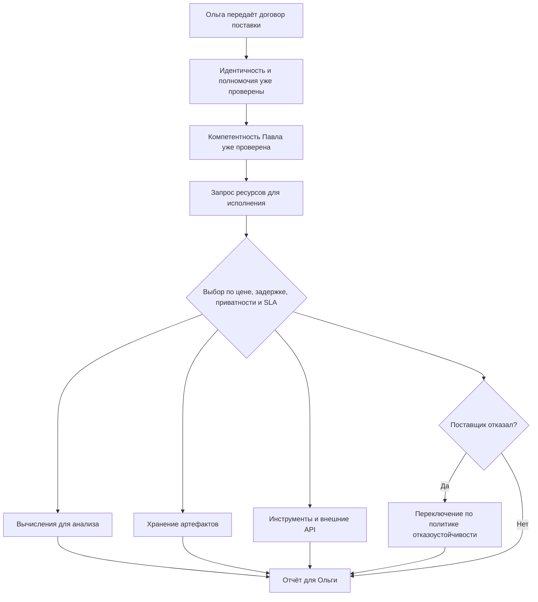
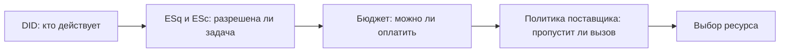
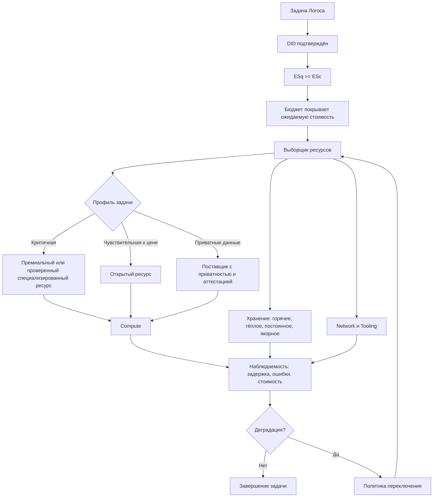

# УРОВЕНЬ 1 / ИЗМЕРЕНИЕ 03: МАТЕРИАЛЬНОЕ

> **Уровень:** L1 — Агент  
> **Измерение:** D03 — Material  
> **Учебная редакция:** v1.0  
> **Главная тема:** где Логос берёт вычисления, память, сеть и инструменты для реального выполнения задачи

---

## Ключевой вопрос

**Какими вычислительными и техническими ресурсами ты располагаешь и как ты получаешь доступ к ним?**

---

## Краткое описание измерения

Логос не выполняет задачу в пустоте.

Даже если личность уже подтверждена, компетентность проверена, а задача разрешена, остаётся практический вопрос: **на чём именно будет выполняться работа?**

Материальное измерение отвечает не про владение собственным дата-центром, а про управляемый доступ к ресурсам: вычислениям, хранению, сети и инструментам.

Эта глава отвечает на несколько практических вопросов:

1. Какие классы технических ресурсов нужны Логосу для работы?
2. Почему одного поставщика ресурсов недостаточно?
3. Как выбирается поставщик по цене, задержке, приватности и уровню сервиса?
4. Где хранить быстрые рабочие данные, переносимые артефакты и неизменяемые следы?
5. Как проверить, что вычисление действительно выполнено, а не только выставлено в счёте?
6. Почему внешние инструменты и программные интерфейсы тоже считаются материальным ресурсом?
7. Что происходит, если поставщик ресурсов деградирует или отказывает во время задачи?

---

## Мини-глоссарий

| Термин | Простое объяснение |
|--------|--------------------|
| **Логос** | Цифровой агент, который действует от имени владельца в пределах делегированных прав |
| **DID** | Проверяемый идентификатор субъекта или агента |
| **VC** | Цифровое подтверждение, подлинность которого можно проверить программно |
| **ESq** | Квота компетентностного права: сколько задач данного класса владелец вправе делегировать |
| **ESc** | Компетентностная стоимость задачи или микроагента |
| **AGC** | Операционная валюта для оплаты действий, ресурсов и инструментов |
| **Dual Constraint** | Правило: для действия нужны и достаточная компетентность, и достаточный бюджет |
| **Budget Controller** | Компонент, который следит за бюджетом, лимитами и ожидаемой стоимостью |
| **Resource Marketplace** | Рынок, где можно получить вычислительные и технические ресурсы у разных поставщиков |
| **Resource Router** | Локальный выборщик ресурса: сравнивает поставщиков и выбирает подходящий вариант |
| **Compute** | Вычисления: модели, процессоры, графические ускорители и запуск задач |
| **Storage** | Хранение: рабочая память, индексы, архивы и доказательные следы |
| **Network** | Сетевой доступ: каналы, шлюзы, конечные точки и перенос данных |
| **Tooling** | Инструменты: внешние программные интерфейсы и сервисы, которыми пользуется Логос |
| **SLA** | Обещанный уровень сервиса: доступность, задержка, поддержка и последствия сбоя |
| **RAG** | Поиск нужных фрагментов знания перед ответом или действием агента |
| **Hot storage** | Быстрое локальное хранение для текущей задачи |
| **Warm storage** | Переносимое хранение для распространения и обмена артефактами |
| **Permanent storage** | Долговременное неизменяемое хранение важных записей |
| **On-chain anchor** | Короткий доказательный след в реестре: хэш или ссылка, а не весь файл |
| **IPFS** | Кандидат для переносимого хранения по содержательному адресу |
| **Filecoin** | Кандидат для децентрализованного хранения вместе с IPFS-подходом |
| **Arweave** | Кандидат для долговременного неизменяемого архива |
| **TEE** | Защищённая среда выполнения для конфиденциальных вычислений у внешнего поставщика |
| **Attestation** | Проверяемое подтверждение, что среда или действие соответствуют заявленным свойствам |
| **VeriLLM** | Пример направления, где проверяется сам факт выполнения языкового вывода |
| **Cortensor** | Пример направления, где проверяется полезность выполненной вычислительной работы |
| **MCP** | Стандарт подключения агента к внешним инструментам и системам |
| **Gateway** | Шлюз, который пропускает вызовы к инструментам и может применять правила доступа |
| **x402** | Пример подхода к оплате программного вызова по факту обращения |
| **xpay** | Пример подхода к платёжно-ограниченному доступу к инструментам |
| **OpenTelemetry** | Набор практик для наблюдения задержек, ошибок, стоимости и трасс исполнения |

---

# 0. Гипотетический пример

Продолжим ту же историю.

**Ольга** — владелица небольшого бизнеса. Её Логос ищет специалиста, чтобы проверить договор поставки.

**Павел** — юрист. Его Логос уже прошёл две предыдущие проверки: понятно, кто действует и по какой цепочке полномочий; также понятно, что юридическая компетентность Павла и способности его Логоса достаточны для задачи.

Теперь возникает новый вопрос.

Если Логос Павла вправе взять задачу и способен её выполнить, **на каких ресурсах он фактически будет это делать?**

Договор длинный. Его нужно прочитать, разбить на фрагменты, поднять рабочую память, возможно запустить микроагента для анализа спорных пунктов, сохранить промежуточные артефакты и оставить доказательный след для последующего разбора.

## Проверка 1. Какие ресурсы нужны для задачи?

Логосу Павла нужны не только вычисления.

Ему нужны:

- вычислительная мощность для анализа длинного текста;
- быстрое рабочее хранение для текущих фрагментов договора;
- переносимое хранение для результата и приложений;
- сетевой доступ к внешним сервисам и поставщикам;
- инструменты для чтения, разметки, проверки и подготовки отчёта.

Если один из этих элементов отсутствует, юридическая компетентность сама по себе не спасает: задача просто не будет выполнена технически.

## Проверка 2. Как выбрать поставщика?

Логос Павла не должен каждый раз вручную выбирать облако, модель или хранилище.

Он формирует запрос: какой тип ресурса нужен, какой объём, какая допустимая задержка, какие требования к приватности и какой уровень сервиса нужен.

Затем локальный выборщик ресурсов сравнивает доступных поставщиков. Для простой некритичной части задачи он может предпочесть более дешёвую открытую вычислительную мощность. Для фрагментов с чувствительными данными он должен поднять вес приватности и выбрать поставщика, который может предъявить достаточные подтверждения среды выполнения.

## Проверка 3. Где хранить артефакты?

Не все данные договора одинаковы.

Фрагменты, которые нужны прямо сейчас для анализа, должны лежать близко к вычислению. Черновые извлечения, которые могут понадобиться повторно, должны быть переносимыми. Итоговый отчёт и важные следы могут требовать долговременного неизменяемого хранения. В реестре достаточно оставить короткие доказательные якоря, а не сам договор.

Так Ольга получает результат, а система не превращает каждый документ в тяжёлую запись в общем реестре.

## Проверка 4. Что делать при отказе поставщика?

Допустим, выбранный поставщик начал отвечать медленно или перестал принимать запросы.

Логос Павла должен не просто "попробовать ещё раз". Ему нужна политика переключения: когда считать деградацию значимой, как не потерять состояние задачи, как не оплатить один и тот же вызов дважды и какой поставщик подходит как запасной.

## Главное из примера

**Материальное измерение превращает право и компетентность в реальное исполнение: оно отвечает, где взять вычисления, память, сеть и инструменты, как выбрать поставщика и как не потерять задачу при сбое.**



---

# Содержание

1. Ресурсы: не только "железо"
2. Гибридная модель поставщиков
3. Как работает выбор ресурса
4. Хранение: горячее, тёплое, постоянное
5. Проверяемые вычисления и защита от имитации работы
6. Инструменты, внешние интерфейсы и лимиты
7. Отказоустойчивость, наблюдаемость и уровень сервиса
8. Связь и границы с другими измерениями
9. Итоговая модель целиком
10. Короткое резюме главы
11. Вопросы без ответа

---

# 1. Ресурсы: не только "железо"

Когда говорят "материальные ресурсы", легко представить серверную стойку или графический ускоритель.

Для Логоса это слишком узко.

Задача выполняется не одним сервером, а целым техническим контуром: моделью, вычислением, памятью, сетью, внешними инструментами, лимитами доступа и правилами оплаты.

## 1.1 Четыре класса ресурсов

Настоящее измерение делит материальный слой на четыре класса.

| Класс | Что включает | Зачем нужен Логосу |
|-------|--------------|--------------------|
| **Вычисления (англ. Compute, далее — `Compute`)** | Вызов модели, процессорные и графические мощности, ускорители, пакетные задачи | Чтобы рассуждать, анализировать документы, вызывать инструменты и выполнять многошаговую работу |
| **Хранение (англ. Storage, далее — `Storage`)** | Локальные индексы, рабочий контекст, архивы, доказательные следы | Чтобы держать память задачи, результаты, журналы и переносимые артефакты |
| **Сеть (англ. Network, далее — `Network`)** | Конечные точки, шлюзы, пропускная способность, перенос данных между поставщиками | Чтобы добираться до моделей, инструментов, хранилищ и внешних систем |
| **Инструменты (англ. Tooling, далее — `Tooling`)** | Внешние программные интерфейсы, платные сервисы, управляемые платформенные функции | Чтобы действовать во внешнем мире, а не только генерировать текст |

> Ресурс — это всё, без чего Логос не может реально выполнить задачу.

## 1.2 Что считается ресурсом

Ресурсом считается не только "железо".

В границах настоящего измерения ресурсом может быть:

- модель или вычислительный вызов;
- графический или центральный процессорный час;
- векторный индекс для поиска по документам;
- пропускная способность сети;
- программный интерфейс с учётными данными;
- инструмент, доступ к которому ограничен оплатой, квотой или политикой поставщика.

Такой широкий подход нужен потому, что вопрос главы не про инвентаризацию серверов. Он про **управляемый доступ к технической среде**.

## 1.3 Из чего складывается видимая цена

Для языковых и модельных ресурсов цена не должна выглядеть как одна непонятная сумма.

Её полезно раскрывать по компонентам. Для такого разбора используется следующий ориентир:

| Компонент цены | Ориентировочная доля | Что означает |
|----------------|----------------------|--------------|
| Вычислительная база | `60-70%` | Время графических или специализированных ускорителей, длина контекста, пакетная обработка, профиль модели |
| Обслуживание вывода | `15-25%` | Маршрутизация, токенизация, шлюз, кэширование, наблюдаемость, зарезервированная пропускная способность |
| Маржа поставщика | `5-15%` | Плата за уровень сервиса, резерв мощности и поддержку |

Это не учебная выдумка и не универсальная формула для всех рынков. Это способ показать, что видимая цена может складываться из разных технических частей.

Сверху могут добавляться плата платформы, сетевой перенос, выход данных от поставщика или издержки доказательного расчёта, если задача пересекает границы поставщиков.

## 1.4 Почему цена зависит от типа поставщика

Одна средняя цена скрывает важный выбор.

Предсказуемый поставщик с жёстким уровнем сервиса обычно дороже. Открытый рынок вычислений может быть дешевле, но давать больший разброс по скорости и качеству. Специализированный поставщик может брать доплату за приватность, аттестацию среды или доменную настройку.

Поэтому в запросе к ресурсу важно понимать не только "сколько стоит", но и **какой профиль риска покупается за эту цену**.

В истории Ольги и Павла это означает: дешёвое вычисление может подойти для черновой разметки договора, но чувствительные фрагменты или спорные выводы могут требовать более проверяемой среды.

## Главное

**Материальный слой Логоса состоит из четырёх классов: `Compute`, `Storage`, `Network` и `Tooling`.**  
**Главный вопрос не в том, владеет ли Логос сервером, а в том, может ли он управляемо получить нужный ресурс с понятной ценой, риском и ограничениями.**

---

# 2. Гибридная модель поставщиков

Один поставщик удобен только на бумаге.

В реальной агентной среде задачи различаются: одна требует низкой цены, другая — предсказуемой задержки, третья — повышенной приватности, четвёртая — готового интерфейса для вызова модели.

Поэтому материальный слой строится как гибридная модель поставщиков.

## 2.1 Почему не достаточно одного облака

Полностью централизованная схема даёт управляемость и предсказуемость, но создаёт зависимость от одного класса поставщиков.

Полностью децентрализованная схема может дать цену, эластичность и переносимость, но не всегда даёт одинаковое качество, поддержку и проверяемость.

Практический вывод:

> Децентрализация не отменяет премиальные ресурсы, а премиальные ресурсы не отменяют рынок запасных и более дешёвых вариантов.

## 2.2 Три профиля поставщиков

В учебной форме удобно мыслить не конкретными компаниями, а профилями.

| Профиль | Когда полезен | Ограничение |
|---------|---------------|-------------|
| **Премиальный** | Критичные задачи, высокая цена ошибки, предсказуемая задержка, поддержка | Обычно дороже и сильнее привязывает к поставщику |
| **Открытый** | Пакетные задачи, эластичное масштабирование, чувствительность к цене | Больше разброс качества, нужна проверка поставщика |
| **Специализированный** | Приватные данные, аттестация среды, особая модель, география или доменная настройка | Может быть менее ликвидным и более зависимым от конкретной технологии |

## 2.3 Технологии как кандидаты, а не исходная точка

Сначала возникает потребность: нужен дешёвый и эластичный доступ к вычислениям. Для такой потребности примерами класса решений могут быть открытые рынки вычислений; одним из таких кандидатов является `Akash`.

Другая потребность: нужен агрегированный пул разных графических ускорителей, а не один поставщик. Для этого класса решений `io.net` служит примером агрегированного предложения.

Третья потребность: нужна более готовая среда для обслуживания моделей, где важны не только графические ускорители, но и прикладная подача модели. Для такого профиля упоминается `Render` как пример рыночного прецедента.

Эти названия не являются обязательным выбором для любой задачи. Они показывают типы поставщиков, с которыми должен уметь работать выборщик ресурсов.

## 2.4 Как профиль влияет на маршрут задачи

Материальная политика может выглядеть так:

```text
если задача критична по сроку или последствиям ошибки:
    сначала искать премиальный или проверенный специализированный ресурс

если задача чувствительна к цене и допускает пакетное выполнение:
    сначала искать открытый ресурс

если задача содержит чувствительные данные:
    повысить вес приватности и проверяемости среды
```

Конкретный поставщик становится результатом выбора, а не жёстко прописанной зависимостью.

Для Павла это важно: анализ договора поставки может состоять из нескольких этапов. Черновое извлечение пунктов можно выполнить на более дешёвом ресурсе, но проверку чувствительных условий оплаты и ответственности лучше направить в среду с более сильными гарантиями приватности и наблюдаемости.

## Главное

**Материальная зрелость начинается с гибридности: разные задачи требуют разных профилей поставщиков.**  
**Поставщик выбирается по политике, а не по привычке: цена, задержка, приватность и уровень сервиса должны быть явными критериями.**

---

# 3. Как работает выбор ресурса

Если Логос может выбирать между несколькими поставщиками, ему нужен не список ссылок, а механизм принятия решения.

Этот механизм в настоящем измерении называется выборщиком ресурсов (англ. Resource Router, далее — `Resource Router`).

## 3.1 Что делает выборщик ресурсов

`Resource Router` получает запрос:

- тип ресурса;
- объём;
- допустимую задержку;
- требования к приватности;
- требуемый уровень сервиса;
- бюджетный предел;
- допустимые профили поставщиков.

После этого он выбирает маршрут доступа к ресурсу.

Его задача не просто найти "где дешевле". Он должен выбрать ресурс, который подходит задаче по совокупности ограничений.

## 3.2 Цепочка допуска к ресурсу

Доступ к ресурсу проходит несколько проверок.



Децентрализованный идентификатор (англ. Decentralized Identifier, далее — DID) отвечает за проверяемую идентичность.

Квота компетентностного права (англ. Expert Skill Quota, далее — ESq) и компетентностная стоимость (англ. Expert Skill Cost, далее — ESc) отвечают за допустимость задачи по компетентности.

Операционная валюта (англ. AgentCredits, далее — AGC) и бюджетный контур отвечают за оплату.

Настоящее измерение не объясняет внутреннюю механику этих соседних слоёв. Оно показывает, как их результат становится материальным допуском к ресурсу.

## 3.3 Почему доступ к ресурсу не равен праву выполнить задачу

Можно иметь технический доступ к модели, но не иметь права запускать юридическую проверку.

Можно иметь компетентностное право, но не иметь бюджета.

Можно иметь бюджет, но не пройти политику поставщика или лимит инструмента.

Поэтому материальная проверка собирает несколько "да" в одну цепочку.

```text
если DID подтверждён
и ESq >= ESc
и бюджет покрывает ожидаемую стоимость
и поставщик пропускает вызов:
    ресурс можно запросить
иначе:
    выполнение блокируется или требуется другой маршрут
```

## 3.4 Что открывается после выбора

После выбора ресурса может открываться защищённое удержание оплаты, резервироваться мощность, выдаваться краткоживущий доступ к инструменту или создаваться запись для последующего аудита.

Глубокая реализация этих механизмов принадлежит инфраструктурному и экономическому уровням. В данной главе важен агентный ответ: **Логос не "просто вызывает сервис", а проходит управляемую цепочку допуска к ресурсу.**

В истории Ольги и Павла это означает: Логос Павла не отправляет договор в первый доступный сервис. Он сначала проверяет право, бюджет, профиль приватности и условия поставщика, а затем выбирает маршрут выполнения.

## Главное

**`Resource Router` превращает список возможных поставщиков в управляемый выбор ресурса.**  
**Доступ к ресурсу возникает только после совмещения идентичности, компетентности, бюджета и политики поставщика.**

---

# 4. Хранение: горячее, тёплое, постоянное

Хранение нельзя описывать как один "диск".

Разные данные живут с разной скоростью и разной ценностью. Одни нужны прямо сейчас в ходе вывода модели. Другие нужно переносить между поставщиками. Третьи должны оставаться неизменяемыми как юридический или аудиторский след.

## 4.1 Температура данных

Настоящее измерение использует температурную модель хранения.

| Слой | Что хранится | Возможный класс решений | Почему именно так |
|------|--------------|-------------------------|-------------------|
| **Горячий** | Активный индекс поиска, текущий контекст, фрагменты для быстрого обращения | Локальная векторная база или кэш рядом с исполнением | Для текущей задачи важнее близость к вычислению, чем переносимость |
| **Тёплый** | Распространяемые знания, переносимые артефакты, общие корпуса | Кандидаты вроде `IPFS` и `Filecoin` через управляемые шлюзы | Нужны переносимость и адресация по содержанию без вечного хранения всего |
| **Постоянный** | Неизменяемые записи, важные архивы, аудиторские артефакты | Кандидат вроде `Arweave` | Нужна долговременная неизменяемость |
| **Якорный** | Хэши, указатели, короткие доказательные следы | Реестровые якоря | В реестр помещается доказательство, а не вся рабочая память |

Межпланетная файловая система (англ. InterPlanetary File System, далее — `IPFS`) и `Filecoin` подаются здесь как кандидаты для тёплого переносимого слоя. `Arweave` подаётся как кандидат для постоянного архива.

## 4.2 Почему быстрый поиск не должен жить в публичном IPFS

Для активного поиска по длинному договору важна задержка.

Горячий поиск должен быть близко к месту исполнения. Поэтому активный индекс и текущие фрагменты нельзя проектировать как чтение напрямую из публичного распределённого хранилища.

`IPFS` полезен как переносимый слой распространения и обмена, но не как замена локальному механизму быстрого поиска для текущей миссии.

## 4.3 Выход данных как материальная стоимость

Стоимость хранения — это не только цена за гигабайт.

Если Логос меняет поставщика, ему может понадобиться вывести данные, перенести контрольные точки, синхронизировать индексы или пересобрать поиск. Такая стоимость выхода данных может создать скрытую привязку к поставщику.

Поэтому `Storage` оценивается сразу по нескольким признакам:

1. цена хранения;
2. цена выхода данных;
3. задержка поиска;
4. переносимость между поставщиками;
5. риск расхождения между исходными данными и построенными индексами.

## 4.4 Базовое разделение памяти

Для настоящего измерения достаточно зафиксировать базовую линию:

- активный поиск и низкая задержка — горячий локальный слой;
- переносимые материалы и обменные артефакты — тёплый слой;
- неизменяемые юридические и аудиторские следы — постоянный архив;
- критические доказательные следы — только короткие якоря в реестре.

Точные сроки хранения, частота синхронизации и правила владения отдельными классами памяти остаются вопросом отдельной политики.

Для договора Ольги это означает: сам документ и рабочие фрагменты не должны автоматически становиться публичным вечным архивом. Быстрые фрагменты нужны рядом с анализом, итоговый отчёт может храниться дольше, а доказательный след может быть представлен коротким хэшем.

## Главное

**Хранение делится по температуре: горячее для текущей скорости, тёплое для переносимости, постоянное для долговременных следов, якорное для доказательств.**  
**`IPFS` не заменяет локальный быстрый поиск; он полезен как переносимый слой распространения.**

---

# 5. Проверяемые вычисления и защита от имитации работы

Внешний поставщик может заявить: "я выделил ресурс и выполнил вычисление".

Для материального слоя этого недостаточно. Логосу нужна проверяемость: какой ресурс был предоставлен, была ли задача действительно исполнена и есть ли след для спора о качестве или оплате.

## 5.1 Зачем проверять вычисления

Проверка вычислений нужна не из недоверия ко всем поставщикам.

Она нужна потому, что агентная среда работает с разными поставщиками, разными ценами и разной степенью критичности задач. Чем дороже или чувствительнее задача, тем важнее доказать не только факт счёта, но и факт работы.

## 5.2 Три слоя доверия

| Слой проверки | Что проверяет | Примеры классов решений | Ограничение |
|---------------|---------------|--------------------------|-------------|
| **Проверка среды и поставщика** | Соответствует ли среда заявленному профилю оборудования и приватности | Защищённая среда выполнения (англ. Trusted Execution Environment, далее — `TEE`), аттестация оборудования, сигналы проверенного инвентаря | У части поставщиков зрелость может зависеть от дорожной карты |
| **Проверка вывода модели** | Был ли языковой вывод действительно выполнен | `VeriLLM` как пример направления проверяемого вывода | Сильное направление, но не универсальный производственный стандарт |
| **Проверка полезной работы** | Была ли работа содержательно полезной, а не только технически запущенной | `Cortensor` и похожие подходы к проверке полезной вычислительной работы | Часть таких подходов остаётся экспериментальной или ранней |

## 5.3 Как вводить TEE

Сначала возникает потребность: договор может содержать чувствительные коммерческие условия.

Если такой фрагмент отправляется внешнему поставщику, Логосу нужна среда, где можно ограничить доступ поставщика к данным и получить проверяемое подтверждение условий выполнения. Для этой потребности кандидатом является `TEE`.

В данной главе `TEE` не разбирается как устройство анклава. Здесь важно правило выбора: если задача чувствительна к приватности, выборщик ресурсов повышает вес приватности и сужает пул поставщиков до тех, кто может предъявить достаточные подтверждения.

## 5.4 Практический базовый уровень

Политика проверки может быть такой:

1. Для дешёвых и низкорисковых задач достаточно репутации поставщика и следов использования.
2. Для дорогих или спорных задач желательно иметь проверяемые паттерны выполнения вывода.
3. Для чувствительных данных требуется выбор поставщика с проверяемыми сигналами приватности и среды.
4. Для ценной оплаты нужен след для последующего спора, а не только итоговый счёт.

## 5.5 Не завышать зрелость рынка

Некоторые направления проверки уже дают сильные архитектурные ориентиры, но не являются единым зрелым стандартом для всех задач.

Поэтому учебная редакция говорит: "кандидат", "пример класса решений", "направление", "может применяться", а не "обязательная готовая технология".

В истории Павла это особенно важно. Если микроагент анализирует чувствительный раздел договора, выборщик может предпочесть поставщика с аттестацией среды. Но это не значит, что любой анализ договора всегда обязан идти через один и тот же технический стек.

## Главное

**Проверяемость вычислений нужна там, где высоки цена, риск спора или чувствительность данных.**  
**`TEE`, `VeriLLM`, `Cortensor` и похожие подходы следует понимать как кандидаты и классы решений, а не как один обязательный стандарт для всех задач.**

---

# 6. Инструменты, внешние интерфейсы и лимиты

Логос действует не только через модель.

Он читает документы, вызывает внешние программные интерфейсы, обращается к сервисам, использует шлюзы, платит за вызовы и соблюдает лимиты поставщиков. Поэтому `Tooling` является материальным ресурсом так же, как вычисления или хранение.

## 6.1 Почему инструменты входят в материальный слой

Инструмент потребляет:

- бюджет;
- задержку;
- учётные данные;
- лимит поставщика;
- наблюдаемость;
- правила отзыва доступа.

Если инструмент есть в каталоге, но Логос не может пройти доступ, оплату или лимит, такой инструмент фактически недоступен.

## 6.2 Обнаружение и управляемый доступ

Сначала возникает потребность: Логосу нужен не жёстко прошитый список интеграций, а наблюдаемый каталог инструментов с правилами доступа.

Одним из кандидатов для такого класса решений является протокол контекста модели (англ. Model Context Protocol, далее — `MCP`) и связанные с ним реестры или шлюзы. В этой роли они помогают находить доступные инструменты, применять проверку доступа, ограничивать расходы и фиксировать наблюдаемые события.

Для материального слоя важны два вывода:

1. доступ к инструментам должен быть обнаруживаемым, а не только заранее прописанным;
2. каждый конечный инструмент должен иметь оболочку политики: доступ, лимит, наблюдаемость и путь отзыва.

## 6.3 Платёжно-ограниченный доступ

Многие действия во внешнем мире выглядят не как длительная аренда вычисления, а как короткий платный вызов:

- проверить файл;
- прочитать источник;
- вызвать внешний анализатор;
- открыть платную конечную точку;
- выполнить один шаг рабочего процесса.

Для такого класса задач существуют подходы вроде `x402`, `xpay` и других схем поминутной или повызовной оплаты. Они важны как пример паттерна: инструмент может быть доступен только если Логос одновременно проходит доступ, квоту и платёжную проверку.

## 6.4 От компетентностного допуска к лимиту поставщика

Компетентность отвечает на вопрос: "можно ли этому Логосу выполнять задачу такого класса?"

Материальный слой добавляет следующий вопрос: "пропустит ли конкретный поставщик этот вызов с учётом лимита, бюджета и политики?"

Практическая цепочка выглядит так:

1. `ESq` и `ESc` показывают, разрешена ли задача по компетентности.
2. Бюджетный контур показывает, можно ли оплатить ожидаемую стоимость.
3. Политика поставщика показывает, пропустит ли конкретная конечная точка вызов.
4. Журнал использования показывает, как вызов тарифицируется и ограничивается.

## 6.5 Управление расходом в реальном времени

Обычного счётчика запросов недостаточно.

Разные поставщики тарифицируют по-разному: по токенам, вызовам, времени, объёму, уровню сервиса или комбинации этих признаков.

Поэтому профиль материального доступа должен учитывать:

- общий предел расходов;
- лимиты на инструмент или конечную точку;
- контроль всплесков;
- защиту от повторных списаний;
- собственные бюджетные ограничения поставщика;
- остановку повторных попыток, если ошибка превращается в дорогостоящий цикл.

## 6.6 Зрелость платёжных инструментов

Часть подходов к лимитам и платёжным шлюзам уже выглядит практически применимой, но рынок ещё неоднороден.

Некоторые спецификации и инструменты лучше понимать как ранние стандарты или полезные проектные ориентиры. Поэтому данная глава фиксирует не одного поставщика и не один протокол, а границу способности: Логос должен уметь вызывать инструмент с проверкой доступа, лимита, оплаты и наблюдаемости.

Для Павла это означает: микроагент для анализа длинного договора не получает безлимитный доступ ко всем сервисам. Его вызовы ограничены бюджетом, профилем задачи и политикой конкретных инструментов.

## Главное

**Инструменты являются материальным ресурсом, потому что они потребляют деньги, задержку, учётные данные и лимиты.**  
**Наличие инструмента в каталоге не равно реальному доступу: нужен управляемый вызов с проверкой прав, квоты, оплаты и наблюдаемости.**

---

# 7. Отказоустойчивость, наблюдаемость и уровень сервиса

Материальный слой считается рабочим только тогда, когда он умеет переживать деградацию поставщика.

Если выбранный ресурс стал медленным, недоступным или слишком дорогим, Логосу нужна не импровизация, а заранее описанная политика переключения.

## 7.1 Зачем нужен отказоустойчивый маршрут

Много поставщиков сами по себе не дают отказоустойчивость.

Нужны правила:

- когда задержка считается неприемлемой;
- когда ошибка считается системной, а не случайной;
- что делать с задачей, которая уже выполняется;
- как не потерять промежуточное состояние;
- как не оплатить повторный запуск дважды;
- какой запасной поставщик допустим для данного профиля риска.

## 7.2 Что должно наблюдаться

Чтобы переключаться не вслепую, Логосу нужен наблюдаемый доступ к ресурсу.

Практики вроде `OpenTelemetry` и его соглашений для генеративных систем полезны как пример класса решений: они помогают собирать задержки, ошибки, стоимость и следы исполнения через разных поставщиков.

Минимально нужно видеть:

| Метрика | Зачем нужна |
|---------|-------------|
| **Задержка** | Понять, подходит ли поставщик текущей задаче |
| **Доступность и частота ошибок** | Отличить локальный сбой от системной деградации |
| **Количество токенов или вызовов** | Связать техническое использование с биллингом |
| **Отнесение стоимости** | Понять экономический эффект маршрутизации |
| **След инцидента у поставщика** | Разобрать спор, сбой или снижение качества после факта |

## 7.3 Уровень сервиса и споры

Уровень сервиса (англ. Service-Level Agreement, далее — SLA) описывает ожидания по доступности, задержке, ошибкам, поддержке и возможным последствиям нарушения.

Глубокие механизмы штрафов, споров и выплаты после проверки принадлежат договорному и экономическому слоям. Настоящее измерение фиксирует агентный факт: выбор ресурса должен учитывать обещанный уровень сервиса и наблюдаемые признаки его нарушения.

## 7.4 Политика переключения

Для переключения во время миссии нужно отдельно определить:

1. пороги ожидания и задержки;
2. режимы тёплого или холодного резерва;
3. правила передачи состояния;
4. защиту от повторного списания;
5. наблюдаемый сигнал, после которого автоматическое переключение разрешено;
6. случаи, где нужен человек в контуре, а не автоматическое решение.

## 7.5 Итоговая материальная позиция

Материальный слой зрелый, если Логос:

- выбирает лучший подходящий ресурс, а не просто любой доступный;
- наблюдает качество ресурса;
- переживает деградацию поставщика;
- не теряет бюджетный контроль при переключении;
- разделяет быстрые, переносимые и постоянные данные;
- не смешивает владение вычислениями, идентичностью и экономикой в одну неразличимую область.

В истории Ольги и Павла это означает: если поставщик анализа договора отказал на середине, Логос Павла должен понимать, продолжать ли на запасном поставщике, как передать состояние и как не выставить Ольге двойной счёт.

## Главное

**Отказоустойчивость — это не список запасных поставщиков, а политика переключения с наблюдаемыми условиями.**  
**SLA полезен только тогда, когда задержка, доступность, ошибки, стоимость и инциденты действительно измеряются.**

---

# 8. Связь и границы с другими измерениями

Материальное измерение стоит после идентификации и компетентности: сначала понятно, кто действует и вправе ли он брать задачу, затем решается, на каких ресурсах задача будет исполнена.

Соседние измерения дают контекст, но настоящее измерение не забирает их внутреннюю механику.

| Измерение | Связь | Граница ответственности |
|-----------|-------|--------------------------|
| **L1/D01 (Идентификационное)** | Идентичность и цепочка полномочий нужны перед доступом к поставщикам и инструментам. | Идентификационный слой отвечает за то, кто действует и как это проверяется; настоящее измерение использует результат этой проверки как вход к ресурсному доступу. |
| **L1/D02 (Компетентностное)** | Компетентностная проверка определяет, вправе ли Логос выполнять задачу данного класса. | Компетентностный слой задаёт смысл `ESq` и `ESc`; настоящее измерение превращает этот смысл в практический допуск к ресурсу или инструменту. |
| **L1/D08 (Экономическое)** | Бюджет и платёжный контур ограничивают фактическую доступность ресурса. | Экономический слой отвечает за деньги, бюджет и платёжные ограничения; настоящее измерение учитывает их как условие выбора ресурса. |
| **L2/D03 (Инфраструктурно-материальное)** | Инфраструктурный уровень описывает, на какой технической базе строятся хранилища, защищённые среды и маршрутизация. | Настоящее измерение отвечает с позиции одного Логоса: какие классы ресурсов ему доступны и как он выбирает между ними. |
| **L1/D04 (Функционально-инструментальное)** | Исполнение задач использует выбранные модели, инструменты и маршруты как рабочую среду. | Функциональный слой планирует и исполняет задачу; настоящее измерение предоставляет материальный доступ к ресурсам для этого исполнения. |
| **L1/D05 (Коммуникационное)** | Сеть, шлюзы и конечные точки ограничивают взаимодействие с людьми, агентами и системами. | Коммуникационный слой отвечает за протоколы взаимодействия; настоящее измерение отвечает за доступность сетевых и инструментальных ресурсов. |
| **L1/D09 (Репутационное)** | Репутационные сигналы могут влиять на выбор поставщиков и инструментов. | Репутационный слой отвечает за оценку участников; настоящее измерение может использовать такие сигналы в политике выбора, но не определяет их жизненный цикл. |

## Главное

**Настоящее измерение не решает, кто Логос, насколько он компетентен и как устроена экономика.**  
**Оно отвечает за практический ресурсный доступ: где взять вычисления, хранение, сеть и инструменты для разрешённой задачи.**

---

# 9. Итоговая модель целиком

В компактном виде материальный слой выглядит как управляемый контур доступа.

Сначала задача проходит входные проверки: идентичность, компетентность и бюджет. Затем `Resource Router` выбирает профиль поставщика и конкретный ресурс. После этого выполнение наблюдается, оплачивается, хранит нужные артефакты и при сбое может переключиться на другой маршрут.



## Главное

**Материальная модель соединяет входные права, бюджет и технический рынок ресурсов в один исполнимый маршрут.**  
**Результат выбора — не "самый дешёвый ресурс", а ресурс, подходящий задаче по цене, задержке, приватности, уровню сервиса и проверяемости.**

---

# 10. Короткое резюме главы

1. Логос располагает не одним облаком, а управляемым набором ресурсов: `Compute`, `Storage`, `Network` и `Tooling`.
2. Ресурсы выбираются через гибридную модель поставщиков: премиальные, открытые и специализированные профили решают разные задачи.
3. `Resource Router` выбирает поставщика по цене, задержке, приватности, уровню сервиса, бюджету и политике доступа.
4. Хранение делится по температуре: горячее для текущего поиска, тёплое для переносимости, постоянное для неизменяемых артефактов, якорное для коротких доказательств.
5. Вычисления для дорогих, спорных или чувствительных задач должны иметь проверяемые сигналы среды, исполнения или полезной работы.
6. Инструменты и внешние программные интерфейсы тоже являются ресурсами, потому что потребляют бюджет, задержку, учётные данные и лимиты.
7. Отказоустойчивость требует наблюдаемости и политики переключения, а не простого списка запасных поставщиков.

## Главное

**Материальное измерение отвечает за переход от "Логос вправе и способен" к "Логос действительно может выполнить задачу на конкретных технических ресурсах".**

---

# 11. Вопросы без ответа

В данной главе зафиксирована базовая модель материального доступа, но несколько решений требуют отдельной политики, проектирования или инфраструктурного уточнения.

1. **Как окончательно разделить горячее, тёплое и постоянное хранение?** Нужно определить сроки хранения, частоту синхронизации, правила владения и юридическое удержание для рабочей памяти, повторно используемых материалов и неизменяемых следов.
2. **Как переключать поставщика во время миссии?** Нужны пороги задержки и отказа, правила передачи состояния, защита от повторной оплаты и критерии автоматического переключения.
3. **Как измерять стоимость переноса и риск расхождения данных?** Нужно определить профиль проверки для переноса индексов, контрольных точек, повторного построения поиска и задержек между локальным, шлюзовым и распределённым хранением.

## Главное

**Открытые вопросы касаются не идеи материального слоя, а производственных правил: как хранить, когда переключаться и как измерять стоимость переноса между поставщиками.**
