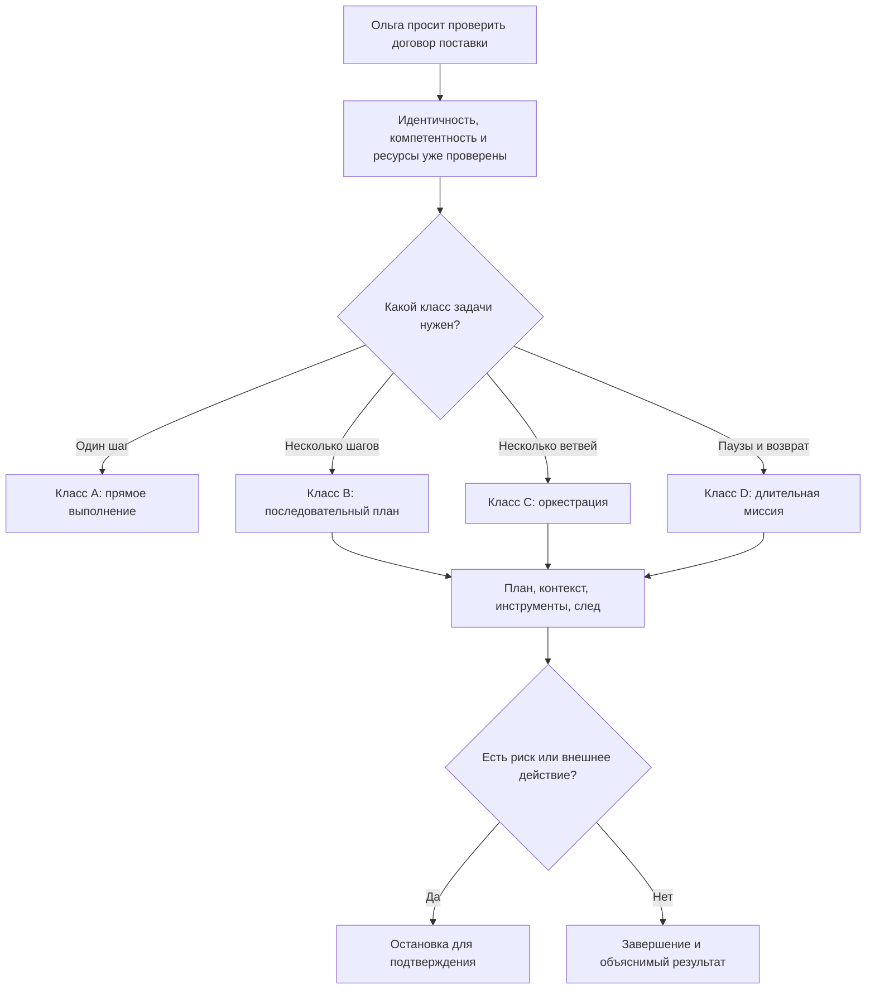
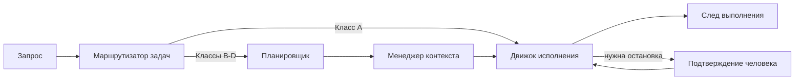
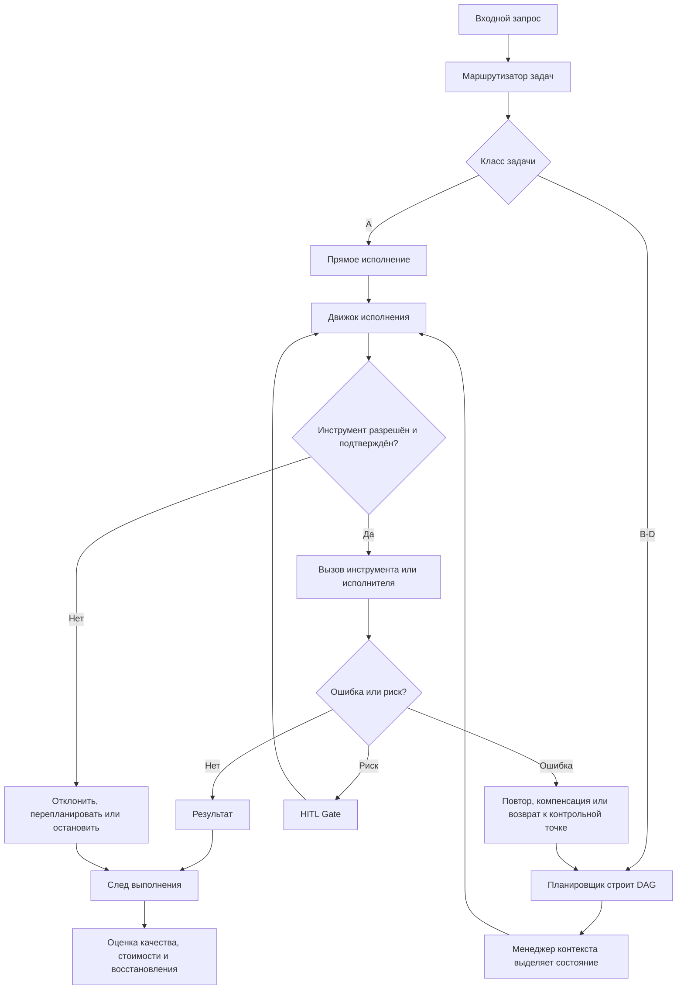

# УРОВЕНЬ 1 / ИЗМЕРЕНИЕ 04: ФУНКЦИОНАЛЬНО-ИНСТРУМЕНТАЛЬНОЕ

> **Уровень:** L1 — Агент  
> **Измерение:** D04 — Functional-Instrumental  
> **Учебная редакция:** v1.0  
> **Главная тема:** как агент превращает запрос в безопасно выполненную прикладную задачу

---

## Ключевой вопрос

**Какие прикладные задачи ты способен решать и как ты их выполняешь?**

---

## Краткое описание измерения

Агент может быть установлен, опознан, компетентен и обеспечен ресурсами. Но этого ещё недостаточно, чтобы доверить ему работу.

Нужно понять, какие задачи он умеет выполнять практически: простые вызовы, многошаговые процессы, работу с несколькими исполнителями, длительные миссии, остановки, повторный запуск и исправление ошибок.

Настоящее измерение описывает функциональный контур: как запрос классифицируется, как строится план, как удерживается состояние, как вызываются инструменты и как остаётся проверяемый след выполнения.

Эта глава отвечает на несколько практических вопросов:

1. Как отличить простую задачу от сложной миссии?
2. Из каких частей состоит оркестратор выполнения?
3. Как агент безопасно подключает внешние инструменты?
4. Когда нужен план, граф зависимостей, параллельные ветви и передача контекста?
5. Как сохранять рабочее состояние между шагами и сессиями?
6. Что делать с ошибками, ложными вызовами инструментов и действиями с риском?
7. Как понять после выполнения, что именно произошло, сколько это стоило и где задача была остановлена?

---

## Мини-глоссарий

| Термин | Простое объяснение |
|--------|--------------------|
| **Логос** | Персональный агент, действующий от имени владельца в пределах делегированных прав. |
| **DID** | Децентрализованный идентификатор: способ проверить, кто действует, без единого центрального реестра. |
| **ESq** | Квота компетентности владельца: какой объём специализированных задач он вправе распределить. |
| **ESc** | Стоимость компетентности: сколько такого объёма требует конкретная задача или специализированный агент. |
| **Оркестратор** | Центральный контур, который выбирает маршрут задачи, строит план, держит контекст и запускает исполнение. |
| **Маршрутизатор задач** | Часть оркестратора, которая решает, к какому классу относится запрос и какой путь исполнения начать. |
| **Планировщик** | Часть оркестратора, которая раскладывает задачу на шаги, зависимости, проверки и точки перепланирования. |
| **Менеджер контекста** | Часть оркестратора, которая удерживает рабочее состояние, краткие сводки и долговременные абстракции. |
| **Движок исполнения** | Часть оркестратора, которая вызывает инструменты и исполнителей, следит за статусом, ошибками и итоговым следом. |
| **MCP** | Протокол подключения агента к внешним инструментам и ресурсам; не протокол общения агента с агентом. |
| **A2A** | Протокол взаимодействия агента с агентом; в этой главе важен только как соседняя граница. |
| **Манифест инструмента** | Описание доступного инструмента, его разрешений, ограничений и признаков риска. |
| **Уровень доверия инструмента** | Локальная оценка того, насколько безопасно использовать сервер инструмента в разных сценариях. |
| **OAuth 2.1** | Внешний слой авторизации, который помогает проверять право вызова инструмента. |
| **PKCE** | Дополнение к авторизации, снижающее риск перехвата кода доступа. |
| **JSON-RPC** | Формат запросов и ответов, через который может идти серия вызовов к инструментам. |
| **Граф зависимостей** | План задачи в виде узлов и связей: что надо сделать, в каком порядке и где можно работать параллельно. |
| **Структурированная передача контекста** | Формальная передача результата, ограничений и происхождения данных между частями исполнения. |
| **Паттерн саги** | Подход к многошаговым действиям: если один шаг не удалось отменить напрямую, заранее готовятся компенсирующие действия. |
| **Контрольная точка** | Зафиксированное состояние, к которому можно вернуться при ошибке или после паузы. |
| **Компенсирующее действие** | Заранее описанный шаг, который уменьшает последствия уже выполненного внешнего действия. |
| **HITL Gate** | Точка остановки, где требуется подтверждение человека перед продолжением. |
| **LOA** | Уровень автономности: насколько самостоятельно агент вправе действовать в данном домене. |
| **Квитанция выполнения** | Проверяемое подтверждение, что инструмент действительно был вызван и вернул конкретный результат. |
| **Происхождение данных** | Сведения о том, откуда пришёл результат, каким вызовом он получен и какие ограничения ещё действуют. |
| **След выполнения** | Полная запись маршрута, плана, вызовов, остановок, ошибок, стоимости и результата задачи. |
| **Телеметрия** | Нормализованные технические события, по которым можно наблюдать выполнение и восстанавливать причины сбоев. |
| **Оценка ресурсов** | Предварительный и фактический расчёт токенов, вызовов инструментов, вычислений, хранения и задержки. |
| **Контроллер бюджета** | Соседний экономический компонент, который управляет расходами; настоящее измерение только передаёт ему данные о выполнении. |
| **Двойное ограничение** | Принцип, что задаче нужны и компетентностное право, и достаточный бюджет; одно не заменяет другое. |

---

# 0. Гипотетический пример

Ольга владеет небольшим бизнесом. Её Логос ищет исполнителя для проверки договора поставки.

На предыдущих шагах история уже прошла три базовые проверки:

1. понятно, кто действует от имени Ольги и Павла;
2. понятно, что Павел как специалист-юрист имеет основание брать юридическую задачу;
3. понятно, что у его Логоса есть ресурсы для работы с документом, инструментами и промежуточными данными.

Теперь вопрос меняется.

Ольгу интересует уже не только "кто это" и "имеет ли он право". Её интересует, **что именно Логос Павла функционально умеет сделать с договором поставки и как будет устроено выполнение**.

**Ольга** — заказчик, владелица небольшого бизнеса.  
**Павел** — специалист-юрист, чей Логос берёт задачу проверки договора поставки.

Если задача будет неверно классифицирована, Логос Павла может выбрать слишком простой путь, пропустить важную проверку или, наоборот, запустить дорогую многошаговую процедуру там, где достаточно одного действия. Поэтому функциональное измерение защищает Ольгу от непрозрачного исполнения, Павла — от неконтролируемого поручения, а цифровую среду — от задач, которые внешне выглядят выполненными, но не имеют проверяемого маршрута.

## Проверка 1. Какой класс задачи нужен?

Логос Павла сначала смотрит на форму задачи.

Если Ольга просит: "Найди дату подписания в этом договоре", это почти атомарный запрос. Достаточно одного основного действия.

Если она просит: "Проверь договор поставки, выдели риски, сравни условия оплаты и подготовь итоговое объяснение", это уже многошаговая задача одного исполнителя.

Если для проверки нужны отдельные ветви: анализ штрафов, проверка сроков, сопоставление с внутренними правилами бизнеса Ольги, затем общий вывод, задача становится оркестрированной.

Если договорная работа растягивается на несколько дней, ждёт правки от контрагента и должна возобновляться после пауз, это уже длительная миссия.

## Проверка 2. Нужен ли план или можно выполнить сразу?

Для простого запроса Логос Павла может сразу вызвать нужный инструмент.

Для проверки договора поставки нужен план: какие пункты читать, в каком порядке, какие промежуточные результаты сохранить, где потребуется подтверждение Ольги и какие действия нельзя делать без остановки.

План здесь не украшение. Он нужен, чтобы не потерять зависимость между шагами: например, вывод о штрафах нельзя собирать до того, как извлечены сроки поставки и условия ответственности.

## Проверка 3. Как удерживается контекст?

Договор может быть длинным, а задача может возвращаться после паузы. Поэтому Логосу Павла недостаточно держать только последние сообщения чата.

Он должен помнить рабочее состояние: цель, текущий класс задачи, снимок плана, нерешённые блокеры, подтверждённые результаты, точки остановки и ссылку на след выполнения.

Иначе после перерыва он начнёт "вспоминать" задачу из общей переписки и может потерять уже принятые решения.

## Проверка 4. Какие инструменты можно вызывать?

Для работы с договором Логос Павла может использовать внешние инструменты: извлечение текста, поиск по шаблонам, сравнение версий, генерацию отчёта.

Но он не должен вызывать произвольный найденный инструмент. Сначала проверяются манифест, разрешения, авторизация, уровень доверия сервера и признаки риска.

Если инструмент неизвестен, не прошёл авторизацию или не может дать квитанцию выполнения, задача должна быть остановлена, перепланирована или передана на подтверждение.

## Проверка 5. Где нужна остановка для человека?

Допустим, Логос Павла нашёл риск и предлагает отправить контрагенту правку договора. Это уже не просто анализ текста: действие может повлиять на деловую позицию Ольги.

В такой точке выполнение должно остановиться и запросить подтверждение. Настоящее измерение описывает сам механизм остановки и возобновления, а правила допустимой автономности задаются соседним слоем.

## Главное из примера

**Функциональное измерение превращает задачу из общей просьбы в управляемое исполнение: выбрать класс, построить маршрут, удержать контекст, безопасно вызвать инструменты, остановиться при риске и оставить проверяемый след.**



---

# Содержание

1. Классы задач A-D
2. Оркестратор: четыре части исполнения
3. Подключение инструментов и безопасность
4. Оркестрационные паттерны
5. Контекст и состояние
6. Ошибки, ложные вызовы и остановки
7. Наблюдаемость и оценка выполнения
8. Связь и границы с другими измерениями
9. Итоговая модель целиком
10. Короткое резюме главы
11. Вопросы без ответа

---

# 1. Классы задач A-D

Функциональный контур начинается с простого вопроса: **какую форму исполнения требует запрос?**

Если все задачи запускать одинаково, система будет ошибаться в обе стороны. Простые запросы станут дорогими и медленными. Сложные миссии будут выполняться как будто это один вызов инструмента.

Поэтому настоящее измерение использует рабочую четырёхклассовую таксономию задач. Это проектный синтез поверх современных подходов к маршрутизации: от атомарных действий к многошаговым процессам, координации нескольких исполнителей и длительным миссиям.

## 1.1 Дерево решений для маршрутизатора задач

Маршрутизатор задач (англ. Task Router) отвечает на пять вопросов в определённом порядке:

1. Можно ли закрыть запрос одним действием или одним вызовом инструмента без явного плана?
2. Нужны ли несколько шагов, но внутри одного исполнителя и одного рабочего состояния?
3. Нужны ли несколько исполнителей, независимые ветви или формальная передача контекста?
4. Требуется ли состояние между сессиями, контрольные точки, длительное ожидание или повторный вход в задачу?
5. Есть ли условия, которые делают маршрут чувствительным к стоимости, качеству, доступности инструментов или политике?

Если достаточно первых двух уровней, задача попадает в класс A или B. Если нужна координация нескольких исполнителей, это класс C. Если задача живёт через паузы, ожидания и возобновление, это класс D.

Оценка стоимости и качества накладывается поверх всех классов. Она не заменяет саму классификацию.

## 1.2 Четыре класса задач

| Класс | Функциональный профиль | Когда уместен | Критерий успеха |
|------|-------------------------|---------------|-----------------|
| **A** | Атомарная задача: один исполнитель, один основной вызов, почти нет ветвления. | Получить статус, извлечь один факт, вызвать один прикладной интерфейс. | Ответ корректен, результат инструмента подтверждён, лишний план не строится. |
| **B** | Композитная задача: один исполнитель, несколько шагов или вызовов инструментов. | Собрать данные, нормализовать их, подготовить отчёт. | Все обязательные шаги выполнены, промежуточные результаты проверены, контекст удержан в одном рабочем потоке. |
| **C** | Оркестрированная задача: несколько исполнителей, граф зависимостей, передача контекста между ролями. | Исследование, анализ, подготовка текста и проверка результата в разных ветвях. | Критичные узлы завершены, передачи контекста валидны, сбои локализованы, итог собран в единый результат. |
| **D** | Автономная миссия: длительное выполнение, паузы, возврат к задаче, перепланирование и ожидание внешних событий. | Многодневная работа, сопровождение процесса, фоновые проверки с повторным входом. | Состояние не потеряно между сессиями, контрольные точки согласованы, остановки для человека соблюдены, миссию можно безопасно возобновить. |

## 1.3 Не путать класс задачи и уровень автономности

Класс задачи отвечает на вопрос:

> "Какая форма исполнения нужна?"

Уровень автономности (англ. Level of Autonomy, далее — LOA) отвечает на другой вопрос:

> "Насколько самостоятельно агенту разрешено действовать?"

Задача может быть сложной, но требовать низкой автономности. И наоборот: простая задача может быть разрешена к самостоятельному исполнению, если она безопасна и входит в делегированный контур.

## 1.4 Что считается неуспехом

Неуспех в настоящем измерении — это не только явный отказ.

Ошибкой считается:

- неверный класс задачи;
- слишком дорогой маршрут для простой задачи;
- запуск длительной миссии без контрольных точек;
- потеря состояния между шагами;
- пропуск обязательной остановки для человека;
- выполнение без проверяемого следа.

В примере Ольги и Павла проверка одного пункта договора может быть классом A, полная проверка договора — классом B, параллельный анализ нескольких аспектов — классом C, а сопровождение правок договора в течение недели — классом D. Один и тот же сюжет может перейти из одного класса в другой, если меняется форма исполнения.

## Главное

**Класс задачи описывает форму исполнения, а не ценность задачи и не уровень самостоятельности агента.**  
**Хорошая маршрутизация защищает систему от двух ошибок: усложнять простое и упрощать сложное.**

---

# 2. Оркестратор: четыре части исполнения

Чтобы агент был не набором отдельных функций, а исполняющей системой, ему нужен оркестратор (англ. Orchestrator).

Оркестратор принимает запрос, выбирает форму задачи, строит план, удерживает рабочее состояние, вызывает инструменты и доводит выполнение до результата или управляемого отказа.

В настоящем измерении оркестратор состоит из четырёх обязательных частей.

## 2.1 Компоненты оркестратора

| Компонент | Что делает | Что не принадлежит этому компоненту |
|----------|------------|--------------------------------------|
| **Маршрутизатор задач** | Классифицирует запрос, оценивает сложность, стоимость, качество, доступные инструменты и стартовый путь исполнения. | Не задаёт правила автономности и юридические границы. |
| **Планировщик** | Строит граф зависимостей, условия параллельности, точки проверки, критерии перепланирования и возможные остановки. | Не определяет смысл компетентностных квот и стоимости компетентности. |
| **Менеджер контекста** | Удерживает рабочее состояние, сводки, эпизоды, смысловые абстракции и непрерывность между сессиями. | Не владеет физическим хранением и внутренним устройством ресурсов. |
| **Движок исполнения** | Вызывает инструменты и исполнителей, контролирует статус, повторы, компенсации, передачи контекста и след выполнения. | Не управляет бюджетом как экономическим компонентом. |

## 2.2 Поток данных и сигналов

Исполнение должно быть понятно как цепочка сигналов, а не как скрытая "магия агента".

1. Маршрутизатор получает запрос и собирает контекст маршрутизации: намерение, ограничения, ожидаемую стоимость, доступные инструменты и разрешённую автономность.
2. По результату маршрутизации задача либо идёт сразу в движок исполнения, либо передаётся планировщику.
3. Планировщик формирует граф зависимостей, отмечает обязательные проверки, возможные остановки для человека и контрольные точки.
4. Менеджер контекста выделяет нужное рабочее состояние: активный буфер, сводку, эпизоды и смысловые сведения.
5. Движок исполнения вызывает инструменты, запускает исполнителей, применяет повторы, компенсации и проверку передачи контекста.
6. След выполнения пишется по ходу работы, а не только в конце.



## 2.3 Почему части разделены

Маршрутизация, планирование, состояние и фактическое исполнение ломаются по-разному.

Если смешать их в один блок, трудно понять, где произошла ошибка:

- запрос был неверно классифицирован;
- план пропустил зависимость;
- состояние потеряло важное решение;
- инструмент был вызван без права или без квитанции;
- остановка для человека не была поставлена в нужной точке.

Разделение компонентов делает отказ управляемым: можно перепланировать, вернуться к контрольной точке, заменить инструмент или остановить выполнение до внешнего действия.

В истории с договором поставки оркестратор Логоса Павла сначала выбирает класс задачи, затем строит проверочный маршрут, удерживает найденные риски и вызывает инструменты только через проверенный контур. Если Ольга меняет задачу с "найти риск" на "подготовить правку и отправить контрагенту", меняется не только текст запроса, но и маршрут исполнения.

## Главное

**Оркестратор — это связка маршрута, плана, контекста и исполнения.**  
**Разделение четырёх частей нужно не ради архитектурной формы, а ради понятной локализации ошибок и безопасного возобновления работы.**

---

# 3. Подключение инструментов и безопасность

Агент не должен выполнять прикладные задачи только "внутри текста". Ему нужны внешние инструменты: поиск, чтение документов, вызовы прикладных интерфейсов, проверка статусов, сохранение результатов.

Но внешний инструмент — это и источник риска. Он может быть неизвестным, неправильно описанным, недостаточно авторизованным, разрушительным или просто не тем инструментом, который нужен задаче.

Поэтому сначала возникает потребность: **единый и проверяемый способ подключать инструменты к движку исполнения**. Одним из таких решений для данного контура является протокол контекста модели (англ. Model Context Protocol, далее — MCP).

## 3.1 Что даёт MCP

MCP описывает взаимодействие агента с инструментами и внешними ресурсами.

Для настоящего измерения важны:

- единая клиент-серверная модель вызова инструментов;
- базовые примитивы инструментов, ресурсов и подсказок;
- развитие удалённого транспорта;
- единая операционная поверхность для движка исполнения.

При этом MCP не заменяет взаимодействие агента с агентом. Межагентная коммуникация остаётся соседним контуром, а здесь рассматривается именно связь агента с инструментом.

## 3.2 Что важно в текущем профиле протокола

Для работы движка исполнения существенны четыре группы возможностей:

1. потоковый HTTP-транспорт как шаг к масштабируемому удалённому подключению;
2. пакетная отправка JSON-RPC-запросов для серий вызовов;
3. формализованная модель авторизации с внешним слоем OAuth 2.1;
4. аннотации инструментов как словарь признаков риска, но не как гарантия безопасности.

Некоторые элементы следует считать направлением развития, а не обязательной основой: `Server Cards`, `.well-known/mcp.json`, примитив `Tasks` и часть идей вокруг корпоративных шлюзов и зрелого реестра. Они могут быть полезны как будущий слой обнаружения, но не должны становиться обязательной зависимостью раньше зрелости.

## 3.3 Авторизация и доверенный вызов

MCP сам по себе не решает весь вопрос доверенной личности вызывающего. Поэтому нужен внешний слой авторизации:

- `OAuth 2.1`;
- метаданные защищённого ресурса (англ. Protected Resource Metadata);
- указатели ресурса (англ. Resource Indicators);
- `PKCE`;
- `HTTPS` для удалённых серверов.

Манифест инструмента и подсказки вроде "только чтение" или "может изменять данные" помогают принять решение, но не заменяют проверку личности, прав доступа и политики.

## 3.4 Локальные уровни доверия

Сам протокол не навязывает единую шкалу доверия к серверам инструментов. Поэтому настоящее измерение вводит локальный профиль из пяти уровней.

| Уровень | Простое значение | Допуск |
|---------|------------------|--------|
| **0** | Неизвестный или разовый сервер без проверенного владельца и устойчивой авторизации. | Только изолированное знакомство, без производственного исполнения. |
| **1** | Сервер преимущественно для чтения или песочница. | Допустим для поиска и неразрушительных операций чтения. |
| **2** | Авторизованный внешний сервер. | Допустим для ограниченных операций записи после проверки политики. |
| **3** | Одобренный партнёрский сервер. | Допустим для доменных процессов при наличии аудита и дисциплины отката. |
| **4** | Внутренний или критичный сервер. | Допустим для критичных маршрутов, если есть след, политика и запасной путь. |

Эта шкала — политика среды выполнения, а не свойство MCP как стандарта.

## 3.5 Жизненный цикл инструмента

Жизненный цикл инструмента можно читать как цепочку:

```text
зарегистрировать или обнаружить
-> связать с авторизацией
-> прочитать манифест инструмента
-> использовать во время исполнения
-> приостановить или отозвать доступ
```

Манифест нужен для того, чтобы движок исполнения не работал с произвольным найденным инструментом. Устойчивое направление развития — переход от статических настроек к обнаружению через реестр и посредничество шлюза. Но части этого слоя, зависящие от дорожной карты экосистемы, должны вводиться как возможное развитие, а не как уже обязательная основа.

В задаче Ольги Логос Павла может использовать инструмент извлечения текста и инструмент сравнения версий договора. Но если найденный сервер не имеет проверенного владельца или не даёт понятного манифеста, движок исполнения не должен просто "попробовать": он должен ограничить действие, выбрать другой путь или поставить остановку.

## Главное

**Инструменты расширяют возможности агента, но одновременно расширяют поверхность риска.**  
**MCP полезен как контур агент-инструмент, но безопасность требует авторизации, манифеста, уровней доверия, квитанций и политики исполнения.**

---

# 4. Оркестрационные паттерны

После классификации задачи нужно выбрать не только "кто выполняет", но и "какой рисунок исполнения нужен".

Паттерн выбирается по форме задачи. Не нужно превращать каждый запрос в многоагентную схему только потому, что это выглядит сложнее. И не нужно выполнять длительную миссию как один линейный список шагов.

## 4.1 Матрица паттернов

| Класс | Основной паттерн | Когда уместен | Что ломает паттерн |
|------|------------------|---------------|--------------------|
| **A** | Прямое исполнение или короткий цикл рассуждение-действие. | Одна цель, один основной вызов, минимум состояния. | Лишнее планирование и ненужная передача задачи. |
| **B** | Последовательный процесс. | Несколько шагов одного исполнителя, порядок важен. | Попытка вести много ветвей без графа зависимостей. |
| **C** | Иерархическая оркестрация. | Есть роли, передачи контекста, объединение результатов и общие ограничения. | Неформальная передача контекста и отсутствие сверки статусов. |
| **D** | Адаптивная длительная миссия. | Есть ожидания, паузы, внешние события и повторный вход. | Запуск без контрольных точек и устойчивого состояния. |

## 4.2 Граф зависимостей как форма плана

Для классов B-D план должен читаться как направленный ациклический граф (англ. Directed Acyclic Graph, далее — DAG).

В таком графе:

- узел — атомарный шаг, подзадача исполнителя или критичная проверка;
- связь — зависимость, порядок или требование к данным;
- ветвь — параллельная работа, если нет жёсткой зависимости;
- барьер — точка синхронизации перед сборкой результата;
- узел прерывания — место, где требуется подтверждение человека.

Такой план нужен, чтобы параллельность была выражена явно, а не держалась в неявной памяти модели.

## 4.3 Параллельность и структурированная передача контекста

Параллельность допустима только при трёх условиях:

1. ветви не конкурируют за одно и то же изменяемое состояние;
2. результаты ветвей имеют явный контракт объединения;
3. передача между ветвями идёт через структурированную передачу контекста (англ. Structured Handoff), а не через свободный пересказ.

Такая передача должна включать не только сам результат, но и происхождение данных: что было вызвано, чем подтверждено и какие ограничения продолжают действовать.

Иначе сбой может возникнуть не в финальном ответе, а раньше: одна ветвь передаст неполный или неподтверждённый контекст, а следующая будет строить на нём выводы.

## 4.4 Паттерн саги, контрольные точки и откат

Для многошаговых задач с побочными эффектами нужен способ восстановиться после частичного сбоя.

Обычная транзакционная интуиция здесь не работает: нельзя предполагать, что все внешние инструменты умеют "атомарно" отменить уже выполненное действие. Поэтому используется паттерн саги (англ. Saga Pattern): система заранее описывает компенсирующие действия.

Практическая дисциплина такова:

- перед необратимым или дорогим действием ставится контрольная точка;
- после действия в следе фиксируется побочный эффект и возможная компенсация;
- при ошибке выбирается повтор с задержкой, компенсация или перепланирование с последней валидной точки;
- откат состояния оркестрации не означает автоматическую отмену внешнего действия без отдельной компенсации.

Одна миссия может пройти путь A -> B -> C -> D. Поэтому класс задачи не является вечной меткой: планировщик должен переоценивать форму исполнения по новым наблюдениям, а менеджер контекста — удерживать непрерывность между переходами.

В истории Ольги проверка договора может начаться как класс B: прочитать, выделить риски, подготовить вывод. Если Ольга просит параллельно проверить штрафы, сроки и условия оплаты, маршрут становится ближе к классу C. Если затем контрагент присылает новую версию через два дня, задача требует контрольных точек и возобновления.

## Главное

**Паттерн исполнения выбирается по структуре задачи.**  
**DAG, структурированная передача контекста, контрольные точки и компенсирующие действия делают сложное выполнение управляемым, а не просто многошаговым.**

---

# 5. Контекст и состояние

Контекст в настоящем измерении — это не просто история чата.

Если хранить только последние сообщения, сложные задачи ломаются: теряются промежуточные решения, повторно сжимаются одни и те же данные, возникают лишние обращения к памяти, а длительная миссия не может безопасно вернуться после паузы.

Поэтому контекст должен быть многослойным.

## 5.1 Иерархия памяти

Полезно разделять оперативное состояние и долговременную память.

| Слой | Роль |
|------|------|
| **Рабочее состояние** | Текущий запуск, последние сообщения, текущий узел плана, ожидающие остановки. |
| **Сообщения** | Сырые сообщения и результаты инструментов для локального восстановления. |
| **Эпизоды** | Завершённые фрагменты работы: что произошло, чем закончилось, какие побочные эффекты были. |
| **Смысловые сведения** | Обобщённые факты, предпочтения и повторно используемые ограничения. |
| **Темы** | Долгоживущие паттерны, повторяющиеся намерения и межмиссионные абстракции. |

Такая иерархия нужна, чтобы поиск по памяти шёл не по бесконечному списку сообщений, а по всё более сжатым и осмысленным слоям.

## 5.2 Автоматические сводки

Сводка не должна переписывать весь контекст на каждом шаге.

Более устойчивый подход:

- запускать сводку по порогу, а не на каждом сообщении;
- сохранять только то, что выпало из активного окна;
- фиксировать, какая часть уже была сжата;
- сильнее сжимать повторяющуюся историю и бережнее сохранять решения, ограничения, блокеры и следующие шаги.

Экономия объёма допустима только тогда, когда сводка сохраняет то, что нужно для продолжения исполнения.

## 5.3 Состояние между сессиями

Для задач класса D нужно устойчивое состояние между сессиями.

Минимальный объект состояния должен содержать:

- цель;
- класс задачи;
- снимок плана;
- нерешённые блокеры;
- применимую остановку для человека;
- подтверждённые квитанции и передачи контекста;
- сводку предыдущих шагов;
- указатель на след выполнения.

Настоящее измерение определяет, **что** нужно сохранять для продолжения задачи. Физическое хранение, уровни хранилищ и инфраструктурные детали относятся к соседнему материальному слою.

Для договора Ольги это означает: если работа прервалась после анализа штрафов, Логос Павла должен вернуться не к общему чату, а к конкретному состоянию задачи. В этом состоянии должно быть видно: "штрафы проверены, сроки ещё не сверены, правка контрагенту требует подтверждения".

## Главное

**Контекст — это рабочая память исполнения, а не только переписка.**  
**Для сложных и длительных задач нужно хранить цель, план, блокеры, квитанции, остановки и связь со следом выполнения.**

---

# 6. Ошибки, ложные вызовы и остановки

Когда агент вызывает инструменты, появляется особый риск: он может сослаться на инструмент, которого нет, передать неверные параметры, заявить о выполненном действии без подтверждения или передать следующему шагу неподтверждённый результат.

Это не просто "модель ошиблась". Это риск слоя исполнения.

## 6.1 Многослойная защита

Один универсальный фильтр не закрывает все виды ошибок. Нужен стек проверок.

| Слой | Контроль | Что ловит |
|------|----------|-----------|
| **До исполнения** | Проверка схемы, списки разрешённых инструментов, политический фильтр вызовов. | Несуществующие инструменты, неверные параметры, запрещённые вызовы. |
| **Во время исполнения** | Квитанции, привязка к идентификатору инструмента, сверка с реестром. | Ложные ссылки на якобы выполненные вызовы. |
| **После исполнения** | Проверка ответа против квитанций и источников результата. | Неподтверждённые утверждения в итоговом ответе. |
| **На границе передачи** | Валидатор передачи контекста, схемы и квитанции. | Каскадные ошибки между стадиями и исполнителями. |

## 6.2 Базовые правила движка исполнения

Для движка исполнения полезен строгий минимум:

```text
если вызов инструмента не соответствует известной схеме:
    отклонить вызов

если результат не имеет квитанции или происхождения:
    считать результат подозрительным

если передача контекста не подтверждает происхождение данных:
    заблокировать передачу или перепланировать

если вызов высокого риска не прошёл политику:
    остановить выполнение до действия
```

Открытые библиотеки и тестовые наборы могут служить источниками паттернов защиты, но не должны становиться единственной опорой дизайна.

## 6.3 Остановка для человека

Остановка для человека (англ. Human-in-the-loop Gate, далее — HITL Gate) в настоящем измерении — это механизм прерывания и возобновления выполнения.

Она может быть поставлена на этапе маршрутизации, при планировании или возникнуть во время исполнения.

Настоящее измерение отвечает за техническую механику:

- где поставить прерывание;
- как записать его в след выполнения;
- как дождаться решения;
- как возобновить задачу после подтверждения или отказа.

Порог автономности, доменные исключения и политика того, когда человек обязан участвовать, задаются соседним контуром автономности.

## 6.4 Типовые причины остановки

| Причина | Что делает настоящее измерение | Где задаётся политика |
|---------|--------------------------------|-----------------------|
| Необратимое действие | Ставит прерывание перед отправкой действия. | В правилах автономности. |
| Недостаточная уверенность плана | Запускает проверку, перепланирование или эскалацию человеку. | В правилах автономности и доменной политике. |
| Граница бюджета или политики | Останавливает выполнение и ждёт внешнего решения. | В экономическом и автономном контурах. |
| Проблема области действия или авторизации | Блокирует вызов до повторной проверки прав. | В идентификационном и автономном контурах. |

## 6.5 Таксономия ошибок и восстановление

| Тип ошибки | Пример | Нормальный ответ |
|-----------|--------|------------------|
| **Временная ошибка** | Тайм-аут, лимит частоты, временная проблема сети. | Повтор с задержкой. |
| **Несовпадение инструмента** | Инструмент не найден, схема неверна, аннотация противоречива. | Отклонить вызов, заново выбрать инструмент, проверить манифест. |
| **Ошибка планирования** | Пропущена зависимость, порядок невозможен, нет промежуточного результата. | Проверить план и перепланировать. |
| **Деловой отказ** | Ресурс недоступен, внешняя операция сорвалась. | Выполнить компенсацию и перепланировать. |
| **Ошибка политики** | Нужна остановка для человека, но подтверждения нет. | Поставить паузу и ждать возобновления. |
| **Ошибка состояния** | Контекст потерян, контрольная точка противоречива. | Вернуться к последней валидной контрольной точке. |

Настоящее измерение предпочитает управляемое прерывание неконтролируемому продолжению. Поэтому паттерн саги, контрольные точки, квитанции, HITL Gate и след выполнения работают как единый стек восстановления.

В договорной задаче Логос Павла может подготовить проект правки, но не отправлять его контрагенту без подтверждения Ольги. Если инструмент сравнения версий возвращает результат без квитанции, этот результат нельзя без проверки включать в итоговое заключение.

## Главное

**Ошибка исполнения должна вести к проверке, перепланированию, компенсации или остановке, а не к уверенной имитации успеха.**  
**HITL Gate — это технический механизм паузы и возобновления; политика его обязательности задаётся соседним контуром.**

---

# 7. Наблюдаемость и оценка выполнения

После выполнения нужно ответить не только "получился ли финальный текст". Нужно понять, как задача шла, какие решения принимались, какие инструменты вызывались, где были остановки, сколько ресурсов ушло и можно ли восстановиться после сбоя.

Для этого нужен след выполнения (англ. Execution Trace).

## 7.1 Что делает след выполнения

След выполнения нужен для:

- отладки;
- аудита и соблюдения правил;
- объяснения пользователю;
- привязки расходов к шагам;
- оценки качества;
- восстановления после прерывания.

Он должен собираться как самостоятельный артефакт на протяжении всего графа исполнения, а не как итоговая запись "задача завершена".

## 7.2 Что должно попадать в след

| Элемент следа | Зачем нужен |
|---------------|-------------|
| Идентификаторы задачи и запуска | Связать пользовательский запрос, план и дочерние исполнения. |
| Решение маршрутизации | Объяснить, почему выбран класс A-D и стартовый путь. |
| Снимок плана или DAG | Видеть ожидаемую структуру и последующие перепланирования. |
| Вызовы инструментов и квитанции | Подтвердить, что действия действительно были исполнены. |
| События передачи контекста | Локализовать каскадные ошибки. |
| События HITL Gate | Показать, где автономность была остановлена. |
| Задержка, повторы и компенсации | Понять надёжность маршрута. |
| Прогноз стоимости и фактические расходы | Калибровать маршрутизацию и планирование. |

## 7.3 Телеметрия и оценка

Для нормализованной телеметрии в данном контуре может использоваться `OpenTelemetry GenAI SemConv`. Практический интерфейс наблюдения может строиться через специализированный слой операционной аналитики, например `Langfuse`; важен не конкретный поставщик, а структура событий.

Такая структура должна описывать:

- рассуждение и планирование;
- вызовы инструментов;
- передачи контекста;
- прерывание и возобновление;
- связь родительских и дочерних запусков.

Оценивать настоящее измерение нужно системно, а не только по качеству финального ответа. Важны успешность по классам A-D, задержка, восстановление после серии сбоев, лишние повторы, лишние эскалации, целостность передачи контекста и полнота следа.

Ориентирами для оценки могут служить классы бенчмарков вроде `MASEval`, `MultiAgentBench`, `ProtocolBench` и связанные подходы к проверке маршрутизации. Они вводятся как возможные ориентиры оценки, а не как единственный обязательный набор.

## 7.4 Оценка ресурсов

Оценка ресурсов нужна дважды:

1. до исполнения — грубый прогноз токенов, числа вызовов инструментов, вычислительного пути и ожидаемой задержки;
2. после исполнения — фактические значения, чтобы калибровать маршрутизатор и планировщик через след выполнения.

Практически маршрут и план должны учитывать хотя бы:

- ожидаемые токены;
- ожидаемое число вызовов инструментов;
- ожидаемый вычислительный и хранилищный след.

Настоящее измерение не задаёт окончательную формулу связи между компетентностной стоимостью, ресурсами и материальной маршрутизацией. Здесь фиксируется только необходимость мостового слоя в планировщике: он должен уметь оценивать выполнение в своих единицах и передавать эти данные соседним контурам.

## 7.5 Минимальный операционный минимум

Для зрелого исполнения нужен минимум:

- любой запуск класса B-D имеет отслеживаемое состояние плана;
- любой критичный вызов инструмента имеет происхождение или квитанцию;
- любая остановка для человека отражена в следе как пара "прерывание — возобновление";
- любой длительный запуск имеет дисциплину контрольных точек;
- маршрутизатор может сравнить прогноз и факт после завершения.

Для Ольги след выполнения должен показать, почему проверка договора стала классом B или C и какие инструменты были вызваны. Он также должен показать, где Логос Павла остановился перед внешним действием и как фактические расходы соотнеслись с прогнозом.

## Главное

**След выполнения превращает работу агента из непрозрачного результата в проверяемую историю исполнения.**  
**Наблюдаемость нужна не только для аудита, но и для восстановления, объяснения, оценки качества и калибровки будущих маршрутов.**

---

# 8. Связь и границы с другими измерениями

Настоящее измерение находится после идентичности, компетентности и ресурсов: оно не доказывает, кто действует, не выдаёт право на домен и не управляет инфраструктурой. Оно отвечает за то, как уже допущенный агент функционально исполняет задачу.

| Измерение | Связь | Граница ответственности |
|-----------|-------|--------------------------|
| **L1/D01 (Идентификационное)** | Даёт доверенную идентичность и проверку того, кто вызывает инструменты. | Настоящее измерение потребляет эту проверку во время исполнения, но не определяет модель идентичности. |
| **L1/D02 (Компетентностное)** | Даёт смысл компетентностных квот и требований задачи. | Настоящее измерение учитывает их при маршруте и плане, но не определяет формулы компетентности. |
| **L1/D03 (Материальное)** | Даёт вычисления, хранение, доступ к инструментам и устойчивость инфраструктуры. | Настоящее измерение определяет, что нужно удерживать и вызывать, но не владеет физическим слоем ресурсов. |
| **L1/D05 (Коммуникационное)** | Определяет взаимодействие с людьми, агентами и системами. | Настоящее измерение владеет контуром агент-инструмент и внутренней передачей контекста, но не межагентным коммуникационным стеком. |
| **L1/D07 (Автономность)** | Задаёт правила самостоятельности и пороги участия человека. | Настоящее измерение реализует остановку и возобновление, но не решает, когда автономность разрешена. |
| **L1/D08 (Экономическое)** | Управляет бюджетом, ограничениями расходов и экономической оценкой действия. | Настоящее измерение собирает прогнозы и фактические расходы, но не владеет бюджетным контроллером. |

## Главное

**Настоящее измерение владеет функциональным исполнением: маршрут, план, контекст, вызов, восстановление и след.**  
**Соседние измерения дают идентичность, компетентность, ресурсы, коммуникацию, автономность и экономические ограничения.**

---

# 9. Итоговая модель целиком

Функциональная модель начинается с запроса и заканчивается не просто ответом, а объяснимым результатом с проверяемым маршрутом.

Сначала запрос классифицируется. Затем строится план нужной сложности. Менеджер контекста удерживает состояние, движок исполнения вызывает инструменты через проверенный контур, ошибки обрабатываются через повторы, компенсации, контрольные точки и остановки. Всё это записывается в след выполнения, который нужен для объяснения, аудита, восстановления и последующей оценки.



## Главное

**Итоговая модель настоящего измерения — это управляемый цикл: классифицировать, спланировать, удержать контекст, исполнить, проверить, восстановиться при сбое и оставить след.**

---

# 10. Короткое резюме главы

1. Функциональное измерение отвечает за форму исполнения прикладных задач, а не за идентичность, компетентность, ресурсы, автономность или бюджет как таковые.
2. Задачи делятся на классы A-D: от одного вызова до длительной миссии с паузами и возвратом.
3. Оркестратор состоит из маршрутизатора задач, планировщика, менеджера контекста и движка исполнения.
4. Инструменты подключаются через проверяемый контур: манифест, авторизация, уровень доверия, квитанции и политика.
5. Для задач B-D план должен быть выражен как граф зависимостей, а передачи контекста должны быть структурированными.
6. Контекст включает цель, план, блокеры, сводки, квитанции, остановки и связь со следом выполнения.
7. Ошибки обрабатываются через проверку, повтор, компенсацию, перепланирование, контрольные точки и остановку для человека.
8. След выполнения нужен для объяснения, аудита, восстановления, оценки качества и калибровки будущих маршрутов.

## Главное

**Настоящее измерение объясняет, как агент практически выполняет задачу так, чтобы результат был не только получен, но и проверяемо достигнут.**

---

# 11. Вопросы без ответа

1. **Как формализовать мост между компетентностной стоимостью, оценкой ресурсов и материальной маршрутизацией?** Сейчас ясно, что планировщик должен заранее оценивать токены, вызовы инструментов, вычисления, хранение и задержку. Но окончательная формула, связывающая эти оценки с компетентностными и ресурсными правилами, остаётся отдельным решением управления и реализации.
2. **Насколько далеко можно продвигать динамическое обнаружение инструментов без зависимости от незрелых расширений MCP?** Реестры, шлюзы, `.well-known`-метаданные, `Server Cards` и примитив `Tasks` выглядят как направление развития, но часть этих элементов ещё должна рассматриваться как будущий слой. Нужна граница: что включать как базовый механизм, а что держать за флагом возможности.

## Главное

**Открытые вопросы касаются не самой идеи функционального исполнения, а двух мест соединения: с ресурсно-компетентностной оценкой и со зрелостью динамического обнаружения инструментов.**
