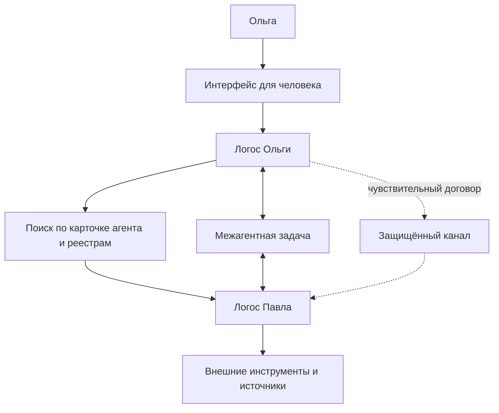
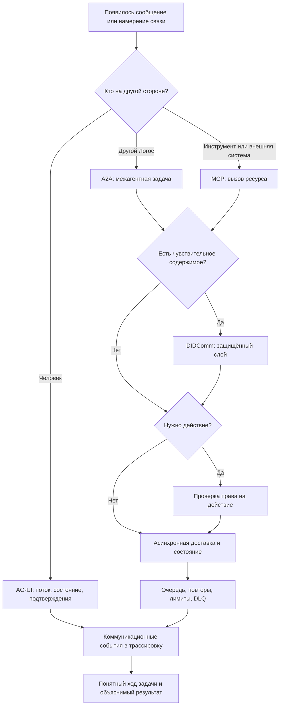

# УРОВЕНЬ 1 / ИЗМЕРЕНИЕ 05: КОММУНИКАЦИОННОЕ

> **Уровень:** L1 — Агент (свойства Логоса)  
> **Измерение:** D05 — Communication  
> **Учебная редакция:** v1.0  
> **Главная тема:** как Логос находит собеседников, выбирает правильный канал связи и надёжно обменивается сообщениями

---

## Ключевой вопрос

**Как ты взаимодействуешь с людьми, другими агентами и системами и какие протоколы при этом используешь?**

---

## Краткое описание измерения

Логос не работает в одиночестве. Он принимает задачи от человека, договаривается с другими Логосами, вызывает инструменты и передаёт чувствительные данные.

Для этих ситуаций нельзя использовать один универсальный канал. Человек, другой агент и внешний инструмент ждут разных правил общения.

Эта глава отвечает на несколько практических вопросов:

1. Как отличить разговор с человеком от взаимодействия с другим агентом?
2. Когда нужен межагентный протокол, а когда достаточно вызова инструмента?
3. Как Логос находит другого Логоса и понимает, что тот умеет?
4. Как защищать чувствительные сообщения и проверять право на действие?
5. Как вести долгую задачу, если участники временно недоступны?
6. Какие события коммуникации нужно видеть в трассировке выполнения?

---

## Мини-глоссарий

| Термин | Простое объяснение |
|--------|--------------------|
| **Логос** | Агент, который действует от имени человека или организации в цифровой среде. |
| **`AG-UI`** | Интерфейс для общения человека с Логосом: поток ответа, состояние задачи и запрос подтверждений. |
| **`A2A`** | Протокол для общения одного Логоса с другим Логосом. |
| **`MCP`** | Протокол для подключения Логоса к инструментам, API, базам данных и внешним системам. |
| **`DIDComm`** | Защищённый обмен сообщениями на базе DID, полезный для чувствительных данных. |
| **DID** | Децентрализованный идентификатор: проверяемое имя участника без зависимости от одного центрального реестра. |
| **VC** | Проверяемое учётное данное: цифровое подтверждение, которое можно программно проверить. |
| **API** | Программный интерфейс приложения: формальный способ обратиться к функции или данным внешней системы. |
| **`Agent Card`** | Машиночитаемая карточка агента: кто он, что умеет и где к нему обращаться. |
| **Реестр доверия** | Реестр, который помогает проверить участника, его аттестации и происхождение сведений. |
| **Реестр поиска** | Слой, который расширяет поиск агентов по способностям и точкам подключения. |
| **`Structured Handoff`** | Структурированная передача контекста внутри одного Логоса, а не внешний межагентный протокол. |
| **`Performative`** | Смысловой тип сообщения: например, запрос, сообщение факта, подтверждение или отказ. |
| **Оркестратор** | Внутренний управляющий компонент Логоса, который планирует, маршрутизирует и контролирует исполнение задачи. |
| **Шлюз** | Пограничный слой, который маршрутизирует трафик, применяет лимиты и помогает разделять протоколы. |
| **Очередь доставки** | Надёжное хранилище намерений и сообщений, если получатель временно недоступен. |
| **DLQ** | Очередь сообщений, которые не удалось обработать после повторных попыток. |
| **Автоматический размыкатель** | Механизм, который временно закрывает проблемный путь связи после повторяющихся отказов. |
| **Ограничение частоты запросов** | Правило, которое не даёт одному направлению связи перегрузить систему. |
| **Наблюдаемость** | Возможность понять, какой протокол был выбран, где возникла ошибка и почему задача пошла именно этим путём. |

---

# 0. Гипотетический пример

Ольге нужно проверить договор поставки перед подписанием. Её Логос уже прошёл предыдущие этапы истории.

Идентичность участников определена: понятно, чей Логос действует. Компетентность Павла как юриста и способности его Логоса подтверждены. Ресурсы для обработки документа доступны. Функциональный слой умеет открыть файл, вызвать нужные инструменты и собрать результат.

Теперь возникает новый вопрос: **как Логос Ольги и Логос Павла вообще должны общаться, чтобы задача не превратилась в набор случайных сообщений?**

**Ольга** — заказчик. Её Логос ищет исполнителя для проверки договора поставки.  
**Павел** — специалист-юрист. Его Логос выполняет проверку.

Коммуникационное измерение нужно здесь не ради переписки как таковой. Оно защищает участников от путаницы: где человек даёт подтверждение, где агент договаривается с агентом, где вызывается внешний инструмент, а где передаётся чувствительный документ.

## Проверка 1. Как Логос Ольги находит Логос Павла?

Логос Ольги не должен искать исполнителя по свободному тексту вроде «хороший юрист». Ему нужна машиночитаемая точка входа.

Для этого используется карточка агента (англ. Agent Card, далее — `Agent Card`). В ней можно увидеть, кто агент, какие способности он заявляет, где находится его точка подключения и какие способы взаимодействия он поддерживает.

Дополнительные реестры могут расширить поиск: один слой помогает найти кандидатов по способностям, другой добавляет сигналы доверия и происхождения сведений. Но сама коммуникационная логика начинается с вопроса: **к кому и по какому адресу обращаться?**

## Проверка 2. Как два Логоса договариваются о задаче?

Когда Логос Ольги нашёл Логос Павла, им нужен не просто чат. Им нужен формат, в котором можно описать задачу, состояние, части сообщения, запрос уточнений и жизненный цикл выполнения.

Для этого нужен межагентный протокол (англ. Agent-to-Agent Protocol, далее — `A2A`). В этой главе он рассматривается как текущий базовый профиль для взаимодействия «Логос ↔ Логос».

Через этот канал Логос Ольги может передать: «нужно проверить договор поставки», а Логос Павла может ответить: «задача принята», «нужны уточнения», «проверка выполняется», «результат готов».

## Проверка 3. Где в этой истории человек?

Ольга не должна читать служебные межагентные сообщения. Ей нужен понятный интерфейс: что происходит, на каком шаге задача, где нужен её выбор и какие действия требуют подтверждения.

Для этого используется пользовательский потоковый интерфейс (англ. Agent User Interface, далее — `AG-UI`). Он показывает Ольге состояние работы, поток объяснений и запросы подтверждения.

Если Логос Павла через межагентный канал попросит уточнить спорный пункт договора, Логос Ольги может вывести это Ольге через человеко-ориентированный интерфейс. Но событие «нужен ввод человека» не превращает межагентный протокол в полноценный пользовательский интерфейс.

## Проверка 4. Как подключаются внешние системы?

Проверка договора может потребовать открыть хранилище документов, вызвать юридическую базу, обратиться к программному интерфейсу приложения (англ. Application Programming Interface, далее — API) или получить данные из внешнего источника.

Это не разговор с равноправным агентом. Вторая сторона здесь не ведёт самостоятельный жизненный цикл задачи, а предоставляет инструмент или ресурс.

Для такого вызова нужен протокол контекста модели (англ. Model Context Protocol, далее — `MCP`). Он помогает Логосу обращаться к инструментам и внешним системам, не смешивая это с переговорами между Логосами.

## Проверка 5. Как передать чувствительный договор?

Договор поставки может содержать коммерческие условия, персональные данные или другую чувствительную информацию. Межагентный протокол описывает задачу и состояние, но защищённая доставка содержимого требует отдельного слоя.

Для этого может использоваться защищённый обмен сообщениями на основе децентрализованного идентификатора (англ. Decentralized Identifier, далее — DID): `DIDComm`. Он позволяет передавать чувствительные данные поверх межагентного взаимодействия, не смешивая защищённый канал с моделью задачи.

## Проверка 6. Что если Павел не сразу онлайн?

Проверка договора может занять часы. Логос Павла может временно потерять соединение, внешний инструмент может не ответить, а часть сообщений может потребовать повторной доставки.

Поэтому коммуникация должна считать асинхронность нормальным режимом, а не исключением. Задача не должна зависеть от того, что все участники одновременно находятся онлайн.

## Главное из примера

**Коммуникационное измерение не выбирает «один лучший протокол». Оно разделяет роли: человек видит управляемый интерфейс, Логосы договариваются через межагентный канал, инструменты вызываются отдельно, а чувствительные данные передаются через защищённый слой.**



---

# Содержание

1. Три типа коммуникации
2. Протокольный стек и границы
3. Поиск агента и карточка агента
4. Защищённый обмен и право на действие
5. Асинхронность и устойчивость к отказам
6. Маршрутизация, лимиты и наблюдаемость
7. Связь и границы с другими измерениями
8. Итоговая модель целиком
9. Короткое резюме главы
10. Вопросы без ответа

---

# 1. Три типа коммуникации

Главная ошибка в коммуникационном слое — считать, что любой обмен сообщениями устроен одинаково.

На практике роль собеседника меняет всё: формат сообщения, ожидание ответа, проверку прав, наблюдаемость и способ обработки ошибок. Поэтому данная глава делит коммуникацию на три типа.

| Тип | Участники | Главная цель | Подходящий интерфейс | Что нельзя смешивать |
|-----|-----------|--------------|----------------------|----------------------|
| **Тип 1** | человек ↔ Логос | поставить задачу, увидеть ход работы, подтвердить действие | `AG-UI` | не заменять человеческий интерфейс служебным межагентным событием |
| **Тип 2** | Логос ↔ Логос | найти партнёра, договориться о задаче, вести её состояние | `A2A` | не сводить сотрудничество агентов к вызову инструмента |
| **Тип 3** | Логос ↔ внешняя система | вызвать инструмент, API, источник данных или корпоративную систему | `MCP` | не считать инструмент равноправным агентом |

## 1.1 Человек ↔ Логос

Человеку нужен не протокольный конверт, а управляемый интерфейс.

Ольга должна видеть, что её договор принят в работу, где сейчас находится задача, какой вывод предварителен, а какое действие требует её подтверждения. Поэтому `AG-UI` отвечает за поток событий, состояние сессии и видимые человеку обновления.

Межагентный протокол может сообщить, что нужен ввод человека. Но это только мост к человеку, а не полноценный интерфейс для человека.

## 1.2 Логос ↔ Логос

Когда Логос Ольги обращается к Логосу Павла, им нужен формат сотрудничества.

Здесь важны поиск возможностей, описание задачи, состояние выполнения и части сообщения. Поэтому текущим базовым профилем для межагентного взаимодействия выступает `A2A v1.0.0`.

Такой канал нужен именно для взаимодействия равноправных агентов. Он не заменяет вызов инструмента и не описывает внутреннюю передачу контекста между компонентами одного Логоса.

## 1.3 Логос ↔ внешние системы

Если Логос Павла вызывает юридическую базу, файловое хранилище или корпоративный API, это другой тип связи.

Внешняя система не ведёт переговоры о задаче как агент. Она предоставляет функцию, данные или ресурс. Поэтому здесь используется `MCP`: он задаёт способ безопасно и ограниченно вызвать инструмент.

> Вопрос не в том, «какой транспорт удобнее». Вопрос в том, **кто находится на другой стороне связи**.

В примере с договором это выглядит так: Ольга управляет задачей через человеко-ориентированный интерфейс; два Логоса согласуют работу через межагентный канал; Логос Павла вызывает нужные источники через инструментальный протокол.

## Главное

**Коммуникация делится не по техническому вкусу, а по роли второй стороны.**  
**Человек, другой Логос и внешний инструмент требуют разных правил связи.**

---

# 2. Протокольный стек и границы

После разделения типов можно собрать стек. Он не является лестницей, где один протокол «выше» другого во всех ситуациях. Скорее это набор поверхностей, каждая из которых включается при своей потребности.

## 2.1 Верхнеуровневая схема

На уровне одного Логоса картина такая:

```text
Человек
  ↕ AG-UI
Логос / Оркестратор
  ↔ A2A v1.0.0 ↔ Другой Логос
  ↔ MCP ↔ Внешняя система или инструмент
  ↔ DIDComm ↔ Защищённый DID-канал для чувствительных сообщений
```

`AG-UI` отвечает за человеческую поверхность. `A2A v1.0.0` отвечает за сотрудничество равноправных агентов. `MCP` отвечает за вызов инструментов и ресурсов. `DIDComm v2.1` может использоваться как защищённый слой для конфиденциальных сообщений на базе DID.

## 2.2 Почему это не выбор одного стандарта

В рабочей задаче могут одновременно понадобиться все четыре поверхности.

Такой стек защищает от двух ошибок:

1. считать межагентное взаимодействие обычным вызовом инструмента;
2. заставлять пользовательский интерфейс работать как служебный канал между агентами.

## 2.3 Границы близких понятий

| Понятие | Роль в настоящем измерении | Что делает | Чего не делает |
|---------|----------------------------|------------|----------------|
| **`AG-UI`** | поверхность «человек ↔ Логос» | показывает поток событий, состояние и запросы подтверждения | не заменяет сотрудничество агентов |
| **`A2A`** | поверхность «Логос ↔ Логос» | ведёт жизненный цикл задачи, сообщения и обмен возможностями | не является протоколом вызова инструментов |
| **`MCP`** | поверхность «Логос ↔ инструмент» | вызывает инструменты, ресурсы и внешние системы | не описывает переговоры равноправных агентов |
| **`DIDComm`** | защищённый слой | передаёт чувствительные сообщения на базе DID | не заменяет модель задачи в `A2A` |
| **`Structured Handoff`** | внутренняя передача контекста | помогает компонентам одного Логоса передавать состояние работы | не является внешним межагентным транспортом |
| **`Performative`** | смысл сообщения | помогает понимать намерение: запрос, факт, подтверждение, отказ | не задаёт доставку и масштабирование сети |

## 2.4 Как выбирать поверхность

Минимальная логика выбора выглядит так:

```text
если сообщение адресовано человеку:
    использовать AG-UI
иначе если вторая сторона является другим Логосом:
    использовать A2A
иначе если вторая сторона является инструментом или внешней системой:
    использовать MCP

если в сообщении есть чувствительное содержимое:
    добавить защищённый DIDComm-слой
```

В истории Ольги и Павла это помогает не смешивать договорённость о задаче, показ статуса человеку, вызов юридической базы и защищённую передачу договора.

## Главное

**Стек D05 — это не один канал, а разделение поверхностей.**  
**`A2A`, `MCP`, `AG-UI` и `DIDComm` могут работать одновременно, потому что отвечают на разные потребности.**

---

# 3. Поиск агента и карточка агента

Прежде чем Логосы начнут обмениваться сообщениями, они должны найти друг друга и понять, есть ли смысл начинать разговор.

Для человека профиль исполнителя может выглядеть как страница с описанием. Для Логоса нужна машиночитаемая точка входа: идентичность, адрес, поддерживаемые протоколы и заявленные способности.

## 3.1 Зачем нужна карточка агента

`Agent Card` отвечает на базовые вопросы:

1. кто этот агент;
2. где к нему обращаться;
3. какие возможности он заявляет;
4. какие способы подключения поддерживает;
5. какие сведения помогают проверить целостность карточки.

Обычно такая карточка публикуется в известной точке доступа. В текущем базовом профиле используется путь `/.well-known/agent.json`.

Смысл этой точки не в секретности. Смысл в том, чтобы другой Логос мог программно начать поиск и первичное сопоставление возможностей.

## 3.2 Три уровня поиска

Поиск можно представить как три последовательных слоя.

| Слой | Что даёт | Зачем нужен |
|------|----------|-------------|
| **Карточка агента** | первичный адрес, заявленные возможности, поддерживаемые способы связи | начать контакт с конкретным агентом |
| **Реестр поиска** | расширенный поиск и сопоставление по возможностям | найти подходящих кандидатов, если их много |
| **Реестр доверия** | аттестации, происхождение сведений, дополнительные сигналы проверки | снизить риск работы с неподтверждённым участником |

Такой поиск не означает, что в этой главе полностью описывается вся инфраструктура реестров, брокеров и масштабирования. Настоящее измерение удерживает только агентный вопрос: **какие сигналы нужны Логосу, чтобы начать коммуникацию?**

## 3.3 Что Логос читает перед началом разговора

Перед тем как Логос Ольги обратится к Логосу Павла, ему нужны как минимум четыре класса сигналов:

| Сигнал | Простой вопрос | Где может находиться |
|--------|----------------|----------------------|
| **идентичность и адрес** | кто это и куда обращаться? | `Agent Card` |
| **способности** | подходит ли агент для задачи? | `Agent Card` и реестр поиска |
| **целостность публикации** | не подменена ли карточка? | подписанная карточка агента |
| **доверительные сведения** | есть ли основания доверять участнику? | реестр доверия и идентификационный слой |

## 3.4 Граница с инфраструктурой

Данная глава описывает, что нужно одному Логосу на старте коммуникации. Она не проектирует топологию сети, кэширование, брокеры, маршрутизаторы и масштабирование реестров.

Эта граница важна: если смешать агентный выбор и инфраструктурную доставку, коммуникационное измерение начнёт отвечать сразу за всё и потеряет ясность.

В примере с договором Логос Ольги сначала получает машиночитаемую карточку Логоса Павла, затем сверяет способности и доверительные сигналы, и только после этого начинает межагентную задачу.

## Главное

**Поиск начинается с машиночитаемой карточки агента, а не с свободного описания.**  
**Реестры помогают расширить поиск и доверие, но полная инфраструктура поиска остаётся отдельной областью ответственности.**

---

# 4. Защищённый обмен и право на действие

Найти агента и открыть канал недостаточно. Нужно ещё понять, как защищать содержимое и кто имеет право выполнить конкретное действие.

Здесь важно разделить три вещи:

1. идентичность участника;
2. защищённую передачу сообщения;
3. разрешение на конкретное действие.

## 4.1 Почему межагентного протокола недостаточно

`A2A` описывает жизненный цикл межагентной задачи и структуру сообщений. Но сам по себе он не должен считаться полным ответом на конфиденциальную доставку чувствительных данных.

Если Логос Ольги передаёт договор поставки, нужен защищённый слой для содержимого. Для этого в базовой модели используется `DIDComm v2.1`: он опирается на DID и поддерживает сквозное шифрование.

Подписанная карточка агента помогает проверить целостность и происхождение сведений. Но подпись карточки не заменяет защищённый канал для самого договора.

## 4.2 Что даёт DIDComm

Для данного измерения важны три свойства `DIDComm`:

| Свойство | Зачем нужно |
|----------|-------------|
| **Сквозное шифрование** | чувствительное содержимое не передаётся как обычный открытый фрагмент задачи |
| **Опора на DID** | защищённый обмен связан с проверяемой идентичностью участников |
| **Поддержка асинхронной доставки** | получатель может получить сообщение после восстановления связи |

Важно не перепутать слой защиты и модель задачи. `DIDComm` защищает доставку чувствительного содержимого, но не заменяет состояние задачи, роли сообщений и жизненный цикл `A2A`.

## 4.3 Почему идентичность не равна праву на действие

DID отвечает на вопрос: «кто этот участник?»  
Подписанная карточка агента отвечает на вопрос: «не подменена ли публикация?»  
Но ни одно из этих утверждений само по себе не отвечает на вопрос: «может ли агент выполнить именно это действие?»

Для действия нужна отдельная проверка прав на границе исполнения.

| Паттерн | Простой смысл | Пример класса решений |
|---------|---------------|-----------------------|
| **Централизованная проверка политики** | перед действием стоит детерминированная проверка правил | шлюз или контроллер политики перед выполнением |
| **Авторизация через ограниченные возможности** | агент получает не широкую роль, а узкое разрешение | `OCap` / `OCapN` |
| **Контур управления политиками и аудитом** | правила, проверки и аудит вынесены в отдельный контрольный слой | набор инструментов для политик и контроля |

## 4.4 Статус предложений по предварительной авторизации

Вокруг агентных систем появляются предложения для детерминированной проверки перед действием. Один из таких вариантов обозначается как `OAP`.

В данной главе его разумно держать как наблюдаемый кандидат, а не как обязательный слой. Базовую модель уже можно объяснить через три класса решений: проверку политики, ограниченные возможности и контур управления политиками.

> Открыть разговор — не то же самое, что получить право выполнить действие.

## 4.5 Что ещё не закрыто полностью

Принцип разделения слоёв понятен: `A2A` ведёт межагентную задачу, `DIDComm` защищает чувствительные сообщения, а право на действие проверяется отдельно.

Но рабочая связка этих элементов всё ещё требует практического уточнения: как именно объединить идентичность, подписанную карточку агента, защищённый обмен и проверку прав в один совместимый поток.

В истории Ольги и Павла это значит: даже если Логос Павла найден, его карточка подписана, а защищённый канал открыт, система всё равно должна проверить, можно ли выполнять конкретное действие над договором.

## Главное

**Защищённая коммуникация состоит из нескольких слоёв: идентичность, защищённый канал и проверка права на действие.**  
**Ни один из этих слоёв не должен подменять остальные.**

---

# 5. Асинхронность и устойчивость к отказам

Долгая межагентная задача не должна зависеть от того, что все участники находятся онлайн одновременно.

Проверка договора может включать ожидание ответа Павла, доступ к внешней системе, уточнение у Ольги и повторную доставку защищённого сообщения. Поэтому асинхронность — нормальный режим коммуникации, а не редкое исключение.

## 5.1 Асинхронная задача как базовый профиль

Для межагентного обмена важно уметь запустить задачу и не держать вызывающую сторону в синхронном ожидании до самого конца.

В `A2A` это выражается через неблокирующий режим задачи, например `blocking:false`. Такой режим позволяет Логосу Ольги продолжать работу, пока Логос Павла выполняет проверку.

Но неблокирующий вызов сам по себе не гарантирует доставку, восстановление после сбоя или обработку всех ошибок.

## 5.2 Очередь, локальная устойчивость и ретрансляция

Для надёжной коммуникации нужен операционный слой вокруг протокола.

| Слой | Роль |
|------|------|
| **Неблокирующая межагентная задача** | не заставляет вызывающего ждать завершения долгой работы |
| **Локальная долговечная очередь** | временно хранит намерение или сообщение до доставки |
| **Ретрансляция защищённых сообщений** | помогает доставить зашифрованное содержимое после восстановления связи |

Локальная очередь может быть реализована разными способами, например через встроенное хранилище. Но это не свойство ядра `A2A`; это реализационный профиль вокруг него.

## 5.3 Повторы, автоматический размыкатель и DLQ

Отказы нужно различать. Временная сетевая ошибка, недоступность инструмента и отказ другого Логоса требуют разных реакций.

Минимальная дисциплина выглядит так:

1. повторять только временные ошибки и делать паузу между попытками;
2. после повторяющихся отказов временно закрывать проблемный путь связи автоматическим размыкателем;
3. после исчерпания попыток помещать сообщение в DLQ вместе с причиной;
4. различать отказ инструмента и отказ межагентного пути.

Отказ инструмента обычно снижает доступную функциональность. Отказ другого Логоса может сломать всю ветку делегирования.

## 5.4 Что не принадлежит этой главе

Настоящее измерение фиксирует, что путь связи должен быть асинхронным, устойчивым к временной недоступности и видимым для трассировки.

Но глубокая классификация ошибок, откаты, компенсации и восстановление исполнения относятся к функциональному и инфраструктурному слоям. Коммуникационная глава не должна превращаться в полную модель исполнения.

В примере Ольги и Павла это означает: если Логос Павла временно недоступен, задача не исчезает. Сообщения удерживаются, попытки повторяются по правилам, а после исчерпания попыток причина становится видимой для дальнейшего решения.

## Главное

**Асинхронность — нормальный режим долгой межагентной работы.**  
**`A2A` задаёт модель задачи, но надёжная доставка, повторы, очереди и обработка отказов требуют отдельного операционного слоя.**

---

# 6. Маршрутизация, лимиты и наблюдаемость

Даже правильно выбранные протоколы могут создать проблемы, если их маршрутизировать одинаково и не наблюдать за событиями коммуникации.

Коммуникационный слой должен отвечать на два практических вопроса:

1. куда направить конкретный обмен;
2. какие события сохранить, чтобы потом объяснить ход задачи.

## 6.1 Ограничение частоты запросов на границе протоколов

Если не ограничивать коммуникационный трафик, один тип взаимодействия может перегрузить остальные. Например, поток вызовов к инструментам не должен делать человеческий интерфейс Ольги неотзывчивым.

Поэтому лимиты должны учитывать не только количество HTTP-запросов, но и направление взаимодействия:

| Направление | Почему нужен отдельный подход |
|-------------|-------------------------------|
| **`AG-UI`** | человек должен продолжать видеть состояние задачи даже при деградации других путей |
| **`A2A`** | межагентные задачи имеют собственные состояния, повторы и делегирование |
| **`MCP`** | инструментальные вызовы требуют отдельных проверок доступа и контроля исполнения |
| **`DIDComm`** | защищённые сообщения могут требовать иной доставки и обработки чувствительных данных |

## 6.2 Правило маршрутизации во время выполнения

Во время работы оркестратор и пограничные компоненты должны выбирать поверхность по смыслу взаимодействия.

| Вопрос | Куда маршрутизировать |
|--------|------------------------|
| Это поток для человека? | в `AG-UI` |
| Это координация с другим Логосом? | в `A2A` |
| Это вызов инструмента или ресурса? | в `MCP` |
| Это чувствительное сообщение на базе DID? | через `DIDComm` как защищённый слой |

Такое правило не изобретает универсальный агентный протокол. Оно делает выбор явным и проверяемым.

## 6.3 Что нужно видеть в наблюдаемости

Настоящее измерение не владеет всей системой наблюдаемости. Но оно должно передать в трассировку коммуникационные события, без которых невозможно понять ход задачи.

Минимальный набор сигналов:

1. какой протокол выбран;
2. направление связи: человек, другой Логос, инструмент или защищённое сообщение;
3. переходы состояния межагентной задачи;
4. ошибки доставки;
5. исчерпание повторных попыток;
6. попадание в лимит частоты запросов;
7. события пользовательского потока.

Если эти сигналы не сохраняются, оркестратор не сможет объяснить, почему задача ушла к другому Логосу, почему был вызван инструмент, где произошла деградация и почему потребовался ручной ввод.

## 6.4 Практическая граница

Коммуникационное измерение задаёт правила выбора поверхности и список сигналов, которые нужно отдать в общую трассировку выполнения.

Оно не описывает всю телеметрию, аналитику качества, нормализацию трасс и оценку исполнения. Эти области относятся к соседним слоям.

В истории с договором это означает: если проверка задержалась из-за внешнего инструмента, Ольга должна видеть понятный статус, а система должна отличать инструментальную задержку от отказа Логоса Павла.

## Главное

**Маршрутизация должна учитывать смысл обмена, а не только технический адрес.**  
**Без коммуникационных сигналов в трассировке система не сможет объяснить ход межагентной задачи.**

---

# 7. Связь и границы с другими измерениями

Коммуникационное измерение находится между функциональной способностью Логоса и средой, где он взаимодействует с людьми, агентами и системами. Оно определяет поверхности связи, но не забирает себе идентичность, исполнение, инфраструктурную доставку и семантику сообщений.

| Измерение | Связь | Граница ответственности |
|-----------|-------|--------------------------|
| **L1/D01 (Идентификационное)** | DID, VC, реестр доверия и сигналы идентичности нужны для поиска и защищённого обмена. | Настоящее измерение показывает, где эти сигналы подключаются к коммуникации; идентификационный слой определяет сами идентификаторы, документы и цепочки доверия. |
| **L1/D04 (Функционально-инструментальное)** | `MCP` и `Structured Handoff` связаны с вызовом инструментов и внутренней передачей контекста. | Настоящее измерение различает коммуникационные поверхности; функциональный слой описывает инструментальный протокол, оркестрацию и контроль исполнения. |
| **L2/D04 (Коммуникационно-протокольное)** | Масштабирование доставки, шлюзы, брокеры, производительность и сетевые детали нужны для рабочей среды. | Настоящее измерение описывает выбор поверхности на уровне одного Логоса; инфраструктурный уровень описывает доставку, маршрутизацию и масштаб. |
| **L3/D02 (Семантико-протокольное)** | `Performative` и смысловые типы сообщений помогают понимать намерение в обмене. | Настоящее измерение не владеет полной семантической моделью; оно только показывает, где смысл сообщения влияет на коммуникацию. |

## Главное

**D05 владеет выбором коммуникационной поверхности на уровне Логоса.**  
**Соседние измерения владеют идентичностью, исполнением, инфраструктурной доставкой и полной семантикой сообщений.**

---

# 8. Итоговая модель целиком

Вся модель собирается в один поток: сначала определить роль второй стороны, затем выбрать поверхность связи, затем добавить защиту и операционные гарантии там, где они нужны.



Эта схема показывает главный принцип: протокол выбирается не в вакууме. Сначала определяется роль второй стороны, затем тип обмена, затем необходимость защищённого слоя, проверки прав и операционной устойчивости.

## Главное

**Коммуникационная модель начинается с роли собеседника и заканчивается объяснимым следом выполнения.**  
**Так Логос может одновременно быть понятным человеку, совместимым с другими агентами и безопасным при работе с инструментами и чувствительными данными.**

---

# 9. Короткое резюме главы

1. Коммуникация Логоса делится на три типа: с человеком, с другим Логосом и с внешней системой.
2. `AG-UI`, `A2A`, `MCP` и `DIDComm` не конкурируют; они закрывают разные потребности.
3. Межагентный поиск начинается с `Agent Card`, а реестры добавляют поиск по возможностям и доверительные сигналы.
4. Защищённый канал не заменяет модель задачи, а идентичность не заменяет право на действие.
5. Долгие межагентные задачи должны быть асинхронными, с очередями, повторами и видимыми отказами.
6. Маршрутизация, лимиты и наблюдаемость нужны, чтобы задача оставалась управляемой и объяснимой.

## Главное

**Коммуникационное измерение учит Логос выбирать правильную поверхность связи для каждого собеседника и сохранять понятный след этого выбора.**

---

# 10. Вопросы без ответа

1. **Как будет выглядеть практически проверенный единый поток `A2A + DIDComm`?** Принцип разделения ролей понятен, но рабочая связка защищённого канала, межагентной задачи и эксплуатационных характеристик требует отдельной проверки на инфраструктурном уровне.
2. **Где заканчивается коммуникация и начинается оркестрация?** Настоящее измерение описывает поверхности связи, но полная модель внутренней оркестрации, передачи контекста и управления исполнением остаётся у функционального слоя.
3. **Как точно сопоставлять смысловые типы сообщений с типами межагентных сообщений?** Данная глава признаёт роль смыслового слоя, но не должна закреплять всю модель речевых актов и их соответствие протокольным типам как обязательную.
4. **Как глубоко нормализовать наблюдаемость многошаговой коммуникации?** Здесь перечислены нужные коммуникационные сигналы, но полная архитектура трассировки, телеметрии и анализа исполнения должна определяться отдельно.
5. **Какие профили предварительной авторизации станут обязательными?** Проверка права на действие нужна, но конкретные профили вроде `OAP` пока разумнее рассматривать как кандидатов, а не как обязательную часть базовой модели.

## Главное

**Открытые вопросы касаются не самого разделения поверхностей, а их рабочей сборки: защищённый межагентный поток, граница с исполнением, семантика сообщений, наблюдаемость и политика авторизации.**
