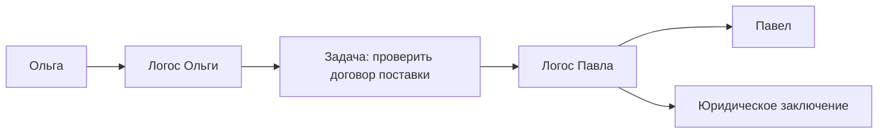
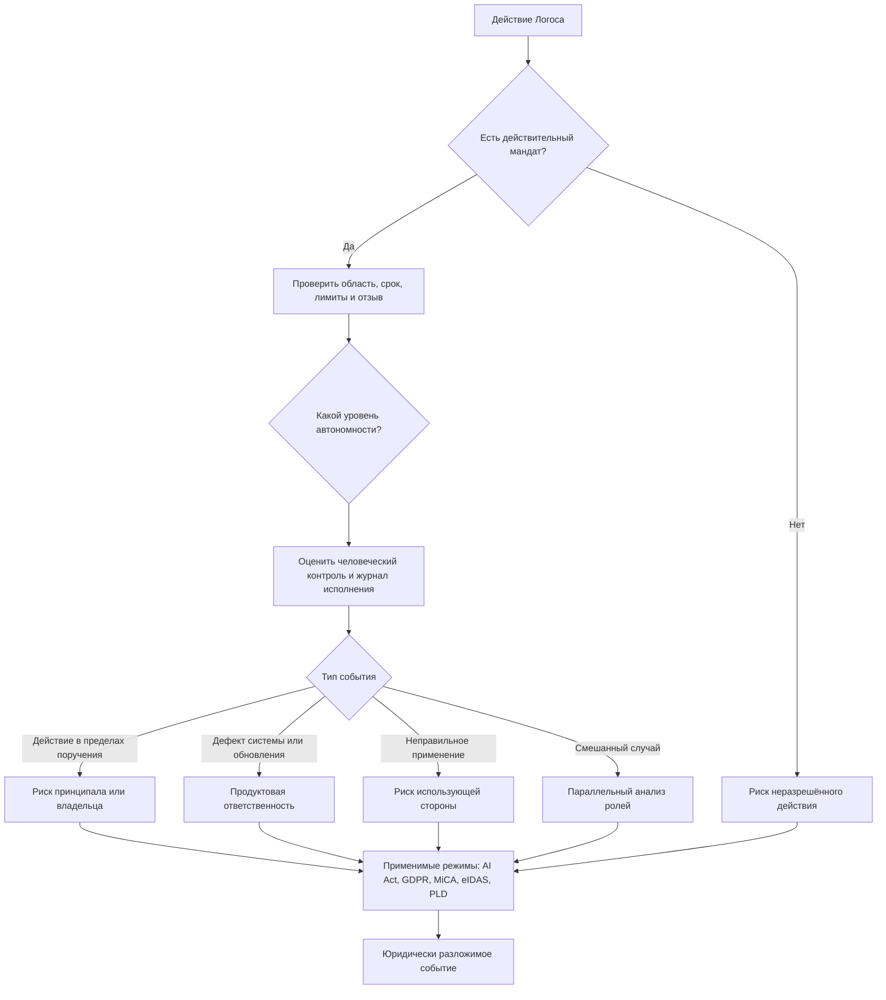

# УРОВЕНЬ 1 / ИЗМЕРЕНИЕ 06: ПРАВОВОЕ

> **Уровень:** L1 — Агент  
> **Измерение:** D06 — Legal  
> **Учебная редакция:** v1.0  
> **Главная тема:** кто отвечает за действия Логоса и на каких правовых основаниях он может действовать

---

## Ключевой вопрос

**Какие юридические обязательства и права на тебя наложены и как они реализуются?**

---

## Краткое описание измерения

Логос может искать исполнителей, принимать поручения, вызывать инструменты, писать тексты, вести переговоры и готовить действия для человека или организации.

Но право пока не говорит: "сам агент стал отдельным юридическим лицом".

Поэтому данная глава объясняет не то, как Логос получает собственную правосубъектность, а то, как его действия получают юридический смысл через людей, организации, мандаты, регуляторные режимы и доказательства.

Эта глава отвечает на несколько практических вопросов:

1. Кто несёт ответственность, если Логос действует в пределах поручения?
2. Кто отвечает, если ошибка возникла из-за дефекта системы или обновления?
3. Как уровень автономности меняет требования к контролю и доказуемости?
4. Почему проверяемое делегирование нужно не только технически, но и юридически?
5. Как на действия Логоса проецируются `AI Act`, `MiCA`, `GDPR`, `eIDAS`, `PLD` и другие режимы ЕС?
6. Какие вопросы ещё не закрыты и требуют отдельного проектного или управленческого решения?

---

## Мини-глоссарий

| Термин | Простое объяснение |
|--------|--------------------|
| **Логос** | Цифровой агент, который действует от имени человека или организации в пределах выданных ему прав. |
| **Правосубъектность** | Способность самому иметь юридические права, обязанности и ответственность. |
| **Мандат** | Проверяемое поручение: кто кому что разрешил, на какой срок и с какими ограничениями. |
| **Принципал** | Человек или организация, от имени которых действует агент. |
| **Поставщик системы** | Сторона, которая создаёт или предоставляет систему искусственного интеллекта и отвечает за её продуктовые и регуляторные обязанности. |
| **Использующая сторона** | Человек или организация, которые применяют систему искусственного интеллекта в конкретном сценарии. |
| **DID** | Децентрализованный идентификатор: проверяемый цифровой идентификатор без единого центрального реестра. |
| **VC** | Проверяемое учётное данное: цифровое подтверждение, подлинность которого можно проверить. |
| **Delegation VC** | Проверяемое учётное данное о делегировании: кто выдал агенту полномочия и где их границы. |
| **LOA** | Уровень автономности: шкала того, насколько самостоятельно агент может действовать. |
| **HITL** | Участие человека в процессе: момент, когда действие требует человеческого подтверждения. |
| **Execution Trace** | Журнал исполнения: что агент сделал, в каком порядке, какими инструментами и с каким результатом. |
| **AI Act** | Регламент ЕС об искусственном интеллекте: задаёт обязанности для разных ролей в цепочке таких систем. |
| **PLD** | Директива ЕС об ответственности за дефектную продукцию: применяет продуктовую ответственность к программному обеспечению и системам искусственного интеллекта. |
| **AILD** | Предлагавшаяся директива об ответственности за вред от искусственного интеллекта; после отзыва отдельный единый режим для такого вреда не возник. |
| **MiCA** | Регламент ЕС о рынках криптоактивов: определяет правовой режим токенов и эмитентов. |
| **AGC** | Операционная валюта среды, квалифицируемая как токен электронных денег по `MiCA`. |
| **Qi** | Токен управления и ценности среды, квалифицируемый как иной криптоактив по `MiCA`. |
| **EMT** | Токен электронных денег: криптоактив, привязанный к одной фиатной валюте. |
| **OCA** | Иной криптоактив: криптоактив, который не является токеном электронных денег или токеном, привязанным к активам. |
| **MiFID II** | Финансово-рыночный режим ЕС, граница с которым важна, если токен начинает походить на инвестиционный инструмент. |
| **GDPR** | Общий регламент ЕС о защите данных: задаёт правила обработки персональных данных. |
| **DPIA** | Оценка воздействия на защиту данных: анализ рисков для персональных данных перед опасной обработкой. |
| **eIDAS** | Режим ЕС для электронной идентификации, доверенных услуг, подписей и аттестаций. |
| **QES** | Квалифицированная электронная подпись, юридически приравненная к собственноручной подписи в ЕС. |
| **QEAA** | Квалифицированная электронная аттестация атрибутов: сильное подтверждение статуса или свойства в инфраструктуре `eIDAS`. |
| **EUDI** | Европейская цифровая идентичность: инфраструктурный слой для совместимости цифровых удостоверений в ЕС. |
| **CRA** | Регламент ЕС о киберустойчивости цифровых продуктов. |
| **NIS2** | Директива ЕС о кибербезопасности организаций и инфраструктур. |
| **Data Act** | Регламент ЕС о данных; в этой главе важен как слой требований к безопасному прерыванию некоторых цифровых контрактов. |
| **SCC** | Стандартные договорные положения для передачи персональных данных за пределы Европейской экономической зоны. |
| **QMS** | Система управления качеством: процедуры, роли и контроль жизненного цикла продукта с искусственным интеллектом. |

---

# 0. Гипотетический пример

Представим единую агентную среду, где Логосы помогают людям находить исполнителей, согласовывать работу, проверять результат и проводить оплату.

Сюжет уже прошёл несколько шагов.

Сначала среда должна была понять, кто участвует в задаче. Потом — имеет ли исполнитель нужную компетентность. Затем — есть ли у него ресурсы, инструменты и канал связи, чтобы выполнить работу.

Теперь история дошла до правового вопроса.

**Ольга** — заказчик. Её Логос ищет исполнителя для проверки договора поставки.

**Павел** — специалист-юрист. Его Логос выполняет проверку договора и готовит заключение.

На предыдущих шагах уже понятно: Логос Павла связан с Павлом, компетентность в юридической области подтверждена, технические ресурсы доступны, задача может быть исполнена, а коммуникация между сторонами установлена.

Но для Ольги этого всё ещё недостаточно.

Ей нужно понять:

> если проверка договора окажется ошибочной, кто будет отвечать?

Не сам ли Логос Павла? Павел как специалист? Владелец Логоса? Поставщик системы, если ошибка вызвана дефектом? Или несколько сторон одновременно?

## Проверка 1. Есть ли у Логоса собственная правосубъектность?

Первый соблазн — сказать: "раз Логос действует, пусть он сам и отвечает".

Но в текущем праве ЕС Логос не считается самостоятельным субъектом права. Он не становится отдельным "электронным лицом" и не получает собственный независимый набор юридических обязанностей.

Поэтому в примере с договором поставки юридический эффект нужно искать не в самом агенте, а в цепочке:



Логос Павла — операционный исполнитель. Правовой смысл его действия зависит от того, кто дал ему полномочия, какие границы были установлены и была ли ошибка связана с поручением, использованием или дефектом системы.

## Проверка 2. Был ли у Логоса Павла действительный мандат?

Ольге важно не просто получить файл с заключением.

Ей нужно понимать, что Логос Павла не вышел за пределы разрешённого:

- Павел действительно поручил своему Логосу юридическую проверку;
- поручение относится к договорам поставки, а не к любым правовым действиям вообще;
- есть срок действия поручения;
- есть ограничения по действиям, которые агент не вправе совершать;
- есть возможность отозвать мандат;
- можно проверить, что мандат существовал на момент выполнения задачи.

Для такой проверки нужен не устный рассказ, а машиночитаемое доказательство делегирования.

## Проверка 3. Что если ошибка возникла не из-за Павла?

Допустим, Логос Павла пропустил существенный риск в договоре.

Причина может быть разной.

Если Павел поручил агенту задачу в допустимых пределах, но затем проигнорировал обязательное человеческое подтверждение, это одна юридическая ситуация.

Если дефект был в самой системе искусственного интеллекта, в её обновлении, в защитных механизмах или в документации, это другая ситуация.

Если Павел применил систему в сценарии, где требовались дополнительные меры контроля и оценки рисков, но не обеспечил их, это третья ситуация.

Правовое измерение поэтому не ищет одного виновного заранее. Оно раскладывает событие по ролям и причинам.

## Проверка 4. Что произойдёт после правовой проверки?

После D06 задача не заканчивается.

Дальше автономность определяет, может ли Логос Павла продолжать сам или должен запросить подтверждение. Экономический слой отвечает за оплату и лимиты. Репутационный слой позже учтёт качество результата. Эволюционный слой может повлиять на будущую настройку агента.

Но именно данная глава отвечает на вопрос, без которого следующий шаг опасен:

> чьи права, обязанности и риски стоят за действием Логоса?

## Главное из примера

**Правовое измерение превращает действие агента из технического события в юридически разложимое событие: кто выдал полномочие, кто использовал систему, кто отвечал за её качество и какие режимы права применяются.**

---

# Содержание

1. Правовой статус Логоса
2. Модель распределения ответственности
3. Уровень автономности и юридический риск
4. Продуктовая ответственность и отсутствие отдельного режима вреда от искусственного интеллекта
5. Проекция `AI Act`
6. Проекция `MiCA` на токены среды
7. Проекция `GDPR`
8. Проверяемое делегирование как юридический инструмент
9. Дополнительные регуляторные слои
10. Связь и границы с другими измерениями
11. Итоговая модель целиком
12. Короткое резюме главы
13. Вопросы без ответа

---

# 1. Правовой статус Логоса

Чтобы понять ответственность, сначала нужно снять главное недоразумение.

Логос может вести себя как самостоятельный участник: принимать входящие задачи, вызывать инструменты, готовить ответы, инициировать действия и общаться с другими агентами. Но это не значит, что право признаёт его отдельным лицом.

В действующем праве ЕС Логос остаётся инструментом, системой искусственного интеллекта и программным продуктом, действующим в рамках мандата человека или организации.

> Логос может действовать технически самостоятельно, но юридически его действие должно быть привязано к человеку, организации, продуктовой цепочке или регуляторному режиму.

## 1.1 Инструмент, а не самостоятельное лицо

Сам по себе Логос:

- не становится "электронным лицом";
- не получает собственный титул на права;
- не образует отдельный карман ответственности;
- не может заменить человека или организацию там, где право требует их волеизъявления.

Это консервативное правило особенно важно для автономных сценариев. Чем больше агент делает сам, тем сильнее нужно доказывать не его "личность", а границы делегирования, контроль, журнал действий и возможность отзыва.

## 1.2 Четыре правовых контекста

Один и тот же Логос может иметь разный правовой смысл в разных режимах ЕС.

| Контекст | Как Логос понимается правом | Практический эффект |
|----------|-----------------------------|---------------------|
| Регламент об искусственном интеллекте (англ. Artificial Intelligence Act, далее — `AI Act`) | Система искусственного интеллекта в цепочке поставщика, использующей стороны и пользователя | Обязанности ложатся на роли вокруг системы, а не на Логос как отдельное лицо. |
| Директива об ответственности за дефектную продукцию (англ. Product Liability Directive, далее — `PLD`) | Программное обеспечение или продукт с искусственным интеллектом | Дефекты, обновления и последующее обучение могут создавать продуктовую ответственность. |
| Договор, поручение и представительство | Технический посредник, выражающий волю принципала в пределах мандата | Юридическая сила действия зависит от действительного поручения и его границ. |
| Защита данных и электронная идентификация | Точка обработки данных и носитель проверяемых полномочий | Нужны распределение ролей по данным, минимизация, оценка рисков и проверяемые аттестации. |

Эта таблица помогает не смешивать режимы.

Ошибка в договоре поставки у Ольги и Павла может одновременно затрагивать мандат Павла, качество системы искусственного интеллекта, обработку персональных данных и требования к человеческому контролю. Но ни один из этих режимов не делает Логос самостоятельным субъектом права.

## 1.3 Почему статус нужно формулировать осторожно

В ЕС не появился отдельный единый режим ответственности за вред от искусственного интеллекта, основанный только на вине. Предлагавшаяся директива об ответственности за искусственный интеллект (англ. AI Liability Directive, далее — `AILD`) была отозвана.

Это усиливает практический вывод:

> архитектура должна опираться не на идею "агент сам отвечает", а на проверяемую цепочку ролей, мандата, продукта, контроля и журналирования.

Если система слишком легко говорит "Логос заключил", "Логос решил" или "Логос несёт ответственность", она создаёт ложную юридическую картину. Более точная формулировка: Логос выполнил действие, а юридические последствия распределяются между людьми, организациями и режимами права.

В истории Ольги и Павла это означает: заключение подготовил Логос Павла, но правовой анализ спрашивает, кто выдал полномочие, кто должен был контролировать действие, не было ли дефекта системы и какие внешние правила применяются.

## Главное

**Логос не является самостоятельным субъектом права в текущей модели. Его действия получают юридический смысл через мандат, роли участников, продуктовую ответственность и регуляторные обязанности.**

---

# 2. Модель распределения ответственности

Следующий вопрос: если Логос не отвечает как отдельное лицо, значит ли это, что всегда отвечает только владелец?

Нет.

Модель ответственности не сводится к одной стрелке "всё на пользователя" или "всё на поставщика". Вокруг Логоса есть как минимум три роли: поставщик системы, владелец или принципал и сам Логос как операционная поверхность исполнения.

## 2.1 Три роли вместо одного виновного

| Участник | Базовая роль | Типовая юридическая экспозиция |
|----------|--------------|--------------------------------|
| **Поставщик системы** | Создаёт или предоставляет систему искусственного интеллекта и платформенный слой | Обязанности поставщика по `AI Act`, продуктовые дефекты, защитные механизмы, документация, журналы и часть обязанностей по данным. |
| **Владелец Логоса или принципал** | Использует систему и выдаёт поручение | Законность инструкций, действительность делегирования, выбор сценария применения, человеческий контроль и часть обязанностей по данным. |
| **Логос** | Операционный исполнитель | Не отдельный носитель ответственности; через него проявляются мандат, дефект, использование и обработка данных. |

Эта модель называется трёхсторонней не потому, что Логос становится третьим юридическим лицом. Он остаётся операционным узлом.

Третья позиция нужна, чтобы анализировать событие точнее: что именно сделал агент, каким инструментом, по чьему поручению, в каком режиме автономности и с каким журналом.

## 2.2 Ответственность зависит от типа события

В договоре поставки Ольги может возникнуть несколько разных ситуаций.

| Событие | Кто первично под риском | Почему |
|---------|-------------------------|--------|
| Действие в пределах действительного мандата | Владелец или принципал | Агент выражает делегированную волю в разрешённых границах. |
| Нарушение защитных механизмов, дефект дизайна или ошибочное обновление | Поставщик системы и другие продуктовые участники | Это проблема качества продукта или соблюдения обязанностей, а не только неправильного использования. |
| Неправильное применение в рискованном сценарии без нужного контроля | Использующая сторона | Важны выбор сценария, надзор, инструкции и оценка рисков. |
| Смешанный случай: дефект системы плюс неправильное применение | Несколько сторон одновременно | После отзыва `AILD` нет одного общего правила, которое автоматически поглощает все случаи. |

Такое разложение помогает не спорить абстрактно, "кто виноват вообще", а сначала установить причину события.

## 2.3 Почему нельзя переложить всё на одну сторону

Поставщик системы не может сказать: "агентом пользовался владелец, значит нас это не касается", если вред связан с дефектом продукта, обновлением, безопасностью или отсутствием необходимых защитных механизмов.

Владелец или принципал не может сказать: "это сделала система", если он сам выбрал сценарий применения, выдал мандат, снял контроль или проигнорировал ограничения.

Логос не может быть удобным "буфером", куда складывают ответственность. Его роль другая: дать фактическую поверхность для доказательства того, что произошло.

## 2.4 Как выглядит простой алгоритм анализа

```text
если действие было в пределах действительного мандата:
    анализировать ответственность принципала и условия поручения
иначе если действие вышло за пределы мандата:
    проверять, кто допустил выход за пределы и были ли защитные механизмы

если есть признак дефекта системы, обновления или документации:
    отдельно анализировать продуктовую ответственность

если сценарий относится к повышенному риску:
    проверять человеческий контроль, оценку воздействия и обязанности использующей стороны
```

В примере с договором поставки это значит: Ольга не должна получать только фразу "ответственность Павла". Ей нужна проверяемая картина: мандат Павла, журнал действий Логоса, режим контроля и признаки возможного дефекта.

## Главное

**Ответственность распределяется по ролям и причинам события. Логос не становится ответственным лицом, но его действия должны быть так записаны и ограничены, чтобы ответственность можно было доказуемо отнести к нужным участникам.**

---

# 3. Уровень автономности и юридический риск

Автономность важна для права не потому, что она превращает Логос в лицо.

Она важна потому, что меняет плотность контроля, ширину допустимого делегирования и риск того, что конкретный сценарий будет воспринят как более чувствительный.

Уровень автономности (англ. Level of Autonomy, далее — `LOA`) задаёт, насколько самостоятельно агент может действовать. Участие человека в процессе (англ. human-in-the-loop, далее — `HITL`) показывает, где решение требует человеческого подтверждения.

## 3.1 Что меняется при росте автономности

| Диапазон `LOA` | Правовая проекция |
|----------------|-------------------|
| `LOA-1..2` | Человеческий контроль плотный. Сценарий ближе к использованию помощника, где владелец сохраняет близкое управление. |
| `LOA-3` | Делегирование становится существенным. Растёт значение формального объёма поручения, журналов, оценки воздействия и контроля со стороны использующей стороны. |
| `LOA-4..5` | Самостоятельность шире. Одновременно повышается значение защитных механизмов поставщика и управления применением со стороны владельца или организации. |

Главная мысль не в том, что "чем выше автономность, тем больше всегда отвечает владелец".

Более точная формула:

> Чем выше автономность, тем больше юридическое значение имеют качество делегирования, доказуемость контроля и соблюдение обязанностей поставщика и использующей стороны.

## 3.2 Где здесь место человеческого подтверждения

В юридически чувствительных сценариях человек может быть нужен не как формальность, а как часть доказуемого контроля.

Для договора поставки это может означать, что Логос Павла готовит анализ, выделяет риски и предлагает вывод, но финальное юридически значимое подтверждение остаётся за Павлом или другим уполномоченным лицом, если так требует мандат или режим применения.

`HITL` здесь выполняет две функции:

1. снижает риск автоматического значимого решения без человеческого пересмотра;
2. показывает внешней стороне, что действие не было полностью неконтролируемым.

## 3.3 Автономность не заменяет мандат

Даже высокий `LOA` не даёт агенту права делать всё подряд.

Если мандат разрешает проверить договор поставки, это не означает разрешение:

- подписывать договор;
- принимать обязательства за Павла;
- переводить активы;
- менять собственные полномочия;
- выполнять действия за пределами юридического домена.

Автономность отвечает на вопрос "насколько самостоятельно можно исполнять разрешённое". Мандат отвечает на вопрос "что вообще разрешено".

В истории Ольги и Павла это различие критично. Логос Павла может автономно подготовить черновик заключения, но это ещё не означает право заключить договор или признать обязательство от имени Павла.

## Главное

**`LOA` меняет не правосубъектность Логоса, а требования к мандату, контролю, журналированию и оценке риска. Автономность всегда должна оставаться внутри доказуемых границ поручения.**

---

# 4. Продуктовая ответственность и отсутствие отдельного режима вреда от искусственного интеллекта

Правовое измерение должно учитывать не только поручение владельца, но и качество самой системы.

Если ошибка возникла из-за дефектного обновления, слабого защитного механизма или проблемы в продукте, нельзя объяснить всё только действиями пользователя.

## 4.1 Что меняет `PLD`

`PLD` рассматривает программное обеспечение и системы искусственного интеллекта как продукты. Это важно, потому что продуктовый риск не заканчивается в момент выпуска.

Дефект может быть связан:

- с исходным дизайном;
- с обновлением;
- с безопасностью;
- с последующей адаптацией системы;
- с тем, как система учится или меняется после продажи.

При определённых условиях действует строгая ответственность (англ. strict liability): для пострадавшей стороны не всё сводится к доказательству умысла или вины конкретного оператора.

## 4.2 Почему соответствие `AI Act` влияет на продуктовый риск

Если система искусственного интеллекта не соблюдает требования `AI Act`, это может усиливать предположение о дефекте в рамках продуктовой ответственности.

Иначе говоря, регуляторное несоблюдение и гражданско-правовая ответственность не живут в разных мирах.

Для архитектуры это означает: требования к документации, человеческому контролю, журналированию, качеству данных и управлению жизненным циклом нужны не только для формального соблюдения правил, но и для будущего разбора вреда.

## 4.3 Что означает отзыв `AILD`

Отзыв `AILD` не означает, что ответственности за вред от искусственного интеллекта нет.

Он означает другое: в ЕС не появился отдельный гармонизированный режим, который единообразно закрывает все случаи вреда от искусственного интеллекта на основе вины.

Поэтому картина становится слоистой:

- `PLD` покрывает дефекты продукта;
- `AI Act` задаёт обязанности по ролям и рискам;
- отраслевые режимы добавляют свои требования;
- национальное деликтное право остаётся дополнительным слоем.

В истории Ольги и Павла это значит: если ошибка в проверке договора возникла из-за дефектного обновления, вопрос не заканчивается фразой "Павел пользовался агентом". Нужно отдельно проверить продуктовую сторону.

## Главное

**Продуктовая ответственность делает качество системы искусственного интеллекта самостоятельной осью анализа. Даже действительный мандат владельца не снимает вопрос о дефектах, обновлениях, безопасности и соблюдении обязанностей поставщика.**

---

# 5. Проекция `AI Act`

`AI Act` нужен здесь не как полный пересказ регламента, а как слой, который распределяет обязанности вокруг системы искусственного интеллекта.

Сначала возникает практическая потребность: внешняя сторона должна понимать, кто отвечает за безопасное проектирование системы, кто применяет её в конкретном сценарии и где требуется человеческий контроль.

Для этой потребности `AI Act` даёт ролевую рамку.

## 5.1 Какие роли важны для Логоса

Логос может попадать в цепочку как система искусственного интеллекта, которую предоставляет одна сторона и применяет другая.

Поэтому важны роли:

- поставщик системы (англ. provider): отвечает за обязанности, связанные с предоставлением системы искусственного интеллекта;
- использующая сторона (англ. deployer): применяет систему в конкретном сценарии;
- пользователь или внешняя сторона: взаимодействует с результатом или получает последствия.

В учебной редакции дальше используются русские названия ролей, чтобы не подменять правовой смысл рунглишем.

## 5.2 Человеческий контроль

Для более автономных или чувствительных сценариев важен человеческий контроль.

В этой логике он связан прежде всего с:

- статьёй 14 `AI Act` о человеческом надзоре;
- запретом полностью автоматизированных значимых решений без человеческого пересмотра там, где это применимо;
- обязанностями использующей стороны по надзору, инструкциям и оценке воздействия.

Для договора поставки это особенно важно, если проверка может привести к значимому юридическому или экономическому действию: например, отказу от сделки, существенному изменению условий или запуску дальнейшего обязательства.

## 5.3 Оценки воздействия и инструкции применения

Если сценарий относится к повышенному риску, одной технической работоспособности недостаточно.

Нужны:

- оценка воздействия на защиту данных (англ. Data Protection Impact Assessment, далее — `DPIA`);
- правила человеческого контроля;
- инструкции использования;
- ограничения применения;
- доказуемая история действий;
- меры по качеству и управлению жизненным циклом.

Для поставщика это связано с системой управления качеством (англ. Quality Management System, далее — `QMS`). Для использующей стороны — с тем, как именно она применяет систему в своём процессе.

## 5.4 Временная шкала требований

У `AI Act` есть поэтапное включение обязанностей.

Для настоящего измерения важны три ориентира:

| Дата | Что становится важным |
|------|-----------------------|
| Февраль 2025 | Запретные практики начинают действовать как ранний слой ограничений. |
| Август 2025 | Возникают обязанности по универсальным моделям искусственного интеллекта (англ. General-Purpose AI, далее — `GPAI`). |
| Август 2026 | Основное применение режима высокорисковых систем искусственного интеллекта становится ключевой точкой контроля. |

Эти даты не превращают Логос в субъект права. Они задают календарь обязанностей для ролей вокруг него.

В истории Ольги и Павла календарь важен так: если юридическая проверка встроена в коммерческий процесс, система должна заранее понимать, какие обязанности уже действуют и какие станут обязательными на следующем этапе.

## Главное

**`AI Act` распределяет обязанности вокруг системы искусственного интеллекта: кто предоставляет, кто применяет, кто контролирует и где нужен человеческий пересмотр. Для Логоса это проекция на роли, а не признание его отдельным юридическим лицом.**

---

# 6. Проекция `MiCA` на токены среды

Логос действует не только словами и документами. Он может использовать токены среды для оплаты, лимитов, гарантий и экономических действий.

Правовой риск здесь возникает из простой потребности: если агент распоряжается токенами, нужно понимать, чем эти токены являются с точки зрения регулирования.

## 6.1 Операционная валюта `AGC`

`AGC` рассматривается как токен электронных денег (англ. E-Money Token, далее — `EMT`) по регламенту о рынках криптоактивов (англ. Markets in Crypto-Assets Regulation, далее — `MiCA`).

Практический смысл:

- токен привязан к одной фиатной валюте;
- ожидается погашение по номиналу;
- возникают обязанности, характерные для режима электронных денег;
- безопасное использование требует лимитов и контроля.

Для Логоса это означает: если он оплачивает юридическую проверку или резервирует сумму под задачу, лимиты в мандате и точки человеческого подтверждения становятся частью безопасной эксплуатации.

## 6.2 Токен `Qi`

`Qi` рассматривается как иной криптоактив (англ. Other Crypto-Asset, далее — `OCA`) по `MiCA`.

Он не должен восприниматься как основной залог для `AGC`. Его роль связана с управлением и ценностью среды, а не с прямым обеспечением операционной валюты.

Для настоящего измерения важна не вся экономическая модель токена, а правовой вывод: когда Логос действует автономно, операции с `Qi` должны быть ограничены, пока граница с финансово-рыночным регулированием остаётся предметом мониторинга.

## 6.3 Граница с `MiFID II`

Второй режим рынков финансовых инструментов (англ. Markets in Financial Instruments Directive II, далее — `MiFID II`) важен как граница.

Если свойства токена или связанные с ним управленческие и инвестиционные функции усилятся, может возникнуть риск иной квалификации.

Поэтому в автономных действиях Логоса операции с `Qi` требуют осторожности и ограничений до закрытия этой классификационной неопределённости.

## 6.4 Почему лимиты в мандате имеют правовой смысл

Лимит в мандате — это не только инженерная настройка.

Он отвечает на вопрос: какую экономическую экспозицию принципал действительно разрешил агенту?

Для Ольги это может быть лимит оплаты юридической проверки. Для Павла — предел действий, которые его Логос вправе совершить при исполнении. Если агент выходит за лимит, правовой анализ меняется: возникает вопрос, почему ограничение не сработало и кто должен был его контролировать.

## Главное

**Токены среды добавляют к действиям Логоса финансово-регуляторный слой. `AGC` требует режима операционной валюты и лимитов, а `Qi` требует осторожности из-за классификационной границы с финансовым регулированием.**

---

# 7. Проекция `GDPR`

Проверка договора поставки почти всегда затрагивает данные: имена, роли, переписку, реквизиты, коммерческие условия, историю действий и иногда персональные данные сотрудников.

Поэтому правовой статус Логоса нельзя описать без защиты данных.

## 7.1 Логос как поверхность исполнения в цепочке обработки

Общий регламент о защите данных (англ. General Data Protection Regulation, далее — `GDPR`) не спрашивает, "умный" агент или нет.

Он спрашивает:

- кто определяет цели обработки;
- кто определяет средства обработки;
- какие данные обрабатываются;
- есть ли законное основание;
- можно ли удалить или ограничить данные;
- как доказать соблюдение правил.

Логос здесь является поверхностью исполнения: он принимает входные данные, вызывает инструменты, хранит или передаёт результаты и формирует журнал.

## 7.2 Распределение ролей по данным

В этой модели поставщик системы выступает контролёром платформенного слоя, а владелец может становиться совместным контролёром там, где он вместе с системой определяет цели обработки.

В учебном языке это означает:

> нельзя просто сказать "данные обработал агент". Нужно определить, кто решил, зачем и как эти данные обрабатываются.

Если Павел поручил своему Логосу проверить договор Ольги, важно понять, какие данные попали в обработку, кто задавал цель, где хранился результат и кто может отвечать на запросы субъекта данных.

## 7.3 `DPIA` как не формальность, а проверка риска

`DPIA` нужна при высокорисковой обработке, профилировании или чувствительных данных.

Для агентной среды это важная проверка до запуска сценария, а не документ "после факта".

Она должна связать:

- происхождение и качество данных;
- ограничения применения;
- риски для субъектов данных;
- трансграничную передачу;
- меры минимизации;
- журналирование и контроль доступа.

## 7.4 Off-chain данные и on-chain хэши

Архитектура может снижать риск, если держит сами данные вне цепочки, а в цепочке оставляет только хэши или доказательства.

Но это не решает всё автоматически.

Право на удаление по статье 17 `GDPR` может конфликтовать даже с такими следами, если они связаны с персональными данными или позволяют их устойчиво сопоставлять.

Поэтому вывод осторожный: хранение вне цепочки снижает риск, но не устраняет его.

## 7.5 Трансграничная обработка

Если вычисления или хранение выходят за пределы Европейской экономической зоны, возникает отдельный риск.

Стандартные договорные положения (англ. Standard Contractual Clauses, далее — `SCC`) могут быть частью решения, но для D06 важно зафиксировать саму потребность: нужен готовый к проверке план трансграничной передачи и включение этой темы в `DPIA`.

В примере с договором поставки это означает: если Логос Павла обрабатывает договор на внешней вычислительной инфраструктуре, Ольге важно не только качество заключения, но и то, где оказались данные договора.

## Главное

**`GDPR` заставляет описывать действия Логоса через цели обработки, роли контролёров, минимизацию данных, оценку воздействия и трансграничные риски. Техническая трассировка помогает, но не заменяет правовую архитектуру данных.**

---

# 8. Проверяемое делегирование как юридический инструмент

Логос не получает полномочие просто потому, что умеет действовать.

Нужен проверяемый мандат: кто выдал полномочие, кому, на что именно, на какой срок, с какими лимитами и как это полномочие отзывается.

Проверяемое учётное данное (англ. Verifiable Credential, далее — `VC`) может быть технической формой такого доказательства. Децентрализованный идентификатор (англ. Decentralized Identifier, далее — `DID`) может связывать участников цепочки.

Но юридический вывод должен быть осторожным: форма `VC` сама по себе ещё не делает документ полноценной цифровой доверенностью во всех государствах ЕС.

## 8.1 Что делает `Delegation VC`

Проверяемое учётное данное о делегировании (англ. Delegation Verifiable Credential, далее — `Delegation VC`) превращает абстрактную фразу "мой агент действует за меня" в структуру, которую можно проверить.

Оно должно фиксировать:

- идентификаторы сторон;
- область разрешённых действий;
- срок действия;
- денежные или операционные лимиты;
- запрещённые действия;
- условия человеческого подтверждения;
- правила эскалации;
- способ отзыва;
- статус мандата на момент действия.

Юридически это важно по двум причинам.

Во-первых, без доказуемого мандата трудно отнести действие Логоса к принципалу.

Во-вторых, без формализованных границ почти невозможно отличить разрешённое действие от неразрешённого.

## 8.2 Почему одной формы `W3C VC` недостаточно

Нужна не только криптографически проверяемая карточка полномочий.

Нужно, чтобы внешняя сторона понимала юридическую силу этой карточки: кто её выдал, по какой форме, соответствует ли она национальным требованиям, можно ли на неё полагаться в споре и как проверить отзыв.

В ЕС пока нет единой специальной схемы электронной доверенности именно для AI-агентов, которая автоматически признаётся одинаково во всех государствах-членах.

Поэтому `Delegation VC` лучше понимать так:

- как технический и доказательный объект он оправдан;
- как единая юридическая форма для всех случаев он ещё не завершён;
- для высокой исполнимости ему нужен мост к доверенным услугам и национальным требованиям.

## 8.3 Сильные правовые опоры: `QES`, `QEAA` и `EUDI`

Когда ожидается юридически значимое действие, мандат должен быть сильнее частной записи.

Здесь могут использоваться элементы режима электронной идентификации, аутентификации и доверенных услуг (англ. electronic IDentification, Authentication and trust Services, далее — `eIDAS`).

| Элемент | Роль в цепочке правового эффекта |
|---------|----------------------------------|
| Квалифицированная электронная подпись (англ. Qualified Electronic Signature, далее — `QES`) | Привязывает человеческое волеизъявление к выдаче мандата; агент сам такую подпись не создаёт. |
| Квалифицированная электронная аттестация атрибутов (англ. Qualified Electronic Attestation of Attributes, далее — `QEAA`) | Даёт сильную опору для статуса, роли, атрибутов и фактов представительства. |
| Европейская цифровая идентичность (англ. European Digital Identity, далее — `EUDI`) | Помогает совместимости между системами без требования, чтобы всё было построено только на `DID`. |

Такая цепочка выглядит не как "частный токен полномочий сам всё решает", а как связка:

```text
человеческое или организационное волеизъявление
    -> доверенная подпись или аттестация
    -> проверяемый объект мандата
    -> проверка срока, области действия и отзыва
    -> действие Логоса в разрешённых границах
```

## 8.4 Как безопасно проектировать трансграничный мандат

Пока нет единой общеевропейской формы для мандата AI-агента, безопаснее проектировать двойной слой.

Первый слой — машиночитаемый: `Delegation VC`, `DID`, область действия, лимиты, срок и отзыв.

Второй слой — юридический: форма волеизъявления, доверенная подпись или аттестация, требования конкретной юрисдикции и доказательная оболочка для внешней стороны.

Для внешней стороны важно получать не только сам `VC`, но и сведения:

- кто эмитент;
- действителен ли статус эмитента;
- какие атрибуты подтверждены;
- не истёк ли срок;
- не отозван ли мандат;
- требуется ли отдельная локальная форма доверенности.

Ольга не должна верить словам "Логос Павла имеет полномочия".

Её Логос должен уметь проверить, что Павел действительно выдал своему Логосу мандат на юридическую проверку договора поставки, что мандат действует сейчас, что он не отозван и что агент не выходит за пределы разрешённой задачи.

Если задача требует строгой юридической силы, одного `Delegation VC` может быть недостаточно. Тогда он становится машинно-проверяемым доказательным слоем рядом с подписью, аттестацией или национальной формой поручения.

## Главное

**`Delegation VC` — не новый самостоятельный институт права ЕС. Это проверяемый объект мандата, который становится юридически сильнее, когда связан с человеческим или организационным волеизъявлением, доверенными аттестациями, отзывом и национальными требованиями.**

---

# 9. Дополнительные регуляторные слои

Правовая картина не заканчивается на `AI Act`, `MiCA`, `GDPR`, `eIDAS` и `PLD`.

Если Логос действует в коммерческой среде, поверх базовых режимов появляются дополнительные слои кибербезопасности, данных, санкций и страхования риска.

## 9.1 Киберустойчивость цифрового продукта

Регламент о киберустойчивости (англ. Cyber Resilience Act, далее — `CRA`) рассматривает цифровые продукты через призму безопасности жизненного цикла.

Для Логоса это важно потому, что дефект безопасности может быть не просто технической проблемой, а юридически значимым фактом.

Полное применение этого режима запланировано на 11 декабря 2027 года.

## 9.2 Организационная кибербезопасность

Директива `NIS2` работает на уровне организаций и управленческих обязанностей по кибербезопасности.

Она важна там, где агентная среда или её участники попадают в регулируемую инфраструктурную или организационную категорию.

Для D06 смысл простой: безопасность Логоса нельзя рассматривать только как настройку одного агента. В ряде сценариев это часть управления риском всей организации.

## 9.3 Безопасное прерывание и цифровые контракты

`Data Act` содержит требование к безопасному прерыванию в некоторых цифровых контрактах.

Для агентной среды это важно как принцип: если автоматизированное исполнение создаёт риск, должна существовать возможность безопасно остановить или прервать процесс в допустимых случаях.

В правовом измерении это связано с мандатом, отзывом, аварийным снижением автономности и доказуемым журналом.

## 9.4 Параллельные санкции и страхование риска

Один инцидент может затронуть несколько режимов одновременно.

Например, дефект системы, нарушение защиты данных и неправильное применение в рискованном сценарии могут породить несколько независимых линий последствий.

Поэтому страхование риска и пруденциальные меры могут становиться фактической частью управления ответственностью там, где продуктовая экспозиция значима.

В истории Ольги и Павла это означает: ошибка в юридической проверке может быть не "одним спором по договору", а событием, где одновременно проверяются качество продукта, обработка данных, мандат и правила применения.

## Главное

**Дополнительные режимы делают правовую архитектуру слоистой. Безопасность, прерывание, санкции и страхование риска должны рассматриваться вместе с мандатом, автономностью и продуктовой ответственностью.**

---

# 10. Связь и границы с другими измерениями

Правовое измерение стоит в середине L1-цепочки: после идентичности, компетентности, ресурсов, функций и коммуникации, но до автономности, экономики, репутации и эволюции.

Его задача — не переписать соседние измерения, а показать, какие юридические последствия возникают, когда их механизмы уже используются в действии Логоса.

| Измерение | Связь | Граница ответственности |
|-----------|-------|--------------------------|
| **L1/D01 (Идентификационное)** | `DID` и `VC` дают базу для проверки связи человека, организации и Логоса. | D01 отвечает за идентификационную основу; настоящая глава отвечает за юридический смысл мандата и ответственности. |
| **L1/D04 (Функционально-инструментальное)** | Журнал исполнения, точки подтверждения и наблюдаемость помогают доказать, что произошло. | D04 отвечает за техническую реализацию выполнения и трассировки; D06 объясняет их правовой эффект. |
| **L1/D07 (Автономность)** | `LOA`, область действия, отзыв и запрещённые действия определяют, насколько свободно агент может исполнять поручение. | D07 отвечает за конфигурацию автономности; D06 отвечает за то, как эта конфигурация влияет на ответственность. |
| **L2/D08 (Нормативно-правовое)** | Полные режимы `AI Act`, `MiCA`, `GDPR`, `eIDAS`, `PLD`, `CRA` и `NIS2` задают внешнюю правовую рамку. | L2/D08 отвечает за режимы среды целиком; D06 берёт только проекцию на один Логос. |
| **L2/D05 (Экономико-стимулирующее)** | `AGC`, `Qi`, платежи, лимиты и распределение ценности создают экономическую сторону действий агента. | L2/D05 отвечает за экономическую модель; D06 фиксирует правовые последствия операций Логоса с токенами и лимитами. |

## Главное

**D06 отвечает за правовую проекцию действий Логоса: где идентичность, автономность, выполнение, данные и токены становятся вопросами ответственности, мандата и применимого права.**

---

# 11. Итоговая модель целиком

Правовая модель Логоса собирается из нескольких слоёв.

Сначала есть действие агента. Затем нужно определить мандат, уровень автономности, журнал исполнения, тип события, роли участников и применимые регуляторные режимы. Только после этого можно аккуратно говорить, кто несёт риск и какие обязанности включаются.



Эта схема не заменяет юридическую квалификацию в конкретной юрисдикции. Она показывает архитектурную дисциплину: не называть агента ответственным лицом, а разбирать событие по доказуемым признакам.

## Главное

**Итоговая модель D06 — это не "Логос отвечает" и не "всегда отвечает владелец". Это последовательная проверка мандата, автономности, причины события, ролей и регуляторных слоёв.**

---

# 12. Короткое резюме главы

1. Логос в текущем праве ЕС остаётся инструментом, системой искусственного интеллекта и программным продуктом, а не самостоятельным субъектом права.
2. Его действия получают юридический смысл через мандат человека или организации, продуктовую цепочку, роли обработки данных и применимые режимы ЕС.
3. Ответственность распределяется между поставщиком системы, владельцем или принципалом и другими участниками в зависимости от причины события.
4. Рост автономности повышает значение границ делегирования, человеческого контроля, журнала исполнения и оценки риска.
5. `PLD` делает дефекты программного обеспечения, обновлений и последующего обучения важной осью ответственности.
6. `AI Act`, `MiCA`, `GDPR`, `eIDAS`, `CRA`, `NIS2` и `Data Act` добавляют разные регуляторные слои, но не превращают Логос в юридическое лицо.
7. `Delegation VC` полезен как проверяемый объект мандата, но для строгой юридической силы должен быть связан с доверенными аттестациями, подписью, отзывом и национальными требованиями.
8. Открытые вопросы касаются не идеи правового измерения, а проектной детализации: управление данными, качество, раскрытие взаимодействия с искусственным интеллектом, `DPIA`, трансграничность и сила мандата.

## Главное

**Правовое измерение нужно, чтобы каждое действие Логоса можно было связать с полномочием, контролем, причиной события и ответственными ролями.**

---

# 13. Вопросы без ответа

1. **Как должна выглядеть архитектура управления данными для высокорисковых применений Логоса?** Нужно связать происхождение данных, контроль качества, ограничения применения и юридические доказательства.
2. **Как должна быть оформлена система управления качеством поставщика системы искусственного интеллекта?** Требуются роли, процедуры, пострыночный мониторинг и контроль документов для жизненного цикла Логоса как продукта с искусственным интеллектом.
3. **Как единообразно сообщать внешним сторонам, что они взаимодействуют с AI?** Недостаточно предполагать, что пользователь "и так понимает"; нужен общий шаблон раскрытия для интерфейса, карточки агента, исходящих действий и делегированных взаимодействий.
4. **Как завершить `DPIA` для типового паттерна обработки данных?** До такой оценки архитектура защиты данных остаётся проектной, а не полностью закрытой с точки зрения соблюдения требований.
5. **Как обеспечить юридическую силу `Delegation VC` через `eIDAS` и национальные требования?** Нужны политика схемы, юридическое заключение и стратегия проверки между государствами-членами.
6. **Как управлять трансграничной обработкой и передачей данных за пределы Европейской экономической зоны?** Нужна карта передач, готовность к `SCC` и включение этой темы в `DPIA`.
7. **Какой минимальный пакет доказательств должен принимать внешний полагающийся участник в разных государствах-членах?** На текущей стадии безопаснее проектировать двойной слой: машинно-проверяемый `VC` плюс юридическая оболочка конкретной юрисдикции.
8. **Где проходит граница для `Qi` относительно финансово-рыночного регулирования?** Пока свойства управления или инвестиционные признаки могут изменить квалификацию, автономные операции Логоса с `Qi` должны оставаться ограниченными.

## Главное

**Открытые вопросы D06 в основном касаются доказуемости и исполнимости: как показать данные, качество, раскрытие, мандат, трансграничность и токеновые ограничения так, чтобы им можно было доверять в правовом споре.**
