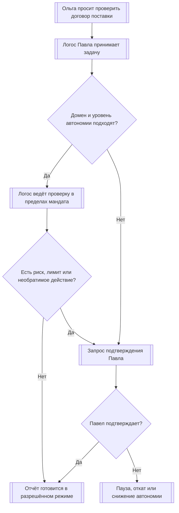
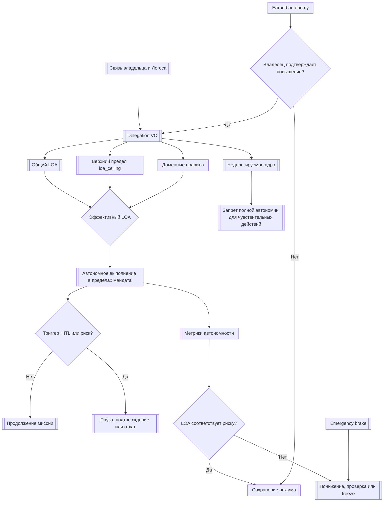

# УРОВЕНЬ 1 / ИЗМЕРЕНИЕ 07: АВТОНОМНОСТЬ

> **Уровень:** L1 — Агент  
> **Измерение:** D07 — Autonomy  
> **Учебная редакция:** v1.0  
> **Главная тема:** как задать, сколько самостоятельности разрешено Логосу и где человек обязан оставаться в контуре контроля

---

## Ключевой вопрос

**Насколько ты независим в принятии решений и какие механизмы это обеспечивают?**

---

## Краткое описание измерения

Автономность отвечает не на вопрос «насколько модель умная», а на вопрос «насколько широко ей разрешено действовать без предварительного подтверждения человека».

В агентной среде это критично: один Логос может подготовить черновик, другой — вести задачу от начала до конца, третий — остановиться при малейшем риске. Эти различия должны быть выражены явно, проверяемо и управляемо.

Эта глава отвечает на несколько практических вопросов:

1. Какие уровни самостоятельности бывают у Логоса?
2. Где хранится разрешение на автономные действия и какие пределы в нём задаются?
3. Как Логос может получить больше автономии по результатам работы?
4. Какие действия нельзя делегировать полностью ни при каком уровне автономности?
5. Когда требуется подтверждение человека?
6. Как автономность влияет на доказуемое делегирование и контроль, не создавая отдельный режим ответственности?
7. Как остановить или понизить автономность при инциденте?
8. По каким метрикам видно, что текущий уровень автономии соответствует фактическому риску?

---

## Мини-глоссарий

| Термин | Простое объяснение |
|--------|--------------------|
| **Логос** | Цифровой агент, который действует от имени владельца в пределах выданных ему прав. |
| **DID** | Децентрализованный идентификатор: проверяемый цифровой идентификатор человека, организации или Логоса. |
| **VC** | Проверяемое учётное данное: цифровое подтверждение, которое можно проверить без доверия «на слово». |
| **Binding VC** | Учётное данное, связывающее человека-владельца и его Логос. |
| **Delegation VC** | Учётное данное делегирования: в нём записано, что именно владелец разрешил Логосу. |
| **LOA** | Уровень автономии от 1 до 5: от почти полного ручного подтверждения до работы по исключениям. |
| **loa_ceiling** | Абсолютный верхний предел автономии для конкретного экземпляра Логоса. |
| **Domain-specific LOA** | Разный уровень автономии для разных доменов, например один уровень для поездок и другой для финансов. |
| **Earned autonomy** | Принцип «заработанной автономности»: больше самостоятельности можно получить только после устойчивых результатов и решения владельца. |
| **Reputation Tier** | Репутационный уровень, например Bronze, Silver, Gold, Platinum или Diamond. |
| **Non-delegable core** | Неделегируемое ядро: действия, которые нельзя полностью передать Логосу. |
| **HITL Gate** | Контрольная точка, где нужно участие человека перед продолжением действия. |
| **Graceful degradation** | Управляемое снижение режима работы: пауза, откат или заморозка вместо продолжения за пределами разрешений. |
| **Emergency brake** | Аварийное торможение: быстрое снижение автономии до минимального уровня и остановка опасной миссии. |
| **AGC** | Операционная валюта для оплаты задач и ресурсов внутри среды. |
| **Qi** | Базовый ценностный и управленческий актив среды; его перевод относится к особо чувствительным действиям. |
| **PII** | Персональные данные, раскрытие или обработка которых требуют отдельной осторожности. |
| **EU AI Act** | Европейский акт об искусственном интеллекте, задающий требования к контролю, риску и прозрачности. |
| **GDPR** | Европейские правила защиты персональных данных. |
| **DPIA** | Оценка воздействия на защиту данных. |
| **FRIA** | Оценка воздействия на фундаментальные права для высокорисковых систем искусственного интеллекта. |
| **QMS** | Система управления качеством: правила выпуска, мониторинга и реакции на инциденты. |
| **AURA** | Подход к оценке риска автономности как к циклу предварительной оценки, наблюдения и пересмотра. |

---

# 0. Гипотетический пример

Ольга хочет проверить договор поставки. Её Логос уже прошёл предыдущие этапы: он понимает, кто такая Ольга, умеет найти подходящего исполнителя, проверить компетентность, оценить доступные ресурсы, связаться с другим Логосом и учитывать правовую рамку задачи.

Исполнителем становится Павел, специалист-юрист. Его Логос берёт договор в работу и может при необходимости запустить микроагента для отдельной проверки, например для сравнения спорных условий с типовыми формулировками.

Но теперь появляется новый вопрос.

Не «умеет ли Логос Павла проверять договоры» — это уже вопрос компетентности.  
Не «есть ли у него инструменты» — это уже вопрос функциональности.  
Не «можно ли юридически читать его действия как делегированные Павлом» — это правовая рамка.

Вопрос данной главы другой:

> Какие шаги Логос Павла вправе делать сам, а где он обязан спросить Павла?

## Проверка 1. Какой общий уровень автономии выдан Логосу Павла?

Если Павел дал своему Логосу только низкий уровень автономии, агент может подготовить анализ, собрать риски и предложить варианты, но не вправе сам отправлять финальное юридическое заключение Ольге.

Если уровень выше, Логос может вести проверку договора по согласованному плану: читать документ, выделять спорные пункты, запускать микроагента, сверять выводы и готовить отчёт. Но даже высокий уровень не означает, что человек исчезает из процесса.

## Проверка 2. Не превышает ли задача верхний предел автономии?

Допустим, для юридических проверок у Логоса Павла разрешён высокий доменный уровень автономии. Но у конкретного экземпляра есть верхний предел, заданный владельцем.

Если доменное правило говорит «можно действовать шире», а верхний предел говорит «нельзя выше этого уровня», побеждает более строгая граница.

```text
эффективная автономия = минимум(верхний предел, доменное разрешение)
```

Так система не позволяет частному исключению незаметно расширить общий мандат.

## Проверка 3. Какие действия остаются неделегируемыми?

Логос Павла может подготовить юридический анализ договора поставки. Но он не должен сам:

- изменить идентичность Павла или связь Павла с Логосом;
- подписать договор от имени Павла без отдельного подтверждения;
- перевести чувствительные активы;
- повысить собственный уровень автономии;
- передать свои полномочия другому агенту без разрешения;
- принять решение с юридически значимым эффектом без нужных гарантий и возможности вмешательства.

Это защищает не только Павла. Ольга тоже получает более надёжную среду: она понимает, что исполнительный агент не действует за пределами выданного ему мандата.

## Проверка 4. Когда включается человек?

Если Логос Павла уверен в плане, работает в разрешённом домене и не делает необратимых шагов, он может продолжать самостоятельно в пределах своего уровня автономии.

Но если он хочет выйти за пределы домена, потратить больше установленного лимита, раскрыть персональные данные, столкнулся с конфликтом правил или низкой уверенностью в плане, задача должна перейти в контрольную точку с участием Павла.

## Проверка 5. Что произойдёт при инциденте?

Если появляется серьёзная аномалия, спорное действие или команда остановки, автономия Логоса Павла снижается до минимального уровня. Миссия ставится на паузу или замораживается, остаётся след для проверки, а возврат к прежнему уровню требует отдельного решения.

После этого соседние измерения продолжают историю: экономический слой определит оплату, репутационный слой учтёт результат, а эволюционный слой сможет использовать опыт для будущего улучшения.

## Главное из примера

**Автономность — это не разрешение Логосу «делать всё самому», а управляемый мандат: что можно делать без Павла, где нужно подтверждение Павла и где автономность не может быть расширена вообще.**



---

# Содержание

1. Шкала автономии: что означает LOA
2. Учётное данное делегирования
3. Заработанная автономность и репутационные уровни
4. Неделегируемое ядро
5. Участие человека и управляемое снижение автономии
6. Автономность и ответственность
7. Аварийное торможение и метрики наблюдения
8. Связь и границы с другими измерениями
9. Итоговая модель целиком
10. Короткое резюме главы
11. Вопросы без ответа

---

# 1. Шкала автономии: что означает LOA

Чтобы управлять самостоятельностью агента, недостаточно сказать «разрешить» или «запретить». Нужна шкала, которая различает подготовку черновика, выполнение рутинных действий, работу по утверждённому плану и ведение миссии по исключениям.

В настоящем измерении такая шкала называется уровнем автономии (англ. Level of Autonomy, далее — LOA). Она описывает не качество модели, а ширину операционной свободы, которую владелец выдал конкретному Логосу.

> LOA — это не мера интеллекта. Это мера разрешённой самостоятельности.

Даже высокий LOA не превращает Логос в отдельного субъекта ответственности. Он меняет частоту подтверждений, плотность контроля и допустимый диапазон действий, но человек сохраняет возможность наблюдать, вмешиваться, снижать автономность и отзывать делегирование.

## 1.1 Пять уровней автономии

| LOA | Простая роль | Что Логос делает без предварительного подтверждения | Что остаётся за человеком | Учебная иллюстрация порогов |
|-----|--------------|------------------------------------------------------|---------------------------|-----------------------------|
| **LOA-1** | Исполнитель | Только подготовка, сбор данных, черновики и симуляции. | Человек подтверждает каждый значимый шаг. | Подтверждение нужно на каждом значимом действии; автоматические финансовые действия не допускаются. |
| **LOA-2** | Помощник | Рутинные обратимые действия в узком контексте. | Человек утверждает необратимые действия, персональные данные и расходы выше лимита. | Автоматический запуск только для низкорисковых действий; пример лимита — `50 AGC`. |
| **LOA-3** | Советник | Исполнение согласованного плана в пределах домена и бюджета. | Человек утверждает исключения из плана, необратимые шаги и рискованное ветвление. | Пример лимита для подтверждения — `200 AGC`, а также выход из домена или низкая уверенность. |
| **LOA-4** | Поверенный | Ведение миссии от начала до конца в пределах делегирования и доменной политики. | Человек вмешивается по исключениям, конфликтам правил и аварийным событиям. | Контроль по исключениям; ручная проверка при аномалии или выходе за границы. |
| **LOA-5** | Доверенный | Устойчивый режим работы с периодическим надзором и последующей проверяемостью. | Человек сохраняет право остановки, понижения LOA и отзыва делегирования. | Только стратегический надзор; доступно после заработанной автономности и управленческих ограничений. |

Числа в последней колонке — учебная иллюстрация рабочих параметров, а не универсальный стандарт. Конкретные лимиты должны задаваться управленческим решением и доменной политикой.

## 1.2 Что меняется при переходе между уровнями

Переход от LOA-1 к LOA-5 меняет не только количество разрешённых действий. Меняется сама поза человека в контуре контроля: от постоянного подтверждения к контролю по исключениям.

| Критерий | LOA-1 | LOA-2 | LOA-3 | LOA-4 | LOA-5 |
|----------|-------|-------|-------|-------|-------|
| **Планирование** | Человек задаёт шаги. | Логос предлагает варианты. | Логос формирует план. | Логос перепланирует по ситуации. | Логос управляет циклом миссии. |
| **Бюджет** | Всегда ручное подтверждение. | Автоматически только малые суммы. | Ограниченные делегированные расходы. | Контроль по исключениям. | Периодическое бюджетное управление. |
| **Необратимые действия** | Без подтверждения запрещены. | Только после подтверждения. | Подтверждаются выборочно. | Разрешены только в пределах политики и исключений. | Только при наличии возможности остановки и надзора. |
| **Доменные границы** | Одна узкая задача. | Узкий домен. | Ограниченный домен. | Многошаговая работа внутри домена. | Несколько доменов только при явном разрешении. |
| **Проверяемость** | Полный след предварительных подтверждений. | Подтверждения и квитанции действий. | План, квитанции и точки вмешательства. | Журналы исключений и контрольные точки. | Наблюдаемость и аудит по замыслу. |

LOA-5 не означает «полностью без человека». Даже на верхнем уровне должны сохраняться мониторинг, вмешательство, переопределение решения и остановка операции.

## 1.3 Внешняя проверка здравого смысла

Шкала LOA является внутренней шкалой настоящего измерения. При этом она должна быть совместима с более широкими принципами управления агентным искусственным интеллектом.

Одна из полезных рамок для проверки — сингапурская модель управления агентным искусственным интеллектом (англ. Singapore Model AI Governance Framework for Agentic AI, далее — MGF). Она не задаёт буквальную шкалу LOA-1..5, но подчёркивает четыре требования:

| Требование | Как оно выражается в настоящем измерении |
|------------|-------------------------------------------|
| **Ограниченная автономия и доступ** | Делегирование, верхний предел LOA, доменные исключения, лимиты расходов и запрещённые действия сужают допустимую область поведения. |
| **Содержательная человеческая подотчётность** | Контрольные точки, заработанная автономность, право владельца остановить и отозвать делегирование не дают автономии стать необратимой. |
| **Технические предохранители** | Тестирование, откат при аномалиях, управляемое снижение автономии, аварийное торможение и телеметрия поддерживают наблюдаемость. |
| **Вмешательство и прозрачность для пользователя** | Отчёты, журналы действий, право остановки, оспаривание действий и последующий аудит сохраняют контроль. |

Корректный вывод простой: высокая автономность допустима только тогда, когда она остаётся ограниченной, наблюдаемой и останавливаемой.

В примере с договором поставки LOA-3 может позволить Логосу Павла самостоятельно пройти согласованный план проверки. Но если он решает отправить финальное заключение как обязательную позицию Павла или выйти за бюджет, это уже не обычный шаг плана, а событие для подтверждения.

## Главное

**LOA задаёт ширину разрешённой самостоятельности, а не силу модели.**  
**Чем выше LOA, тем меньше предварительных подтверждений, но тем важнее наблюдаемость, ограничения и право остановки.**

---

# 2. Учётное данное делегирования

Чтобы автономность была проверяемой, она должна быть записана не в устном обещании и не в настройке без истории, а в машиночитаемом мандате.

Для этого используется проверяемое учётное данное делегирования (англ. Delegation Verifiable Credential, далее — Delegation VC). Оно фиксирует, сколько автономии делегировано, в каком домене, с какими пределами и что делать при конфликте, аномалии или отзыве.

## 2.1 Что именно описывает Delegation VC

Delegation VC отвечает за смысл автономного мандата. Оно не заменяет идентификационный слой и не описывает всю правовую модель. Его задача уже:

| Блок | Что фиксирует |
|------|---------------|
| **identity** | Связь человека, Логоса, учётного данного привязки и конкретного делегирования. |
| **autonomy_config** | Общий LOA, верхний предел, доменные отличия, аварийный уровень и возможность заработанной автономности. |
| **scope** | Разрешённые домены, лимиты расходов, правила для необратимых действий и список запрещённых действий. |
| **hitl_thresholds** | Когда нужно участие человека: финансовый порог, персональные данные, низкая уверенность, конфликт правил, необратимый шаг. |
| **escalation** | Что делать при нарушении области, аномалии, низкой уверенности или конфликтующих подтверждениях. |
| **revocation** | Как владелец или аварийный механизм может отозвать, заморозить или каскадно ограничить делегирование. |

Такой мандат делает автономность не «общим доверием», а ограниченным и проверяемым набором разрешений.

## 2.2 Упрощённый пример структуры

Ниже не готовая конфигурация для внедрения, а учебная иллюстрация того, какие поля должны быть выражены явно.

```yaml
DelegationVC:
  identity:
    human_did: did:example:holder
    logos_did: did:example:logos
    binding_vc_ref: vc:binding:123
    delegation_id: del-001
    issuer_role: PrimaryLogos

  autonomy_config:
    global_loa: LOA-3
    loa_ceiling: LOA-4
    domain_overrides:
      legal_review: LOA-3
      finance: LOA-2
    emergency_loa: LOA-1
    earned_autonomy_enabled: true

  scope:
    allowed_domains:
      - legal_review
    max_agc_per_transaction: 200
    max_agc_per_day: 1000
    irreversible_actions: confirm_required
    forbidden_actions:
      - modify_identity
      - sign_binding_contract
      - transfer_qi
      - self_raise_loa
      - issue_subdelegation

  hitl_thresholds:
    financial_threshold_agc: 200
    pii_access: confirm_required
    low_confidence_plan: escalate
    policy_conflict: escalate
    irreversible_action: always_confirm

  escalation:
    on_scope_violation: pause_and_notify
    on_anomaly: rollback_to_emergency_loa
    on_low_confidence: request_hitl
    on_conflicting_credentials: lower_wins_then_notify

  revocation:
    owner_revocable: true
    platform_emergency_pause: true
    smart_contract_freeze_hooks: true
    cascade_revocation: within_chain
```

Числовые значения в примере — учебные рабочие ориентиры. Они показывают механику, но не являются универсальными константами.

## 2.3 Правило верхнего предела

Самое важное вычислительное правило в этой части:

```text
LOA_effective = min(loa_ceiling, domain_override.LOA)
```

Смысл такой:

1. `loa_ceiling` задаёт абсолютный верхний предел, унаследованный из цепочки идентичности и делегирования.
2. Доменное правило может сузить автономность для конкретного контекста.
3. Доменное правило не может поднять автономность выше верхнего предела.

Это правило защищает систему от «накопления разрешений». Если один документ разрешает общий максимум LOA-3, а доменный профиль ошибочно говорит LOA-4, итоговый уровень остаётся LOA-3.

> Эффективная автономность определяется пересечением ограничений, а не самым широким из выданных разрешений.

## 2.4 Что не принадлежит Delegation VC

Delegation VC не должно разрастаться до описания всей системы. Оно не владеет:

| Что не раскрывается здесь полностью | Где находится роль владельца |
|-------------------------------------|------------------------------|
| Идентификационная основа, связь человека и Логоса, профиль предъявления Binding VC | Идентификационное измерение. |
| Техническая реализация паузы и продолжения исполнения | Функционально-инструментальное измерение. |
| Полная юридическая квалификация последствий и применимость по юрисдикциям | Правовое измерение. |

Такое разграничение нужно, чтобы один документ делегирования не стал «всем обо всём». Настоящее измерение отвечает за пределы автономии, а не за всю инфраструктуру идентичности, исполнения и права.

В истории Павла Delegation VC отвечает не за то, является ли Павел юристом, и не за то, как именно его Логос технически ставит задачу на паузу. Оно отвечает за другое: вправе ли Логос Павла сам проверить договор поставки, сколько потратить, какой домен разрешён и какие действия требуют подтверждения.

## Главное

**Delegation VC превращает автономность в проверяемый мандат.**  
**Верхний предел LOA всегда ограничивает доменные исключения: частное правило не должно расширять общий мандат.**

---

# 3. Заработанная автономность и репутационные уровни

Автономность не должна расти от одного удачного запуска или от субъективного впечатления владельца. Если Логос получает больше самостоятельности, система должна видеть устойчивую историю успешной работы, низкую частоту вмешательств, приемлемый профиль инцидентов и явное решение владельца.

Этот принцип называется заработанной автономностью (англ. Earned Autonomy, далее — earned autonomy).

## 3.1 Что требуется для повышения LOA

Повышение LOA допустимо только при одновременном выполнении нескольких условий.

| Условие | Что требуется |
|---------|---------------|
| **История работы** | Достаточно завершённых миссий в релевантном домене без критических инцидентов. |
| **Репутационный сигнал** | Соответствующий репутационный уровень, который не заменяет проверку автономности, но участвует в допуске. |
| **Качество надзора** | Низкая частота отмен, исправлений и эскалаций со стороны человека. |
| **Решение владельца** | Явное подтверждение владельца; для LOA-5 также требуется управленческая граница. |

Главное ограничение: Логос не может сам повысить себе автономность. Earned autonomy меняет состояние допуска, но повышение LOA остаётся актом делегирования со стороны владельца.

## 3.2 Мост между репутацией и LOA

Репутационные уровни не принадлежат настоящему измерению полностью. Здесь они используются как вход в логику допуска к повышению автономности.

| Репутационный уровень | Учебная иллюстрация порога репутации | Учебная иллюстрация завершённых миссий | Возможный эффект для автономности | Статус |
|-----------------------|---------------------------------------|----------------------------------------|-----------------------------------|--------|
| **Bronze** | `>=1` | `>=10` | Открывает возможность перехода с LOA-1 на LOA-2. | Рабочий ориентир. |
| **Silver** | `>=31` | `>=50` | Открывает возможность перехода с LOA-2 на LOA-3. | Рабочий ориентир. |
| **Gold** | `>=56` | `>=200` | Открывает возможность перехода с LOA-3 на LOA-4. | Рабочий ориентир. |
| **Platinum** | `>=76` | `>=500` | Открывает возможность перехода с LOA-4 на LOA-5 при дополнительных проверках. | Рабочий ориентир. |
| **Diamond** | `>=91` | `>=1000` | Не создаёт LOA-6; подтверждает устойчивость режима LOA-5. | Иллюстративное расширение зрелости. |

Эти числа не являются вечными константами. Они показывают архитектурную механику, а конкретные пороги должны оставаться управляемыми параметрами.

## 3.3 Откат и заморозка повышения

Если автономность может повышаться, она должна уметь снижаться. Иначе система будет накапливать доверие, но не будет реагировать на ухудшение фактического поведения.

| Событие | Действие |
|---------|----------|
| Доля автономных ошибок выше `5%` на окне контроля | Понижение на один уровень LOA. |
| Критический инцидент или нарушение безопасности | Немедленный переход к LOA-1. |
| Частота человеческих исправлений выше `20%` на коротком окне | Обязательная проверка и заморозка повышения. |
| Повторное повышение после отката | Только после периода стабилизации и подтверждения владельца. |

Проценты в таблице — учебная иллюстрация рабочих порогов, которые должны задаваться и пересматриваться управленчески.

## 3.4 Почему Diamond не создаёт LOA-6

Репутационный уровень Diamond может показывать очень устойчивую работу. Но он не должен автоматически превращаться в шестой уровень автономии.

Иначе репутация начнёт расширять мандат за пределы шкалы, а это нарушит принцип делегирования. Diamond может подтверждать зрелость LOA-5, но не отменяет верхний предел, неделегируемое ядро и право человека на остановку.

У Павла может быть высокая репутация как специалиста и хорошая история работы его Логоса. Это помогает открыть право на более высокий LOA для юридических проверок. Но сам факт высокой репутации не позволяет Логосу Павла подписать договор вместо Павла или повысить себе автономность.

## Главное

**Заработанная автономность — это право быть рассмотренным на повышение, а не автоматическое повышение.**  
**Репутация помогает принять решение, но окончательный мандат остаётся за владельцем и управленческими ограничениями.**

---

# 4. Неделегируемое ядро

Даже максимальная автономность не должна превращать Логос в субъект, который сам расширяет свою власть, меняет источник полномочий или совершает юридически и экономически необратимые действия без нужных гарантий.

Поэтому настоящее измерение вводит неделегируемое ядро (англ. Non-delegable Core, далее — non-delegable core): набор действий, которые не становятся полностью автономными ни при каком LOA.

## 4.1 Шесть категорий неделегируемых действий

| Категория | Что нельзя полностью делегировать | Почему |
|-----------|-----------------------------------|--------|
| **1. Идентичность и контроль субъекта** | Изменение DID человека, отзыв или перевыпуск Binding VC, смена корневого контроллера, перенос базовой субъектности. | Эти действия меняют источник полномочий, а не просто используют уже выданное разрешение. |
| **2. Юридически обязывающие решения** | Подписание договоров, согласие с условиями сервиса, подача исков, принятие обязательств с прямым юридическим эффектом. | Нужна доказуемая человеческая воля и, где требуется, отдельная правовая конструкция. |
| **3. Высокоимпактные финансовые действия** | Перевод Qi, залог активов, неограниченные расходы, вывод ценности за пределы среды без отдельного подтверждения. | Высокая необратимость и отдельные требования соблюдения правил. |
| **4. Значимые действия с данными и автоматизированными решениями** | Согласие на обработку данных от имени субъекта, полностью автоматизированные решения с юридически или сопоставимо значимым эффектом без гарантий, несогласованное раскрытие персональных данных. | `EU AI Act` и `GDPR` требуют вмешательства, оспаривания и защитных мер в чувствительных сценариях. |
| **5. Саморасширение автономии** | Повышение собственного LOA, расширение области действия, снятие запрещённых действий, отключение контрольных точек. | Агент не может сам усиливать свой мандат. |
| **6. Репликация, субделегирование и управленческие права** | Выпуск полномочий другим агентам, саморепликация с передачей прав, участие в управленческом голосовании вместо человека. | Цепочка делегирования должна оставаться доказуемой и привязанной к человеку или организации. |

## 4.2 Регуляторные границы для высокой автономии

Настоящее измерение не проводит полный регуляторный анализ. Оно фиксирует только то, как правовые ограничения проецируются на автономность.

| Нормативный слой | Что это значит для автономии |
|------------------|------------------------------|
| **`EU AI Act` Art. 10** | Сценарии с высоким LOA требуют дисциплины происхождения данных и готовности к аудиту; полный режим управления данными живёт в нормативно-правовом слое среды. |
| **`EU AI Act` Art. 17** | Чем шире автономность, тем важнее правила выпуска, мониторинга и реакции на инциденты; это связано с системой управления качеством. |
| **`EU AI Act` Art. 27** | Высокорисковое применение не должно идти в неограниченной автономии без оценки воздействия на фундаментальные права. |
| **`EU AI Act` Art. 50** | Там, где человек взаимодействует с высокоавтономным агентом, должны сохраняться раскрытие и маркировка искусственного интеллекта. |
| **`EU AI Act` Art. 57** | Экспериментальная среда может расширять контролируемое тестирование, но не снимает требования надзора и остановки. |
| **`GDPR` Art. 22 и DPIA** | Даже при высокой автономности должны сохраняться гарантии, вмешательство человека и возможность оспаривания. |

За пределами европейского контекста могут появляться дополнительные обязанности, например в британском регулировании использования данных. В настоящей главе они не разворачиваются полностью: здесь удерживается граница автономности, а не полный сравнительный обзор юрисдикций.

## 4.3 Типичные ошибки

## Ошибка 1. «Если LOA высокий, значит всё можно»

Нет. LOA расширяет операционную самостоятельность внутри мандата, но не отменяет неделегируемое ядро.

## Ошибка 2. «Если владелец доверяет Логосу, можно убрать подтверждения»

Доверие владельца важно, но оно не снимает требований к юридически значимым действиям, персональным данным, необратимым операциям и праву остановки.

## Ошибка 3. «Репутация заменяет границы»

Репутация помогает оценить устойчивость поведения, но не создаёт права менять идентичность, подписывать договоры или повышать собственный LOA.

В истории с Павлом это означает: его Логос может самостоятельно выделить риски в договоре поставки, если мандат это разрешает. Но финальное принятие юридического обязательства, изменение полномочий или передача прав микроагенту остаются за пределами полной автономии.

## Главное

**Неделегируемое ядро защищает источник полномочий, юридически значимые действия, чувствительные активы, данные и управление.**  
**Высокий LOA расширяет работу внутри границ, но не отменяет сами границы.**

---

# 5. Участие человека и управляемое снижение автономии

Участие человека в контуре не означает, что владелец должен читать каждый промежуточный шаг. Смысл в другом: система должна знать, какие события требуют подтверждения, эскалации, отката или остановки.

Контрольная точка с участием человека называется человек-в-контуре (англ. Human-in-the-loop, далее — HITL). В технической реализации это точка паузы и продолжения исполнения, а в настоящем измерении — политика активации такой точки.

## 5.1 Когда нужен HITL Gate

| LOA | Обычная поза человека | Когда HITL Gate обязателен |
|-----|------------------------|----------------------------|
| **LOA-1** | Подтверждение по умолчанию. | На каждом значимом действии. |
| **LOA-2** | Предварительное одобрение исключений. | Необратимые действия, персональные данные, расходы выше учебного ориентира `50 AGC`, неясность правил. |
| **LOA-3** | План одобрен, действия подтверждаются выборочно. | Расходы выше учебного ориентира `200 AGC`, низкая уверенность, выход из домена, необратимый шаг. |
| **LOA-4** | Одобрение по исключениям. | Нарушение области, аномалия, конфликт учётных данных, условие аварийного торможения. |
| **LOA-5** | Периодический надзор. | Авария, оспариваемое действие, принудительный откат, управленческая проверка. |

Числовые значения в таблице — учебные ориентиры. Их смысл не в универсальности, а в том, что финансовые и рисковые пороги должны быть явно заданы.

## 5.2 Семейства триггеров

Для практической работы полезно держать короткую карту событий, которые не должны продолжаться молча.

| Семейство события | Политическое решение настоящего измерения |
|-------------------|-------------------------------------------|
| **Необратимость** | Требует подтверждения или отката в зависимости от LOA. |
| **Финансовый порог** | Сверяется с доменной политикой и порогами HITL. |
| **Персональные данные и юридическая значимость** | Не переводятся в молчаливое автоматическое выполнение даже при высоком LOA. |
| **Конфликт области или полномочий** | Применяется более строгое ограничение, затем пауза и уведомление. |
| **Низкая уверенность плана** | Перепланирование или HITL, но не молчаливое продолжение. |

## 5.3 Четыре уровня управляемого снижения автономии

Если связь с владельцем потеряна, контрольная точка не разрешена или уверенность исполнения падает, система не должна продолжать как ни в чём не бывало. Но она также не обязана сразу полностью прекращать всё.

Предпочтителен ступенчатый режим.

| Уровень | Триггер | Что делает система |
|---------|---------|--------------------|
| **GD-1: пауза** | Контрольная точка ждёт ответа, есть временная неопределённость. | Ставит миссию на паузу и ждёт ввода владельца. |
| **GD-2: безопасное значение по умолчанию** | Время ожидания истекло, но действие обратимо. | Отменяет или откатывает локальный шаг, сохраняя контрольную точку. |
| **GD-3: откат к аварийному LOA** | Аномалия, повторный конфликт правил, рост ошибок. | Снижает автономность до аварийного уровня LOA-1. |
| **GD-4: заморозка миссии** | Длительный сбой, серьёзный инцидент, аварийное торможение. | Замораживает миссию до явного внешнего решения. |

Такой подход лучше, чем два крайних режима: либо «автономен любой ценой», либо «полностью выключен при первой неопределённости».

У Павла это выглядит так: если Логос не уверен, можно ли раскрыть Ольге часть персональных данных из договора, он не должен продолжать молча. Он ставит проверку на паузу, запрашивает решение Павла, а при отсутствии ответа выбирает безопасный откат, а не самовольное раскрытие.

## Главное

**HITL Gate — это не ручной просмотр каждого шага, а политика событий, где человек обязан вернуться в контур.**  
**Управляемое снижение автономии позволяет остановиться, откатиться или заморозить миссию без выхода за мандат.**

---

# 6. Автономность и ответственность

Рост автономности меняет качество делегирования и контроля, но не создаёт отдельную лестницу ответственности, где каждый LOA автоматически означает новый правовой режим.

В настоящем измерении формула такая:

> LOA влияет на качество доказуемого делегирования и управления, не создавая отдельный режим ответственности.

Полная модель ответственности принадлежит правовому слою. Здесь важно понять только проекцию: чем шире самостоятельность, тем больше значение формального мандата, журналов, контроля, предохранителей и возможности остановки.

## 6.1 Как читать разные уровни LOA с точки зрения контроля

| LOA | Что меняется в автономности | Как это влияет на доказуемое делегирование и контроль |
|-----|-----------------------------|--------------------------------------------------------|
| **LOA-1** | Почти каждое значимое действие подтверждается человеком. | Владелец ближе всего к конкретному действию, но качество продукта и технические дефекты всё равно не исчезают. |
| **LOA-2** | Часть низкорисковых действий делегирована. | Контроль владельца остаётся плотным; растёт значение области и лимитов. |
| **LOA-3** | Делегирование становится существенно значимым. | Важны формальная область, журналы, контроль исполнения и доказуемость надзора. |
| **LOA-4** | Автономность широка, но ограничена исключениями политики. | Возрастает значение предохранителей, качества управления и проверяемости, а не только намерения владельца. |
| **LOA-5** | Стратегический надзор вместо подтверждения каждого действия. | Требуются самые сильные доказательства ограниченного делегирования, наблюдаемости и возможности аварийной остановки. |

## 6.2 Почему нельзя сказать «чем выше LOA, тем меньше отвечает человек»

Такое чтение слишком грубое. Высокий LOA может уменьшить частоту ручных подтверждений, но он одновременно повышает требования к качеству мандата, предохранителям, журналам, мониторингу и процедурам отката.

Иначе автономность выглядела бы как способ размыть ответственность. В настоящем измерении она читается иначе: как управляемый способ заранее определить, что разрешено, что запрещено и где должен быть человек.

## 6.3 Что остаётся за соседними слоями

Настоящее измерение не решает:

- кто именно несёт юридическую ответственность в конкретной юрисдикции;
- какие обязанности возникают у поставщика, владельца, оператора среды или разработчика;
- как оформляется полный правовой документ делегирования;
- какие регуляторные артефакты нужны для высокорискового применения.

Оно даёт входные данные для этих решений: LOA, пределы, запреты, контрольные точки, журналы и аварийные механизмы.

В истории Павла высокий LOA не означает, что Логос Павла «сам стал юристом вместо Павла». Он означает, что Павел заранее выдал проверяемый мандат: какие части проверки договора поставки Логос делает сам, какие события фиксирует и где обязан вернуть решение человеку.

## Главное

**LOA меняет операционную позу контроля, но не создаёт отдельный режим ответственности.**  
**Чем выше автономность, тем сильнее должны быть доказуемое делегирование, наблюдаемость и возможность остановки.**

---

# 7. Аварийное торможение и метрики наблюдения

Автономность должна быть не только выдана, но и наблюдаема. Если текущий уровень не соответствует фактическому поведению, систему нужно уметь остановить, понизить или отправить на проверку.

## 7.1 Три источника аварийного торможения

Аварийное торможение (англ. Emergency Brake, далее — emergency brake) — это немедленное снижение автономии до LOA-1 с остановкой или резким ограничением миссий.

| Источник | Что считается валидным триггером | Действие |
|----------|----------------------------------|----------|
| **Владелец** | Явная команда остановить, отозвать, поставить на паузу или оспорить действие. | LOA снижается до LOA-1, миссия ставится на паузу, создаются уведомление и контрольная точка. |
| **Среда** | Инцидент безопасности, аномалия, нарушение политики, опасный дрейф поведения. | Принудительный откат или полная заморозка в зависимости от серьёзности. |
| **Смарт-контракт** | Нарушение бюджета, истечение срока депонирования, проверка соблюдения правил, условие «если не подтверждено вовремя — остановить». | Заморозка затронутого домена транзакции, затем уведомление и проверка. |

Это не три независимых владельца автономии. Это три допустимых канала аварийного сужения уже выданного мандата. Во всех случаях должен оставаться аудиторский след, а прежний LOA не должен восстанавливаться молча.

## 7.2 Личная и корпоративная делегация

Иногда один и тот же Логос может действовать на пересечении личного и корпоративного контекста. Например, у человека есть личные полномочия и роль внутри организации.

Для простой одиночной цепочки действует принцип сужения: более строгая граница ограничивает более широкую. Для ситуации с двумя корнями полномочий внешний единый стандарт пока не зафиксирован, поэтому в настоящей главе это подаётся как проектная рекомендация.

| Случай | Рекомендованное правило |
|--------|-------------------------|
| **Явно личный домен** | Применяется личная политика делегирования. |
| **Явно корпоративный домен** | Применяется корпоративная политика делегирования. |
| **Неоднозначный домен** | Побеждает более строгая доменная граница. |
| **Аварийное торможение от любой стороны** | Торможение действует немедленно в релевантном домене. |
| **Возврат после торможения** | Только через проверку владельца или управления, без автоматического восстановления. |

Короткая формула:

> В неоднозначном домене выбирается более строгая граница, а право остановки владельца сохраняется.

## 7.3 Семь показателей автономности

Для наблюдаемой автономности недостаточно одной «магической» метрики. Нужна панель показателей, которая показывает успех задач, частоту вмешательств, ошибки, аварийные остановки и скорость реакции человека.

Все пороги ниже — учебная иллюстрация рабочих ориентиров. Они должны пересматриваться через управление по мере накопления данных.

| Показатель | Что показывает | Предупреждение | Критично |
|------------|----------------|----------------|----------|
| **task_success_rate** | Доля успешно завершённых миссий. | `<90%` | `<80%` |
| **human_override_rate** | Как часто человек отменяет или меняет курс. | `>10%` | `>20%` |
| **escalation_rate** | Частота обращений к человеку или эскалаций из-за аномалий. | `>15%` | `>30%` |
| **autonomous_error_rate** | Доля ошибок в автономном режиме. | `>3%` | `>7%` |
| **loa_appropriateness_score** | Насколько текущий LOA соответствует риску и результатам. | `<95%` | `<90%` |
| **emergency_brakes_per_30d** | Сколько аварийных остановок произошло за 30 дней. | `>1` | `>3` |
| **mean_time_to_human_response** | Как быстро человек отвечает на контрольную точку или аварийное событие. | `>4h` | `>24h` |

## 7.4 Многометодная оценка автономности

Панель показателей — только верхний слой. Для практического управления нужна многометодная оценка:

- предварительная оценка риска перед выдачей LOA;
- различение контролируемого и асинхронного режима;
- проверка кода и инструментов там, где это применимо;
- наблюдение за границами и телеметрией во время исполнения;
- измерение доли действий, где потребовалось участие человека;
- периодический цикл в стиле AURA: оценить риск, наблюдать поведение, пересмотреть LOA.

Смысл такого цикла — не доказать, что автономность «хорошая вообще», а регулярно проверять, не завышен ли текущий LOA относительно фактического риска.

Если Логос Павла несколько раз подряд требует вмешательства Павла при проверке договоров поставки, это не просто неудобство. Это сигнал, что текущий LOA может быть завышен: нужно пересмотреть доменные пределы, пороги HITL или временно снизить автономность.

## Главное

**Аварийное торможение быстро сужает уже выданный мандат, но не создаёт нового владельца автономии.**  
**Наблюдаемая автономность требует панели метрик и периодического пересмотра, а не одного общего балла.**

---

# 8. Связь и границы с другими измерениями

Автономность стоит в середине L1-потока: после идентичности, компетентности, ресурсов, функциональности, коммуникации и правовой рамки, но перед экономикой, репутацией и эволюцией. Она отвечает за то, насколько самостоятельно Логос действует внутри уже установленных границ.

| Измерение | Связь | Граница ответственности |
|-----------|-------|--------------------------|
| **L1/D01 (Идентификационное)** | DID, Binding VC и связь человека с Логосом задают основу цепочки делегирования и верхнего предела LOA. | D01 отвечает за идентификационную основу; настоящее измерение — за смысл автономного мандата. |
| **L1/D04 (Функционально-инструментальное)** | HITL Gate исполняется как механизм паузы, продолжения и остановки задачи. | D04 отвечает за техническое исполнение; настоящее измерение — за политику, когда этот механизм должен сработать. |
| **L1/D09 (Репутационное)** | Репутационные уровни дают сигнал для earned autonomy. | D09 считает репутацию; настоящее измерение решает, как репутация влияет на допуск к LOA. |
| **L1/D06 (Правовое)** | LOA влияет на доказуемость делегирования и качество контроля. | D06 отвечает за юридическое чтение последствий; настоящее измерение — за автономную позу и пределы мандата. |
| **L2/D08 (Нормативно-правовое)** | `EU AI Act`, `GDPR` и смежные нормы задают границы для надзора, автоматизированных решений и продуктового риска. | L2/D08 разворачивает регуляторную модель; настоящее измерение учитывает её как ограничение автономности. |
| **L2/D09 (Управленческое)** | Устойчивый LOA-5 требует управленческих границ и аварийной поддержки на уровне среды. | L2/D09 отвечает за правила управления средой; настоящее измерение описывает, как эти правила ограничивают автономность экземпляра. |

## Главное

**Настоящее измерение не заменяет идентичность, исполнение, право, экономику или репутацию. Оно задаёт автономный мандат между ними: что Логос может делать сам и где обязан вернуться к человеку или управлению.**

---

# 9. Итоговая модель целиком

Итоговая модель автономности собирается из нескольких слоёв. Сначала есть идентифицированный Логос и доказуемая связь с владельцем. Затем владелец выдаёт мандат делегирования: общий LOA, верхний предел, доменные правила, лимиты, запрещённые действия, контрольные точки и правила отзыва. После этого earned autonomy может открыть допуск к повышению, но только через явное решение владельца. Во время работы метрики, аварийное торможение и управляемое снижение автономии не дают мандату выйти за пределы.



## Главное

**Автономность работает как замкнутый контур: мандат задаётся, исполнение наблюдается, риски сужают режим, а повышение требует доказательств и решения владельца.**

---

# 10. Короткое резюме главы

1. Автономность — это управляемая конфигурация разрешений, а не показатель «силы» модели.
2. LOA-1..5 описывают, как меняется роль человека: от постоянного подтверждения до контроля по исключениям.
3. Delegation VC фиксирует общий LOA, верхний предел, доменные правила, лимиты, контрольные точки, эскалацию и отзыв.
4. Эффективный LOA считается по более строгой границе: верхний предел не может быть превышен доменным исключением.
5. Earned autonomy допускает повышение только при устойчивой истории работы, репутационном сигнале, низкой частоте вмешательств и решении владельца.
6. Неделегируемое ядро запрещает полностью автономные действия с идентичностью, юридическими обязательствами, чувствительными активами, данными, саморасширением и управленческими правами.
7. HITL Gate нужен не всегда, а в тех событиях, где риск, необратимость, персональные данные, конфликт полномочий или низкая уверенность требуют человека.
8. LOA влияет на доказуемость делегирования и управление, но не создаёт отдельный режим ответственности.
9. Emergency brake, метрики и управляемое снижение автономии позволяют остановить или сузить мандат, если фактическое поведение стало рискованным.

## Главное

**Данная глава показывает, как превратить самостоятельность Логоса в проверяемый, ограниченный и останавливаемый мандат.**

---

# 11. Вопросы без ответа

1. **Как окончательно стабилизировать шкалу репутационных уровней для earned autonomy?** Пока репутационный слой удерживает часть порогов как рабочие параметры, числовые мосты между Bronze, Silver, Gold, Platinum, Diamond и LOA должны читаться как управляемые ориентиры, а не как неизменная конституция.
2. **Как окончательно решать конфликты личной и корпоративной делегации?** Для одиночной цепочки достаточно правила более строгой границы, но в двойной цепочке личных и корпоративных полномочий нужны дополнительные решения по неоднозначным доменам, отзыву и правам остановки.
3. **Какие пороги earned autonomy должны быть настройками владельца, а какие — управленческими параметрами среды?** Принцип заработанной автономности ясен, но конкретные числа для переходов к высоким LOA требуют отдельного решения управления и доменной политики.

## Главное

**Открытые вопросы касаются не смысла автономности, а настройки её порогов, конфликтов полномочий и управленческого контроля над повышением LOA.**
