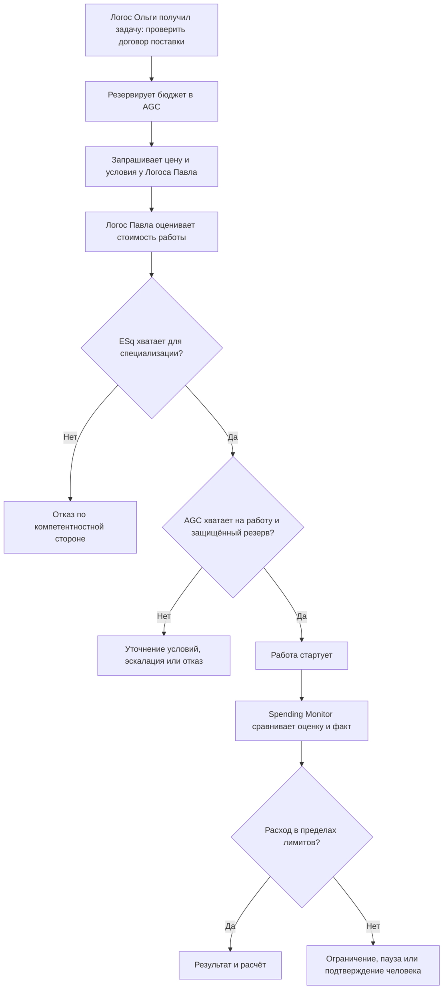
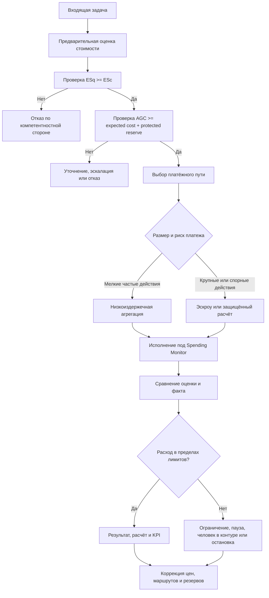

# УРОВЕНЬ 1 / ИЗМЕРЕНИЕ 08: ЭКОНОМИЧЕСКОЕ

> **Уровень:** L1 — Агент  
> **Измерение:** D08 — Economic  
> **Учебная редакция:** v1.0  
> **Главная тема:** как агент получает, тратит и защищает операционный бюджет

---

## Ключевой вопрос

**Какова твоя финансовая независимость и как она обеспечивается?**

---

## Краткое описание измерения

Агент может быть идентифицирован, компетентен, обеспечен ресурсами, функционален, связан с другими участниками, юридически оформлен и достаточно автономен.

Но этого всё ещё недостаточно, если он не умеет экономически жить: считать стоимость задачи, резервировать средства, останавливаться при нехватке бюджета и не принимать работу, за которую не может заплатить.

Настоящее измерение объясняет финансовую независимость Логоса как управляемую способность работать в пределах бюджета, зарабатывать на разрешённых задачах и не превращать автономность в неконтролируемые расходы.

Эта глава отвечает на несколько практических вопросов:

1. Когда Логос можно считать финансово независимым?
2. Какие элементы управляют его расходами и доходами?
3. Почему одной компетентности недостаточно без операционных средств?
4. Как заранее оценивать стоимость задачи и не допускать перерасход?
5. Что происходит, если бюджет исчерпан?
6. Какие метрики показывают, что экономическая модель агента устойчива?
7. Как выстроить стимулы так, чтобы агент работал на цель владельца, а не на собственный расход?

---

## Мини-глоссарий

| Термин | Простое объяснение |
|--------|--------------------|
| **Логос** | Агент, который действует от имени владельца в цифровой среде. |
| **`AGC`** | Операционная валюта агента: из неё оплачиваются задачи, инструменты, вычисления и расчёты с другими агентами. |
| **`Qi`** | Отдельный актив среды для ценности и управления; в данной главе он важен только как соседний экономический слой, а не как рабочий бюджет агента. |
| **Операционный резерв** | Часть доступных средств, которую нельзя тратить свободно: она нужна на запуск, выполнение и безопасное завершение задач. |
| **Канал заработка** | Разрешённый способ получать `AGC` за выполненные миссии, услуги или взаимодействия с другими агентами. |
| **`Budget Controller`** | Компонент Логоса, который оценивает, резервирует, отслеживает и ограничивает расходы. |
| **`Orchestrator`** | Компонент Логоса, который планирует и исполняет задачу; он выбирает ход работы, но не должен самовольно расширять бюджет. |
| **`Allocation Engine`** | Часть `Budget Controller`, распределяющая доступные средства между задачами, миссиями и резервами. |
| **`Spending Monitor`** | Часть `Budget Controller`, которая следит за фактическим расходом, скоростью сгорания бюджета и отклонением от оценки. |
| **`Earning Tracker`** | Часть `Budget Controller`, которая учитывает входящие средства, ожидаемые расчёты и заблокированные суммы. |
| **`Cost Estimator`** | Часть `Budget Controller`, которая заранее оценивает стоимость задачи. |
| **`Reporting`** | Часть `Budget Controller`, которая показывает владельцу и политикам исполнения экономическое состояние агента. |
| **`ESq`** | Квота специализации: сколько компетентностного объёма владелец вправе распределить агенту. |
| **`ESc`** | Стоимость специализации: сколько компетентностного объёма требует конкретная задача или микроагент. |
| **Двойное ограничение** | Правило: действие допустимо только если одновременно хватает компетентностного права и денег на выполнение. |
| **Защищённый резерв** | Минимальная сумма, которую нельзя тратить на новые действия, чтобы агент мог корректно завершить уже начатое. |
| **Микроагент** | Дочерний исполнитель внутри Логоса, создаваемый под более узкую задачу. |
| **Предварительная оценка стоимости** | Расчёт ожидаемых расходов до запуска задачи. |
| **Трассировка исполнения** | Запись плана, шагов, вызовов инструментов, решений и стоимости выполнения. |
| **`MCP`** | Протокол подключения агента к внешним инструментам и системам. |
| **`API`** | Программный интерфейс, через который агент вызывает внешний сервис. |
| **`x402`** | Пример протокольного подхода к оплате конкретного действия по запросу. |
| **Эскроу** | Механизм, где средства удерживаются до выполнения согласованных условий. |
| **Канал состояний** | Механизм агрегации множества мелких операций с последующим расчётом итогом. |
| **`SLA`** | Соглашение о качестве услуги: сроках, надёжности и ожидаемом результате. |
| **Запрос цены** | Шаг, на котором один агент спрашивает другого о цене и условиях выполнения. |
| **Предложение цены** | Ответ контрагента с ценой, сроком, качеством и условиями расчёта. |
| **Скорость сгорания бюджета** | Сколько средств агент расходует за период. |
| **Запас хода** | Сколько времени агент сможет продолжать работу при текущем расходе и доходе. |
| **Отношение резерва к расходу** | Насколько запас средств покрывает текущую скорость расходов. |
| **Срок окупаемости** | Когда накопленная ценность результата сравняется с накопленными затратами. |
| **Стоимость успешного результата** | Полная цена не просто ответа модели, а результата, который действительно решает задачу. |
| **Валовая маржа** | Доля дохода, остающаяся после прямых операционных расходов. |
| **Уравнение выживания** | Простая проверка: создаёт ли текущий профиль работы больше ценности, чем потребляет стоимости. |
| **Неплатёжеспособность** | Состояние, когда средств не хватает для продолжения работы по правилам безопасности. |
| **Контур страхования** | Экономический буфер для спорных, мошеннических или системных потерь. |
| **Задача принципала и агента** | Ситуация, где владелец и агент могут иметь разные стимулы, поэтому нужны лимиты, отчётность и контроль. |
| **Человек в контуре** | Режим, при котором чувствительное или дорогое действие требует подтверждения человека. |
| **Уровень автономности** | Степень самостоятельности Логоса, заданная владельцем и политиками среды. |

---

# 0. Гипотетический пример

Ольга уже прошла несколько шагов в общей истории.

Её Логос идентифицирован. Он понимает, кто такая Ольга и от чьего имени действует. Компетентностный слой уже помог отличить просто уверенного исполнителя от исполнителя с подтверждённым правом и способностью работать с юридическими задачами. Материальный слой показал, какие ресурсы нужны для выполнения. Функциональный слой отвечает за план работы. Коммуникационный слой позволяет Логосам договориться. Правовой слой задаёт рамки обязательств. Автономность определяет, где Логос может действовать сам, а где нужно подтверждение владельца.

Теперь история доходит до экономического вопроса.

**Ольга** — заказчик. Её Логос ищет исполнителя для проверки договора поставки.

**Павел** — специалист-юрист. Его Логос выполняет проверку договора поставки.

На первый взгляд задача звучит просто: Логос Ольги отправляет договор, Логос Павла проверяет, Ольга получает результат.

Но в реальной среде нужно ответить на другой набор вопросов:

- хватит ли у Ольги средств, чтобы оплатить проверку;
- может ли Логос Павла принять задачу без риска уйти в перерасход;
- как заранее оценить стоимость инструментов, вычислений, хранения контекста и расчёта;
- что делать, если задача оказалась дороже оценки;
- когда нужно остановиться или спросить человека.

## Проверка 1. Есть ли у Ольги бюджет на задачу?

Логос Ольги не должен отправлять задачу, если оплата существует только как обещание.

Сначала он резервирует сумму в `AGC`: часть на оплату работы Павла, часть на платёжные издержки, часть на безопасное завершение собственного процесса.

Если резерв не создан, задача не должна уходить дальше как полноценный заказ. Иначе Логос Павла начнёт расходовать свои ресурсы, не имея экономической гарантии расчёта.

## Проверка 2. Может ли Логос Павла принять работу?

Логос Павла смотрит не только на то, что задача юридическая и компетентностно допустимая.

Он оценивает собственную экономику:

- сколько стоят вызовы инструментов;
- сколько может стоить анализ длинного договора;
- понадобится ли хранить состояние;
- есть ли риск повторных попыток;
- останется ли защищённый резерв на завершение работы.

Если ожидаемая стоимость выше доступного бюджета или слишком близка к опасному порогу, Логос Павла должен уточнить условия, запросить другой бюджет, передать задачу на подтверждение человеку или отказаться.

## Проверка 3. Проходят ли обе стороны двойное ограничение?

Для юридической проверки договора мало одного ответа «Павел компетентен».

Нужны две независимые проверки:

```text
ESq_available >= ESc
AGC_available >= expected_cost + protected_reserve
```

Первая проверка говорит: у Логоса Павла есть подтверждённое право и компетентностный объём на такую специализацию.

Вторая говорит: выполнение можно оплатить без нарушения экономической безопасности.

Если проходит только первая проверка, у исполнителя есть компетентность, но нет денег на работу. Если проходит только вторая, есть деньги, но нет права брать такую специализацию. В обоих случаях задача не должна стартовать как обычное исполнение.

## Проверка 4. Как происходит расчёт?

Для одной дорогой и спорной работы может понадобиться эскроу: средства удерживаются до выполнения условий.

Для серии мелких действий удобнее агрегировать расчёты: не оплачивать каждый технический шаг отдельно тяжёлой операцией, а сводить множество микроплатежей в итоговый расчёт.

В примере Ольги и Павла это означает простую вещь: форма оплаты выбирается не «по привычке», а по размеру, риску и спорности действия.

## Проверка 5. Что будет при перерасходе?

Предположим, анализ договора оказался сложнее: больше страниц, больше ссылок, больше проверок.

`Budget Controller` Логоса Павла сравнивает оценку с фактом. Если расход растёт слишком быстро, он может ограничить повторные попытки, остановить дорогие инструменты, запросить подтверждение или отказаться от продолжения.

Пополнение бюджета само по себе не должно автоматически перезапускать старую цепочку действий. После экономического сбоя нужно проверить состояние задачи, причину перерасхода и заново разрешить продолжение.

## Главное из примера

**Экономическое измерение защищает обе стороны: Ольгу — от оплаты неконтролируемого процесса, Павла — от выполнения работы без средств, а среду — от агентов, которые умеют действовать, но не умеют считать цену действия.**



---

# Содержание

1. Финансовая независимость Логоса
2. Управление бюджетом
3. Двойное ограничение: компетентность и деньги
4. Тарификация и микроплатежи
5. Метрики финансовой независимости
6. Экономический жизненный цикл и неплатёжеспособность
7. Риски и стимулы
8. Связь и границы с другими измерениями
9. Итоговая модель целиком
10. Короткое резюме главы
11. Вопросы без ответа

---

# 1. Финансовая независимость Логоса

Финансовая независимость в данной главе не означает, что Логос полностью отделён от владельца или создаёт капитал из ничего.

Она означает другое: Логос может выполнять разрешённую операционную деятельность без ручного подтверждения каждой траты, если заранее заданные экономические условия соблюдены.

Для этого нужны четыре опоры.

| Опора | Что означает | Что ломается без неё |
|-------|--------------|----------------------|
| **Операционный резерв** | У Логоса есть доступный `AGC` на запуск, выполнение и завершение задачи. | Даже короткая задача может остановиться из-за нехватки ликвидности. |
| **Канал заработка** | Логос может получать `AGC` за разрешённые миссии и услуги. | Расход только переносит момент остановки, но не создаёт устойчивость. |
| **Слой контроля** | `Budget Controller` заранее оценивает, резервирует и ограничивает расходы. | Бюджет становится мягкой рекомендацией, а не реальным пределом. |
| **Слой ограничений** | Каждое действие проходит проверку компетентностного права и оплаты. | Агент может быть либо компетентен, но неплатёжеспособен, либо платёжеспособен, но не имеет права действовать. |

> Финансовая независимость — это не строка баланса, а способность действовать в пределах заранее разрешённого экономического контура.

Поэтому «у агента есть деньги» не равно «агент финансово независим».

Логос может иметь временный остаток средств, но не быть независимым, если не умеет заранее оценивать цену задачи, не имеет устойчивого канала заработка или не может остановить перерасход во время исполнения.

Обратная ситуация тоже возможна: потенциально выгодная задача не делает Логос устойчивым, если её выполнение нарушает лимиты, требует неподтверждённой компетенции или блокирует весь резерв на один рискованный запуск.

## 1.1 Что именно считается операционными деньгами

Рабочим бюджетом на уровне отдельного Логоса выступает `AGC`.

В данной главе `AGC` рассматривается не как абстрактная «ценность среды», а как ограниченный ресурс исполнения: им оплачиваются инструменты, вычисления, хранение, расчёты с контрагентами и завершение задач.

Отдельный актив `Qi` относится к более широкому экономическому и управленческому уровню. Для Логоса в этой главе важно не смешивать эти слои: `AGC` нужен для операционной ликвидности, а `Qi` не заменяет текущий бюджет задачи.

## 1.2 Где проходит граница настоящего измерения

Данная глава объясняет, как один Логос видит свои доходы, расходы, резервы и ограничения.

Она не определяет всю денежную архитектуру среды, правила эмиссии, распределение общей выручки или полную механику расчётов между множеством участников.

Для читателя это практическая граница: здесь мы спрашиваем не «как устроена вся экономика», а «может ли конкретный агент безопасно заработать, потратить и остановиться».

В истории Ольги и Павла это выглядит так: Логос Ольги не проектирует всю денежную систему, а проверяет, может ли зарезервировать оплату проверки договора. Логос Павла не устанавливает правила всей среды, а решает, можно ли принять конкретную работу без риска перерасхода.

## Главное

**Финансовая независимость Логоса держится на четырёх вещах: резерве, заработке, контроле расходов и двойной проверке права плюс оплаты.**  
**Деньги без контроля не дают независимости; контроль без денег не даёт способности действовать.**

---

# 2. Управление бюджетом

Чтобы бюджет был реальным ограничением, нужен компонент, который работает до запуска задачи и во время её выполнения.

Эту роль выполняет `Budget Controller`.

Он не заменяет функциональный компонент исполнения. Функциональный компонент строит план, выбирает инструменты и ведёт задачу. `Budget Controller` отвечает за другое: можно ли тратить, сколько можно тратить, когда нужно остановиться и какое решение экономически допустимо.

> `Orchestrator` отвечает на вопрос «как выполнить задачу».  
> `Budget Controller` отвечает на вопрос «можно ли платить за такой ход выполнения».

## 2.1 Пять внутренних функций

| Функция | Простое назначение | Как помогает финансовой независимости |
|---------|--------------------|---------------------------------------|
| **`Allocation Engine`** | Делит доступный `AGC` между активными задачами, миссиями и резервами. | Не позволяет одной задаче случайно поглотить весь бюджет. |
| **`Spending Monitor`** | Сравнивает оценку с фактом, следит за скоростью расхода и отклонениями. | Видит перерасход до того, как баланс станет нулевым. |
| **`Earning Tracker`** | Учитывает входящий `AGC`, ожидаемые расчёты и заблокированные средства. | Показывает не только «сколько есть», но и что уже обещано или ещё не получено. |
| **`Cost Estimator`** | Считает ожидаемую стоимость задачи до запуска. | Помогает принять или отклонить задачу до дорогого исполнения. |
| **`Reporting`** | Показывает владельцу и политикам исполнения расход, запас хода, маржу и использование резервов. | Делает финансовую независимость измеримой, а не интуитивной. |

## 2.2 Логика решения до запуска

Наивное правило звучало бы так:

```text
если баланс > 0:
  принять задачу
```

Для автономного агента этого недостаточно.

Более правильный цикл учитывает оценку стоимости, защищённый резерв, вероятность успешного пути, ценность дополнительной информации и возможность отказа.

```text
оценить стоимость: инструменты + вычисления + хранение + расчёт
проверить защищённый резерв
оценить надёжность выбранного пути
сравнить ожидаемую пользу и стоимость

если польза оправдывает стоимость и лимиты соблюдены:
  принять задачу
иначе если не хватает данных:
  запросить уточнение
иначе если риск или цена выходят за автономный порог:
  передать человеку
иначе:
  отказаться
```

Такая логика нужна не ради экономии как самоцели.

Она защищает от повторных попыток, скрытых расходов, чрезмерного использования инструментов и ситуаций, где технически успешный запуск оказывается экономически неразумным.

## 2.3 Зрелость контроля расходов

Контроль расходов можно представить как пять смысловых уровней. Это локальная учебная шкала, а не универсальная индустриальная нумерация.

| Уровень | Смысл | Что умеет Логос |
|---------|-------|-----------------|
| **1. Ответственный владелец** | Есть владелец бюджета и общий лимит. | Расход виден, но реакция в основном происходит после факта. |
| **2. Наблюдаемость** | Расходы разбиты по задачам и инструментам. | Можно увидеть дорогие места и стоимость одного запуска. |
| **3. Ограничители** | Есть лимиты, предупреждения, контроль скорости и точки подтверждения. | Перерасход можно остановить не только вручную. |
| **4. Предиктивный контроль** | Оценка сравнивается с фактом, а маршрут исполнения меняется по истории. | Бюджет влияет на выбор способа выполнения. |
| **5. Оптимизация** | Экономическая логика системно улучшает маршрутизацию, кэширование, выбор моделей и отказы. | Снижение расхода становится устойчивым преимуществом исполнения. |

Базовый целевой уровень для финансовой независимости — не ниже третьего.

Первые два уровня дают видимость, но ещё не предотвращают перерасход. Они позволяют понять проблему, когда она уже произошла.

## 2.4 Нерешённая граница интерфейса

Смысловая граница уже ясна: функциональный компонент планирует и ведёт исполнение, а `Budget Controller` разрешает, ограничивает или останавливает расход.

Но точный технический контракт между ними ещё должен быть оформлен: как передаётся оценка стоимости, как возвращается разрешение или отказ, как запускается остановка во время выполнения и как всё это попадает в трассировку.

В примере с договором поставки Логос Павла сначала строит рабочий план: прочитать договор, выделить риски, сверить обязательства, подготовить вывод. Затем `Budget Controller` проверяет, можно ли оплатить такой план и оставить резерв на завершение. Если план становится дороже по ходу работы, экономический слой должен иметь право остановить или пересогласовать исполнение.

## Главное

**`Budget Controller` превращает бюджет из «остатка на счёте» в механизм принятия решений.**  
**Финансово независимый Логос оценивает стоимость до запуска, отслеживает расход во время работы и умеет отказать даже от формально выполнимой задачи.**

---

# 3. Двойное ограничение: компетентность и деньги

В экономической модели Логоса есть важное правило: действие должно быть одновременно компетентностно допустимым и экономически оплачиваемым.

Эти две проверки нельзя заменить друг другом.

```text
Проверка A: ESq_available >= ESc
Проверка B: AGC_available >= expected_cost + protected_reserve
```

Первая проверка отвечает на вопрос: есть ли у Логоса подтверждённое право и компетентностный объём для задачи.

Вторая отвечает на вопрос: может ли он оплатить выполнение без нарушения собственного бюджетного контура.

## 3.1 Почему это именно «и», а не «или»

Если использовать правило «или», появятся две ошибки.

| Ошибка | Что происходит | Почему это опасно |
|--------|----------------|-------------------|
| **Есть деньги, но нет компетентностного права** | Агент может оплатить выполнение, но не должен брать такую специализацию. | Коммерческая возможность подменяет право действовать. |
| **Есть компетентность, но нет бюджета** | Агент имеет право выполнить задачу, но не может оплатить инструменты, расчёт и завершение. | Работа стартует без экономической устойчивости. |

Поэтому `ESq` и `AGC` не конвертируются друг в друга.

Деньги не покупают компетентностное право. Компетентность не создаёт операционную ликвидность.

## 3.2 Двойная проверка при создании микроагента

Когда Логос создаёт дочернего исполнителя под узкую задачу, правило должно применяться до создания.

Нельзя создавать микроагента, если:

- не хватает `ESq` под специализацию;
- не хватает `AGC` на запуск, работу и завершение;
- нарушены обе стороны сразу.

Практически это даёт три исхода: отказ по компетентностной стороне, отказ по экономической стороне и полный отказ, когда не проходит ни одна из проверок.

## 3.3 Связь с автономностью

Даже если обе проверки проходят, действие может требовать подтверждения человека.

Причина проста: стоимость, риск или чувствительность домена могут выходить за автономный порог, заданный владельцем.

Экономическая проверка говорит: «средств достаточно». Автономная политика говорит: «можно ли продолжать без человека». Эти вопросы связаны, но не совпадают.

В истории Ольги и Павла проверка договора поставки может пройти по компетентности и бюджету. Но если цена выросла выше порога, Логос Павла не должен молча продолжать работу: он передаёт решение человеку в контуре.

## Главное

**Двойное ограничение защищает среду от двух ошибок: платёжеспособного, но неправомочного действия и компетентного, но неоплаченного действия.**  
**Формула должна работать как `AND`: обе проверки нужны одновременно.**

---

# 4. Тарификация и микроплатежи

Чтобы Логос мог быть финансово независимым, он должен видеть не только общий баланс, но и структуру цены.

Стоимость задачи складывается из разных источников: языковой модели, инструментов, внешних вызовов, вычислений, хранения, расчётов с другими агентами и платёжной инфраструктуры.

## 4.1 Что должен считать оценщик стоимости

| Категория расхода | Как может тарифицироваться | Что нужно оценить до запуска |
|-------------------|----------------------------|------------------------------|
| **Инференс языковой модели** | За токен или за ответ. | Входные и выходные токены, промахи кэша, повторные попытки. |
| **Вызовы инструментов через `MCP`, `API` или другие интерфейсы** | За вызов или пакет вызовов. | Количество вызовов, ожидаемая успешность, издержки расчёта. |
| **Вычисления на процессоре или графическом ускорителе** | За минуту или час. | Длительность выполнения, класс модели, путь вычислений. |
| **Хранение и состояние** | За объём и срок хранения. | Контрольные точки, сохранение контекста, удержание артефактов. |
| **Услуга другого Логоса** | По согласованной цене. | Предложение контрагента, `SLA`, репутационный сигнал, блокировка средств. |

Абсолютные ставки в `AGC` не закреплены в данной главе как постоянная таблица.

Важнее другое: все эти драйверы цены должны попасть в предварительную оценку до запуска. Иначе Логос будет видеть только цену ответа, а не цену результата.

## 4.2 Оплата за конкретное действие

Для агентной среды неудобно опираться только на подписки и ручной биллинг.

Логосу часто нужно оплатить конкретное действие: вызов инструмента, проверку данных, небольшую услугу другого агента, отдельный расчёт.

Здесь полезна модель «плачу за использование» (англ. pay-per-use): оплата привязана к конкретному действию, а не к долгому ручному контракту.

`x402` в данной главе выступает как пример класса решений для оплаты действия прямо в потоке запроса. Он не является владельческим понятием этой главы, но показывает, почему микроплатежи за `API`, инструменты и межагентные услуги можно рассматривать как реалистичный операционный путь.

Количественный ориентир: масштаб внедрения порядка `$600M+` важен не как реклама конкретного решения и не как тариф, а как знак, что модель оплаты за действие уже может рассматриваться всерьёз.

## 4.3 Почему платёжная операция не должна быть дороже действия

Если каждое маленькое действие оплачивать тяжёлой отдельной операцией, сама платёжная инфраструктура может съесть экономический смысл микросервиса.

Поэтому для серии дешёвых действий нужна низкоиздержечная платёжная схема. Каналы состояний и похожие способы агрегации могут использоваться как пример класса решений: множество мелких действий учитывается в ходе работы, а итоговый расчёт проводится реже и крупнее.

Для дорогих, спорных или юридически чувствительных действий лучше подходит отдельный расчёт с удержанием средств, например через эскроу.

## 4.4 Цена между Логосами

Когда Логос Ольги ищет исполнителя, он может пройти простой коммерческий цикл:

```text
запрос цены -> предложение цены -> принятие
```

Предложение контрагента нельзя оценивать только по номинальной цене.

Нужно учитывать:

- ожидаемое качество;
- срок;
- репутационный сигнал;
- блокировку резерва;
- риск повторных попыток;
- платёжную схему;
- спорность результата.

Модели равновесий и анализа стимулов могут помогать тестировать стратегии ценообразования, но данная глава не вводит единую формулу комиссий или распределения выручки для всей среды.

## 4.5 Практическое правило цены

Предложение другого Логоса приемлемо только тогда, когда оно:

1. помещается в бюджетный контур;
2. не скрывает аномальные расходы на повторы и контекст;
3. даёт положительную ожидаемую ценность;
4. использует платёжный путь, соответствующий размеру и риску платежа.

Для маленьких частых действий лучше низкоиздержечный путь. Для крупных и спорных — более защищённый путь с удержанием средств и явными условиями.

В примере Ольги и Павла учебная иллюстрация цены «проверка договора — 100 `AGC`» ещё не всё объясняет. Логос Ольги должен понять, что входит в цену, как удерживаются средства, что будет при споре и не скрыты ли дополнительные расходы. Логос Павла должен убедиться, что предложенная цена покрывает реальную стоимость юридической проверки, а не только первый проход по документу.

## Главное

**Тарификация нужна не для бухгалтерской красоты, а для решения «можно ли запускать задачу».**  
**Финансово независимый Логос считает полную стоимость успешного результата, а не только цену одного вызова модели или инструмента.**

---

# 5. Метрики финансовой независимости

Без метрик финансовая независимость остаётся декларацией.

Логос должен уметь показать, сколько он тратит, как долго сможет работать, насколько доход покрывает расход и где оценка расходится с фактом.

## 5.1 Базовый набор метрик

| Метрика | Простое чтение | Что показывает |
|---------|----------------|----------------|
| **Скорость сгорания бюджета** | Расходы за период. | Как быстро уходит операционный резерв. |
| **Запас хода** | Доступный резерв / чистый расход. | Сколько Логос сможет работать в текущем режиме. |
| **Отношение резерва к расходу** | Резерв / расход за тот же период. | Насколько Логос устойчив к падению доходов. |
| **Срок окупаемости** | Время до момента, когда ценность результата не ниже накопленных затрат. | Когда Логос перестаёт быть только центром расходов. |
| **Стоимость ответа или решения** | Полная стоимость результата. | Сколько реально стоит полезный выход, а не просто технический ответ. |
| **Валовая маржа** | `(доход - прямой операционный расход) / доход`. | Насколько доход превышает прямое сгорание бюджета. |

Эти метрики нельзя считать корректно без подробной атрибуции затрат.

Трассировка исполнения даёт данные «оценка против факта», но экономический вывод делает настоящее измерение: стоит ли продолжать, менять цену, менять маршрут, ограничивать задачу или останавливать выполнение.

## 5.2 Уравнение выживания

Для учебного объяснения полезна простая свёртка:

```text
survival_equation = value_period - total_cost_period

если survival_equation >= 0:
  текущий профиль исполнения экономически оправдан
иначе:
  нужен пересмотр, новая цена, ограничение или остановка
```

Это не внешний стандарт и не отдельная технология.

Это локальная проверка: создаёт ли выбранный профиль работы больше ценности, чем потребляет стоимости.

Важно считать полную стоимость автономности: повторные попытки, накладные расходы маршрутизации, платёжные издержки, хранение состояния и блокировку резерва.

## 5.3 Что сильнее всего искажает экономику

Одна цена ответа часто вводит в заблуждение.

На реальную стоимость успешного результата влияют:

- скрытая цена инференса;
- повторные попытки;
- разрастание контекста;
- ошибки маршрутизации;
- отсутствие кэширования;
- неправильный выбор модели или инструмента;
- слишком поздний отказ от задачи.

Поэтому `Cost Estimator` и `Spending Monitor` должны работать вместе. Первый оценивает путь до запуска, второй проверяет, не расходится ли реальность с ожиданием.

## 5.4 Минимальная панель финансового состояния

У индивидуального Логоса в базовой панели должны быть как минимум:

1. доступный `AGC`;
2. заблокированный `AGC`;
3. текущая скорость сгорания бюджета;
4. запас хода;
5. отношение резерва к расходу;
6. стоимость успешного результата;
7. отклонение оценки от факта по последним задачам.

Без такой панели `Reporting` не выполняет свою функцию: владелец видит остаток средств, но не понимает финансовую устойчивость агента.

В истории с договором поставки метрика «стоимость одного ответа» почти бесполезна. Ольге важнее стоимость завершённой проверки: чтение договора, уточнения, инструменты, расчёт, спорные места и финальный результат. Если эта стоимость системно выше оценки, Логос должен менять цену или маршрут работы.

## Главное

**Метрики переводят финансовую независимость из обещания в проверяемое состояние.**  
**Главная единица анализа — стоимость успешного результата, а не стоимость отдельного технического шага.**

---

# 6. Экономический жизненный цикл и неплатёжеспособность

Финансовая независимость должна описывать не только нормальную работу, но и моменты, когда денег не хватает.

Иначе агент будет выглядеть устойчивым только до первого экономического сбоя.

## 6.1 Шесть стадий экономического жизненного цикла

| Стадия | Экономический смысл | Что происходит с бюджетом |
|--------|---------------------|---------------------------|
| **1. Создание** | Проверяются специализация и бюджетный контур. | Резервируется стартовый расход и подтверждается возможность запуска. |
| **2. Активация** | Инициализируются инструменты, контекст и доступы. | Появляются стартовые расходы и первая атрибуция стоимости. |
| **3. Работа** | Микроагент создаёт полезный результат. | Расход растёт по фактическим вызовам и выбранному пути исполнения. |
| **4. Простой** | Активность временно низкая, но состояние ещё хранится. | Основной расход уходит на хранение и удержание состояния. |
| **5. Заморозка** | Выполнение остановлено без полного удаления состояния. | Новые расходы ограничиваются, но нужен контролируемый путь сохранения. |
| **6. Деактивация** | Жизненный цикл завершён. | Новые расходы прекращаются, состояние архивируется или удаляется по политике. |

У каждой стадии свой профиль стоимости и свои точки остановки.

Это важно для метрик: агент в стадии простоя не бесплатен, если хранит состояние; агент в стадии заморозки не должен продолжать потреблять средства как активный исполнитель.

## 6.2 Что означает `AGC = 0`

Нулевой бюджет — это не просто неудобство.

Это переход из логики исполнения в логику защиты.

Когда средств не хватает, Логос не должен продолжать так, будто проблема временная. Он должен уменьшить расход, остановить новые действия, сохранить важное состояние и не расширять права расходования.

В учебной форме это можно представить как четыре реакции:

1. **Ограничение.** Режутся необязательные вызовы инструментов, повторы и дорогие модели.
2. **Пауза.** Новые значимые действия не стартуют; начатая работа доводится только при наличии защищённого резерва.
3. **Полная остановка.** Исполнение прекращается, новые подзадачи не создаются, полномочия расходования не расширяются.
4. **Завершение в критическом случае.** Агент прекращает действия, отзывает расходные полномочия, сохраняет необходимое состояние, уведомляет участников и блокирует автоматический перезапуск.

Конкретные числовые пороги зависят от политики и контекста. В данной главе закрепляется не универсальный порог, а структура реакции.

## 6.3 Почему повторные попытки ведут к риску неплатёжеспособности

Повторы могут выглядеть безобидно: агент ещё раз вызывает инструмент, ещё раз пробует модель, ещё раз уточняет контекст.

Но именно такие циклы способны незаметно превратить выполнимую задачу в экономически опасную.

Поэтому остановка не должна ждать момента, когда баланс уже равен нулю. Нужны лимиты скорости, обнаружение аномалий и жёсткие потолки расхода заранее.

## 6.4 Возврат после экономического сбоя

Пополнение бюджета не должно автоматически продолжать старую цепочку исполнения.

После неплатёжеспособности нужен отдельный процесс восстановления:

1. проверить сохранённое состояние и очередь действий;
2. убедиться, что причина исчерпания средств устранена;
3. пересчитать бюджетный контур;
4. заново разрешить продолжение или деактивацию;
5. при необходимости подключить человека.

Это разделяет два события: «деньги появились» и «работу можно продолжать».

Если их смешать, агент может повторить ту же ошибку, которая уже привела к остановке.

В истории Павла это означает: если проверка договора ушла в перерасход, простое добавление средств не должно автоматически запускать прежний маршрут. Сначала нужно понять, почему расход вырос: договор оказался сложнее, инструмент начал ошибаться или маршрут был выбран неверно. Только после этого можно продолжать.

## Главное

**Неплатёжеспособность — это экономический сигнал безопасности, а не только техническая ошибка.**  
**Возврат средств и разрешение продолжить должны быть разными решениями.**

---

# 7. Риски и стимулы

Финансовая независимость не должна превращаться в бесконтрольность.

Если агент получает бюджет и автономность, появляется задача согласования стимулов: он должен работать на цель владельца в разрешённых пределах, а не просто увеличивать собственную активность, расход или удержание задачи.

## 7.1 Страховой контур

В экономической среде возможны спорные, мошеннические и системные потери.

Поэтому полезен контур страхования: общий экономический буфер, который помогает смягчать последствия таких событий.

Для индивидуального Логоса это важно не только как внешняя защита. Наличие такого контура влияет на то, какие риски допустимы, какие потери могут быть восстановлены и где нужен более строгий расчёт.

Учебный количественный ориентир — порядок `3-5%` от скользящего объёма, финансируемый комиссиями и штрафами. Это не фиксированная норма, а ориентир средней уверенности: конкретный размер должен определяться управленческим решением.

## 7.2 Анализ стратегий и комиссий

Экономическое поведение агентов можно анализировать через модели равновесия и проектирования стимулов.

Такие модели помогают проверять:

- не создаёт ли цена неправильные стимулы;
- не выгодно ли агентам завышать стоимость;
- не появляются ли условия для сговора;
- как разные комиссии меняют поведение участников.

Но данная глава не делает из этих моделей единственный источник чисел.

Например, доли распределения выручки вроде `40/30/20/10` могут рассматриваться как стратегический ориентир соседнего экономического уровня, но не как правило, которое индивидуальный Логос сам устанавливает здесь.

## 7.3 Владелец и Логос как задача согласования стимулов

Отношение владельца и Логоса нельзя описать только как «выдали права в интерфейсе».

Это задача принципала и агента: владелец задаёт цель, но агент принимает часть решений внутри исполнения. У него может быть больше информации о ходе работы, стоимости, риске и вероятности успеха.

Отсюда возникают типичные проблемы:

- информационная асимметрия;
- моральный риск;
- потеря цели владельца при локально рациональном поведении агента;
- слишком широкие полномочия расходования;
- недостаточная отчётность по значимым решениям.

## 7.4 Правило согласования стимулов на уровне Логоса

Базовое правило можно записать так:

```text
Логос оптимизирует не собственную выгоду,
а результат миссии в пределах бюджета,
правил подтверждения и трассируемой ответственности.
```

Это правило не вводит универсальный договор распределения прибыли.

Оно фиксирует более узкую норму для отдельного Логоса: экономически разумным считается поведение, которое максимизирует ценность миссии при соблюдении прав, бюджета и ограничителей владельца.

Логос не должен сам повышать потолок расхода. Чувствительные действия должны идти через усиленное подтверждение. В экономически значимой ситуации должна сохраняться запись: кто принял решение, на каком основании и в каком бюджетном контуре.

## 7.5 Разделение ролей в контроле

| Роль | Что делает | Как снижает потерю цели владельца |
|------|------------|-----------------------------------|
| **Выбор** | Определяет, какую задачу вообще стоит принимать. | Уменьшает склонность брать рискованные или невыгодные задачи. |
| **Наблюдение** | Следит за оценкой, фактом, аномалиями и отклонением расхода. | Делает скрытые издержки видимыми. |
| **Исполнение** | Выполняет разрешённый план в рамках лимитов. | Не получает права самовольно менять потолок. |
| **Разбор спорных случаев** | Решает чувствительные, спорные или аномальные ситуации. | Отделяет хозяйственное исполнение от окончательного санкционирования. |

## 7.6 Три слоя работы с риском

Практически управление рисками должно работать в трёх моментах:

1. **До исполнения:** оценка стоимости, проверка ожидаемой пользы, распределение резерва, отказ или передача человеку.
2. **Во время исполнения:** лимиты скорости, обнаружение аномалий, жёсткие потолки расхода.
3. **После исполнения:** пересмотр метрик, учёт споров, корректировка стимулов и правил.

Такой цикл замыкает ответ настоящего измерения: финансовая независимость поддерживается не одним лимитом, а повторяющимся процессом предсказания, исполнения и коррекции.

В примере с Ольгой и Павлом Логос Павла не должен стремиться «побольше поработать», если это уже не повышает ценность проверки договора. Его задача — дать полезный юридический результат в пределах согласованного бюджета, а не максимизировать число вызовов инструментов.

## Главное

**Финансовая независимость не равна бесконтрольному бюджету.**  
**Логос должен оптимизировать результат миссии в рамках прав, бюджета, подтверждений и трассируемой ответственности.**

---

# 8. Связь и границы с другими измерениями

Экономическое измерение стоит после автономности и перед репутацией в потоке L1. Оно превращает способность действовать в способность действовать оплачиваемо, ограниченно и измеримо.

| Измерение | Связь | Граница ответственности |
|-----------|-------|--------------------------|
| **L1/D02 (Компетентностное)** | Даёт условие `ESq >= ESc` для специализации и задач. | D02 отвечает за смысл компетентностного права; настоящее измерение отвечает за совместную экономическую проверку с `AGC`. |
| **L1/D04 (Функционально-инструментальное)** | Планирует выполнение, выбирает инструменты и даёт трассировку оценки против факта. | D04 отвечает за ход исполнения; настоящее измерение отвечает за разрешение, ограничение и остановку расхода. |
| **L1/D07 (Автономность)** | Задаёт пороги, где нужно подтверждение человека. | D07 отвечает за степень самостоятельности; настоящее измерение отвечает за экономические условия «продолжать или остановить». |
| **L2/D05 (Экономико-стимулирующее)** | Определяет более широкую экономику `AGC`, `Qi` и распределение выручки. | L2/D05 отвечает за системную токеномику; настоящее измерение использует только проекцию, видимую отдельному агенту. |
| **L3/D03 (Транзакционно-обменное)** | Детализирует обмен ценностью, эскроу, каналы состояний и цены между агентами. | L3/D03 отвечает за механику обменов; настоящее измерение учитывает их влияние на бюджет и устойчивость конкретного Логоса. |

## Главное

**Настоящее измерение не проектирует всю экономику среды. Оно отвечает за экономическую состоятельность одного Логоса: бюджет, контроль, оплату, остановку и метрики.**

---

# 9. Итоговая модель целиком

Теперь можно собрать модель в один поток.

Логос получает задачу, оценивает её стоимость, проверяет компетентностное право, проверяет доступный `AGC` и защищённый резерв, выбирает платёжный путь, исполняет работу под мониторингом, считает метрики и при необходимости ограничивает, приостанавливает или завершает выполнение.



В этой схеме нет одной «главной кнопки».

Финансовая независимость появляется из сочетания: предварительной оценки, двойного ограничения, контроля во время исполнения, правильной платёжной формы, метрик и дисциплины восстановления после сбоев.

## Главное

**Экономическая модель Логоса — это цикл: оценить, зарезервировать, проверить, исполнить, измерить, скорректировать или остановить.**

---

# 10. Короткое резюме главы

1. Финансовая независимость Логоса — это не отсутствие владельца, а способность работать в разрешённом бюджетном контуре.
2. `AGC` в данной главе — операционная ликвидность, из которой оплачиваются задачи, инструменты, вычисления, хранение и расчёты.
3. `Budget Controller` нужен до запуска и во время исполнения: он оценивает стоимость, распределяет средства, следит за расходом и сообщает о состоянии.
4. Действие допустимо только при двойной проверке: хватает компетентностного права и хватает средств с защищённым резервом.
5. Тарификация должна считать полную стоимость успешного результата, а не только цену одного ответа или вызова инструмента.
6. Метрики вроде скорости сгорания, запаса хода, отношения резерва к расходу, срока окупаемости и маржи делают финансовую независимость проверяемой.
7. Неплатёжеспособность переводит Логос из режима исполнения в режим защиты: ограничение, пауза, остановка или контролируемое завершение.
8. Пополнение бюджета не равно разрешению продолжить: после сбоя нужны проверка состояния, новая оценка и отдельное решение.
9. Согласование стимулов требует, чтобы Логос оптимизировал результат миссии в рамках бюджета, прав, подтверждений и трассируемой ответственности.

## Главное

**Финансово независимый Логос умеет не просто тратить и зарабатывать, а экономически обосновывать каждое значимое действие.**

---

# 11. Вопросы без ответа

1. **Как именно должен выглядеть интерфейс между `Budget Controller` и `Orchestrator`?** Смысловая граница понятна, но нужен точный контракт: как передаётся оценка стоимости, как возвращается разрешение или отказ, как срабатывает остановка во время исполнения и как это записывается в трассировку.
2. **Как разложить абсолютную цену задачи по компонентам?** Настоящее измерение может перечислить драйверы стоимости, но стабильная декомпозиция тарифов по языковой модели, инструментам, вычислениям, хранению и расчёту требует отдельного решения.
3. **Как трактовать доходы Логоса в налоговом режиме?** До отдельной юрисдикционной проработки такие доходы разумно считать доходами владельца, но единый налоговый режим здесь не установлен.
4. **Нужен ли универсальный договор распределения прибыли между владельцем и Логосом?** В данной главе закреплено более узкое правило: агент оптимизирует результат миссии в пределах бюджета и правил владельца. Универсальная схема распределения прибыли остаётся вопросом более широкого экономического проектирования.
5. **Как детально восстанавливать очередь задач после неплатёжеспособности?** Принцип уже задан: пополнение бюджета не запускает автоматическое продолжение. Но порядок приоритизации, синхронизации с политиками и повторного разрешения очереди требует отдельной спецификации.

## Главное

**Открытые вопросы касаются не смысла финансовой независимости, а точных интерфейсов, тарифов, налоговой квалификации и процедур восстановления.**
