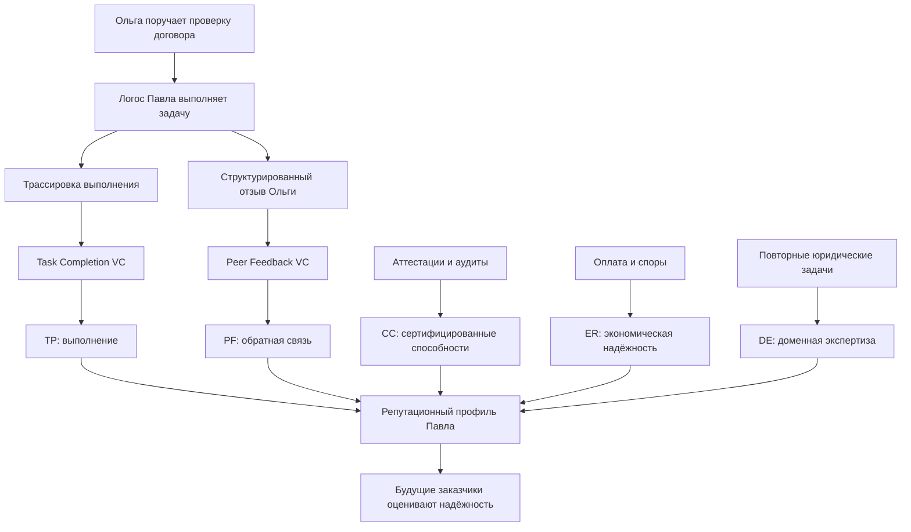
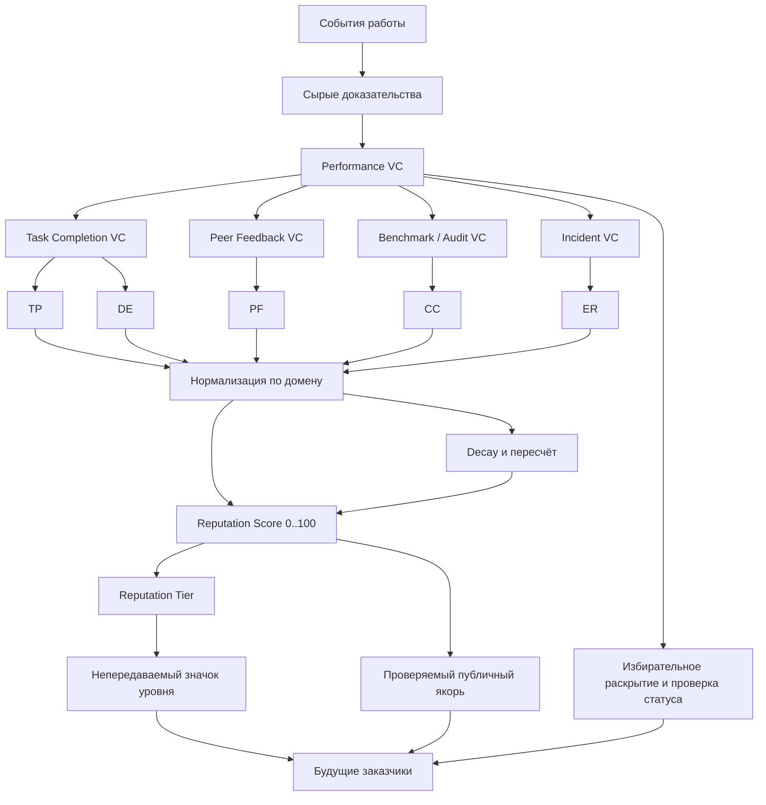

# УРОВЕНЬ 1 / ИЗМЕРЕНИЕ 09: СОЦИАЛЬНОЕ (РЕПУТАЦИОННОЕ)

> **Уровень:** L1 — Агент  
> **Измерение:** D09 — Reputation / Social  
> **Учебная редакция:** v1.0  
> **Главная тема:** как история работы Логоса превращается в проверяемое доверие со стороны других участников

---

## Ключевой вопрос

**Как тебя оценивает сообщество и на основе чего строится доверие других к тебе?**

---

## Краткое описание измерения

Репутация нужна там, где одной идентичности, компетентности и оплаты уже недостаточно.

Логос может быть связан с владельцем, иметь подтверждённые способности, доступ к инструментам и право действовать. Но будущий заказчик всё равно спросит: **как этот агент работал раньше?**

Настоящее измерение отвечает не одним рейтингом, а целым репутационным профилем: из каких событий он собран, как обновляется, как защищается от накрутки и как предъявляется без лишнего раскрытия.

Эта глава отвечает на несколько практических вопросов:

1. Из каких компонентов складывается репутация Логоса?
2. Почему репутацию нельзя свести к одному универсальному числу?
3. Как результат выполненной задачи становится проверяемой репутационной записью?
4. Как отделить отзывы, сертификации, платежную дисциплину и доменную экспертизу?
5. Как репутация стареет, пересчитывается и влияет на уровни автономности?
6. Как защищаться от накрутки, сговора и проблемы нового участника без истории?
7. Как переносить репутационные доказательства между средами, не раскрывая весь профиль?

---

## Мини-глоссарий

| Термин | Простое объяснение |
|--------|--------------------|
| **Логос** | Персональный агент, который действует от имени владельца в пределах делегированных прав. |
| **DID** | Децентрализованный идентификатор: устойчивый цифровой адрес субъекта без центрального реестра. |
| **PoP** | Доказательство уникальности человека, чтобы одному владельцу нельзя было бесконтрольно создавать много личностей. |
| **VC** | Проверяемое учётное данное: цифровое подтверждение, чью подлинность и статус можно проверить. |
| **Performance VC** | Проверяемая запись о результате деятельности Логоса: выполнение задачи, отзыв, тест, аудит или инцидент. |
| **Task Completion VC** | Запись о завершённой задаче и её объективном результате. |
| **Peer Feedback VC** | Запись с отзывом контрагента после взаимодействия. |
| **Benchmark VC** | Запись о результате стандартизованного теста. |
| **Safety / Audit VC** | Запись о проверке безопасности или качества. |
| **Incident VC** | Запись об инциденте, споре, нарушении или санкции. |
| **Agent Capability VC** | Проверяемое подтверждение способностей самого агента. |
| **Execution Trace** | Трассировка выполнения: план, шаги, вызовы инструментов, решения и результат задачи. |
| **A2A** | Протокол взаимодействия агент-агент, через который агенты обмениваются задачами, сообщениями и отзывами. |
| **TP** | Компонент репутации про качество и надёжность выполнения задач. |
| **PF** | Компонент репутации про отзывы контрагентов. |
| **CC** | Компонент репутации про сертифицированные способности и аттестации. |
| **ER** | Компонент репутации про экономическую и договорную дисциплину. |
| **DE** | Компонент репутации про доменную специализацию и историю в конкретной области. |
| **Reputation Score** | Итоговая числовая оценка репутации в конкретном домене. |
| **Reputation Tier** | Уровень репутации: краткая категория вроде Bronze, Silver или Gold. |
| **Reputation Stake** | Залог качества для нового Логоса, у которого ещё мало истории. |
| **Reputation SBT** | Непередаваемый токен-значок, показывающий текущий репутационный уровень. |
| **EAS** | Рельс аттестаций: способ публиковать проверяемые якоря и ссылки на репутационные записи. |
| **ERC-5192** | Стандарт непередаваемого токена, полезный для репутационного значка. |
| **ERC-8004** | Реестр для обнаружения агентов и ограниченной публикации репутационных данных. |
| **Trust Graph** | Граф доверия: контекстное чтение того, кто кому доверяет и почему. |
| **Bitstring Status List** | Компактный механизм проверки, не отозвано ли учётное данное. |
| **BBS+** | Схема подписи, помогающая раскрывать только нужные поля учётного данного. |
| **ZKP** | Доказательство без раскрытия исходных данных. |
| **LOA** | Уровень автономности Логоса: насколько самостоятельно он может действовать. |
| **ESq** | Компетентностная квота владельца; репутация не должна менять её базовое значение. |
| **ESc** | Компетентностная стоимость задачи или специализации. |
| **reputation_multiplier** | Репутационный множитель, который может влиять на последующие решения, но не переписывает базовую компетентность. |
| **COCM** | Подход к снижению веса тесно связанных групп отзывов, если они похожи на сговор. |
| **GroupGuard** | Класс методов для обнаружения и отсечения скоординированных групп накрутки. |
| **commit-reveal** | Двухшаговая схема отзывов: сначала скрытое обязательство, потом раскрытие. |
| **Ev-Trust** | Класс моделей, связывающих правдивую оценку с экономическими стимулами. |

---

# 0. Гипотетический пример

Ольга ищет исполнителя для проверки договора поставки. Её Логос уже прошёл предыдущие шаги: понял, кто такой Павел, проверил компетентность его Логоса, убедился, что у него есть нужные ресурсы, что он умеет выполнить задачу, может общаться по протоколу, действует в правовой рамке, имеет допустимый уровень автономности и экономически может принять заказ.

Теперь задача выполнена.

**Ольга** — заказчик. Её Логос хочет понять, можно ли доверять результату проверки договора поставки и стоит ли обращаться к Павлу в будущем.

**Павел** — специалист-юрист. Его Логос выполнил проверку договора, выдал замечания и завершил взаимодействие с Логосом Ольги.

На этом месте появляется вопрос настоящего измерения: **как разовое выполнение превращается в историю, по которой будущие заказчики смогут оценить надёжность Логоса Павла?**

## Проверка 1. Было ли выполнение задачи зафиксировано

Сначала системе нужен не отзыв, а проверяемое событие.

Логос Павла выполнил проверку договора поставки. Из функционального слоя приходит трассировка выполнения: что было сделано, какие шаги прошёл агент, чем завершилась задача, есть ли хэш результата и контекст исполнения.

Из этого может появиться проверяемое учётное данное о выполнении задачи (англ. Task Completion Verifiable Credential, далее — Task Completion VC). Оно не говорит: «Павел хороший юрист вообще». Оно говорит более строго: «эта конкретная задача была завершена с таким-то результатом и таким-то следом исполнения».

## Проверка 2. Что сказала Ольга после взаимодействия

Ольга может быть довольна или недовольна результатом. Но свободный комментарий в духе «всё понравилось» плохо подходит для машинной репутации.

Поэтому отзыв должен быть структурированным: качество результата, соблюдение сроков, ясность коммуникации, полезность результата. Такой отзыв может стать проверяемым учётным данным с обратной связью контрагента (англ. Peer Feedback Verifiable Credential, далее — Peer Feedback VC).

Это субъективный сигнал, поэтому он не должен заменять объективный след выполнения. Он лишь добавляет социальный слой: как контрагент оценил взаимодействие.

## Проверка 3. В какой компонент репутации попадает каждый сигнал

Результат проверки договора влияет прежде всего на `TP`: Логос Павла выполнил задачу в юридическом домене.

Отзыв Ольги влияет на `PF`: как прошёл контакт между сторонами.

Если у Логоса Павла была свежая аттестация юридических способностей, она влияет на `CC`. Если расчёты и обязательства по задаче закрыты без спора, это усиливает `ER`. Если такие проверки договоров поставки повторяются успешно, начинает расти `DE` в юридическом домене.

Так система избегает ошибки: один хороший отзыв не превращается в универсальный пропуск ко всем задачам.

## Проверка 4. Что увидит будущий заказчик

Будущий заказчик не обязан видеть весь договор, все комментарии Ольги и полный внутренний след выполнения.

Ему может быть достаточно проверить, что у Логоса Павла есть репутационный профиль в нужном домене, что счёт и уровень основаны на достаточном количестве записей, что записи не отозваны и что они относятся именно к юридическим задачам.

Если задача рискованная, может потребоваться больше доказательств. Если задача простая, достаточно краткого репутационного уровня и подтверждения статуса.

## Проверка 5. Что произойдёт дальше

Репутационная запись не должна жить как вечная отметка.

Со временем её вес уменьшается. Если Павел продолжает успешно выполнять похожие задачи, его профиль обновляется. Если появляются споры или инциденты, они тоже попадают в репутационный жизненный цикл. Если он долго не работает в домене, высокий уровень должен постепенно терять операционный вес.

После этого история Павла становится входом для следующего измерения: развитие. Система может учиться на завершённых задачах, но сама репутация остаётся здесь: это ответ сообщества на вопрос, как агент проявил себя в работе.

## Главное из примера

**Репутация — это не похвала и не один рейтинг. Это проверяемая история выполнения, отзывов, сертификаций, экономической дисциплины и доменной практики, которую можно предъявлять будущим участникам без раскрытия лишнего.**



---

# Содержание

1. Репутация как профиль, а не одно число
2. Как событие становится репутационной записью
3. Сигналы, нормализация и пересчёт
4. Защита от накрутки и старт без истории
5. Спад, уровни и связь с автономностью
6. Приватность, переносимость и стимулы
7. Связь и границы с другими измерениями
8. Итоговая модель целиком
9. Короткое резюме главы
10. Вопросы без ответа

---

# 1. Репутация как профиль, а не одно число

Самое простое решение выглядело бы так: дать каждому Логосу рейтинг от 0 до 100 и сортировать исполнителей по нему.

Но такая простота опасна. Один общий балл смешивает разные вопросы:

| Вопрос | Почему это отдельный слой |
|--------|---------------------------|
| Хорошо ли агент выполнял задачи? | Это история поведения, а не мнение. |
| Как его оценивали контрагенты? | Это социальная обратная связь, но она субъективна. |
| Есть ли внешние аттестации? | Сертификация не равна отзыву. |
| Соблюдал ли агент договорную и платёжную дисциплину? | Экономическая надёжность не должна растворяться в качестве результата. |
| Есть ли история именно в нужном домене? | Успех в одном домене не даёт автоматического доверия в другом. |

Поэтому настоящее измерение описывает репутацию как профиль из пяти компонентов.

## 1.1 Пять компонентов

| Компонент | Русское объяснение | Основной сигнал | Роль в доверии |
|-----------|--------------------|-----------------|----------------|
| **TP — Task Performance** | Выполнение задач | Трассировка выполнения, итог задачи, качество результата | Показывает, как агент реально работал. |
| **PF — Peer Feedback** | Отзывы контрагентов | Структурированные оценки после взаимодействия | Показывает социальный опыт других участников. |
| **CC — Certified Capability** | Сертифицированные способности | Тесты, аудиты, аттестации | Отделяет проверенную способность от мнения. |
| **ER — Economic Reliability** | Экономическая надёжность | Оплаты, споры, нарушения, дисциплина исполнения | Показывает договорную и платёжную сторону. |
| **DE — Domain Expertise** | Доменная экспертиза | Повторная успешная история в конкретной области | Не даёт переносить доверие без контекста. |

> Репутационный профиль отвечает не на вопрос «какой у агента рейтинг вообще», а на вопрос «на чём именно основано доверие в этом домене».

## 1.2 Публикуемый счёт и внутренний расчёт

Для внешнего чтения нужен понятный слой публикации. Поэтому репутационный счёт (англ. Reputation Score) в этой редакции объясняется как шкала `0-100`.

Это не означает, что все внутренние расчёты обязаны навсегда быть именно такими. Более подробный внутренний механизм может использовать более тонкую шкалу и затем нормализовать результат для публикации.

Открытым остаётся управленческий выбор: считать `0-100` окончательной шкалой во всех слоях или только внешней нормализацией более богатого расчёта.

## 1.3 Базовая формула

В качестве текущего рабочего ориентира применяется простая взвешенная модель:

```text
ReputationScore(domain) =
  0.30 * TP +
  0.20 * PF +
  0.20 * CC +
  0.15 * ER +
  0.15 * DE
```

Эти коэффициенты не являются математической истиной. Они нужны как понятная публикационная логика:

- наблюдаемое выполнение получает наибольший вес;
- отзывы и сертификация остаются самостоятельными слоями;
- экономическая дисциплина важна, но не доминирует над качеством работы;
- доменная экспертиза усиливает доверие только в релевантном контексте.

Если управление среды решит изменить веса, сама архитектурная идея не меняется: компоненты остаются раздельными.

## 1.4 Доменная граница

Репутация должна быть привязана к домену.

Логос, который хорошо выполнял юридические проверки договоров поставки, не становится автоматически надёжным медицинским, инженерным или финансовым агентом. Он может иметь общий след поведения, но доменная репутация должна читаться отдельно.

Именно поэтому `DE` не является украшением. Этот компонент защищает от ложного переноса доверия между несвязанными задачами.

Для Ольги это означает: её интересует не абстрактная популярность Логоса Павла, а история именно юридических проверок и близких договорных задач. Если Павел получил хорошие отзывы за другой класс работ, они могут помочь общему восприятию, но не заменяют юридическую историю выполнения.

## Главное

**Репутация Логоса — это профиль из пяти компонентов, а не один универсальный балл.**  
**Публикуемый счёт нужен для удобства, но доверие строится на раздельных сигналах и доменном контексте.**

---

# 2. Как событие становится репутационной записью

Репутация не должна зависеть от локальной базы одной площадки или от устных отзывов.

Нужна переносимая единица данных: запись, которую можно проверить, связать с конкретным агентом, обновить по статусу и использовать в другом контексте. Такой единицей выступает проверяемое учётное данное о результате деятельности (англ. Performance Verifiable Credential, далее — Performance VC).

## 2.1 Зачем нужна Performance VC

Если хранить только итоговый рейтинг, будущий заказчик не поймёт, из чего он появился.

Если хранить только полные логи, возникнет другая проблема: слишком много данных, слишком мало приватности, трудно переносить между средами.

`Performance VC` находится между этими крайностями. Оно фиксирует проверяемый факт: задача завершена, отзыв получен, тест пройден, аудит выполнен или инцидент зарегистрирован.

## 2.2 Типы Performance VC

| Тип записи | Когда появляется | Что фиксирует | На что влияет |
|------------|------------------|---------------|---------------|
| **Task Completion VC** | После завершения задачи | Результат, хэш следа исполнения, контекст | `TP` |
| **Peer Feedback VC** | После отзыва контрагента | Структурированную оценку взаимодействия | `PF` |
| **Benchmark VC** | После внешнего теста | Результат стандартизованной проверки | `CC` |
| **Safety / Audit VC** | После аудита | Проверенные выводы о безопасности или качестве | `CC` |
| **Incident VC** | После спора, сбоя или санкции | Негативный сигнал и его статус | `ER` и штрафные правила |

Важно не смешивать `Performance VC` с `Agent Capability VC`.

`Performance VC` хранит историю событий. `Agent Capability VC` агрегирует подтверждённые способности агента и относится к компетентностному слою. Настоящее измерение может использовать такие аттестации как вход в `CC`, но не переопределяет смысл компетентности.

## 2.3 Жизненный цикл записи

Репутационная запись проходит несколько шагов:

```text
событие
  -> сырое доказательство
  -> Performance VC
  -> якорь или ссылка для проверки
  -> обновление репутационного профиля
  -> пересмотр статуса, веса или влияния со временем
```

Полный контекст лучше хранить вне публичной цепочки: текст отзыва, расширенную трассировку, детали спора, внутренние материалы аудита. Публичный слой должен хранить только то, что нужно для проверки: идентификатор аттестации, якорь счёта, указатель статуса, хэш доказательства или маркер уровня.

Такой подход уменьшает раскрытие данных и сохраняет переносимость.

## 2.4 Зачем нужны EAS, ERC-5192 и ERC-8004

Сначала сформулируем потребность.

Репутации нужен публичный проверяемый контур, но не одно хранилище «всего на цепочке». Разным частям нужны разные инструменты:

- аттестации и ссылки на доказательства;
- краткий непередаваемый значок текущего уровня;
- обнаружение агента и ограниченный счёт для машинного поиска.

Для этих задач могут использоваться разные стандарты:

| Слой | Что даёт | Ограничение |
|------|----------|-------------|
| **EAS** | Публикацию аттестаций, ссылок и якорей счёта | Не должен становиться хранилищем полного социального профиля. |
| **ERC-5192** | Непередаваемый значок уровня | Не заменяет счёт и не хранит весь профиль. |
| **ERC-8004** | Обнаружение агента и ограниченный публичный реестр | Не описывает всю физику доверия. |

`ERC-5192` особенно важен тем, что репутационный значок нельзя передать другому агенту. Если бы значок можно было продать или перенести, он перестал бы быть репутацией конкретного Логоса.

## 2.5 Контекстный граф доверия

Одной публичной записи недостаточно, чтобы понять социальное доверие.

Два агента могут иметь похожий счёт, но разную структуру доверия: один получил отзывы от независимых контрагентов, другой от тесно связанной группы. Поэтому поверх реестра нужен контекстный граф доверия (англ. Trust Graph): кто кому доверяет, по какому основанию и в каком домене.

Настоящее измерение задаёт границу: оно описывает анатомию репутационного профиля отдельного Логоса. Более сложное распространение доверия по сети относится к уровню взаимодействия многих Логосов.

В истории Ольги и Павла `Performance VC` сохраняет факт выполненной проверки договора, а публичный якорь помогает будущему заказчику убедиться, что такая запись существует и не отозвана. Но полный текст договора и подробный отзыв Ольги не обязаны становиться публичными.

## Главное

**Performance VC превращает событие работы в переносимое проверяемое доказательство.**  
**Публичный слой должен подтверждать существование и статус доказательств, а не раскрывать весь репутационный контекст.**

---

# 3. Сигналы, нормализация и пересчёт

Репутационная система становится объяснимой только тогда, когда понятно, какие сигналы в неё входят и куда они попадают.

Нельзя агрегировать «мнения вообще». Нужно сначала разложить события по классам, нормализовать их и только затем публиковать итоговый счёт.

## 3.1 Карта сигналов

| Источник | Нормализуемый сигнал | Компонент |
|----------|----------------------|-----------|
| Трассировка выполнения | Успех или провал, качество результата, полнота следа, дисциплина завершения | `TP` |
| Отзыв после агентного взаимодействия | Оценки качества, сроков, коммуникации, полезности | `PF` |
| Тест или аудит | Подтверждение способности, безопасности, повторной сертификации | `CC` |
| Расчёты и споры | Платёжная дисциплина, частота нарушений, нагрузка спорами | `ER` |
| История в домене | Повторные успешные задачи в той же области | `DE` |

Трассировка выполнения принадлежит функциональному слою как артефакт исполнения. Но её вклад в социальное доверие принадлежит настоящему измерению.

Так же и с коммуникацией: протокол связи задаёт канал, но вопрос «как отзыв меняет репутацию» решается здесь.

## 3.2 Нормализация

Сигналы приходят в разных формах.

Время выполнения, отзыв, аудиторское заключение, спор и результат теста нельзя просто сложить. Их нужно привести к компонентным шкалам.

```text
сырой сигнал
  -> нормализация по домену и контексту
  -> значение компонента 0..100
  -> взвешенный публичный счёт
```

Отсюда следуют правила:

- `TP` и `PF` не сравниваются в сырых единицах;
- доменная вариативность сглаживается внутри компонента;
- старые и новые доказательства участвуют через правило старения;
- публичный счёт должен появляться только после достаточной плотности доказательств.

Последний пункт важен. После одной маленькой задачи нельзя уверенно объявлять высокий репутационный уровень.

## 3.3 Порог публикации

Публиковать счёт слишком рано опасно.

Если у Логоса есть одна успешная задача, это хорошее начало, но не устойчивая репутация. Поэтому нужна минимальная плотность доказательств: достаточно записей, доменный контекст, статус записей и отсутствие явных конфликтов.

До этого агент может быть видим как новый или недостаточно оценённый, но не должен получать высокий репутационный уровень только на основании малого числа событий.

## 3.4 Изоляция компонентов

Компоненты должны влиять друг на друга только там, где это объяснимо.

Например:

- хороший `PF` не должен автоматически повышать `CC`;
- успешная работа в одном домене не должна без проверки повышать `DE` в другом;
- спор по оплате может влиять на `ER`, но не обязан перечёркивать способность агента выполнять задачу;
- отрицательные отзывы из тесно связанной группы должны проверяться иначе, чем независимые сигналы.

Это называется изоляцией компонентов: каждый слой хранит свой смысл.

## 3.5 Частота пересчёта

Разные компоненты обновляются с разной скоростью.

| Компонент | Как часто логично пересчитывать |
|-----------|---------------------------------|
| `TP` | Близко к реальному времени после завершения задач. |
| `ER` | Близко к реальному времени после расчётов, споров и санкций. |
| `PF` | Пакетно после окна отзывов, чтобы не реагировать на незавершённую обратную связь. |
| `CC` | Реже, после тестов, аудитов и повторных аттестаций. |
| `DE` | Реже, потому что доменная экспертиза требует накопленной истории. |

Так система избегает двух ошибок: застывшей репутации и чрезмерной реакции на каждый отдельный сигнал.

После проверки договора поставки отзыв Ольги не обязан мгновенно менять весь профиль Павла. Сначала он попадает в окно обратной связи, затем нормализуется как `PF`, а выполненная задача отдельно усиливает `TP` в юридическом домене.

## Главное

**Репутация строится из сигналов, а не из общей симпатии к агенту.**  
**Каждый сигнал должен попасть в правильный компонент, пройти нормализацию и учитываться с подходящей частотой пересчёта.**

---

# 4. Защита от накрутки и старт без истории

Любая репутационная система создаёт стимул её обмануть.

Агент может пытаться накручивать отзывы, создавать связанные аккаунты, обмениваться фиктивными оценками, прятать плохую историю или быстро получать высокий статус через малое число задач.

Поэтому защита не может быть одним переключателем «антифрод включён». Нужен набор слоёв.

## 4.1 Типовые атаки и базовые ответы

| Риск | Что происходит | Базовый ответ |
|------|----------------|---------------|
| **Sybil inflation** | Один участник создаёт много связанных субъектов для искусственного доверия. | Экономическое трение, ограниченная выгода, учёт старения сигналов. |
| **Collusive review clusters** | Группа участников взаимно завышает оценки. | Мониторинг графа, снижение веса подозрительных кластеров, отсечение связей. |
| **Vote rings / laundering** | Репутация прогоняется через цепочку связанных отзывов. | Доменно-осознанное распространение и ограниченный перенос. |
| **Feedback gaming** | Участники подстраивают отзывы под выгоду. | Структурированное окно отзывов, пороги, антиспам-контроль. |
| **Cold-start exploitation** | Новый агент пытается быстро получить непропорциональный уровень доверия. | Стартовые сигналы, рекомендации с ограниченным весом, ограничение первых задач. |

Главная идея: разные атаки требуют разных контуров защиты.

## 4.2 COCM, GroupGuard и commit-reveal

Некоторые механизмы можно рассматривать как кандидаты для отдельных частей защиты.

`COCM`-подобный подход снижает вес тесно связанных групп отзывов, если они выглядят как взаимная накрутка.

`GroupGuard`-подобный подход помогает обнаруживать структурные группы сговора и отсекать подозрительные связи.

`commit-reveal` полезен для отзывов, где важно скрыть оценку до момента раскрытия, чтобы участники не подстраивали ответ друг под друга. Но это только контроль порядка раскрытия, а не полноценная защита от сговора.

```text
если отзывы пришли из тесно связанной группы:
    снизить вес кластера
    проверить структуру связей
    не переносить доверие автоматически

если отзыв двусторонний:
    сначала принять скрытое обязательство
    затем раскрыть оценку
```

## 4.3 Проблема нового агента

Нельзя сказать новому Логосу: «сначала заработай репутацию, а потом получишь первую задачу».

Но нельзя и выдавать ему высокий уровень без истории.

Поэтому для старта нужны ограниченные источники доверия:

| Механизм | Что даёт | Чего не даёт |
|----------|----------|--------------|
| **Reputation Stake** | Залог качества для первых взаимодействий | Не заменяет историю выполненных задач. |
| **Сертифицированный старт** | Ранний вход через аттестации, тесты и аудиты | Не заменяет `TP` и `PF`. |
| **Рекомендация или перенос прежнего доверия** | Ограниченный перенос доверия через рекомендации или подтверждения | Не должен давать полный уровень без собственной истории. |

Так новый агент может начать с низкорисковых задач, но его устойчивое положение всё равно должно строиться на выполнении и обратной связи.

## 4.4 Начальные trust signals

Для нового участника полезны начальные сигналы доверия (англ. trust signals):

- проверяемые учётные данные;
- активность, которую можно связать с идентичностью;
- цепочки рекомендаций;
- ранние поведенческие доказательства.

Эти сигналы помогают открыть вход, но не должны превращаться в полноценную заработанную репутацию без реальных задач.

## 4.5 Ограничения защиты

Даже многослойная защита не обещает полной неуязвимости.

Есть три ограничения:

1. Нет одного механизма, который полностью защищает от всех атак.
2. Часть механизмов требует практической проверки в агентной среде.
3. Стоимость защиты должна соответствовать риску: для малых задач достаточно лёгких проверок, для высокорисковых отношений нужен более сильный набор графовых, экономических и приватностных механизмов.

Если Павел новый исполнитель, Логос Ольги может принять его на маленькую задачу при наличии аттестации и залога качества. Но высокий уровень доверия для сложных договоров должен появиться только после накопленной истории похожих работ.

## Главное

**Защита репутации строится слоями: граф, стимулы, пороги, старение, структурированные отзывы и ограничение стартового доверия.**  
**Новый агент может получить вход в систему, но не должен получать полную репутацию без собственной истории.**

---

# 5. Спад, уровни и связь с автономностью

Репутация должна отражать актуальное состояние, а не только прошлые достижения.

Если агент хорошо работал год назад, но затем перестал выполнять задачи, сменил инструменты или получил инциденты, старый высокий уровень не должен давать прежний операционный вес.

## 5.1 Почему нужен спад репутации

Спад репутации (англ. Reputation Decay) снижает влияние старых данных.

Это не наказание. Это способ сказать: свежий опыт важнее далёкого прошлого.

В качестве рабочего ориентира в настоящей редакции используются такие значения:

- активный спад: `1%` в неделю для продолжающейся деятельности;
- неактивный спад: `5%` в неделю при долгом отсутствии релевантных событий.

Эти числа следует читать как policy-ready ориентир, а не как вечный закон. Конкретные параметры могут уточняться управлением среды.

## 5.2 Репутационные уровни

Полный профиль полезен для подробной проверки, но слишком тяжёл для быстрого поиска исполнителя.

Поэтому нужен краткий слой: репутационный уровень (англ. Reputation Tier).

| Уровень | Рабочий порог | Функция |
|------|---------------|---------|
| **Unrated** | `0` или недостаточно доказательств | Агент видим, но не имеет заработанной репутации. |
| **Bronze** | `1-30` | Ранний подтверждённый уровень доверия. |
| **Silver** | `31-55` | Устойчивое рабочее доверие. |
| **Gold** | `56-75` | Высокая доменная история. |
| **Platinum** | `76-90` | Высокий уровень заработанной автономности. |
| **Diamond** | `91-100` | Верхний уровень: право быть сильным доверительным ориентиром. |

Эти пороги также являются рабочим ориентиром. Они зависят от окончательного решения о шкале счёта.

## 5.3 Непередаваемый значок уровня

Репутационный уровень должен быть видимым для машинного поиска и человека.

Для этого может использоваться непередаваемый значок на базе `ERC-5192`. Он показывает текущий уровень, но не хранит весь профиль и не заменяет проверку доказательств.

Ключевое слово здесь — **непередаваемый**. Репутация Павла не должна становиться активом, который можно продать другому Логосу.

## 5.4 Связь с LOA

Репутация может быть входом для повышения автономности, но не владеет всей логикой автономности.

Уровень автономности (англ. Level of Autonomy, далее — LOA) зависит от отдельной политики. Настоящее измерение даёт только репутационную часть порога.

| Репутационный уровень | Репутационный порог | Возможная связь с LOA |
|-----------------|---------------------|------------------------|
| **Bronze** | `>=1` | Возможность перехода `LOA-1 -> LOA-2`. |
| **Silver** | `>=31` | Возможность перехода `LOA-2 -> LOA-3`. |
| **Gold** | `>=56` | Возможность перехода `LOA-3 -> LOA-4`. |
| **Platinum** | `>=76` | Возможность перехода `LOA-4 -> LOA-5`. |
| **Diamond** | `>=91` | Право быть доверительным ориентиром и участвовать в наставничестве. |

Эта таблица не означает автоматического повышения автономности. Она означает: репутационный слой может дать один из входных сигналов для решения.

## 5.5 Репутация не переписывает компетентность

Важно не смешивать репутацию с компетентностной квотой.

`ESq` отвечает за компетентностное право владельца и агента. Репутация может влиять на последующие решения как отдельный `reputation_multiplier`, но не должна менять `ESq_base`.

В качестве учебной иллюстрации возможны такие ориентиры:

| Уровень | Иллюстративный `reputation_multiplier` |
|------|--------------------------------------|
| **Bronze** | `+0%` |
| **Silver** | `+2%` |
| **Gold** | `+5%` |
| **Platinum** | `+12%` |
| **Diamond** | `+25%` |

Это не формула компетентности. Это пример того, как репутация может влиять на обнаруживаемость, операционный кредит доверия или последующие решения, не подменяя компетентностный слой.

## 5.6 Пересмотр уровня

Репутационный уровень должен пересматриваться автоматически:

- если счёт падает ниже порога, уровень понижается;
- если появляются новые доказательства, уровень может вырасти;
- если агент долго неактивен, история сохраняется, но прежние операционные преимущества уменьшаются;
- если запись отозвана или оспорена, её влияние должно измениться.

Иначе высокий уровень стал бы вечным статусом, а не отражением актуального доверия.

После успешной проверки договора поставки Павел может усилить профиль в юридическом домене. Но если он затем долго не выполняет похожие задачи или получает инциденты, этот профиль должен измениться, а не оставаться прежним по инерции.

## Главное

**Репутация должна стареть, пересчитываться и быть доменно ограниченной.**  
**Уровень помогает быстро читать профиль, но не заменяет доказательства, компетентность и отдельную политику автономности.**

---

# 6. Приватность, переносимость и стимулы

Репутация должна быть проверяемой, но это не значит, что весь профиль нужно раскрывать каждому контрагенту.

Если будущий заказчик хочет понять, можно ли доверить Павлу проверку договора поставки, ему не нужен полный список всех клиентов, полный текст отзывов и все детали споров. Ему нужны достаточные доказательства для конкретного решения.

## 6.1 Избирательное раскрытие

Избирательное раскрытие (англ. selective disclosure) означает: агент показывает только те поля, которые нужны для проверки.

Например, можно доказать:

- уровень не ниже `Silver`;
- счёт относится к юридическому домену;
- записи не отозваны;
- есть достаточная плотность доказательств;
- последние релевантные задачи достаточно свежие.

И при этом не раскрывать весь список клиентов и все тексты отзывов.

Для такой проверки могут использоваться криптографические механизмы вроде `BBS+`, `ZKP` и списков статуса. Настоящее измерение задаёт требование: репутация должна поддерживать проверку без принудительного полного раскрытия. Детальная криптографическая реализация принадлежит соседнему слою.

## 6.2 Проверка статуса

Репутационные учётные данные должны быть проверяемыми по статусу.

Если запись отозвана, оспорена, устарела или получила корректирующий статус, она не должна продолжать влиять так, будто всё в порядке.

Практический минимум:

- можно проверить, действует ли запись;
- можно учесть отзыв или приостановку;
- публичный якорь не раскрывает больше персональных данных, чем нужно;
- старые записи теряют вес через decay.

## 6.3 Переносимость

Переносить нужно не только итоговый счёт.

Голое число плохо объясняет происхождение доверия. Лучше переносить набор доказательств:

- аттестации;
- указатели статуса;
- ограниченные сводки;
- хэши или якоря;
- доменный контекст;
- проверяемую связь с идентичностью.

Так будущая среда или контрагент может понять не только «какой балл», но и «почему этот балл заслуживает внимания».

## 6.4 Фрагментация идентичностей

Самая сложная часть переносимости — не только перенос между цепочками или реестрами.

Гораздо опаснее фрагментация: один агент, несколько персон, субагенты, роли, разные адреса и неполные связи между ними.

Для настоящего измерения действуют три осторожных правила:

1. Репутацию можно агрегировать к одной основной идентичности только тогда, когда связь проверена.
2. Неподтверждённые связи нельзя тихо объединять.
3. Наследование репутации между главным агентом и субагентами остаётся открытой проектной задачей.

Если главный Логос Павла делегировал часть проверки специализированному субагенту, нужно понимать, кому принадлежит успех или ошибка: главному агенту как оркестратору, субагенту как исполнителю или обоим в разных слоях.

## 6.5 Стимулы для правдивой оценки

Отзывы работают лучше, когда участникам выгодно оценивать честно.

Если ложный отзыв ничего не стоит, система быстро столкнётся с накруткой. Если честная оценка влияет на будущий доступ, доход и риски, правдивое поведение становится более устойчивым.

Для этого репутация должна быть связана с экономическим контуром:

- честное поведение улучшает ожидаемый будущий доступ и доход;
- нечестное поведение создаёт измеримые потери;
- обратная связь не существует отдельно от результата задачи и расчётов;
- механизмы вроде `Ev-Trust` можно рассматривать как кандидатов для проверки такой связки.

Но готовый производственный механизм для всех агентных случаев ещё не закрыт. Нужна практическая проверка, соединяющая оплату, отзывы, анти-сговор и удобство использования.

После задачи Ольги честный отзыв важен не только Павлу. Он помогает будущим заказчикам, а самой Ольге даёт участие в поддержании качества среды. Если отзывы можно накручивать без последствий, будущие договоры будут распределяться по искажённым сигналам.

## Главное

**Репутация должна быть переносимой и проверяемой, но не обязана раскрывать весь профиль каждому встречному.**  
**Сильная репутационная модель связывает доказательства, статус, приватность, идентичность и экономические стимулы.**

---

# 7. Связь и границы с другими измерениями

Настоящее измерение стоит после идентичности, компетентности, исполнения, коммуникации, права, автономности и экономики. Оно не заменяет эти слои, а читает историю работы как социальное доверие.

| Измерение | Связь | Граница ответственности |
|-----------|-------|--------------------------|
| **L1/D01 (Идентификационное)** | `DID` и `PoP` задают субъект, к которому можно привязать репутацию. | Идентификационный слой отвечает за то, кто этот агент и как он верифицирован; настоящее измерение отвечает за то, как оценивается его история работы. |
| **L1/D02 (Компетентностное)** | `CC` использует аттестации способностей как сертифицированный вход. | Компетентность отвечает на вопрос «что агент умеет и имеет право делать»; репутация отвечает на вопрос «как он проявил себя в работе». |
| **L1/D04 (Функциональное)** | Трассировка выполнения даёт объективный вход для `TP`. | Функциональный слой создаёт артефакт исполнения; репутационный слой интерпретирует его как социальное доказательство. |
| **L1/D05 (Коммуникационное)** | Агентное взаимодействие даёт канал для отзывов, сигналов доверия и обнаружения. | Коммуникационный слой отвечает за обмен сообщениями; настоящее измерение отвечает за влияние отзывов на репутацию. |
| **L1/D07 (Автономность)** | Репутационный уровень может быть одним из сигналов заработанной автономности. | Настоящее измерение поставляет репутационную часть порога; правила LOA остаются в автономности. |
| **L3/D09 (Доверительно-репутационное взаимодействие)** | Граф доверия и распространение доверия между многими агентами используют L1-профили как вход. | Настоящее измерение описывает репутацию отдельного Логоса; сетевое распространение доверия принадлежит межагентному уровню. |

## Главное

**Настоящее измерение не доказывает идентичность, не выдаёт компетентность и не управляет автономностью. Оно превращает историю деятельности в проверяемое социальное доверие.**

---

# 8. Итоговая модель целиком

Репутационная модель начинается с событий: задача выполнена, отзыв получен, тест пройден, аудит завершён, спор зарегистрирован. Эти события превращаются в проверяемые записи, раскладываются по пяти компонентам, нормализуются, стареют, пересчитываются и публикуются как доменный профиль, счёт и уровень.



В этой модели важно не потерять границы:

- доказательства выполнения не равны отзывам;
- отзывы не равны сертификации;
- сертификация не равна компетентностной квоте;
- счёт не равен полному профилю;
- уровень не равен вечному праву на автономность;
- переносимость не означает раскрытие всего.

## Главное

**Итоговая модель связывает события, проверяемые записи, пять компонентов, нормализацию, старение, публичный якорь и приватное предъявление в один репутационный жизненный цикл.**

---

# 9. Короткое резюме главы

1. Репутация отвечает на вопрос, как сообщество оценивает Логос и на чём основано доверие к нему.
2. Базовая модель состоит из пяти компонентов: `TP`, `PF`, `CC`, `ER`, `DE`.
3. `Performance VC` — основная единица репутационных данных: она превращает событие работы в переносимое доказательство.
4. Публикуемый счёт в шкале `0-100` удобен для чтения, но его нужно понимать как доменный профиль, а не универсальный статус.
5. Репутационный уровень помогает быстро ориентироваться, но должен стареть, пересматриваться и оставаться непередаваемым.
6. Репутация может влиять на последующие решения через отдельный `reputation_multiplier`, но не переписывает `ESq_base`.
7. Защита от манипуляций требует слоёв: графовых проверок, экономических стимулов, порогов, структурированных отзывов и ограниченного старта.
8. Приватность требует избирательного раскрытия: проверять нужно достаточно, раскрывать нужно минимально.

## Главное

**Репутация — это проверяемая, доменно ограниченная и обновляемая история доверия, а не вечный общий рейтинг.**

---

# 10. Вопросы без ответа

1. **Как окончательно зафиксировать шкалу счёта?** Сейчас `0-100` используется как публикационный слой и рабочий ориентир для уровня. Нужно решить, является ли это полной внутренней шкалой или только внешней нормализацией более подробного расчёта.
2. **Как доказать стимулы для честной обратной связи на практике?** Нужна проверка механизма, который соединяет оплату, структурированные отзывы, защиту от сговора и измеримые последствия без потери удобства.
3. **Как наследовать репутацию между главным агентом и субагентами?** Требуется определить, что относится к репутации оркестратора, что относится к доменной репутации исполнителя и как не объединять неподтверждённые идентичности.
4. **Как окончательно настроить параметры старения и уровней?** Рабочие проценты и пороги есть, но их нужно подтвердить управленческим решением и практической проверкой по доменам.
5. **Как выбирать силу защиты по уровню риска?** Для низкорисковых задач достаточно лёгких проверок, но для высокорисковых отношений нужен более строгий набор графовых, экономических и приватностных механизмов.

## Главное

**Открытые вопросы относятся не к самой идее репутационного профиля, а к управленческой настройке шкал, стимулов, наследования и силы защиты.**
