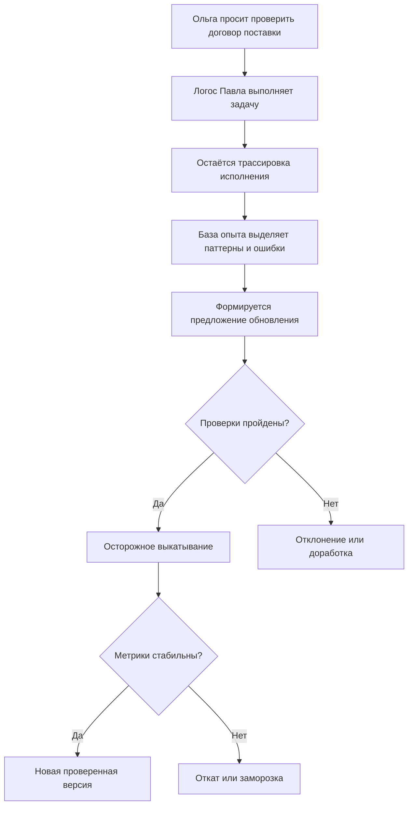
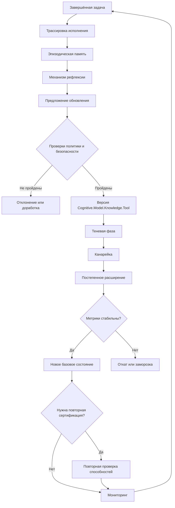

# УРОВЕНЬ 1 / ИЗМЕРЕНИЕ 10: ЭВОЛЮЦИОННОЕ

> **Уровень:** L1 — Агент (свойства Логоса)  
> **Измерение:** D10 — Evolution  
> **Учебная редакция:** v1.0  
> **Главная тема:** как Логос учится на опыте, обновляется и остаётся управляемым во времени

---

## Ключевой вопрос

**Как ты развиваешься, учишься и адаптируешься к новым условиям и какие механизмы обучения у тебя есть?**

---

## Краткое описание измерения

Персональный цифровой агент (англ. Logos, далее — Логос) не должен оставаться неизменным после первой настройки.

Он выполняет задачи, получает опыт, ошибается, исправляется, обновляет память, меняет инструменты и иногда проходит повторную проверку способностей.

Настоящее измерение объясняет, как такой рост сделать наблюдаемым, управляемым и обратимым, чтобы развитие не превращалось в скрытую самонастройку.

Эта глава отвечает на несколько практических вопросов:

1. Как различать развитие владельца и развитие самого агента?
2. Как опыт задач превращается не в архив логов, а в рабочее знание?
3. Как версионировать изменения так, чтобы их можно было сравнить и откатить?
4. Когда обновление требует повторной проверки способностей?
5. Почему самообновление должно иметь границы и защитные проверки?
6. Как заметить, что улучшение в одном месте ухудшило поведение в другом?
7. Какие метрики помогают владельцу и управлению видеть эволюцию целиком?

---

## Мини-глоссарий

| Термин | Простое объяснение |
|--------|--------------------|
| **Логос** | Персональный цифровой агент, который действует от имени владельца в пределах делегированных прав. |
| **Развитие владельца** | Рост человеческой квалификации: новые дипломы, сертификаты, права и доменные подтверждения. |
| **Развитие агента** | Улучшение фактических способностей самого Логоса через опыт, тесты, память, версии и проверяемые обновления. |
| **ESq** | Квота специализации: сколько компетентностного объёма владелец вправе распределить. |
| **Agent Capability VC** | Проверяемое учётное данное о способностях самого агента, а не о дипломах владельца. |
| **Execution Trace** | Трассировка выполненной задачи: план, шаги, решения, вызовы инструментов, стоимость и результат. |
| **Experience Base** | База опыта Логоса: место, где сырой опыт превращается в пригодные для повторного использования паттерны. |
| **Episodic Memory** | Эпизодическая память: сохранённые случаи, контекст, успехи, ошибки и ограничения конкретных задач. |
| **Pattern Library** | Библиотека паттернов: проверенные стратегии, анти-паттерны и признаки типичных ошибок. |
| **Reflection Engine** | Механизм рефлексии: анализ завершённых задач и подготовка предложений по обновлению. |
| **Preference Model** | Слой предпочтений и чувствительных поведенческих настроек; в данной главе он не считается стабилизированным ядром базы опыта. |
| **Benchmark** | Эталонный тест, на котором измеряют способность агента решать задачи определённого класса. |
| **Canary deployment** | Постепенное выкатывание обновления: сначала без влияния на пользователя, затем на малой безопасной доле задач. |
| **Re-certification** | Повторная сертификация: новая проверка способностей после значимого изменения агента. |
| **Rollback** | Откат к предыдущему проверенному состоянию, если обновление ухудшило качество или безопасность. |
| **LOA** | Уровень автономности: насколько самостоятельно Логос может действовать без подтверждения человека. |
| **HITL Gate** | Точка, где для продолжения требуется подтверждение человека. |
| **Earned autonomy** | Повышение автономности через накопленную историю безопасной работы и явное решение владельца. |
| **Negative transfer** | Негативный перенос: улучшение в одной области, которое ухудшает поведение в другой. |
| **Preference contamination** | Повреждение чувствительных предпочтений или правил поведения после обучения или донастройки. |
| **Evolution Dashboard** | Панель показателей, по которой смотрят, развивается ли агент качественно и безопасно. |
| **Knowledge Transfer Package** | Пакет передачи знаний между агентами: внешний источник опыта, который требует отдельной проверки перед применением. |

---

# 0. Гипотетический пример

Ольга уже прошла с цифровой средой почти весь путь первого уровня.

Её Логос установлен, связан с ней как с владельцем, понимает, какие исполнители могут брать юридические задачи, умеет общаться с другими агентами, учитывает правовые рамки, соблюдает уровень автономности, проверяет оплату и смотрит на репутационные сигналы.

Теперь Ольге нужно проверить договор поставки. Исполнителем становится Павел — специалист-юрист, чей Логос уже много раз выполнял похожие проверки.

На первый взгляд всё просто: если Логос Павла хорошо справлялся раньше, пусть продолжает.

Но появляется новый вопрос: **как понять, что Логос Павла действительно стал лучше со временем, а не просто изменился неизвестным образом?**

**Ольга** — заказчик, её Логос ищет исполнителя для проверки договора поставки.  
**Павел** — специалист-юрист, его Логос выполняет проверку.

Эволюционное измерение включается не в момент выбора Павла как юриста, а в момент оценки его развития: что агент выучил из прошлых договоров, какие версии менялись, какие проверки прошёл после обновлений и можно ли доверять его текущему состоянию.

## Проверка 1. Разделить рост Павла и рост его Логоса

Павел мог пройти новое обучение по договорному праву. Это повышает человеческую квалификацию и может расширить разрешённую область делегирования.

Но это не доказывает автоматически, что его Логос стал лучше проверять договоры поставки.

Отдельно нужно смотреть, как сам агент работал с задачами, какие тесты прошёл и какие способности подтверждены.

## Проверка 2. Посмотреть, чему агент научился на прошлых задачах

После каждой проверки договора остаётся трассировка исполнения (англ. Execution Trace, далее — `Execution Trace`): какие пункты договора анализировались, какие риски были найдены, где потребовалась помощь человека, какие ошибки повторялись.

Эти следы не должны лежать мёртвым архивом.

База опыта (англ. Experience Base, далее — `Experience Base`) сохраняет эпизоды, выделяет устойчивые паттерны и готовит предложения по обновлению памяти или правил работы.

## Проверка 3. Понять, что именно изменилось

Логос Павла мог измениться по-разному:

| Что могло измениться | Почему это важно для Ольги |
|----------------------|----------------------------|
| Правила рассуждения и подсказки | Агент иначе выбирает план проверки договора. |
| Базовая модель или адаптер | Поведение может измениться шире, чем в одном юридическом сценарии. |
| Память и библиотека паттернов | Агент лучше вспоминает похожие договоры, но может перенести не тот паттерн. |
| Инструменты и доступы | Агент может получить новые действия и новые внешние последствия. |

Если все изменения смешаны в одну строку "обновлено", Ольга не понимает, что именно стало лучше и что можно откатить.

## Проверка 4. Выпустить обновление не сразу на все задачи

Даже полезное обновление не должно мгновенно становиться основным режимом.

Сначала его можно прогнать параллельно без влияния на результат, затем дать малую долю безопасных задач, потом расширить область применения и только после удержания качества сделать новым базовым состоянием.

Так Ольга получает не обещание "мы улучшились", а наблюдаемый путь: кандидат был сравнен, проверен, ограниченно применён и оставлен под мониторингом.

## Проверка 5. Проверить, не ухудшилось ли что-то рядом

Представим, что Логос Павла стал быстрее находить штрафные условия в договорах поставки.

Это хорошо, но недостаточно.

Нужно проверить, не стал ли он хуже замечать вопросы конфиденциальности, не начал ли слишком часто игнорировать ручное подтверждение и не применяет ли паттерны из одного типа договора там, где они неуместны.

## Главное из примера

**Эволюция Логоса — это не просто "агент стал умнее". Это проверяемый цикл: опыт собирается, изменение формулируется, версия отделяется от прежней, обновление выкатывается осторожно, а ухудшение можно остановить.**



---

# Содержание

1. Два потока развития
2. База опыта: как задачи превращаются в знание
3. Четыре слоя версионирования
4. Осторожное выкатывание и повторная сертификация
5. Защитные ограничения при развитии
6. Негативный перенос и повреждение предпочтений
7. Человеческий надзор, метрики и управление
8. Связь и границы с другими измерениями
9. Итоговая модель целиком
10. Короткое резюме главы
11. Вопросы без ответа

---

# 1. Два потока развития

Развитие Логоса нельзя свести к одному показателю зрелости.

Есть два разных вопроса:

> **Владелец получил больше права делегировать?**  
> **Или сам агент доказал, что стал лучше выполнять задачи?**

Оба вопроса важны, но отвечают на разные риски.

Если их смешать, получится ложная уверенность: диплом владельца будет выглядеть как способность агента, а опыт агента — как новое право владельца.

## 1.1 Развитие владельца

Развитие владельца (англ. Human Evolution) относится к человеку.

Новые дипломы, профессиональные сертификаты, лицензии и доменные подтверждения могут повысить базовую квоту специализации `ESq_base`.

Проще:

> владелец получает больше оснований делегировать задачи определённого класса.

Для Павла это может означать, что он подтвердил дополнительную квалификацию в договорном праве. Но это ещё не говорит, что его Логос уже умеет применять эту квалификацию в конкретной проверке договора поставки.

## 1.2 Развитие агента

Развитие агента (англ. Agent Evolution) относится к самому Логосу.

Здесь важны не дипломы владельца, а фактическая способность агента: результаты эталонных тестов (англ. benchmark, далее — `benchmark`), качество исполнения, обновления памяти, корректность инструментов и способность безопасно работать после изменений.

Такой рост может повышать множитель способностей, который участвует в формуле компетентностного допуска:

```text
ESq_effective = ESq_base × capability_multiplier
```

Но этот множитель не появляется "по ощущениям". Он должен опираться на проверяемые результаты, а не на сам факт обновления.

## 1.3 Четыре оси развития

Настоящее измерение читает эволюцию по четырём независимым осям.

| Ось | Что растёт | Как проявляется |
|-----|------------|-----------------|
| **Компетенции владельца** | `ESq_base`, доменные подтверждения, разрешённая область делегирования | Владелец может обоснованно делегировать более широкий или более сложный класс задач. |
| **Способности агента** | Проверенное состояние способностей, качество исполнения, применимость аттестации | Агент доказывает, что действительно умеет выполнять задачи данного класса. |
| **Автономность** | Допустимый уровень самостоятельности и плотность надзора | Некоторые шаги могут выполняться с меньшим числом ручных подтверждений, если это отдельно разрешено. |
| **Экономическая устойчивость** | Возможность финансировать обновления, тесты, хранение опыта и откаты | Развитие становится регулярным процессом, а не разовой дорогой операцией. |

Эти оси нельзя автоматически повышать друг через друга.

Рост способности не означает автоматический рост автономности. Рост дохода не доказывает безопасность. Новая квалификация владельца не заменяет проверку агента.

## 1.4 Минимальная синхронизация потоков

Практическое правило можно записать так:

```text
если право владельца действительно
и способность агента подтверждена
и автономность разрешает такой режим
и обновление не ухудшило контроль:
    новая область работы допустима
иначе:
    требуется ограничение, повторная проверка или ручное решение
```

Микро-пример: Павел проходит дополнительное обучение по проверке договоров поставки, а его Логос после серии задач показывает лучшие результаты на профильных тестах. Для Ольги этого всё равно недостаточно, пока новая версия агента не прошла проверку и не осталась в рамках разрешённой автономности. Только после синхронизации двух потоков задача получает устойчивое основание.

## Главное

**Развитие владельца и развитие агента связаны, но не совпадают.**  
**Новая область работы допустима только тогда, когда право, способность, автономность и контроль остаются валидными одновременно.**

---

# 2. База опыта: как задачи превращаются в знание

Опыт полезен только тогда, когда его можно извлечь, проверить и применить к новой задаче.

Если после работы остаются только длинные журналы, агент не развивается. Если же опыт автоматически переписывает активные правила без проверки, агент становится непредсказуемым.

Поэтому настоящая глава использует `Experience Base` как отдельный постоянный слой между исполнением задач и будущим планированием.

## 2.1 Из чего состоит база опыта

`Experience Base` состоит из трёх стабилизированных компонентов.

| Компонент | Что хранит или делает | Роль в развитии |
|-----------|-----------------------|-----------------|
| **Эпизодическая память (англ. Episodic Memory)** | Сырые случаи, краткие пересказы, успехи, провалы, контекст и ограничения. | Даёт материал для анализа и поиска похожих ситуаций. |
| **Библиотека паттернов (англ. Pattern Library)** | Проверенные стратегии, анти-паттерны, признаки ошибок и повторно используемые эвристики. | Переводит частный опыт в знание, которое можно применить снова. |
| **Механизм рефлексии (англ. Reflection Engine)** | Послемиссионный анализ, предложения обновлений, проверочные запросы и задания консолидации. | Связывает прошлый опыт с будущими изменениями памяти, знаний или правил. |

Модель предпочтений (англ. Preference Model) находится рядом, но не входит в стабилизированное ядро `Experience Base`, потому что для него остаются отдельные риски повреждения предпочтений.

## 2.2 Как работает цикл опыта

Базовый цикл выглядит так:

1. Задача завершается и оставляет `Execution Trace`.
2. Эпизодическая память сохраняет случай, контекст, решения, побочные эффекты и результат.
3. Механизм рефлексии выделяет успешные паттерны, повторяющиеся ошибки, пропущенные проверки и возможные улучшения.
4. Паттерн попадает в библиотеку только после проверки, а не автоматически.
5. При новой задаче планировщик сначала ищет релевантные паттерны, а затем обращается к конкретным эпизодам, если нужна подробность.
6. После нового исполнения цикл повторяется и уточняет доверие к паттернам.

> База опыта — это не "длинная память ради памяти", а способ отличать сырой случай от проверенного правила.

## 2.3 Дисциплина извлечения

С ростом опыта возникает две опасности.

Первая: память становится слишком дорогой для постоянного поиска.  
Вторая: память становится шумной и начинает подсовывать нерелевантные случаи.

Поэтому слой памяти должен соблюдать несколько правил:

- поиск должен иметь ограниченную стоимость;
- успехи и провалы нужно хранить раздельно, чтобы агент учился не только на победах;
- повторяющиеся малозначимые эпизоды можно сжимать сильнее, чем важные провалы и решения с высоким сигналом;
- связи между эпизодами и паттернами должны помогать аудиту и откату;
- фоновая консолидация допустима только при сохранении происхождения данных.

## 2.4 Предложение раньше обновления

Механизм рефлексии не должен тихо переписывать активную политику агента.

Его корректная роль:

1. сформировать предложение;
2. привязать его к конкретным трассировкам и паттернам ошибок;
3. проверить предложение на безопасность, регрессии и свежие ограничения;
4. только после этого обновлять память, слой знаний или кандидата на выкатывание.

Изменение базовой модели тоже возможно, но оно не является единственным или главным способом развития. Практический приоритет мягче: сначала память, правила, знания и рабочие процессы; затем инструменты; и только потом обновление модельного слоя, если ожидаемая польза выше риска и стоимости повторной проверки.

Микро-пример: Логос Павла замечает, что в договорах поставки он часто пропускает условие о штрафе за просрочку, если оно спрятано в приложении. Механизм рефлексии не должен сразу переписать рабочие правила. Он формирует предложение: при проверке договора отдельно искать приложения и сверять их с разделом ответственности.

## Главное

**Опыт становится развитием только после отбора, проверки и аккуратного включения в будущую работу.**  
**`Experience Base` хранит не просто прошлое, а проверяемые основания для будущих обновлений.**

---

# 3. Четыре слоя версионирования

Чтобы развитие было управляемым, нужно понимать, что именно изменилось.

Одна строка "версия обновлена" слишком груба. Агент может изменить правила рассуждения, модель, память или инструменты, и каждое изменение несёт разные риски.

Поэтому настоящее измерение использует четырёхслойное версионирование:

```text
Logos Version = Cognitive.Model.Knowledge.Tool
```

## 3.1 Слои версии

| Слой | Что меняется | Почему важно отделять |
|------|--------------|-----------------------|
| **Когнитивный слой (англ. Cognitive)** | Политика рассуждения, подсказки, эвристики рефлексии, правила решений. | Может сильно изменить поведение без смены базовой модели. |
| **Модельный слой (англ. Model)** | Семейство модели, адаптеры, веса или поставщик модели. | Обычно несёт наибольшую стоимость повторной проверки и риск смещения поведения. |
| **Слой знаний (англ. Knowledge)** | Структуры памяти, индексы поиска, библиотека паттернов, доменные наборы знаний. | Сохраняет непрерывность опыта и влияет на то, что агент вспоминает. |
| **Инструментальный слой (англ. Tool)** | Манифесты инструментов, привязки, версии, разрешения и контракты времени выполнения. | Меняет поверхность действий и внешние последствия. |

## 3.2 Совместимость и разрывы

Базовые правила такие:

- небольшое обновление внутри слоя допустимо, если не ломает входной и выходной контракт и сохраняет сопоставимость трассировок;
- разрывающее изменение требует новой версии слоя и теневой проверки;
- миграция знаний должна сохранять доступ к прошлым снимкам хотя бы для аудита и отката;
- обновление инструмента не считается безопасным только потому, что модель не менялась.

Особенно важно не недооценивать слой знаний и инструментов. Они часто меняют реальное поведение сильнее, чем косметическая смена модели.

## 3.3 Неизменяемые ревизии и изменяемые указатели

Для слоёв с состоянием полезна модель:

```text
неизменяемые ревизии
+ изменяемые указатели
+ типизированные зависимости
+ ссылка от развёрнутого состояния к проверенным доказательствам
```

Откат в такой модели не означает "стереть историю".

Он означает: вернуть активный указатель к прежнему проверенному состоянию, сохранив запись о том, что происходило.

## 3.4 Когда нужен откат или заморозка

| Сигнал | Что может откатываться | Практический смысл |
|--------|------------------------|--------------------|
| Регрессия на тестах выше допустимого порога | Когнитивный или модельный кандидат | Способность ухудшилась и требует повторной проверки. |
| Рост повторяющихся ошибок в уже решённых кейсах | Кандидат слоя знаний | Поиск или консолидация памяти могли деградировать. |
| Ухудшение отказов, надзора или безопасного поведения | Когнитивный, модельный или инструментальный слой | Безопасность важнее локального прироста полезности. |
| Несовпадение контракта инструмента или расширение опасных разрешений | Инструментальный слой | Нужно вернуться к разрешённой поверхности действий. |
| Необъяснимое расхождение трассировок | Любой слой | Без прослеживаемости обновление нельзя считать проверяемым. |

## 3.5 Внешний импорт знаний

Знания могут приходить не только из собственного опыта Логоса.

Внешний пакет передачи знаний (англ. Knowledge Transfer Package, далее — `Knowledge Transfer Package`) может быть полезным каналом развития. Но он не должен сразу попадать в активную работу.

Для настоящего измерения достаточно правила: внешний импорт влияет на развитие только после проверки происхождения, совместимости и отдельного осторожного выкатывания.

## 3.6 Чего версионирование не обещает

Четыре слоя не гарантируют безопасность сами по себе.

Они дают структуру, внутри которой можно:

- сравнить кандидата с прежним состоянием;
- связать обновление с проверенными доказательствами;
- откатить или заморозить отдельный слой;
- запустить целевую повторную проверку вместо полного перезапуска всего агента.

Микро-пример: Логос Павла обновил библиотеку паттернов для договоров поставки, но не менял модель и инструменты. Если после этого он стал чаще пропускать условия о гарантийном ремонте, откатывать нужно именно слой знаний. Без раздельных версий пришлось бы гадать, что изменилось.

## Главное

**Версионирование делает развитие различимым: что изменилось, почему, на основании чего и что можно откатить.**  
**Без разделения слоёв эволюция превращается в непрозрачную смесь изменений.**

---

# 4. Осторожное выкатывание и повторная сертификация

Если Логос меняется постоянно, то обновление и проверка способностей больше нельзя рассматривать отдельно.

Осторожное выкатывание (англ. canary deployment, далее — `canary deployment`) отвечает на вопрос: как новый кандидат входит в рабочий режим.  
Повторная сертификация (англ. re-certification, далее — `re-certification`) отвечает на вопрос: достаточно ли старого подтверждения способностей для нового состояния агента.

## 4.1 Четыре фазы выкатывания

| Фаза | Объём задач | Что проверяется | Условие перехода |
|------|-------------|-----------------|------------------|
| **Тень** | Нет влияния на пользователя, параллельное воспроизведение | Сопоставимость трассировок, тестов и схем данных. | Кандидат объяснимо повторяет или улучшает прежнее состояние. |
| **Канарейка** | Малая доля низкорисковых задач | Регрессии, повторные ошибки, качество извлечения опыта, сигналы надзора. | Нет существенного ухудшения качества и безопасности. |
| **Постепенное расширение** | Ограниченное расширение домена | Устойчивость при большем разнообразии задач. | Метрики остаются в согласованной зоне. |
| **Полный режим** | Новое состояние по умолчанию | Удержание качества, мониторинг и полнота доказательств. | Кандидат становится базовым состоянием только после периода наблюдения. |

Эта схема отличается от обычного обновления веб-сервиса: здесь важно смотреть не только на успешность, но и на полноту трассировок, качество плана, нагрузку на надзор и готовность к откату.

## 4.2 Какие изменения требуют какой проверки

| Тип изменения | Основной слой | Формат повторной проверки |
|---------------|---------------|---------------------------|
| Смена базовой модели или адаптера | Модельный | Полная проверка набора способностей и повторная проверка безопасности. |
| Изменение правил рассуждения или рефлексии | Когнитивный | Доменные тесты и теневая проверка. |
| Крупное изменение схемы памяти или поиска | Слой знаний | Выборочная проверка затронутых доменов и набор регрессионных задач. |
| Новый инструмент с сильным влиянием или расширение разрешений | Инструментальный | Выборочная и безопасность-ориентированная проверка до выкатывания. |
| Редакционное обновление знаний без доказанного изменения поведения | Слой знаний | Сначала мониторинг с повышенной наблюдаемостью. |
| Инцидент или необъяснимый дрейф | Любой | Срочная повторная проверка или заморозка способности. |

Важное ограничение: в настоящей главе не задаётся единый срок действия для всех подтверждений. Корректнее использовать подход "сначала мониторинг и события-триггеры", потому что разные домены и разные слои устаревают по-разному.

## 4.3 Когда прежнее подтверждение способностей уже недостаточно

Проверяемое учётное данное о способностях агента (англ. Agent Capability VC, далее — `Agent Capability VC`) становится ограниченно применимым или требует повторной проверки, если:

- новое состояние меняет релевантность тестовой семьи;
- обновление затрагивает профиль безопасности или планировочное поведение;
- поверхность инструментов существенно расширяет доступные действия;
- рабочее поведение больше не сопоставимо со снимком, на котором выпускалось подтверждение;
- метрики или инциденты показывают дрейф.

Иначе возникает ложная ситуация: подтверждение описывает прежнее состояние агента, а в работе уже находится другой агент.

## 4.4 Непрерывное подтверждение и ограниченная сертификация

Практический режим состоит из двух рельсов:

1. частые подтверждения состояния и мониторинг;
2. более редкая формальная повторная сертификация.

Каждое значимое обновление должно оставлять цепочку доказательств, удобную для проверки. `Agent Capability VC` должен указывать дату снимка и область тестов. `Canary deployment` не должен завершаться без доказательств, достаточных для возможной повторной выдачи подтверждения.

Мониторинг не заменяет сертификацию, но помогает не пропустить долгий тихий дрейф.

## 4.5 Регуляторная граница

Для высокорискового режима важно, чтобы адаптивные изменения были заранее ограничены и оценены.

Если обновление остаётся внутри заранее определённой и оценённой области адаптации, оно может продолжать идти через выкатывание и мониторинг.

Если самообновление выходит за эту область, нужно поднимать флаг регуляторного пересмотра.

Проще:

> "Агент постоянно учится" не является освобождением от учёта, качества, аудита и точки эскалации.

Микро-пример: Логос Павла обновил только паттерны поиска штрафных условий и прошёл теневую проверку на старых договорах. Это может идти через ограниченное выкатывание. Но если он получил новый инструмент, который самостоятельно отправляет юридически значимые уведомления, прежнего подтверждения уже недостаточно: изменилась поверхность действий.

## Главное

**Обновление становится рабочим состоянием только после осторожного пути: тень, малая доля, расширение, наблюдение.**  
**Старое подтверждение способностей действует только пока новое состояние остаётся сопоставимым с тем, что было проверено.**

---

# 5. Защитные ограничения при развитии

Развитие полезно не само по себе.

Полезное обновление может одновременно ухудшить отказ от опасных задач, размыть границы домена или снизить чувствительность к ручному надзору. Поэтому настоящее измерение исходит из более строгого правила:

> развитие допустимо только как ограниченный, типизированный и обратимый процесс.

## 5.1 Минимальный набор защитных проверок

| Проверка | Что спрашивает | Зачем нужна |
|----------|----------------|-------------|
| **Проверка предложения** | Есть ли обоснование, привязанное к трассировкам, и ожидаемая польза? | Отсекает произвольные самообновления. |
| **Проверка политики** | Не нарушает ли обновление ценности владельца, запрещённые действия и границы домена? | Удерживает привязку к намерению владельца и неделегируемому ядру. |
| **Проверка безопасности** | Не ухудшились ли отказы, модерация и метрики вредных задач? | Ловит смещение поведения до рабочего режима. |
| **Проверка выкатывания** | Разрешён ли объём канарейки и есть ли план отката? | Не даёт рискованному изменению сразу попасть в полный режим. |
| **Проверка мониторинга** | Есть ли сигналы дрейфа и точки эскалации после запуска? | Делает защиту непрерывной, а не разовой. |

Точка подтверждения человеком (англ. human-in-the-loop gate, далее — `HITL Gate`) остаётся частью этой логики: не каждое обучение требует ручного решения, но значимые изменения должны уметь эскалироваться.

## 5.2 Почему нельзя обещать неограниченное безопасное самообновление

Самообновление (англ. self-update) может быть полезным, если семейство изменений заранее ограничено, предложения проходят проверку, а откат однозначен.

Но из этого не следует, что можно безопасно разрешить любое полезное на вид самосовершенствование.

Практическое следствие:

- допускаются только ограниченные семейства самообновлений;
- утверждение о безопасном неограниченном самосовершенствовании не принимается как рабочая норма;
- кандидат, требующий выхода за границы, должен оставаться в исследовательском или экспериментальном режиме, а не попадать в обычное выкатывание.

## 5.3 Ценностные якоря

Даже успешное обновление неприемлемо, если оно смещает ценностные ограничения владельца или цифровой среды.

Нужно сохранять три якоря:

1. намерение владельца и доменная область делегирования;
2. прослеживаемость решений и обоснований обновления;
3. зону неделегируемых действий, которую агент не может менять сам.

Неделегируемое ядро (англ. Non-delegable core) означает действия, которые не становятся допустимыми только потому, что агент стал "умнее" или эффективнее.

## 5.4 Сигналы дрейфа

Минимальные сигналы, которые должны попадать в общий цикл мониторинга:

- неожиданное падение качества отказа на вредные или внеобластные задачи;
- рост ручных вмешательств при сопоставимых задачах;
- рост необъяснимого расхождения планов относительно прежнего проверенного состояния;
- повторное появление уже закрытых небезопасных паттернов;
- улучшение полезности ценой ухудшения безопасности.

Эти сигналы нельзя оставлять ручной заметкой "на потом". Они должны быть частью той же панели и того же цикла выкатывания.

## 5.5 Сводная формула безопасного развития

```text
безопасное развитие =
    сначала предложение
  + ограниченное семейство изменений
  + проверка по трассировкам
  + осторожное выкатывание
  + возможность отката
  + эскалация человеку или управлению
```

Это не математическое доказательство полной безопасности. Это минимальная рабочая позиция: развитие разрешается не потому, что оно звучит полезно, а потому что его можно ограничить, проверить и остановить.

Микро-пример: Логос Павла предлагает автоматически расширить свой способ проверки с договоров поставки на договоры подряда. Даже если первые тесты выглядят успешными, это выход за узкий домен. Такое изменение должно идти через отдельную проверку области, а не через тихое самообновление.

## Главное

**Развитие без границ создаёт риск дрейфа поведения.**  
**Безопасный рост начинается с предложения, проходит проверку и всегда оставляет возможность отката или эскалации.**

---

# 6. Негативный перенос и повреждение предпочтений

Не каждое ухудшение выглядит как явный инцидент.

Иногда агент становится лучше в целевой задаче, но хуже в соседней. Иногда обучение повышает результат теста, но повреждает чувствительные предпочтения, правила отказа или устойчивость политики.

Настоящее измерение разделяет два риска.

## 6.1 Негативный перенос

Негативный перенос (англ. negative transfer) — это ситуация, когда новый путь адаптации улучшает поведение в целевой области, но ухудшает работу вне неё.

Базовый протокол:

1. каждый кандидат на обновление объявляет целевой домен улучшения;
2. до выкатывания проверяется набор соседних доменов без регрессии;
3. если улучшение в целевой области получено ценой падения в критически близкой области, кандидат блокируется или сужается;
4. паттерн из одного домена получает ограниченную метку применимости, пока не накоплены доказательства переносимости.

Для `Pattern Library` это особенно важно: повторно используемый паттерн без доменной границы легко становится источником ложного переноса.

## 6.2 Повреждение предпочтений

Повреждение предпочтений (англ. preference contamination) — это риск, что обучение или донастройка нарушат чувствительное поведение: устойчивые предпочтения, правила отказа, доменные запреты, безопасные реакции.

Поэтому обновления, затрагивающие `Preference Model`, должны:

- версионироваться отдельно;
- сопровождаться специальными проверками на повреждение;
- не переписывать ценности владельца и устойчивые безопасные предпочтения тихо;
- не попадать в полный режим без явного аудита.

## 6.3 Типичные ложные выигрыши

| Напряжение | Ложный выигрыш | Чем грозит |
|------------|----------------|------------|
| Способность против автономности | Агент решает больше задач и кажется готовым к более высокому `LOA`. | Рост способности не доказывает готовность к более редкому надзору. |
| Богатая память против безопасности | Больше найденных эпизодов повышает успешность. | Поиск может подтянуть устаревшие или небезопасные паттерны. |
| Экономия против повторной проверки | Проверки становятся реже и дешевле. | Дрейф остаётся незамеченным дольше. |
| Быстрое выкатывание против совместимости | Обновление быстрее доходит до работы. | Ломаются гарантии отката и аудита. |

Эта таблица не задаёт формулу весов. Она показывает главное: "улучшение" нельзя считать полным прогрессом, если не проверены соседние оси.

## 6.4 Что делать при обнаружении проблемы

Если обнаружен негативный перенос или повреждение предпочтений, допустимы четыре реакции:

1. откатить затронутую версию слоя;
2. сузить доменную область кандидата;
3. вернуть кандидата в режим ограниченной канарейки;
4. заморозить чувствительные способности и запустить повторную проверку.

Микро-пример: Логос Павла после обновления быстрее находит штрафные условия, но чаще пропускает обязательства по качеству товара. Это не "частичный успех", а сигнал негативного переноса. Обновление нужно сузить, проверить на соседнем наборе договорных условий или откатить.

## Главное

**Развитие считается качественным только тогда, когда улучшение не прячет ухудшение рядом.**  
**Паттерны, предпочтения и доменные переносы требуют отдельных проверок, а не общей фразы "модель стала лучше".**

---

# 7. Человеческий надзор, метрики и управление

Надзор человека не означает ручное подтверждение каждого учебного события.

По мере зрелости корректный режим может смещаться от плотных подтверждений к надзору по исключениям. Но человек и управление не исчезают из цикла: они задают границы, принимают решения о рисковых изменениях и реагируют на отклонения.

## 7.1 Три роли надзора

| Роль | Что делает |
|------|------------|
| **Владелец или развёртывающая сторона** | Подтверждает значимые решения о развитии, принимает откаты, разрешает расширение области. |
| **Оценщик или оракул** | Запускает тесты, подтверждения состояния и повторную сертификацию. |
| **Управление и соблюдение правил** | Следит за границами пересмотра, состоянием реестров, политиками эскалации и правовыми сигналами. |

Эти роли нужны, чтобы развитие не свелось ни к полной самодеятельности модели, ни к ручной работе по каждому мелкому событию.

## 7.2 Явные условия эскалации

События развития должны иметь видимое состояние в реестре или панели, а также понятные переходы между стадиями.

Эскалация нужна, если обновление:

- затрагивает рабочее развёртывание;
- меняет привилегии или доступы;
- несёт высокий риск или стоимость;
- выходит за заранее определённую область адаптации;
- вызывает необъяснимый дрейф;
- требует повторного подтверждения способности.

## 7.3 Панель развития

Панель развития (англ. Evolution Dashboard, далее — `Evolution Dashboard`) собирает 13 показателей. Это число является частью модели настоящего измерения, а не учебной иллюстрацией.

| № | Показатель | Что показывает |
|---|------------|----------------|
| 1 | `benchmark_delta` | Улучшает ли кандидат способность относительно прежнего состояния. |
| 2 | `domain_coverage_growth` | В скольких доменах способность подтверждена, а не только заявлена. |
| 3 | `pattern_reuse_rate` | Как часто проверенные паттерны помогают в новых задачах. |
| 4 | `repeat_error_rate` | Возвращаются ли уже известные ошибки после обновлений. |
| 5 | `retrieval_hit_quality` | Достаёт ли поиск релевантный опыт вместо шума. |
| 6 | `memory_staleness_ratio` | Как много устаревших паттернов и эпизодов попадает в активный поиск. |
| 7 | `canary_survival_rate` | Какая доля кандидатов проходит все фазы выкатывания. |
| 8 | `rollback_frequency` | Как часто обновления приходится откатывать. |
| 9 | `re_cert_cycle_time` | Сколько занимает подтверждение нового состояния способностей. |
| 10 | `human_override_rate` | Как часто поведение после развития требует ручного вмешательства. |
| 11 | `autonomy_incident_rate` | Растут ли инциденты при тех же уровнях автономности и областях работы. |
| 12 | `regulatory_reassessment_count` | Как часто обновления выходят за заранее оцененную правовую область. |
| 13 | `safety_drift_index` | Меняется ли профиль безопасности, отказов и вредных задач после обновлений. |

Эти показатели смотрят не только на успех. Качественная эволюция должна сочетать рост способности с откатываемостью, надзором, прослеживаемостью и соблюдением правил.

## 7.4 Связь с заработанной автономностью

Заработанная автономность (англ. Earned autonomy) означает, что более высокий уровень самостоятельности может появиться через накопленную историю безопасной работы и явное решение владельца.

Развитие агента может быть входом в такое решение, но не может заменить его.

Практическое правило:

- рост способности — необходимый, но недостаточный сигнал;
- история безопасных выкатываний и низкий уровень ручных вмешательств усиливают аргумент;
- итоговое повышение `LOA` остаётся актом делегирования, а не актом самообновления агента.

## 7.5 Карта регуляторного пересмотра

| Событие развития | Что делает настоящее измерение |
|------------------|--------------------------------|
| Обновление остаётся внутри заранее определённой области адаптации | Продолжает осторожное выкатывание и мониторинг. |
| Обновление меняет риск или предпосылки человеческого надзора | Поднимает флаг пересмотра. |
| Обновление затрагивает высоковлияющие домены или автоматизированные решения | Требует более строгой проверки до полного режима. |
| Обновление существенно меняет договорные или инструментальные последствия | Добавляет продуктовую и договорную проверку. |

## 7.6 Базовая управленческая семёрка

Сводный режим развития:

1. каждый шаг развития версионируется;
2. каждый кандидат привязан к трассировкам;
3. каждое значимое обновление проходит осторожное выкатывание;
4. повторная сертификация запускается по событиям и мониторингу, а не по догадке;
5. высокий риск дрейфа ведёт к откату или заморозке;
6. правовая граница имеет явную точку эскалации;
7. рост способности не равен автоматическому росту автономности.

Микро-пример: после серии успешных проверок договоров поставки Логос Павла показывает низкий уровень ручных вмешательств и стабильные тесты. Это может стать аргументом для будущего повышения автономности в узком домене. Но само повышение всё равно требует отдельного решения Павла как владельца и соблюдения границ задачи.

## Главное

**Управляемая эволюция видна в версиях, трассировках, метриках, событиях эскалации и решениях владельца.**  
**Агент не повышает себе автономность сам только потому, что стал лучше выполнять задачи.**

---

# 8. Связь и границы с другими измерениями

Эволюционное измерение завершает первый уровень: оно собирает опыт агента во времени, но не забирает себе владение соседними вопросами. Идентификация, компетентность, исполнение, автономность, репутация, право и экономика остаются отдельными слоями.

| Измерение | Связь | Граница ответственности |
|-----------|-------|--------------------------|
| **L1/D02 (Компетентностное)** | Развитие владельца и развитие агента сходятся в компетентностной архитектуре: человеческие подтверждения влияют на `ESq_base`, а способности агента — на множитель. | Настоящее измерение определяет, когда развитие меняет применимость подтверждений; семантика `Agent Capability VC`, тестов и компетентностного допуска остаётся у компетентностного слоя. |
| **L1/D04 (Функциональное)** | `Execution Trace` даёт сырьё для базы опыта, рефлексии, анализа отката и повторной проверки. | Настоящее измерение использует трассировку как вход развития; описание исполнения и наблюдаемости остаётся у функционального слоя. |
| **L1/D09 (Репутационное)** | Репутация и история задач влияют на доверие к устойчивости развития. | Репутация не заменяет подтверждение способностей и не доказывает безопасность обновления сама по себе. |
| **L1/D07 (Автономность)** | `LOA`, `HITL Gate` и earned autonomy задают, какие события развития могут идти автоматически, а какие требуют эскалации. | Настоящее измерение показывает эволюционную проекцию; решение о делегировании и уровне автономности остаётся в слое автономности. |
| **L2/D08 (Нормативно-правовое)** | Регуляторные требования усиливают учёт, управление качеством и точку пересмотра при адаптивных изменениях. | Настоящее измерение поднимает флаги пересмотра; правовая интерпретация и полный контроль соблюдения правил остаются на нормативном уровне. |
| **L3/D04 (Контрактно-договорное)** | Внешний импорт знаний может быть каналом развития агента. | Настоящее измерение требует проверки происхождения, совместимости и выкатывания; полный жизненный цикл пакета передачи знаний и договорные условия находятся на уровне взаимодействия агентов. |

## Главное

**Настоящее измерение владеет циклом развития агента во времени.**  
**Соседние измерения дают идентичность, компетентность, исполнение, автономность, репутацию, право и договорные механизмы, но не подменяются эволюцией.**

---

# 9. Итоговая модель целиком

Вся модель складывается в один контур: задача оставляет опыт; опыт формирует предложение; предложение проходит проверки; изменение получает версию; кандидат осторожно выкатывается; метрики решают, станет ли он новым базовым состоянием, будет ли откатан или потребует повторной сертификации.



Эта схема показывает, почему эволюция не является отдельной "кнопкой обновить". Она соединяет память, версии, тесты, выкатывание, сертификацию, надзор и правовые флаги в один управляемый цикл.

## Главное

**Развитие Логоса — это замкнутый цикл обучения, проверки, версионирования, осторожного запуска и наблюдения.**  
**Цикл ценен только тогда, когда его можно объяснить, ограничить и остановить.**

---

# 10. Короткое резюме главы

1. Логос развивается по двум потокам: через рост квалификации владельца и через рост фактических способностей агента.
2. Эти потоки нельзя смешивать: право делегировать и умение выполнять задачу требуют разных доказательств.
3. `Experience Base` превращает трассировки задач в эпизоды, паттерны и проверенные предложения обновления.
4. Четыре слоя версии помогают понять, что изменилось: рассуждение, модель, знания или инструменты.
5. Значимое обновление не должно сразу становиться рабочим состоянием; оно проходит тень, канарейку, расширение и мониторинг.
6. Повторная сертификация запускается по типу изменения, дрейфу, инцидентам и изменению области действия, а не по единому универсальному сроку.
7. Безопасное развитие требует границ самообновления, ценностных якорей, сигналов дрейфа и возможности отката.
8. Негативный перенос и повреждение предпочтений проверяются отдельно, потому что общий рост метрики может скрывать локальное ухудшение.
9. Надзор человека становится реже только при явных основаниях; рост способности не повышает автономность автоматически.
10. `Evolution Dashboard` нужен, чтобы видеть не только прирост способностей, но и откаты, повторные ошибки, качество памяти, безопасность и регуляторные флаги.

## Главное

**Настоящее измерение отвечает за то, чтобы Логос менялся не скрыто и произвольно, а через проверяемый, версионированный и управляемый цикл развития.**

---

# 11. Вопросы без ответа

1. **Как доказать безопасность ограниченного самообновления в рабочем режиме?** Нужен практический проверочный контур с типизированными семействами обновлений, явными границами, однозначным откатом и тестами, которые могут опровергнуть безопасность кандидата до более широкого применения.
2. **Какая политика переводит мониторинг в полную повторную сертификацию?** Единый универсальный срок не задан; требуется управленческий профиль по уровню риска, типу слоя и критичности домена.
3. **Как стабилизировать `Preference Model` и устранять повреждение предпочтений?** Нужны пороги, карантинный режим, изоляция версий и явная проверка владельцем для обновлений, чувствительных к предпочтениям и безопасному поведению.
4. **Как задавать веса между четырьмя осями развития?** Компетенции владельца, способности агента, автономность и экономическая устойчивость описаны раздельно, но правила компромиссов и повышения по нескольким осям должны определяться управлением.
5. **Как полностью оформить передачу знаний между агентами?** Настоящее измерение использует только эволюционную проекцию внешнего импорта: происхождение, совместимость, проверка и выкатывание. Полный договорный жизненный цикл и лицензирование требуют отдельного решения на уровне взаимодействия агентов.

## Главное

**Открытые вопросы касаются не идеи развития как таковой, а границ: что можно обновлять, когда нужна повторная проверка, как не повредить предпочтения и кто утверждает компромиссы между осями.**
