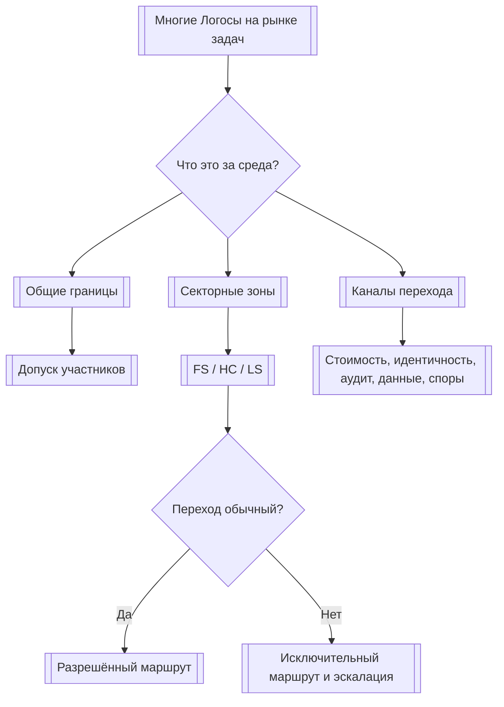
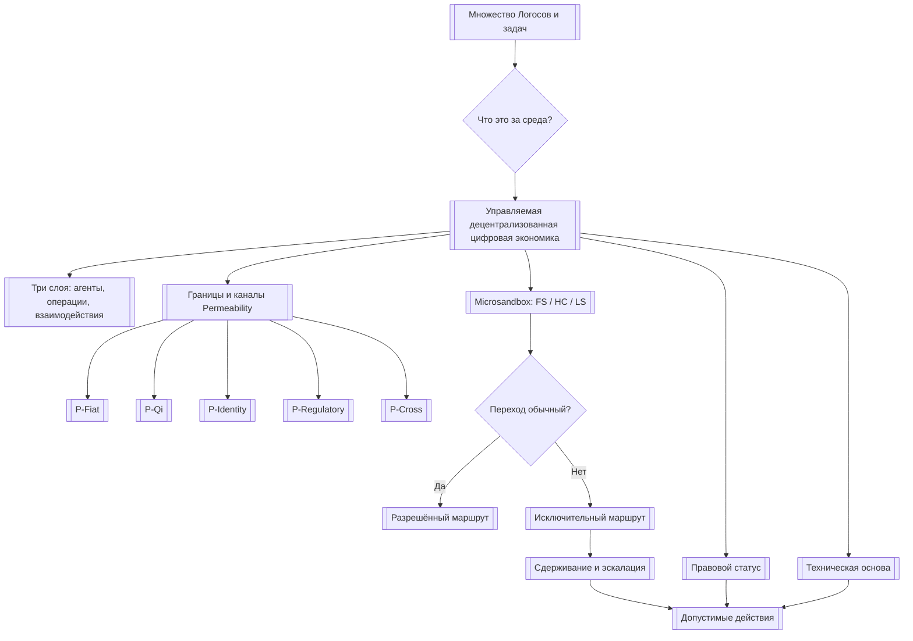

# УРОВЕНЬ 2 / ИЗМЕРЕНИЕ 01: ИДЕНТИФИКАЦИОННО-ОНТОЛОГИЧЕСКОЕ

> **Уровень:** L2 — Среда (инфраструктура)  
> **Измерение:** D01 — Ontology  
> **Учебная редакция:** v1.0  
> **Главная тема:** как описать саму агентную среду, её границы и отличие от открытых сетей агентов

---

## Ключевой вопрос

**Что это за среда, каковы её границы, статус и чем она отличается от других сред?**

---

## Краткое описание измерения

Когда в цифровой экономике действуют не один и не десять, а тысячи Логосов (англ. Logos), им нужно больше, чем список функций.

Им нужен общий ответ: **в какой среде они вообще находятся**.

Настоящее измерение объясняет среду как управляемую децентрализованную цифровую экономику (англ. Managed Decentralized Digital Economy): не полностью открытую сеть без входных правил и не централизованный сервис, а спроектированное пространство с границами, секторами, каналами перехода и регуляторными ограничениями.

Эта глава отвечает на несколько практических вопросов:

1. Что именно считается внутренней средой, а что находится снаружи?
2. Почему управляемость не отменяет децентрализацию?
3. Какие границы проходят вокруг агентов, данных, стоимости, задач и правового статуса?
4. Что такое микропесочница (англ. Microsandbox, далее — `Microsandbox`) и почему она является основной единицей границы?
5. Почему проницаемость (англ. Permeability, далее — `Permeability`) должна быть управляемой, а не свободной по умолчанию?
6. Чем такая среда отличается от открытых сетей агентов и сетей стимулов?
7. Какие вопросы остаются нерешёнными и требуют отдельного управленческого или проектного решения?

---

## Мини-глоссарий

| Термин | Простое объяснение |
|--------|--------------------|
| **Логос** | Цифровой агент (англ. Logos), действующий в пределах делегированных ему прав. |
| **Среда** | Общее пространство правил, инфраструктуры и взаимодействий, где работают многие Логосы. |
| **Онтология среды** | Ответ на вопрос, что именно существует внутри среды, где её границы и по каким правилам она отличается от внешнего мира. |
| **Управляемая децентрализованная цифровая экономика** | Тип среды, где децентрализация развивается постепенно, но входы, переходы и риски остаются управляемыми. |
| **Граница среды** | Правило или механизм, который определяет, что допускается внутрь, наружу или между секторами. |
| **`Permeability`** | Управляемая проницаемость (англ. Permeability): не «всё открыто», а набор разрешённых каналов перехода. |
| **`Microsandbox`** | Микропесочница (англ. Microsandbox): частично изолированная операционная зона для задач определённого сектора или назначения. |
| **`FS`** | Финансовый сектор внутри среды. |
| **`HC`** | Сектор здравоохранения, где особенно важны данные, цели обработки и правовые основания. |
| **`LS`** | Логистический сектор; в этой главе это именно логистика, не юридические услуги. |
| **DID** | Децентрализованный идентификатор (англ. Decentralized Identifier): проверяемая цифровая привязка субъекта или агента. |
| **VC** | Проверяемое учётное данное (англ. Verifiable Credential): цифровое подтверждение, которое можно проверить криптографически. |
| **AGC** | Операционная стабильная валюта (англ. AgentCredits), связанная с фиатной стоимостью. |
| **Qi** | Резервный, инвестиционный и управленческий слой ценности (англ. Qi Energy). |
| **`MiCA`** | Регламент о рынках криптоактивов (англ. Markets in Crypto-Assets Regulation). |
| **`AMLR`** | Рамка против отмывания денег (англ. Anti-Money Laundering Regulation), важная для запрета анонимных агентных счетов. |
| **`EU AI Act`** | Европейский регламент об искусственном интеллекте (англ. European Union Artificial Intelligence Act). |
| **`GDPR`** | Общий регламент защиты данных (англ. General Data Protection Regulation). |
| **`DPIA`** | Оценка воздействия на защиту данных (англ. Data Protection Impact Assessment) перед чувствительной обработкой. |
| **`CASP`** | Поставщик услуг с криптоактивами (англ. Crypto-Asset Service Provider), работающий в лицензируемом режиме. |
| **`EMT`** | Электронно-денежный токен (англ. E-Money Token): криптоактив, привязанный к фиатной валюте. |
| **`OCA`** | Иной криптоактив (англ. Other Crypto-Asset): категория для актива, который не является электронно-денежным токеном. |
| **`GPAI`** | Модель искусственного интеллекта общего назначения (англ. General-Purpose AI). |
| **`Base L2`** | Текущая техническая основа исполнения среды на сети второго уровня (англ. Layer 2). |
| **`OP Stack`** | Технологический стек (англ. OP Stack), на котором может строиться сеть второго уровня. |
| **`Optimistic Rollup`** | Оптимистический роллап (англ. Optimistic Rollup): тип сети второго уровня, где транзакции считаются корректными, пока не доказано обратное. |
| **Аварийный ограничитель** | Механизм временного ограничения или остановки опасного перехода (англ. circuit breaker). |
| **Сдерживание** | Ограничение действия агента, сектора или канала, чтобы риск не распространился дальше (англ. containment). |

---

# 0. Гипотетический пример

Представим цифровой рынок городских услуг, где одновременно работают сотни Логосов.

Одни Логосы ищут подрядчиков для поставок.  
Другие планируют логистику.  
Третьи помогают клиникам закупать оборудование.  
Четвёртые проводят расчёты, проверяют документы и фиксируют исполнение.

На уровне одного агента важно понять, кто он, что умеет и какие права получил от владельца. Но на уровне среды возникает другой вопрос:

> **Как множество разных Логосов вообще понимают, где они находятся, какие правила действуют и какие переходы допустимы?**

**Марина** — оператор муниципального рынка задач. Она не исполняет каждую сделку вручную, но отвечает за то, чтобы рынок не смешивал несовместимые режимы.

**Илья** — владелец логистической компании. Его корпоративные Логосы возят товары и участвуют в тендерах.

**София** — координатор сети клиник. Её Логосы закупают медицинские расходники и обрабатывают чувствительные данные о поставках.

**Роман** — финансовый контролёр. Его Логосы проверяют оплату, резервные подтверждения и признаки подозрительных операций.

Если все эти участники попадут в одну полностью открытую среду без онтологии, начнутся ошибки:

- логистическая задача может случайно попасть в медицинский режим обработки данных;
- медицинские данные могут уйти в обычный коммерческий контур;
- платёж может пройти без нужной проверки;
- внешний агент может выглядеть как внутренний участник;
- спор между секторами не получит понятного маршрута.

Настоящее измерение нужно именно для того, чтобы такие ошибки не решались каждый раз заново.

## Проверка 1. Что считается одной средой

Сначала Марине нужно понять: это единый цифровой рынок или набор несвязанных сервисов?

Если среда единая, у неё должны быть общие границы: кто допускается, какие зоны существуют, как агент переходит между ними и кто видит нарушение.

Если этого нет, участники вроде Ильи, Софии и Романа не могут заранее понять, какие правила применяются к их действиям.

## Проверка 2. Какие сектора нельзя смешивать

Логистический Логос Ильи может планировать доставку медицинских расходников.

Но это ещё не значит, что он автоматически получает доступ к медицинским данным Софии.

Среда должна различать сектор логистики, сектор финансов и сектор здравоохранения. Для этого используются `Microsandbox`: частично изолированные зоны, где правила доступа и переходов зависят от назначения.

## Проверка 3. Какие переходы разрешены

Роман видит, что по сделке нужна оплата в AGC и проверка резервов.

Это не просто технический перевод. Стоимость проходит через отдельный канал границы: фиатный вход и выход, операционная валюта, внешние платёжные пути и регуляторные проверки.

Так же отдельно проходят идентичность, доказательства, данные, аудит и межсекторные задачи.

## Проверка 4. Когда переход становится исключением

София просит передать часть медицинского контекста логистическим Логосам Ильи, чтобы оптимизировать доставку.

Технически это возможно.

Но среда не должна считать такой переход обычной проницаемостью. Он может изменить правовое основание обработки, цель использования данных и обязанность объяснять участникам, что происходит.

Поэтому для `HC`-зоны такой переход должен идти как исключительный маршрут, а не как стандартная операция.

## Проверка 5. Что делать при риске распространения

Допустим, один внешний агент начинает массово отправлять заявки, которые перегружают финансовый и логистический контуры.

В полностью открытой сети это могло бы быстро распространиться по рынку.

В управляемой среде нужен механизм сдерживания: ограничить агента, закрыть канал, приостановить переход между `Microsandbox` или поднять вопрос на управленческую эскалацию.

## Проверка 6. Почему это не ручное управление каждым агентом

Марина не должна вручную разрешать каждое действие Ильи, Софии и Романа.

Управляемость означает другое: границы заранее спроектированы, переходы наблюдаемы, а опасные ситуации имеют маршруты ограничения и эскалации.

Децентрализация при этом остаётся возможной: полномочия могут постепенно распределяться шире, пока сохраняются проверяемые границы среды.

## Главное из примера

**Онтология среды нужна не для формального описания системы, а как общая карта реальности, по которой многие Логосы понимают: где они действуют, какие границы пересекают и почему не каждый технически возможный переход является допустимым.**

---

# Содержание

1. Что именно описывает онтология среды
2. Границы среды и управляемая проницаемость
3. Правовой и технический статус среды
4. Чем эта среда отличается от других типов сред
5. Связь и границы с другими измерениями
6. Итоговая модель целиком
7. Короткое резюме главы
8. Вопросы без ответа

---

# 1. Что именно описывает онтология среды

Прежде чем говорить о токенах, управлении, исполнении задач или юридических режимах, нужно ответить на более базовый вопрос: **какая среда вообще создаётся**.

Если этот вопрос не решён, разные участники будут видеть одну и ту же систему по-разному.

Для одного это будет рынок агентов.  
Для другого — сеть платежей.  
Для третьего — инфраструктура для регулируемых отраслей.  
Для четвёртого — набор технических протоколов.

Онтология среды связывает эти взгляды в одну модель.

## 1.1 Среда как управляемая децентрализованная экономика

Настоящее измерение описывает среду как управляемую децентрализованную цифровую экономику.

Это означает три вещи.

Во-первых, среда не строится на допущении «всё открыто для всех по умолчанию».

Во-вторых, она не сводится к централизованному сервису, где один оператор вручную управляет каждым действием.

В-третьих, её децентрализация рассматривается как траектория: полномочия и техническое доверие могут распределяться шире по мере созревания правил, наблюдаемости и механизмов сдерживания.

> Управляемость здесь означает наличие границ, а не ручной контроль каждого агента.

## 1.2 Семь проблем, из-за которых нужна такая среда

Спонтанная агентная экономика может быстро стать удобной, но неуправляемой.

Настоящее измерение выделяет семь системных проблем, которые объясняют, почему среда не должна быть просто открытым пространством взаимодействий.

| Проблема | Почему это важно | Ответ среды |
|----------|------------------|-------------|
| Резкое рыночное падение и распространение риска | Если стоимость движется без ограничений, сбой может быстро затронуть многих участников. | Граничные контроли, ограничения скорости, экстренная эскалация. |
| Безопасность | Без проверяемой идентичности агентная экономика превращается в пространство анонимных действий. | Децентрализованный идентификатор (англ. Decentralized Identifier, далее — DID) и проверяемое учётное данное (англ. Verifiable Credential, далее — VC) как входной слой. |
| Конфиденциальность | Не вся полезная активность совместима с открытым потоком данных. | Секторная изоляция через `Microsandbox`, особенно в здравоохранении. |
| Инфраструктурная хрупкость | Среде нужна явная техническая граница и слой исполнения. | Закрепление на конкретной технической основе исполнения. |
| Управление и ответственность | Нельзя управлять каждым действием вручную, но правила должны иметь маршрут изменения и эскалации. | Постепенная децентрализация и экстренный надзор. |
| Неравенство доступа | Не все роли и домены должны иметь одинаковый вход. | Селективный доступ по ролям и секторам. |
| Совместимость ценностей и правил | Для отраслевых зон важны не только цена и скорость, но и допустимые классы действий. | Правила `Microsandbox` и отраслевые управленческие контуры. |

## 1.3 Три слоя одной среды

Чтобы не смешивать разные вопросы, удобно держать трёхслойную модель.

| Слой | Что находится внутри | Зачем он нужен настоящему измерению |
|------|----------------------|-------------------------------------|
| Агентский | Логосы, микроагенты, идентификационные и делегационные связи. | Показывает, **кто** может входить в среду. |
| Операционный | `Microsandbox`, правила доступа, расчёты и контуры исполнения. | Показывает, **где** агент действует и на каких условиях. |
| Интеракционный | Передача стоимости, кооперация, споры, сообщения и переходы между доменами. | Показывает, **как** внутренние участники взаимодействуют друг с другом и с внешним миром. |

Эти слои не являются тремя отдельными мирами.

Это три способа смотреть на одну и ту же среду. Настоящее измерение владеет именно общей связкой: что считается средой, где проходят её границы и как эти границы выражаются в архитектуре.

## 1.4 Почему управляемость не противоречит децентрализации

Главное напряжение этой главы звучит так:

> Если среда децентрализованная, почему она остаётся управляемой?

Ответ в том, что слова «управляемая» и «децентрализованная» отвечают на разные вопросы.

| Слово | Что оно означает здесь | Чего оно не означает |
|-------|------------------------|----------------------|
| Управляемая | У среды есть наблюдаемые границы, каналы перехода, ограничения и маршруты эскалации. | Оператор вручную решает каждую задачу каждого агента. |
| Децентрализованная | Полномочия и техническое доверие могут постепенно распределяться между участниками и механизмами управления. | Правил нет, вход свободен для всех, а границ не существует. |

Ранняя управляемая фаза совместима с децентрализацией, если она защищает границы среды и не превращается в постоянную подмену всей экономики централизованным управлением.

## Главное

**Онтология среды отвечает не на вопрос «какие агенты есть внутри», а на вопрос «какая реальность для них создана».**  
**Управляемая децентрализация означает распределяемые полномочия при сохранении наблюдаемых границ.**

---

# 2. Границы среды и управляемая проницаемость

Граница среды нужна не для изоляции ради изоляции.

Она нужна, чтобы участники понимали, когда действие остаётся внутренним, когда оно выходит наружу, когда меняет сектор и когда требует отдельной проверки.

Без такой границы одна и та же операция может выглядеть как обычная доставка, финансовая транзакция, медицинская обработка данных и юридически значимое действие одновременно.

## 2.1 Управляемая проницаемость как основная логика границы

`Permeability` означает, что среда не полностью закрыта и не полностью открыта.

Она допускает переходы, но делает их типизированными.

Пять каналов помогают различать, **что именно проходит через границу**.

| Канал | Что проходит через границу | Как это понимать учебно |
|-------|----------------------------|--------------------------|
| `P-Fiat` | Фиатная стоимость, вход и выход через AGC и внешние платёжные пути. | Деньги не «текут куда угодно»: вход и выход стоимости требуют отдельного режима. |
| `P-Qi` | Переход резервного или инвестиционного слоя Qi к внешним крипторынкам. | Управленческая и резервная ценность имеет собственный канал, отличный от операционных платежей. |
| `P-Identity` | DID, VC, связи идентичности и доказательства проверки. | Доверие к участнику входит через проверяемые идентификационные доказательства. |
| `P-Regulatory` | Аудит, подтверждения резервов, доказательства соответствия требованиям и надзорные взаимодействия. | Регуляторный контур не является внешним шумом: он проецируется в архитектуру среды. |
| `P-Cross` | Межсекторные и внешние переходы задач, данных и споров. | Не всякая задача может свободно перейти из одного сектора в другой. |

Эта схема не означает, что каждый канал уже полностью специфицирован.

Она задаёт более важный принцип: границы среды лучше мыслить как набор разных шлюзов, а не как одну абстрактную «проницаемость».

## 2.2 `Microsandbox` как основная единица границы

Среде нужно разделять режимы деятельности.

Финансовая задача, медицинская задача и логистическая задача могут использовать похожих агентов и похожую инфраструктуру, но их правила доступа, данные и риски различаются.

Для этого вводится `Microsandbox`: программно создаваемая частично изолированная операционная зона, специализируемая по сектору, назначению и набору допустимых переходов.

Важно не путать её с регуляторной песочницей в смысле `EU AI Act`. Здесь `Microsandbox` — архитектурная единица среды, а не официальный правовой режим экспериментирования.

Базовая модель различает три сектора.

| `Microsandbox` | Назначение | Граничное следствие |
|----------------|------------|---------------------|
| `FS` | финансовые услуги (англ. Financial Services). | Наиболее жёсткая связь с `CASP`, `AMLR` и мониторингом транзакций. |
| `HC` | здравоохранение (англ. Healthcare). | Самый строгий режим для данных, ролей контролёра и обработчика, а также обязательной `DPIA`. |
| `LS` | логистика (англ. Logistics). | Меньше чувствительных персональных данных, но выше требования к устойчивому исполнению и трассируемости. |

Термин `LS` в этой главе означает именно логистику.

## 2.3 Жизненный цикл `Microsandbox`

`Microsandbox` важна не только как зона, но и как объект с жизненным циклом.

Граница меняется по стадиям.

| Стадия | Что важно для границы |
|--------|------------------------|
| Инициализация (англ. Initialization) | Настройка зоны и первичный контроль допуска. |
| Подключение (англ. Onboarding) | Подключение участников, ролей, данных и начальных правил. |
| Операции (англ. Operations) | Постоянное применение правил доступа и переходов. |
| Масштабирование (англ. Scaling) | Рост пропускной способности и наблюдаемости переходов. |
| Завершение (англ. Sunset) | Управляемое отключение, вывод участников и перенос обязательств. |

Жизненный цикл нужен не ради административной схемы.

Он нужен потому, что одна и та же зона на старте, в рабочем режиме и при закрытии имеет разные риски.

## 2.4 Когда переход становится исключением

Самая строгая проверка возникает в `HC`.

Переход данных или задач из здравоохранения в другой контекст не должен считаться обычным вариантом `Permeability`.

Причина проста: такой переход может изменить правовое основание, цель обработки и обязанность объяснять участникам, что происходит с их данными.

Поэтому часть переходов должна быть не обычным маршрутом, а исключительным путём.

## 2.5 Механизм сдерживания как граничный инструмент

Если риск уже распространяется, поздно спорить о терминологии.

Среде нужен инструмент, который может ограничить действие на нужном уровне:

- отдельный агент;
- отдельная `Microsandbox`;
- канал перехода;
- маршрут управленческой эскалации.

Для такого класса механизмов используется аварийный ограничитель (англ. circuit breaker, далее — `circuit breaker`). В учебном смысле это предохранитель границы: он не решает всю безопасность среды, но помогает не дать проблеме перейти дальше.

Окончательная реализация такого механизма относится к соседним слоям исполнения и мониторинга. Настоящее измерение фиксирует архитектурную необходимость: граница должна быть не только описана, но и способна сдерживать распространение риска.

## Главное

**Граница среды — это не одна линия, а система каналов, зон и исключительных маршрутов.**  
**`Microsandbox` делает границу предметной: она показывает, где действует агент, какие правила применяются и какие переходы требуют отдельной проверки.**

---

# 3. Правовой и технический статус среды

Среда не существует «везде сразу».

У неё есть правовой статус, техническая основа и регуляторные следствия. Настоящее измерение не раскрывает эти соседние области полностью, но показывает, почему они входят в онтологию среды.

## 3.1 Правовой статус как часть онтологии

Если среда работает с агентами, ценностью, данными и регулируемыми секторами, правовой режим не может быть внешним приложением.

Он влияет на то, что среда считает допустимым действием.

Основные проекции такие:

| Область | Что означает для среды |
|---------|------------------------|
| Регламент о рынках криптоактивов (англ. Markets in Crypto-Assets Regulation, далее — `MiCA`) | AGC квалифицируется как `EMT`; Qi относится к категории `OCA`; для части операций требуется `CASP`-контур. |
| Рамка против отмывания денег (англ. Anti-Money Laundering Regulation, далее — `AMLR`) | Анонимные агентные счета недопустимы. |
| Регламент об искусственном интеллекте (англ. European Union Artificial Intelligence Act, далее — `EU AI Act`) | Среда рассматривается как потребитель модели искусственного интеллекта общего назначения (англ. General-Purpose AI, далее — `GPAI`), а не как её поставщик; внутренняя `Microsandbox` не равна регуляторной песочнице по статье 57. |
| Общий регламент защиты данных (англ. General Data Protection Regulation, далее — `GDPR`) | В `HC`-зоне медицинская организация выступает основным контролёром, среда может быть совместным контролёром, а `DPIA` обязательна. |
| Трёхсторонняя ответственность | Ответственность распределяется между средой, развёртывающим или оператором и агентом. |

Здесь важно не запоминать названия регламентов как список.

Важно увидеть принцип: правовой статус определяет границы среды так же реально, как техническая сеть или протокол доступа.

## 3.2 Техническая основа как граница исполнения

Среда должна иметь явный слой исполнения.

Иначе непонятно, где фиксируются транзакции, где работают смарт-контракты, где находятся якоря доказательств и где проходит техническая граница.

В текущей модели такой основой является `Base L2`: сеть второго уровня на базе `OP Stack` и класса `Optimistic Rollup`.

Эта основа задаёт не только удобство разработки, но и онтологический факт: среда не «растворена в интернете», а закреплена на конкретной базе исполнения.

Как инфраструктурный ориентир используется порядок около 100-300 транзакций в секунду. Это не учебный коэффициент для расчётов в этой главе, а показатель класса пропускной способности, который помогает понять масштаб технической границы.

## 3.3 Почему статус не исчерпывает среду

Право и инфраструктура важны, но они не заменяют онтологию.

Можно знать, на какой сети выполняются контракты, но не понимать, какие сектора существуют.

Можно знать регуляторную квалификацию AGC, но не понимать, как задача переходит между `FS`, `HC` и `LS`.

Можно знать, что есть DID и VC, но не понимать, какие входы и выходы среды они открывают.

Настоящее измерение собирает эти проекции в общую картину: статус среды проявляется через границы, роли, каналы и допустимые переходы.

## Главное

**Правовой и технический статус не являются внешними комментариями к среде.**  
**Они определяют, где среда исполняется, какие действия допустимы и какие переходы требуют отдельной проверки.**

---

# 4. Чем эта среда отличается от других типов сред

Сравнивать среды только по признаку «есть агенты искусственного интеллекта или нет» недостаточно.

Агенты могут быть и в открытой сети стимулов, и в рынке быстрого запуска, и в регулируемой инфраструктуре.

Главная ось сравнения другая:

> управляемые границы против открытого участия по умолчанию.

## 4.1 Ближайший структурный тип

Существуют среды, которые тоже объединяют искусственный интеллект, криптоэкономику и собственную дорожную карту сети.

Они структурно близки, потому что тоже пытаются связать агентов, стимулы и инфраструктуру.

Но настоящая модель отличается тем, что делает управляемые границы центральным свойством: стабильный операционный слой стоимости, регуляторное соответствие и `Microsandbox` не являются второстепенными надстройками.

## 4.2 Открытые сети участия

Другой тип сред строится вокруг максимально открытого участия.

Там слабее выражены:

- проверка соответствия требованиям перед входом;
- внутренняя секторная изоляция;
- уверенность в идентификационном слое;
- управляемые каналы перехода.

Из этого не следует, что такие среды хуже.

Они просто принадлежат к другому онтологическому типу. Их базовая норма — открытое участие, а не управляемая допустимость.

## 4.3 Сравнительная таблица типов

| Параметр | Управляемая децентрализованная цифровая экономика | Децентрализованная сеть ИИ | Открытая экономика подсетей | Открытая среда быстрого запуска агентов |
|----------|----------------------------------------------------|----------------------------|-----------------------------|------------------------------------------|
| Базовый тип | Среда с управляемыми границами и секторными зонами. | Сеть координации ИИ и криптоинфраструктуры. | Открытая экономика стимулов. | Открытый рынок выпуска и торговли агентами. |
| Главный отличитель | `Microsandbox` и управляемая `Permeability`. | Оркестрация сети и дорожная карта цепочки. | Открытые подсети и стимулы. | Быстрый выпуск агентов и рыночная открытость. |
| Модель границы | Типизированные каналы перехода. | Граничные контроли не являются центром модели. | Границы минимальны. | Границы минимальны. |
| Регуляторное соответствие | Проецируется в архитектуру среды. | Не выступает центральным слоем дизайна. | Не является ядром модели. | Не является ядром модели. |
| Уверенность в идентичности | Ожидается допуск через DID, VC и подотчётность. | Не является онтологическим центром. | Ограниченная. | Развивается, но остаётся заметный разрыв доверия. |
| Секторная изоляция | `FS`, `HC`, `LS` через `Microsandbox`. | Сопоставимая секторная изоляция не является базовым признаком. | Нет. | Нет. |
| Путь децентрализации | Управляемая фаза, затем более распределённые конфигурации, затем потенциально более широкая открытость. | Ведётся от логики сети. | Открытость с начала. | Открытость с начала. |

## 4.4 Итог сравнения

Главное отличие настоящей модели не в том, что она «делает то же самое осторожнее».

Она иначе определяет сам тип среды.

Если открытая сеть говорит: «участвовать можно широко, а правила минимальны», то управляемая среда говорит: «участвовать можно через понятные границы, а переходы должны быть типизированы».

## Главное

**Отличие среды проходит не по линии «есть агенты или нет», а по линии «открытость по умолчанию или управляемая допустимость».**  
**Настоящее измерение описывает второй тип: среду, где границы являются частью самой архитектуры.**

---

# 5. Связь и границы с другими измерениями

Настоящее измерение стоит в начале уровня среды. Оно задаёт общий ответ на вопрос, что это за среда, но не забирает у соседних измерений их собственную механику.

| Измерение | Связь | Граница ответственности |
|-----------|-------|--------------------------|
| **L1/D01 (Идентификационное)** | DID, VC и допуск в среду используются как входная проекция идентичности. | Настоящее измерение показывает роль идентичности в границе среды; полная модель личности, агента и верификации остаётся у L1/D01. |
| **L2/D02 (Функционально-целевое)** | AGC, Qi и экономические инструменты задают часть внешней и внутренней границы стоимости. | Настоящее измерение показывает, что стоимость проходит через отдельные каналы; устройство инструментального слоя остаётся у L2/D02. |
| **L2/D03 (Инфраструктурно-материальное)** | `Base L2` выступает технической границей исполнения. | Настоящее измерение фиксирует, что техническая основа важна для онтологии; вычисления, хранение, контракты и сценарии межсетевых переходов остаются у L2/D03. |
| **L2/D06 (Механизмы координации и исполнения)** | `Microsandbox` определяется здесь как граничный объект, но её рабочее исполнение требует координации. | Настоящее измерение определяет, что такое зона и почему она нужна; маршрутизация, оркестрация и исполнение переходов остаются у L2/D06. |
| **L2/D08 (Нормативно-правовое)** | Правовой статус влияет на допустимые действия и переходы. | Настоящее измерение показывает правовой статус как проекцию границы; детальная квалификация `CASP`, `MiCA`, `EU AI Act`, `GDPR` и ответственности остаётся у L2/D08. |
| **L2/D09 (Управленческое)** | Постепенная децентрализация и экстренные механизмы важны для управляемого характера среды. | Настоящее измерение объясняет, почему управляемость совместима с децентрализацией; полная архитектура управления и эскалации остаётся у L2/D09. |

## Главное

**Настоящее измерение владеет общей картой среды: тип, границы, сектора и каналы перехода.**  
**Соседние измерения владеют подробной механикой идентичности, инструментов, инфраструктуры, исполнения, права и управления.**

---

# 6. Итоговая модель целиком

Если собрать главу в одну схему, получится такая логика.

Сначала среда определяется как управляемая децентрализованная цифровая экономика. Затем она задаёт слои, сектора и каналы перехода. После этого правовой и технический статус показывают, где среда исполняется и какие ограничения встроены в её границы. Наконец, сравнение с другими типами сред показывает, что главный отличитель — не наличие агентов, а управляемая допустимость.

## Главное

**Итоговая модель показывает среду как набор связанных границ: кто входит, где действует, что может переходить между зонами и когда требуется сдерживание или эскалация.**

---

# 7. Короткое резюме главы

1. Настоящее измерение отвечает на вопрос, что за среда создаётся, где проходят её границы и почему она отличается от других сред.
2. Среда описывается как управляемая децентрализованная цифровая экономика: правила и границы есть с самого начала, а децентрализация развивается как траектория.
3. Управляемость не означает ручное управление каждым агентом; она означает наблюдаемые границы, типизированные переходы и возможность эскалации.
4. Главный граничный объект — `Microsandbox`, то есть частично изолированная секторная зона.
5. Базовые сектора — `FS`, `HC` и `LS`; особенно строгие ограничения возникают при переходах из здравоохранения в другие контексты.
6. `Permeability` лучше понимать как пять каналов перехода: фиатная стоимость, Qi, идентичность, регуляторные доказательства и межсекторные переходы.
7. Правовой и технический статус не являются внешними приложениями: они определяют допустимые действия и техническую границу исполнения.
8. Главное отличие от открытых сетей агентов — управляемая допустимость вместо открытого участия по умолчанию.

## Главное

**Настоящее измерение превращает слово «среда» в архитектурную модель: тип, границы, сектора, каналы перехода и отличие от открытых сетей.**

---

# 8. Вопросы без ответа

1. **Какой статус должен иметь `Microsandbox`: операционная зона или почти юрисдикция?** Сейчас более узкая трактовка достаточна: `Microsandbox` — частично изолированная операционная среда. Более сильная трактовка потребует согласования с механикой исполнения и управления.
2. **Где проходит граница между управляемостью и децентрализацией?** Понятно, что среда может двигаться от управляемой фазы к более распределённым конфигурациям. Но нужен критерий, после которого она перестаёт быть управляемой средой и становится просто открытой сетью.
3. **Как должен выглядеть практический прототип механизма сдерживания?** Архитектурно понятно, что нужен многоуровневый предохранитель для агента, `Microsandbox`, канала перехода и управленческой эскалации. Конкретный прототип зависит от решений в слоях безопасности, мониторинга, координации и исполнения.

## Главное

**Открытые вопросы касаются не самого факта существования границ, а силы этих границ: насколько самостоятельной является `Microsandbox`, как далеко может идти децентрализация и как именно реализуется сдерживание риска.**
