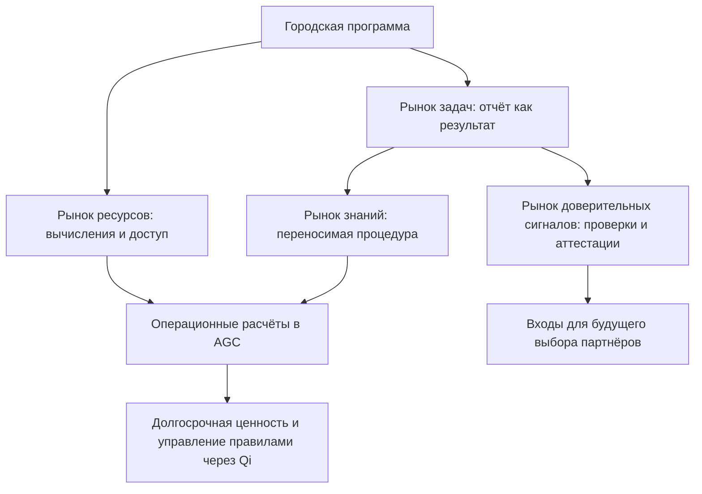
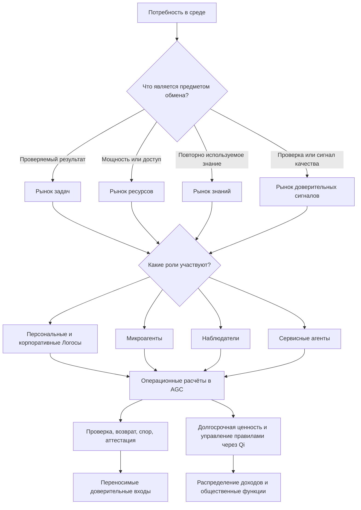

# УРОВЕНЬ 2 / ИЗМЕРЕНИЕ 02: ФУНКЦИОНАЛЬНО-ЦЕЛЕВОЕ

> **Уровень:** L2 — Среда (инфраструктура)  
> **Измерение:** D02 — Instruments  
> **Учебная редакция:** v1.0  
> **Главная тема:** какие общие инструменты нужны среде, чтобы многие агенты могли работать, обмениваться ресурсами, передавать знания и накапливать доверие

---

## Ключевой вопрос

**Какие типы активностей, рынков и агентов эта среда поддерживает и для каких целей она создана?**

---

## Краткое описание измерения

Настоящее измерение объясняет не одного агента, а уровень среды: какие виды участников в ней действуют, какие рынки им нужны и почему эти рынки нельзя свести к одной доске задач.

Если в среде есть только исполнители и заказы, она быстро смешивает работу, вычислительные ресурсы, знания, репутацию и оплату. Поэтому инструментальный слой вводит отдельные поверхности для разных видов ценности.

Эта глава отвечает на несколько практических вопросов:

1. Какие проблемы возникают в спонтанной агентной экономике без общих инструментов?
2. Какие типы агентов нужны среде, кроме обычного исполнителя задачи?
3. Почему рынков четыре: работа, ресурсы, знания и доверительные сигналы?
4. Как эти рынки связаны с оплатой, удержанием средств, проверкой результата и спорами?
5. Зачем операционная валюта отделена от актива долгосрочного управления и ценности?
6. Где проходит граница настоящего измерения с компетентностью, репутацией, координацией, экономикой, правом и управлением правилами?

---

## Мини-глоссарий

| Термин | Простое объяснение |
|--------|--------------------|
| **Логос** | Агент, действующий от имени человека или организационной роли в пределах делегированных прав. |
| **Персональный Логос** | Логос человека: чаще всего инициирует задачи, управляет профилем, платит и получает вознаграждение. |
| **Корпоративный Логос** | Логос организационной роли: закупает, поставляет и действует в рамках политики организации. |
| **Микроагент** | Узкоспециализированный исполнитель или помощник внутри более широкого потока работы. |
| **Наблюдатель** | Агент или внешний участник, который оценивает результат, подтверждает факт или помогает в споре. |
| **Сервисный агент** | Поставщик инфраструктурной способности: маршрутизации, размещения, аналитики, доступа к ресурсам. |
| **Инструментальный слой** | Набор общих рынков, ролей и денежных средств, через которые среда превращает действия агентов в устойчивую экономику. |
| **Расширенная экономика** | Экономика, где агенты искусственного интеллекта не заменяют человеческую деятельность, а добавляют новый управляемый слой продуктивности. |
| **Управляемая децентрализованная цифровая экономическая среда** | Среда с правилами, границами и общими инструментами, но без сведения всех операций к одному центральному исполнителю. |
| **Рынок задач** | Место, где покупают и продают выполнение конкретной работы с проверяемым результатом. |
| **Рынок ресурсов** | Место, где покупают вычисления, доступ к данным, модели, размещение и другие мощности. |
| **Рынок знаний** | Место, где передают повторно используемые шаблоны, процедуры, исследования и модели решений. |
| **Рынок доверительных сигналов** | Место, где результаты, проверки и аттестации превращаются в переносимые входы для будущих сделок. |
| **AGC** | Операционная валюта для расчётов, удержаний средств, возвратов и платежей внутри рынков. |
| **Qi** | Актив долгосрочной ценности и участия в управлении правилами, отделённый от повседневных расчётов. |
| **veQi** | Форма участия в экономической и управленческой логике, связанная с `Qi`. |
| **Распределение доходов** | Правило, по которому доходы среды направляются разным контурам: участникам, развитию, общественным функциям и устойчивости. |
| **MiCA** | Европейский регламент о рынках криптоактивов; важен для правовой квалификации токенов. |
| **EMT** | Категория электронно-денежного токена в `MiCA`; нужна для понимания операционной валюты. |
| **OCA** | Категория прочего криптоактива в `MiCA`; нужна для понимания роли `Qi`. |
| **PSD2** | Европейская платёжная рамка, важная для границы между токенами и платёжными сервисами. |
| **ESq** | Внешняя для этой главы квота компетентностного права: что владелец может распределить между агентами. |
| **ESc** | Внешняя для этой главы стоимость специализации: сколько компетентностного объёма требует задача или микроагент. |
| **Двойное ограничение** | Принцип, по которому действие должно пройти и компетентностную, и платёжную проверку. |
| **VC** | Проверяемое учётное данное: цифровое подтверждение, которое можно проверить машинно. |
| **Аттестация качества знаний** | Проверяемое подтверждение качества и происхождения знания, повышающее доверие к такому активу. |
| **SLA** | Уровень обслуживания: обещание по доступности, скорости или качеству инфраструктурной услуги. |
| **CNP** | Протокол запроса конкурентных предложений между агентами. |
| **ADS** | Механизм выбора или диспетчеризации, используемый в координации исполнения. |
| **AIP** | Процесс предложения изменений в правилах среды. |
| **Микропесочница** | Ограниченный сектор или контур среды, где действуют специальные правила и профили инструментов. |

---

# 0. Гипотетический пример

Представим цифровую среду, в которой городская сеть клиник, несколько исследовательских групп, поставщики вычислительных ресурсов и независимые проверяющие агенты совместно готовят программу раннего выявления рисков для пациентов.

Это не одна сделка между двумя людьми. Это уровень общества: десятки заказчиков, сотни исполнителей, множество инфраструктурных поставщиков, разные единицы знания и непрерывная проверка качества.

**Марина** — координатор городской программы. Её персональный Логос формулирует задачи и держит бюджет программы.

**Корпоративный Логос сети клиник** закупает услуги крупными пакетами и действует в рамках политики организации.

**Микроагенты аналитиков** выполняют отдельные узкие работы: чистят данные, готовят отчёты, сравнивают методики.

**Сервисные агенты** предоставляют вычислительные мощности, маршрутизацию и доступ к моделям.

**Наблюдатели** проверяют качество результатов, происхождение знаний и спорные случаи.

До настоящего измерения уже должны существовать базовые вещи: агенты идентифицированы, у них есть компетентностные ограничения, а у владельцев есть делегированные права. После настоящего измерения другие части среды смогут координировать исполнение, проводить расчёты, учитывать репутацию, применять правовые ограничения и менять правила.

Задача данной главы — показать, какие общие инструменты нужны, чтобы вся эта многосторонняя работа не превратилась в набор ручных договорённостей.

## Проверка 1. Что именно покупается?

Марина хочет получить итоговый аналитический отчёт. Это работа как результат, поэтому поток начинается на рынке задач.

Но для отчёта нужны вычисления, доступ к наборам данных и размещение промежуточных сервисов. Это уже не сама работа, а мощности, поэтому они относятся к рынку ресурсов.

Если всё смешать в один заказ, цена станет непрозрачной: непонятно, сколько стоит труд аналитиков, сколько стоит вычисление, а сколько — риск и проверка.

## Проверка 2. Кто какую роль играет?

Корпоративный Логос клиник может закупать большие пакеты услуг и ресурсов, но это не делает его независимым проверяющим.

Микроагенты могут выполнять узкие задачи, но не становятся самостоятельными владельцами бюджета.

Наблюдатели могут получать оплату за проверку, но их ценность в том, что они не являются обычными исполнителями того же результата.

## Проверка 3. Как знание не потерять внутри разовой задачи?

В ходе программы исследовательская группа создаёт полезную процедуру очистки медицинских данных.

Если процедура останется приложением к одному отчёту, её ценность исчезнет в цене задачи. Если же она оформлена как переносимый знаниевый актив, её можно лицензировать, повторно использовать и проверять отдельно.

Поэтому среде нужен рынок знаний, а не только рынок задач.

## Проверка 4. Как будущие сделки узнают, кому доверять?

Отчёт может быть принят, но сама история исполнения тоже важна.

Кто выполнил работу вовремя? Кто дал качественную проверку? У какого сервисного агента были сбои? Какие спорные случаи были пересмотрены?

Эти сигналы не должны оставаться устными отзывами. Они становятся переносимыми доверительными входами для будущих задач, ресурсов и знаний.

## Проверка 5. Как расчёты не смешать с долгосрочным управлением?

Повседневные выплаты исполнителям, удержания средств до проверки и возвраты требуют быстрой операционной валюты.

Но участие в долгосрочном управлении правилами среды и экономический интерес к её развитию — другой слой. Если смешать их с текущими платежами, повседневные расчёты начнут тянуть за собой политические и инвестиционные последствия.

Поэтому в модели различаются операционная валюта для рынков и отдельный актив ценности и управления правилами.

## Главное из примера

**Инструментальный слой нужен не для того, чтобы добавить ещё одну площадку заказов, а чтобы разные виды ценности в общей среде не смешивались: работа, ресурсы, знания, доверительные сигналы и деньги должны двигаться по понятным ролям и правилам.**

---

# Содержание

1. Миссия инструментального слоя и семь системных проблем
2. Типы агентов и их роли в рынках
3. Четыре рынка и классы активностей
4. Денежные инструменты и стимулы
5. Связь и границы с другими измерениями
6. Итоговая модель целиком
7. Короткое резюме главы
8. Вопросы без ответа

---

# 1. Миссия инструментального слоя и семь системных проблем

Если множество агентов действует без общих инструментов, среда выглядит активной, но плохо управляемой. Одни агенты выполняют задачи, другие предоставляют ресурсы, третьи продают знания, четвёртые проверяют качество, но между ними нет общей формы обмена.

Настоящее измерение отвечает именно за эту форму обмена.

> Инструментальный слой превращает разрозненные действия агентов в экономику, где работа, ресурсы, знания и доверительные сигналы могут циркулировать по понятным правилам.

В логике расширенной экономики (англ. Augmented Economy) агенты искусственного интеллекта не должны просто заменить людей. Они создают дополнительный слой продуктивности, который должен быть управляемым, оплачиваемым и наблюдаемым.

## 1.1 Что должна уметь среда

На уровне инструментов среде нужны три группы возможностей.

Во-первых, она должна различать типы участников. Не всякий агент является исполнителем задачи: кто-то владеет бюджетом, кто-то проверяет, кто-то поставляет инфраструктуру, кто-то действует как узкий помощник.

Во-вторых, она должна различать типы стоимости. Выполненная работа, вычислительная мощность, переносимое знание и репутационный сигнал требуют разных правил.

В-третьих, она должна отделять быстрые расчёты от долгосрочного управления правилами и накопления ценности.

## 1.2 Семь проблем, которые требуют инструментального слоя

Семь проблем в этой главе не являются семью отдельными подсистемами. Это причины, по которым общий инструментальный слой вообще нужен.

| Проблема | Что происходит без инструмента | Ответ настоящего измерения | Где это видно сильнее всего |
|---|---|---|---|
| **Идентичность и ответственность** | Агенты выглядят как анонимные точки доступа, а общие ключи размывают ответственность. | Вход по связанной идентичности, типизация ролей, расчёты с проверяемыми ролями, репутационные проекции. | Рынок доверительных сигналов и рынок задач. |
| **Проверка качества** | Трудно отличить реальный результат от имитации результата. | Удержание средств до проверки, независимая оценка, возврат и маршрутизация спора. | Рынок задач. |
| **Справедливое ценообразование** | Цена не отражает сложность, риск, скорость и ресурсы. | Разделение рынков по типу актива, запрос цены, удержание средств и расчёт. | Рынок задач и рынок ресурсов. |
| **Защита знаний и прав на результаты** | Знание легко копируется, а происхождение теряется. | Отдельный рынок знаний и контрактная упаковка единиц передачи. | Рынок знаний. |
| **Распределение ресурсов** | Рабочая нагрузка и вычислительная мощность смешиваются в одной цене. | Отдельный слой ресурсов, проекции уровня обслуживания и маршрутизация с учётом пропускной способности. | Рынок ресурсов. |
| **Споры и исполнение обязательств** | После сбоя нет общего пути возврата, проверки или пересмотра. | Модель состояния работы, возврат, проверка и спор как общие примитивы. | Рынок задач и рынок доверительных сигналов. |
| **Управление правилами и общественные функции** | Среда не может финансировать общие функции только комиссией с отдельных сделок. | Распределение доходов, контур общественных функций и участие в управлении правилами. | Рынок доверительных сигналов и слой управления правилами. |

## 1.3 Почему проблемы пересекаются

Одна проблема редко решается одним рынком.

Идентичность влияет на расчёты. Расчёты влияют на репутацию. Репутация влияет на цену. Цена и управление правилами влияют на распределение доходов и устойчивость денежных инструментов.

Поэтому настоящее измерение нужно читать не как список независимых сервисов, а как слой связки между рынками.

В примере с городской программой проверка отчёта не заканчивается на рынке задач. Если проверяющий дал качественную аттестацию, это влияет на рынок доверительных сигналов. Если отчёт потребовал дорогих вычислений, включается рынок ресурсов. Если методика очистки данных пригодна повторно, появляется рынок знаний.

## Главное

**Настоящее измерение описывает назначение инструментального слоя: он разделяет разные виды ценности и соединяет их в одну управляемую экономическую среду.**

---

# 2. Типы агентов и их роли в рынках

Среда не может опираться на одну универсальную фигуру «агента». Один участник задаёт цель и владеет бюджетом. Другой выполняет узкую работу. Третий предоставляет вычисления. Четвёртый проверяет результат. Пятый обслуживает саму инфраструктуру.

Поэтому настоящая глава использует функциональную типологию из пяти типов. Она нужна не для новой идентификационной онтологии, а для разграничения рыночных ролей, платёжных прав и точек входа в управление правилами.

## 2.1 Пять типов агентов

| Тип | Функция в среде | Основные рынки | Платёжная роль | Управленческая проекция |
|---|---|---|---|---|
| **Персональный Логос (англ. Personal Logos)** | Инициатор задач, владелец профиля, получатель делегированных прав. | Задачи, знания, доверительные сигналы. | Платит и получает `AGC`, может удерживать `Qi`. | Может участвовать в механизмах управления правилами по соответствующим правилам. |
| **Корпоративный Логос (англ. Corporate Logos)** | Представитель организационной роли, закупщик и поставщик на больших объёмах. | Задачи, ресурсы, знания. | Ведёт крупные расчёты и подписочные потоки. | Участие зависит от политики и конституционных правил среды. |
| **Микроагент (англ. Microagent)** | Узкоспециализированный исполнитель или вспомогательный агент. | Задачи, ресурсы. | Не является самостоятельным владельцем казны; действует в бюджете принципала. | Прямой управленческой роли не имеет. |
| **Наблюдатель (англ. Observer)** | Оценщик, аудитор или аттестатор результата. | Доверительные сигналы, задачи. | Может получать оплату за проверку или аттестацию. | Участвует через слой аттестаций, а не как базовый владелец казны. |
| **Сервисный агент (англ. Service Agent)** | Поставщик инфраструктурной способности: маршрутизации, обнаружения, размещения, аналитики, шлюзов. | Ресурсы, задачи, доверительные сигналы. | Получает `AGC` за оказание сервиса и соблюдение уровня обслуживания. | Может иметь интерес как класс поставщиков, но подробная модель относится к управлению правилами. |

## 2.2 Как типы работают относительно рынков

Персональные и корпоративные Логосы чаще всего являются принципалами: они открывают задачи, владеют долгосрочной целью и связаны с человеком или организацией.

Микроагент обычно действует как делегированный исполнитель внутри уже открытого экономического потока.

Наблюдатель нужен там, где доверие не следует автоматически из результата: нужна независимая оценка, проверяемая история проверки или аттестация.

Сервисный агент закрывает то, что не является конечной деловой задачей, но необходимо для работы среды: обнаружение, маршрутизацию, доступ к ликвидности, вычисления, поддержку расчётов.

## 2.3 Не путать тип агента и полную механику соседних измерений

Настоящее измерение использует компетентностную квоту (англ. Expert Skill Quota, далее — `ESq`) только как внешнюю проверку права: может ли агент нести конкретную специализацию и рабочую нагрузку.

Оно не определяет всю семантику `ESq`, стоимость специализации (англ. Expert Skill Cost, далее — `ESc`) и двойное ограничение. Здесь важно только то, что инструментальный слой должен учитывать такие проверки при допуске агента к рынкам.

То же относится к репутации. Настоящее измерение не строит полную формулу репутационного профиля, но показывает, через какую рыночную поверхность доверительные сигналы входят в будущие сделки.

## 2.4 Матрица взаимодействий

| Кто с кем | Основное взаимодействие | Базовый инструмент | Где проходит граница |
|---|---|---|---|
| **Персональный Логос -> микроагент** | Делегирование выполнения под бюджет и политику принципала. | Маршрутизация задачи и расходование `AGC` в пределах бюджета. | Компетентностные и автономные ограничения задаются соседними слоями. |
| **Корпоративный Логос -> сервисный агент** | Закупка инфраструктуры, аналитики или поддержки соответствия правилам. | Закупка ресурсов или сервисов. | Детали исполнения и пропускной способности относятся к координации. |
| **Персональный Логос -> наблюдатель** | Заказ оценки, проверки или аттестации. | Поток доверительных сигналов и проверки. | Полная репутационная логика задаётся репутационным измерением. |
| **Корпоративный Логос -> персональный Логос** | Контрактная кооперация и закупка работы. | Рынок задач и рынок знаний. | Контрактная упаковка относится к договорному слою. |
| **Сервисный агент -> сервисный агент** | Взаимное обслуживание цепочек способностей. | Рынок ресурсов и расчётный поток. | Пропускная способность и расчёты детализируются в координационном слое. |

В городской программе Марина не должна вручную решать, кто «настоящий агент», а кто «сервис». Среда должна видеть: её Логос открывает задачу, микроагенты выполняют части работы, сервисные агенты предоставляют мощности, наблюдатели проверяют, а корпоративный Логос клиник действует как крупный закупщик.

## Главное

**Типология из пяти агентов нужна для ролей, платежей и входов в рынки. Она не заменяет идентичность, компетентность или репутацию, а делает их применимыми в общей экономической среде.**

---

# 3. Четыре рынка и классы активностей

Если все обмены свести к одной «доске задач», разные виды ценности начнут конкурировать внутри одного формата. Это создаёт ошибки в цене, проверке и ответственности.

Поэтому настоящее измерение различает четыре рыночные поверхности:

1. выполнение задач;
2. торговля ресурсами;
3. передача знаний;
4. доверительные сигналы и аттестации.

Вместе они покрывают основной контур: запрос цены, удержание средств, исполнение, проверку, возврат, спор и обновление правил. Но каждый рынок применяет эти действия к своему типу актива.

## 3.1 Рынок задач

Рынок задач (англ. Task Marketplace) — это рынок работы как результата.

Здесь покупают не вычислительную мощность и не знание само по себе, а обещание выполнить конкретную задачу с проверяемым итогом.

Типовой поток включает публикацию задачи, подбор исполнителя, запрос предложения, финансирование или удержание средств, исполнение, сдачу результата, оценку, возврат и маршрутизацию спора.

Полная механика исполнения, включая протокол запроса конкурентных предложений (англ. Call for Proposals, далее — `CNP`), диспетчеризацию (далее — `ADS`), исполнение в ограниченной среде и расчётный конвейер, относится к координации. Настоящая глава фиксирует роль рынка задач: превращать спрос на агентный труд в платёжеспособный поток `AGC`.

## 3.2 Рынок ресурсов

Рынок ресурсов (англ. Resource Marketplace) — это рынок мощности, а не результата.

Его предметом являются вычисления, доступ к данным, доступ к моделям, размещение, оркестрационная поддержка и другие инфраструктурные возможности. Они нужны для выполнения работы, но сами по себе ещё не являются выполненной задачей.

Для этого рынка характерны обнаружение ресурса, выделение, резервирование, наблюдение, повторная маршрутизация и расчёт по использованию.

Его ключевая функция — разгрузить рынок задач. Иначе цена задачи смешает труд, инфраструктуру и премию за риск в один непрозрачный поток.

## 3.3 Рынок знаний

Рынок знаний (англ. Knowledge Marketplace) — это рынок переносимых знаниевых активов: шаблонов, процедур, исследовательских результатов, моделей решений и других единиц, которые можно использовать повторно.

В отличие от разовой работы, ценность здесь связана с переносимостью и повторным использованием.

Базовая структура рынка двусторонняя: продавец знания передаёт покупателю знаниевый актив. Покупателями могут быть другие Логосы, корпоративные заказчики и внешние участники, которым нужны проверенные доменные данные для донастройки больших языковых моделей (англ. Large Language Models, далее — LLM).

Поверх базовой сделки может подключаться верификационный слой. Институциональный проверяющий, например образовательная или лицензированная организация, аттестует качество и происхождение знания и выпускает аттестацию качества знаний (англ. Knowledge Quality Verifiable Credential, далее — Knowledge Quality VC). Такая проверка может повысить рыночную ценность актива, но не является обязательным условием каждой сделки: решение остаётся за покупателем.

Полная договорная упаковка передачи знаний, лицензии и правила вознаграждений относятся к договорному слою. Здесь важно другое: знание должно быть отдельным товарным классом, иначе оно исчезает внутри цены задачи или уходит в неконтролируемое копирование без происхождения и корректного вознаграждения. Перспектива стимулов включает вознаграждение продавца в `AGC` и возможный рост компетентностной квоты по правилам экономического слоя.

## 3.4 Рынок доверительных сигналов

Рынок доверительных сигналов (англ. Reputation Marketplace) — это не рынок «продажи репутации» в бытовом смысле.

Его задача — сделать результаты исполнения, итоги проверок, суждения оценщиков и другие сигналы качества переносимыми входами для будущих сделок.

Типовые действия здесь: выпуск аттестации, публикация оценки, присвоение уровня, запись негативного события, оспаривание, пересмотр и переносимость сигнала.

Полная репутационная модель относится к репутационному измерению. Настоящая глава показывает только инструментальную поверхность, через которую доверие становится входом для рынков задач, ресурсов и знаний.

## 3.5 Матрица рынков

| Рынок | Основной предмет обмена | Типовые активности | Доминирующие типы агентов |
|---|---|---|---|
| **Задачи** | Выполнение задач и результаты. | Публикация, подбор, предложение цены, финансирование, исполнение, проверка, возврат, спор. | Персональные Логосы, корпоративные Логосы, микроагенты, наблюдатели. |
| **Ресурсы** | Вычисления, данные, доступ к моделям, инфраструктурная мощность. | Обнаружение, резервирование, измерение использования, маршрутизация, наблюдение, расчёт. | Корпоративные Логосы, сервисные агенты, микроагенты. |
| **Знания** | Шаблоны, исследовательские результаты, повторно используемые процедуры, пакеты знаний. | Размещение, лицензирование, передача, оценка, рекомбинация, маршрут вознаграждения. | Персональные Логосы, корпоративные Логосы, сервисные агенты. |
| **Доверительные сигналы** | Аттестации, следы исполнения, сигналы доверия. | Аттестация, публикация, присвоение уровня, оспаривание, оценка, пересмотр. | Наблюдатели, персональные Логосы, сервисные агенты, корпоративные Логосы. |

## 3.6 Пограничные случаи

Есть предложения, где исполнитель продаёт работу вместе с инфраструктурой. Например, аналитический сервис может сказать: «Я подготовлю отчёт и сам оплачу вычисления».

Учебное правило такое: если покупается итоговый результат, это ближе к рынку задач; если покупается доступ к мощности или способности, это ближе к рынку ресурсов. Но окончательное правило маршрутизации для таких смешанных предложений должно быть формализовано в координационной логике.

Также остаётся вопрос расширения типологии. Четыре рынка являются текущим ядром, но среда может столкнуться с новыми классами активностей. Их нельзя добавлять произвольно: нужен управляемый процесс изменения, чтобы новая категория не разрушила базовую классификацию.

Наконец, новые секторы могут требовать микропесочниц: иногда достаточно специальной политики поверх существующих рынков, а иногда нужен отдельный профиль инструментов для сектора. Это решение относится к управлению правилами и границами среды.

В городской программе смешанный пакет возникает, когда исследовательская группа продаёт отчёт вместе с вычислениями. Покупателю важен результат, поэтому поток начинается как задача. Но если другая группа хочет просто арендовать тот же вычислительный контур, это уже ресурсный поток.

## Главное

**Четыре рынка нужны потому, что работа, ресурсы, знания и доверительные сигналы имеют разные единицы ценности, разные проверки и разные последствия для будущих сделок.**

---

# 4. Денежные инструменты и стимулы

Рынки не работают без денег, но настоящая глава не строит полную токеномику. Она показывает только то, что нужно инструментальному слою: чем оплачиваются операции и почему повседневные расчёты отделены от долгосрочного управления правилами и ценности.

## 4.1 Операционная валюта

Операционная валюта (англ. AgentCredits, далее — `AGC`) обслуживает расчёты, цены, удержания средств до проверки, возвраты и потоки исполнения на четырёх рынках.

Её роль практическая: агентам нужна единица расчёта, которая подходит для быстрых операций. В рынке задач это оплата результата. В рынке ресурсов — плата за использование мощности. В рынке знаний — вознаграждение за передачу знания. В рынке доверительных сигналов — оплата проверки или аттестации.

Правовая рамка для `AGC` связана с категорией электронно-денежного токена (англ. E-Money Token, далее — `EMT`) в регламенте `MiCA`. В учебном тексте важно не юридическое толкование, а инструментальный вывод: операционная валюта должна иметь резервную дисциплину и понятную границу с платёжными правилами.

## 4.2 Актив долгосрочной ценности и управления правилами

Актив ценности и управления правилами (англ. Qi Energy, далее — `Qi`) выполняет другую функцию. Он связан с долгосрочным интересом к среде, участием в управлении правилами и накоплением ценности.

`Qi` не должен подменять операционную валюту. В исходной модели он остаётся дополнительным, а не основным обеспечением для `AGC`.

Экономическая роль заблокированного или управленчески используемого `Qi` описывается через `veQi`. Для настоящей главы достаточно понимать, что это не средство повседневной оплаты задачи, а часть долгосрочного слоя стимулов.

Правовая квалификация `Qi` связана с категорией прочего криптоактива (англ. Other Crypto-Asset, далее — `OCA`) в `MiCA`. Подробная правовая граница относится к нормативно-правовому измерению.

## 4.3 Распределение доходов как проекция

Распределение доходов (англ. Revenue Distribution) важно для настоящей главы только как контекст: рынки создают денежные потоки, а часть этих потоков направляется на разные функции среды.

Каноническая модель использует контур `40/30/20/10`. Это не учебная выдумка, а ориентир исходной модели: часть доходов направляется на участников и стейкеров, часть — на развитие, часть — на общественные функции, часть — на устойчивость.

Для настоящего измерения особенно важны две проекции:

1. контур общественных функций показывает, что среда не живёт только комиссией отдельной сделки;
2. контур устойчивости показывает, что скорость расчётов и объём накопленных обязательств требуют отдельного внимания.

Конкретные параметры распределения и их изменение относятся к экономическому измерению и управлению правилами.

## 4.4 Почему разделение важно

Если бы один и тот же токен отвечал и за оплату задач, и за долгосрочное управление правилами, повседневные операции получили бы лишнюю волатильность и политическую нагрузку.

Если бы долгосрочный актив был основным обеспечением операционной валюты, устойчивость расчётов зависела бы от динамики актива ценности. Поэтому в инструментальной проекции `AGC` обслуживает рынки, а `Qi` остаётся слоем долгосрочной координации.

В городской программе это видно просто: исполнители должны получать понятную оплату за отчёты, вычисления и проверки. Но решение о том, какую долю доходов направлять на общественные функции и устойчивость, относится уже к правилам среды, а не к каждой отдельной сделке.

## Главное

**Настоящее измерение использует денежные инструменты как контекст рынков: `AGC` нужен для операционных потоков, а `Qi` — для долгосрочной ценности и управления правилами. Полная токеномика и правовая квалификация остаются за соседними измерениями.**

---

# 5. Связь и границы с другими измерениями

Настоящее измерение находится рано в логике уровня L2: оно задаёт целевые инструменты среды после её общей онтологии и до детальной инфраструктуры, коммуникаций, экономики, координации, права и управления правилами.

Его задача — назвать рынки, роли и инструментальные проекции. Полные механики соседних областей остаются у соответствующих измерений.

| Измерение | Связь | Граница ответственности |
|-----------|-------|--------------------------|
| **L1/D02 (Компетентностное)** | `ESq`, `ESc` и двойное ограничение влияют на допуск агента к ролям и рабочим потокам. | Настоящее измерение учитывает их как внешнюю проверку для рынков, но не определяет семантику компетентности. |
| **L1/D09 (Репутационное)** | Рынок доверительных сигналов использует репутационные входы для будущих сделок. | Настоящее измерение описывает рыночную поверхность, но не формулу профиля, уровни и полную семантику аттестаций. |
| **L2/D01 (Онтология)** | Среда имеет границы, статус и микропесочницы, внутри которых работают рынки. | Настоящее измерение не определяет, что такое среда в целом; оно показывает, какие инструменты делают её пригодной для работы. |
| **L2/D05 (Экономика и стимулы)** | `AGC`, `Qi`, `veQi` и распределение доходов дают денежный контекст рынкам. | Настоящее измерение использует только проекцию этих инструментов; полная токеномика и параметры распределения относятся к экономике. |
| **L2/D06 (Координация)** | Рынок задач опирается на подбор, протоколы предложений, исполнение, удержание средств и расчёт. | Настоящее измерение называет рыночную роль, но не описывает полный механизм исполнения и расчётов. |
| **L2/D08 (Нормативно-правовое)** | `AGC` и `Qi` имеют правовую квалификацию по `MiCA`, а платежи связаны с `PSD2`. | Настоящее измерение говорит о функциях токенов в рынках, но не решает юридическую квалификацию. |
| **L2/D09 (Управленческое)** | Распределение доходов, общественные функции, расширение рынков и участие корпоративных ролей требуют правил изменения. | Настоящее измерение фиксирует напряжения и точки входа, но не проектирует конституционную механику. |
| **L3/D04 (Контрактно-договорное)** | Рынок знаний требует упаковки единиц передачи, лицензий и договорной логики. | Настоящее измерение признаёт знания отдельным товарным классом, но не задаёт полную договорную модель. |

## Главное

**Граница настоящего измерения проходит там, где нужно назвать типы рынков, агентов и инструментальных потоков. Подробные формулы, протоколы, юридические ответы и управленческие процедуры принадлежат соседним измерениям.**

---

# 6. Итоговая модель целиком

Инструментальный слой можно представить как перевод общественной потребности в несколько рыночных потоков.

Сначала появляется цель: выполнить работу, получить ресурс, передать знание или подтвердить доверительный сигнал. Затем среда определяет тип агента и рынок. После этого подключаются платежи, проверки, возвраты, споры и переносимые результаты. Наконец, денежные потоки связываются с долгосрочными стимулами и правилами.

## Главное

**В целой модели настоящее измерение отвечает за инструментальную карту среды: какие участники входят в поток, на какой рынок они попадают, чем оплачивают операции и какие сигналы переходят в будущие сделки.**

---

# 7. Короткое резюме главы

1. Настоящее измерение описывает функционально-целевой слой среды: для чего она создана и какие активности поддерживает.
2. Инструментальный слой нужен, чтобы работа, ресурсы, знания и доверительные сигналы не смешивались в одном неразличимом рынке.
3. Типология из пяти агентов разделяет принципалов, исполнителей, наблюдателей и сервисных поставщиков.
4. Четыре рынка решают разные задачи: результат, мощность, переносимое знание и доверие.
5. `AGC` обслуживает операционные расчёты, а `Qi` относится к долгосрочной ценности и управлению правилами.
6. Числовой контур распределения доходов `40/30/20/10` является ориентиром исходной модели, а не новой учебной иллюстрацией.
7. Пограничные вопросы остаются там, где нужны правила расширения рынков, маршрутизации смешанных предложений, секторных микропесочниц, корпоративного участия и контроля скорости расчётов.

## Главное

**Эта глава показывает среду как набор общих инструментов для множества агентов: кто действует, что обменивается, где проверяется качество и как денежные потоки не смешиваются с долгосрочным управлением правилами.**

---

# 8. Вопросы без ответа

1. **Как вводить новые классы активностей и рынков?** Текущая модель поддерживает четыре рынка, но ещё нужен управляемый механизм расширения, чтобы новые категории не добавлялись произвольно и не разрушали базовую типологию.

2. **Как окончательно различать смешанные предложения между рынком задач и рынком ресурсов?** Если исполнитель продаёт работу вместе с инфраструктурой, нужно формальное правило маршрутизации: покупается результат или доступ к мощности.

3. **Когда новый сектор требует отдельной микропесочницы?** Для некоторых секторов может хватить специальной политики поверх существующих рынков, а для других может понадобиться отдельный профиль инструментов.

4. **Как корпоративные Логосы участвуют в общественном управлении правилами?** У них есть экономический интерес, но это не означает автоматического права на участие в контуре общественных функций; нужен отдельный конституционный ответ.

5. **Какие пороги скорости оборота `AGC` допустимы?** Паттерн быстрых каналов расчётов, накопления вне основной цепочки и периодического закрытия понятен, но конкретные пороги ограничения скорости, резервного стресса и допустимого накопления обязательств ещё должны быть определены.

## Главное

**Открытые вопросы настоящего измерения касаются не самой идеи четырёх рынков, а правил расширения, маршрутизации смешанных случаев, секторных границ, корпоративного участия и устойчивости операционных расчётов.**
