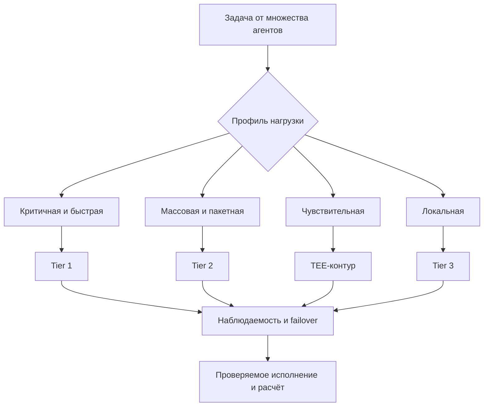
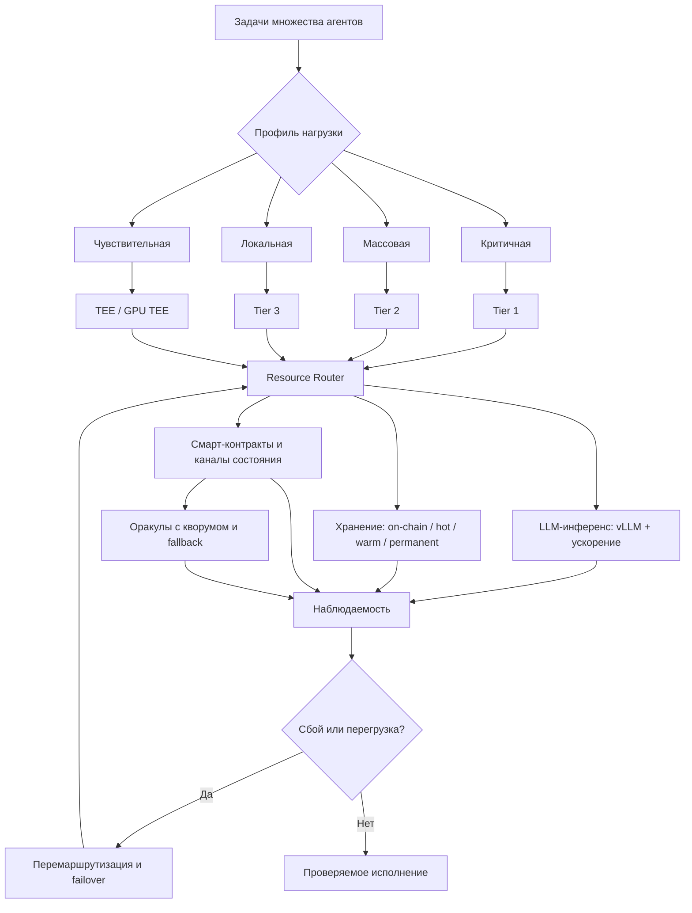

# УРОВЕНЬ 2 / ИЗМЕРЕНИЕ 03: ИНФРАСТРУКТУРНО-МАТЕРИАЛЬНОЕ

> **Уровень:** L2 — Среда (инфраструктура)  
> **Измерение:** D03 — Infrastructure  
> **Учебная редакция:** v1.0  
> **Главная тема:** на какой технической основе работает агентная среда и почему она не зависит от одного провайдера

---

## Ключевой вопрос

**На какой технической и вычислительной инфраструктуре построена среда и как обеспечиваются её надёжность и масштабируемость?**

---

## Краткое описание измерения

Агентная среда не может существовать только как набор правил и профилей участников.

Ей нужна техническая основа: вычисления, хранение данных, маршрутизация задач, доверенные среды исполнения, смарт-контракты, оракулы, наблюдаемость и механизмы отказоустойчивости.

Настоящее измерение объясняет, как эта основа устроена на уровне всей среды, где одновременно работают множество агентов, поставщиков ресурсов и рынков.

Эта глава отвечает на несколько практических вопросов:

1. На каких типах вычислительной инфраструктуры исполняются задачи среды?
2. Как среда выбирает, где запускать запрос к модели, пакетную задачу или чувствительный сценарий?
3. Почему одной облачной платформы, одного децентрализованного рынка или одного узла хранения недостаточно?
4. Как защищаются конфиденциальные вычисления?
5. Где хранятся разные классы данных: быстрые, проверяемые, долговечные и публично якоримые?
6. Как смарт-контракты, оракулы и каналы состояния становятся техническими рельсами для экономики среды?
7. Как маршрутизатор ресурсов связывает стоимость, задержку, приватность, аттестацию и надёжность?
8. Какие вопросы ещё требуют отдельного управленческого или проектного решения?

---

## Мини-глоссарий

| Термин | Простое объяснение |
|--------|--------------------|
| **Логос** | Агент, который действует от имени владельца в цифровой среде. |
| **Вычислительный слой (англ. compute layer)** | Часть инфраструктуры, где запускаются модели, инструменты и задачи агентов. |
| **Уровень исполнения (англ. execution tier)** | Категория инфраструктуры с разным балансом цены, задержки, надёжности и приватности. |
| **SLA** | Соглашение об уровне сервиса: обещанный уровень доступности, скорости или качества исполнения. |
| **LLM** | Большая языковая модель, обслуживающая запросы агентов и пользователей. |
| **Маршрутизация LLM** | Выбор модели, провайдера и инфраструктурного пути для конкретного запроса. |
| **Инференс (англ. inference)** | Запуск модели для получения ответа или результата. |
| **`vLLM`** | Движок обслуживания больших языковых моделей, важный для плотного использования графических процессоров. |
| **`PagedAttention`** | Механизм управления памятью в `vLLM`, который помогает эффективнее обслуживать много запросов. |
| **Спекулятивное декодирование (англ. Speculative Decoding)** | Приём ускорения генерации, когда быстрый предварительный шаг помогает основной модели отвечать быстрее. |
| **GPU** | Графический процессор, часто используемый для запуска моделей искусственного интеллекта. |
| **TEE** | Доверенная среда исполнения: защищённый контур, где код и данные можно обрабатывать с дополнительной изоляцией. |
| **Аттестация** | Проверяемое подтверждение, что задача выполнялась в нужной среде и с нужными свойствами. |
| **`Intel TDX`** | Кандидатный путь доверенных виртуальных машин на процессорах Intel. |
| **`AMD SEV-SNP`** | Кандидатный путь доверенных виртуальных машин на процессорах AMD. |
| **GPU TEE** | Подход, при котором доверенная среда распространяется ближе к вычислениям на графическом процессоре. |
| **Микропесочница (англ. Microsandbox)** | Ограниченная среда исполнения для чувствительных или изолируемых задач. |
| **HC / FS** | Обозначения чувствительных зон исполнения, где требования к конфиденциальности выше обычных. |
| **Слой хранения (англ. storage layer)** | Инфраструктура, где размещаются состояния, журналы, артефакты, ссылки и доказательства. |
| **On-chain** | То, что записано непосредственно в блокчейн или связано с ним как проверяемый якорь. |
| **Hot storage** | Быстрое хранилище для активных состояний и данных, нужных почти сразу. |
| **Warm storage** | Хранилище для переносимых и проверяемых данных, к которым обращаются не каждую секунду. |
| **Permanent storage** | Долговечное хранилище для артефактов, которые должны сохраняться очень долго. |
| **`IPFS`** | Пример адресуемого по содержимому хранилища. |
| **`Filecoin`** | Пример сети хранения с экономикой и доказательствами хранения. |
| **`Arweave`** | Пример долговременного хранилища для устойчивых публикаций и журналов. |
| **RAG** | Поиск с дополнением генерации: модель отвечает, опираясь на найденные данные. |
| **Base L2** | Базовый расчётный слой поверх Ethereum, используемый как техническая граница и якорь расчётов. |
| **Смарт-контракт** | Программа в блокчейне, которая исполняет правила без ручного посредника. |
| **DID** | Децентрализованный идентификатор: проверяемый идентификатор субъекта без единого центрального реестра. |
| **VC** | Проверяемое учётное данное: цифровое подтверждение, которое можно криптографически проверить. |
| **SBT** | Непередаваемый токен, привязанный к субъекту или роли. |
| **`ERC-4337`** | Стандарт абстракции аккаунта, позволяющий гибче оплачивать операции и спонсировать комиссии. |
| **Paymaster** | Механизм в `ERC-4337`, который может оплачивать комиссии за пользователя или агента. |
| **Оракул** | Слой, который приносит внешние данные в блокчейн или проверяемую систему. |
| **`Chainlink`** | Кандидатный основной источник оракульных данных. |
| **`Pyth`** | Кандидатный независимый источник оракульных данных с сигналами свежести и уверенности. |
| **TWAP** | Средневзвешенная по времени цена, используемая как сглаживающая проверка. |
| **Канал состояния (англ. State Channel)** | Механизм, где частые обновления идут вне блокчейна, а итог или спор фиксируется в блокчейне. |
| **Resource Router** | Маршрутизатор ресурсов: компонент, который выбирает поставщика ресурсов по ограничениям и оценкам. |
| **Жёсткое ограничение (англ. hard constraint)** | Условие, которое нельзя нарушить: приватность, география, минимальная мощность, аттестация. |
| **Взвешенная оценка (англ. weighted scoring)** | Сравнение допустимых провайдеров по нескольким критериям с разными весами. |
| **Стоимость передачи данных (англ. egress cost)** | Цена вывода данных из одного провайдера или региона в другой. |
| **Наблюдаемость (англ. observability)** | Сбор сигналов о здоровье системы: трассы, метрики, ошибки, очереди и задержки. |
| **`OpenTelemetry`** | Набор стандартов и инструментов для трассировки и метрик в распределённых системах. |
| **`W3C Trace Context`** | Стандарт передачи идентификаторов трассировки между системами. |
| **Автомасштабирование (англ. autoscaling)** | Автоматическое добавление или уменьшение вычислительных ресурсов под нагрузку. |
| **`Karpenter` / `KAITO` / `KEDA`** | Примеры инструментов для автоматического выделения и масштабирования ресурсов. |
| **DRA** | Динамическое распределение ресурсов для более точного планирования GPU-нагрузок. |
| **Failover** | Переключение на запасной путь при сбое основного. |
| **Circuit breaker** | Механизм аварийной остановки или ограничения операций при опасном состоянии. |

---

# 0. Гипотетический пример

Представим цифровую среду, где одновременно работают тысячи Логосов.

Они ищут исполнителей, запускают модели, вызывают инструменты, хранят результаты, проводят микроплатежи, проверяют доказательства исполнения и иногда обрабатывают чувствительные данные.

**Ирина** — оператор региональной сети клиник. Её организация хочет запустить сервис, где Логосы помогают врачам разбирать обезличенные медицинские документы, готовить предварительные отчёты и передавать результаты в защищённый контур.

**Максим** — владелец инфраструктурного пула. Он предоставляет часть графических процессоров, часть хранилища и несколько узлов наблюдаемости.

**София** — инженер среды. Она отвечает не за один заказ, а за то, чтобы вся среда могла выдержать рост нагрузки, сбои провайдеров и разные требования к приватности.

Задача приходит не изолированно. Сначала среда понимает, что это за участники и какие роли у них есть. Затем коммуникационный слой помогает агентам договориться о формате запроса. Экономический слой определяет, как будет оплачиваться работа. Контрактный слой фиксирует обязательства. Настоящее измерение отвечает на другой вопрос: **где и как это всё технически исполнить, чтобы среда не зависела от одного места и не теряла проверяемость**.

## Проверка 1. Какой тип нагрузки пришёл в среду?

Не все задачи одинаковы.

Часть запросов требует низкой задержки: врач ждёт быстрый ответ. Часть можно выполнить пакетно ночью. Часть связана с чувствительными данными и требует доверенного контура. Часть можно отправить в более дешёвый децентрализованный пул.

София не выбирает провайдера по одному признаку «дешевле». Сначала она разделяет нагрузку по профилю: критичная, массовая, локальная, чувствительная, пакетная.

## Проверка 2. Где задачу можно исполнять?

Для чувствительной медицинской обработки среда ищет доверенную среду исполнения и проверяемую аттестацию.

Для массового анализа обезличенных документов можно использовать гибридный или децентрализованный пул, если он проходит ограничения по задержке, мощности и стоимости передачи данных.

Для локальных данных, которые нельзя удобно отправлять наружу, может понадобиться периферийный узел рядом с источником данных.

## Проверка 3. Как выбрать провайдера?

Маршрутизатор ресурсов сначала отбрасывает недопустимые варианты: не та география, нет нужной аттестации, слишком высокая задержка, недостаточная мощность.

Только после этого он сравнивает оставшихся провайдеров по цене, успешности, задержке, репутации, локальности и бюджету.

Это важно для Ирины: дешёвый провайдер не должен выиграть, если он не проходит требования по конфиденциальности.

## Проверка 4. Как среда поймёт, что всё работает?

Одного запуска мало.

Среда должна видеть очереди, задержки, сбои экспорта метрик, насыщение провайдеров, стоимость передачи данных и моменты, когда нужно переключиться на резервный путь.

Если основной маршрут перегружен, система должна переключить часть нагрузки. Если оракульные данные расходятся, контрактный слой должен получить сигнал остановки, а не молча принять одну подозрительную цену.

## Проверка 5. Где сохраняется результат?

Короткое состояние сессии не нужно навсегда записывать в блокчейн.

Проверяемый указатель или хеш можно закрепить on-chain. Быстрые рабочие данные должны лежать рядом с исполнением. Переносимые проверяемые материалы уходят в тёплый слой хранения. Долговечные журналы и публикации требуют постоянного слоя.

Так среда не превращает любое действие в дорогую запись в блокчейн и не теряет доказательный след там, где он нужен.

## Главное из примера

**Инфраструктурное измерение защищает среду от зависимости от одного провайдера, одного хранилища, одного оракула или одного способа исполнения. Оно превращает множество разнородных ресурсов в управляемый, проверяемый и масштабируемый технический слой.**



---

# Содержание

1. Три уровня вычислительной инфраструктуры
2. Маршрутизация LLM и слой инференса
3. Доверенные среды исполнения и конфиденциальные вычисления
4. Хранение данных: четыре слоя вместо одного хранилища
5. Смарт-контракты, оракулы и каналы состояния
6. Resource Router и проверяемое исполнение SLA
7. Надёжность, наблюдаемость и масштабирование
8. Связь и границы с другими измерениями
9. Итоговая модель целиком
10. Короткое резюме главы
11. Вопросы без ответа

---

# 1. Три уровня вычислительной инфраструктуры

Главная инфраструктурная потребность среды проста: разные задачи требуют разных условий исполнения.

Если всё держать только у крупных централизованных провайдеров, среда получает предсказуемость, но платит максимальную цену и усиливает зависимость от поставщиков. Если всё перенести только в децентрализованные вычислительные рынки, среда выигрывает в цене и гибкости, но рискует качеством, задержкой и прозрачностью сетевых расходов. Если всё исполнять локально, среда выигрывает в близости к данным, но быстро упирается в ограниченную мощность.

Поэтому базовая модель настоящего измерения — **трёхуровневая вычислительная архитектура**.

## 1.1 Что именно описывает настоящее измерение

На уровне отдельного Логоса важно, какие ресурсы ему доступны: вычисления, хранение, сеть, инструменты.

На уровне среды вопрос другой: **на какой общей инфраструктуре эти ресурсы становятся доступными множеству агентов одновременно**.

Настоящее измерение поэтому описывает физическую и вычислительную конфигурацию среды: уровни исполнения, поставщиков ресурсов, доверенные контуры, хранение, маршрутизацию и наблюдаемость.

## 1.2 Три уровня исполнения

| Уровень | Профиль | Когда используется | Основное ограничение |
|---------|---------|--------------------|----------------------|
| **Tier 1** | Централизованная инфраструктура с приоритетом SLA | Критичные сценарии, чувствительные процессы с участием человека, гарантированный резервный путь | Самая высокая стоимость и зависимость от поставщика |
| **Tier 2** | Гибридный и децентрализованный слой для масштабирования | Массовый инференс, пакетные задачи, всплески нагрузки, открытые модели | Качество и сетевые расходы могут быть менее прозрачными |
| **Tier 3** | Периферийные, локальные и домашние узлы | Низкая задержка, работа рядом с данными, частичная автономность при разрывах связи | Ограниченная ёмкость и более слабые гарантии SLA |

> Гибридность здесь не временная уступка, а способ соединить надёжность, стоимость, приватность и задержку в одной среде.

## 1.3 Tier 2 как рычаг масштабирования

Среде нужен слой, куда можно выводить всплески вычислительной нагрузки без немедленного расширения дорогой централизованной инфраструктуры.

Для этого рассматриваются децентрализованные рынки графических процессоров и вычислений. `Akash` важен как пример экономики провайдера, где модель сжигания и выпуска токенов показывает, как рынок вычислений может стабилизировать расчётную поверхность для услуг. Это не означает перенос такой модели на операционную валюту среды: для неё действует отдельная экономическая логика.

`io.net` важен как пример агентного выделения GPU: агент может запрашивать вычисления, следить за прогрессом и инициировать резервный путь без постоянного ручного посредника.

Здесь важны не отдельные рекламные цифры, а паттерн:

1. агент запрашивает вычислительный ресурс;
2. инфраструктура проверяет доступность и требования;
3. задача отправляется в подходящий пул;
4. при сбое выбирается запасной путь.

## 1.4 Практическая дисциплина распределения нагрузки

Рабочий принцип такой:

```text
если задача критична по задержке или правовым последствиям:
    использовать Tier 1 или доверенный контур
иначе если задача массовая или пакетная:
    рассмотреть Tier 2
иначе если данные должны оставаться рядом с источником:
    рассмотреть Tier 3
```

В примере Ирины срочный запрос врача уходит в более предсказуемый контур, массовый ночной анализ обезличенных документов — в масштабируемый пул, а данные, которые нельзя удобно перемещать, остаются ближе к локальному узлу. София не «выбирает облако», а распределяет разные классы нагрузки по разным инфраструктурным ролям.

## Главное

**Среда построена не как одно облако и не как полностью децентрализованная сеть. Её вычислительная основа — управляемая иерархия из Tier 1, Tier 2 и Tier 3, где каждый уровень закрывает свой профиль задач.**

---

# 2. Маршрутизация LLM и слой инференса

Когда в среду приходят тысячи запросов к моделям, недостаточно спросить: «какая модель лучше?»

Нужно решить более практический вопрос: **какой движок, на каком уровне исполнения и у какого провайдера должен обслужить конкретный запрос с учётом задержки, стоимости, приватности и устойчивости**.

Поэтому маршрутизация больших языковых моделей (англ. Large Language Model, далее — LLM) в настоящем измерении — это не продуктовая настройка, а часть инфраструктурного контура управления.

## 2.1 Маршрутизация как инфраструктурная функция

Маршрутизация LLM связывает сразу несколько вопросов:

| Вопрос | Почему это инфраструктура |
|--------|---------------------------|
| Где запускать запрос? | От выбора уровня исполнения зависят задержка и отказоустойчивость. |
| Какой движок использовать? | От движка зависят пропускная способность и плотность использования GPU. |
| Какие ограничения проверить сначала? | Приватность и регулирование важнее низкой цены. |
| Какой путь выбрать запасным? | Без запасного пути рост нагрузки превращается в простой. |

Экономическая интерпретация цены операций принадлежит соседнему экономическому слою. Настоящее измерение описывает технический стек выбора модели и влияние этого выбора на задержку, пропускную способность и использование оборудования.

## 2.2 Базовый движок инференса

Среде нужен движок, который умеет обслуживать множество разных агентных нагрузок на общих кластерах GPU.

`vLLM` рассматривается как базовый кандидат, потому что его механизмы `PagedAttention` и непрерывной пакетной обработки помогают плотнее использовать память и вычисления. Практический смысл не в том, что вычисления становятся «дешёвыми сами по себе», а в том, что один и тот же пул GPU обслуживает больше параллельных запросов.

Если без такого слоя пришлось бы преждевременно добавлять новые GPU, то с ним сначала повышается эффективность уже выделенного оборудования.

## 2.3 Второй слой ускорения

После оптимизации самого движка можно ускорять путь генерации ответа.

Спекулятивное декодирование (англ. Speculative Decoding) не заменяет `vLLM`. Оно работает как дополнительный слой: быстрый предварительный шаг помогает основной модели быстрее выдавать результат.

Итоговая логика двухслойная:

| Слой | За что отвечает |
|------|-----------------|
| `vLLM` | Память, размещение запросов, пакетная обработка, плотность использования GPU |
| Спекулятивное декодирование | Сокращение задержки генерации и ускорение ответа |

## 2.4 Резервные пути для LLM

Маршрутизатор LLM должен выбирать не просто «лучшую модель», а **допустимый путь исполнения**.

Порядок должен быть таким:

1. проверить приватность и регуляторные ограничения;
2. проверить бюджет задержки;
3. определить, подходит ли самостоятельное размещение модели с открытыми весами;
4. назначить основной и резервный маршруты.

Точные правила приоритета провайдеров, пороги ожидания, повторные попытки и каскад моделей ещё требуют отдельного решения. Архитектурная рамка ясна, но конечные эксплуатационные пороги не должны выдаваться за уже закрытую политику.

В примере Ирины один медицинский запрос может требовать защищённого пути и короткой задержки, а другой — пакетной ночной обработки. София использует одну и ту же дисциплину маршрутизации, но разные допустимые маршруты.

## Главное

**Маршрутизация LLM — это часть инфраструктурного управления: сначала ограничения и допустимость, затем выбор движка, уровня исполнения и резервного пути.**

---

# 3. Доверенные среды исполнения и конфиденциальные вычисления

Некоторые задачи нельзя безопасно выполнять в обычном вычислительном контуре.

Если данные чувствительны, среде нужно доказуемо ограничить, где они обрабатываются, кто может к ним получить доступ и в каком окружении исполнялся код.

Для этого используется доверенная среда исполнения (англ. Trusted Execution Environment, далее — TEE): защищённый контур, где вычисления получают дополнительную изоляцию и могут сопровождаться аттестацией.

## 3.1 Что принадлежит настоящему измерению

Настоящее измерение описывает техническую сторону TEE:

- какие классы доверенных сред рассматриваются;
- где они нужны;
- как они связаны с GPU-нагрузками;
- какие ограничения возникают по зрелости, накладным расходам и поддерживаемым сценариям.

Сценарии реагирования на атаки, правовая квалификация приватности и полные защитные процедуры относятся к соседним слоям. Здесь важна инфраструктурная основа, на которой эти процедуры вообще могут работать.

## 3.2 Матрица TEE-кандидатов

TEE нельзя свести к одной универсальной технологии. Разные варианты лучше подходят для разных нагрузок.

| Технологический путь | Сильная сторона | Ограничение | Роль в настоящем измерении |
|----------------------|-----------------|-------------|-----------------------------|
| `Intel TDX` | Зрелый путь доверенных виртуальных машин и широкая облачная поддержка | Исторически сильнее в CPU-сценариях; GPU-пути нужно проверять отдельно | Production-кандидат для чувствительных зон, особенно где важна доступность у крупных провайдеров |
| `AMD SEV-SNP` | Зрелая изоляция виртуальных машин и хороший баланс безопасности и производительности | Поддержка зависит от конкретного облака и провайдера | Альтернативный путь доверенных виртуальных машин |
| GPU TEE | Аттестация ближе к реальному инференсу на GPU | Зрелость зависит от оборудования и провайдера | Лучший кандидат там, где CPU-анклав недостаточен для конфиденциального инференса |

Для зон `HC` и `FS` базовая линия требует один из двух путей доверенных виртуальных машин: `Intel TDX` или `AMD SEV-SNP`. `Intel TDX` предпочтителен там, где важна широта облачной доступности, но это не отменяет роли `AMD SEV-SNP` как альтернативы.

## 3.3 Почему GPU TEE важен

Ранний компромисс конфиденциального инференса выглядел так: данные защищены в CPU-анклаве, а реальное выполнение модели уходит во внешний GPU-контур.

Для чувствительных сценариев это неудобно. Если большая часть вычисления происходит на GPU, то защищённость только CPU-части может оказаться недостаточной.

Поэтому отдельно выделяется путь GPU TEE. `Phala Network` важна как пример инфраструктуры, где аттестованный инференс на H100/H200 уже рассматривается как рабочий ориентир. Заявленный накладной расход ниже 2% относится к конкретному инфраструктурному примеру и должен читаться как ориентир зрелости, а не как универсальная гарантия для любой конфигурации.

## 3.4 Где TEE обязателен, а где опционален

| Тип сценария | Роль TEE |
|--------------|----------|
| `HC Microsandbox` | Обязательный технический базис. |
| `FS` и другие сценарии высокой чувствительности | Рекомендуется по умолчанию и становится обязательным там, где риск утечки выше стоимости накладных расходов. |
| Инференс на данных владельца и приватный RAG | Предпочтителен GPU TEE, если вычисление реально идёт на GPU. |
| Публичные пакетные нагрузки | Может быть опциональным, если данные и результат не требуют такого уровня защиты. |

В примере Ирины медицинская обработка с чувствительными данными не должна попадать в обычный дешёвый пул только потому, что он свободен. София сначала проверяет необходимость TEE и аттестации, а уже затем сравнивает цену и задержку.

## Главное

**TEE в настоящем измерении — это не общий лозунг про безопасность, а конкретный инфраструктурный контур для чувствительных вычислений. Для разных нагрузок нужны разные TEE-пути: доверенные виртуальные машины, GPU TEE или обычное исполнение без TEE.**

---

# 4. Хранение данных: четыре слоя вместо одного хранилища

Данные среды различаются по сроку жизни, скорости доступа, проверяемости и праву на удаление.

Поэтому одно «децентрализованное хранилище для всего» не подходит. Быстрое состояние сессии, проверяемый указатель, переносимый корпус данных и долговечный журнал требуют разных мест хранения.

## 4.1 Четырёхслойная модель

| Слой | Что хранится | Пример технологии | Почему именно здесь |
|------|--------------|-------------------|---------------------|
| **On-chain** | Хеши, аттестации, указатели, критичные расчётные метаданные | Base L2, якоря в стиле EAS | Минимальный доказательный след и связь с расчётами |
| **Hot** | Активное состояние сессии, данные рядом с исполнением, рабочий контекст | Управляемые быстрые хранилища и кэши | Низкая задержка важнее долговечности |
| **Warm** | Переносимые корпуса, проверяемые материалы для поиска, промежуточные архивы | `IPFS`, `Filecoin`, Storacha | Адресация по содержимому, переносимость и проверяемость |
| **Permanent** | Долговечные журналы, аудиторские артефакты, устойчивые публикации | `Arweave` | Долгий срок жизни и близость к задачам происхождения данных |

Ключевое разделение: on-chain слой не равен вечному хранилищу. Он нужен для якорей и проверяемых ссылок. Долговечные артефакты лежат в permanent-слое.

## 4.2 Тёплый и постоянный слои

Тёплый слой должен быть переносимым, адресуемым по содержимому и проверяемым. Поэтому вместе рассматриваются `IPFS`, `Filecoin Onchain Cloud` и `Storacha`.

Постоянный слой нужен для артефактов, которые должны жить долго: журналов, публикаций, доказательных материалов. Здесь `Arweave` выступает кандидатом для практически неизменяемого хранения. `Arweave AO` рассматривается осторожнее: как перспективный, но не окончательно закреплённый паттерн для задач, где данные и вычисления находятся рядом с долговечным хранилищем.

## 4.3 Почему hot-слой нельзя заменить warm-слоем

Если маршрутизатору при каждом сбое придётся заново тянуть всё из тёплого или постоянного слоя, восстановление станет медленным и дорогим.

Поэтому активное состояние, быстрые артефакты поиска и контекст исполнения должны оставаться рядом с вычислительным путём. Warm- и permanent-слои дают проверяемость и долговечность, но не заменяют быстрый рабочий контур.

## 4.4 Что пока не закрыто

Архитектура хранения уже определена: on-chain, hot, warm, permanent.

Открытым остаётся более точный вопрос размещения для эпизодической памяти и RAG-чувствительных данных: какие части должны жить рядом с исполнением, какие можно переносить в тёплый слой, какие должны иметь долгий срок хранения, а какие обязаны поддерживать удаление.

В примере Ирины короткий контекст врачебного запроса остаётся в быстром слое, проверяемый след результата якорится on-chain, переносимые обезличенные материалы попадают в тёплый слой, а долгоживущие аудиторские артефакты сохраняются отдельно.

## Главное

**Хранение в среде многослойное: блокчейн даёт якорь, быстрый слой даёт задержку, тёплый слой даёт переносимость и проверяемость, постоянный слой даёт долговечность.**

---

# 5. Смарт-контракты, оракулы и каналы состояния

Экономическая среда должна не только запускать вычисления, но и фиксировать расчёты, депозиты, статусы, реестры, аварийные остановки и микроплатежи.

Для этого нужен смарт-контрактный стек. Но важно не смешивать роли: настоящее измерение описывает технические рельсы, а не всю экономическую, юридическую или договорную семантику.

## 5.1 Что остаётся здесь

Настоящее измерение владеет инфраструктурной частью:

- какие контракты составляют технический слой;
- как операции проходят через Base L2;
- как абстракция аккаунта снижает трение оплаты комиссий;
- как оракулы поставляют данные;
- как каналы состояния помогают частым микроплатежам и сверке исполнения.

Экономическая модель токенов, юридическая сила договоров, полные SLA-метрики и штрафы относятся к соседним слоям.

## 5.2 Рабочий контрактный инвентарь

Рабочий набор из 11 контрактов следует читать как инфраструктурный пакет средней уверенности: он полезен для проектного описания, но не должен подаваться как полностью внешне подтверждённая публичная спецификация.

| Контракт | Роль в инфраструктуре |
|----------|-----------------------|
| `QiToken.sol` | Базовый токеновый примитив; экономический смысл описывается отдельно. |
| `AgentCredits.sol` | Операционный контракт для `AGC`; логика цены и привязки относится к экономическому слою. |
| `VotingEscrow.sol` | Примитив блокировки `veQi`; управленческая семантика относится к governance-слою. |
| `QiGovernor.sol` | Контракт исполнения управленческих решений. |
| `CredentialRegistry.sol` | Реестр событий, связанных с DID и VC. |
| `ReputationSBT.sol` | Непередаваемый слой репутационных отметок. |
| `StakingPool.sol` | Примитив стейкинга и стимулов. |
| `EscrowFactory.sol` | Поверхность создания эскроу для рыночных сценариев. |
| `AgentMarketplace.sol` | Точка входа для координации рыночных операций. |
| `CircuitBreaker.sol` | Примитив аварийной паузы. |
| `StateChannelManager.sol` | Слой координации расчётов вне блокчейна. |

Децентрализованный идентификатор (англ. Decentralized Identifier, далее — DID) и проверяемое учётное данное (англ. Verifiable Credential, далее — VC) здесь важны не как темы идентичности сами по себе, а как события и указатели, которые нужно технически якорить.

## 5.3 Абстракция аккаунта и Paymaster

У среды есть практическая проблема: агентный процесс не должен срываться только потому, что конкретный аккаунт не может синхронно оплатить каждую отдельную комиссию.

`ERC-4337` и Paymaster дают инфраструктурный механизм спонсирования комиссий и более удобного исполнения операций. Это не описание всей двухтокенной экономики. Это рельс, по которому экономические инструменты могут работать с меньшим трением на уровне газа.

## 5.4 Оракулы: композиция вместо одной точки отказа

Операционная цена, привязка и расчётные сигналы не должны зависеть от одного источника.

Поэтому оракульный слой строится как отказоустойчивая композиция:

1. `Chainlink` как основной кандидатный справочный слой;
2. `Pyth` как независимый источник с сигналами свежести и уверенности;
3. медианная агрегация и средневзвешенная по времени цена (англ. Time-Weighted Average Price, далее — TWAP) как дополнительная проверка, якорь последней корректной цены и фильтр выбросов.

Минимальное правило такое: цена публикуется только при кворуме живых источников и согласованном медианном результате.

Если источники устарели, кворум потерян или расхождение между оставшимися источниками превышает управляемый порог в 20%, слой должен выдавать сигнал остановки в контур защиты, а не молча публиковать одиночную цену. Число 20% здесь используется как управляемый порог этой модели, а не как универсальная рыночная константа.

## 5.5 Каналы состояния

Некоторые операции происходят слишком часто, чтобы каждое обновление сразу писать в блокчейн.

Канал состояния (англ. State Channel) позволяет обновлять состояние вне блокчейна, а в блокчейн выводить итог, спор или нарушение порога. Это подходит для дешёвых частых микроплатежей, периодического учёта использования и коротких интервалов исполнения SLA.

Связанные рельсы в стиле `x402` рассматриваются как подходящий класс инфраструктуры для низкостоимостных агентных микротранзакций.

В примере Ирины оплата множества мелких вызовов модели не должна создавать запись в блокчейне на каждый шаг. Канал состояния агрегирует частые обновления, а проверяемый итог выводится тогда, когда это нужно для расчёта или спора.

## Главное

**Смарт-контракты, оракулы и каналы состояния в настоящем измерении — это технические рельсы среды: они фиксируют события, поддерживают расчёты, защищают от одиночного оракула и уменьшают стоимость частых операций.**

---

# 6. Resource Router и проверяемое исполнение SLA

Когда у среды есть много провайдеров, нужен не список поставщиков, а дисциплина выбора.

Resource Router — это маршрутизатор ресурсов: он решает, какой провайдер может принять задачу, какой путь передачи данных допустим и как потом проверить фактическое исполнение.

## 6.1 Что делает маршрутизатор ресурсов

Маршрутизатор не должен начинать с единого обобщённого балла.

Сначала идут жёсткие ограничения:

1. приватность;
2. география;
3. минимальная мощность;
4. допустимая задержка;
5. требуемая аттестация.

Только после этого допустимые провайдеры сравниваются по взвешенной оценке.

Такой порядок важен: нельзя компенсировать нарушение приватности низкой ценой или хорошей репутацией.

## 6.2 Оценка провайдера

Рабочая учебная форма формулы выглядит так:

```text
оценка_провайдера =
  0.30 * успешность
+ 0.15 * соответствие_схеме_или_политике
+ 0.20 * оценка_задержки
+ 0.15 * доверие_или_репутация
+ 0.10 * локальность_и_ёмкость
+ 0.10 * соответствие_бюджету
```

Это числовая иллюстрация рабочего профиля весов. Её нужно читать как управляемую настройку, а не как окончательно закреплённый закон среды.

## 6.3 Стоимость передачи данных

Цена исполнения — это не только цена GPU.

Если данные нужно переносить между провайдерами, регионами или уровнями инфраструктуры, появляется стоимость передачи. Для публичных облаков используется консервативный ориентир примерно 0.085-0.12 USD за гигабайт для стандартного исходящего плеча. Этот диапазон является ориентиром для калибровки, а не универсальным тарифом для каждого провайдера.

Базовая формула:

```text
стоимость_передачи =
  объём_передачи_в_гигабайтах * ориентир_исходящего_трафика
+ топологический_буфер
+ фиксированная_надбавка_расчёта
```

Топологический буфер покрывает повторы, резервирование, сбои сжатия, межзональные переходы и риск преобразования форматов. Фиксированная надбавка покрывает сверку и настройку пути между провайдерами.

## 6.4 От выбора к проверяемому исполнению

После выбора провайдера маршрутизатор не должен останавливаться на предположении.

Проверяемое исполнение строится из нескольких сигналов:

- измеренный объём передачи и журналы пути;
- мониторинг с поддержкой TEE там, где он нужен;
- криптографическая или аудиторская аттестация;
- залоговая или on-chain сверка расчётов.

Иными словами, путь выглядит так:

```text
допустимый маршрут
-> оценка провайдера
-> измеренное плечо передачи
-> отдельная надбавка и буфер
-> проверяемый расчёт между провайдерами
```

## 6.5 Каналы состояния в SLA-пути

Соглашение об уровне сервиса (англ. Service Level Agreement, далее — SLA) часто требует не одной финальной записи, а серии коротких подтверждений: сколько было использовано, когда возникла задержка, когда был превышен порог, когда нужно закрыть расчёт.

Каналы состояния позволяют обновлять такие данные вне блокчейна и выводить их on-chain только при закрытии, споре или нарушении порога. Так среда снижает давление на блокчейн и сохраняет проверяемость.

В примере Ирины София не смешивает цену модели, цену передачи данных и штрафы SLA в один непрозрачный балл. Она показывает отдельно, кто исполнял задачу, сколько данных передано, где был буфер и что именно подтверждено.

## Главное

**Resource Router сначала проверяет недопустимые риски, затем сравнивает провайдеров и только потом фиксирует проверяемое исполнение. Цена, задержка, приватность и аттестация не смешиваются в один непрозрачный показатель.**

---

# 7. Надёжность, наблюдаемость и масштабирование

Надёжность среды нельзя переложить на один блокчейн, один облачный регион или один децентрализованный рынок.

Даже если расчётный слой устойчив, выше него остаются модели, маршрутизаторы, хранилища, оракулы, провайдеры GPU, очереди и сетевые переходы. Все они могут деградировать.

Поэтому настоящая надёжность собирается из нескольких слоёв.

## 7.1 Расчётный якорь

Среда использует Base Stage 1 как базовый расчётный и якорный слой поверх Ethereum.

Это даёт основу для расчётов, доказательных привязок и восстановления, но не отменяет необходимости прикладного резервирования. Fault proofs и Security Council дают минимально достаточный базовый уровень для ранней стадии, однако вычисления, инференс и наблюдаемость всё равно должны проектироваться как многопровайдерная система.

## 7.2 Наблюдаемость и failover

Наблюдаемость — это не дополнительная панель «для удобства», а контур управления гибридной инфраструктурой.

Минимальная базовая линия:

- региональные сборщики метрик на кластер провайдера;
- `W3C Trace Context` между границами провайдеров;
- резервирование экспорта метрик по приоритетам;
- автоматическое переключение при доле ошибок экспорта выше 5%;
- предупреждения при насыщении очереди выше 85%.

Пороги 5% и 85% следует читать как стартовую эксплуатационную конфигурацию, которую можно уточнять управленчески и операционно.

Сигналы от децентрализованных или провайдерских проверок дополняют этот слой. Паттерны `check_d`, Vigil и Forta-подобных систем показывают, что состояние провайдера можно оценивать не только по внутренним метрикам, но и по внешним проверкам, прогнозам отказов и взвешенным SLA-сигналам.

## 7.3 Автомасштабирование

Рост нагрузки не должен каждый раз превращаться в ручную закупку и настройку GPU.

Для этого используются зрелые паттерны автоматического выделения ресурсов: `Karpenter`, NVIDIA Grove, DRA, `KAITO`, `KEDA` и прогнозные расширения вроде Kedify-подобных систем.

Их общая роль:

| Механизм | Что даёт |
|----------|----------|
| Реактивное автомасштабирование | Добавляет ресурсы, когда нагрузка уже выросла. |
| GPU-aware scheduling | Учитывает специфику графических процессоров и топологию. |
| Прогнозное масштабирование | Поднимает ёмкость до того, как задержка стала проблемой. |

## 7.4 Децентрализованное расширение ёмкости

Масштабирование не обязано означать «добавить ещё один аккаунт у крупного облачного провайдера».

Децентрализованные рынки GPU могут использоваться как эластичная резервная ёмкость. `OpenGPU`, `Aethir` и `io.net` выступают примерами распределённого предложения, задачной оплаты и агентного выделения ресурсов.

Практический смысл:

1. всплеск инференса можно вынести в Tier 2;
2. региональный пул можно временно расширить;
3. простаивающая стоимость снижается через оплату по задаче;
4. Tier 1 сохраняется для сценариев, где SLA или соответствие требованиям важнее цены.

## 7.5 Сетевые расходы как часть надёжности

Стоимость передачи между уровнями и провайдерами — не бухгалтерская мелочь.

Если маршрутизатор не учитывает исходящий трафик, межзональные переходы, межрегиональные передачи, кэширование, сжатие и локальность, то дешёвый вычислительный путь может оказаться дорогим или нестабильным на практике.

Для крупных централизованных провайдеров ориентиры сетевых тарифов достаточно наблюдаемы. Для части децентрализованных Tier 2-провайдеров публичная прозрачность ниже. Поэтому среда должна использовать более консервативные сетевые буферы и не считать скрытые сетевые расходы полностью известными.

## 7.6 Семь слоёв надёжности

Итоговая поза надёжности и масштабирования состоит из семи слоёв:

1. явная расчётная граница на Base Stage 1;
2. гибридные уровни вычислений;
3. эффективный слой инференса;
4. доверенный контур для чувствительного исполнения;
5. многослойное хранение с дисциплиной размещения;
6. проверяемая маршрутизация и исполнение;
7. наблюдаемость, автомасштабирование и маршрутизация с учётом сетевой топологии.

В примере Ирины сбой одного провайдера не должен останавливать всю сеть клиник. София заранее строит маршруты, метрики, буферы и резервные пути так, чтобы среда могла деградировать управляемо, а не внезапно.

## Главное

**Надёжность среды создаётся не одной технологией, а композицией расчётного якоря, гибридных вычислений, эффективного инференса, TEE, многослойного хранения, проверяемого маршрутизатора, наблюдаемости и масштабирования.**

---

# 8. Связь и границы с другими измерениями

Инфраструктурное измерение находится в середине общей архитектуры: оно превращает цели, роли, коммуникации и экономические правила в исполнимую техническую среду.

Но оно не должно забирать себе соседние темы. Его задача — технический субстрат и проверяемые рельсы исполнения.

| Измерение | Связь | Граница ответственности |
|-----------|-------|--------------------------|
| **L1/D03 (Материальное)** | На уровне отдельного Логоса описывается доступ к ресурсам. | Здесь описана общая инфраструктура среды, на которой эти ресурсы становятся доступными множеству агентов. |
| **L2/D01 (Онтология)** | Онтологический слой задаёт границы среды и роль микропесочницы как объекта границы. | Здесь раскрываются вычисления, хранение, контракты и маршрутизация поверх этой границы. |
| **L2/D02 (Функционально-целевое)** | Цели и поддерживаемые активности объясняют, зачем среде нужны ресурсы. | Здесь описывается техническая возможность эти активности исполнять и масштабировать. |
| **L2/D05 (Экономико-стимулирующее)** | Экономический слой определяет смысл операционной валюты, стимулов и расчётов. | Здесь описаны технические рельсы расчётов: контракты, оракулы, каналы состояния и инфраструктурная сверка. |
| **L2/D06 (Координация и исполнение)** | Координационный слой описывает переговоры, аукционы, матчинги и семантику исполнения. | Здесь описан технический маршрутизатор, инфраструктурный выбор провайдера и проверяемое исполнение пути. |
| **L2/D07 (Безопасность и мониторинг)** | Слой безопасности описывает playbooks, системные риски и реакцию на инциденты. | Здесь описана техническая основа: TEE, наблюдаемость, аварийные примитивы и сигналы для защитного контура. |
| **L2/D08 (Нормативно-правовое)** | Правовой слой определяет обязанности по данным, договорам и регулированию. | Здесь описаны инфраструктурные предпосылки: размещение данных, аттестация, TEE и проверяемые следы. |
| **L2/D09 (Управление)** | Управление меняет веса, пороги, политики и аварийные решения. | Здесь показано, какие параметры технически существуют и где они должны быть настраиваемыми. |
| **L3/D04 (Контракты)** | Контрактный уровень описывает договорные отношения и SLA как социально-правовую форму. | Здесь описан только инфраструктурный путь исполнения, измерения и сверки. |
| **L3/D06 (Конкуренция)** | Рыночный уровень описывает конкуренцию, обратные аукционы и формирование цены. | Здесь эти механизмы используются только как вход для технического выбора провайдера. |

## Главное

**Настоящее измерение владеет технической основой среды: где исполнять, где хранить, как маршрутизировать, как наблюдать и как проверять. Смысл экономики, права, безопасности, координации и управления остаётся у соседних измерений.**

---

# 9. Итоговая модель целиком

Если собрать главу в одну картину, инфраструктура среды выглядит как управляемая цепочка.

Сначала задача получает профиль: критичная, массовая, чувствительная, локальная, пакетная. Затем проверяются жёсткие ограничения: приватность, география, мощность, задержка, аттестация. После этого маршрутизатор выбирает уровень исполнения и провайдера, слой инференса обслуживает модельные запросы, TEE защищает чувствительные сценарии, хранилище размещает разные данные в разных слоях, а смарт-контракты, оракулы и каналы состояния фиксируют расчёт и проверяемость.



## Главное

**Инфраструктура среды — это не набор независимых технологий, а единый контур: профиль задачи, ограничения, маршрутизация, исполнение, хранение, расчёт, наблюдаемость и резервный путь.**

---

# 10. Короткое резюме главы

1. Среда использует трёхуровневую вычислительную архитектуру: Tier 1 для критичных задач, Tier 2 для масштабирования, Tier 3 для локальности и периферийного исполнения.
2. Маршрутизация LLM — это инфраструктурная функция, а не просто выбор модели: она учитывает приватность, задержку, стоимость, движок и резервные пути.
3. `vLLM` и спекулятивное декодирование помогают увеличить пропускную способность и снизить задержку без немедленного расширения GPU-парка.
4. TEE нужен для чувствительного исполнения; `Intel TDX`, `AMD SEV-SNP` и GPU TEE закрывают разные части этой потребности.
5. Хранение разделено на on-chain, hot, warm и permanent-слои, потому что разные данные требуют разных свойств.
6. Смарт-контракты, Paymaster, оракулы и каналы состояния образуют технические рельсы расчётов и микроплатежей.
7. Resource Router сначала проверяет жёсткие ограничения, затем считает взвешенную оценку и фиксирует проверяемый путь исполнения.
8. Надёжность строится через Base Stage 1, многопровайдерность, наблюдаемость, автомасштабирование, сетевые буферы и отказоустойчивые оракулы.

## Главное

**Настоящее измерение отвечает за техническую способность среды работать масштабно, проверяемо и устойчиво, не сводясь к одному облаку, одному рынку, одному хранилищу или одному оракулу.**

---

# 11. Вопросы без ответа

1. **Финальные веса Resource Router.** Рабочий профиль весов уже пригоден для архитектурного описания, но остаётся управляемой настройкой. Нужны окончательные правила изменения весов и условия, при которых они пересматриваются.
2. **Размещение эпизодической памяти и RAG-чувствительных данных.** Четырёхслойная модель хранения определена, но ещё нужно решить, какие классы knowledge-state относятся к hot, warm и permanent-слоям с учётом срока хранения, права на удаление и близости к исполнению.
3. **Пороги и порядок failover для LLM-маршрутизации.** Нужны конкретные значения ожидания, бюджеты повторных попыток, правила каскада моделей и приоритеты провайдеров.
4. **Сетевые расходы децентрализованного Tier 2.** Для централизованных провайдеров ориентиры прозрачнее, а для части децентрализованных рынков стоимость передачи между провайдерами остаётся менее наблюдаемой. До прояснения нужны консервативные буферы.

## Главное

**Открытые вопросы не отменяют инфраструктурную модель. Они уточняют управляемые параметры: веса, размещение данных, пороги переключения и сетевые буферы.**
