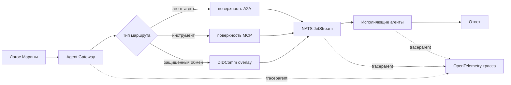
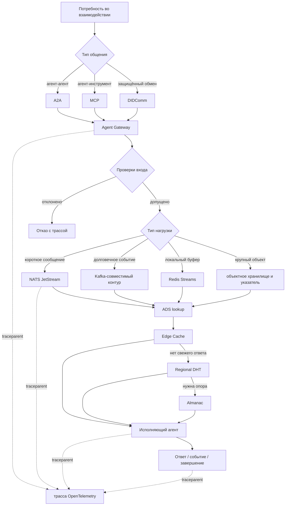

# УРОВЕНЬ 2 / ИЗМЕРЕНИЕ 04: КОММУНИКАЦИОННО-ПРОТОКОЛЬНОЕ

> **Уровень:** L2 — Среда  
> **Измерение:** D04 — Communication Infrastructure  
> **Учебная редакция:** v1.0  
> **Главная тема:** как среда доставляет сообщения между множеством агентов, внешними системами и инфраструктурными слоями

---

## Ключевой вопрос

**Как среда связывает агентов друг с другом и с внешними системами, и какие сетевые и коммуникационные стандарты при этом используются?**

---

## Краткое описание измерения

Один агент может отправить сообщение другому агенту почти как человек пишет письмо.

Но среда уровня L2 решает более сложную задачу: в ней одновременно работают тысячи и миллионы агентов, внешние сервисы, шлюзы, очереди, кэши обнаружения и механизмы наблюдаемости.

Настоящее измерение объясняет, как такая коммуникация остаётся маршрутизируемой, проверяемой, масштабируемой и устойчивой к сбоям.

Эта глава отвечает на несколько практических вопросов:

1. Как отделить смысл сообщения от инфраструктуры, которая его доставляет?
2. Какие слои нужны между внешним агентским запросом и внутренним брокером сообщений?
3. Почему среде нужен не один универсальный протокол, а слоистый коммуникационный стек?
4. Как обрабатывать быстрые сообщения, большие артефакты и повторные доставки?
5. Где проходит граница между коммуникацией, координацией, безопасностью и вычислительной инфраструктурой?
6. Как обнаруживать агентов при сбоях, задержках и временно устаревших данных?
7. Как трассировать путь сообщения через шлюз, брокер, обработчик и ответ?

---

## Мини-глоссарий

| Термин | Простое объяснение |
|--------|--------------------|
| **Логос** | Агент, действующий в цифровой среде от имени участника |
| **Агентная среда** | Общая инфраструктура, где агенты находят друг друга, договариваются и исполняют задачи |
| **Коммуникационный стек** | Набор слоёв, через которые сообщение проходит от смысла до сети |
| **Поверхность протокола** | Внешний способ общения: например, агент с агентом или агент с инструментом |
| **Привязка протокола** | Конкретный способ перенести протокол через транспорт, например через `gRPC` |
| **Протокол агент-агент, `A2A`** | Стандарт для общения агентов друг с другом |
| **Протокол модель-контекст, `MCP`** | Стандарт для обращения агента к инструментам и ресурсам |
| **`DIDComm`** | Защищённый обмен сообщениями на основе децентрализованных идентификаторов |
| **`AG-UI`** | Протокол событий между агентом и пользовательским интерфейсом |
| **Карточка агента, `Agent Card`** | Машиночитаемое описание агента, его интерфейсов и версий |
| **`Agent Gateway`** | Шлюз, который принимает внешние агентские запросы и применяет правила входа |
| **`extAuthz`** | Способ вынести решение об авторизации во внешний механизм политик |
| **`OPA`** | Один из возможных движков декларативных политик |
| **`OAuth`** | Семейство механизмов авторизации доступа |
| **`NATS JetStream`** | Брокер сообщений для быстрого управляющего обмена |
| **`Kafka`** | Потоковая шина для долговечных событий, аудита и больших потоков |
| **`Redis Streams`** | Локальная очередь или буфер для близких к исполнению задач |
| **`JetStream Object Store`** | Хранилище крупных объектов рядом с брокером сообщений |
| **`Redpanda`** | Kafka-совместимая опция для высоконагруженных потоков и крупных данных |
| **Очередь отказов, `DLQ`** | Отдельный путь для сообщений, которые много раз не удалось обработать |
| **Обратное давление** | Механизм, который не даёт системе принимать больше работы, чем она способна обработать |
| **`gRPC`** | Двоичный удалённый вызов поверх HTTP, удобный для строгих интерфейсов |
| **`JSON-RPC 2.0`** | Текстовый формат удалённого вызова, полезный как запасной путь совместимости |
| **`REST`** | Распространённый стиль HTTP-интерфейсов |
| **`HTTP/2`** | Версия HTTP, подходящая для устойчивых сервисных соединений |
| **`HTTP/3`** | Версия HTTP поверх `QUIC`, полезная для нестабильных и коротких соединений |
| **`QUIC`** | Транспортный протокол с быстрым восстановлением соединений |
| **`mTLS`** | Взаимная проверка сторон по сертификатам при сетевом соединении |
| **Сервисная сетка** | Слой управления сервисными соединениями, политиками и наблюдаемостью |
| **Сервис обнаружения агентов, `ADS`** | Инфраструктура, помогающая найти подходящих агентов и их адреса |
| **Пограничный кэш, `Edge Cache`** | Ближайший к запросу кэш для быстрых повторных поисков |
| **Региональная распределённая таблица, `Regional DHT`** | Распределённый региональный каталог, устойчивый к частичным сбоям |
| **`Almanac`** | Авторитетный резервный реестр для обнаружения и подтверждения записей |
| **`OR-Set`** | Структура данных, которая аккуратно сливает добавления и удаления |
| **`Last-Writer-Wins`** | Правило, где последняя версия изменяемого поля побеждает при слиянии |
| **`OpenTelemetry`** | Единый способ собирать трассы и метрики по распределённой системе |
| **`W3C traceparent`** | Заголовок, который переносит контекст трассы между сервисами |
| **`Langfuse`** | Возможная система для хранения и анализа агентских трасс |
| **`Protobuf`** | Формат строгих схем сообщений для `gRPC` и других интерфейсов |
| **`Helm`** | Способ разворачивать приложения в Kubernetes-кластере |
| **`NACK`** | Контроллер Kubernetes для объектов `NATS JetStream` |
| **`Strimzi`** | Kubernetes-оператор для Kafka-совместимого контура |
| **`Sentinel`** | Механизм высокой доступности для `Redis` |
| **Автомасштабирование подов, `HPA`** | Механизм Kubernetes, который добавляет или убирает экземпляры по нагрузке |
| **Кэш документов DID** | Кэш децентрализованных идентификаторов, ускоряющий защищённые обмены |
| **Постквантовая криптография, `PQC`** | Класс криптографии, рассчитанный на будущие квантовые угрозы |
| **`AGNTCY SLIM`** | Направление развития транспортной линии агентской инфраструктуры |
| **Микросреда, `Microsandbox`** | Частично изолированная операционная среда для домена или режима работы |
| **Межсредовой брокер, `CSB`** | Посредник для контролируемых операций между микросредами |

---

# 0. Гипотетический пример

Представим управляемую агентную экономическую среду.

В ней не один заказчик пишет одному исполнителю. В ней одновременно возникают тысячи задач: логистика, финансы, здравоохранение, юридические проверки, разработка, аудит, расчёты и сопровождение сделок.

**Марина** — операционный менеджер сети клиник. Её организация запускает срочный тендер: нужно за ночь проверить расписание поставок расходных материалов, согласовать замену нескольких поставщиков и подготовить отчёт для внутреннего контроля.

**Логос Марины** не выбирает одного знакомого исполнителя вручную. Он публикует задачу в среде, где могут откликнуться десятки специализированных агентов: логистические, финансовые, юридические, складские и аналитические.

**Агенты поставщиков** находятся в разных микросредах: часть работает в логистическом контуре, часть — в финансовом, часть — во внешних системах партнёров.

Если такая задача пойдёт через случайные HTTP-запросы, среда быстро потеряет контроль:

- непонятно, кто принял запрос;
- непонятно, какой протокол используется;
- сложно ограничить поток;
- трудно понять, где произошла задержка;
- большие вложения могут забить быстрый путь сообщений;
- при сбое каталога агенты перестанут находить друг друга.

Настоящее измерение нужно именно здесь: оно описывает коммуникационную инфраструктуру для общества агентов, а не только формат одного сообщения.

## Проверка 1. Есть ли правильная поверхность общения?

Логос Марины обращается к другим агентам как к агентам, а не как к обычным веб-сервисам. Для этого нужен протокол агент-агент (англ. Agent-to-Agent Protocol, далее — `A2A`).

Если в процессе нужны внешние инструменты, например система склада или календарь поставок, используется протокол модель-контекст (англ. Model Context Protocol, далее — `MCP`).

Если нужно защищённое сообщение, привязанное к децентрализованной идентичности, поднимается `DIDComm`. Но он не заменяет весь быстрый транспорт: его роль уже и точнее.

## Проверка 2. Есть ли контролируемый вход в среду?

Агенты поставщиков не должны напрямую публиковать сообщения во внутренний брокер.

Сначала запрос проходит через `Agent Gateway`: шлюз проверяет контекст идентичности, применяет правила допуска, ограничивает скорость потока и добавляет данные для трассировки.

Так среда отделяет внешнее агентское общение от внутренней транспортной плоскости.

## Проверка 3. Можно ли доставить много сообщений без перегрузки?

Когда десятки агентов уточняют условия, присылают статусы и отвечают на запросы, быстрый обмен идёт через брокер сообщений.

Базовая модель использует `NATS JetStream` для управляющего пути с низкой задержкой. Но не вся нагрузка одинакова: долговечные события и аудит удобнее вести через Kafka-совместимую шину, а локальные буферы рядом с исполнением могут использовать `Redis Streams`.

Среда не пытается сделать один продукт ответом на все случаи.

## Проверка 4. Что делать с большими файлами?

Логистический агент прикладывает таблицу поставок и архив накладных.

Такой груз не нужно проталкивать как обычное сообщение. Быстрый путь должен передать ссылку, а сам крупный объект положить в отдельное объектное хранилище или потоковую шину для крупных данных.

Иначе одно крупное вложение начнёт мешать коротким управляющим сообщениям.

## Проверка 5. Как агенты находят друг друга при сбоях?

Логос Марины ищет не конкретный адрес, а подходящих участников.

Для этого нужен сервис обнаружения агентов (англ. Agent Discovery Service, далее — `ADS`). Но важно не смешивать две вещи: инфраструктура обнаружения отвечает за кэши, распределённые таблицы и резервный реестр; логика выбора победителя относится к координационному слою.

Если ближайший кэш временно устарел, среда может перейти к региональному распределённому каталогу, а затем к авторитетному реестру.

## Проверка 6. Можно ли потом объяснить, где всё задержалось?

Марина видит, что один поставщик не ответил вовремя.

Чтобы понять причину, недостаточно локальных логов. Нужна сквозная трасса: вход в шлюз, проверка правил, публикация в брокер, обработчик, ответ или завершение потока.

Для этого контекст трассы переносится через всю цепочку.

## Главное из примера

**Коммуникационное измерение уровня L2 защищает среду от хаоса массового обмена.**

Оно превращает набор разрозненных сообщений в управляемый путь:

> внешний агентский запрос проходит через шлюз, транспорт, обнаружение, обработчик, ответ и трассу.



---

# Содержание

1. Слоистая модель коммуникации
2. Транспортный стек
3. Шлюз как контролируемый вход
4. Топология обнаружения агентов
5. Масштабирование и надёжность
6. Наблюдаемость коммуникационного пути
7. Связь и границы с другими измерениями
8. Итоговая модель целиком
9. Короткое резюме главы
10. Вопросы без ответа

---

# 1. Слоистая модель коммуникации

На уровне одного агента можно обсуждать, как он понимает задачу и какой протокол использует для общения.

На уровне среды вопрос другой: как доставить эти коммуникации при масштабе, сбоях, версиях, внешних системах, политике доступа и трассировке.

Поэтому настоящему измерению нужна слоистая модель. Она отделяет смысл сообщения от инфраструктуры доставки.

> Смысл сообщения отвечает на вопрос «что агент хочет сказать».  
> Коммуникационная инфраструктура отвечает на вопрос «как это сообщение безопасно и наблюдаемо пройдёт через среду».

## 1.1 Шесть слоёв

Учебно эту модель удобно представить как шесть этажей:

```text
L6. Смысловая поверхность       A2A, MCP, DIDComm, AG-UI
L5. Привязки протоколов         gRPC, JSON-RPC, REST, версии интерфейсов
L4. Шлюз и контроль входа        Agent Gateway, политики, лимиты, трассировка
L3. Брокер сообщений             NATS JetStream, Kafka, Redis Streams
L2. Инфраструктура обнаружения   Edge Cache, Regional DHT, Almanac
L1. Сетевой слой                 HTTP/2, HTTP/3, QUIC, mTLS, сервисная сетка
```

Верхние слои говорят, какой вид взаимодействия происходит: агент с агентом, агент с инструментом, защищённый обмен или интерфейс с пользователем.

Нижние слои говорят, как этот обмен физически проходит через сеть, шлюз, брокер и каталог.

## 1.2 Что принадлежит настоящему измерению

| Слой | Роль | Что фиксирует данная глава |
|------|------|----------------------------|
| L6. Смысловая поверхность | Выбор вида общения | Только инфраструктурное включение поверхности, без полного описания поведения агента |
| L5. Привязки протоколов | Как протокол едет по транспорту | `gRPC`, `JSON-RPC 2.0`, `REST`, версии интерфейсов и план миграции |
| L4. Шлюз | Контролируемый вход | Проверки допуска, ограничение потока, перевод форматов, трассировка |
| L3. Брокер | Доставка сообщений | Основной быстрый путь, дополнительные шины, повторы, очереди отказов |
| L2. Обнаружение | Как найти адрес и доступность агента | Кэши, распределённый каталог, резервный реестр, устаревание данных |
| L1. Сеть | Базовая передача | `HTTP/2`, выборочный `HTTP/3`, `QUIC`, `mTLS`, сервисная сетка |

## 1.3 Практическое правило маршрутизации

В учебной форме правило выглядит так:

```text
если нужен обмен агент-агент:
    начать с A2A
если нужен вызов инструмента или ресурса:
    использовать MCP
если нужен защищённый DID-связанный обмен:
    добавить DIDComm как защитный слой
если нужен масштабный внутренний обмен:
    пройти через Agent Gateway, брокер и ADS-инфраструктуру
```

Такое правило не делает один протокол главным для всего. Оно помогает выбрать правильный вход в зависимости от задачи.

В примере Марины `A2A` нужен для общения с агентами поставщиков, `MCP` — для обращения к внешним системам склада, а `DIDComm` — только там, где требуется защищённый обмен, привязанный к идентичности. Всё это всё равно проходит через общую коммуникационную инфраструктуру среды.

## Главное

**Настоящее измерение не переписывает смысл агентского общения. Оно описывает инфраструктуру, которая доставляет разные поверхности общения в масштабе среды.**

---

# 2. Транспортный стек

Среда не может полагаться на один универсальный канал.

Короткое управляющее сообщение, долговечное событие аудита, локальный буфер рядом с исполнением и крупный файл требуют разных путей. Если всё пустить через один механизм, либо быстрые сообщения начнут ждать большие объекты, либо долговечные события потеряют нужную надёжность.

Поэтому транспортный стек устроен как набор дополняющих контуров.

## 2.1 Роли транспортных компонентов

| Компонент | Простая роль | Почему это не полная замена остальным |
|-----------|--------------|----------------------------------------|
| `NATS JetStream` | Базовый брокер для быстрого управляющего обмена | Хорош для коротких сообщений и управляемой доставки, но не должен тащить все крупные данные |
| `Kafka` | Долговечная шина событий и аудита | Полезна для потока событий, но не является прямой заменой быстрого управляющего брокера |
| `Redis Streams` | Локальный буфер рядом с исполнением или участием человека | Удобен близко к среде исполнения, но не является главным межрегиональным брокером |
| `JetStream Object Store` | Путь для крупных объектов | Помогает не перегружать обычные сообщения большими вложениями |
| `Redpanda` | Kafka-совместимая опция для высоконагруженных или крупных потоков | Рассматривается как дополнительный путь, а не как замена базового управляющего брокера |

## 2.2 Что реально обещает доставка

Для `NATS JetStream` базовая дисциплина доставки — «как минимум один раз», а не встроенное «ровно один раз».

Это важное различие. Если сообщение может прийти повторно, обработчик должен быть идемпотентным: повторная обработка не должна создавать второй платёж, второй заказ или второе изменение статуса.

Практические следствия:

1. потребители должны уметь сами забирать работу контролируемыми партиями;
2. повторные попытки ограничиваются бюджетом, задержками и окном обработки;
3. эффект «ровно один раз» достигается ключами идемпотентности и дедупликацией выше брокера;
4. сообщения, которые многократно не обработались, уходят в отдельный путь отказов.

Очередь отказов здесь не магическая встроенная корзина. Это отдельный поток или потребитель, который реагирует на сигналы о превышении числа попыток.

## 2.3 Защищённый обмен и быстрый путь

Иногда нужно установить доверие, проверить децентрализованную идентичность или передать конфиденциальное сообщение. Для этого подходит `DIDComm`.

Но из этого не следует, что каждое горячее управляющее сообщение нужно оборачивать в `DIDComm`. Канон задаёт более аккуратную модель: сначала установить доверие и защищённый контекст, а быстрые рабочие сообщения вести через брокер с сетевой защитой, например через `mTLS`.

Числа в этом подразделе стоит читать как ориентиры для проектирования, а не как универсальные обещания среды:

| Что измеряется | Учебный ориентир | Как понимать |
|----------------|------------------|--------------|
| Упаковка и распаковка `DIDComm` | примерно 4-10 мс на сообщение | подходит для запуска доверия и конфиденциального обмена, но не доказывает необходимость оборачивать каждый быстрый пакет |
| Отдельные криптографические операции | десятки микросекунд, иногда примерно до 50-125 микросекунд | сама криптография не всегда главный узкий участок; важны резолверы, кэши и развёртывание |
| Холодный путь DID или учётных данных | от менее 0,5 с до 3-4 с | холодные проверки нужно бюджетировать отдельно |
| Здоровый путь сообщений | около 10-30 мс | это ориентир, а не жёсткий договор |
| Путь под ограничением ресурсов | p95 может деградировать до 1-5 с | бюджет должен учитывать нагрузку и инфраструктурное состояние |

Защита свежести, защита от повторов и смысл конверта `DIDComm` остаются на уровне каждого сообщения. Повторное использование соединения может уменьшить накладные расходы транспорта, но не отменяет правила защищённого обмена.

## 2.4 Сетевой слой

Под брокером и шлюзом есть ещё базовая сеть.

Для устойчивых внутренних соединений естественен `gRPC` поверх `HTTP/2`, взаимная проверка сторон через `mTLS` и управление соединениями через сервисную сетку.

`HTTP/3` и `QUIC` особенно полезны там, где соединения нестабильны, короткоживущи или идут с мобильных и внешних путей. Внутри стабильной сервисной сети их польза может быть умеренной, поэтому они подаются как выборочная опция, а не обязательная замена всего транспорта.

## 2.5 Большие сообщения

Крупные вложения не должны становиться обычными брокерными сообщениями.

Канон фиксирует практический риск: прямые крупные публикации в некоторых версиях `JetStream` сталкивались с проблемами около 32 МБ. Поэтому правила размера нужно трактовать как проектные ориентиры, а не как вечный закон:

1. до 1 МБ — обычный путь короткого сообщения;
2. от 1 МБ до примерно 32 МБ — лучше избегать прямой крупной публикации и использовать ссылку на объект;
3. больше примерно 32 МБ — объектное хранилище или дополнительная потоковая шина с сообщением-указателем.

Для нагрузок больше 10 МБ граница остаётся управленчески настраиваемой. Это не закрытый сравнительный тест продуктов, а архитектурное правило: большие данные не должны разрушать быстрый путь коротких сообщений.

## 2.6 Дальний горизонт криптографии

Постквантовая криптография уже важна как направление развития.

Но текущий производственный транспортный стек не меняется только потому, что стандарты `PQC` существуют. Линии вроде `AGNTCY SLIM` полезно наблюдать, но их нужно вводить в базовый путь только после зрелости библиотек и эксплуатационной практики.

Горизонт 2027+ в этой главе следует читать как ориентир мониторинга зрелости, а не как обещание конкретной даты внедрения.

В примере Марины таблицы поставок идут не как огромные сообщения в брокере, а как объекты со ссылкой в коротком сообщении. Так агенты продолжают быстро обмениваться статусами, даже если один участник прикладывает большой архив документов.

## Главное

**Транспортный стек состоит из нескольких дополняющих путей: быстрый брокер, долговечная шина событий, локальные буферы, объектный путь и сетевой слой. Надёжность появляется не из одного продукта, а из правильного разделения нагрузок.**

---

# 3. Шлюз как контролируемый вход

Внешние агентские запросы не должны напрямую попадать во внутренний брокер.

Без шлюза среда не сможет единообразно проверить идентичность, применить правила доступа, ограничить поток, перевести протокол и добавить трассировку.

Поэтому отдельный входной слой нужен не как украшение, а как точка управления коммуникацией.

## 3.1 Что делает шлюз

`Agent Gateway` в настоящем измерении — это не обычный прокси.

| Функция | Зачем нужна |
|---------|-------------|
| Понимание агентских протоколов | Запрос агента к агенту отличается от обычного REST-трафика |
| Перевод `A2A` в внутренний маршрут | Стандарт `A2A` не задаёт прямую привязку к `NATS JetStream` |
| Проверки подлинности и прав | Внешний запрос должен пройти контекст идентичности и допуска |
| Ограничение скорости | Перегрузку лучше сдерживать до попадания в брокер |
| Вставка трассировки | Путь запроса должен быть виден от входа до обработчика |

## 3.2 Политики и внешний движок авторизации

Шлюз должен уметь передавать решение об авторизации во внешний слой политик.

Один возможный класс решений — `extAuthz`: шлюз спрашивает внешний движок, например `OPA`, `OAuth`-контур или специализированный механизм, можно ли пропустить маршрут.

Здесь важно смягчить нормативность: конкретная реализация политик остаётся настраиваемой. Настоящее измерение фиксирует место применения правила, а не полный язык политик.

## 3.3 Перевод `A2A`, `gRPC` и `NATS`

`A2A` версии 1.0.0 важен для инфраструктуры потому, что в нём есть `gRPC`, список поддерживаемых интерфейсов и версия каждого интерфейса в карточке агента.

Но `A2A` не стандартизует прямую привязку к `NATS JetStream`. Поэтому связка:

```text
поверхность A2A | Agent Gateway | пространство тем NATS
```

является локальным адаптером среды. Её нужно описывать, тестировать и трассировать как собственный контракт.

Минимальная логика выглядит так:

```text
внешний запрос приходит как A2A, gRPC или REST
шлюз проверяет идентичность и политику
шлюз нормализует конверт сообщения
шлюз публикует сообщение во внутреннее пространство тем или ведёт прямой сервисный маршрут
ответ возвращается по корреляционному идентификатору
контекст трассы проходит через все шаги
```

## 3.4 Миграция версий

Если среда переходит с более ранней версии `A2A` на 1.0.0, это не должно происходить одним резким переключением.

Учебная последовательность:

1. проверить `gRPC`-привязки в подготовительном окружении;
2. включить канареечный производственный поток через согласование поддерживаемых интерфейсов;
3. выполнить полный переход;
4. держать откат на границе шлюза через `JSON-RPC 2.0`, не меняя основной брокер.

## 3.5 Межсредовые коммуникации

Когда запрос проходит между микросредами, шлюз отвечает за более узкий вопрос: где стоит инфраструктурная точка допуска.

Он может проверить контекст идентичности, маршрут, метки политики и трассировку до попадания трафика в нижний транспортный слой.

Но сам шлюз не решает всю системную безопасность, не определяет юридическую применимость аварийных команд и не управляет экономическим исполнением. Эти темы принадлежат соседним измерениям.

В примере Марины агент внешнего поставщика не получает прямой доступ к внутреннему брокеру клинической среды. Его сообщение сначала проходит через шлюз, где проверяется маршрут, применяются ограничения и добавляется трассировка.

## Главное

**Шлюз — это граница управляемого входа. Он не заменяет агентские протоколы и не решает всю безопасность, но именно через него внешняя коммуникация становится допускаемой, ограничиваемой, переводимой и наблюдаемой.**

---

# 4. Топология обнаружения агентов

Массовая агентная среда не может каждый раз спрашивать один центральный каталог.

Если каталог далеко, перегружен или временно недоступен, агенты должны продолжать находить друг друга в разумных пределах свежести данных.

Поэтому обнаружение строится как многоуровневая инфраструктура.

## 4.1 Два аспекта `ADS`

У `ADS` есть два разных аспекта:

1. инфраструктурная топология: где лежат кэши, как они обновляются, как происходит отказоустойчивый поиск;
2. координационная логика: как выбираются кандидаты, как ранжируются предложения, как задача переходит в координационный процесс.

Настоящее измерение владеет первым аспектом. Второй аспект принадлежит координационному слою.

## 4.2 Три уровня обнаружения

```text
Edge Cache      -> быстрый ближайший поиск
Regional DHT    -> устойчивый региональный распределённый каталог
Almanac         -> авторитетный резервный реестр
```

| Слой | Что делает | Чего не делает |
|------|------------|----------------|
| `Edge Cache` | Быстро отвечает на повторные локальные запросы | Не выбирает победителя матчинга |
| `Regional DHT` | Сохраняет распределённую устойчивость и слияние данных | Не становится единственным источником истины |
| `Almanac` | Служит резервной авторитетной опорой | Не должен быть быстрым путём для каждого запроса |

Такой порядок делает обнаружение устойчивым: сначала быстрый локальный ответ, затем региональный слой, затем резервный реестр.

## 4.3 Свежесть, слияние и частичные сбои

`ADS` не обещает мгновенную глобальную согласованность.

Более реалистичная модель: чтение сначала из кэша, обновление событийно или по расписанию, ограниченно устаревшие данные при сбоях и переход к резервному реестру при необходимости.

Числа ниже — учебные ориентиры, а не окончательные неизменные параметры:

| Параметр | Ориентир | Что означает |
|----------|----------|--------------|
| Обновление регионального слоя | примерно каждые 30 минут | частота настраивается управлением и эксплуатационной телеметрией |
| Якорь свежести в резервном реестре | примерно 3600 секунд | авторитетная запись тоже имеет срок свежести |
| Слияние состава | `OR-Set` | добавления и удаления не теряются при распределённом слиянии |
| Слияние изменяемых атрибутов | `Last-Writer-Wins` | последняя версия поля побеждает при конфликте |

Если часть сети изолирована, правильная реакция — не мгновенная остановка всего мира, а деградация маршрута:

```text
локальный кэш -> региональный каталог -> авторитетный резервный реестр
```

Данные могут быть устаревшими, но это устаревание должно быть ограниченным и видимым.

## 4.4 Отзыв и удаление записей

Когда агент больше не должен быть видимым, инфраструктура должна уметь распространять это изменение каскадом.

Учебная модель:

1. смысловое скрытие или запрет решается выше, в координационном или управленческом слое;
2. пограничный кэш сразу инвалидирует запись по событию или истечению срока;
3. региональная распределённая таблица сходится на следующем цикле обновления;
4. резервный реестр остаётся авторитетной опорой до своего обновления или истечения записи.

В примере Марины логистический агент может временно исчезнуть из ближайшего кэша, но среда не обязана сразу считать всю задачу невозможной. Она может проверить региональный каталог, а затем резервный реестр, сохранив понятный порядок деградации.

## Главное

**Обнаружение агентов — это не один каталог и не алгоритм выбора победителя. В настоящем измерении это инфраструктура кэшей, распределённых таблиц, резервного реестра и ограниченно устаревающих данных.**

---

# 5. Масштабирование и надёжность

Масштабирование коммуникационной среды нельзя свести к фразе «добавим больше узлов».

Если нет обратного давления, контроля повторов, правил больших сообщений и версионной дисциплины, дополнительные узлы только быстрее разнесут ошибку.

Поэтому надёжность коммуникационного слоя строится как композиция нескольких механизмов.

## 5.1 Горизонтальное масштабирование

| Компонент | Как масштабируется | Почему так |
|-----------|--------------------|------------|
| Потребители `JetStream` | Горизонтально, через контролируемое вытягивание работы | Так проще управлять темпом обработки |
| Шлюз | Несколько почти безсостоянийных экземпляров | Вход, политики и перевод форматов должны расти независимо от брокера |
| Пограничные кэши `ADS` | Размножаются ближе к спросу | Снижают давление на региональные и резервные слои |
| Региональная распределённая таблица | Растёт числом узлов | Устойчивость возникает из распределения, а не из одного центра |

Канон поддерживает архитектурную уверенность в масштабировании, но не закрывает её прямым производственным примером на 10M+ агентов. Поэтому число 10M+ следует читать как горизонт проектирования, а не как завершённо доказанную эксплуатационную метрику.

## 5.2 Обратное давление и перегрузка

Когда поток сообщений растёт, система должна уметь сказать: «сейчас принимаем меньше, позже повторим, это сообщение ушло в отказ».

Практический набор:

1. ограничение скорости и формирование потока на шлюзе;
2. управление потребителями на брокере;
3. задержанные повторные попытки;
4. отдельный путь для сообщений, которые постоянно не обрабатываются;
5. объектный путь для крупных вложений.

Без этих механизмов быстрый брокер может стать точкой лавинообразной перегрузки.

## 5.3 Версии и схемы сообщений

Коммуникационная инфраструктура — это не только сеть. Это ещё и договор о формате сообщений.

Если агенты разных версий продолжают работать одновременно, нельзя бездумно переиспользовать номера полей, удалять поля без резерва или менять смысл интерфейса без проверки.

Для `gRPC` и `Protobuf` это означает:

| Правило | Зачем нужно |
|---------|-------------|
| Не переиспользовать номера полей | Старые агенты не должны неправильно читать новые сообщения |
| Удалённые поля помечать как зарезервированные | Снижается риск скрытых регрессий формата |
| Версионировать пакет или интерфейс | Шлюз может маршрутизировать несколько версий |
| Проверять различия схем в CI/CD | Контракты не меняются незаметно |

`A2A` версии 1.0.0 помогает тем, что карточка агента может указывать поддерживаемые интерфейсы и версии. Но внутренние адаптеры среды всё равно требуют собственной дисциплины схем, тестирования и отката.

## 5.4 Надёжность как композиция

Надёжность появляется одновременно из четырёх слоёв:

1. управляемый вход через шлюз;
2. понятные обещания доставки в брокере;
3. деградация обнаружения через кэш, региональный каталог и резервный реестр;
4. безопасная эволюция схем и интерфейсов.

## 5.5 Эксплуатационный контур

В Kubernetes-окружении производственный ориентир таков:

| Слой | Ориентир развёртывания | Что помнить |
|------|------------------------|-------------|
| `NATS JetStream` | `Helm` + `NACK` | Контроллер управляет потоками, потребителями, ключ-значение объектами, объектными хранилищами и аккаунтами, но требует наблюдения |
| Kafka-совместимый контур | `Strimzi` | Дополнительная шина для больших и долговечных потоков, не замена быстрого управляющего пути |
| `Redis Streams` | Высокая доступность через `Sentinel` | Локальный буфер, не главный брокер среды |

Для автомасштабирования полезно смотреть не только на CPU около 70%, но и на очередь ожидающих сообщений, задержку потребителей и непрерывность трассировки. Эти значения являются эксплуатационными ориентирами, а не универсальными гарантиями.

В примере Марины всплеск ответов от поставщиков сначала ограничивается на шлюзе, затем дозируется потребителями брокера. Если один агент постоянно не обрабатывает сообщение, оно уходит в отдельный путь отказов, а не блокирует весь тендер.

## Главное

**Масштабирование коммуникации — это управляемый темп, версионная дисциплина, деградация без остановки всей среды и ясные пути отказа.**

---

# 6. Наблюдаемость коммуникационного пути

В распределённой агентной среде вопрос «сообщение не дошло» слишком грубый.

Нужно знать точнее:

- запрос не прошёл шлюз;
- политика его отклонила;
- брокер принял, но потребитель отстал;
- обработчик завис;
- ответ потерял корреляцию;
- крупный объект задержал путь;
- кэш обнаружения вернул устаревший адрес.

Поэтому наблюдаемость — часть коммуникационного стека, а не приложение после факта.

## 6.1 Базовая модель трассировки

Единая трасса должна проходить через:

1. вход в шлюз;
2. решение политики;
3. публикацию в брокер или прямой сервисный маршрут;
4. обработчик или потребителя;
5. ответ, обратный вызов или завершение потока.

Для этого используется `OpenTelemetry`, а контекст трассы переносится через `W3C traceparent`. `Langfuse` может служить подходящим хранилищем и интерфейсом для агентских трасс, но сама идея не зависит от одного инструмента.

## 6.2 Что именно нужно видеть

Минимальный набор сигналов:

| Сигнал | Зачем нужен |
|--------|-------------|
| Задержка входа | Видно, перегружен ли шлюз |
| Ошибки авторизации | Видно, какие правила останавливают маршрут |
| Задержка от публикации до потребления | Видно, успевает ли брокерный контур |
| Повторные доставки и путь отказов | Видно, какие сообщения не обрабатываются |
| Задержки загрузки объектов | Видно, мешают ли крупные вложения |
| Непрерывность трассы | Видно, не распалась ли цепочка между шлюзом, брокером и обработчиком |

## 6.3 Граница интерпретации

Настоящее измерение отвечает за то, чтобы путь был наблюдаемым.

Но оно не обязано само объяснять смысл каждого следа:

- смысл шагов выполнения относится к функциональному слою агента;
- интерпретация аномалий безопасности относится к слою безопасности;
- проверка итогов координации относится к координационному слою.

Коммуникационная трасса даёт факты маршрута. Соседние измерения объясняют доменный смысл этих фактов.

## 6.4 Почему это не приложение

Если в системе есть шлюз, брокер, кэши обнаружения, объектные ссылки, повторные доставки и разные версии интерфейсов, локальные логи быстро перестают помогать.

Без непрерывной трассы среда видит отдельные фрагменты, но не путь целиком.

В примере Марины трасса позволяет отделить три разные ситуации: агент поставщика не прошёл политику входа, сообщение застряло в очереди или ответ был отправлен, но не сопоставился с исходным запросом.

## Главное

**Наблюдаемость делает коммуникационную инфраструктуру проверяемой. Без сквозной трассы среда не может уверенно отличить сетевой сбой, отказ политики, задержку брокера и ошибку обработчика.**

---

# 7. Связь и границы с другими измерениями

Настоящее измерение стоит в середине уровня L2: после базовой инфраструктуры и перед экономикой, координацией, безопасностью и управлением.

Оно не описывает всё поведение агентов. Оно отвечает за коммуникационную плоскость среды: как запросы входят, доставляются, обнаруживают адресатов, выдерживают нагрузку и остаются наблюдаемыми.

| Измерение | Связь | Граница ответственности |
|-----------|-------|--------------------------|
| **L1/D05 (Коммуникационное измерение агента)** | Описывает агентские поверхности общения: `A2A`, `MCP`, `DIDComm`, `AG-UI` | L1 отвечает за смысл и роль протоколов для одного агента; L2/D04 отвечает за шлюз, брокер, сеть, обнаружение и доставку в масштабе среды |
| **L2/D06 (Координация и исполнение)** | Использует обнаружение агентов для матчинга, запросов предложений и выбора участников | L2/D06 отвечает за правила выбора и координации; L2/D04 отвечает за физическую топологию `ADS` |
| **L2/D03 (Инфраструктурно-материальное)** | Даёт вычислительную и инфраструктурную основу | L2/D03 отвечает за compute, storage, failover и SLA-контуры; L2/D04 отвечает за коммуникационную доставку и наблюдаемость |
| **L2/D07 (Безопасность и мониторинг)** | Интерпретирует аномалии, риски и защитные правила | L2/D04 включает `mTLS`, шлюзовые проверки и трассы как коммуникационные средства; полная политика безопасности остаётся у L2/D07 |
| **L2/D09 (Управление)** | Финализирует настраиваемые правила федерации, политик и эксплуатационных параметров | L2/D04 показывает, какие параметры нужно настраивать; L2/D09 определяет, кто и как утверждает изменения |
| **L3/D04 (Контрактно-договорное)** | Использует коммуникационную инфраструктуру для исполнения сервисных обязательств | L3/D04 отвечает за договорённости, SLA и последствия; L2/D04 отвечает за техническую доставку сообщений |

## Главное

**Граница настоящего измерения проходит по коммуникационной инфраструктуре. Оно не выбирает победителей, не толкует безопасность и не пишет договоры, но даёт всем этим слоям управляемую доставку сообщений.**

---

# 8. Итоговая модель целиком

Итоговая модель выглядит как путь от потребности во взаимодействии к наблюдаемой доставке.

Сначала среда определяет, какой тип общения нужен. Затем запрос проходит через шлюз, где применяются правила входа и добавляется трассировка. После этого он идёт либо в быстрый брокер, либо в дополнительную шину, либо в объектный путь. Если нужно найти адресата, используется топология обнаружения. В конце результат возвращается с тем же контекстом трассы.



## Главное

**Коммуникационная инфраструктура соединяет четыре вещи: правильную поверхность общения, контролируемый вход, подходящий транспорт и сквозную наблюдаемость.**

---

# 9. Короткое резюме главы

1. Настоящее измерение отвечает за коммуникацию на уровне среды, а не за один диалог между двумя агентами.
2. Смысловые протоколы и транспортная инфраструктура разделены: верхние слои говорят, что происходит, нижние — как это доставляется.
3. `Agent Gateway` нужен как управляемый вход, где применяются политики, лимиты, перевод форматов и трассировка.
4. `NATS JetStream` является базовым быстрым брокером, но рядом нужны дополнительные пути для событий, локальных буферов и крупных объектов.
5. `ADS` в этой главе — это инфраструктура обнаружения: кэш, региональная распределённая таблица и резервный реестр.
6. Надёжность требует обратного давления, идемпотентности, очередей отказа, версионной дисциплины и контролируемой деградации.
7. Наблюдаемость должна проходить через всю цепочку, иначе среда не сможет объяснить, где и почему произошёл сбой.

## Главное

**Среда связывает агентов не одним протоколом, а слоистым коммуникационным стеком, где каждый слой отвечает за свою часть управляемой доставки.**

---

# 10. Вопросы без ответа

1. **Финальный договор по топологии `ADS`.** Рабочая схема кэша, региональной распределённой таблицы и резервного реестра описана, но окончательная федерационная политика, приоритеты источников и правила отказоустойчивости требуют управленческого утверждения.
2. **Грамматика межсредовых политик.** Место применения правил понятно: шлюз и маршрутный слой. Но язык правил, порядок их распространения и приоритет между локальными и глобальными политиками ещё требуют отдельного решения.
3. **Точные эксплуатационные пороги крупных нагрузок.** Разделение коротких сообщений и крупных объектов задано, но конкретные пороги для отдельных рабочих нагрузок должны калиброваться по тестам и телеметрии.
4. **Зрелость постквантового транспортного контура.** Направление развития понятно, но включать `PQC` в базовый производственный путь стоит только после зрелости библиотек и эксплуатационной практики.
5. **Окончательная настройка холодных путей идентичности и статуса.** Кэши документов DID и проверок статуса снижают задержку, но сроки жизни, инвалидация и режимы критических операций остаются политикой управления.

## Главное

**Открытые вопросы здесь в основном управленческие и эксплуатационные: где поставить финальные пороги, кто утверждает правила и когда новые технологии становятся достаточно зрелыми для базового пути.**
