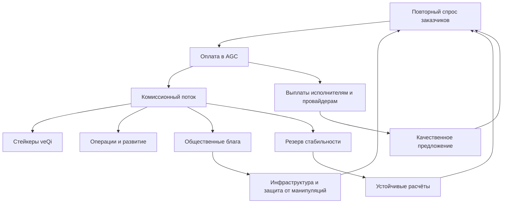
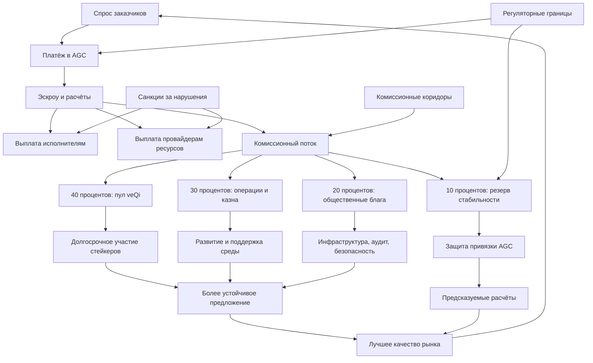

# УРОВЕНЬ 2 / ИЗМЕРЕНИЕ 05: ЭКОНОМИКО-СТИМУЛИРУЮЩЕЕ

> **Уровень:** L2 — Среда (инфраструктура)  
> **Измерение:** D05 — Economic Incentives  
> **Учебная редакция:** v1.0  
> **Главная тема:** как устроить выгоды, комиссии и наказания так, чтобы большая агентная экономика работала в интересах всех участников

---

## Ключевой вопрос

**Какие стимулы и экономическую выгоду получает каждый участник (владелец Логоса, заказчик, платформа, другие агенты), как устроены токеномика, системы комиссий и перераспределение ценности и как обеспечивается баланс интересов между ними?**

---

## Краткое описание измерения

Экономико-стимулирующее измерение объясняет, почему участникам среды выгодно вести себя предсказуемо: выполнять задачи качественно, возвращаться с новым спросом, держать ресурсы доступными, финансировать общую инфраструктуру и не извлекать краткосрочную выгоду за счёт остальных.

Здесь экономика рассматривается не как «доходность токена», а как система согласования интересов большого рынка.

Эта глава отвечает на несколько практических вопросов:

1. Кто участвует в экономике среды и какую выгоду получает?
2. Зачем нужны два разных экономических инструмента: стабильная расчётная единица и токен долгосрочного участия?
3. Как доходы среды распределяются между стейкерами, операциями, общественными благами и резервом стабильности?
4. Почему стейкеры не должны бесконтрольно повышать комиссии для пользователей?
5. Как запускать новый рынок без вечных субсидий?
6. Как связывать вознаграждения, комиссии и санкции с реальным качеством работы?
7. Почему общественные блага и защита от манипуляций являются частью экономики, а не отдельной благотворительностью?
8. Какие регуляторные ограничения влияют на дизайн токенов и платёжных потоков?

---

## Мини-глоссарий

| Термин | Простое объяснение |
|--------|--------------------|
| **Логос** | Агент, действующий от имени владельца в цифровой среде. |
| **Стимул** | Экономическая причина вести себя определённым образом: заработать, получить доступ, избежать штрафа, сохранить репутацию. |
| **`AGC`** | Стабильная операционная валюта для расчётов в среде; ориентир: `1 AGC ≈ 1 USD`. |
| **`Qi`** | Токен долгосрочного участия: связан с доходностью, управлением и дефицитностью. |
| **`veQi`** | Непередаваемая форма `Qi`, получаемая при блокировке токена на срок; используется для долгосрочного выравнивания интересов. |
| **Распределение доходов** | Правило, по которому доходы среды делятся между несколькими контурами, а не уходят одному участнику. |
| **Совместимость стимулов** | Состояние, при котором честное поведение для участника не хуже основного способа обмана или обхода правил. |
| **Доходность от реальной выручки** | Вознаграждение из уже заработанных комиссий, а не из новой инфляционной эмиссии. |
| **Стейкер** | Участник, который блокирует `Qi` и получает долю доходов за долгосрочное участие. |
| **Комиссионный коридор** | Заранее заданные границы, внутри которых можно менять комиссии. |
| **Бутстраппинг** | Запуск рынка через временные стимулы, пока спрос и предложение ещё не сошлись устойчиво. |
| **Санкция за нарушение** | Экономическое наказание за срыв сервиса, неверное исполнение, сговор или мошенничество. |
| **Общественные блага** | Инфраструктура и работы, полезные всей среде, но плохо оплачиваемые отдельной сделкой. |
| **Sybil-атака** | Попытка получить выгоду через массовое создание фиктивных участников или голосов. |
| **`MiCA`** | Европейская регуляторная рамка для рынков криптоактивов. |
| **`EMT`** | Категория токена электронных денег: привязка к одной фиатной валюте и строгие резервы. |
| **`OCA`** | Категория прочего криптоактива: применима к токену управления и ценности без стабилизации к валюте. |
| **`CASP`** | Провайдер криптоактивных услуг; статус важен для выпуска и обслуживания токенов. |
| **`HQLA`** | Высоколиквидные резервные активы: фиат, государственные облигации и близкие к ним инструменты. |
| **Оракул** | Сервис, который даёт проверяемый внешний сигнал, например о цене или состоянии резерва. |
| **`SLA`** | Соглашение об уровне сервиса: обещание доступности, сроков и качества. |
| **`KTP`** | Пакет передачи знаний: оформленный объект знания, который можно лицензировать и продавать. |
| **`KL`** | Лицензия на использование пакета знаний. |
| **`VC`** | Верифицируемое учётное данное: цифровое подтверждение факта, которое можно проверить. |
| **`ESq`** | Квота специализации владельца: сколько компетентностного объёма он вправе распределять. |
| **`APY`** | Годовая доходность в процентах; в этой главе допустима только как ориентир, связанный с реальной выручкой. |

---

# 0. Гипотетический пример

Представим агентную среду, где одновременно работают несколько рынков: рынок задач, рынок вычислительных ресурсов, рынок знаний и контур общественных благ.

В городскую программу «Зелёная логистика» входят десятки организаций. Им нужно каждый день оптимизировать маршруты доставки, проверять экологические отчёты, покупать вычислительные мощности и переиспользовать накопленные знания.

**Марина** — руководитель закупок городской службы. Она размещает поток задач и платит за результат.

**Сеть исполнителей** — группа Логосов и ресурсных провайдеров, которые берут задачи, предоставляют вычисления и отвечают за качество.

**Илья** — владелец Логоса, который уже накопил полезную базу маршрутов и продаёт её как знаниевый актив.

**Стейкеры** — участники, которые блокируют `Qi` и ожидают доходность от реальной выручки среды.

**Общественный контур** — палата участников, которая распределяет часть доходов на общую инфраструктуру: инструменты аудита, безопасность, обучающие материалы, поддержание зависимостей.

Если смотреть только на сделку Марины и одного исполнителя, экономика кажется простой: заказчик платит, исполнитель получает. Но на уровне среды этого недостаточно. Нужно, чтобы деньги одновременно поддерживали качество предложения, устойчивость расчётов, долгосрочное участие, развитие инфраструктуры и защиту от манипуляций.

## Проверка 1. Есть ли реальный спрос

Марина не покупает токен ради токена. Ей нужен выполненный поток задач: маршруты, отчёты, расчёты, проверяемые результаты.

Поэтому первый вопрос экономического дизайна звучит так: создаёт ли среда повторный спрос, который способен кормить исполнителей, провайдеров ресурсов и стейкеров без вечной субсидии?

## Проверка 2. Чем платить за работу

Для ежедневных расчётов нужна стабильная единица. Исполнитель не должен гадать, сколько будет стоить оплата завтра, а заказчик не должен держать бюджет в волатильном активе.

Здесь появляется `AGC`: операционный инструмент для цен, эскроу, микроплатежей и расчётов. Его задача — быть удобной расчётной единицей, а не объектом спекуляции.

## Проверка 3. Кто получает доход среды

Когда Марина платит комиссию, она не должна исчезать в одном кармане. Часть дохода идёт стейкерам, часть — на операции и развитие, часть — на общественные блага, часть — в резерв стабильности.

Так комиссия превращается из простой платы за сделку в механизм поддержания всей среды.

## Проверка 4. Не вредят ли стейкеры пользователям

Стейкеры заинтересованы в высокой доходности. Пользователи заинтересованы в низких и предсказуемых комиссиях.

Если дать стейкерам прямое неограниченное право повышать комиссию, рынок может потерять заказчиков. Поэтому комиссия должна меняться в коридорах и через управленческие процедуры, а не по желанию одной группы.

## Проверка 5. Как запустить рынок без вечной раздачи денег

В начале Марине может быть предложена льготная комиссия, а исполнителям — дополнительная поддержка. Но это допустимо только как мост к реальному спросу.

Если субсидия не заканчивается по заранее заданному правилу, она привлекает участников, которым выгоден сам бонус, а не работа в среде.

## Проверка 6. Как наказывать за вредное поведение

Если провайдер сорвал доступность, исполнитель неверно выполнил задачу, а группа участников вступила в сговор, наказание не должно быть одинаковым.

Лёгкий сбой сервиса и доказанное мошенничество создают разный риск. Поэтому санкции должны учитывать тяжесть нарушения, повторяемость и связь с другими сбоями.

## Проверка 7. Кто оплачивает то, что нужно всем

Марина платит за свои задачи. Илья продаёт знания. Провайдеры получают оплату за ресурсы.

Но кто оплатит аудит общих инструментов, безопасность, документацию и поддержку инфраструктуры, которой пользуются все? Для этого нужен отдельный контур общественных благ, иначе рациональные участники будут пользоваться общим результатом, но недофинансировать его создание.

## Главное из примера

**Экономико-стимулирующее измерение проектирует не одну сделку, а правила большого рынка: деньги, комиссии, доходность, санкции и общественные блага должны направлять множество участников к устойчивому поведению.**



---

# Содержание

1. Карта участников и потоки ценности
2. Два экономических инструмента: `AGC`, `Qi` и `veQi`
3. Распределение доходов и совместимость стимулов
4. Баланс между стейкерами и пользователями
5. Запуск рынка и временные субсидии
6. Стимулы для разных типов участников
7. Динамические комиссии и санкции
8. Общественные блага и защита от манипуляций
9. Регуляторные ограничения токенов
10. Связь и границы с другими измерениями
11. Итоговая модель целиком
12. Короткое резюме главы
13. Вопросы без ответа

---

# 1. Карта участников и потоки ценности

Экономика среды начинается не с токена, а с вопроса: кто что вкладывает и какую выгоду получает?

Если участник видит только абстрактную «ценность экосистемы», стимул слабый. Ему нужен конкретный пакет выгод: доход, доступ к спросу, снижение издержек, рост репутации, право участвовать в управлении или возможность финансировать общие блага.

## 1.1 Участники экономической карты

| Участник | Что вкладывает | Что получает | Какое поведение стимулируется |
|----------|----------------|--------------|-------------------------------|
| Заказчик или владелец Логоса как покупатель | Спрос, данные, оплату в `AGC`, повторные задачи | Полезный результат, предсказуемый сервис, снижение транзакционных издержек | Возвращаться в рынок и создавать устойчивый спрос |
| Логос-исполнитель | Время, вычисления, компетенции, репутационный риск | Выручку в `AGC`, рост репутации, доступ к более выгодным задачам | Выполнять задачи качественно и предсказуемо |
| Владелец Логоса как продавец знаний | Базу опыта, экспертизу, структурирование знаний | Оплату в `AGC`, роялти, рост доверия к знаниям | Вести знания точно и пригодно для повторного использования |
| Провайдер ресурсов | Вычисления, хранение, инференс, доступность | Оплату за проверяемый вклад, приоритет маршрутизации, маржу за хороший сервис | Держать мощности доступными и соблюдать `SLA` |
| Стейкер `Qi` или держатель `veQi` | Ликвидность, время блокировки, долгий горизонт | Долю доходов, управленческий вес, долгосрочный потенциал роста | Поддерживать долгосрочную устойчивость, а не разовую выгоду |
| Операционный контур среды | Разработку, резерв риска, поддержку, вывод на рынок | Комиссионный поток и ресурс для развития | Поддерживать качество рынка, а не только объём сделок |
| Контур общественных благ | Внимание участников, экспертизу, проверку заявок | Бюджет грантов и мандат на общую инфраструктуру | Финансировать то, что рынок недодаёт напрямую |
| Внешние агенты и сети | Интеграционные затраты и переходные риски | Новый спрос и монетизацию без полной миграции | Приносить внешнее предложение и способности |

Эта карта шире пары «заказчик — исполнитель». В зрелой среде важны долгосрочный капитал, общественные блага и внешнее предложение. Без них рынок превращается в набор отдельных сделок и хуже финансирует качество, безопасность и развитие.

## 1.2 Поток ценности

Высокоуровневый поток выглядит так:

```text
заказчик платит AGC
  -> среда удерживает комиссию
  -> чистая выплата уходит исполнителям и провайдерам
  -> комиссия делится между стейкерами, общественными благами, операциями и резервом
  -> доходность и гранты поддерживают долгосрочное участие
  -> лучшее участие повышает качество предложения
  -> качество предложения удерживает спрос
```

Это не бухгалтерская схема ради отчётности. Каждый платёж ниже по потоку создаёт стимул выше по потоку: спрос питает доходность стейкеров, стейкеры поддерживают долгий горизонт, общественные блага улучшают инфраструктуру, резерв снижает риск расчётов, выплаты удерживают предложение.

## 1.3 Что значит «совместимость стимулов»

Совместимость стимулов (англ. Incentive Compatibility, далее — IC) здесь понимается практически, а не как готовая математическая теорема.

Рабочий критерий такой: для каждого ключевого класса участников честное поведение должно быть ожидаемо не хуже основного отклонения.

| Участник | Честное поведение | Основное отклонение, которое нужно сделать невыгодным |
|----------|-------------------|--------------------------------------------------------|
| Заказчик | Возвращаться с повторным спросом | Уйти после одной субсидированной сделки |
| Провайдер | Держать доступность и выполнять `SLA` | Имитировать качество или играть на метриках |
| Стейкер | Держать долгий горизонт | Давить на комиссии ради краткосрочной доходности |
| Контур общественных благ | Финансировать проверяемый вклад | Захватывать гранты через популярность или фиктивные заявки |

Данная глава не утверждает, что схема уже доказана как точное равновесие. Она фиксирует путь: спецификация правил, моделирование выплат, проверка отклонений и уточнение параметров.

В примере с городской логистикой это означает: Марина остаётся в среде, если повторные задачи становятся дешевле и надёжнее; провайдеры не имитируют доступность, если будущие заказы дороже краткосрочного выигрыша; стейкеры не повышают комиссию бесконтрольно, если правила не дают им такого прямого канала.

## Главное

**Экономика среды — это многосторонняя карта выгод. Если из неё убрать долгосрочный капитал, общественные блага или внешнее предложение, рынок теряет устойчивость.**

---

# 2. Два экономических инструмента: `AGC`, `Qi` и `veQi`

Один токен не должен одновременно быть удобной расчётной единицей, объектом долгосрочного участия и инструментом управления.

Если ежедневные платежи зависят от спекулятивной цены, пользователям сложно планировать бюджет. Если управленческий токен постоянно используется как расчётная валюта, у держателей появляется конфликт между удобством рынка и удержанием актива.

Поэтому экономика разделяет операционный инструмент и инструмент долгосрочного участия.

## 2.1 Не путать роли

| Инструмент | Простая роль | Регуляторная логика | Предложение | Ценообразование |
|------------|--------------|---------------------|-------------|-----------------|
| `AGC` | Деньги для расчётов внутри среды | Токен электронных денег (англ. E-Money Token, далее — EMT) | Эластичное: выпуск через фиатный шлюз и погашение через обратный обмен | Стабильное: ориентир `1 AGC ≈ 1 USD`, резерв не ниже `100%` в фиате и `HQLA` |
| `Qi` | Токен долгосрочной ценности и управления | Прочий криптоактив (англ. Other Crypto-Asset, далее — OCA) | Предварительный ориентир: фиксированное предложение `333M`; дополнительный выпуск не предусмотрен | Рыночное: ценность зависит от доли доходов, дефицитности и управленческой роли |
| `veQi` | Заблокированная форма `Qi` | Экономическая функция долгого участия | Появляется при блокировке `Qi` | Даёт больший вес в доходах и управлении, пока участник сохраняет долгий горизонт |

`AGC` должен быть предсказуемым и пригодным для расчётов. `Qi` может быть волатильным, потому что несёт риск и потенциальную доходность. `veQi` связывает право на долю доходов с отказом от немедленной ликвидности.

## 2.2 `AGC` как расчётный инструмент

Для платежей нужна единица, которую можно использовать в ценах, эскроу, микроплатежах и расчётах за сервис. Поэтому `AGC` проектируется как операционный инструмент, а не как волатильный токен для роста цены.

Его выпуск и погашение должны быть простыми:

```text
фиат -> фиатный шлюз -> выпуск AGC
AGC -> обратный обмен -> фиат
```

Вознаграждения стейкерам выплачиваются из комиссий, уже заработанных средой. Они не должны создаваться как новый выпуск `AGC`.

Для защиты стабильности может использоваться дополнительный буфер `Qi`, но только как вспомогательный инструмент. Канонические числовые ориентиры для такого буфера: размер `5-15%` от обращающегося `AGC`, развёртывание `10-20%` буфера за `24h`, активация при устойчивом отклонении `0.5-2%` после подтверждения оракулами. Эти числа являются проектными ориентирами и требуют управленческой настройки.

Главное ограничение: `Qi` не становится основным обеспечением `AGC`. Основная защита стабильности — резервная дисциплина, погашение по номиналу и высоколиквидные активы.

## 2.3 Оракулы и остановка опасного режима

Чтобы стабильность не зависела от одного источника цены, среда должна использовать слой оракулов: несколько источников, усреднение во времени, проверку свежести и резервный порядок действий.

Если сохранившиеся ценовые источники расходятся существенно, рабочий ориентир — больше `20%`, или теряют кворум и свежесть, экономический слой должен переходить к режиму остановки или защиты привязки. Сначала срабатывает резервная логика, и только затем может подключаться вспомогательный буфер `Qi`.

> `AGC` держится не на надежде, что `Qi` будет расти, а на резерве, погашении и проверяемых сигналах.

## 2.4 `Qi`, `veQi` и доходность

`Qi` получает ценность из трёх источников:

1. Доля доходов: `40%` дохода среды направляется стейкерам `veQi` в `AGC`.
2. Дефицитность: предварительный ориентир фиксированного предложения `333M` и блокировки уменьшают свободное обращение.
3. Управленческая премия: `veQi` даёт вес в управлении параметрами среды.

Целевой ориентир доходности `veQi` на запуске — `8-12% APY`, но только как доходность от реальной выручки. Это не должно быть обещанием дохода из инфляционной эмиссии.

## 2.5 Почему механизм сжигания и выпуска не подходит для `AGC`

Механизм сжигания и выпуска (англ. Burn-Mint Equilibrium) может использоваться только как язык для `Qi`-слоя, где сжигание возможно по управленческому решению, а дополнительный выпуск не предусмотрен.

Для `AGC` такой подход не подходит. `AGC` должен опираться на резерв, погашение и стабильную привязку, а не на автоматическое расширение и сжатие предложения ради цены.

## 2.6 Скорость оборота и микроплатежи

Агентная среда может порождать много мелких платежей: вызовы инструментов, короткие вычисления, частичные результаты. Если каждый такой платёж немедленно отправлять в дорогой расчётный слой, система станет слишком тяжёлой.

Поэтому предпочтительны накопление вне основного расчётного слоя, платёжные каналы и периодическое окончательное урегулирование. Идея проста: часто считать внутри, реже закреплять итог.

## 2.7 Изоляция рисков

Опасный режим возникает, когда нестабильность операционной валюты и падение токена долгосрочного участия начинают усиливать друг друга. Чтобы этого избежать, `AGC` и `Qi` изолируются.

Падение цены `Qi` не должно нарушать привязку `AGC`, потому что `AGC` обеспечен фиатом и `HQLA`, а не `Qi`. Если вспомогательный буфер `Qi` применялся в стрессовом событии, после стабилизации система должна вернуться к резервной модели: восстановить погашение по номиналу, снизить экспозицию `Qi` и пополнить контур стабильности.

В примере с городской логистикой Марина платит исполнителям в `AGC`, потому что ей нужен понятный бюджет. Стейкеры работают с `Qi` и `veQi`, потому что принимают долгий риск ради доли доходов. Эти роли нельзя смешивать: иначе ежедневные платежи Марины зависели бы от настроения рынка вокруг `Qi`.

## Главное

**`AGC` нужен для стабильных расчётов, `Qi` — для долгосрочной ценности и управления, `veQi` — для привязки доходности к терпеливому участию. Их смешение создаёт риск для всей экономики.**

---

# 3. Распределение доходов и совместимость стимулов

Комиссия среды должна не просто приносить доход. Она должна поддерживать несколько функций одновременно: долгосрочное участие, операционную устойчивость, общественные блага и резерв стабильности.

Поэтому доходы делятся по фиксированным контурам.

## 3.1 Базовый контур `40/30/20/10`

Распределение доходов (англ. Revenue Distribution) задаётся как проектный базовый контур `40/30/20/10`.

| Контур | Доля | Зачем нужен | Что происходит при недофинансировании |
|--------|------|-------------|----------------------------------------|
| Пул вознаграждения `veQi` | `40%` | Делает блокировку `Qi` экономически рациональной и связывает капитал с ростом использования | `Qi` становится спекулятивным активом без терпеливой базы |
| Операции и казна | `30%` | Финансирует развитие, поддержку, резервы и рост | Среда стагнирует или начинает повышать комиссии сверх меры |
| Гранты на общественные блага | `20%` | Оплачивает инфраструктуру, безопасность и инструменты, которые не монетизируются каждой сделкой | Общая основа рынка недофинансируется |
| Резерв стабильности | `10%` | Поддерживает соответствие, расчёты, буферы и экстренное обслуживание | Стрессовое событие начинает забирать ресурс у других контуров |

Для контура общественных благ важна не только доля, но и порядок распределения. Он должен работать как повторяемая грантовая программа: регулярные раунды, окно для инфраструктурных потребностей, окно для уже доказанного вклада, проверяемость, ограничение концентрации, раскрытие конфликта интересов и перенос неиспользованного бюджета.

## 3.2 Что уже можно утверждать

Схему можно делать прозрачной и исполнимой правилами: заявки на выплату могут быть привязаны к снимку состояния, участники могут сами забирать положенную выплату, выходы через погашение и сжигание могут быть проверяемыми, а распределение может быть связано с реальным использованием.

Но это не доказывает, что сами проценты `40/30/20/10` глобально оптимальны. Для такого утверждения нужны отдельная модель полезности участников, эластичность спроса и явный набор отклонений.

Корректная формула для данной главы:

> `40/30/20/10` — это прозрачная базовая схема, ориентированная на IC, а не публично доказанная математическая оптимальность.

## 3.3 Практическая логика отклонений

Схема должна делать основные отклонения невыгодными:

1. Заказчик не должен выигрывать от разового использования, если повторные выгоды, качество подбора и снижение издержек выше выгоды ухода.
2. Исполнитель и провайдер не должны выигрывать от ухудшения `SLA`, если будущие выплаты и приоритет маршрутизации дороже краткосрочного обмана.
3. Стейкер не должен получать устойчивый выигрыш от постоянного повышения комиссий, если управление комиссиями ограничено коридорами.
4. Грантовый слой не должен выигрывать от популярностного захвата, если распределение учитывает проверяемый вклад и устойчивость к Sybil-атакам.

## 3.4 Общественная палата и децентрализация как экономические поверхности

Общественная палата важна здесь не как деталь управления, а как адресат `20%` контура общественных благ. Этот контур не должен быть побочным режимом голосования держателей `Qi`: общественные блага требуют отдельной легитимности.

Постепенная децентрализация также важна экономически. Если распределение `40/30/20/10` существует только на бумаге, `Qi` теряет управленческий смысл. Если полномочия передаются слишком рано, общественные блага и защита привязки могут зависеть от незрелой координации.

В примере с городской логистикой часть комиссии Марины возвращается стейкерам, часть поддерживает операционный контур, часть финансирует общие инструменты аудита маршрутов, часть идёт в резерв стабильности. Поэтому её комиссия работает не только как плата за сделку, но и как вклад в инфраструктуру, от которой зависят будущие сделки.

## Главное

**Распределение доходов должно быть правилом, а не ручной выплатой. Контур `40/30/20/10` задаёт прозрачную экономическую основу, но его окончательная оптимальность требует отдельного моделирования.**

---

# 4. Баланс между стейкерами и пользователями

Стейкеры хотят высокую доходность. Пользователи хотят низкие и предсказуемые комиссии. Оба интереса легитимны, но без ограничений они конфликтуют.

Если держатели `veQi` получают право напрямую максимизировать комиссию, они могут повысить текущий доход и одновременно ухудшить удержание заказчиков. Экономика должна отделять участие в росте от права ухудшать условия рынка.

## 4.1 Три слоя настройки комиссий

| Слой | Кто контролирует | Что можно менять |
|------|------------------|------------------|
| Конституционный комиссионный коридор | Более высокий управленческий маршрут | Верхние и нижние границы комиссий |
| Операционная настройка | Оператор, затем параметрическое управление | Текущие значения внутри коридора |
| Доля выплат стейкерам | Экономическая модель настоящего измерения | Распределение уже полученного дохода |

Такой подход защищает рынок от прямой максимизации комиссии. Стейкер участвует в росте, но не получает неограниченного рычага извлечения дохода из пользователей.

## 4.2 Три фазы управления

1. **Фаза запуска.** Комиссии и возвраты задаются оператором внутри заранее объявленного коридора.
2. **Фаза роста.** Палата `Qi` получает периодическое право настройки параметров, но не меняет конституционные границы.
3. **Зрелая фаза.** Изменение коридоров и чувствительных правил выплат требует более высокого межпалатного или конституционного маршрута.

Это снижает риск, что держатели `veQi` будут оптимизировать квартальную доходность за счёт долгосрочного оттока пользователей.

## 4.3 Что остаётся открытым в `veQi`

Блокировка `Qi` полезна как фильтр терпения: участник, который надолго отказывается от ликвидности, лучше связан с будущим среды.

Но сама блокировка не решает два вопроса:

1. Как учитывать интенсивность предпочтений: один голосующий может иметь слабое мнение, другой — очень сильное.
2. Как не допустить, чтобы долгие блокировки слишком сильно снизили ликвидность `Qi` и усилили концентрацию.

Поэтому доходность `veQi` допустима только при контролируемой жертве ликвидности. Она не должна полностью вытеснять свободный `Qi` из оборота.

## 4.4 Признак успешного баланса

Баланс считается достигнутым, если:

| Группа | Что должна видеть |
|--------|-------------------|
| Стейкеры | Надёжный источник доходности и долгосрочный потенциал |
| Заказчики | Предсказуемую эффективную комиссию и выгоды повторного использования |
| Операционный контур | Достаточный ресурс для развития и устойчивости |
| Управление | Разделение права на выплаты и права менять рыночные условия |

Если хотя бы один элемент исчезает, конфликт не решён.

В примере стейкеры хотят, чтобы городская программа платила больше комиссии. Марина готова платить только пока среда даёт лучший подбор, качество и надёжность. Комиссионный коридор не устраняет конфликт интересов, но переводит его в ограниченный и проверяемый порядок настройки.

## Главное

**Стейкер должен участвовать в росте среды, но не должен иметь неограниченного права повышать цену для пользователей. Баланс держится на коридорах, фазах управления и проверке удержания спроса.**

---

# 5. Запуск рынка и временные субсидии

Новый рынок редко запускается сам. В начале может не хватать исполнителей, спроса, доверия, ликвидности и привычки возвращаться.

Но субсидия полезна только тогда, когда ведёт к реальному спросу. Если экономика живёт лишь пока раздаются бонусы, это не рост, а отложенная проблема.

## 5.1 Трёхфазная логика запуска

| Фаза | Цель | Основной инструмент |
|------|------|---------------------|
| Создать магнит | Показать убедительный сценарий использования | Корпоративные пилоты, показательные нагрузки, качественное предложение |
| Запустить пользовательский цикл | Добиться повторного спроса | Быстрый подбор, ранние выгоды лояльности, удержание заказчиков |
| Закрепить поведение | Перевести рынок к устойчивым привычкам | Ограниченные вознаграждения, расширение управления, нормализация комиссий |

Эта логика лучше вечной субсидии. Временные стимулы должны создавать предложение, которое затем встречает реальный спрос.

## 5.2 Канонические ориентиры запуска

Числа ниже являются проектными ориентирами этой модели, а не универсальными законами рынка:

1. `100%` субсидия комиссии допустима только как ранний инструмент: для первых `1000` задач или до заранее объявленного рубежа спроса.
2. `3-5` корпоративных пилотов допустимы, если они создают повторный спрос, а не только публичный объём активности.
3. Субсидии должны завершаться по правилу, а не по ручному усмотрению.
4. Переход между фазами должен зависеть от использования и удержания, а не только от календаря.

## 5.3 Чего запуск не должен делать

Политика запуска не должна:

1. обещать бессрочную высокую `APY` без связи с доходом;
2. субсидировать обе стороны рынка одновременно без понимания эластичности;
3. превращать массовую скидку для покупателей в постоянный двигатель спроса;
4. подменять продуктовую пригодность ростом через стимулы.

Ранние льготы допустимы как мост к экономике, которая дальше стоит на реальном использовании.

В примере городская программа может получить временную льготу на первые задачи, чтобы быстрее сформировать поток исполнителей и провайдеров. Но если после окончания льготы Марина не остаётся из-за качества, скорости и надёжности, субсидия не создала рынок.

## Главное

**Бутстраппинг должен покупать время для формирования реального спроса, а не заменять спрос. Субсидия без заранее заданного завершения притягивает временных участников вместо устойчивого рынка.**

---

# 6. Стимулы для разных типов участников

Разные участники реагируют на разные стимулы. Провайдеру ресурсов важна оплата за доступность, внешнему агенту — быстрый доступ к спросу, покупателю — повторная выгода, продавцу знаний — оплата за качество и происхождение знания.

Одна универсальная скидка не решает эти задачи.

## 6.1 Провайдеры ресурсов

Провайдер ресурсов должен получать оплату не за сам факт владения мощностью, а за проверяемый вклад: доступность, соблюдение `SLA`, корректное исполнение нагрузки.

| Элемент | Что даёт провайдеру | Зачем это системе |
|---------|---------------------|-------------------|
| Выплата за использование | Доход за реально отработанную мощность | Не платить за пустую готовность |
| Приоритет маршрутизации | Больше заказов при хорошем `SLA` | Вознаграждать качество без постоянной монополии |
| Перенос репутации внутри среды | Рост доверия и ценовой силы | Стимулировать длинную историю надёжности |
| Залог или блокировка | Доступ к задачам с повышенным доверием | Создать риск потерь при вредном поведении |

Экономика провайдера должна учитывать скрытые сетевые затраты: передачу данных, задержки, межпровайдерские расходы. Иначе маршрутизация будет выбирать низкую видимую цену, которая позже возвращается потерей качества или скрытым расходом.

## 6.2 Внешние агенты

Внешний агент приходит не ради символической интеграции. Ему нужен доступ к спросу, монетизация и низкая цена входа.

Рабочий пакет входа:

1. доступ к спросу без полного захвата одним стеком;
2. импортированная репутация только как помощь при обнаружении, а не полная замена внутренней истории;
3. расчёты через `AGC`, а не через отдельные побочные бонусы;
4. уровни способностей и испытательные окна перед полным приоритетом маршрутизации.

Важно не считать внешнюю оценку равной нативной истории работы. Переносимость репутации ограничена и требует осторожности.

## 6.3 Покупатели задач

Покупательские стимулы допустимы только тогда, когда повышают повторный спрос с поправкой на качество быстрее, чем расходуют комиссионный ресурс.

Устойчивый пакет включает:

| Инструмент | Рабочий ориентир | Что должен улучшать |
|------------|------------------|---------------------|
| Возврат лояльности | `0.5%-2%` по уровням накопленных расходов; финансируется из операционного контура, а не из пула `veQi` | Повторное использование без ухудшения качества |
| Приоритетный подбор | Повторные покупатели раньше получают доступ к сильному предложению | Время до подбора и долю завершённых задач |
| Ранний доступ | Ориентир `48h` на новые премиальные пулы способностей | Платное повторное использование, а не разовый трафик |
| Пакетная скидка | Для связанного спроса от `10` задач | Снижение трения при сохранении положительной маржи |

Пакет валиден только при выполнении контрольных условий: доля завершённых задач выше `85%`, средняя оценка качества выше `4.0/5`, повторное вовлечение растёт, а стоимость возвратов остаётся внутри текущей комиссионной комнаты. Эти числа являются рабочими ориентирами для проверки, а не общими законами.

Если два окна проверки подряд условия не соблюдаются, возврат должен снижаться на уровень или завершаться до повторной валидации.

## 6.4 Продавцы знаний

Владелец Логоса может зарабатывать не только на исполнении задач. Он может продавать структурированные знания: шаблоны, опыт, проверенные данные, стратегии и другие пакеты, пригодные для повторного использования.

Знаниевой рынок (англ. Knowledge Marketplace) рассматривается как дополнительный поток дохода. Продавец знаний может получать `AGC` за скачивание, подписку или роялти, а также усиливать свою компетентностную позицию, если качество знания подтверждено.

Базовая модель двусторонняя:

| Участник | Что вкладывает | Что получает | Какой стимул возникает |
|----------|----------------|--------------|------------------------|
| Продавец знаний | Базу опыта, экспертизу, структурирование | `AGC`, роялти, рост `ESq` при подходящей аттестации | Вести знания точно, а не накапливать шум |
| Покупатель знаний | Оплату в `AGC` | Проверяемые данные с происхождением | Снижать стоимость качественных обучающих и операционных данных |
| Институциональный верификатор, если привлечён | Экспертизу, репутацию, лицензию | Комиссию за аттестацию | Монетизировать проверку качества в масштабируемой форме |

Проверяемое качество знания может оформляться через учётное данное качества знания (англ. Knowledge Quality Verifiable Credential, далее — Knowledge Quality VC), прикреплённое к пакету передачи знаний (англ. Knowledge Transfer Package, далее — KTP). Лицензия знания (англ. Knowledge License, далее — KL) регулирует право использования. Для настоящего измерения важна не юридическая упаковка, а стимул: продавец получает двойную выгоду — `AGC` сейчас и возможный рост компетентностной позиции на перспективу.

## 6.5 Почему покупательские стимулы не должны вредить доходности стейкеров

Возвраты и скидки совместимы с доходностью стейкеров только тогда, когда работают как окупаемая инвестиция в удержание, а не как бесконечная раздача.

Проверка проста:

```text
если дополнительная чистая выручка от удержания > стоимость возвратов:
    стимул можно продолжать
иначе:
    стимул снижается или завершается
```

Если завершение задач падает ниже `85%`, качество ниже `4.0/5`, повторное вовлечение не растёт или стоимость возвратов растёт без выручки, покупательский пакет уменьшается до более низкого уровня раньше, чем расширяется комиссионный коридор.

## 6.6 Граница с индивидуальной и кооперативной экономикой

Настоящее измерение говорит о стимулах среды. Оно не рассчитывает финансовую устойчивость одного Логоса и не проектирует внутреннее распределение наград в конкретной команде.

Но эти соседние темы ограничивают экономику среды: покупатель не останется лояльным, если его собственный бюджет нестабилен; команда исполнителей не будет надёжной, если её внутренняя кооперативная экономика поощряет безбилетников.

В примере Илья продаёт знаниевый пакет о маршрутах. Если покупатели платят за проверяемое происхождение и качество, Илье выгодно поддерживать базу знаний аккуратно. Если бы рынок платил только за объём файлов, он стимулировал бы накопление непроверенного материала.

## Главное

**Стимулы должны быть адресными: провайдеру платят за проверяемую доступность, покупателю дают выгоды за качественный повторный спрос, внешнему агенту снижают входной барьер, продавцу знаний оплачивают структурированность и происхождение.**

---

# 7. Динамические комиссии и санкции

Фиксированная комиссия «навсегда» редко подходит рынку, который проходит запуск, рост и зрелую фазу. На раннем этапе дороже ручная поддержка, подбор предложения, проверка качества и соответствие требованиям. По мере роста эти издержки должны нормализоваться.

Санкции решают соседнюю задачу: честное поведение должно быть выгоднее срыва, имитации качества, сговора или мошенничества.

## 7.1 Фазовые комиссии

Комиссионная модель задаётся как фазовый ориентир и требует дальнейшей калибровки по бенчмаркам и эластичности спроса.

| Фаза | Комиссия покупателя | Комиссия исполнителя или продавца | Смысл |
|------|---------------------|-----------------------------------|-------|
| Запуск, `0-6` месяцев | `0%-0.5%` | `10%-12%` | Повышенная доля продавца допустима, пока среда финансирует ручной подбор, резервные мощности и дорогую поддержку запуска |
| Рост, `6-24` месяца | `0%-1%` | `8%-10%` | Умеренная доля монетизирует качество подбора и снижает зависимость от ручной поддержки |
| Зрелая фаза, `24+` месяца | `0.5%-1.5%` | `6%-8%` | Стабильный диапазон ближе к зрелым сервисным рынкам, но всё ещё финансирует маршрутизацию, споры, `SLA` и резервы |

Эти числа являются проектными ориентирами. Они не доказывают, что одна таблица оптимальна для всех режимов рынка.

## 7.2 Правило настройки внутри коридора

Внутри фазового коридора комиссия может корректироваться по формуле:

```text
комиссия(момент) =
    базовая ставка фазы
  + поправка на перегрузку
  + поправка на волатильность
  + премия за соответствие или верификацию
  - возврат лояльности
```

Рутинная настройка допустима только в пределах `+/-20%` от базовой ставки текущей фазы и не чаще одного планового окна проверки в квартал. Изменение самого конституционного контура не должно расширять опубликованный диапазон более чем на `+/-30%` без более высокого решения.

Экстренный режим также ограничен: мультиподпись `3/5` может временно зафиксировать комиссию на разрешённой ступени или заморозить перенастройку при рыночном сбое, системной недоступности провайдеров или подтверждённой аномалии. Ориентир задержки — `48h`. Такой режим не должен становиться скрытым постоянным повышением комиссии.

## 7.3 Санкции

Санкция за нарушение (англ. slashing) — не произвольный штраф, а часть модели «вознаграждение — наказание».

Нужно различать обычные сбои доступности, повторные нарушения, неверное исполнение, сговор и мошенничество.

| Нарушение | Тип санкции | Рабочий диапазон |
|-----------|-------------|------------------|
| Небольшой сбой доступности или `SLA` | Уменьшение вознаграждения | `0.1%-0.5%` |
| Повторный сбой доступности | Повышенное удержание или небольшое списание залога | `0.5%-1%` |
| Доказанный пропуск или неверное исполнение | Списание части залога | `2%-5%` |
| Сговор, мошенничество, координированная манипуляция | Жёсткое списание и исключение из маршрутизации | `10%-25%` |

Числа являются проектными ориентирами. Их смысл — различать сервисный сбой и вредное поведение, а не наказывать все нарушения одинаково.

## 7.4 Коррелированные сбои

Если один провайдер случайно недоступен, риск ограничен. Если десять провайдеров падают по общей причине или коалиция совместно манипулирует качеством, системный риск выше.

Поэтому рабочая эвристика выглядит так:

```text
санкция =
    базовый штраф
  * тяжесть нарушения
  * коэффициент корреляции
  * модификатор волатильности
```

Точные веса факторов остаются задачей моделирования.

## 7.5 Премия за сложные песочницы

Некоторые классы среды требуют дополнительных затрат: проверка, локальность данных, повышенный `SLA`, конфиденциальность, отраслевое соответствие. Для таких случаев допустима надбавка к комиссии в размере `5-15%` от базовой комиссии текущей фазы.

Эта надбавка допустима только по именованным причинам: уровень верификации, класс `SLA`, отраслевые затраты, требования к месту хранения данных, конфиденциальность. Всё остальное считается произвольной переоценкой.

В примере провайдеры, обслуживающие городской поток в обычном режиме, платят одну комиссию. Если часть задач требует более строгой проверки и хранения данных в отдельной песочнице, надбавка объясняется конкретной стоимостью соответствия, а не тем, что заказчик готов платить больше.

## Главное

**Комиссии должны меняться по фазам и в коридорах, а санкции — различать тяжесть и системность нарушения. Иначе экономика либо переизвлекает ценность из рынка, либо недонаказывает вредное поведение.**

---

# 8. Общественные блага и защита от манипуляций

Общественные блага — это не пожертвования после прибыли. Это часть экономической архитектуры.

Аудиты, инструменты, документация, обучение, поддержка зависимостей и безопасность могут не продаваться в каждой сделке, но без них частный рынок работает хуже.

## 8.1 Зачем отдельный контур общественных благ

Если общую инфраструктуру финансируют только добровольно, возникает проблема безбилетника: пользоваться хотят все, платить готовы немногие.

Поэтому `20%` доходов выделяются на общественные блага как структурный контур. Он делает поддержку общей основы предсказуемой.

## 8.2 Как не захватить грантовый контур

Гранты не должны распределяться только через популярное голосование. Нужны несколько механизмов:

1. оценка уже наблюдаемого вклада;
2. учёт зависимостей: важный низкоуровневый инструмент может быть малозаметен пользователям;
3. разные способы распределения, чтобы один тип атаки не захватил весь контур;
4. процедуры вызова и проверки для подозрительных раундов;
5. ограничения концентрации на одного получателя в одном раунде.

## 8.3 Sybil-защита как экономическая защита

Sybil-защита нужна не только управлению. Слабые фильтры личности ухудшают подбор исполнителей, субсидии, грантовые раунды и распределение общественных благ.

Минимальный пакет включает:

| Слой | Роль в стимулах |
|------|-----------------|
| Доказательство уникальности человека | Повышает цену массового фиктивного участия |
| Приватное или устойчивое к подкупу голосование | Снижает возможность доказать проданный голос |
| Проверка вклада и выборочная ревизия | Уменьшает выгоду от фиктивных грантовых заявок |
| Несколько механизмов финансирования | Не даёт одной атаке захватить весь бюджет |

## 8.4 Признак зрелости

Зрелый режим общественных благ — это не максимальный размер грантового пула. Это способность финансировать общую инфраструктуру без новой инфляции и без лёгкого захвата.

Лучше, когда гранты питаются доходами или доходностью среды, чем когда они бесконечно оплачиваются новой эмиссией.

В примере городской логистики часть общественного бюджета может финансировать аудит маршрутизатора, открытые тесты качества и инструмент проверки происхождения данных. Марина не покупает эти инструменты в каждой сделке, но без них качество всего рынка снижается.

## Главное

**Общественные блага — это экономический контур поддержания общей основы рынка. Он должен быть финансируемым, проверяемым и защищённым от фиктивного участия.**

---

# 9. Регуляторные ограничения токенов

Экономический дизайн токенов нельзя отделить от правовой классификации. То, что удобно как продуктовая идея, может требовать лицензии, резервов, отчётности и ограничений платёжных потоков.

## 9.1 `AGC` как `EMT`

`AGC` следует проектировать как токен электронных денег: привязка к одной валюте, ожидание погашения по номиналу, резервная дисциплина, регулируемая цепочка выпуска и обслуживания.

Это делает `AGC` более тяжёлым в правовом смысле, но именно такая тяжесть поддерживает его роль как расчётной единицы. Он должен быть погашаемым, проверяемым и пригодным для расчётов.

## 9.2 `Qi` как `OCA`

`Qi` рассматривается как токен управления и ценности с фиксированным предложением, без обязательной стабилизации к одной валюте. Рабочая классификация — `OCA`, с аккуратным мониторингом границы с другими режимами.

Корректное разделение:

```text
AGC = EMT
Qi = OCA
```

`AGC` не должен становиться корзинным активом, а `Qi` не должен становиться основным обеспечением `AGC`.

## 9.3 Срок и давление авторизаций

Производственный запуск `AGC` должен учитывать регуляторный дедлайн `01.07.2026` и то, что хранение плюс перевод `EMT` могут попадать в область платёжных услуг.

Это означает, что экономика `AGC` требует не только смарт-контрактов, но и лицензированной операционной цепочки: эмиссия, резервы, обслуживание, погашение, соответствие требованиям провайдера криптоактивных услуг (англ. Crypto-Asset Service Provider, далее — CASP).

## Главное

**Регуляторная классификация задаёт границы токеномики: `AGC` должен быть стабильным и резервно обеспеченным платёжным инструментом, а `Qi` — отдельным токеном долгосрочной ценности и управления.**

---

# 10. Связь и границы с другими измерениями

Настоящее измерение владеет экономическими стимулами среды: выгодами участников, двухтокенной архитектурой, распределением доходов, комиссиями, санкциями, общественными благами и экономическими ограничениями токенов.

Соседние измерения задают рынки, инфраструктуру, управление, право, репутацию и контрактное исполнение, на которых эта экономика работает.

| Измерение | Связь | Граница ответственности |
|-----------|-------|--------------------------|
| **L2/D02 (Функционально-целевое)** | Определяет типы рынков и активностей, где применяются стимулы. | Настоящее измерение задаёт экономику токенов и стимулов; функциональное измерение задаёт структуру рынков. |
| **L2/D03 (Инфраструктурно-материальное)** | Даёт оракулы, расчётную инфраструктуру и техническую основу исполнения правил. | Настоящее измерение использует сигналы и расчётный слой; инфраструктурное измерение проектирует их устройство. |
| **L2/D08 (Нормативно-правовое)** | Определяет правовую рамку `MiCA`, платёжные требования и соответствие. | Настоящее измерение объясняет экономические последствия классификации; правовое измерение владеет юридической детализацией. |
| **L2/D09 (Управленческое)** | Даёт палаты, процедуры, маршруты изменений и экстренные меры. | Настоящее измерение задаёт экономические контуры; управленческое измерение определяет, кто и как меняет правила. |
| **L1/D08 (Экономическое одного Логоса)** | Ограничивает покупательскую лояльность бюджетом конкретного Логоса. | Настоящее измерение работает на уровне среды; индивидуальная финансовая устойчивость остаётся на уровне одного Логоса. |
| **L1/D09 (Репутационное)** | Репутация влияет на удержание покупателей, приоритет провайдеров и вход внешних агентов. | Настоящее измерение использует репутационные сигналы как стимулы; репутационное измерение владеет расчётом доверия. |
| **L3/D04 (Контрактное)** | Формализует `SLA`, лицензии знаний, роялти и договорные механизмы. | Настоящее измерение объясняет выгоду сторон; контрактное измерение владеет юридико-технической упаковкой договоров. |
| **L3/D05 (Кооперативно-координационное)** | Описывает командные награды, безбилетников и экономику коалиций. | Настоящее измерение задаёт стимулы среды; кооперативное измерение разбирает распределение внутри команд. |
| **L3/D06 (Конкурентно-рыночное)** | Описывает аукционы, рыночные арены, конкуренцию и обнаружение цен. | Настоящее измерение задаёт комиссионную и санкционную поверхность; конкурентное измерение владеет рыночной механикой. |

## Главное

**Настоящее измерение отвечает за экономические стимулы среды, но не подменяет рынки, инфраструктуру, право, управление, репутацию и контрактное исполнение соседних измерений.**

---

# 11. Итоговая модель целиком

Экономико-стимулирующее измерение собирает множество решений в одну модель: кто создаёт спрос, кто поставляет работу и ресурсы, как платёж превращается в распределённый доход, почему `AGC` отделён от `Qi`, как комиссии удерживаются в коридорах, как санкции наказывают вредное поведение и как общественные блага получают устойчивое финансирование.



## Главное

**Вся модель держится на одном принципе: устойчивость возникает тогда, когда частная выгода участников связана с качеством, повторным спросом, резервной дисциплиной и финансированием общей основы рынка.**

---

# 12. Короткое резюме главы

1. Экономика среды шире пары «заказчик — исполнитель»: в ней есть покупатели, исполнители, провайдеры, продавцы знаний, стейкеры, операционный контур, общественные блага и внешние агенты.
2. `AGC` и `Qi` разделены, потому что ежедневные расчёты и долгосрочное участие требуют разных свойств.
3. `veQi` связывает доходность с долгим горизонтом, но не должен давать прямое право бесконтрольно повышать комиссии.
4. Базовый контур доходов `40/30/20/10` поддерживает стейкеров, операции, общественные блага и резерв стабильности.
5. Запуск рынка допускает временные субсидии, но они должны завершаться по правилу и вести к реальному спросу.
6. Комиссии должны быть фазовыми и ограниченными коридорами; санкции должны учитывать тяжесть и системность нарушения.
7. Общественные блага и Sybil-защита являются частью экономической устойчивости.
8. Правовая классификация токенов ограничивает допустимую токеномику: `AGC` работает как `EMT`, `Qi` — как `OCA`.

## Главное

**Экономико-стимулирующее измерение превращает поток сделок в устойчивую многостороннюю экономику, где каждый участник видит выгоду от поведения, полезного для всей среды.**

---

# 13. Вопросы без ответа

1. **Как совместить `veQi` и другие формы выражения предпочтений в управлении?** Блокировка по времени хорошо показывает терпение участника, но не отвечает полностью на вопрос, как учитывать интенсивность предпочтений и не усиливать концентрацию.
2. **Как блокировка `Qi` влияет на ликвидность?** Нужно смоделировать баланс между свободным `Qi`, доходностью стейкинга и управленческим спросом, чтобы `veQi` не вытеснил полезную ликвидность.
3. **Как доказать совместимость стимулов для схемы `40/30/20/10`?** Базовый контур прозрачен и ориентирован на устойчивость, но требуется отдельная модель выплат, эластичности и отклонений.
4. **Как точно откалибровать комиссионные коридоры?** Выбрана логика ограниченного управления комиссиями, но ширина коридоров, частота перенастройки и правила экстренного режима требуют численной проверки.
5. **Как доказать оптимальность фазовых комиссий?** Таблица `0-6 / 6-24 / 24+` месяцев задаёт рабочий ориентир, но нужны оценки эластичности, пороги оттока и моделирование рыночных режимов.
6. **Какие покупательские стимулы действительно повышают удержание?** Возвраты, приоритетный подбор, ранний доступ и пакетные скидки должны быть проверены по удержанию, качеству и чистой выручке.

## Главное

**Открытые вопросы связаны не с направлением модели, а с калибровкой: нужно проверить параметры на данных, моделях поведения и управленческих решениях.**
