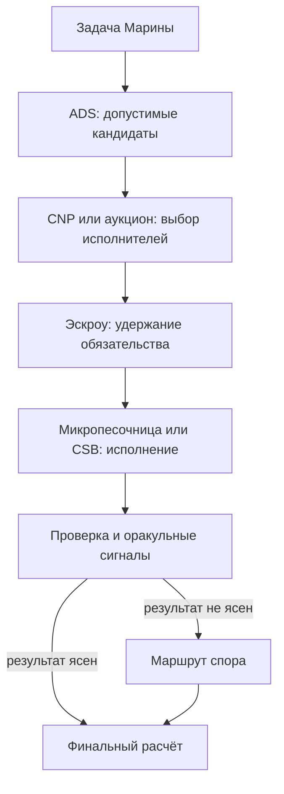
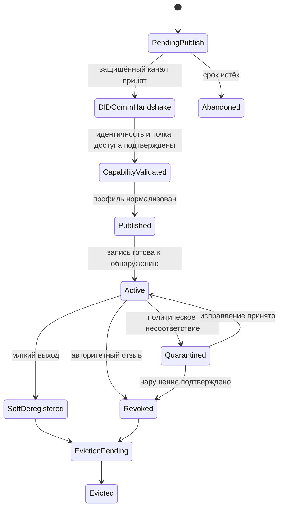
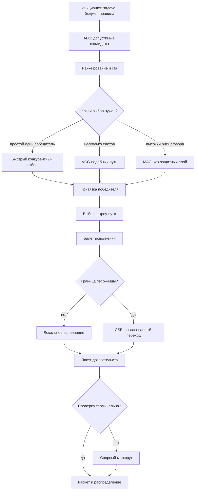

# УРОВЕНЬ 2 / ИЗМЕРЕНИЕ 06: МЕХАНИЗМЫ КООРДИНАЦИИ И ИСПОЛНЕНИЯ

> **Уровень:** L2 — Среда (инфраструктура)  
> **Измерение:** D06 — Coordination & Execution  
> **Учебная редакция:** v1.0  
> **Главная тема:** как множество агентов находят друг друга, договариваются, исполняют работу, проверяют результат и завершают расчёты

---

## Ключевой вопрос

**Как в среде исполняются транзакции, аукционы, матчинги и другие экономические и протокольные процессы?**

---

## Краткое описание измерения

Один агент может принять задачу и выполнить её внутри своего локального контура. Но цифровая экономическая среда работает иначе: в ней тысячи агентов одновременно ищут исполнителей, конкурируют за задачи, блокируют оплату, передают работу между изолированными зонами, проверяют результат и иногда спорят.

Настоящее измерение объясняет не отдельный модуль, а координационный стек: последовательность правил, которая превращает намерение заказчика в проверяемое исполнение и финальный расчёт.

Эта глава отвечает на несколько практических вопросов:

1. Как запрос проходит путь от намерения до финального распределения результата?
2. Как выбрать подходящий вид эскроу под профиль задачи?
3. Как определить, нужен ли простой отбор, аукцион или защита от сговора?
4. Как сервис обнаружения превращает записи агентов в допустимый набор кандидатов?
5. Как исполнять работу внутри изолированной среды и между такими средами?
6. Как проверка результата связана с оракулами, спорами и расчётом?
7. Где заканчивается ответственность настоящего измерения и начинаются соседние измерения?

---

## Мини-глоссарий

| Термин | Простое объяснение |
|--------|--------------------|
| Логос | Агент, который действует в цифровой среде от имени владельца или роли. |
| Координационный стек | Набор правил, который связывает поиск исполнителя, выбор победителя, эскроу, исполнение, проверку и расчёт. |
| Операционная валюта AGC | Расчётная единица для оплаты операций и удержания обязательств в среде. |
| Эскроу | Условное удержание средств до тех пор, пока результат не будет проверен или спор не будет решён. |
| Фабрика эскроу | Компонент, который создаёт подходящий тип эскроу под задачу. |
| Одноразовое эскроу с дедлайном | Эскроу для короткой задачи с понятным сроком завершения. |
| Эскроу по этапам | Эскроу, где оплата и проверка разбиты на несколько контрольных точек. |
| Многостороннее эскроу | Эскроу, где результат подтверждает группа проверяющих или комитет. |
| Оракульное эскроу | Эскроу, где решение о выплате опирается на измеримый сигнал проверки. |
| Сервис обнаружения агентов ADS | Смысловой реестр кандидатов: собирает записи агентов, нормализует их и отдаёт допустимый набор для отбора. |
| Карточка агента | Подписанное описание агента: кто он, где доступен, какие возможности заявляет и какие условия видимости применяются. |
| Справочный реестр Almanac | Реестр присутствия и доступности, который может помочь понять, где агент достижим. |
| Распределённая хеш-таблица DHT | Сетевой способ хранить и находить записи без одного центрального узла. |
| Запрос предложений cfp | Сообщение, которым заказчик просит подходящих агентов прислать предложения. |
| Протокол конкурентных предложений CNP | Оболочка переговоров: публикация запроса, приём предложений, оценка, принятие или отказ. |
| Привязка победителя | Проверяемая запись о том, какой кандидат выбран и на каких условиях. |
| Обратный аукцион Викри | Механизм, где исполнители конкурируют ценой, а правило оплаты снижает стимул к манипуляции. |
| VCG | Аукционный механизм для распределения нескольких мест или ресурсов, полезный в ограниченно сложных случаях. |
| MACI | Слой приватной подачи заявок, который может снижать риск сговора и подкупа в чувствительных ветках отбора. |
| Микропесочница | Частично изолированная операционная среда с собственными правилами, ограничениями и допустимыми действиями. |
| Проницаемость | Управляемая возможность переносить действия, данные или стоимость через границы среды или песочницы. |
| Брокер межпесочничного перехода CSB | Обязательная координационная поверхность для работы, которая пересекает границы песочниц. |
| Доверенный набор оракулов | Несколько проверочных сигналов: выбор оракула, залоговая ответственность и агрегированная оценка качества. |
| Залоговая ответственность | Экономический стимул вести себя корректно: за плохое поведение можно потерять залог. |
| Сокращение залога | Штраф за недобросовестный или ошибочный проверочный сигнал. |
| Модуль споров | Компонент, который маршрутизирует неоднозначные случаи вместо произвольного ручного расчёта. |
| Пакет доказательств | Собранные результаты, телеметрия и проверочные признаки, по которым принимается решение. |
| Финальный расчёт | Выплата, возврат или разделение средств после проверки или решения спора. |
| Финальное распределение | Последний разнос результата расчёта между получателями после завершения обязательства. |
| Защищённое рукопожатие DIDComm | Защищённый обмен сообщениями для публикации или изменения чувствительных записей агента. |
| Протокол A2A | Протокол общения агент-агент; в этой главе важен только как транспортная соседняя роль. |
| GDPR | Европейские правила защиты персональных данных; здесь важны как ограничение на раскрытие полей до переговоров. |
| DPIA | Оценка влияния обработки данных на приватность; относится к правовому соседнему слою. |
| AI Act | Европейское регулирование систем искусственного интеллекта; в этой главе учитывается как внешнее ограничение на проверки и споры. |
| MiCA | Европейские правила для криптоактивов; важны для соседних денежных и правовых контуров. |

---

# 0. Гипотетический пример

Представим цифровую среду, где городская логистическая сеть хочет за одну ночь перестроить маршруты доставки лекарств после сбоя на складе.

Задача слишком большая для одного исполнителя. Нужны агенты, которые умеют планировать маршруты, проверять температурные ограничения, бронировать транспорт, следить за сроками, принимать телеметрию и готовить отчёт для заказчика.

**Марина** — оператор городской логистической программы. Её Логос формулирует задачу и задаёт бюджет, срок и ограничения.

**Агентный консорциум исполнителей** — несколько Логосов перевозчиков, проверяющих сервисов и расчётных контуров, которые могут взять разные части работы.

Перед настоящим измерением уже должны быть решены базовые вопросы: кто участвует, какие роли и способности заявлены, как участники могут обмениваться сообщениями, какие экономические и правовые ограничения действуют. После настоящего измерения результат уйдёт дальше: в репутацию, оплату, спорные процедуры или обновление правил управления.

## Проверка 1. Можно ли собрать допустимый набор кандидатов?

Логос Марины не должен рассылать задачу всем подряд. Сначала среда должна найти агентов, которые вообще подходят по возможностям, доступности, политике видимости и минимальным требованиям доверия.

Для этого нужен сервис обнаружения агентов (англ. Agent Discovery Service, далее — ADS). Он собирает подписанные карточки агентов, дополнительные реестровые пометки и признаки доступности, убирает дубликаты и передаёт дальше только допустимый набор кандидатов.

## Проверка 2. Как открыть переговоры и выбрать победителей?

После обнаружения кандидатов задача ещё не исполнена. Нужно спросить подходящих агентов, кто готов взять работу, за какую цену, с какими сроками и какими ограничениями.

Для этого используется запрос предложений (англ. Call for Proposals, далее — cfp) внутри протокола конкурентных предложений (англ. Contract Net Protocol, далее — CNP). Если задача простая, может хватить быстрого конкурентного отбора. Если задача распределяется между несколькими исполнителями, нужен более сложный аукционный механизм.

## Проверка 3. Как удержать обязательство до результата?

Победитель отбора не должен сразу получить деньги только потому, что его выбрали. Но и исполнитель не должен работать без подтверждения, что оплата зарезервирована.

Поэтому координационный стек выбирает подходящий эскроу-путь: короткий по сроку, по этапам, с комитетом проверки или с оракульной проверкой. Этот выбор делается рано, но влияет на весь дальнейший путь: какие доказательства принимать, когда платить, когда возвращать средства и куда отправлять спор.

## Проверка 4. Где исполнять работу?

Часть маршрутизации лекарств можно выполнить в обычной операционной зоне. Но если задача затрагивает медицинские данные, финансовые ограничения или другой регулируемый контур, работа должна проходить внутри подходящей микропесочницы (англ. Microsandbox).

Если часть задачи должна перейти из одной песочницы в другую, например из логистической зоны в медицинскую, нужен брокер межпесочничного перехода (англ. Cross-Sandbox Broker, далее — CSB). Он не просто пересылает сообщение, а проверяет идентичность, согласует правила, удерживает расчётный контекст и сохраняет след аудита.

## Проверка 5. Как понять, что результат можно оплатить?

Когда исполнители возвращают маршруты и отчёты, среда должна решить, достаточно ли результата для расчёта. Для измеримых частей можно использовать доверенный набор оракулов: несколько проверочных сигналов, где учитываются выбор подходящего оракула, залоговая ответственность и агрегированная оценка качества.

Если результат неоднозначен, расчёт не должен зависеть от импровизации оператора. Состояние переводится в маршрут спора, а финальный расчёт ждёт итогового решения.

## Главное из примера

**Координация на уровне среды — это не один выбор исполнителя, а управляемая цепочка: найти допустимых кандидатов, выбрать механизм отбора, закрепить обязательство, исполнить работу в правильной среде, проверить результат и только потом завершить расчёт.**



---

# Содержание

1. Транзакционный жизненный цикл
2. Как выбирается эскроу-путь
3. Как выбирается аукционный механизм
4. Обнаружение, матчинг и переговоры
5. Исполнение в микропесочницах и между ними
6. Проверка, оракулы и споры
7. Как стек собирается в один путь
8. Связь и границы с другими измерениями
9. Итоговая модель целиком
10. Короткое резюме главы
11. Вопросы без ответа

---

# 1. Транзакционный жизненный цикл

Координация начинается не с технологии, а с простой потребности: участники должны понимать, на какой стадии находится работа и что разрешено делать дальше.

Если стадии не различать, среда может слишком рано выбрать победителя, слишком рано отпустить оплату, потерять связь между проверкой и расчётом или пытаться отменить уже необратимое действие.

Поэтому настоящее измерение использует семифазный путь как машину состояний: сначала стадия, затем проверка, затем фиксация перехода.

## 1.1 Семь фаз пути

| Фаза | Что происходит | Что ещё нельзя делать |
|------|----------------|-----------------------|
| Инициация | Формируется контекст задачи: намерение, бюджет, правила. | Нельзя финализировать выплату. |
| Эскроу | Создаётся поверхность обязательства и удержания средств. | Нельзя считать победителя выбранным. |
| Матчинг | Формируется привязка победителя или набора победителей. | Нельзя отпускать средства. |
| Исполнение | Исполнитель получает билет на работу и выполняет задачу. | Нельзя считать качество принятым. |
| Проверка | Результат, телеметрия и проверочные сигналы классифицируются. | Нельзя делать финальное распределение. |
| Расчёт | Средства выпускаются, возвращаются, делятся или уходят в спорный путь. | Нельзя переписать итог без нового состояния. |
| Распределение | Завершённый расчёт разносится между получателями. | Нельзя заново открыть матчинг. |

> Порядок фаз защищает участников от преждевременной финальности: поздние действия открываются только после явной проверки.

## 1.2 Проверки переходов

Рабочее правило можно записать как псевдокод:

```text
если стадия готова:
    проверить условия перехода
    если условия выполнены:
        зафиксировать новое состояние
    иначе:
        остаться в текущем состоянии или начать откат
```

Переход от эскроу к матчингу требует действительного эскроу-контекста. Переход от матчинга к исполнению требует привязки победителя. Переход от исполнения к проверке требует подтверждения завершения. Переход от проверки к расчёту требует либо объективного прохождения проверки, либо формального маршрута спора.

## 1.3 Откат и компенсация

Откат не должен означать «стереть запись». В распределённой среде часть действий уже могла запустить зависимые задачи или временные удержания.

Поэтому откат идёт по зависимости в обратном порядке:

| Класс эффекта | Пример | Как отменять |
|---------------|--------|--------------|
| Обратимое резервирование | Предварительное удержание средств, бронь слота. | Отменить и пометить как прерванное. |
| Зависимая работа | Очередь проверок, дочерние подзадачи. | Сначала закрыть листья зависимости. |
| Компенсируемый эффект | Временное начисление или удержание. | Сделать компенсирующую транзакцию. |
| Необратимый эффект | Внешний перевод, человечески подписанный выпуск средств. | Остановить процесс и передать на ручное решение. |

В примере Марины логистические агенты могут заранее зарезервировать слоты транспорта. Если победитель отбора меняется до исполнения, эти слоты можно отменить. Но если средства уже выпущены во внешний контур, координационный стек не делает вид, что события не было: он останавливает путь и требует отдельного решения.

## Главное

**Семь фаз нужны не для эффектного описания процесса, а для контроля разрешённых переходов.**

**До расчёта допустимы предварительные и компенсируемые действия; после финального распределения нельзя возвращаться к выбору победителя как будто ничего не произошло.**

---

# 2. Как выбирается эскроу-путь

Когда среда выбрала или почти выбрала исполнителя, возникает вопрос обязательства: как защитить заказчика от невыполненной работы, а исполнителя — от неоплаченного труда.

Ответом служит эскроу. Но эскроу не однотипен: разные задачи требуют разных правил удержания, проверки и выплаты.

## 2.1 Зачем нужна фабрика эскроу

Фабрика эскроу (англ. EscrowFactory) может рассматриваться как компонент, который создаёт нужный тип удержания под профиль задачи. Настоящее измерение не раскрывает внутреннюю экономику эскроу и не описывает газовые расходы или детали контрактов. Здесь важна маршрутизация: какой путь выбрать, чтобы дальнейшая проверка и расчёт были согласованы с задачей.

## 2.2 Четыре паттерна эскроу

| Профиль задачи | Подходящий путь | Почему он подходит |
|----------------|-----------------|--------------------|
| Короткая одноразовая задача с понятным сроком | `TimelockEscrow` | Срок ограничивает обязательство и упрощает завершение. |
| Задача с несколькими поставками | `MilestoneEscrow` | Ошибка локализуется на конкретном этапе. |
| Задача, где нужен человеческий или комитетный просмотр | `MultiSigEscrow` | Выпуск средств требует явного подтверждения нескольких сторон. |
| Задача с измеримым результатом | `OracleEscrow` | Проверка результата напрямую связана с выплатой. |

## 2.3 Почему выбор эскроу влияет на весь путь

Эскроу выбирается рано, но его последствия идут дальше:

| Дальнейшая стадия | Как влияет выбор эскроу |
|-------------------|-------------------------|
| Матчинг | Ограничивает тип допустимой привязки победителя. |
| Проверка | Задаёт формат доказательств, которые можно принять. |
| Расчёт | Определяет, возможен ли автоматический выпуск средств, частичный раздел или спорный путь. |

Если Марина делит логистическую задачу на этапы, ей не подходит один финальный выпуск средств за всю ночь. Этапное эскроу позволяет отдельно принять построение маршрутов, проверку температурных ограничений и подтверждение доставки, не смешивая все риски в один момент.

## Главное

**Эскроу в настоящем измерении — это не теория платежей, а ограничение исполнения.**

**Правильный эскроу-путь заранее определяет, какие доказательства будут допустимы и как расчёт сможет завершиться.**

---

# 3. Как выбирается аукционный механизм

Когда несколько агентов могут выполнить задачу, среда должна решить, как выбирать победителя. Нельзя просто всегда брать минимальную цену: иногда важны несколько слотов, риск сговора, срочность или сложность комбинации исполнителей.

Настоящее измерение не выбирает «лучший аукцион вообще». Оно связывает профиль задачи с механизмом отбора внутри координационного пути.

## 3.1 Рабочий набор механизмов

| Условие | Механизм | Координационная причина |
|---------|----------|-------------------------|
| Низкая сложность, один победитель, низкий риск сговора | Обратный аукцион Викри | Быстрый путь конкурентного выбора. |
| Несколько мест или ресурсов, но сложность ещё ограничена | `VCG` | Сильная логика распределения в управляемых случаях. |
| Высокая сложность или слишком много комбинаций | Приближённое или динамическое семейство `VCG` | Сохраняет выполнимость вместо слишком дорогого точного расчёта. |
| Повышенный риск сговора или подкупа | `MACI` поверх выбранного базового механизма | Добавляет приватность заявок и снижает видимость сигналов для сговора. |

`VCG` в этой главе означает механизм Викри-Кларка-Гроувса (англ. Vickrey-Clarke-Groves, далее — VCG). Он полезен для правдивого распределения нескольких слотов, но вычислительно тяжелеет при комбинаторном росте.

Как ориентир из исходной спецификации: точный VCG рассматривается для управляемого диапазона примерно до 15 слотов. Это не универсальная константа для всех внедрений, а ориентир, после которого нужна калибровка порога и возможный переход к приближённому механизму.

`MACI` используется не как механизм по умолчанию для каждого запроса, а как избирательный антиколлюзионный слой. Он уместен там, где приватная подача заявок действительно снижает риск сговора, а операционные издержки приемлемы.

## 3.2 Четыре признака маршрутизации

Выбор механизма зависит от четырёх признаков:

1. комбинаторная сложность;
2. срочность и допустимая задержка;
3. риск сговора;
4. неоднородность оценок участников.

Упрощённо это можно записать так:

```text
если риск сговора высокий:
    добавить MACI как слой защиты

если победитель один и задача простая:
    выбрать быстрый обратный аукцион
иначе если мест несколько и сложность ограничена:
    выбрать VCG
иначе:
    выбрать приближённый или динамический механизм
```

## 3.3 Что не решается здесь

Настоящее измерение не раскрывает полную теорию рынков, ценообразования и конкурентной структуры. Оно использует аукцион как ветку выбора победителя и связывает его с последующим эскроу, исполнением и расчётом.

В примере Марины часть задач можно отдать одному перевозчику через быстрый обратный аукцион. Но распределение нескольких районов между разными исполнителями требует многоцелевого выбора, поэтому может понадобиться VCG-подобный путь. Если участники могут координировать ставки между собой, поверх базового механизма может добавляться MACI.

## Главное

**Аукционный механизм выбирается не по названию, а по признакам задачи.**

**Настоящее измерение отвечает за связь «профиль задачи → механизм отбора → последствия для исполнения», а не за всю теорию конкуренции.**

---

# 4. Обнаружение, матчинг и переговоры

Перед переговорами среда должна решить, кого вообще можно рассматривать. Это отдельная проблема: запись агента может быть доступна в сети, но не подходить по возможностям, политике видимости, актуальности или минимальным признакам доверия.

Поэтому обнаружение и матчинг разделяются: сначала допустимость, затем ранжирование, затем переговоры.

## 4.1 Смысловой контур ADS

ADS в настоящем измерении — это смысловой метареестр поверх нескольких источников. Он может принимать:

- подписанные карточки агентов (англ. Agent Cards);
- пометки курируемых реестров;
- сведения о присутствии из `Almanac`;
- сетевые записи, доставленные через распределённую хеш-таблицу (англ. Distributed Hash Table, далее — DHT).

Важна не физическая топология хранения, а смысловая обработка записи:

| Шаг | Что делает ADS | Что не является задачей этой главы |
|-----|----------------|------------------------------------|
| Приём | Принимает карточки, реестровые пометки и признаки присутствия. | Репликация по сетевым регионам. |
| Нормализация | Собирает единый профиль кандидата. | Размещение данных в инфраструктуре. |
| Удаление дублей | Склеивает совпадающие поверхности идентичности и сервиса. | Транспорт слияния в DHT. |
| Проверка допустимости | Отбирает по возможностям, политике видимости и минимальным требованиям. | Отказоустойчивость сетевого маршрута. |
| Передача дальше | Выпускает допустимый набор кандидатов для cfp и ранжирования. | Физическая доставка сообщений. |

Если несколько источников расходятся, рабочая логика строится по приоритету: подписанная карточка агента определяет конечную точку и заявленные возможности; курируемый реестр добавляет доверительные и политические пометки; `Almanac` помогает с доступностью и достижимостью, особенно когда подробные метаданные отсутствуют или устарели.

## 4.2 От допустимости к переговорам

ADS не выбирает победителя. Он выпускает ограниченный набор кандидатов, которые уже прошли базовые условия.

Дальше CNP открывает переговорный контур:

1. ADS выпускает допустимый набор кандидатов.
2. cfp отправляется только этому набору.
3. Ответы привязываются к контексту кандидата.
4. Оценка упорядочивает только допустимые предложения.
5. Принятие или отказ формируют привязку победителя.
6. Билет исполнения открывает старт, связанный с эскроу.
7. Информирование, проверка и расчёт завершают жизненный цикл.

Принцип коротко:

> Сначала допустимость, потом порядок, потом переговоры.

Это защищает среду от ситуации, где высокий рейтинг или низкая цена делает недопустимого кандидата видимым.

## 4.3 Приватность до переговоров

Обнаружение не должно раскрывать лишние поля профиля. Особенно это важно для персональных Логосов: до переговоров достаточно показать набор возможностей и условия допустимости, а чувствительные данные остаются скрытыми.

| Поверхность обнаружения | Корпоративная роль | Персональный Логос | Правило ADS |
|-------------------------|--------------------|--------------------|-------------|
| Прямой поиск по DID | Допустим для сервисного профиля и публичной точки доступа. | Допустим только при явном согласии или существующей связи. | Поиск не раскрывает чувствительные поля по умолчанию. |
| Матчинг по возможностям | Допустим. | Допустим и является предпочтительным базовым режимом. | Сначала возвращается контур возможностей, а не богатый профиль личности. |
| Публичные поля | Класс сервиса, тип точки доступа, публичные политические метки. | Минимальный профиль по согласию. | Раскрытие ограничено принципом минимизации данных. |
| Чувствительные поля | Скрыты до переговоров или авторизации. | Скрыты до переговоров или авторизации. | До матчинга такие поля не выдаются. |
| Политические метки | Обязательны. | Обязательны. | Метки могут сужать видимость без раскрытия деталей идентичности. |

Юридические оценки вроде GDPR, DPIA, AI Act и MiCA принадлежат соседнему правовому контуру. Здесь они важны как ограничения поведения ADS: показывать меньше, проверять допустимость раньше, не раскрывать чувствительные поля до нужной стадии.

## 4.4 Ранжирование без подмены допустимости

Оценка предложения не сводится к цене. Координационный слой может учитывать:

| Компонент оценки | Роль | Ограничение |
|------------------|------|-------------|
| Соответствие возможностям | Проверяет релевантность задаче. | Не заменяется бонусом репутации. |
| Доступность и нагрузка | Снижает риск неявки. | Не делает недопустимого кандидата видимым. |
| Цена | Сохраняет рыночную дисциплину. | Учитывается только после проверки допустимости. |
| Задержка и срочность | Учитывает давление срока. | Вторична к политическим и видимостным ограничениям. |
| Репутация | Переносит прошлое качество в порядок предложений. | Не заменяет соответствие возможностям. |
| Поза ответственности | Учитывает залоговые или страховые гарантии. | Работает как вторичный сигнал порядка. |

Точные веса остаются настраиваемыми через управление. Важно только, что ранжирование не может отменить правило допустимости.

## 4.5 Жизненный цикл записи агента

Запись агента должна не только появиться, но и корректно исчезать или становиться невидимой при отзыве.



Защищённое рукопожатие DIDComm (англ. DIDComm) используется здесь только как защищённый обмен для публикации и чувствительных переходов. Выбор метода DID, формат привязанных учётных данных и реестр отзыва принадлежат соседним зонам ответственности.

Практическое правило: первая публикация не завершена до состояния «опубликован и активен»; мягкий выход идёт через ожидание удаления; отзыв полномочий сразу скрывает запись из смыслового набора кандидатов, даже если инфраструктурные копии сходятся не мгновенно.

Если в ночной задаче Марины перевозчик теряет право работать с медицинским грузом во время активного cfp, ADS немедленно убирает его из допустимого набора. Уже после этого сетевые кэши могут догонять обновление, но новые предложения в адрес отозванного кандидата не выдаются.

## Главное

**ADS отвечает на вопрос «кого можно рассматривать и какие поля можно показать», CNP — на вопрос «как получить привязку победителя».**

**Рейтинг, цена и доступность работают только после проверки допустимости.**

---

# 5. Исполнение в микропесочницах и между ними

После выбора исполнителя возникает другой вопрос: где и на каких условиях ему разрешено работать. Для регулируемых доменов недостаточно просто отправить задачу победителю.

Нужен контекст исполнения: какие инструменты разрешены, какие сетевые пути открыты, какие данные нельзя вывести, нужна ли более строгая вычислительная изоляция и можно ли передавать работу через границу песочницы.

## 5.1 Микропесочница как контекст исполнения

Микропесочница задаёт процедурную оболочку работы. В ней координационный слой проверяет:

- разрешён ли класс операции для данного профиля;
- какие инструменты и сетевые пути допустимы;
- требуются ли более строгие конфиденциальные вычисления;
- возможен ли межпесочничный переход;
- какой путь надзора или спора должен быть доступен.

Настоящее измерение не определяет саму природу микропесочниц. Оно объясняет, как координационный поток проходит через их правила.

## 5.2 Модель проницаемости

Проницаемость нельзя свести к одному техническому барьеру. Нужна слоистая модель:

| Слой | Координационный вопрос |
|------|------------------------|
| Политический слой | Разрешён ли класс операции в данном профиле? |
| Слой изоляции | Какая среда исполнения подходит для нагрузки? |
| Доменный слой | Какие отраслевые обязательства добавляются? |
| Эмпирический слой | Как измерять недопустимый риск утечки или выхода за границы? |

Эта модель задаёт направление, но не закрывает численные пороги: какие значения считать допустимыми, как калибровать пределы и когда включать эскалацию, остаётся вопросом управления и внедрения.

## 5.3 CSB как поверхность межпесочничного перехода

Когда задача, данные или средства пересекают границу песочницы, локальных допущений одной стороны недостаточно. Нужен общий контекст, который обе стороны могут проверить.

Эту роль выполняет CSB. Его минимальная функция в настоящем измерении — сделать межпесочничный переход атомарно объяснимым и учитывающим правила.

| Функция CSB | Зачем нужна |
|-------------|-------------|
| Проверка идентичности и учётных данных | Нельзя слепо доверять локальным допущениям другой песочницы. |
| Согласование правил | Нужно выбрать допустимый более строгий путь. |
| Нейтральная передача расчётного контекста | Результат матчинга должен перейти в безопасный эскроу-путь. |
| Непрерывность аудита | Обе стороны должны видеть один проверяемый след. |

Открытой остаётся топология CSB: единая поверхность проще для детерминированной маршрутизации и аудита, федерация экземпляров повышает устойчивость и локальность, но усложняет согласование правил, порядок событий и привязку ответственности при споре.

Жёсткое правило при этом уже понятно: работа, данные или средства, пересекающие границу песочницы, должны идти через брокерский координационный контекст. Межпесочничный расчёт без общего брокерского контекста архитектурно недопустим.

В примере Марины маршрутный агент может работать в логистической песочнице, а проверка медицинских температурных ограничений — в медицинской. CSB нужен именно в месте перехода: он не раскрывает внутренности соседних зон, но обеспечивает общий след, согласованные правила и безопасный расчётный путь.

## Главное

**Микропесочница отвечает за локальный контекст исполнения, а CSB — за допустимый переход через границу.**

**Главное правило межпесочничной работы: пересечение границы должно быть брокерованным, проверяемым и связанным с расчётом.**

---

# 6. Проверка, оракулы и споры

Даже если работа выполнена, среда должна понять, можно ли завершать расчёт. Для этого нужен проверочный контур, который не зависит от одного случайного сигнала.

Если результат объективен, проверка может быть автоматизированной. Если доказательства конфликтуют или оценка субъективна, задача должна перейти в спорный маршрут.

## 6.1 Доверенный набор оракулов

Оракул в этой главе — не единственный источник истины, а часть доверенного набора проверочных сигналов.

| Сигнал доверия | Роль в координации |
|----------------|--------------------|
| Динамический выбор оракула | Снижает риск захвата и позволяет выбирать проверку под задачу. |
| Залоговая ответственность и сокращение залога | Создают экономический риск для плохого проверочного поведения. |
| Агрегированная оценка качества | Не даёт одному шумному сигналу единолично решить выплату. |

Такой набор особенно важен для оракульного эскроу и первой линии проверки. Он не заменяет инфраструктуру оракулов, а задаёт минимальные требования для расчётного перехода.

## 6.2 Три уровня эскалации

| Уровень | Что делает | Когда нужен |
|---------|------------|-------------|
| Уровень 1 | Автоматическая или оракульная проверка. | Объективные споры и измеримые результаты. |
| Уровень 2 | Ограниченная панель или человеческий обзор. | Субъективная оценка или конфликтующие доказательства. |
| Уровень 3 | Внешняя или юридическая оболочка. | Юрисдикционные и тяжёлые по исполнимости случаи. |

Если первого уровня недостаточно, расчёт должен ждать терминального исхода спора. Это важно: спор является переходом состояния, а не ручной импровизацией поверх процесса.

## 6.3 Модуль споров как граница между проверкой и расчётом

Модуль споров (англ. DisputeModule) используется здесь как граница между проверкой и расчётом.

Путь выглядит так:

1. проверка формирует пакет доказательств;
2. нетерминальный исход переводит состояние в спорный маршрут;
3. спорный маршрут назначает тип случая, уровень автоматизации и путь разрешения;
4. расчёт возобновляется только после терминального исхода.

Для настоящего измерения достаточно трёх правил:

1. оракульный расчёт допустим только при явном доверенном наборе сигналов;
2. эскалация спора является переходом состояния;
3. финальность расчёта зависит от исхода спора, если объективной проверки недостаточно.

Если температурные датчики в примере Марины дают противоречивые данные, автоматическая выплата перевозчику не должна проходить сразу. Координационный стек собирает пакет доказательств и переводит случай на следующий уровень, а расчёт ждёт итоговой классификации.

## Главное

**Проверка связывает исполнение с расчётом: без терминального исхода нельзя безопасно выпускать средства.**

**Оракулы дают сигналы, но спорный путь нужен там, где автоматическая проверка не закрывает вопрос.**

---

# 7. Как стек собирается в один путь

Отдельные элементы не дают ответа на ключевой вопрос, пока не видно, как они связаны. Координация становится стеком только тогда, когда обнаружение, выбор победителя, эскроу, исполнение, проверка, спор и расчёт образуют один жизненный цикл.

## 7.1 Связующий путь

Рабочая последовательность выглядит так:

1. ADS собирает допустимый набор кандидатов.
2. CNP или аукционная ветка формирует привязку победителя.
3. Фабрика эскроу создаёт расчётно-безопасную поверхность обязательства.
4. Микропесочница задаёт локальные ограничения исполнения, а CSB обслуживает межпесочничный переход.
5. Проверка получает результат, телеметрию и доверенные сигналы.
6. Если исход терминальный, расчёт выпускает, возвращает или делит средства.
7. Если исход не терминальный, случай уходит в спорный маршрут и возвращается к расчёту после решения.
8. Финальное распределение завершает поток.

## 7.2 Минимальные интерфейсные артефакты

| Артефакт | Где возникает | Зачем нужен |
|----------|---------------|-------------|
| `task_spec_hash` | Инициация или cfp | Фиксирует предмет координации. |
| `candidate_context` | ADS | Связывает обнаружение и ранжирование. |
| `winner_binding` | CNP или аукцион | Делает выбор победителя проверяемым. |
| `escrow_id` | Фабрика эскроу | Даёт якорь расчёта. |
| `execution_ticket` | Микропесочница или CSB | Разрешает исполнение. |
| `evidence_bundle` | Проверка | Переносит результат и исход политики. |
| `dispute_record_id` | Спорный маршрут | Удерживает нетерминальный случай в одном жизненном цикле. |

## 7.3 Не путать гибкость и финальность

| Часть пути | Может быть гибкой | Должна быть проверяемой |
|------------|-------------------|-------------------------|
| Обнаружение и ранжирование | Источники записей, сигналы порядка, веса оценки. | Правило допустимости и набор кандидатов. |
| Выбор механизма | Быстрый отбор, VCG-подобный путь, MACI-слой. | Привязка победителя. |
| Исполнение | Локальная песочница или межпесочничный путь. | Билет исполнения и след аудита. |
| Проверка | Типы оракулов и уровни эскалации. | Терминальный исход перед расчётом. |
| Расчёт | Выплата, возврат, разделение. | Связь с эскроу и спорным исходом. |

## Главное

**Координационный стек — это гибкий поиск и выбор до обязательства, но проверяемые переходы после обязательства.**

**Прямой ответ настоящего измерения: экономические и протокольные процессы исполняются как жизненный цикл состояний, где каждый переход имеет условия, артефакты и границы ответственности.**

---

# 8. Связь и границы с другими измерениями

Настоящее измерение находится в середине уровня среды: оно принимает от соседних измерений идентичность, инфраструктуру, коммуникацию, экономику, безопасность и правовые ограничения, а само отвечает за связку «кандидаты → выбор → обязательство → исполнение → проверка → расчёт».

| Измерение | Связь | Граница ответственности |
|-----------|-------|--------------------------|
| **L2/D01 (Онтология)** | Определяет понятие микропесочницы и границы среды. | Настоящее измерение не определяет микропесочницу как сущность; оно описывает исполнение внутри и между такими границами. |
| **L2/D02 (Инструменты)** | Операционная валюта AGC, Qi Energy и распределение выручки используются в расчётном контуре. | Денежная политика, резервы и распределительная экономика остаются вне этой главы; здесь они выступают как инструменты расчёта. |
| **L2/D03 (Инфраструктура)** | Смарт-контракты, фабрика эскроу и оракульная инфраструктура дают техническую поверхность. | Настоящее измерение выбирает маршрут и потребляет сигналы, но не описывает инфраструктурный стек полностью. |
| **L2/D04 (Коммуникации)** | Протокол A2A, доставка сообщений и физическая сеть обнаружения обеспечивают связность. | Здесь остаются смысловая допустимость, ранжирование и переход от обнаружения к cfp; транспорт и топология не раскрываются. |
| **L2/D07 (Безопасность)** | Механизмы прерывания и защитные меры ограничивают исполнение. | Настоящее измерение учитывает их как условия переходов, но не проектирует весь контур безопасности. |
| **L2/D08 (Нормативно-правовое)** | Правовые рамки ограничивают приватность, споры, финальность и внешнюю исполнимость. | Здесь они используются как ограничения маршрутов; правовая доктрина остаётся соседней ответственностью. |
| **L3/D03 (Обмен)** | Полные паттерны эскроу и экономика расчётов раскрываются на уровне обменов. | Настоящее измерение выбирает эскроу-путь по профилю задачи. |
| **L3/D06 (Конкуренция)** | Аукционная теория и рыночная конкуренция задают механизмы выбора. | Здесь аукцион используется как ветка отбора внутри жизненного цикла исполнения. |
| **L3/D08 (Конфликты)** | Споры и конфликтные траектории дают путь для нетерминальных исходов проверки. | Настоящее измерение передаёт спор в этот маршрут и ждёт терминального исхода перед расчётом. |

## Главное

**Граница настоящего измерения — не «всё про эскроу, аукционы и споры», а их связка в исполнимый координационный путь.**

---

# 9. Итоговая модель целиком

Вся модель сводится к одной идее: среда должна превращать экономическое намерение в проверяемое исполнение без преждевременной выплаты, случайного выбора исполнителя и неуправляемого перехода через границы песочниц.



## Главное

**Итоговая модель соединяет гибкий отбор исполнителей с жёсткой дисциплиной состояний: до обязательства можно искать и сравнивать, после обязательства каждый переход должен быть проверяемым.**

---

# 10. Короткое резюме главы

1. Настоящее измерение описывает координационный стек уровня среды: от обнаружения кандидатов до финального расчёта.
2. Семифазный жизненный цикл нужен как машина состояний, где переходы проходят через проверку и фиксацию.
3. Эскроу выбирается по профилю задачи и заранее задаёт допустимые доказательства, выплаты и спорные пути.
4. Аукционный механизм выбирается по сложности, срочности, риску сговора и неоднородности оценок.
5. ADS сначала формирует допустимый набор кандидатов, а CNP или аукционная ветка уже затем выбирает победителя.
6. Микропесочницы задают локальные ограничения исполнения, а CSB делает межпесочничный переход проверяемым.
7. Оракулы дают проверочные сигналы, но нетерминальные случаи должны уходить в спорный маршрут.
8. Финальность расчёта допустима только после проверки или решения спора.

## Главное

**Координация в среде — это дисциплина переходов: кто допускается, кто выбран, где исполняет, чем доказал результат и на каком основании получает расчёт.**

---

# 11. Вопросы без ответа

1. **Точная машина состояний для фаз и отката.** Принцип «стадия → проверка → фиксация» и компенсационный откат определены, но ещё нужны точные события переходов, окна ожидания, бюджеты повторов и список необратимых эффектов.
2. **Измеримые пороги проницаемости микропесочниц.** Слоистая модель принята как направление, но нужны метрики, настраиваемые пределы и производственная калибровка.
3. **Финальная топология ADS.** Смысловая роль ADS определена, но остаются вопросы приоритета источников, удаления устаревших карточек, приватности и отказоустойчивости.
4. **Единый CSB или федерация брокеров.** Обязательность брокерского контекста ясна, но не выбраны топология, модель упорядочивания событий и распределение ответственности при споре между брокерами.
5. **Порог перехода от точного VCG к приближённым механизмам.** Есть ориентир для управляемого диапазона, но нужны доменные пороги и допустимая потеря стимульных гарантий.
6. **Единая таблица выбора аукциона.** Признаки маршрутизации определены, но нужна калиброванная таблица решений и резервные правила для редких случаев.
7. **Калибровка управления для проницаемости.** Нужны операционные метрики, триггеры эскалации и допустимая стоимость ложных срабатываний.
8. **Политика обновления маршрутизации задач к механизмам.** Нужны каталог механизмов, данные для калибровки и обратная связь, которая позволит обновлять правила выбора.

## Главное

**Открытые вопросы в основном не меняют форму координационного стека; они уточняют пороги, топологию и калибровку, без которых архитектурные правила нельзя безопасно превратить в производственные настройки.**
