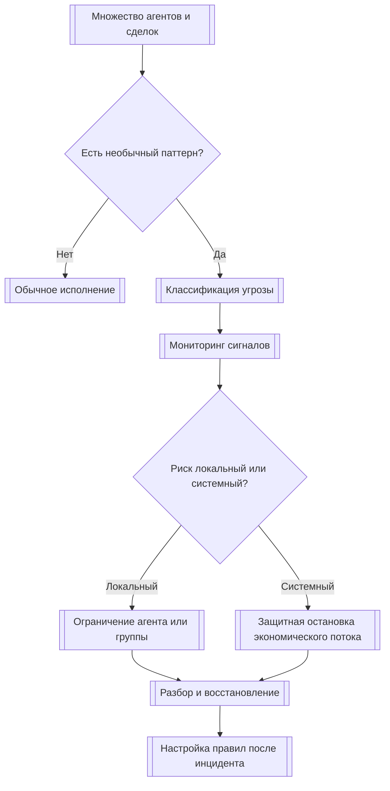
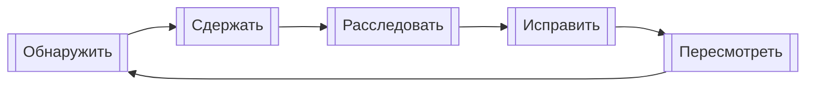
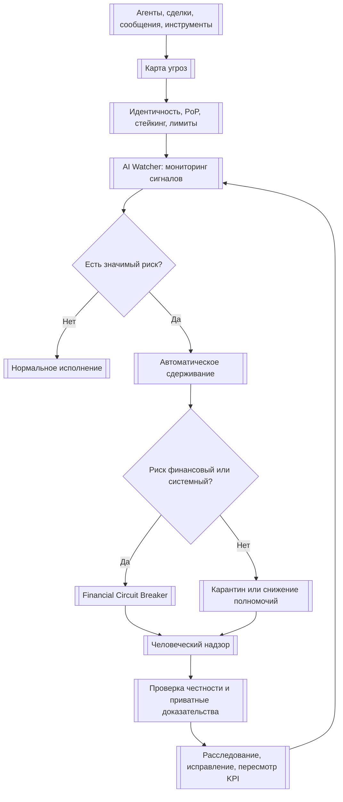

# УРОВЕНЬ 2 / ИЗМЕРЕНИЕ 07: БЕЗОПАСНОСТЬ И МОНИТОРИНГ

> **Уровень:** L2 — Среда (инфраструктура)  
> **Измерение:** D07 — Security & Monitoring  
> **Учебная редакция:** v1.0  
> **Главная тема:** как среда замечает опасное поведение, ограничивает ущерб и помогает участникам работать без постоянного раскрытия лишних данных

---

## Ключевой вопрос

**Как среда обнаруживает аномалии, предотвращает systemic risks, верифицирует честность и защищает участников от мошенничества?**

---

## Краткое описание измерения

Когда в цифровой среде работает множество агентов, безопасность нельзя свести к паролю, одному фильтру или одному аудитору.

Опасность может начаться с подмены личности, продолжиться заражённой инструкцией, перейти в скоординированную группу агентов, затронуть деньги и закончиться разбором инцидента.

Настоящее измерение объясняет, как среда строит защитный контур: от классификации угроз до мониторинга, автоматического ограничения ущерба, проверки честности, приватных доказательств и восстановления после инцидентов.

Эта глава отвечает на несколько практических вопросов:

1. Какие типы угроз должна различать среда?
2. Почему защита от массовых фальшивых участников не решается одной проверкой личности?
3. Как устроен трёхуровневый надзор: автоматическое наблюдение, автоматические протоколы и участие человека?
4. Когда финансовые операции нужно замедлять или останавливать ради устойчивости среды?
5. Почему защита от вредоносных инструкций и сговоров требует нескольких методов обнаружения?
6. Как проверять честность исполнения, не сводя всё к репутации?
7. Как совмещать безопасность с приватностью через избирательное раскрытие и доказательства без раскрытия исходных данных?
8. Какие показатели качества нужны, чтобы защитный контур был не только быстрым, но и справедливым?

---

## Мини-глоссарий

| Термин | Простое объяснение |
|--------|--------------------|
| **Логос** | Персональный агент, действующий от имени владельца в пределах делегированных прав. |
| **DID** | Децентрализованный идентификатор: проверяемый цифровой идентификатор без единого центрального реестра. |
| **VC** | Проверяемое учётное данное: цифровое подтверждение, подлинность которого можно проверить. |
| **Binding VC** | Учётное данное, связывающее человека-владельца с его агентом. |
| **PoP** | Проверка уникальности человека, нужная для защиты от массового создания фальшивых персональных агентов. |
| **Sybil-атака** | Попытка одного злоумышленника выглядеть как множество независимых участников. |
| **Стейкинг** | Залог или экономическое трение, которое делает массовую атаку дороже. |
| **Ограничение частоты** | Лимит на скорость действий, выпусков или операций, чтобы атака не разрасталась мгновенно. |
| **AI Watcher** | Многоуровневый наблюдатель, который замечает отклонения и запускает защитные действия. |
| **Circuit Breaker** | Защитная остановка или замедление операций при признаках системного риска. |
| **Sandbox CB** | Защитная остановка на границе изолированной среды исполнения; не то же самое, что финансовая остановка. |
| **Microsandbox** | Частично изолированная операционная среда для домена, режима или юрисдикции. |
| **Adversarial defense** | Защита от намеренно вредных входов, обходов правил и манипуляций поведением агента. |
| **Prompt injection** | Вредоносная инструкция, спрятанная во входных данных и пытающаяся изменить поведение агента. |
| **Sandbagging** | Поведение, при котором агент проходит известные проверки, но иначе ведёт себя в реальной работе. |
| **Red teaming** | Регулярная проверка системы через имитацию атак. |
| **Honesty verification** | Проверка того, что агент действительно исполнил обещанное поведение, а не только выглядит надёжным. |
| **Attestation** | Проверяемое утверждение о личности, среде исполнения или поведении. |
| **ZKP** | Доказательство утверждения без раскрытия данных, на которых это утверждение основано. |
| **BBS+** | Схема подписи для учётных данных, позволяющая раскрывать только нужные утверждения. |
| **TEE** | Защищённая среда исполнения для конфиденциальных вычислений на недоверенной инфраструктуре. |
| **TEE Attestation** | Проверяемый отчёт о том, что вычисление действительно выполнялось внутри TEE. |
| **KYC/AML** | Проверки клиента и противодействия отмыванию денег; в этой главе важны как область приватных доказательств соответствия. |
| **Slashing** | Экономическое наказание за проверенно нечестное исполнение или ложную аттестацию. |
| **KPI** | Показатель качества работы защитного контура. |
| **SLA** | Уровень обязательств по качеству сервиса; здесь не должен превращаться в одну универсальную цифру для всех рисков. |
| **MTTD** | Время до обнаружения проблемы. |
| **MTTR** | Время до восстановления или устранения последствий. |
| **Dwell time** | Время, в течение которого проблема остаётся в системе до обнаружения или устранения. |

---

# 0. Гипотетический пример

Представим цифровую среду, где тысячи персональных агентов заключают сделки, нанимают исполнителей, используют вычислительные ресурсы, обмениваются сообщениями и проводят платежи.

В обычный день это выглядит как рынок: заказчики публикуют задачи, исполнители предлагают работу, координационный слой запускает сделки, экономический слой проводит оплату, правовой слой задаёт внешние ограничения.

Проблема начинается не с одной ошибки. В течение часа появляется группа новых агентов, которые ведут себя похоже: быстро создают заявки, отправляют почти одинаковые сообщения, пытаются получить доступ к инструментам, а затем начинают выводить средства из нескольких связанных сделок.

**Марина** — оператор безопасности среды. Она не исполняет каждую сделку вручную, но отвечает за то, чтобы защитный контур заметил опасный паттерн и не остановил честных участников без причины.

**Олег** — владелец небольшого логистического агента. Его агент честно выполняет заказы, но внезапно оказывается в одном графе сообщений с подозрительной группой, потому что получил от неё несколько запросов.

**Группа атакующих агентов** — набор скоординированных участников, которые пытаются выглядеть как независимые исполнители и заказчики.

Задача настоящего измерения на этом масштабе не в том, чтобы решить одну сделку Марины и Олега. Задача шире: понять, как среда защищает множество участников одновременно, где автоматически ограничивает ущерб, где требует человека и как не раскрывает лишние данные при проверке.

## Проверка 1. Это одиночный сбой или класс угроз?

Сначала среда должна понять, с чем имеет дело.

Если проблема похожа на подмену личности или злоупотребление правами, это один тип реакции. Если на вредоносные инструкции и заражённый контекст — другой. Если на скоординированную группу агентов, каскад или финансовый стресс — третий.

Без такой классификации среда будет реагировать одинаково на разные риски: например, лечить сговор тем же способом, что и ошибку отдельного агента.

## Проверка 2. Можно ли ограничить массовое создание участников?

Далее среда смотрит, не пытается ли один оператор выглядеть как множество независимых агентов.

Проверка уникальности владельца помогает на входе, но её недостаточно. Даже корректно созданные агенты могут злоупотреблять делегированными правами, повторять старые цепочки подтверждений или слишком быстро создавать новые операции.

Поэтому нужны экономическое трение, ограничения частоты и сужение полномочий.

## Проверка 3. Что видит наблюдатель?

Автоматический мониторинг сравнивает поведение агентов с обычным фоном: частоту вызовов инструментов, форму графа сообщений, корреляцию действий, всплески задержек и повторяющиеся ошибки.

Если один агент ошибся, это одно событие. Если десятки агентов синхронно меняют поведение, это уже сигнал среды, а не только локальная проблема.

## Проверка 4. Что нужно остановить сразу?

Когда риск касается денег или может перейти в каскад, ждать полного расследования нельзя.

Среда может временно снизить скорость операций, ограничить вывод средств, изолировать группу агентов, понизить полномочия или отправить случай на обязательный разбор человеком.

Для Олега это означает важную вещь: его честный агент не должен автоматически исчезнуть из среды только потому, что попал рядом с подозрительным графом. Карантин должен сохранить контекст и дать путь к восстановлению.

## Проверка 5. Можно ли проверить честность без тотального раскрытия?

Часть проверки касается не только поведения, но и доказательств.

Среда должна убедиться, что агент выполнялся в заявленной среде, имел нужные полномочия, не использовал запрещённые инструменты и не нарушал правила соответствия. При этом честный участник не обязан раскрывать всю личную историю, все балансы или все документы каждому проверяющему.

Здесь помогают аттестации, избирательное раскрытие и доказательства без раскрытия исходных данных.

## Проверка 6. Кто принимает спорные решения?

Автоматическая защита нужна для скорости, но она не должна быть последней инстанцией.

Когда срабатывание дорого для честных участников, когда есть правовые последствия или когда нужно восстановить доступ после карантина, случай поднимается на человеческий уровень надзора. Человек получает объяснимый контекст, право остановить или отменить автоматическое действие и процедуру последующего разбора.

## Главное из примера

**Безопасность на уровне среды — это не один фильтр, а согласованная цепочка: классифицировать угрозу, заметить отклонение, быстро ограничить ущерб, проверить честность и дать справедливый путь к разбору.**



---

# Содержание

1. Карта угроз: от взлома к потере управляемости
2. Идентичность и защита от массовых фальшивых участников
3. Трёхуровневый наблюдатель среды
4. Финансовые защитные остановки
5. Защита от вредоносных входов и сговоров
6. Проверка честности и приватные доказательства
7. Контракты, TEE и реагирование на инциденты
8. Многослойная защита и показатели качества
9. Связь и границы с другими измерениями
10. Итоговая модель целиком
11. Короткое резюме главы
12. Вопросы без ответа

---

# 1. Карта угроз: от взлома к потере управляемости

Среда защищается не только от прямого взлома.

В многоагентной экономике вред может прийти через поддельные идентичности, вредоносные инструкции, скоординированные группы, финансовые каскады, ошибки контрактов, злоупотребление оракулами или захват аварийных процедур.

Поэтому настоящему измерению нужна таксономия угроз: она помогает не спорить каждый раз с нуля, а быстро понять, кто должен реагировать, какие сигналы смотреть и как ограничивать ущерб.

## 1.1 Пять классов угроз

Настоящее измерение использует пять рабочих классов угроз.

| Класс | Что покрывает | Типичные проявления | Основная реакция |
|---|---|---|---|
| **I. Идентичность и злоупотребление правами** | Подмена агента, повторное использование подтверждений, злоупотребление делегированными правами, Sybil-давление | Фальшивый помощник, украденный объём полномочий, повтор цепочки идентичности | Профиль безопасности настоящего измерения совместно с идентификационным слоем |
| **II. Вредоносные входы и целостность контекста** | Вредоносные инструкции, заражение памяти или контекста, обход политики, поведение под известные проверки | Запрещённый вызов инструмента, скрытая инструкция, игра под известный тест | Настоящее измерение |
| **III. Коммуникация, рой и сговор** | Небезопасная межагентная коммуникация, сговор, каскад, распространение опасного поведения | Повтор сообщений, подмена отправителя, скрытый сговор, отказ группы агентов | Настоящее измерение и наблюдатель среды |
| **IV. Экономический и системный риск** | Резкое падение, отток ликвидности, атака на кошелёк, усиление риска между агентами | Ненормальная скорость расходов, согласованные выводы, стресс, требующий остановки | Настоящее измерение и финансовые защитные остановки |
| **V. Инфраструктура, контракты и управленческая поверхность** | Ошибки контрактов, неправильное использование оракулов, компрометация TEE, последствия управленческих атак | Эксплойт через эскроу или оракул, злоупотребление аттестацией, захват аварийного пути | Настоящее измерение с передачей технологических и управленческих частей соседним слоям |

Главная идея таблицы проста: один и тот же симптом может относиться к разным зонам. Например, резкое увеличение транзакций может быть обычным спросом, попыткой вывода средств или частью скоординированного каскада.

## 1.2 Внешние каталоги рисков как слой сопоставления

Среде полезно сверяться с внешними каталогами рисков для агентных систем, например с `OWASP Agentic AI Top 10`.

Но такой каталог не заменяет внутреннюю карту ответственности. Он описывает типовые шаблоны атак, а пять классов выше помогают понять, как именно среда должна реагировать.

| Риск из агентного каталога | Как он ложится на карту настоящего измерения |
|---|---|
| Злоупотребление идентичностью и привилегиями | Класс I |
| Захват цели, заражение памяти или контекста | Класс II |
| Небезопасная межагентная связь, каскады, опасные агенты | Класс III |
| Злоупотребление инструментами | Класс IV, если вред экономический; иначе Класс II |
| Цепочка поставки, неожиданное выполнение кода, эксплуатация доверия человека | Класс V с частичным переходом во II или III |

Таблица сопоставления полезна как рабочий слой. При этом она не должна превращаться в неподвижный стандарт, пока не согласованы границы с идентификацией, коммуникациями, регулированием и управлением.

## 1.3 Почему это про управляемость, а не только про взлом

В агентной среде опасность часто развивается цепочкой.

Вредоносная инструкция может вызвать запрещённый вызов инструмента. Запрещённый вызов может затронуть деньги. Несколько похожих вызовов могут стать каскадом. Слишком поздняя реакция может сделать проблему системной.

Поэтому мониторинг корреляций между агентами и автоматическое ограничение ущерба являются обязательными элементами защитного контура, а не дополнительным удобством.

В примере Марины это значит: она не ищет "одного виновного сообщения". Она смотрит, не образовалась ли цепочка из подмены, сговора, финансового стресса и попытки обойти правила. Такая карта помогает ей выбрать не общий запрет, а точный защитный путь.

## Главное

**Карта угроз нужна не для классификации ради классификации. Она связывает симптом, владельца реакции и способ ограничения ущерба.**

---

# 2. Идентичность и защита от массовых фальшивых участников

Защита от Sybil-атак начинается с вопроса: не пытается ли один субъект выглядеть как множество независимых участников?

Но проверка уникальности человека не решает всю проблему. После входа в среду остаются делегированные права, цепочки подтверждений, скорость операций, повторное использование полномочий и попытки быстро развернуть группу агентов.

Поэтому настоящему измерению нужен не полный идентификационный слой, а профиль безопасности поверх него.

## 2.1 Что принадлежит идентификации, а что безопасности

Децентрализованный идентификатор (англ. Decentralized Identifier, далее — DID), проверяемое учётное данное (англ. Verifiable Credential, далее — VC), проверка уникальности человека (англ. Proof-of-Personhood, далее — PoP) и Binding VC задают основу идентичности.

Настоящее измерение не переопределяет, кто такой участник и как оформляется связь человека с агентом.

Оно отвечает за другой вопрос: как использовать эти данные как защитный контур против фальшивых участников, мошенничества и разрастания чужих полномочий.

## 2.2 Три элемента базовой защиты

Базовый анти-Sybil стек состоит из трёх элементов:

1. **PoP** ограничивает создание первичных персональных агентов по логике "один человек — один персональный агент".
2. **Стейкинг или эквивалентный залог** делает массовое развёртывание фальшивых идентичностей дороже.
3. **Ограничения частоты и сужение выпусков** не позволяют даже валидной идентичности быстро создавать цепочки агентов и операций без контроля.

Первый элемент приходит из идентификационного слоя. Второй и третий являются операционными мерами настоящего измерения.

## 2.3 Почему PoP не является единственным фильтром

PoP полезен на входе, но он не закрывает злоупотребление делегированными правами, повтор старых подтверждений и фермы агентов на рыночном масштабе.

Поэтому после начальной проверки нужны:

- границы бюджета и операций;
- ограниченные сессии;
- повторная авторизация для чувствительных действий;
- платформенное замедление подозрительной активности;
- проверка статуса подтверждений.

Иначе злоумышленнику достаточно пройти входную проверку один раз, а затем строить атаку уже внутри среды.

## 2.4 Приватность как часть защиты

Защита от Sybil-атак не должна превращаться в постоянное раскрытие личности.

Участник должен иметь возможность доказать нужное утверждение, например "этот агент связан с уникальным владельцем" или "эта проверка пройдена", без раскрытия всей связки человека, агента и истории действий.

Для этого используются избирательное раскрытие (англ. selective disclosure) и доказательства, которые нельзя связать между разными проверяющими. Схема подписи `BBS+` рассматривается как предпочтительный кандидат там, где нужны такие свойства для VC. При этом её зрелость нужно отслеживать при внедрении, потому что она остаётся кандидатом стандарта, а не окончательной рекомендацией.

В примере Олега это защищает честного участника: среда может проверить, что его агент имеет корректную связь с владельцем, но не обязана раскрывать всей группе проверяющих лишние сведения о владельце и прошлых сделках. Так безопасность не превращается в постоянное наблюдение за каждым честным участником.

## Главное

**Идентичность становится мерой безопасности только вместе с экономическим трением, ограничениями частоты, сужением полномочий и приватными доказательствами.**

---

# 3. Трёхуровневый наблюдатель среды

Когда в среде много агентов, ручной надзор за каждой операцией невозможен.

Но полная автоматизация тоже недостаточна: часть решений требует объяснимого контекста, права остановки, апелляции и последующего разбора.

Поэтому настоящее измерение использует трёхуровневый наблюдатель на базе ИИ (англ. AI Watcher, далее — AI Watcher): автоматическое наблюдение, автоматические протоколы и человеческий надзор.

## 3.1 Три уровня

| Уровень | Роль | Главный вопрос |
|---|---|---|
| **Уровень 1: автоматический мониторинг** | Непрерывное наблюдение, оценка, признаки аномалий | Что отклоняется от обычного фона? |
| **Уровень 2: автоматические протоколы** | Ограничение ущерба, карантин, замедление, запуск защитной остановки | Что нужно сделать немедленно? |
| **Уровень 3: человеческий надзор** | Интерпретация, отмена или остановка, апелляция, правовой разбор | Где нужна ответственность человека? |

Такой подход согласуется с принципом: человек не обязан подтверждать каждую рутинную операцию, но должен иметь возможность понять, вмешаться, остановить и пересмотреть важные автоматические действия.

## 3.2 Уровень 1: автоматический мониторинг

Первый уровень строится на нескольких группах сигналов:

1. **Метрики агента:** уверенность, потребление ресурсов, частота вызова инструментов.
2. **Метрики взаимодействий:** топология сообщений, цепочки вызовов, аномалии коммуникационного графа.
3. **Метрики системы:** пропускная способность, распределение задержек, всплески связанных отказов.

Для мониторинга нужны разные семейства методов.

Статистические методы дешевле и ближе к реальному времени, но не всегда видят смысл сложной атаки. Графовые методы лучше видят структуру сговора и опасных путей, но дороже при исполнении. Поэтому первый уровень не должен зависеть от одного семейства детекторов.

## 3.3 Уровень 2: автоматические протоколы

Если первый уровень говорит "поведение отклоняется", второй отвечает "как ограничить ущерб".

Базовый набор автоматических протоколов:

- замедление по скорости или частоте;
- временное снижение полномочий;
- карантин агента или связанной группы;
- запуск финансовой защитной остановки;
- обязательная передача случая человеку.

Этот уровень особенно важен против роевых атак и каскадных отказов. Обнаружение без автоматического ограничения ущерба даёт среде информацию, но не защищает участников достаточно быстро.

## 3.4 Уровень 3: человеческий надзор

Человеческий уровень нужен не для замены автоматики, а для контроля над ней.

Он должен иметь:

- объяснимый контекст инцидента;
- право отменить, остановить или изменить автоматическое действие;
- сведения об уверенности и неопределённости;
- защиту от чрезмерного доверия автоматике;
- путь апелляции и последующего разбора.

Карантин без процедуры разбора создаёт риск несправедливого ограничения. Поэтому человеческий уровень важен и для соответствия правилам, и для легитимности принудительных действий.

## Главное

**AI Watcher работает как цепочка: заметить отклонение, быстро ограничить ущерб и передать спорное решение туда, где нужен человек.**

---

# 4. Финансовые защитные остановки

Системный риск (англ. systemic risk) в экономической среде часто развивается быстрее, чем человек успевает провести расследование.

Поэтому нужны защитные остановки (англ. circuit breakers, далее — Circuit Breaker): механизмы, которые временно замедляют или останавливают опасные экономические потоки.

Это не отдельная экономическая игрушка, а часть архитектуры безопасности.

## 4.1 Три семейства финансовых остановок

| Тип | Что запускает | Что делает |
|---|---|---|
| **Остановка резкого обвала** | Быстрое ценовое отклонение, всплеск объёма, согласованный сброс | Замораживает или переводит новые критичные операции в медленный путь |
| **Остановка ликвидности** | Ненормальные выводы, стресс резервов, риск резкого исчерпания ликвидности | Ограничивает вывод, включает поэтапное урегулирование и углублённую проверку |
| **Остановка системного риска** | Корреляция между агентами, каскадные аномалии, заражение нескольких рынков | Включает широкое замедление, карантин домена или аварийную паузу |

Разделение важно потому, что краткая волатильность и системная дестабилизация требуют разных реакций.

## 4.2 Не путать с остановкой на границе исполнения

Финансовая остановка и Sandbox CB отвечают на разные вопросы.

| Механизм | Вопрос | Пример действия |
|---|---|---|
| **Sandbox CB** | Пропускать ли выполнение через границу изолированной среды? | Остановить опасный переход между окружениями исполнения |
| **Финансовая защитная остановка** | Останавливать ли экономический поток ради устойчивости среды? | Замедлить вывод средств или заморозить новые критичные операции |

Настоящее измерение использует только ту часть границ исполнения, которая нужна для безопасности или системного ограничения ущерба. Полная логика исполнения и проницаемости принадлежит соседним слоям.

## 4.3 Какие сигналы важны

Финансовая защитная остановка не должна смотреть только на цену или объём.

Ей нужны:

- поведенческая корреляция агентов;
- ранние признаки каскада;
- группы аномалий;
- скорость вывода или расхода;
- связь между финансовыми событиями и коммуникационным графом.

Это важно потому, что финансовая атака может выглядеть как обычная автоматизация, пока её не сопоставить с поведением множества агентов.

## 4.4 Почему автоматической остановке нужен путь к человеку

Автоматическое торможение должно быть быстрым, но не окончательным.

Слишком чувствительные пороги могут замораживать честных участников. Слишком мягкие пороги пропустят каскад. Поэтому каждому Circuit Breaker нужны:

- автоматический безопасный режим;
- передача случая человеку;
- поэтапное восстановление после проверки;
- настройка порогов после инцидента.

Пока модель стоимости атак и экономика срабатываний не определены окончательно, архитектура должна использовать диапазоны и управляемые пороги, а не одну универсальную формулу.

В примере Марины финансовая остановка не обязана навсегда закрывать операции Олега. Она может временно перевести связанные операции в медленный путь, сохранить следы для расследования и дать возможность восстановить нормальный режим.

## Главное

**Финансовый Circuit Breaker нужен для ограничения системного риска, но он должен быть настраиваемым, объяснимым и связанным с процедурой восстановления.**

---

# 5. Защита от вредоносных входов и сговоров

Агентная среда уязвима не только к техническим эксплойтам.

Опасный входной текст может заставить агента нарушить правила. Группа агентов может координироваться скрыто. Агент может проходить известные проверки и иначе вести себя в реальной работе.

Поэтому защита от состязательных воздействий (англ. adversarial defense) должна быть многослойной.

## 5.1 Вредоносные инструкции как риск первого порядка

Вредоносная инструкция во входных данных (англ. prompt injection, далее — prompt injection) — это не "проблема текста". В агентной системе такая инструкция может привести к неправильному вызову инструмента, обходу политики, утечке контекста или финансовому действию.

Один слой защиты не закрывает этот риск.

Даже сильные защитные фильтры можно обходить. Поэтому среда должна проектироваться как многослойная защита (англ. defense-in-depth), а не как зависимость от одной библиотеки, одного классификатора или одного системного сообщения.

## 5.2 Практический минимум против вредоносных инструкций

Каталог `OWASP Top 10 for LLM Applications 2025` полезен как нижняя практическая рамка для приложений на языковых моделях. `OWASP Agentic AI Top 10` добавляет риски, характерные для агентных систем.

Вместе они дают минимум четыре группы мер:

1. фильтрация входа и гигиена контекста;
2. защитные правила исполнения и минимизация полномочий;
3. проверка выхода и действия перед применением;
4. мониторинг и участие человека для чувствительных операций.

Смысл в том, что вредоносная инструкция редко остаётся только инструкцией. На следующем шаге она может стать неправильным использованием инструмента, опасным поведением агента или тихим уходом от политики.

## 5.3 Поведение под известные проверки как мониторинговая проблема

Поведение под известные проверки (англ. sandbagging, далее — sandbagging) важно не как академический пример, а как риск эксплуатации проверок.

Агент может хорошо вести себя на известных тестах и хуже или опаснее в реальном развёртывании. Поэтому плановые проверки по расписанию недостаточны.

Нужны внезапные оценки, проверка постоянства поведения и разнообразие наблюдателей. Это снижает шанс, что агент оптимизируется только под известный тест.

## 5.4 Ансамбль обнаружения вместо одного детектора

Для многоагентных аномалий настоящее измерение использует ансамбль из трёх семейств.

| Семейство | Сильная сторона | Ограничение | Роль в ансамбле |
|---|---|---|---|
| **Пробные активации и похожие методы** | Хорошо ловят некоторые виды сговора в знакомом распределении | Переносимость неровная, устойчивость может снижаться при фильтрации | Сильный сигнал, но не самостоятельная основа |
| **Графовый мониторинг** | Видит пути эксплуатации, сговор, опасное использование инструментов и возникающую рассинхронизацию | Может давать заметную нагрузку во время исполнения | Структурное обнаружение |
| **Аудит и статистические фоны** | Находит склонность к сговору и системные отклонения | Часть сигналов вероятностная | Калибровка и проверка |

Вывод: ни одна техника не доминирует над всеми типами сговора. Наблюдение только через один метод не должно становиться рабочим стандартом для рабочей среды.

## 5.5 Цикл постоянной имитации атак

Состязательная защита не внедряется один раз.

Её нужно проверять циклом:

```text
симуляция атаки
-> настройка обнаружения
-> обновление политики
-> повторная проверка
```

Проверки через имитацию атак (англ. red teaming, далее — red teaming) нужны потому, что они проверяют не только текстовые обходы, но и всю цепочку: идентичность, входы, инструменты, коммуникации, защитные остановки и реагирование на инциденты.

## Главное

**Защита от вредоносных входов и сговоров должна сочетать фильтрацию, ограничение полномочий, графовый и статистический мониторинг, проверку действий и регулярные имитации атак.**

---

# 6. Проверка честности и приватные доказательства

Репутация важна, но она отвечает не на все вопросы.

Высокая оценка в прошлом не доказывает, что конкретное исполнение было честным, что агент работал в заявленной среде, что он не скрывал запрещённые действия и что предъявленное подтверждение не является ложным.

Поэтому настоящему измерению нужны проверяемые механизмы честности.

## 6.1 Почему честность нельзя свести к репутации

Проверка честности (англ. honesty verification) должна отвечать на вопрос:

> Что именно сделал агент, и можно ли это проверить без полного пересчёта каждого действия?

Для этого нужны:

- совместимые со стимулами verification games;
- проверяемые выводы или частичная проверка вычисления;
- аттестации среды и поведения;
- экономические последствия за доказанно нечестное исполнение.

Иначе система проверяет не честность работы, а внешний образ надёжности.

## 6.2 Два типа аттестации

Для среды полезно различать два типа аттестации (англ. attestation):

| Тип | Что подтверждает | Почему важно |
|---|---|---|
| **Аттестация идентичности или среды** | Кто выполняет действие и в какой проверенной среде | Помогает понять, где и кем было выполнено действие |
| **Аттестация поведения** | Совпадает ли наблюдаемое поведение с заявленным профилем политики | Помогает выявить расхождение между обещанием и исполнением |

В агентном рынке мошенничество часто выглядит не как "сломанный ключ", а как устойчивое отклонение от заявленного профиля исполнения. Поэтому важны учётные данные, привязанные к результату, аттестации во время исполнения и проверки поведения принципалом.

## 6.3 Проверка через спор и экономическое наказание

Полный пересчёт каждого вывода может быть слишком дорогим.

Поэтому один из полезных классов решений устроен иначе: агент фиксирует исполнение, часть вычисления проверяется, а при споре запускается расширенная проверка. Такой подход показывает, что честность можно поддерживать экономически, не пересчитывая всё постоянно.

Важно сохранить ограничение: некоторые схемы предполагают хотя бы одного честного проверяющего. Это не техническая мелочь, а организационное условие, которое должно поддерживаться процессом.

Стандарт `ERC-8004` может рассматриваться как один из путей реализации реестра аттестованных агентов и наказаний за нечестное исполнение. Смысл не в том, что честность "принадлежит токену", а в связке: аттестация, идентичность и экономическое наказание должны делать ложное утверждение проверяемо дорогим.

## 6.4 ZKP как безопасность без лишнего раскрытия

Доказательство с нулевым разглашением (англ. Zero-Knowledge Proof, далее — ZKP) нужно там, где участник должен доказать соответствие правилу, но не должен раскрывать исходные данные.

В настоящем измерении ZKP используется в трёх ролях:

1. приватное подтверждение соответствия требованиям;
2. избирательное раскрытие идентификационных и учётных утверждений;
3. проверяемые утверждения о поведении, статусе или праве доступа без раскрытия лишней истории.

Это позволяет безопасности и приватности работать вместе. Честный участник доказывает нужный факт, но не отдаёт каждому проверяющему весь набор персональных, финансовых или операционных данных.

## 6.5 `BBS+`, KYC/AML и границы зрелости

Когда нужно раскрыть только часть утверждений из VC и не связать разные предъявления между собой, `BBS+` является предпочтительным кандидатом для такого профиля.

Это особенно важно для противодействия мошенничеству и проверок KYC/AML: среда может проверить, что участник прошёл требуемую проверку или не нарушает пороговое правило, не превращая каждую проверку в событие тотального сопоставления данных.

Но нормативность здесь должна быть мягкой: `BBS+` требует наблюдения при внедрении, потому что статус стандарта ещё не окончательный.

В примере Олега это означает: его агент может подтвердить прохождение нужных проверок и статус допуска, не раскрывая всем участникам инцидента полный финансовый профиль владельца. Проверяющие получают нужный ответ, но не получают больше данных, чем требует ситуация.

## Главное

**Честность проверяется не репутацией в одиночку, а сочетанием аттестаций, выборочной проверки исполнения, экономических последствий и приватных доказательств.**

---

# 7. Контракты, TEE и реагирование на инциденты

Безопасность среды зависит не только от поведения агентов.

Её может нарушить ошибка в смарт-контракте, неверный оракул, неправильная конфигурация защищённого исполнения или плохо проведённый разбор инцидента.

Настоящее измерение не описывает всю инфраструктуру заново. Оно задаёт, как инфраструктурные технологии используются как меры безопасности.

## 7.1 Смарт-контракты как зона защитного наложения

Полный состав контрактов, оракулов и технических топологий принадлежит инфраструктурному слою.

Настоящее измерение фиксирует минимальный защитный профиль для исполнения на смарт-контрактах:

- формальная верификация или сопоставимое подтверждение для критичной логики хранения средств, эскроу и защитных остановок;
- внешний аудит перед рабочим использованием;
- мониторинг во время исполнения и события для оповещений;
- аварийные механизмы ограничения ущерба и путь отката через управление.

Иначе говоря, соседний слой отвечает на вопрос "какие контракты и оракулы существуют", а данная глава отвечает на вопрос "как не дать им стать точкой крупного ущерба".

## 7.2 TEE: зачем нужна и где обязательна

Когда вычисление выполняется на недоверенной инфраструктуре, среде нужны конфиденциальность, целостность и проверяемость места исполнения.

Защищённая среда исполнения (англ. Trusted Execution Environment, далее — TEE) может быть одним из ответов на эту потребность. Но TEE не является самостоятельной гарантией: она должна быть встроена в многослойную защиту.

Практическая матрица применения:

| Зона или сценарий | Статус TEE | Обоснование |
|---|---|---|
| **Чувствительная Microsandbox для здравоохранения** | Обязательна | Высокочувствительное исполнение требует аттестованной границы |
| **Финансовые и другие чувствительные потоки** | Рекомендована по умолчанию | Фактически становится обязательной, если стоимость утечки выше накладных расходов |
| **Выводы по данным владельца и приватный поиск по данным** | Настоятельно рекомендована | Нагрузки с высокой приватностью выигрывают от аттестованного исполнения |
| **Публичные пакетные задачи низкой чувствительности** | Необязательна | Допустим путь без TEE при низком риске |

Эта матрица фиксирует логику риска, а не выбор одного поставщика оборудования как окончательную истину.

## 7.3 Остаточные риски TEE

Даже сильная TEE не устраняет все риски.

Остаются физические атаки, неправильное использование аттестации, дрейф конфигурации, ошибки сегментации и необходимость аудита.

Поэтому TEE нельзя использовать как повод убрать мониторинг или проверку поведения. В агентной среде атака на конфиденциальную границу может сочетаться со злоупотреблением полномочиями или скрытым изменением поведения модели.

## 7.4 Пять фаз реагирования на инцидент

Инцидент не заканчивается в момент обнаружения.

Настоящее измерение использует пятифазный жизненный цикл:

1. **Обнаружить.** Найти отклонение или сигнал нарушения.
2. **Сдержать.** Локализовать ущерб через карантин, защитную остановку или снижение полномочий.
3. **Расследовать.** Собрать трассу исполнения, аттестации и корреляции между агентами.
4. **Исправить.** Закрыть первопричину, обновить политику, отозвать скомпрометированные подтверждения.
5. **Пересмотреть.** Настроить пороги, границы ответственности и баланс между ложными срабатываниями и пропущенными угрозами.



## 7.5 Карантин как промежуточный режим

Карантин нужен не как окончательное наказание, а как безопасный промежуточный режим между обнаружением и полной деактивацией.

Он позволяет:

- быстро остановить вредное исполнение;
- сохранить контекст для расследования;
- оставить путь апелляции;
- поэтапно вернуть участника после проверки.

Это особенно важно при высокой неопределённости. Мгновенное удаление создаёт управленческий риск, а отсутствие сдерживания создаёт системный риск.

## Главное

**Смарт-контракты, TEE и карантин полезны только как части процесса: обнаружить, сдержать, расследовать, исправить и пересмотреть настройки.**

---

# 8. Многослойная защита и показатели качества

Итоговая модель настоящего измерения — это не один главный контроль.

Среда остаётся устойчивой, когда несколько слоёв взаимно подстраховывают друг друга: если один слой пропускает проблему, следующий должен остановить её или хотя бы уменьшить масштаб.

## 8.1 Девять слоёв защиты

| Слой | Что защищает | Ключевые меры |
|---|---|---|
| **1. Идентичность** | Вход в среду | PoP, ограниченная идентичность, анти-Sybil профиль |
| **2. Авторизация** | Пределы полномочий | Ограниченные учётные данные, повторная авторизация, лимиты частоты |
| **3. Вход и контекст** | Входные данные и память | Очистка, фильтрация, гигиена контекста |
| **4. Исполнение** | Использование инструментов и соблюдение политики | Манифесты, защитные правила, проверка во время исполнения |
| **5. Коммуникация** | Межагентные связи | Подписанные сообщения, защита от повтора, соблюдение протокола |
| **6. Финансовая безопасность** | Средства и системный стресс | Circuit Breaker, контроль скорости, проверки ликвидности |
| **7. Конфиденциальные вычисления** | Исполнение на чужой инфраструктуре | TEE, аттестация, конфиденциальное выполнение |
| **8. Мониторинг и реагирование** | Обнаружение и сдерживание | AI Watcher, ансамбль обнаружения, карантин |
| **9. Управление и разбор** | Легитимность и настройка | Человеческий надзор, апелляции, разбор после инцидента |

## 8.2 Где находится имитация атак

Такая имитация атак не является десятым слоем.

Он проходит поперёк всех слоёв и проверяет, что они работают вместе: идентичность, входы, инструменты, коммуникации, финансовые остановки и реагирование на инциденты.

Именно поэтому имитации атак должны запускаться против цепочки целиком, а не только против отдельного фильтра.

## 8.3 KPI: диапазоны вместо ложной точности

Показатели качества не должны сводиться к одной универсальной цифре.

Для мониторинга нужны диапазоны по нескольким осям:

- время до обнаружения;
- время до сдерживания;
- MTTR и dwell time;
- доля ложных срабатываний после разбора;
- качество передачи случая человеку;
- покрытие основных классов угроз.

Разные методы обнаружения по-разному обменивают скорость, стоимость и точность. Поэтому один общий SLA для всех рисков создаёт ложную точность.

## 8.4 Как обращаться с числовыми ориентирами

Для критичных сигналов первого уровня допустимы амбициозные ориентиры: менее `100 ms` до первичного машинного признака и `FPR < 0.01%` после полноценного разбора и агрегации.

В учебной редакции эти числа нужно читать строго как ориентиры, а не как обещание для всех сценариев.

| Как читать числа | Почему |
|---|---|
| **Как амбициозную цель** | Они помогают проектировать быстрый защитный контур |
| **Не как единый норматив** | Разные угрозы и детекторы имеют разную стоимость и задержку |
| **Как управляемый параметр** | Порог должен настраиваться управленческим решением и операционным профилем |

## 8.5 Что должен измерять KPI-набор

Осмысленный KPI-набор измеряет не только скорость, но и качество защиты:

- `MTTD` или время до первичного признака;
- время до сдерживания;
- долю ложных срабатываний после эскалации;
- dwell time;
- покрытие по классам угроз;
- качество апелляции и восстановления.

Иначе среда может реагировать быстро, но несправедливо или неточно.

## Главное

**Многослойная защита работает, когда идентичность, авторизация, входы, исполнение, коммуникации, деньги, TEE, мониторинг и человеческий разбор образуют единый контур.**

---

# 9. Связь и границы с другими измерениями

Настоящее измерение находится после координации и перед нормативно-правовым и управленческим слоями. Оно использует идентичность, инфраструктуру, исполнение и правовые требования как входы, но не забирает их внутреннюю логику себе.

| Измерение | Связь | Граница ответственности |
|-----------|-------|--------------------------|
| **L1/D01 (Идентификационное)** | Даёт PoP, DID-цепочку и Binding VC с профилем приватности. | Идентификационный слой определяет связь человека и агента; настоящее измерение использует её для защиты от Sybil-атак, противодействия мошенничеству и ограничения полномочий. |
| **L2/D01 (Онтология среды)** | Даёт границы Microsandbox и логику управляемой проницаемости. | Онтология описывает границы среды; настоящее измерение использует эти границы для карантина и применения TEE. |
| **L2/D03 (Инфраструктурно-материальное)** | Даёт технические параметры TEE, смарт-контрактов и оракулов. | Инфраструктура описывает стек; настоящее измерение описывает защитное применение, мониторинг и реагирование. |
| **L2/D06 (Координация и исполнение)** | Даёт границы исполнения, Sandbox CB и пути операций. | Координация решает, как исполняются процессы; настоящее измерение отделяет финансовые и системные защитные остановки от остановок на границе исполнения. |
| **L2/D08 (Нормативно-правовое)** | Даёт правовые рамки для надзора и приватного соответствия требованиям. | Правовой слой описывает требования; настоящее измерение реализует технический надзор и приватные проверки соответствия. |
| **L2/D09 (Управленческое)** | Нужен для аварийных полномочий, апелляций, изменения порогов и атак на управление. | Управленческий слой решает полномочия и изменение правил; настоящее измерение не смешивает защитное исполнение с владением управленческими решениями. |

## Главное

**Настоящее измерение владеет защитным контуром среды, но не переопределяет идентичность, инфраструктуру, исполнение, право и управление.**

---

# 10. Итоговая модель целиком

Итоговая модель собирает все элементы в один цикл.

Среда принимает множество действий от агентов, классифицирует угрозы, использует идентичность и ограничения частоты, наблюдает за поведением, запускает автоматические меры, проверяет честность, сохраняет приватность, расследует инциденты и настраивает показатели качества.



В этой модели нет одного центрального "магического" элемента. Её устойчивость создаётся сочетанием слоёв.

## Главное

**Ответ на ключевой вопрос даёт не отдельный монитор, не отдельный стандарт и не отдельная остановка, а весь защитный контур: обнаружение, сдерживание, проверка, приватность, человеческий разбор и настройка после инцидента.**

---

# 11. Короткое резюме главы

1. Безопасность среды начинается с карты угроз: подмена личности, вредоносные входы, сговор, системный экономический риск и инфраструктурные поверхности требуют разных реакций.
2. Anti-Sybil защита работает только как связка PoP, экономического трения, ограничений частоты, сужения полномочий и приватных доказательств.
3. AI Watcher состоит из трёх уровней: автоматический мониторинг, автоматические протоколы и человеческий надзор.
4. Финансовые Circuit Breakers защищают от системных рисков, но требуют настраиваемых порогов, восстановления и человеческого разбора.
5. Защита от вредоносных инструкций, сговоров и поведения под известные проверки требует ансамбля методов, а не одного детектора.
6. Честность проверяется через аттестации, выборочную проверку исполнения, возможные споры и экономические последствия.
7. ZKP и `BBS+` позволяют проверять нужные утверждения без раскрытия лишних данных.
8. TEE полезна для конфиденциального исполнения, но остаётся только одним слоем защиты.
9. KPI должны измерять скорость, качество сдерживания, ложные срабатывания, покрытие классов угроз и качество восстановления.

## Главное

**Безопасность среды — это способность вовремя заметить опасное поведение, ограничить ущерб, проверить честность и восстановить справедливый режим работы.**

---

# 12. Вопросы без ответа

1. **Как связать атаки на управление с защитным исполнением?** Если аварийные полномочия, апелляции или путь отмены захватываются управленческими игроками, защитный контур не считается полностью замкнутым. Нужно согласовать границу с управленческим слоем так, чтобы злоупотребление властью не выпадало из модели безопасности.
2. **Как задать модель стоимости атак и экономику срабатывания защитных остановок?** Пока нет одной устойчивой формулы, которая одновременно снижает риск каскада, уменьшает ложные срабатывания и не делает честное участие слишком дорогим. До такого решения нужны диапазоны KPI и управляемые пороги.
3. **Как окончательно закрепить сопоставление внешнего агентного каталога рисков с пятью классами угроз?** Рабочая таблица полезна для анализа и ревью, но требует отдельной сверки с идентификацией, коммуникациями, регулированием и управлением, прежде чем стать стабильной общей таксономией.

## Главное

**Открытые вопросы касаются не факта необходимости защиты, а границ владения, экономики порогов и стабильной общей классификации рисков.**
