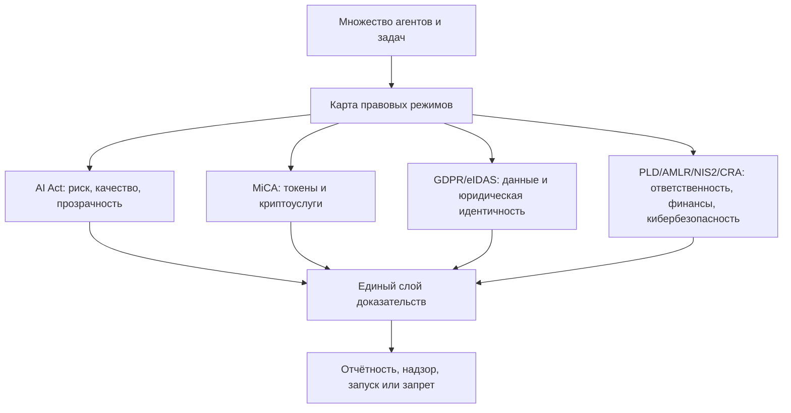
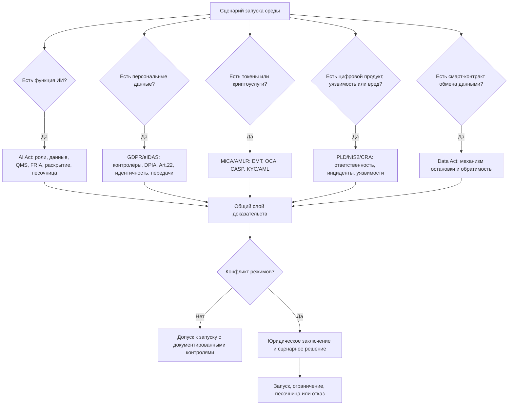

# УРОВЕНЬ 2 / ИЗМЕРЕНИЕ 08: НОРМАТИВНО-ПРАВОВОЕ

> **Уровень:** L2 — Среда (инфраструктура)  
> **Измерение:** D08 — Regulatory  
> **Учебная редакция:** v1.0  
> **Главная тема:** как многоагентная среда заранее встраивает внешние правовые требования в свои правила, проверки и отчётность

---

## Ключевой вопрос

**Какие правовые и регуляторные рамки зашиты в среду и как они соотносятся с внешними юридическими системами?**

---

## Краткое описание измерения

Когда цифровая среда обслуживает множество агентов, задач, токенов, кошельков, журналов и автоматизированных решений, право перестаёт быть внешним приложением к продукту.

Правовые режимы становятся внутренними ограничениями архитектуры: что можно запускать, какие доказательства хранить, когда нужен надзор, где требуется лицензия, как сообщать об инцидентах и почему анонимная финансовая поверхность недопустима.

Эта глава отвечает на несколько практических вопросов:

1. Какие внешние режимы нужно учитывать одновременно, а не по одному?
2. Как режим искусственного интеллекта влияет на данные, качество, раскрытие и регуляторные песочницы?
3. Почему токены среды требуют отдельной правовой квалификации?
4. Как юридическая идентичность, защита данных и трансграничная обработка связываются с работой агентов?
5. Почему ответственность за вред, кибербезопасность и антиотмывочные требования нельзя закрыть одной внутренней политикой?
6. Как среда действует, когда несколько регуляторов могут потребовать разные доказательства по одному и тому же событию?

---

## Мини-глоссарий

| Термин | Простое объяснение |
|--------|--------------------|
| **Логос** | Агент, который действует в среде от имени владельца и через правила среды. |
| **Среда** | Общая инфраструктура, где множество агентов находят задачи, исполняют их, платят, отчитываются и проходят проверки. |
| **`EU AI Act`** | Европейский режим для систем искусственного интеллекта: классификация риска, документация, прозрачность и надзор. |
| **`GPAI`** | Базовая модель общего назначения, от которой среда может зависеть через документацию и сигналы риска поставщика. |
| **High-risk AI system** | Система искусственного интеллекта с повышенным риском, для которой требуются усиленные проверки и документы. |
| **Provider** | Поставщик системы: тот, кто размещает систему на рынке или вводит её в эксплуатацию. |
| **Deployer** | Пользователь системы в конкретном контексте применения. |
| **`QMS`** | Система управления качеством: единый набор процедур для проектирования, изменений, мониторинга и инцидентов. |
| **`FRIA`** | Оценка воздействия на основные права для некоторых высокорисковых применений искусственного интеллекта. |
| **`DPIA`** | Оценка воздействия на защиту данных при рискованной обработке персональных данных. |
| **`MiCA`** | Европейский режим для криптоактивов, эмитентов и поставщиков криптоуслуг. |
| **`AGC`** | Операционный токен среды, который в данном правовом слое читается как токен электронных денег. |
| **`EMT`** | Токен электронных денег: криптоактив, привязанный к фиатной валюте и требующий лицензированной эмиссии. |
| **`EMI`** | Институт электронных денег: лицензированный эмитент для выпуска токенов электронных денег. |
| **`HQLA`** | Высоколиквидные качественные активы, допустимые для резервной дисциплины токена электронных денег. |
| **`Qi`** | Управленческий и ценностный токен среды, который в этом измерении квалифицируется как другой криптоактив. |
| **`OCA`** | Другой криптоактив: категория MiCA для криптоактива, который не является токеном электронных денег или активно-обеспеченным токеном. |
| **`CASP`** | Поставщик криптоуслуг: участник, которому может понадобиться авторизация для обмена, хранения или передачи распоряжений по криптоактивам. |
| **`MiFID II`** | Европейский режим финансовых инструментов; важен как граница, где токен может начать походить на финансовый инструмент. |
| **`ESMA` / `EBA`** | Европейские органы, чьи правила и разъяснения важны для рынков ценных бумаг, банков и криптоактивов. |
| **`eIDAS 2.0`** | Европейский режим юридически признаваемой цифровой идентичности, подписи и аттестаций. |
| **`EUDI Wallet`** | Европейский цифровой кошелёк для идентичности и аттестаций. |
| **`QEAA`** | Квалифицированная электронная аттестация атрибутов: юридически сильное подтверждение статуса или свойства. |
| **`QES`** | Квалифицированная электронная подпись, равная по юридической силе собственноручной подписи. |
| **`GDPR`** | Европейский режим защиты персональных данных. |
| **Controller** | Контролёр данных: тот, кто определяет цели и средства обработки персональных данных. |
| **Joint controller** | Совместные контролёры: несколько участников вместе определяют цели и средства обработки. |
| **`DPA`** | Орган по защите данных, который надзирает за соблюдением GDPR. |
| **`PLD 2024/2853`** | Директива об ответственности за дефектные продукты, включая программное обеспечение и системы искусственного интеллекта. |
| **Strict liability** | Ответственность без доказывания вины, если ущерб связан с дефектным продуктом. |
| **`AMLR 2024/1624`** | Антиотмывочный режим, который запрещает анонимные счета в релевантных финансовых и криптоуслугах. |
| **Beneficial owner** | Бенефициарный владелец: лицо, с которым должна быть связана финансовая активность. |
| **`KYC/AML`** | Проверка клиента и антиотмывочные процедуры. |
| **`NIS2`** | Режим киберустойчивости организаций и операторов. |
| **`CRA`** | Режим кибербезопасности продуктов с цифровыми элементами. |
| **`CSIRT`** | Канал реагирования на компьютерные инциденты. |
| **`SBOM`** | Перечень программных компонентов продукта, полезный для контроля уязвимостей. |
| **`Data Act`** | Европейский режим данных, включая требования к остановке некоторых смарт-контрактов обмена данными. |
| **Смарт-контракт** | Автоматизированное договорное исполнение, которое должно учитывать не только код, но и правовые условия остановки. |
| **Механизм остановки** | Способ прервать или остановить покрываемое автоматизированное исполнение, когда этого требует право. |
| **`DAO`** | Децентрализованная организация; в этом измерении она не заменяет идентифицируемого носителя обязанностей. |
| **Legal wrapper** | Внешняя юридическая оболочка для децентрализованной структуры. |
| **`Digital Omnibus`** | Направление на упрощение и согласование цифровых правил в ЕС, но не автоматическое снятие обязанностей. |
| **`Joint Opinion 1/2026`** | Сигнал регуляторов защиты данных о том, что GDPR не растворяется внутри режима искусственного интеллекта. |
| **`OID4VCI` / `OID4VP`** | Протоколы выдачи и предъявления проверяемых учётных данных, полезные для совместимости с цифровым кошельком. |
| **`SCC 2021`** | Стандартные договорные положения для некоторых трансграничных передач персональных данных. |
| **`SCHUFA`** | Судебный ориентир: автоматизированная оценка может быть значимой даже до финального решения человека. |
| **`Schrems II`** | Судебный ориентир: договорных слов недостаточно, если в стране назначения нет сопоставимой защиты данных. |

---

# 0. Гипотетический пример

Представим цифровую среду, в которой много агентов обслуживают городские сервисы, частные компании и исследовательские команды.

Через неё проходят задачи: анализ документов, подбор исполнителей, расчёт вознаграждений, хранение доказательств, автоматизированные рекомендации и крипторасчёты. Одновременно часть операций затрагивает жителей ЕС, персональные данные, токены, смарт-контракты и облачную инфраструктуру.

**Марина** — руководитель службы регуляторного соответствия у оператора среды. Её задача — подготовить запуск среды в ЕС.

**Игорь** — представитель национального надзорного органа, который просит показать не рекламную презентацию, а карту обязанностей: кто отвечает, какие режимы включаются, какие журналы ведутся и куда пойдут уведомления при инциденте.

**София** — представитель крупного заказчика, который хочет подключить множество агентов к своим рабочим процессам, но не готов принимать риск неоформленной обработки данных, спорной токеновой схемы и непонятной ответственности за автоматизированный вред.

Проверка идёт не вокруг одного договора. Она идёт вокруг способности всей среды жить под несколькими режимами одновременно.

## Проверка 1. Это просто техническая платформа или система с правовыми ролями?

Игорь спрашивает Марину: если среда проектирует, развёртывает и управляет агентскими системами, кто несёт обязанности поставщика, а кто становится пользователем в конкретном применении?

Марина не может ответить: «агенты сами действуют». Для режима искусственного интеллекта и защиты данных важно, кто задаёт цели, средства, контроль, документацию, мониторинг и путь остановки.

## Проверка 2. Какие токены и услуги попадают в финансовый периметр?

София видит, что среда использует операционный токен и отдельный управленческий токен. Для неё это не только удобный способ расчётов.

Нужно понять: один токен требует лицензированного эмитента электронных денег, другой остаётся в категории других криптоактивов, а сервисный слой может потребовать авторизации поставщика криптоуслуг.

## Проверка 3. Что будет с персональными данными и автоматизированными решениями?

Часть агентов ранжирует заявки, оценивает риски и предлагает ограничения доступа. Даже если человек формально нажимает последнюю кнопку, автоматизированная оценка может фактически предопределять результат.

Поэтому Марина должна показать не только политику приватности, а матрицу: где нужна оценка воздействия на защиту данных, где нужен реальный человеческий пересмотр, какие передачи данных идут за пределы Европейской экономической зоны и когда обработка должна быть остановлена.

## Проверка 4. Что произойдёт при инциденте?

Допустим, после обновления модели один агентский контур причиняет вред, а затем выясняется, что часть журналов нужна одновременно для расследования по искусственному интеллекту, защите данных, кибербезопасности и ответственности за продукт.

Если документы заранее не связаны, команда будет собирать доказательства вручную уже после инцидента. Регуляторная архитектура нужна именно затем, чтобы событие сразу попадало в правильные каналы: инцидент, уязвимость, претензия, запрос раскрытия, оценка риска и юридическое заключение.

## Проверка 5. Можно ли спрятать ответственность за децентрализацией?

Марина показывает, что децентрализованная управленческая форма может помогать администрированию, но не убирает идентифицируемого носителя обязанностей перед режимами MiCA, GDPR, PLD, NIS2 и CRA.

Для надзора важен не лозунг о децентрализации, а возможность найти ответственных акторов, документы, роли, маршруты уведомлений и механизмы остановки.

## Главное из примера

**Регуляторное измерение проверяет не отдельную кнопку и не отдельный токен, а способность всей среды доказуемо работать под несколькими внешними режимами одновременно.**



---

# Содержание

1. Регуляторная карта среды
2. Режим искусственного интеллекта
3. Криптоактивы и сервисный слой
4. Юридическая идентичность, данные и автоматизированные решения
5. Ответственность за продукт и антиотмывочный периметр
6. Киберустойчивость и безопасность цифровых продуктов
7. Смарт-контракты и юрисдикционная карта
8. Наложение режимов и разрешение конфликтов
9. Связь и границы с другими измерениями
10. Итоговая модель целиком
11. Короткое резюме главы
12. Вопросы без ответа

---

# 1. Регуляторная карта среды

Правовой слой среды нельзя строить как список законов «для справки». Один и тот же элемент может быть одновременно журналом исполнения, персональными данными, доказательством для надзора, объектом раскрытия при претензии и материалом для киберинцидента.

Поэтому главный вопрос звучит так: какая комбинация обязанностей включается в конкретном сценарии?

| Режим | Что он квалифицирует | Что становится внутренним ограничением среды |
|------|----------------------|----------------------------------------------|
| `EU AI Act` | жизненный цикл системы искусственного интеллекта, роли поставщика и пользователя, прозрачность и высокорисковые случаи | документация, мониторинг, журналы, песочница, надзор и раскрытие |
| `MiCA` | выпуск криптоактивов и криптоуслуги | путь эмитента для `AGC`, информационный документ для `Qi`, авторизация сервисного слоя |
| `eIDAS 2.0` | юридически признаваемую цифровую идентичность и доказательственную силу аттестаций | совместимость с кошельком, квалифицированные аттестации, подписи и печати |
| `GDPR` | обработку персональных данных и роли контролёров | законное основание, минимизация, оценка воздействия, права при автоматизированных решениях |
| `PLD 2024/2853` | ответственность за дефектное программное обеспечение и системы искусственного интеллекта | готовность к раскрытию доказательств, контроль обновлений и цепочки операторов |
| `AMLR 2024/1624` | антиотмывочную дисциплину финансового и криптосервисного слоя | запрет анонимных счетов, связь с бенефициаром, проверка клиента |
| `NIS2` / `CRA` | киберустойчивость оператора и безопасность цифрового продукта | управление рисками, уведомления об инцидентах, обработка уязвимостей, состав продукта |
| `Data Act` | некоторые смарт-контракты обмена данными | возможность остановки или прерывания автоматизированного исполнения |

> В этой главе право — не внешняя сноска. Оно становится набором условий допуска, журналирования, лицензирования, раскрытия и остановки.

Минимальная рабочая логика выглядит так:

```text
если сценарий затрагивает искусственный интеллект:
    проверить AI Act
если сценарий затрагивает персональные данные:
    проверить GDPR и eIDAS-контур идентичности
если сценарий затрагивает токены или криптоуслуги:
    проверить MiCA и AMLR
если сценарий затрагивает вред, уязвимость или цифровой продукт:
    проверить PLD, NIS2 и CRA
если режимы конфликтуют:
    отправить конфликт в очередь юридического заключения
```

Микро-пример. В истории Марины один запуск среды сразу включает несколько вопросов: токены для расчётов, автоматизированные рекомендации, персональные данные пользователей и журналы для надзора. Если команда проверит только один режим, она пропустит обязанности по соседним режимам и создаст риск уже на уровне запуска.

## Главное

**Регуляторная карта среды строится не вокруг одного «главного закона», а вокруг сценария использования.**

**Один и тот же технический узел может одновременно включать обязанности по искусственному интеллекту, данным, токенам, ответственности и кибербезопасности.**

---

# 2. Режим искусственного интеллекта

Среде нужен режим искусственного интеллекта не потому, что в ней есть модели как таковые, а потому что она проектирует, развёртывает и сопровождает агентские контуры с реальным операционным влиянием.

Сначала возникает потребность: определить роли, качество данных, управление изменениями, прозрачность и путь регулируемого эксперимента. Затем конкретным правовым ответом становится `EU AI Act`.

## 2.1 Базовая роль среды

В этом измерении среда рассматривается как актор системного уровня. Она может быть поставщиком (англ. provider) на уровне системы или модели, когда размещает систему на рынке или вводит её в эксплуатацию. В конкретных рабочих контекстах она также может быть пользователем (англ. deployer), если сама применяет систему в операционной песочнице или производственном сценарии.

Если среда зависит от модели общего назначения (англ. General-Purpose AI, далее — `GPAI`), это не означает, что среда автоматически становится поставщиком такой базовой модели. Но она должна уметь принимать документацию, инструкции, требования прозрачности и сигналы риска от поставщика выше по цепочке.

Важные даты имеют практический смысл:

| Дата | Что меняется | Почему это важно |
|------|--------------|------------------|
| `02.02.2025` | запретные практики вступают в силу | нельзя ждать полного календаря, если практика уже запрещена |
| `02.08.2025` | начинаются обязанности по `GPAI` | среда должна принимать документацию и сигналы риска |
| `02.08.2026` | усиливается исполнение по `GPAI`, государства должны обеспечить песочницы | надзор и подготовка документов становятся операционным вопросом |
| `02.08.2027` | закрывается окно для части более ранних моделей | временный запас исчезает |

Это календарь не для справки. Он показывает, что часть обязанностей становится значимой раньше полного завершения переходного периода.

## 2.2 Управление данными по Art.10

Для высокорисковых систем искусственного интеллекта нужны не просто «данные для обучения». Нужна управляемая дисциплина: происхождение, качество, релевантность, представительность, неполнота, ошибки и смещения.

Минимальный контур по Art.10:

| Контроль | Что должно быть обеспечено | Артефакт |
|----------|----------------------------|----------|
| качество и релевантность наборов данных | данные для обучения, проверки и тестирования соответствуют назначению | реестр наборов данных и критериев качества |
| анализ смещений | процедуры выявления, предотвращения и снижения смещений описаны заранее | журнал оценки смещений и корректирующих действий |
| происхождение и подготовка | источники, выборка, разметка и очистка трассируются | реестр происхождения и процедура подготовки данных |
| особые категории данных | такие данные допускаются только при узком обосновании необходимости | юридическая записка и ограниченный пакет доказательств |
| тестовые данные | даже без обучения остаются требования к тестовым данным | досье тестового набора и протокол оценки |

Связанный документ технической документации должен хранить происхождение данных, методы сбора и отбора, процедуры разметки и очистки, а также ключевые характеристики наборов данных.

## 2.3 Система управления качеством по Art.17

Среде нужна система управления качеством (англ. Quality Management System, далее — `QMS`) не как папка с политиками, а как единый способ управлять проектированием, изменениями, инцидентами и мониторингом после запуска.

`ISO 42001` может использоваться как управленческий ориентир, но сам по себе не даёт презумпции соответствия AI Act. Трек гармонизированных стандартов связан с запросом на стандартизацию и `prEN 18286`, который пока не рассматривается как опубликованный гармонизированный стандарт.

Минимальный `QMS`-контур:

| Зона | Что должно быть обеспечено | Артефакт |
|------|----------------------------|----------|
| регуляторная стратегия | распределение ролей, требований и точек допуска | матрица соответствия и реестр ролей |
| разработка и проверка | контролируемые изменения, тестирование, валидация и выпуск | процедуры жизненного цикла разработки и записи проверок |
| данные и риски | связь с управлением данными и жизненным циклом рисков | реестр рисков и связанная записка по данным |
| инциденты и корректирующие действия | приём, разбор причин, корректировка и эскалация | процедура инцидентов и журнал корректирующих действий |
| мониторинг после запуска | связь между `QMS`, технической документацией и наблюдением | план мониторинга и график хранения доказательств |

## 2.4 FRIA, раскрытие и песочница

Оценка воздействия на основные права (англ. Fundamental Rights Impact Assessment, далее — `FRIA`) относится к высокорисковым контекстам применения пользователем системы, а не к базовому слою поставщика по умолчанию. Среда должна подготовить пакет и критерии запуска, но сама `FRIA` выполняется тем актором, который выступает пользователем в конкретном высокорисковом контексте.

`FRIA` может координироваться с `DPIA`, но не превращается в неё. Первая смотрит на основные права в контексте AI Act, вторая — на риски защиты данных по GDPR.

Прозрачность по Art.50 означает, что в человеко-ориентированных и контентных каналах должны быть уведомления или маркировка: взаимодействие с системой искусственного интеллекта, синтетический или изменённый контент, публикации общественного интереса, согласованность интерфейсов и программных каналов. Единый обязательный машинно-читаемый формат пока не закреплён; поэтому правильная позиция — строить слой раскрытия как обязательный базовый контур, а не как улучшение интерфейса.

Регуляторная песочница по Art.57 — это путь контролируемого эксперимента с компетентным органом. Она не отменяет GDPR, PLD, AMLR и другие обязанности. Государства должны обеспечить хотя бы один маршрут песочницы к `02.08.2026`, но маршруты по странам остаются фрагментированными: активный испанский путь, немецкий пилотный путь и отсутствие ясно подтверждённого активного французского маршрута на дату этой редакции.

Микро-пример. Игорь просит Марину показать не только модельную карту, но и процедуру: где хранится досье данных, кто утверждает изменение модели, как пользователь узнаёт о взаимодействии с ИИ и когда команда пойдёт в песочницу. Такой пакет нужен до масштабного запуска, а не после первого спорного случая.

## Главное

**AI Act превращает управление данными, качеством, прозрачностью и экспериментами в обязательные архитектурные процедуры.**

**Среда должна различать роль поставщика, роль пользователя и зависимость от поставщика базовой модели.**

---

# 3. Криптоактивы и сервисный слой

Токены среды нельзя оценивать только по экономической функции. Для регуляторного слоя важно, какой правовой режим включается: выпуск токена, резервы, информационный документ, лицензия эмитента, криптоуслуги и граница с финансовыми инструментами.

Сначала появляется потребность: отделить полезность токена от правового периметра. Затем применяется `MiCA`.

## 3.1 AGC как EMT

Операционный токен `AGC` квалифицируется как токен электронных денег (англ. E-Money Token, далее — `EMT`). Это означает, что его нельзя запускать как облегчённый внутренний токен без лицензированного эмитента.

Из этой квалификации следуют три последствия:

1. Нужна модель лицензированного эмитента, а не простой выпуск токена.
2. Нужны информационный документ, дисциплина резервов, погашение и пруденциальный контур.
3. Производственный запуск становится вопросом институциональной архитектуры.

Допустимы два архитектурных пути:

| Путь | Смысл | Ограничение |
|------|-------|-------------|
| партнёрский `EMI` | авторизованный институт электронных денег в ЕС выпускает токен, а среда выступает техническим оператором | нужен договорный и надзорный контур |
| собственная лицензия `EMI` | оператор среды сам становится лицензированным эмитентом | нужны капитал, управление и лицензирование |

Для пруденциального слоя действуют ориентиры из делегированного регулирования: методы `A` / `B` / `C`, а также пороги `2%` от непогашенного баланса `EMT` либо `3%` для `EMT` в распределении. Эти числа не являются учебной иллюстрацией; это регуляторные ориентиры.

Резервные активы должны читаться через высоколиквидные качественные активы (англ. High-Quality Liquid Assets, далее — `HQLA`): фиат, государственные облигации и допустимые депозиты центрального банка. Криптоактивы исключаются из первичного резерва. `Qi` может быть только дополнительным стабилизационным буфером, а не первичным обеспечением `AGC`.

## 3.2 Qi как OCA

`Qi` в настоящем измерении квалифицируется как другой криптоактив (англ. Other Crypto-Asset, далее — `OCA`), а не как токен электронных денег и не как активно-обеспеченный токен.

Практические следствия:

| Вопрос | Ответ |
|--------|-------|
| Нужна ли для `Qi` та же авторизация, что для `EMT`? | Нет, базовая логика идёт через информационный документ по `OCA`. |
| Делают ли управленческие или ценностные свойства `Qi` автоматически токеном электронных денег? | Нет. |
| Закрыта ли граница с финансовым инструментом по `MiFID II`? | Нет, она требует мониторинга. |

Мониторинговая позиция такова: квалификация `Qi` должна пересматриваться при публикации релевантных технических стандартов `ESMA`, при изменении механизма доходности или при правоприменительном событии по сходным токенам в государстве ЕС.

## 3.3 CASP и срок 01.07.2026

Отдельно от классификации токенов стоит сервисный слой. Если среда оказывает обмен, хранение, администрирование криптоактивов от имени клиентов или передачу распоряжений, она может попасть в периметр поставщика криптоуслуг (англ. Crypto-Asset Service Provider, далее — `CASP`).

Особенно важны три класса услуг:

1. обмен криптоактивов на деньги или другие криптоактивы;
2. хранение и администрирование криптоактивов от имени клиентов;
3. передача распоряжений по криптоактивам от имени клиентов.

Дата `01.07.2026` читается как жёсткая граница переходной логики. Ожидаемая заявка сама по себе не сохраняет право продолжать операции после этой даты.

Микро-пример. София спрашивает Марину, сможет ли заказчик использовать расчёты в токенах сразу после пилота. Марина отвечает не технической схемой кошелька, а регуляторной картой: кто эмитирует `AGC`, кто оказывает криптоуслугу, есть ли авторизация или партнёрский маршрут и какие операции нельзя запускать без юридического заключения.

## Главное

**Для `AGC`, `Qi` и сервисного слоя включаются разные вопросы MiCA: эмиссия, резервы, информационный документ, криптоуслуги и граница с финансовыми инструментами.**

**`AGC = EMT` задаёт более тяжёлую архитектуру эмитента; `Qi = OCA` остаётся текущей квалификацией с обязательным мониторингом границы.**

---

# 4. Юридическая идентичность, данные и автоматизированные решения

Среде нужно не только знать, кто действует, но и доказывать это юридически признаваемым способом, не нарушая защиту данных. Поэтому `eIDAS 2.0` и `GDPR` работают рядом, но отвечают на разные вопросы.

Сначала потребность: признанная идентичность и контролируемая обработка данных. Затем решения: квалифицированные аттестации, подписи, цифровой кошелёк, роли контролёров, оценки воздействия и права человека при автоматизированных решениях.

## 4.1 eIDAS 2.0: юридически сильная идентичность

Если среде нужен эффект, признаваемый между государствами ЕС, внутренних аттестаций недостаточно. Нужна цепочка доверия, которую право признаёт как доказательственную.

Здесь важны четыре опоры:

1. развёртывание европейского цифрового кошелька (англ. European Digital Identity Wallet, далее — `EUDI Wallet`) должно быть обеспечено к `12.2026`;
2. квалифицированная электронная аттестация атрибутов (англ. Qualified Electronic Attestation of Attributes, далее — `QEAA`) имеет силу, сопоставимую с бумажным подтверждением;
3. квалифицированная электронная подпись (англ. Qualified Electronic Signature, далее — `QES`) равна собственноручной подписи;
4. квалифицированные электронные печати важны для подтверждений от юридических лиц и операторов.

Протоколы `OID4VCI` и `OID4VP` могут использоваться как путь совместимости кошелька и проверяемых учётных данных. Но юридическая сила возникает не из формата учётного данного самого по себе, а из квалифицированной цепочки доверия.

## 4.2 GDPR: контролёрная архитектура

`GDPR` смотрит не на то, насколько агент автономен, а на то, кто определяет цели и средства обработки персональных данных.

Поэтому среда не может снять с себя обязанности формулой «агент действовал сам». Если оператор задаёт инструменты, цели обработки, маршруты данных, мониторинг или возможность остановки, он остаётся в контуре контролёра. В некоторых производственных песочницах оператор среды и владелец Логоса могут выступать совместными контролёрами (англ. joint controllers).

Законное основание должно определяться по сценарию:

| Обработка | Возможная правовая логика | Что нельзя делать |
|-----------|----------------------------|-------------------|
| задача по запросу пользователя | договорная необходимость | расширять её на удобство платформы |
| мониторинг и безопасность среды | законный интерес после проверки баланса | игнорировать влияние на людей |
| чувствительные или близкие к чувствительным случаи | явное согласие как предпочтительный путь | подменять согласие скрытым принуждением |

## 4.3 DPIA и Art.22

Оценка воздействия на защиту данных (англ. Data Protection Impact Assessment, далее — `DPIA`) нужна до запуска обработки, которая вероятно создаёт высокий риск для прав и свобод людей.

Типовые триггеры таковы:

| Сценарий | Почему возникает риск | Что должно быть в `DPIA` |
|----------|----------------------|--------------------------|
| автоматизированное ранжирование, оценка или рекомендация, от которой зависит доступ, цена, приоритет или ограничение | оценка может существенно влиять на человека | путь решения, затронутые лица, риски ошибок и смещений, человеческий пересмотр |
| профилирование между несколькими песочницами | долговременное накопление и оценка поведения | категории данных, субъектов, сроков хранения, рисков исключения и минимизации |
| чувствительные данные или данные повышенной чувствительности | высокий риск по самой природе данных | основание обработки, сегментация доступа, срок удаления и остаточный риск |
| систематический мониторинг пользовательских поверхностей | мониторинг сам по себе может затрагивать людей | периметр наблюдения, видимость для субъектов, минимизация журналов |
| процессоры за пределами Европейской экономической зоны | передача меняет профиль риска | карта передачи, правовой инструмент, оценка страны назначения и дополнительные меры |

`DPIA` не является одноразовой запиской. Она пересматривается при изменении целей, данных, модели, цепочки процессоров, маршрута за границу, сроков хранения, человеческого пересмотра или остаточного риска. Если после мер снижения риска высокий остаточный риск остаётся, до запуска требуется предварительная консультация по Art.36.

Права при автоматизированном принятии решений по Art.22 требуют отдельной проверки. После ориентира `SCHUFA` нельзя смотреть только на финальную кнопку отказа. Если автоматизированный скоринг или рекомендация фактически предопределяет решение человека, такой подготовительный этап тоже требует анализа.

Базовые меры защиты:

1. заранее уведомить человека о категории автоматизированного решения и возможном эффекте;
2. обеспечить реальный человеческий пересмотр с полномочием изменить результат;
3. дать возможность выразить позицию, оспорить результат и попросить повторную оценку;
4. показать релевантные факторы, источники данных и контекст конкретного результата;
5. согласовать интерфейс согласия или отказа с выбранным правовым основанием.

## 4.4 Трансграничные передачи

Глава V GDPR должна читаться как ограничение маршрутизации, а не как приложение к договору с поставщиком.

| Маршрут | Базовая позиция | Операционный вывод |
|---------|-----------------|--------------------|
| внутри Европейской экономической зоны | отдельный инструмент главы V не нужен | хранить карту процессоров и подтверждение маршрутизации |
| Великобритания, Швейцария, Япония | действует путь достаточности защиты | периодически перепроверять статус |
| США через сертифицированного импортёра | путь доступен, но судебный риск остаётся | держать запасной пакет на стандартных договорных положениях |
| Индия, Россия, Китай и другие страны без достаточности | нет общего пути достаточности | не запускать производственную передачу без инструмента, оценки права страны и явного одобрения |

Стандартные договорные положения `SCC 2021` выбираются по фактической роли участников, а не по названию поставщика. После `Schrems II` договорной текст сам по себе недостаточен: нужно оценивать право страны назначения, риск доступа государства, технические и организационные меры, а также триггеры пересмотра.

Микро-пример. В пилоте Софии часть вычислений предлагается вынести за пределы ЕС. Марина не запрещает это автоматически, но требует карту ролей, стран, процессоров, ключей шифрования, возможности перенаправить обработку и отражения этого риска в `DPIA`.

## Главное

**eIDAS 2.0 даёт юридически признаваемую идентичность и аттестации, но не снимает требований GDPR.**

**GDPR требует ясных ролей контролёров, оценки воздействия, прав при автоматизированных решениях и управляемых трансграничных маршрутов.**

---

# 5. Ответственность за продукт и антиотмывочный периметр

После запуска среда отвечает не только за корректный релиз. Риск может возникнуть из обновления, переобучения, отказа обновить систему, цепочки нескольких операторов или финансовой анонимности.

Сначала потребность: сохранить трассируемую цепочку ответственности и владельцев финансовой активности. Затем правовые ответы: `PLD 2024/2853` и `AMLR 2024/1624`.

## 5.1 PLD: программное обеспечение и AI как продукты

Новая директива об ответственности за дефектные продукты включает программное обеспечение, системы искусственного интеллекта, облачную поставку и сценарии отказа от нужных обновлений.

Это важно для среды по трём причинам:

1. ответственность может включаться не только при первоначальном выпуске, но и при обновлениях, переобучении и продолжающемся контроле;
2. сертификаты и соответствие не дают иммунитета, если дефект проявляется после запуска;
3. отсутствие нужного обновления или сбой обновления может само стать источником претензии.

Дата `09.12.2026` выступает операционным ориентиром для готовности к PLD. Это не учебная иллюстрация и не далёкая дата для заметки: к этому моменту должны быть готовы доказательства, процедуры раскрытия и контуры ответственности.

## 5.2 Многоагентная цепочка ответственности

Самая сложная часть — вред в автономной многоагентной цепочке. Текущая правовая картина позволяет описать доктринальную направленность, но не позволяет выдавать её за устоявшуюся судебную практику.

Что уже можно использовать как рабочую позицию:

| Вопрос | Что можно утверждать | Что нельзя утверждать |
|--------|----------------------|-----------------------|
| кто может стать ответственным актором | цепочка может включать оператора, платформенного участника или существенного модификатора | точную судебную формулу распределения между всеми участниками |
| как доказывается дефект | презумпции и раскрытие доказательств облегчают путь заявителя | как именно суд применит пороги в агентских цепочках |
| когда заканчивается ответственность | продолжающийся контроль и обновления продлевают экспозицию | универсальный момент выхода облачного агента из-под контроля |

Правильная архитектурная реакция — не рисовать псевдоточную матрицу «агент А отвечает на 40%, агент Б на 60%», а обеспечить трассируемость: кто обновлял, кто модифицировал вывод, кто управлял цепочкой исполнения, где хранится пакет доказательств.

## 5.3 AMLR: без анонимной агентской финансовой поверхности

Антиотмывочный режим важен для среды через запрет анонимных счетов в релевантном криптосервисном слое. Дата `10.07.2027` выступает ориентиром вступления этой логики в действие.

Практический вывод:

1. чисто псевдонимный агент как самостоятельный финансовый актор несовместим с целевым антиотмывочным контуром;
2. если сервисный слой похож на криптоуслуги вокруг `AGC` и `Qi`, нельзя считать «только кошелёк» достаточным режимом по умолчанию;
3. нужна связь финансовой активности с бенефициаром и процедурами `KYC/AML`.

Микро-пример. В сценарии Марины децентрализованная форма не помогает, если регулятор спрашивает, кто стоит за финансовой активностью агента и кто обязан раскрыть доказательства при вреде. Ответ должен лежать в операционной карте ролей, а не в описании автономности агента.

## Главное

**Автономность агента не отменяет цепочку экономических операторов и не создаёт право на анонимный финансовый слой.**

**Для PLD нужна готовность к доказательствам после запуска; для AMLR — связка финансовой активности с проверяемым владельцем.**

---

# 6. Киберустойчивость и безопасность цифровых продуктов

Для среды недостаточно внутренне считать себя безопасной. Ей нужно быть доказуемо управляемой с точки зрения операторской киберустойчивости и безопасности цифрового продукта.

Сначала потребность: разделить обязанности оператора и обязанности продукта. Затем режимы: `NIS2` и `CRA`.

## 6.1 NIS2: устойчивость оператора

Осторожная позиция такова: среда правдоподобно попадает в область `NIS2` как цифровая инфраструктура или сущность облачного типа. Это лучше читать как вероятную обязанность уровня существенного субъекта (англ. essential entity), а не как добровольную практику.

Ключевые последствия:

1. обязанности управления рисками по Art.21 становятся обязательными;
2. уведомление об инцидентах идёт по ступенчатому ритму `24h / 72h / 1 month`;
3. различия между государствами ЕС сохраняются из-за неодинакового переноса норм в национальное право.

Ритм `24h / 72h / 1 month` — регуляторный ориентир, а не учебный пример.

## 6.2 CRA: безопасность продукта с цифровыми элементами

`CRA` смотрит на продуктовую сторону: безопасное проектирование, обработка уязвимостей, отчётность и путь оценки соответствия.

Календарь выглядит так:

| Дата | Событие | Значение для среды |
|------|---------|--------------------|
| `06.2026` | готовность нотифицированных органов по CRA | нужно заранее понимать путь оценки соответствия |
| `09.2026` | старт отчётности по уязвимостям и инцидентам | нужен план уведомлений и обработки уязвимостей |
| `12.2027` | полное применение CRA | продуктовый долг по безопасности становится регуляторным долгом |

Классификация продукта остаётся фактической: обычная, важная или критическая категория (англ. default, important, critical). Осторожная формула такова: платформа искусственного интеллекта, вероятно, как минимум релевантна важной категории, но это не окончательный административный вердикт.

## 6.3 Почему NIS2 и CRA не дублируют друг друга

| Режим | На что смотрит | Тип обязанности |
|------|----------------|-----------------|
| `NIS2` | оператор и устойчивость организации | управление рисками, инциденты, надзорные каналы |
| `CRA` | продукт с цифровыми элементами | безопасное проектирование, уязвимости, оценка соответствия |
| `EU AI Act` | безопасность, специфическая для ИИ | высокорисковые контроли, документация, мониторинг |

Один инцидент может включить несколько маршрутов: киберуведомление, раскрытие уязвимости, досье по ИИ, оценку данных и подготовку к претензии о дефектном продукте.

Микро-пример. Если после обновления агента происходит инцидент, Марина не должна выбирать «это только кибербезопасность» или «это только искусственный интеллект». Ей нужна единая таксономия инцидентов, которая сразу показывает, какие каналы уведомления и какие доказательства требуются.

## Главное

**NIS2 отвечает за устойчивость оператора, CRA — за безопасность цифрового продукта, AI Act — за безопасность, специфическую для ИИ.**

**Среда должна заранее связать инциденты, уязвимости, журналы и доказательства, потому что один сбой может активировать несколько режимов.**

---

# 7. Смарт-контракты и юрисдикционная карта

Смарт-контракт важен здесь не как код, а как правовой объект. Вопрос настоящего измерения: какой минимум обратимости, остановки и ответственности должен сопровождать автоматизированное исполнение.

Сначала потребность: не допустить ситуации, где автоматизация делает правовое исправление невозможным. Затем применяется `Data Act` и сравнительная юрисдикционная карта.

## 7.1 Смарт-контракт как объект права

Для покрываемых смарт-контрактов обмена данными `Data Act` требует механизм остановки или эквивалентную возможность прерывания. Поэтому остановка не является дополнительным удобством: она становится правовым требованием для соответствующих контрактов.

Одновременно появляется напряжение с GDPR: если следы исполнения связаны с персональными данными, необратимость может конфликтовать с правами на удаление, ограничение и минимизацию.

Правильная формула:

> Автоматизация допустима только вместе с ответственностью, остановкой и минимизацией необратимых последствий.

## 7.2 Сравнение юрисдикций

Сравнительный слой используется как ориентир, а не как полный анализ международного частного права.

| Юрисдикция | Базовый подход | Что это значит для среды |
|-----------|----------------|--------------------------|
| ЕС | плотный обязательный стек: AI, токены, данные, ответственность, кибербезопасность | основной центр тяжести соответствия |
| Сингапур | больше надзорных рекомендаций и пропорциональной песочничной логики | полезен как ориентир по контролируемым экспериментам |
| Великобритания | сильнее выражен подход через песочницы и итерацию с регуляторами | полезен как ориентир по инновационному надзору |

Вывод не в том, что один режим «лучше» другого. Вывод в другом: среда не может проектировать один универсальный юридический режим без карты применимого права, регуляторов и маршрутов запуска.

## 7.3 DAO и юридическая оболочка

Децентрализованная организация (англ. Decentralized Autonomous Organization, далее — `DAO`) сама по себе не убирает требования к идентифицируемому носителю обязанностей для EU-facing периметра MiCA и других режимов.

Юридическая оболочка (англ. legal wrapper) может быть ограниченным внешним слоем для управления, но не способом обойти ответственность, лицензирование или надзор. Подробная управленческая механика принадлежит соседнему управленческому измерению; здесь важна только регуляторная квалификация.

Микро-пример. София спрашивает, поможет ли DAO-структура быстрее подключить заказчиков. Марина отвечает: она может помочь с управлением, но не заменяет лицензию, контролёра данных, эмитента, оператора продукта или адресата регуляторного запроса.

## Главное

**Смарт-контракты в этом измерении рассматриваются как правовой узел автоматизации, а не как технический инвентарь.**

**Сравнение юрисдикций помогает проектировать маршрут запуска, но не заменяет обязательный режим ЕС для EU-facing операций.**

---

# 8. Наложение режимов и разрешение конфликтов

Самая практичная часть настоящего измерения начинается там, где режимы включаются одновременно. Среда не живёт в модели «один регулятор спрашивает одно». Она живёт в модели накопленных обязанностей без единого автоматического механизма иерархии.

## 8.1 AI Act и GDPR

AI Act тянет среду к журналированию, документации и мониторингу. GDPR тянет к минимизации, ограничению хранения и дисциплине цели обработки.

`FRIA` и `DPIA` могут использовать общую доказательственную базу, но юридически остаются разными документами. Поэтому нельзя создавать один «общий файл соответствия», который якобы закрывает всё сразу.

Практическое правило:

```text
если AI Act требует журнал:
    проверить, какие персональные данные в журнале
    определить цель хранения и срок
    связать журнал с DPIA
    не удалять доказательства слепо
    не хранить лишнее без цели
```

## 8.2 AI Act, PLD, Data Act и AMLR

Соответствие AI Act не снимает ответственность по PLD. `Data Act` добавляет требование остановки для покрываемых смарт-контрактов. `AMLR` исключает анонимную финансовую поверхность там, где включается криптосервисный слой.

Это означает, что успешная документация по ИИ не отвечает на все вопросы:

| Если команда доказала... | Это ещё не доказывает... |
|--------------------------|--------------------------|
| что система прошла контроли ИИ | что нет ответственности за дефект после обновления |
| что есть журналы исполнения | что обработка данных минимизирована и законна |
| что смарт-контракт работает | что его можно остановить при правовом требовании |
| что токен технически переводится | что сервис имеет нужную лицензию и антиотмывочную связку |

## 8.3 Надзорная координация

Осторожная позиция здесь обязательна: единой зрелой архитектуры надзорной координации ещё нет. Нельзя заранее утверждать, что орган по ИИ, орган защиты данных, финансовый регулятор и киберорган будут действовать по единой процедуре.

Минимальная матрица адресатов:

| Контур | Кто обычно оказывается первым адресатом |
|--------|-----------------------------------------|
| безопасность и классификация системы ИИ | орган по ИИ или рыночный надзор |
| персональные данные и законность обработки | орган защиты данных (`DPA`) |
| выпуск токена или криптоуслуги | финансовый или рыночный регулятор |
| киберинцидент или уязвимость | киберорган или `CSIRT`-канал |

`Digital Omnibus` может упрощать и согласовывать цифровые правила, но его нельзя читать как будущую амнистию от обязанностей. `Joint Opinion 1/2026` одновременно подчёркивает, что защита данных и участие DPA сохраняют самостоятельное значение.

Микро-пример. Когда Игорь просит карту надзорных адресатов, Марина не обещает один универсальный контакт. Она показывает сценарную матрицу: какой орган получает первый сигнал, какие доказательства переиспользуются и какие вопросы требуют отдельного юридического заключения.

## Главное

**Межрежимные конфликты нельзя закрывать общими словами о соответствии. Их нужно переводить в сценарии, доказательства, адресатов и юридические заключения.**

**Упрощение правил не означает исчезновение обязанностей по данным, AI, продуктовой ответственности, токенам и киберустойчивости.**

---

# 9. Связь и границы с другими измерениями

Настоящее измерение владеет средовым правовым периметром: какие внешние режимы становятся внутренними требованиями среды. Соседние измерения владеют тем, что находится ниже или рядом: агентским правовым контуром, онтологией среды, инструментами, инфраструктурой и управлением.

| Измерение | Связь | Граница ответственности |
|-----------|-------|--------------------------|
| **L1/D06 (Правовое)** | Показывает, как правовые обязанности видит отдельный агент, его владелец и цепочка делегирования. | Настоящее измерение отвечает за правовые режимы среды; L1/D06 отвечает за агентский уровень прав и обязанностей. |
| **L2/D01 (Онтология)** | Определяет статус среды, её границы и управляемую проницаемость. | Настоящее измерение добавляет регуляторный периметр и ограничения; L2/D01 не владеет юридическими режимами. |
| **L2/D02 (Инструменты)** | Описывает `AGC` и `Qi` как инструменты среды. | Настоящее измерение отвечает за их правовую квалификацию: `AGC = EMT`, `Qi = OCA`, `CASP`-периметр и мониторинг `MiFID II`. |
| **L2/D03 (Инфраструктура)** | Описывает смарт-контрактный и инфраструктурный стек. | Настоящее измерение рассматривает смарт-контракты только как правовой объект: остановка, ответственность и связь с Data Act/GDPR. |
| **L2/D09 (Управленческое)** | Описывает управление правилами, DAO-оболочку и децентрализацию. | Настоящее измерение оценивает governance только как объект регуляторной квалификации и надзорных ожиданий. |

## Главное

**Настоящее измерение не описывает все механики соседних слоёв. Оно задаёт правовые ограничения, под которыми эти механики должны работать.**

---

# 10. Итоговая модель целиком

В итоговой модели любой значимый запуск среды проходит через карту сценария: что делает среда, какие данные и токены участвуют, кто несёт роль поставщика или пользователя, какие документы нужны, какие регуляторы могут быть адресатами и какие вопросы нельзя закрыть без отдельного юридического заключения.



## Главное

**Регуляторная модель среды — это не один документ, а связанная система сценариев, ролей, доказательств, сроков, уведомлений и открытых юридических решений.**

---

# 11. Короткое резюме главы

1. Среда должна читать правовые режимы как внутренние ограничения архитектуры, а не как внешние сноски.
2. AI Act задаёт роли, управление данными, `QMS`, `FRIA`, раскрытие и песочницу; при этом зависимость от `GPAI` требует документации от поставщика выше по цепочке.
3. `AGC` квалифицируется как `EMT`, `Qi` — как `OCA`, а сервисный слой может попадать в `CASP`-периметр.
4. `eIDAS 2.0` даёт юридически сильную идентичность, но GDPR отдельно требует контролёрной архитектуры, `DPIA`, прав при автоматизированных решениях и осторожности в трансграничных передачах.
5. PLD, AMLR, NIS2, CRA и Data Act добавляют ответственность за продукт, антиотмывочную связку, киберуведомления, безопасность продукта и возможность остановки смарт-контрактов.
6. Надзорная координация остаётся фрагментированной, поэтому конфликтные сценарии нужно выводить в явную очередь юридических заключений.

## Главное

**Настоящее измерение отвечает за то, чтобы многоагентная среда могла не только работать технически, но и доказуемо существовать внутри внешних правовых систем.**

---

# 12. Вопросы без ответа

1. **Какой транзакционный путь лицензирования выбрать для `AGC`?** Архитектурно допустимы партнёрский эмитент электронных денег и собственная лицензия, но конкретная сделка и структура требуют внешнего юридического заключения.
2. **Как закрыть авторизацию `CASP` для сервисного слоя?** Классы криптоуслуг уже сопоставлены, но конкретная авторизация, партнёрский маршрут и паспортирование зависят от юридического и корпоративного решения.
3. **Когда пересматривать квалификацию `Qi` относительно `MiFID II`?** Текущая позиция — `OCA`, но нужны регулярные проверки по стандартам `ESMA`, разъяснениям `EBA`, изменениям механики доходности и правоприменительным событиям.
4. **Какие последующие акты по `eIDAS 2.0` изменят кошелёк и аттестации?** Нужен мониторинг актов внедрения и их влияния на совместимость кошелька, аттестаций и юридической силы.
5. **Как практически координировать несколько надзорных органов?** Единая зрелая схема между органами по ИИ, DPA, финансовыми регуляторами и киберорганами ещё не задана, поэтому требуется карта по юрисдикциям запуска.
6. **Как суды распределят ответственность в автономных многоагентных цепочках?** Доктринальная направленность понятна, но устойчивая судебная практика по таким цепочкам пока не сформирована.
7. **Какой единый формат доказательств использовать при межрежимных конфликтах?** Нужен практический пакет, который одновременно обслуживает документацию по ИИ, GDPR, киберинциденты, PLD-раскрытие и финансовый надзор, не нарушая минимизацию данных.

## Главное

**Открытые вопросы относятся не к отсутствию общей модели, а к транзакционным лицензиям, юрисдикционному надзору, будущим актам и ещё не устоявшейся практике применения права.**


