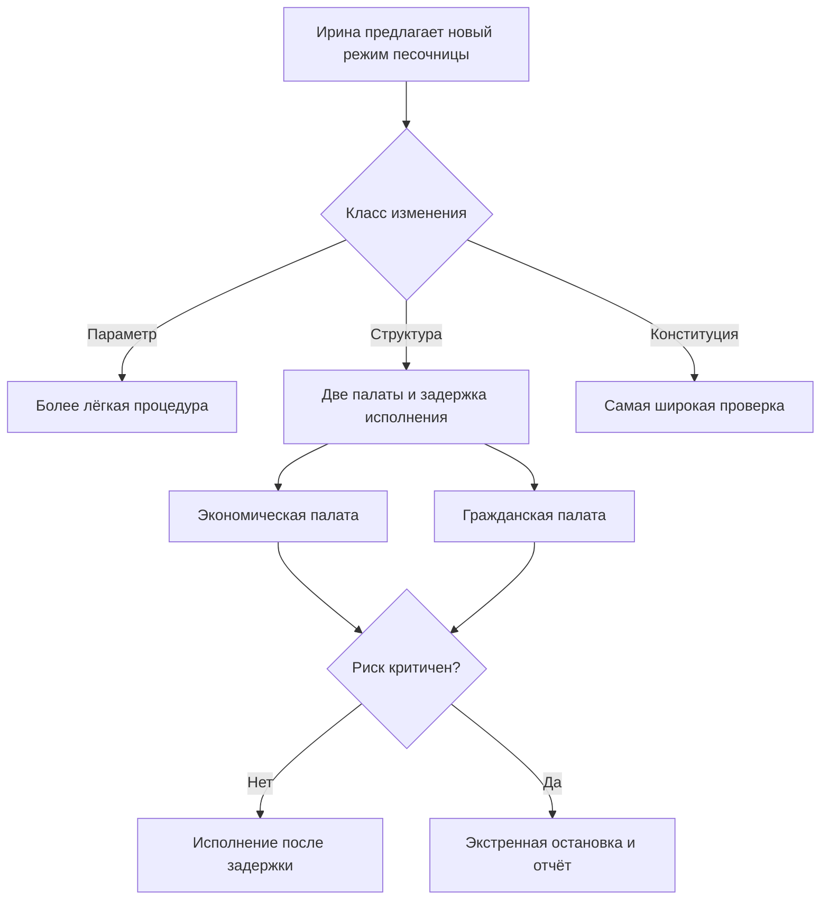
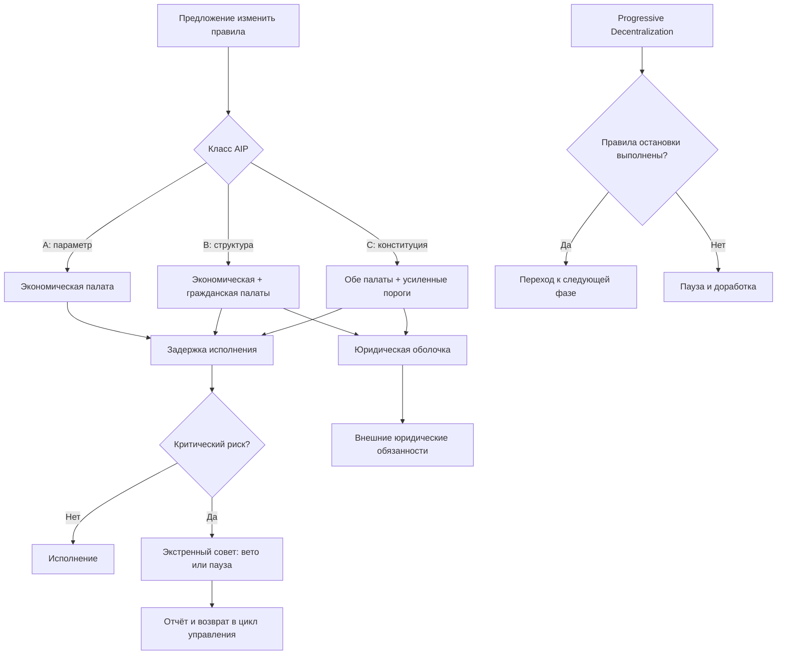

# УРОВЕНЬ 2 / ИЗМЕРЕНИЕ 09: УПРАВЛЕНЧЕСКОЕ (GOVERNANCE)

> **Уровень:** L2 — Среда (инфраструктура)  
> **Измерение:** D09 — Governance  
> **Учебная редакция:** v1.0  
> **Главная тема:** как среда принимает правила, меняет их и действует при авариях

---

## Ключевой вопрос

**Кто и как управляет правилами среды, их изменениями и экстренными мерами?**

---

## Краткое описание измерения

На уровне отдельного агента важно понять, кто действует, что умеет агент и какие права ему делегированы.

На уровне среды вопрос другой: кто меняет правила игры для всех участников, как это делается, кто может остановить опасное изменение и когда особые полномочия должны сжиматься.

Настоящее измерение описывает управленческий слой: палаты, голосование, экстренные меры, специализированные советы, юридическую оболочку и постепенную передачу полномочий от узкого стартового режима к более зрелому управлению.

Эта глава отвечает на несколько практических вопросов:

1. Почему управлением среды не должна заниматься одна палата?
2. Как экономический вес превращается в голос, но не становится единственным источником легитимности?
3. Для чего нужен экстренный совет и почему он не должен становиться обычным правительством среды?
4. Как разные типы изменений проходят обсуждение, голосование, задержку исполнения и проверку риска?
5. Как вторая палата может представлять человеческую легитимность, не превращая проверку личности в раскрытие лишних данных?
6. Что делать, если палаты спорят или если управленческий процесс атакуют?
7. Как делегировать часть решений экспертным и отраслевым органам, не отдавая им окончательную власть?
8. Как среда переходит к более глубокой децентрализации без потери юридической и операционной управляемости?

---

## Мини-глоссарий

| Термин | Простое объяснение |
|--------|--------------------|
| **Логос** | Персональный агент, действующий от имени человека в пределах делегированных прав. |
| **Среда** | Управляемая цифровая экономическая система, где агенты взаимодействуют, работают, получают оплату и подчиняются общим правилам. |
| **Управление (Governance)** | Слой, который определяет, кто принимает правила среды, как они меняются и кто отвечает за экстренные меры. |
| **DAO** | Децентрализованная автономная организация: способ коллективного принятия решений через заранее описанные процедуры. |
| **Бикамеральная модель** | Управление двумя палатами, где разные типы легитимности не смешиваются в один общий голос. |
| **Qi** | Базовый актив ценности и управления; в настоящей главе он важен как источник экономического веса голоса. |
| **veQi** | Непередаваемый вес голоса, возникающий из заблокированного `Qi` с учётом срока блокировки. |
| **Qi Chamber** | Палата экономического веса: решает вопросы, где важны капитал, параметры и экономические контуры среды. |
| **Citizens' Chamber** | Палата человеческой легитимности: нужна для общественных благ, безопасности, политики песочниц и отдельных конституционных ограничений. |
| **Security Council** | Экстренный совет: узкий орган для аварийной стабилизации, а не обычная третья палата. |
| **AIP** | Предложение об изменении правил среды; разные типы таких предложений проходят разные процедуры. |
| **Timelock** | Задержка между принятием решения и исполнением, чтобы участники успели проверить риск и отреагировать. |
| **Quorum** | Минимальная явка или доля голосов, без которой решение не считается достаточно подтверждённым. |
| **Proof-of-Personhood (PoP)** | Проверка уникальности человека: защита от ситуации, когда один участник выдаёт себя за множество людей. |
| **Sybil-атака** | Попытка получить лишнее влияние через множество подставных идентичностей. |
| **MACI** | Механизм приватного голосования с защитой от подкупа и координационного давления; рассматривается как кандидат для гражданской палаты. |
| **Legal wrapper** | Юридическая оболочка, через которую управленческие решения могут признаваться внешним правом. |
| **AGC** | Операционная стабильная валюта среды; для управления важна как объект денежно-политических решений и юридических обязанностей. |
| **EMT** | Токен электронных денег в регуляторной логике `MiCA`; требует идентифицируемого и подотчётного эмитента. |
| **MiCA** | Европейская регуляторная рамка для криптоактивов; задаёт внешние ограничения для части финансовой архитектуры среды. |
| **Sandbox Council** | Отраслевой совет песочницы: помогает управлять правилами конкретного домена в пределах делегированного мандата. |
| **TAC** | Технический консультативный комитет: даёт экспертную оценку, но не заменяет голосование палат. |
| **Conviction Voting** | Голосование с накоплением уверенности со временем; подходит скорее для грантов и приоритизации, чем для конституционных решений. |
| **Progressive Decentralization** | Постепенная передача полномочий от стартового операторского режима к зрелому коллективному управлению. |

---

# 0. Гипотетический пример

Представим цифровую среду, где работают тысячи агентов: одни ищут исполнителей, другие выполняют задачи, третьи проверяют безопасность, четвёртые проводят оплату и фиксируют результат.

Среда выросла, и в ней появляется новый риск. Несколько отраслевых песочниц хотят запустить общий режим для задач с повышенной безопасностью: например, для автоматизированной проверки сложных технических отчётов. Если правила будут слишком мягкими, участники получат опасные результаты. Если слишком жёсткими, полезные исполнители не смогут работать.

**Ирина** — представитель группы участников, которым нужен новый режим безопасного запуска отраслевой песочницы.  
**Марк** — владелец экономической позиции в среде и активный участник палаты экономического веса.  
**София** — участница гражданской палаты, проверенная как уникальный человек.  
**Олег** — член экстренного совета, который может вмешаться только при критическом риске.

Ирина не просит одного администратора "разрешить" новый режим. Она запускает процедуру изменения правил среды. Дальше система должна проверить не только полезность предложения, но и то, кто имеет право его принять, какой тип решения выбран, не занижен ли риск и что делать, если палаты не согласны.

## Проверка 1. Какой это тип изменения?

Сначала предложение классифицируют.

Если это простая настройка параметра, достаточно более лёгкой процедуры. Если меняется структура полномочий песочницы или область ответственности советов, нужна более широкая проверка. Если затрагивается базовая архитектура управления или экстренные полномочия, решение нельзя проводить как обычную настройку.

В примере Ирины речь идёт не о мелкой настройке. Новый режим меняет область полномочий отраслевой песочницы и влияет на безопасность. Значит, предложение должно идти как структурное, а не как параметрическое.

## Проверка 2. Какая легитимность нужна?

Марк смотрит на предложение через экономическую сторону: как новый режим повлияет на стоимость участия, распределение стимулов и устойчивость параметров.

София смотрит иначе: не будет ли новый режим опасен для общественных благ, безопасности участников и справедливого доступа к песочнице.

Обе точки зрения нужны. Экономический вес не должен единолично решать вопросы с сильным общественным следствием, а человеческая легитимность не должна единолично менять денежные и протокольные контуры.

## Проверка 3. Есть ли риск экстренного вмешательства?

Экстренный совет не обсуждает, нравится ли ему предложение Ирины. Его задача уже: остановить исполнение, если обнаружен критический риск, например опасный обход задержки исполнения или неверная классификация предложения.

Если совет вмешивается, он должен объяснить причину и вернуть вопрос в управленческий цикл. Он не получает права превратить аварийный стоп в обычную законодательную власть.

## Проверка 4. Что будет после решения?

Если предложение принято, оно не исполняется мгновенно. Задержка исполнения даёт время проверить код, параметры, юридические ограничения и возможные атаки на процесс.

Если палаты расходятся, запускается заранее описанная процедура согласования. Для обратимых и рутинных изменений можно установить один порядок по умолчанию. Для конституционных или критичных к безопасности изменений безопаснее бездействие до нового согласования.

## Главное из примера

**Управление средой нужно не для того, чтобы "провести голосование", а чтобы разные источники легитимности, риск и юридические границы встретились в одной понятной процедуре.**



---

# Содержание

1. Две палаты вместо одного источника власти
2. Как `Qi` превращается в управленческий вес
3. Экстренный совет без обычной законодательной власти
4. Процесс изменения правил
5. Гражданская палата и защита от подставных идентичностей
6. Конфликты палат и атаки на управление
7. Делегированные органы и голосование с накоплением уверенности
8. Постепенная передача полномочий
9. Связь и границы с другими измерениями
10. Итоговая модель целиком
11. Короткое резюме главы
12. Вопросы без ответа

---

# 1. Две палаты вместо одного источника власти

Если вся среда управляется только голосованием владельцев капитала, возникает перекос: экономически крупный участник может влиять на решения, которые затрагивают безопасность, общественные блага и правила доступа для всех.

Если же вся среда управляется только голосованием "один человек = один голос", возникает другой перекос: решения о параметрах, экономике и протокольных настройках могут приниматься без достаточной связи с теми, кто несёт экономический риск.

Поэтому настоящая глава использует бикамеральную модель управления: две палаты отвечают за разные источники легитимности.

## 1.1 Экономическая палата

Палата экономического веса (`Qi Chamber`) отвечает за вопросы, где цена ошибки и стоимость координации связаны с заблокированным капиталом:

- параметрические настройки;
- экономические контуры;
- обычный курс управления протоколом;
- часть решений о распределении стимулов и потоков ценности.

Её логика проста: если участник надолго связывает капитал со средой, он получает больший вес в вопросах, где этот капитал действительно несёт риск.

## 1.2 Гражданская палата

Палата человеческой легитимности (`Citizens' Chamber`) нужна там, где управление не должно зависеть только от размера позиции в `Qi`:

- общественные блага;
- приоритеты безопасности;
- политика отраслевых песочниц;
- отдельные случаи конституционного вето;
- решения, где "кто затронут" важнее, чем "кто больше поставил".

Эта палата не является копией экономической палаты. Она добавляет другой тип проверки.

## 1.3 Почему палаты не обязаны быть симметричными

Две палаты не означают правило "пятьдесят на пятьдесят по всем вопросам".

Обычные настройки должны проходить быстрее. Изменения базовой архитектуры и экстренных полномочий должны требовать более широкой легитимности и большей задержки перед исполнением. Поэтому дальше предложения делятся на несколько классов, а не проходят по одному шаблону.

## 1.4 Юридическая оболочка и денежно-политические полномочия

Часть решений среды должна быть видима не только участникам, но и внешнему праву. Особенно это важно для операционной стабильной валюты `AGC`, если она попадает в режим токена электронных денег (англ. E-Money Token, далее — EMT) по рамке `MiCA`.

Чистое голосование в сети само по себе не даёт достаточного внешнего носителя обязанностей: нужен идентифицируемый и подотчётный юридический слой. Поэтому юридическая оболочка должна исполнять внешние юридические действия и повседневные денежно-политические полномочия в пределах мандата, заданного управлением среды.

При этом экстренный совет не становится центром обычных денежно-политических решений. Его роль уже: аварийная стабилизация.

Текущая модель рассматривает несколько классов юридической оболочки:

| Кандидат | Сильная сторона | Остаточный риск |
|----------|-----------------|-----------------|
| **Wyoming DAO LLC** | Явное признание DAO-управления в своей юрисдикции. | Слабее пригодность для европейского периметра EMT и банковской практики. |
| **Marshall Islands DAO LLC / MIDAO** | Явное признание токенизированного управления. | Банковская применимость и корреспондентские риски остаются существенными. |
| **Switzerland Foundation / Verein** | Сильная институциональная достоверность и банковская пригодность. | Менее естественная форма для DAO-направленного управления; окончательный выбор требует заключения юристов. |
| **Cayman Foundation Company** | Сильная практика DAO-направленного конституционного контроля и гибкость мандата. | Нужна отдельная проверка соответствия финансово-регуляторному маршруту. |

На текущем уровне описания наиболее сильным кандидатом для плотной связи с DAO-мандатом выглядит `Cayman Foundation Company`. Если приоритетом становится европейская институциональная достоверность и банковская пригодность, сильной альтернативой остаётся швейцарская структура. Ни один вариант не считается окончательным без внешнего юридического заключения.

В примере Ирины это означает: если новый режим песочницы влияет на оплату, резервы или внешние обязанности, голосование палат не может просто "перепрыгнуть" через юридическую оболочку. Оно задаёт мандат, а внешний юридический слой исполняет его в допустимых границах.

## Главное

**Управление среды опирается не на один источник власти, а на сочетание экономического веса, человеческой легитимности, юридической подотчётности и экстренной защиты.**

---

# 2. Как `Qi` превращается в управленческий вес

Экономическая палата не должна считать только количество токенов "здесь и сейчас". Иначе краткосрочное накопление позиции могло бы дать чрезмерное влияние на правила среды.

Поэтому нужен механизм, который связывает голос с длительностью обязательства. В настоящей главе таким механизмом выступает `veQi`.

## 2.1 Что принадлежит настоящему измерению

Актив `Qi`, его выпуск, экономическая роль и распределение доходов принадлежат экономико-стимулирующему слою.

Настоящее измерение отвечает уже за другой вопрос: как `Qi` превращается в вес голоса в экономической палате.

Проще:

> `Qi` — это актив. `veQi` — это управленческий вес, возникающий из заблокированного актива.

## 2.2 Базовая формула

Формула выглядит так:

```text
veQi = Qi_locked × (time_remaining / max_lock)
max_lock = 4 года
min_lock = 1 месяц
```

Смысл формулы:

1. вес голоса зависит не только от размера позиции, но и от оставшегося срока блокировки;
2. вес линейно уменьшается по мере приближения даты разблокировки;
3. краткосрочное заимствование или быстрая покупка позиции хуже подходит для захвата управления.

`veQi` не передаётся между участниками. Это важно: управленческий вес не должен свободно переезжать поверх краткоживущих позиций.

## 2.3 Задержка активации и связь с реальным потоком ценности

Канон сохраняет ориентир: после блокировки действует задержка активации 48 часов.

Это число следует читать как архитектурный ориентир, а не как доказанный оптимум для всех фаз. Его назначение понятно: дать системе время увидеть новую позицию и снизить риск мгновенного управленческого манёвра.

Доходная сторона должна быть связана с реальным потоком ценности среды, а не только с инфляционной раздачей. Иначе долгосрочное участие будет имитироваться ради награды, а не ради устойчивости правил.

## 2.4 Что остаётся открытым

`veQi` повышает стоимость захвата, но не доказывает, что все риски исчезли.

Остаются вопросы:

- нужен ли поверх `veQi` квадратичный слой или ограничение максимального веса;
- как блокировка влияет на ликвидность;
- как распределение сроков блокировки меняет стоимость атаки;
- как калибровать пороги при низкой явке.

Для предложения Ирины это означает: Марк не может получить весь управленческий вес простой покупкой позиции на короткий срок. Но сама формула ещё не освобождает среду от моделирования атак и проверки явки.

## Главное

**`veQi` превращает капитал в управленческий вес только через длительное обязательство.**  
**Это снижает риск краткосрочного захвата, но не заменяет моделирование атак, пороги явки и экстренные механизмы.**

---

# 3. Экстренный совет без обычной законодательной власти

В большой среде бывают ситуации, когда обычный цикл обсуждения и голосования слишком медленный: критическая уязвимость, опасное предложение в задержке исполнения, компрометация ключей или риск обхода процедуры.

Для таких случаев нужен экстренный контур. Но если он получает слишком широкий обычный мандат, децентрализация становится формальной. Поэтому экстренный совет должен быть сильным в аварии и узким в обычной политике.

## 3.1 Базовая конструкция

В этой редакции сохраняются числовые ориентиры модели:

- 12 членов;
- 2 когорты по 6 человек;
- 9 из 12 голосов для экстренных действий;
- 7 из 12 голосов для неэкстренных операционных действий;
- ротация когорт со смещением во времени.

Эти числа являются архитектурным ориентиром текущей модели. Их нельзя читать как окончательно доказанный оптимум: они должны проверяться через угрозы, явку, состав совета и практику реагирования.

## 3.2 Почему состав важнее одного числа

Экстренный совет должен сочетать несколько типов качества:

| Принцип состава | Зачем нужен |
|-----------------|-------------|
| **Техническая компетентность** | Аварийные исправления и оценка инцидентов требуют инженерного понимания. |
| **Управленческая легитимность** | Совет не должен выглядеть как комитет, назначенный только операторами. |
| **Разнообразие ролей** | Нужны безопасность, операции, правовой контур и представители экосистемы. |
| **Организационная и географическая диверсификация** | Снижает риск одновременного давления или компрометации. |

Рекомендуемая логика отбора: утверждение или выбор через две палаты, ограничение концентрации участников из одной организации, раскрытие конфликтов интересов, обязательная ротация ключей подписи.

## 3.3 Что совет может делать

| Класс действия | Примеры | Постфактум-проверка |
|----------------|---------|---------------------|
| **Экстренное действие** | Пауза, срочное исправление, заморозка аварийного маршрута. | Публичный отчёт об инциденте и последующая проверка управлением. |
| **Экстренное вето** | Остановка предложения в задержке исполнения при доказанном критическом риске. | Рассмотрение обеими палатами в следующем цикле. |
| **Операционное обслуживание** | Узкие работы безопасности без изменения конституции среды. | Проверка экономической палатой или отдельным назначенным маршрутом. |

Совет не должен становиться обычным центром политики. У него нет самостоятельной законодательной функции.

## 3.4 Жизненный цикл совета

Базовая логика жизненного цикла такова:

- две когорты избираются или утверждаются со смещением по времени;
- ранняя переоценка состава проводится с ориентиром в 6 месяцев;
- удаление участника возможно через управленческое голосование с повышенным требованием участия или через сверхбольшинство самого совета при компрометации;
- ключи подписи должны регулярно обновляться.

В примере Ирины Олег не решает, "хороший" ли новый режим песочницы. Он вмешивается только если предложение неверно классифицировано, несёт критический риск или пытается обойти задержку исполнения.

## Главное

**Экстренный совет — это аварийный предохранитель, а не третья обычная палата.**  
**Чем сильнее его экстренные полномочия, тем уже должен быть его обычный мандат и тем строже отчётность после вмешательства.**

---

# 4. Процесс изменения правил

Среде нужен не один универсальный тип предложения, а несколько классов изменений. Причина проста: поменять мелкий параметр и изменить конституционную архитектуру управления — это разные риски.

Предложение об изменении правил (англ. Agent Improvement Proposal, далее — AIP) должно проходить маршрут, соответствующий его риску.

## 4.1 Три класса предложений

| Тип | Что меняется | Кто голосует | Порог и задержка как ориентир |
|-----|--------------|--------------|-------------------------------|
| **Parameter (A)** | Настраиваемые параметры без изменения конституции среды. | Экономическая палата. | Кворум `Qi` 4%, задержка исполнения 48 часов. |
| **Structural (B)** | Структура программ, маршрутизация фондов, область полномочий палат или песочниц. | Обе палаты. | Кворум `Qi` 10% и больше 50% "за"; кворум гражданской палаты 5%; задержка 7 дней. |
| **Constitutional (C)** | Базовая архитектура управления, экстренные полномочия, конституционные инварианты. | Обе палаты. | Кворум `Qi` 20% и больше 66% "за"; кворум гражданской палаты 10% и больше 50% "за"; задержка 14 дней. |

Эти числа — ориентиры текущей модели, а не окончательно проверенная математика. Дифференциация классов обоснована, но точные пороги должны проходить моделирование атак и анализ участия.

## 4.2 Рабочий поток

Процесс можно читать как последовательность:

```text
обсуждение на форуме
-> классификация A / B / C
-> голосование нужных палат
-> задержка исполнения
-> исполнение или вето / повышение класса риска
```

Главное правило: предложение не должно само выбирать себе удобный низкий класс риска.

Если классификация спорна, экстренный совет или ответственные председатели палат должны иметь право поднять предложение в более высокий класс. Это не отменяет голосование, а защищает процедуру от занижения риска.

## 4.3 Где проходит граница полномочий AIP

Процесс AIP меняет обычные правила среды, но не является абсолютным сувереном.

Экономические детали `Qi`, `AGC` и распределения доходов принадлежат экономическому слою. Юридическая оболочка и граница с внешним правом принадлежат нормативно-правовому слою. Экстренное сдерживание принадлежит совету только в аварийном режиме.

Поэтому простое большинство не должно отменять внешние обязанности, юридическую преемственность или правила экстренного сдерживания.

В примере Ирины это означает: её предложение не может объявить себя "параметром", если фактически меняет полномочия песочницы. Класс риска должен быть проверен до голосования.

## Главное

**Разные изменения требуют разных процедур.**  
**Чем сильнее влияние на архитектуру, безопасность и права участников, тем шире легитимность, выше пороги и длиннее задержка исполнения.**

---

# 5. Гражданская палата и защита от подставных идентичностей

Если вторая палата должна выражать человеческую легитимность, ей недостаточно списка кошельков. Нужна проверка, что один человек не создаёт множество голосов.

Но проверка личности не должна превращаться в раскрытие лишних данных. Гражданская палата должна доказать уникальность и право участия, не превращая голосование в публичную витрину личной информации.

## 5.1 Что добавляет гражданская палата

Гражданская палата нужна не для повторения экономической палаты другим составом.

Она добавляет управленческую проверку для решений о:

- общественных благах;
- приоритетах безопасности;
- политике песочниц;
- отдельных конституционных ограничениях;
- общественной легитимности решений, которые не должны зависеть только от капитала.

## 5.2 Что принадлежит соседним слоям

Полная идентификационная механика проверки уникального человека принадлежит идентификационному слою. Защитные детали против подставных идентичностей и безопасность приватного голосования принадлежат слою безопасности.

Настоящее измерение использует эти механизмы как вход для управленческого вопроса:

> кто получает право на принцип "один человек = один голос" и когда этот голос становится значимым для конституционного решения?

## 5.3 Потребность перед технологией

Гражданской палате нужны четыре свойства:

1. проверка уникальности человека;
2. приватная подача голоса;
3. возможность отзыва или обновления статуса;
4. защита от подкупа, давления и координационного сговора.

Для первой потребности может рассматриваться стек доказательства человечности класса `World ID 4.0`. Для приватного голосования и защиты от сговора может рассматриваться `MACI v3`. Для резервного или дополнительного маршрута может использоваться агрегирование учётных данных в стиле `Human Passport`.

Это кандидаты, а не окончательно закрытый выбор. У них разные предпосылки доверия, стоимость использования, регуляторная чувствительность и сила защиты.

## 5.4 Ограниченный запуск

Гражданская палата не должна с первого дня считаться универсальной палатой для всех решений.

Более осторожная линия:

- запускать её на фазе, когда уже есть достаточно проверенных участников;
- сначала ограничить область общественными благами, грантами и связанными с безопасностью правами вето;
- расширять полномочия через структурное предложение;
- отдельно проверять стек доказательства человечности, приватного голосования и резервных удостоверений.

София из примера голосует не потому, что у неё много `Qi`, а потому что она проходит человеческую проверку участия. Но её голос не должен автоматически решать денежные параметры, которые принадлежат экономическому контуру.

## Главное

**Гражданская палата добавляет человеческую легитимность там, где капитал не должен быть единственным источником власти.**  
**Её запуск требует защиты от подставных идентичностей, приватного голосования и осторожного расширения полномочий.**

---

# 6. Конфликты палат и атаки на управление

Две палаты полезны только если заранее понятно, что делать при конфликте. Иначе спор превращается в ручную политику без предсказуемой процедуры.

Кроме того, управление можно атаковать не только через код. Его можно атаковать через низкую явку, дешёвое накопление позиции, социальную инженерию подписантов, неверные параметры и терпеливое накопление влияния.

## 6.1 Разрешение межпалатного конфликта

В текущей модели рабочая схема выглядит так:

1. Для рутинных решений применяется оптимистическое одобрение: если вторая палата не возражает в установленное окно, решение может двигаться дальше.
2. Для важных решений у второй палаты есть окно вето.
3. При споре запускается согласительная стадия, где представители палат ищут компромиссную редакцию.
4. Если компромисс не найден, правило по умолчанию зависит от риска.

Правило по умолчанию:

| Тип изменения | Что делать при тупике |
|---------------|-----------------------|
| **Рутинное и обратимое** | Возможен заранее заданный маршрут действия по умолчанию. |
| **Конституционное или критичное к безопасности** | Бездействие до новой легитимной процедуры безопаснее автоматического исполнения. |

Согласительная стадия здесь является адаптацией классической бикамеральной логики. Её точная форма должна быть закреплена отдельно.

## 6.2 Многоуровневая защита

Защита управления складывается из нескольких слоёв:

| Риск | Что снижает риск |
|------|------------------|
| Быстрый захват веса голоса | `veQi`, задержка активации, анализ стоимости накопления позиции. |
| Низкая явка | Кворумы, предсказуемый ритм голосований, делегирование, инструменты участия. |
| Подкуп и сговор | Приватное голосование и механизмы класса `MACI`. |
| Опасное предложение в задержке исполнения | Timelock и экстренное вето. |
| Компрометация подписантов | Ротация ключей, учения реагирования, разнообразие состава совета. |
| Дрейф параметров управления | Периодическая проверка порогов и моделирование атак. |

## 6.3 Два класса показательных провалов

Для этой модели важны два разных класса недавних рисков.

Первый класс — дешёвое накопление управленческой позиции при слабой явке. Такой сценарий показывает, что задержка исполнения без аварийного сдерживания может быть недостаточной.

Второй класс — атака на слой подписантов и процесса. Здесь опасность может быть не в обычной ошибке смарт-контракта, а в социальной инженерии, обходе задержки или миграции без достаточной паузы.

Вывод для настоящей главы: безопасность управления — это не только математика голосования. Это ещё дисциплина процесса, операционная безопасность и способность остановить опасный маршрут до исполнения.

В примере Ирины спор палат не должен решаться кулуарно. Если экономическая палата поддержала предложение, а гражданская палата видит риск для безопасности участников, процедура должна дать окно вето и маршрут согласования.

## Главное

**Бикамеральная модель требует заранее описанного способа разрешать тупики.**  
**Управленческие атаки идут через голосование, явку, подписантов, параметры и экстренные маршруты, поэтому защита должна быть многоуровневой.**

---

# 7. Делегированные органы и голосование с накоплением уверенности

Не каждое решение всей среды должно проходить через полный общеуровневый процесс. В отраслевых песочницах и технических вопросах нужны специализированные органы.

Но делегирование полномочий не должно создавать "маленькие DAO внутри DAO", которые уже не подчиняются общей архитектуре. Делегированные органы получают узкий, отзывный и подотчётный мандат.

## 7.1 Отраслевые советы песочниц

Отраслевой совет песочницы (`Sandbox Council`) может управлять локальными параметрами домена:

- правилами отраслевой песочницы;
- доменными ограничителями;
- эскалацией инцидентов;
- делегированными бюджетами общественных благ;
- приоритизацией улучшений внутри выданного мандата.

Его власть ограничена:

- областью конкретного домена;
- решением, которое выдало мандат;
- возможностью отзыва через структурное предложение;
- полномочиями палат и экстренного совета.

## 7.2 Технический консультативный комитет

Технический консультативный комитет (`TAC`) нужен для экспертной оценки: безопасности, тестов, инженерных рисков, интерпретации контрольных показателей.

Но экспертность не заменяет легитимность.

| Орган | Роль | Почему не получает окончательную власть |
|-------|------|------------------------------------------|
| **TAC** | Рекомендации, экспертная проверка, толкование технических критериев. | Экспертное знание не равно праву менять правила для всех. |
| **Sandbox Council** | Делегированная доменная политика. | Мандат выдан сверху, ограничен доменом и может быть отозван. |
| **Security Council** | Аварийное сдерживание. | Узкий экстренный мандат, а не обычная политика. |

## 7.3 Голосование с накоплением уверенности

Для некоторых решений простое "за/против" плохо отражает устойчивую поддержку. Например, гранты, общественные блага и приоритеты бюджета могут требовать времени: участники постепенно выражают уверенность, а не принимают всё одним резким голосованием.

Здесь может применяться голосование с накоплением уверенности (англ. Conviction Voting). Оно уместнее для грантов, распределения общественных благ и приоритизации бюджетов песочниц. Для конституционных изменений оно слишком слабое: там нужны более строгие палаты, пороги и задержки.

## 7.4 Как поддерживать участие

Явку нельзя улучшить одной наградой за клик.

Рабочая связка выглядит так:

- делегирование голоса там, где оно допустимо;
- предсказуемый ритм управленческих циклов;
- понятные события, вокруг которых участники собираются;
- удобная инфраструктура участия;
- осторожно ограниченные стимулы, связанные с качеством участия, а не только с фактом голосования.

В примере Ирины отраслевой совет может подготовить техническую рекомендацию по песочнице, а `TAC` может оценить безопасность. Но окончательное изменение области полномочий всё равно проходит через нужный класс AIP.

## Главное

**Специализированные органы помогают управлять сложностью, но их мандат должен быть узким, отзывным и подотчётным.**  
**Голосование с накоплением уверенности подходит для мягкой приоритизации, но не для конституционных решений.**

---

# 8. Постепенная передача полномочий

Децентрализация управления не происходит одной кнопкой. Если передать полномочия слишком рано, среда может потерять способность реагировать на аварии, исполнять внешние обязанности или удерживать юридическую преемственность.

Поэтому настоящая глава описывает постепенную децентрализацию как управленческую траекторию: кто реально принимает решения на каждой фазе и какие полномочия можно передавать дальше.

## 8.1 Четыре фазы

| Фаза | Кто реально управляет | Что уже передаётся шире | Что остаётся узким местом |
|------|------------------------|-------------------------|---------------------------|
| **Фаза 1** | Операторское ядро, экстренный совет, ранняя экономическая палата. | Базовый слой голосования, прозрачность аварийных действий, ограниченное делегирование. | Экстренные полномочия, состав органов, юридическая оболочка. |
| **Фаза 2** | Экономическая палата, ограниченная гражданская палата, советы. | Гранты, общественные блага, часть структурного управления, эксперименты с легитимностью палат. | Выбор стека проверки человечности, область гражданской палаты, моделирование атак. |
| **Фаза 3** | Полноценная бикамеральная DAO. | Обычные предложения классов A/B/C, устойчивые делегированные органы, более развитая логика вето. | Конституционное закрепление и мониторинг захвата. |
| **Фаза 4** | Конституционная DAO с минимальной ролью оператора. | Базовые изменения правил проходят через зрелое управление, отдельные инварианты закреплены жёстче. | Риск чрезмерного закрепления и редкие аварийные исключения. |

Главный смысл таблицы: вопрос не в том, "децентрализована ли среда вообще", а в том, какие полномочия уже можно безопасно передать, а какие должны ждать зрелости.

## 8.2 Сигналы перехода

Универсального показателя, который автоматически включает следующую фазу, нет.

Нужен пакет критериев:

- распределение и глубина блокировки `veQi`;
- устойчивая явка в экономической палате;
- доказанная работоспособность гражданской палаты;
- зрелость реагирования экстренного совета;
- устойчивость к управленческим атакам без частых ручных вмешательств;
- подтверждённая юридическая применимость оболочки;
- понятная цепочка назначения и мандата для внешних обязанностей.

## 8.3 Что нельзя передавать автоматически

Постепенная децентрализация не означает, что внешние юридические обязанности сами переходят в сетевое голосование.

Явно отложенными остаются:

- точный момент и область запуска гражданской палаты;
- окончательный выбор юрисдикции юридической оболочки;
- утверждение, что авторизация EMT или надзорные обязанности автоматически переходят к DAO;
- окончательный порядок старшинства между бикамеральной DAO, юридической оболочкой и экстренным советом вне узкой аварийной ситуации.

## 8.4 Правила остановки

Дорожная карта должна иметь не только направление, но и тормоза.

Среда не должна переходить к следующей фазе, если:

1. повседневные денежно-политические полномочия по `AGC` ещё не опираются на юридическую оболочку с прослеживаемой цепочкой назначения и мандата;
2. выбранная юрисдикция не подтверждена внешним юридическим заключением по представительской способности, банковской пригодности и подотчётности в финансовом периметре;
3. логика перехода предполагает автоматический перенос EMT-авторизации, надзорных обязанностей или договорных обязательств к DAO без формального правопреемства или новой авторизации;
4. экстренный совет часто вмешивается, потому что это означает незрелость обычного управления;
5. явка в экономической палате стабильно низкая, гражданская палата формальна, а высокорисковые вопросы управления не закрыты.

В примере Ирины успешное принятие одного режима песочницы не доказывает готовность всей среды к следующей фазе. Переход возможен только если управление, безопасность, участие и юридическая преемственность устойчивы как система.

## Главное

**Постепенная децентрализация — это не обещание, что особые полномочия исчезнут сами.**  
**Это управляемая передача власти с условиями перехода и правилами остановки.**

---

# 9. Связь и границы с другими измерениями

Настоящее измерение находится в конце потока уровня среды: после описания границ, функций, инфраструктуры, коммуникаций, экономики, исполнения, безопасности и правового периметра. Оно не переписывает соседние механики, а задаёт, кто и как может менять правила, которые ими пользуются.

| Измерение | Связь | Граница ответственности |
|-----------|-------|--------------------------|
| **L2/D01 (Идентификационно-онтологическое)** | Даёт границы среды и логику отраслевых песочниц. | Здесь описывается, кто управляет правилами этих контуров; устройство самих границ и песочниц остаётся у L2/D01. |
| **L2/D02 (Функционально-целевое)** | Определяет типы активностей, рынков и агентов, для которых нужны правила управления. | Здесь не задаётся функциональная типология рынков; здесь задаётся порядок изменения правил для них. |
| **L2/D05 (Экономико-стимулирующее)** | Даёт `Qi`, `AGC`, распределение доходов и экономическое выравнивание. | Здесь описывается только превращение `Qi` в управленческий вес через `veQi` и управленческие границы экономических решений. |
| **L2/D07 (Безопасность и мониторинг)** | Обеспечивает защиту от подставных идентичностей, приватное голосование, операционную безопасность и многоуровневую защиту. | Здесь эти механизмы используются как защитные меры управления; детальная безопасность остаётся у L2/D07. |
| **L2/D08 (Нормативно-правовое)** | Задаёт правовую оболочку, финансово-регуляторные ограничения и границы внешней подотчётности. | Здесь описывается управленческий мандат; юридическое признание и надзорный периметр остаются у L2/D08. |
| **L1/D01 (Идентификационное)** | Даёт проверку личности и связь человека с агентом для гражданской легитимности. | Здесь решается, как такой статус превращается в право участия в палате; техническая идентичность остаётся у L1/D01. |
| **L1/D09 (Репутационное)** | Репутация может влиять на качество участия, доверие к делегатам и доменную легитимность. | Репутация не заменяет вес голоса и не является самостоятельным источником конституционной власти. |
| **L1/D07 (Автономность)** | Определяет действия, которые нельзя делегировать агенту по умолчанию. | Здесь важно, что голосование, выборы экстренного совета и расширение управленческих полномочий требуют человеческого контроля. |

## Главное

**Настоящее измерение владеет правилами изменения правил.**  
**Соседние измерения дают экономику, безопасность, право, идентичность и функции, но не заменяют управленческую процедуру.**

---

# 10. Итоговая модель целиком

В компактном виде управление среды собирается так: разные типы решений получают разные процедуры, разные источники легитимности проверяют разные риски, экстренный совет удерживает аварийный контур, а юридическая оболочка связывает внутренний мандат с внешними обязанностями.



## Главное

**Модель работает как система сдержек: палаты дают легитимность, задержка исполнения даёт время, экстренный совет ограничивает аварии, юридическая оболочка удерживает внешнюю подотчётность, а дорожная карта задаёт условия передачи власти.**

---

# 11. Короткое резюме главы

1. Управление среды не сводится к одному голосованию: экономический вес, человеческая легитимность, юридическая подотчётность и экстренная защита отвечают за разные риски.
2. `veQi` делает голос в экономической палате зависящим от длительного обязательства, но не заменяет моделирование атак и настройку кворумов.
3. Экстренный совет нужен для аварий, но не должен становиться обычным политическим центром.
4. Предложения делятся на классы: параметрические, структурные и конституционные изменения проходят разные пороги и задержки.
5. Гражданская палата требует проверки уникальности человека, приватного голосования и осторожного запуска с ограниченной областью.
6. Межпалатные конфликты и управленческие атаки должны иметь заранее описанные процедуры.
7. Отраслевые советы, технический комитет и голосование с накоплением уверенности полезны только в пределах узкого мандата.
8. Постепенная децентрализация требует не только фаз, но и правил остановки.

## Главное

**Управленческое измерение отвечает за то, чтобы правила среды менялись легитимно, проверяемо, с учётом риска и без преждевременной передачи власти.**

---

# 12. Вопросы без ответа

1. **Нужен ли поверх `veQi` квадратичный слой или ограничение максимального веса?** Базовая модель выбрана через `veQi`, но гибридная схема требует моделирования стоимости атаки и чувствительности явки.
2. **Какая юридическая оболочка станет окончательной?** Кандидаты различаются по признанию DAO-управления, банковской пригодности, налоговой логике и применимости к финансовому периметру; нужен внешний юридический вывод.
3. **Как формально моделировать атаки на управление?** Требуется отдельная работа по дешёвому накоплению веса, низкой явке, компрометации подписантов, злоупотреблению экстренным маршрутом и дрейфу параметров.
4. **Как калибровать кворумы и пороги для структурных и конституционных предложений?** Текущие числа являются ориентиром, а не окончательным результатом математической проверки.
5. **Кто имеет окончательную обязательную силу при конфликте DAO, экстренного совета, операционного слоя и юридической оболочки?** Роли описаны, но порядок старшинства вне узких аварийных случаев требует отдельного конституционного решения.
6. **Какие управленческие действия являются неделегируемыми?** Минимально безопасная линия: голосование палат, делегирование голосов, участие в выборах экстренного совета и расширение собственных полномочий не должны становиться автоматическими действиями агента по умолчанию.
7. **Какую роль могут играть агентные системы в управлении?** Текущая логика исходит из человечески подтверждённой легитимности; аналитическая и рекомендательная роль агентов возможна, но прямое право голоса требует отдельного решения.
8. **Когда и с какой областью запускать гражданскую палату?** Возможен ограниченный запуск для общественных благ и прав, связанных с безопасностью, но расширение полномочий должно проходить через структурное решение.
9. **Какой стек проверки человечности, приватного голосования и резервных удостоверений станет рабочей основой?** Кандидаты есть, но их предпосылки доверия, стоимость, регуляторная чувствительность и операционная сложность ещё должны быть сопоставлены.
10. **Как точно закрепить процедуру межпалатного тупика?** Нужны правила для согласительной стадии, окон вето и действий по умолчанию при разных классах риска.

## Главное

**Открытые вопросы связаны не с тем, нужна ли управленческая архитектура, а с точной калибровкой её порогов, юридических границ, неделегируемых действий и зрелости отдельных палат.**
