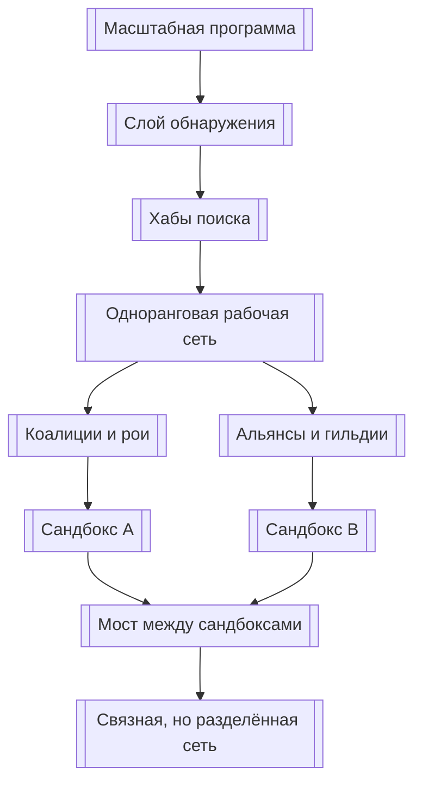
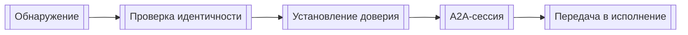
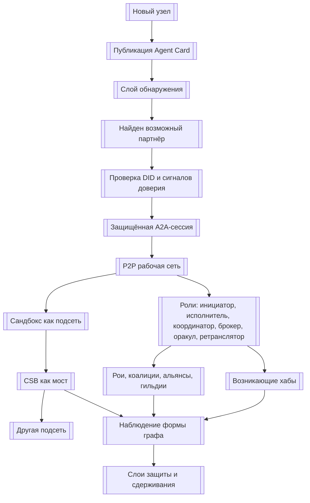

# УРОВЕНЬ 3 / ИЗМЕРЕНИЕ 01: СЕТЕВАЯ СТРУКТУРА

> **Уровень:** L3 — Взаимодействия Логосов  
> **Измерение:** D01 — Network Structure  
> **Учебная редакция:** v1.0  
> **Главная тема:** как из множества связей между агентами складывается форма всей сети

---

## Ключевой вопрос

**Какие сетевые структуры (P2P, иерархии, рои, хабы) образуются в результате связей между Логосами?**

---

## Краткое описание измерения

Один Логос можно описать через его идентичность, навыки, инструменты и правила работы.

Но когда таких Логосов становится много, появляется новый вопрос: **какую форму принимает вся сеть**.

Настоящее измерение объясняет не отдельную сделку, а топологию целой агентной среды: где появляются центры связности, где сохраняется прямое взаимодействие, как сеть растёт, как отделяются локальные подсети и почему разные типы узлов начинают играть разные роли.

Эта глава отвечает на несколько практических вопросов:

1. Почему сеть не должна быть ни полностью централизованной, ни полностью одноранговой.
2. Как поиск участников, рабочее взаимодействие и внутренняя координация образуют три разных слоя.
3. Почему хабы возникают статистически, а не только назначаются сверху.
4. Какие роли узлов меняют форму графа: инициатор, исполнитель, координатор, брокер, оракул и ретранслятор.
5. Как сандбоксы становятся локальными подсетями, а межсандбоксная связь требует отдельного моста.
6. Как сеть проходит путь от начальной загрузки до больших устойчивых кластеров.
7. Какие вопросы остаются открытыми для управления, реализации и дальнейших измерений.

---

## Мини-глоссарий

| Термин | Простое объяснение |
|--------|--------------------|
| **Логос** | Агент, который действует от имени владельца и взаимодействует с другими агентами в цифровой среде. |
| **Узел сети** | Участник графа: обычно Логос или структурная точка, через которую проходят связи. |
| **Ребро графа** | Связь между узлами: поиск, сообщение, делегирование, доверительный сигнал или рабочий маршрут. |
| **P2P** | Одноранговое взаимодействие (англ. peer-to-peer), где участники связываются друг с другом без единого обязательного центра. |
| **Хаб** | Узел с большим числом связей; через него чаще проходят поиск, координация или маршруты. |
| **Гибридная топология** | Сеть, где разные слои устроены по-разному: часть ближе к хабам, часть ближе к прямым связям. |
| **ADS** | Слой обнаружения агентов (англ. Agent Discovery Service): помогает найти подходящего участника и его точку связи. |
| **Agent Card** | Карточка агента (англ. Agent Card): машиночитаемое описание того, кто агент, что он умеет, где с ним связаться и как проверить подлинность. |
| **DID** | Децентрализованный идентификатор (англ. Decentralized Identifier): проверяемый цифровой идентификатор без зависимости от одного центрального реестра. |
| **PoP** | Доказательство уникальности человека (англ. Proof-of-Personhood): снижает риск массового размножения ложных узлов. |
| **A2A** | Протокол взаимодействия агент-агент (англ. Agent-to-Agent Protocol): общий формат задач, сообщений и рабочих сессий между агентами. |
| **DIDComm** | Защищённый обмен сообщениями на основе DID (англ. DIDComm). |
| **Orchestrator** | Внутренний координатор (англ. Orchestrator) одного Логоса, который распределяет работу между его микроагентами. |
| **Микроагент** | Специализированная часть Логоса с ограниченными умениями и разрешениями. |
| **Сандбокс** | Изолированная среда исполнения, внутри которой узлы связаны плотнее, чем с внешними узлами. |
| **CSB** | Мост между сандбоксами (англ. Cross-Sandbox Bridge): нормированная точка для связи разных изолированных сред исполнения. |
| **Reputation Tier** | Уровень репутации (англ. Reputation Tier) Логоса, который может влиять на вероятность стать заметным узлом сети. |
| **Слой обнаружения** | Часть сети, где участники ищут друг друга и получают адреса для дальнейшей связи. |
| **Рабочий маршрут** | Путь, по которому задача или сообщение переходит из поиска в реальное взаимодействие. |
| **Рой** | Временный децентрализованный кластер вокруг задачи без выделенного координатора. |
| **Коалиция** | Временный кластер вокруг миссии с явным координатором. |
| **Альянс** | Повторяемая сеть доверенных связей и устойчивых маршрутов. |
| **Гильдия** | Плотный доменный кластер с устойчивыми правилами участия. |
| **Брокер** | Узел, который помогает разным подсетям и пулам исполнителей находить друг друга. |
| **Оракул** | Узел или сервис, который добавляет внешний проверочный сигнал в состояние сети. |
| **Ретранслятор** | Узел, который помогает доставлять сообщения и сохранять связность при перебоях. |
| **Circuit Breaker** | Механизм остановки или ограничения опасного распространения сбоя (англ. Circuit Breaker). |
| **Sybil-атака** | Попытка захватить влияние через массовое создание ложных идентичностей (англ. Sybil attack). |

---

# 0. Гипотетический пример

Представим большую агентную среду, в которой работают не десятки, а миллионы Логосов.

В этой среде есть персональные Логосы специалистов, корпоративные роли, агентные сервисы, сандбоксы исполнения, рынки задач, репутационные сигналы и инфраструктура сообщений.

В один месяц несколько регионов запускают масштабную программу восстановления инфраструктуры после серии аварий. Нужно одновременно координировать ремонт дорог, доставку материалов, проверку смет, юридические согласования, мониторинг рисков и оплату работ.

Это не одна сделка и не один чат между двумя агентами. Это сетевой процесс: задача распадается на тысячи миссий, миссии ищут исполнителей, исполнители образуют кластеры, кластеры соединяются через хабы, часть работы уходит в изолированные среды исполнения, а результаты возвращаются в общую экономическую среду.

**Елена** — оператор программы восстановления. Её команда отвечает не за ручное управление каждым агентом, а за то, чтобы сеть могла найти нужные узлы, связать их и не потерять управляемость.

**Рафаэль** — владелец крупного пула Логосов, которые помогают с логистикой, проверкой поставщиков и планированием ремонта. Его агенты не работают в одиночку: они входят в коалиции, делегируют подзадачи, проходят проверки и взаимодействуют с чужими сандбоксами.

## Проверка 1. Как сеть найдёт участников

В начале программы у Елены нет полного списка всех подходящих исполнителей.

Поэтому сети нужен слой обнаружения: он помогает найти Логосов по домену, способности, точке связи и базовым сигналам доверия. На этом этапе связь больше похожа на поиск через каталоги и хабы, чем на свободный обмен сообщениями между всеми со всеми.

Это не значит, что вся сеть централизована. Это значит, что **поиск** и **рабочее взаимодействие** решают разные задачи.

## Проверка 2. Как задачи пойдут между Логосами

Когда подходящие участники найдены, программа не должна каждый раз проходить через один центральный узел.

Логосы Рафаэля договариваются с логистическими, юридическими и проверочными Логосами напрямую. Возникает одноранговая рабочая сеть: сообщения и задачи идут между независимыми участниками, а не через единственный обязательный центр.

Если бы все рабочие маршруты проходили через один центр, этот центр стал бы ограничением для всей программы.

## Проверка 3. Где появятся хабы

Через несколько недель видно, что одни Логосы получают больше обращений, чем другие.

Часть из них хорошо находят исполнителей между разными регионами. Часть стабильно координирует сложные миссии. Часть часто подтверждает качество результатов. Эти узлы начинают становиться хабами: не потому, что их заранее назначили главными, а потому что сеть снова и снова выбирает их как полезные точки связности.

Так появляется макроструктура: много узлов с небольшим числом связей и небольшое число узлов, через которые проходит заметная доля маршрутов.

## Проверка 4. Как сандбоксы не смешиваются напрямую

Часть работ исполняется в изолированных средах: например, отдельные сандбоксы обслуживают финансовые расчёты, юридические проверки и инженерные модели.

Внутри каждого сандбокса связи плотные. Но связь между разными сандбоксами не должна выглядеть как обычное прямое ребро. Иначе границы исполнения станут неясными: непонятно, где именно контролировать маршрут, отказ и ответственность.

Поэтому межсандбоксный путь проходит через мост. Для Елены это означает: сеть может оставаться связной, не превращая каждую изолированную среду в открытую для всех область.

## Проверка 5. Как сеть растёт и не теряет форму

Когда программа расширяется, появляются новые исполнители, временные рои, повторяемые альянсы и доменные гильдии.

Сеть уже нельзя описать одной картинкой вроде «все со всеми» или «все через центр». Она становится гибридной: слой поиска опирается на хабы и реестровые точки, рабочие маршруты идут как одноранговая сетка, а внутри одного Логоса координация остаётся локальной иерархией вокруг внутреннего координатора.

Это и есть масштаб настоящего измерения: **форма всей сети как живого графа взаимодействий**, а не поведение одного участника.

## Главное из примера

**Сетевая структура нужна, чтобы большая агентная среда могла одновременно расти, находить участников, сохранять прямые рабочие связи, отделять локальные подсети и не зависеть от одного центра.**



---

# Содержание

1. Три слоя сетевой формы
2. Как возникают хабы и роли узлов
3. Сандбоксы как подсети
4. Рост сети: от начальной загрузки к большим кластерам
5. Установление связи и делегирование
6. Организационные формы поверх сети
7. Защита, наблюдаемость и границы модели
8. Связь и границы с другими измерениями
9. Итоговая модель целиком
10. Короткое резюме главы
11. Вопросы без ответа

---

# 1. Три слоя сетевой формы

Когда агентная среда растёт, один тип топологии перестаёт отвечать на все задачи.

Полностью одноранговая сеть плохо начинает работу с нуля: новым участникам трудно понять, кого искать и где получить актуальные точки связи.

Полностью иерархическая сеть даёт понятный вход, но создаёт зависимость от центров координации и ограничивает прямые рабочие маршруты.

Поэтому настоящая модель использует гибрид: разные слои имеют разную форму.

## 1.1 Слой обнаружения

Сначала участнику нужно найти другого участника.

Для этого нужен слой обнаружения агентов (англ. Agent Discovery Service, далее — ADS): он помогает получить карточку агента, адреса связи и первичные сведения для дальнейшей проверки.

На этом уровне допустим более центрированный путь: реестр, каталог, справочник или другой хаб поиска. Такой путь не равен рабочему транспорту. Он отвечает на вопрос «кого найти», а не «как вся задача будет исполняться».

## 1.2 Межлогосная рабочая сеть

После обнаружения начинается рабочее взаимодействие.

Здесь базовая форма ближе к одноранговой сети (англ. peer-to-peer, далее — P2P): независимые Логосы связываются друг с другом напрямую, договариваются о задаче, обмениваются сообщениями и передают выполнение.

Смысл такого слоя в том, чтобы рабочая сеть не имела одного обязательного центра. Центры могут возникать статистически, но они не должны становиться единственным путём для каждой связи.

## 1.3 Внутренняя структура одного Логоса

Внутри одного Логоса задача устроена иначе.

Там есть внутренний координатор (англ. Orchestrator), который распределяет работу между микроагентами. Поэтому локальная структура одного Логоса похожа на «звезду»: центр направляет специализированные части, а они выполняют свои фрагменты задачи.

Это не внешняя сеть между независимыми Логосами, а внутренняя координация одного участника.

| Слой | Что связывает | Базовая форма | Зачем так устроено |
|------|---------------|---------------|--------------------|
| Слой обнаружения | Поиск участников и их точек связи | Хаб и лучи | Упростить вход в сеть и начальную навигацию. |
| Межлогосная сеть | Рабочие задачи и сообщения между Логосами | P2P-сетка | Не держать исполнение на одном центре. |
| Внутрилогосная координация | Микроагентов одного Логоса | Локальная иерархия | Управлять декомпозицией задачи внутри одного агента. |

```text
Слой обнаружения:      Логос -> ADS / реестр / справочник
Межлогосная сеть:      Логос <-> Логос <-> Логос
Внутри одного Логоса:  Orchestrator -> микроагенты
```

В примере Елены слой обнаружения помогает найти пулы исполнителей по регионам и доменам. После этого Логосы Рафаэля не проводят каждое рабочее сообщение через один реестр: они открывают прямые рабочие связи с другими участниками программы.

## Главное

**Сеть устроена как трёхслойный гибрид: поиск может быть более центрированным, рабочие связи — одноранговыми, а внутренняя координация одного Логоса — локально иерархической.**

---

# 2. Как возникают хабы и роли узлов

Большая сеть редко остаётся равномерной.

Если участники снова и снова выбирают надёжные, полезные или хорошо связанные узлы, эти узлы получают больше связей. Так возникают хабы.

Здесь важна не ручная должность, а статистическая форма графа: часть узлов постепенно становится более связной, потому что через них чаще проходят поиск, координация, проверка или доставка сообщений.

## 2.1 Безмасштабный профиль как ориентир

Для больших сетей полезна интуиция безмасштабного профиля (англ. scale-free profile): в такой сети много узлов с малым числом связей и немного узлов с очень большим числом связей.

Один механизм, который помогает объяснить такую форму, — предпочтительное присоединение (англ. preferential attachment): новые связи чаще идут к тем, у кого уже есть много связей.

Но одной степени узла недостаточно. Узел может быть не просто популярным, а ещё и более пригодным для задач. Поэтому используется идея приспособленности узла (англ. network fitness): репутация и качество работы могут повышать шанс, что сеть снова выберет именно этот узел.

Учебная иллюстрация из модели выглядит так:

```text
γ = 1 + 1 / p
Π_i(t) = (f_i * k_i(t)) / Σ_j (f_j * k_j(t))
```

Здесь:

| Обозначение | Простое чтение |
|-------------|----------------|
| `γ` | показатель формы распределения связей в сети |
| `p` | доля связей, где действует предпочтительное присоединение |
| `k_i(t)` | сколько связей есть у узла `i` в момент `t` |
| `f_i` | приспособленность узла, которую можно интерпретировать через качество и репутацию |

Ориентир `γ` в диапазоне `2.3-2.8` следует читать именно как архитектурную гипотезу для большой сети, а не как уже измеренный производственный факт.

Также правдоподобно, что Логосы с высоким уровнем репутации чаще становятся хабами. Но это не означает автоматического назначения «главных» узлов: высокий уровень репутации только повышает вероятность повторного выбора.

## 2.2 Шесть ролей узлов

Роль узла показывает, **как он меняет форму сети**.

Один и тот же Логос может быть инициатором в одной миссии, исполнителем в другой и брокером в третьей. Поэтому роли описывают не юридический статус, а сетевую функцию.

| Роль | Сетевая функция | Как влияет на граф |
|------|-----------------|--------------------|
| **Инициатор** | Запускает миссию и волну поиска или кооперации. | Создаёт начальные исходящие связи. |
| **Исполнитель** | Принимает рабочий слот и выполняет задачу на краю сети. | Увеличивает плотность рабочих маршрутов. |
| **Координатор** | Удерживает локальную коалицию и распределяет подзадачи. | Может стать локальным хабом. |
| **Брокер** | Помогает разным подсетям и пулам находить друг друга. | Соединяет кластеры и снижает разрыв между ними. |
| **Оракул** | Добавляет внешний проверочный сигнал. | Создаёт дополнительные доверительные рёбра. |
| **Ретранслятор** | Переносит сообщения и помогает при недоступности узлов. | Поддерживает связность маршрутов. |

## 2.3 Что не нужно путать

| Путаемые вещи | В чём разница |
|---------------|---------------|
| Хаб и администратор | Хаб может возникнуть из повторяемого выбора, даже если у него нет управленческой власти. |
| Роль и идентичность | Логос сохраняет свою идентичность, но в разных миссиях может играть разные сетевые роли. |
| Репутация и контроль | Репутация повышает вероятность выбора, но сама по себе не даёт права контролировать всю сеть. |

В программе Елены один брокер быстро начинает соединять строительные и логистические кластеры. Он становится заметным хабом не потому, что Елена вручную сделала его центром всей сети, а потому что разные участники регулярно используют его как удобную точку поиска и стыковки.

## Главное

**Хабы в большой агентной сети возникают из повторяемого выбора полезных узлов. Роли узлов важны потому, что они меняют форму графа: одни запускают связи, другие выполняют работу, третьи соединяют кластеры, проверяют состояние или поддерживают доставку сообщений.**

---

# 3. Сандбоксы как подсети

Сеть не должна быть одинаково открытой во всех местах.

Некоторые задачи требуют изоляции исполнения: финансовые расчёты, юридические проверки, инженерные модели, тестовые контуры или операции с повышенным риском. В таких случаях группа узлов внутри одной сандбокс-среды связана плотнее между собой, чем с внешней сетью.

С точки зрения настоящего измерения сандбокс важен не как технология исполнения, а как **граница подсети**.

## 3.1 Почему сандбокс становится подсетью

Если узлы внутри сандбокса работают с общими ограничениями, ресурсами и правилами доступа, у них появляется собственный профиль связности.

Это означает:

1. внутри сандбокса связи могут быть плотнее;
2. отказ внутри сандбокса не должен автоматически распространяться на всю сеть;
3. внешний маршрут в сандбокс должен быть управляемым;
4. связь между сандбоксами нельзя считать обычным прямым P2P-ребром.

## 3.2 Зачем нужен мост между сандбоксами

Когда двум сандбоксам нужно обменяться результатами, нужен нормированный маршрут.

Такой маршрут задаёт мост между сандбоксами (англ. Cross-Sandbox Bridge, далее — CSB). Его роль в этой главе проста: быть точкой межсандбоксной связности, а не описывать всю внутреннюю механику исполнения.

```text
Сандбокс A --\
              > CSB -> межсандбоксный путь
Сандбокс B --/
```

## 3.3 Один мост или распределённый мост

Есть два структурных варианта.

| Вариант | Плюс для структуры | Минус для структуры |
|---------|--------------------|---------------------|
| **Единственный CSB** | Проще маршрут и проще управление. | Появляется единая точка отказа между подсетями. |
| **Распределённый CSB** | Лучше переносит частичные отказы и распределяет пропускную способность. | Сложнее кворум, задержки и управление участниками. |

Для большой сети рабочая рекомендация смещается к распределённому профилю. Числа `5+` ретрансляторов и кворум `2/3` следует читать как архитектурный ориентир, а не как измеренный универсальный стандарт.

В программе Елены финансовый сандбокс и инженерный сандбокс не соединяются произвольным прямым каналом. Их связывает мост: он делает маршрут видимым для управления отказами и не превращает границу исполнения в неформальную дыру в графе.

## Главное

**Сандбокс — это не только место исполнения, но и локальная подсеть. Межсандбоксная связь должна проходить через управляемый мост, иначе сеть теряет ясные границы маршрутов, отказов и ответственности.**

---

# 4. Рост сети: от начальной загрузки к большим кластерам

Новая сеть не может сразу вести себя как зрелая самоорганизующаяся экосистема.

На старте ей нужны точки входа: где зарегистрироваться, где найти других участников, как получить первичные адреса и карточки агентов. Позже, когда связей становится больше, сеть начинает выращивать собственные хабы и кластеры.

## 4.1 Начальная загрузка

Начальная загрузка опирается на регистрацию и разрешение точек связи.

Практически это означает: Логос становится видимым для поиска, публикует карточку агента и получает путь, по которому другие участники могут его обнаружить.

Такой этап неизбежно выглядит более хабовым: без начального справочника новым узлам трудно найти друг друга.

## 4.2 Расширение и стабилизация

После стартового периода сеть может развиваться через сочетание реестровой навигации и самоорганизации.

Сначала доминируют точки начальной загрузки. Затем повторяемые связи выращивают локальные хабы. Потом граф становится устойчивее: появляется много малосвязных узлов, редкие хабы и кластеры вокруг доменов, регионов или повторяемых задач.

Ориентиры размера фаз ниже являются архитектурной гипотезой, а не измеренными порогами:

| Фаза роста | Ориентир по размеру | Структурная картина |
------------|---------------------|---------------------|
| **Фаза 1** | `0-1K` узлов | Точки начальной загрузки и реестровый поиск доминируют. |
| **Фаза 2** | `1K-100K` узлов | Предпочтительное присоединение ускоряет появление локальных хабов и кластеров. |
| **Фаза 3** | `100K-10M` узлов | Сеть стабилизируется как гибридная структура с редкими хабами и множеством малосвязных узлов. |

## 4.3 Вход и выход узла

Для формы сети важен минимальный базовый сценарий:

1. вход узла завершается публикацией карточки агента и активацией пути обнаружения;
2. выход узла должен убрать его видимость в поиске и прекратить новые входящие связи;
3. судьба незавершённых миссий, тайм-аутов, отзывов и каскадных последствий требует отдельного протокольного решения.

Псевдокод структурного минимума:

```text
если узел входит в сеть:
    опубликовать Agent Card
    активировать путь обнаружения

если узел выходит из сети:
    снять видимость в поиске
    остановить новые входящие связи
    обработать незавершённые миссии по отдельному протоколу
```

Когда к программе Елены подключаются новые региональные исполнители, они сначала должны стать видимыми для поиска. Когда часть исполнителей завершает участие, сеть должна перестать направлять им новые миссии, не теряя состояние уже начатых задач.

## Главное

**Рост сети проходит от более хабовой начальной загрузки к самоорганизующейся гибридной структуре. Вход и выход узлов важны не только как административные действия, но и как изменение видимости, связности и незавершённых маршрутов.**

---

# 5. Установление связи и делегирование

Найти участника недостаточно.

Перед рабочим взаимодействием сеть должна перейти от «я нашёл возможного партнёра» к «я могу открыть с ним проверяемую и защищённую рабочую связь».

Эта глава описывает последовательность как структурный маршрут, а не как измеренное соглашение об уровне задержки.

## 5.1 Пятишаговый маршрут связи

Рекомендуемая логика выглядит так:

1. **Обнаружение.** Найти участника по способности, домену или точке связи и получить его карточку агента.
2. **Разрешение идентичности.** Проверить DID, целостность публикации и сигналы доверия.
3. **Установление доверия.** Запустить защищённый слой для начала взаимодействия. Возможными элементами такого слоя выступают `DIDComm` и A2A-проверки доверия.
4. **Открытие A2A-сессии.** Перейти к обсуждению задачи, предложениям, согласованию и обмену сообщениями.
5. **Передача в исполнение.** Перевести связь из стартовой фазы в рабочий контур выполнения или кооперации.



Важно: опубликованных ориентиров задержки для полной цепочки `ADS -> DIDComm -> A2A-сессия` недостаточно. Поэтому эта последовательность задаёт порядок шагов, а не обещает конкретное время ответа.

## 5.2 Приватность видимости

Слой обнаружения должен помогать найти участника, но не обязан раскрывать всем всё.

Для персональных и корпоративных Логосов могут понадобиться разные режимы видимости. Настоящее измерение фиксирует только потребность: установление доверия должно быть совместимо с приватностью. Окончательная матрица видимости остаётся отдельным решением.

## 5.3 Ограничение глубины делегирования

Делегирование полезно: инициатор может передать координацию, координатор — подзадачу исполнителю, исполнитель — часть работы специализированному субисполнителю.

Но бесконечная цепочка делегирования делает маршрут ответственности непрозрачным. Поэтому рабочая рекомендация вводит ограничение глубины в `4` перехода. Это ориентир управляемости, а не внешний закон.

Пример цепочки:

```text
Инициатор -> Координатор -> Исполнитель -> Субисполнитель
```

В программе Елены координатор ремонта может передать логистическую подзадачу исполнителю, а тот — специализированному субисполнителю. Но если цепочка растягивается дальше, Елене и другим участникам становится трудно понять, кто реально отвечает за результат и где остановить сбой.

## Главное

**Связь между Логосами проходит путь от обнаружения к проверке, защищённой сессии и исполнению. Делегирование допускается, но его глубина должна оставаться ограниченной, чтобы сеть не теряла трассируемость ответственности.**

---

# 6. Организационные формы поверх сети

Когда связи повторяются, поверх графа появляются устойчивые формы.

Настоящее измерение описывает их не как юридические организации и не как полную модель управления, а как морфологию сети: какие кластеры возникают, как долго живут и какую форму связности создают.

## 6.1 Рой, коалиция, альянс и гильдия

| Форма | Сетевой смысл | Ожидаемая длительность | Что остаётся за пределами этой главы |
|-------|---------------|------------------------|--------------------------------------|
| **Рой** | Временный децентрализованный кластер без выделенного координатора; агенты самоорганизуются вокруг задачи через изменения общей среды. | Часы; распадается после выполнения задачи. | Условия запуска, коллективные решения и полная механика самоорганизации. |
| **Коалиция** | Временный кластер вокруг одной миссии с явным координатором. | Часы или дни. | Модель распределения выгоды и правила кооперации. |
| **Альянс** | Повторяемая сеть доверенных связей и устойчивых маршрутов. | Недели или месяцы. | Формальная управленческая механика. |
| **Гильдия** | Плотный доменный кластер с устойчивыми правилами участия. | Месяцы и дольше. | Правила членства, советы и управленческие процедуры. |

## 6.2 Почему эти формы важны для топологии

Рой создаёт временную плотность вокруг задачи.

Коалиция создаёт локальную звезду вокруг координатора.

Альянс превращает повторяемые связи в устойчивые маршруты.

Гильдия формирует плотный доменный кластер.

Всё это меняет не только социальное описание сети, но и её граф: где появляются плотные области, какие маршруты повторяются, где возникают локальные центры и какие связи становятся привычными.

## 6.3 Что ещё не закрыто

Такие формы выглядят правдоподобными и полезными для объяснения кластеризации сети.

Но это не означает, что уже задана полная теория стимулов или конечный автомат переходов между роями, коалициями, альянсами и гильдиями. Настоящее измерение описывает структурные стадии, а не завершённый механизм их жизненного цикла.

В программе Елены сначала возникают рои для срочного сбора данных по повреждениям. Затем вокруг крупных ремонтов появляются коалиции, а через несколько месяцев повторяемые маршруты между проверенными участниками начинают напоминать альянсы и доменные гильдии.

## Главное

**Организационные формы поверх сети — это прежде всего разные типы кластеров. Они показывают, где сеть временно уплотняется, где возникает координатор, где закрепляются повторяемые маршруты и где появляются устойчивые доменные группы.**

---

# 7. Защита, наблюдаемость и границы модели

Форму сети нельзя защитить одним механизмом.

У большой агентной среды есть разные структурные риски: ложные узлы, манипуляция доверительными связями, разделение графа на изолированные части, перегрузка хабов и каскадное распространение отказов.

Поэтому защита должна быть многослойной.

## 7.1 Слои защиты

| Слой | От какого структурного риска защищает | Простое объяснение |
|------|---------------------------------------|--------------------|
| **Допуск и уникальность** | Массовое создание ложных узлов. | Проверка уникальности человека за персональным Логосом снижает риск Sybil-атаки. |
| **Репутация и ослабление доверия** | Искусственное наращивание доверительных рёбер. | Репутационные фильтры уменьшают ценность ложных или ненадёжных связей. |
| **Защита графа** | Захват или разделение структуры сети. | Методы устойчивости графа ограничивают влияние атак на связность. |
| **Операционное сдерживание** | Перегрузка хабов и каскадные эффекты. | Лимиты, кворумы, избыточность и механизмы остановки снижают распространение сбоя. |

Эти слои не заменяют друг друга. Каждый закрывает свой тип отказа.

## 7.2 Наблюдать нужно не только сообщения

Мониторить только доставку сообщений недостаточно.

Для настоящего измерения важно наблюдать саму форму сети:

1. не становятся ли отдельные хабы чрезмерно концентрированными;
2. не появляются ли крупные разделения графа;
3. не меняется ли профиль степеней узлов;
4. не растёт ли нагрузка на межсандбоксные мосты;
5. не появляются ли маршруты, которые обходят ожидаемые границы.

Ориентир масштаба `10M+` следует читать как проектный масштаб для будущей проверки наблюдаемости, а не как уже подтверждённый производственный результат.

## 7.3 Граница нерешённого реестра инвариантов

Для большой сети может возникнуть желание зафиксировать сетевые инварианты в отдельном реестре: например, правила концентрации хабов, допустимые параметры мостов или обязательные метрики связности.

Но для реестра сетевых инвариантов на блокчейне пока нет достаточного готового прецедента. Поэтому это остаётся отложенным архитектурным решением, а не закрытой частью настоящего измерения.

## Главное

**Сетевая структура защищается слоями: допуском узлов, репутацией, устойчивостью графа и операционным сдерживанием. Наблюдать нужно не только сообщения, но и сам граф: хабы, разделения, степень связности и маршруты между подсетями.**

---

# 8. Связь и границы с другими измерениями

Настоящее измерение отвечает за форму сети: слои, узлы, рёбра, хабы, подсети, мосты, кластеры и структурные маршруты.

Соседние измерения дают идентичность, протоколы сообщений, исполнение, репутацию, безопасность, кооперацию и доверие. Здесь они упоминаются только по роли, чтобы не смешивать владельцев решений.

| Измерение | Связь | Граница ответственности |
|-----------|-------|--------------------------|
| **L1/D01 (Идентификационное)** | DID и PoP определяют, кто может быть узлом сети и как проверяется принадлежность участника. | Эта глава использует идентичность как условие членства в графе, но не описывает полную модель DID и PoP. |
| **L1/D05 (Коммуникационное)** | A2A, DIDComm и Agent Card дают поверхность установления связи между агентами. | Эта глава описывает форму маршрута связи, но не владеет полным протоколом сообщений. |
| **L1/D09 (Репутационное)** | Уровень репутации может влиять на вероятность появления хабов. | Эта глава использует репутацию как фактор топологии, но не описывает расчёт уровней и баллов. |
| **L2/D06 (Координация и исполнение)** | ADS, CSB, сандбоксы и границы исполнения задают шлюзы и подсети. | Эта глава описывает их структурный эффект, но не внутреннюю механику исполнения. |
| **L2/D04 (Коммуникационная инфраструктура)** | Доставка, сегментация, регионы и брокерская топология служат инфраструктурной основой сетевой формы. | Эта глава не описывает транспортный стек и эксплуатационную инфраструктуру. |
| **L3/D02 (Семантико-протокольное)** | Смысловые действия переговоров помогают открыть рабочую сессию. | Эта глава показывает место переговоров в маршруте связи, но не владеет языком намерений. |
| **L3/D05 (Кооперация)** | Коалиции и повторяемые формы совместной работы создают кластеры и рёбра. | Эта глава описывает форму кластеров, но не распределение выгоды и правила кооперации. |
| **L3/D09 (Доверие)** | Доверие распространяется по графу и влияет на выбор партнёров. | Эта глава описывает форму графа, но не механику распространения доверия. |

## Главное

**Граница настоящего измерения проходит по топологии: кто с кем связан, где возникают хабы, кластеры и подсети. Соседние измерения владеют идентичностью, протоколами, исполнением, безопасностью, кооперацией, репутацией и доверием.**

---

# 9. Итоговая модель целиком

Если собрать всё вместе, сеть выглядит как гибридный граф.

На входе участнику нужен путь обнаружения. После обнаружения независимые Логосы открывают рабочие связи. Внутри каждого Логоса действует локальная иерархия. По мере роста появляются хабы, роли, кластеры и подсети. Сандбоксы отделяют локальные контуры исполнения, а мосты задают управляемые межсандбоксные маршруты. Защита и наблюдаемость следят не только за сообщениями, но и за самой формой графа.



## Главное

**Итоговая модель — это не одна топология, а сочетание трёх слоёв, возникающих хабов, ролей узлов, сандбоксных подсетей, организационных кластеров и наблюдаемой защиты графа.**

---

# 10. Короткое резюме главы

1. Настоящее измерение описывает форму всей сети, а не поведение одного Логоса.
2. Слой обнаружения может быть более хабовым, потому что новым участникам нужен вход в сеть.
3. Рабочие связи между независимыми Логосами должны оставаться ближе к P2P-сетке, чтобы исполнение не зависело от одного центра.
4. Внутри одного Логоса координация устроена локально иерархически вокруг внутреннего координатора.
5. Хабы возникают из повторяемого выбора надёжных и полезных узлов; высокий уровень репутации может повышать вероятность такого выбора.
6. Сандбоксы образуют локальные подсети, а межсандбоксная связь должна идти через управляемый CSB.
7. Рост сети проходит от начальной загрузки через реестровые точки к самоорганизующимся хабам и кластерам.
8. Установление связи включает обнаружение, проверку идентичности, доверительный старт, A2A-сессию и передачу в исполнение.
9. Рои, коалиции, альянсы и гильдии описывают разные формы кластеризации поверх графа.
10. Защита сети должна смотреть на ложные узлы, доверительные рёбра, разделение графа, перегрузку хабов и каскадные сбои.

## Главное

**Сетевая структура показывает, как из множества локальных взаимодействий возникает макроуровень: хабы, подсети, кластеры, рабочие маршруты и границы связности всей агентной среды.**

---

# 11. Вопросы без ответа

1. **Как окончательно устроить распределённый CSB.** Нужны решения по набору операторов, модели обеспечения, правилам отказа и управлению распределённым мостом. Рекомендация в пользу распределённого профиля есть, но управленческий дизайн не завершён.
2. **Как разделить видимость персональных и корпоративных Логосов в ADS.** Потребность в приватном установлении доверия ясна, но финальная матрица видимости для разных типов Логосов ещё не определена.
3. **Как формализовать вход и выход узла с пограничными случаями.** Регистрация и снятие видимости понятны как базовые операции, но тайм-ауты, отзыв, незавершённые миссии и каскадные последствия требуют отдельного протокольного профиля.
4. **Нужен ли реестр сетевых инвариантов на блокчейне.** Идея может быть полезной для фиксации правил формы сети, но пока остаётся отложенным внутренним архитектурным решением.
5. **Какие задержки допустимы для полной цепочки `ADS -> DIDComm -> A2A-сессия`.** Нужен отдельный практический замер на целевом стеке, прежде чем задавать соглашение об уровне задержки.
6. **Как наблюдать форму сети на масштабе `10M+`.** Общие подходы к мониторингу недостаточны: нужно определить, какие метрики графа становятся значимыми для управления и эксплуатации.
7. **Как формально описать переходы между коалицией, альянсом и гильдией.** Структурные стадии понятны, но полный конечный автомат жизненного цикла этих форм ещё не задан.

## Главное

**Открытые вопросы касаются не базовой идеи гибридной сети, а её производственного закрепления: управления мостами, приватности обнаружения, жизненного цикла узлов, измерения задержек, наблюдаемости и формальных переходов между кластерами.**
