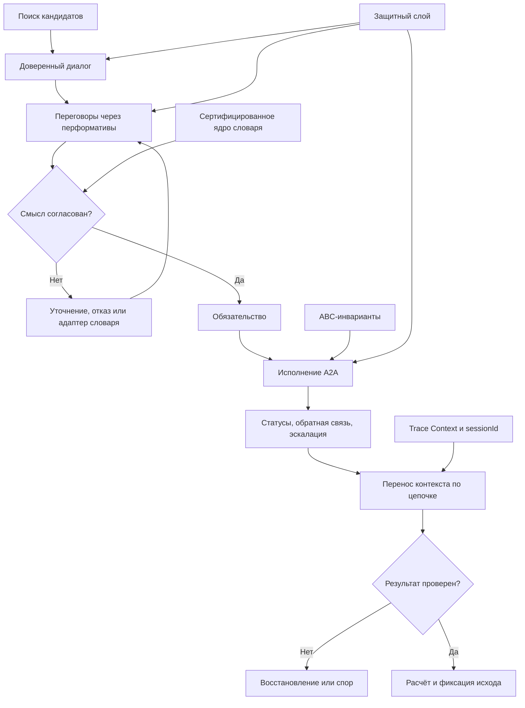

# УРОВЕНЬ 3 / ИЗМЕРЕНИЕ 02: СЕМАНТИКО-ПРОТОКОЛЬНОЕ

> **Уровень:** L3 — Межагентные взаимодействия  
> **Измерение:** D02 — Semantic-Protocol  
> **Учебная редакция:** v1.0  
> **Главная тема:** как сеть агентов сохраняет общий смысл сообщений, намерений и обязательств при росте

---

## Ключевой вопрос

**На каком языке и через какие смысловые протоколы Логосы понимают намерения и контекст друг друга при взаимодействии?**

---

## Краткое описание измерения

Когда в сети работают тысячи Логосов, им недостаточно просто переслать сообщение.

Нужно понять, что сообщение означает: это просьба, предложение, отказ, отчёт о прогрессе, сигнал об ошибке или обещание выполнить работу.

Настоящее измерение объясняет, как сеть связывает смысл сообщения, намерение отправителя, доверенный диалог, переговоры, исполнение и последующий расчёт в один межагентный цикл.

Эта глава отвечает на несколько практических вопросов:

1. Какой общий язык нужен Логосам, чтобы различать просьбу, предложение, согласие, отказ и отчёт?
2. Почему один стандарт связи не закрывает весь путь от поиска партнёра до расчёта?
3. Как сеть сохраняет смысл задачи, если сообщение проходит через несколько агентов и подсетей?
4. Что делать, если разные части сети по-разному называют способности, схемы и условия?
5. Где проходит граница между смыслом сообщения, транспортной инфраструктурой, идентичностью, договором и расчётом?
6. Какие вопросы остаются открытыми для управления, прототипирования и доменной политики?

---

## Мини-глоссарий

| Термин | Простое объяснение |
|--------|--------------------|
| **Логос** | Агент, который действует в цифровой среде и вступает во взаимодействия с другими агентами. |
| **Семантика** | Смысл сообщения: что именно участник хотел сказать и какое обязательство из этого следует. |
| **Смысловой протокол** | Правила, по которым сообщения превращаются в понятные действия и обязательства. |
| **Речевой акт** | Сообщение как действие: попросить, предложить, подтвердить, отказаться, сообщить. |
| **Перформатив** | Тип речевого акта в сообщении, например `request`, `inform`, `cfp` или `accept-proposal`. |
| **FIPA ACL** | Язык коммуникации агентов, где сообщения классифицируются по перформативам. |
| **BDI** | Модель, где поведение агента объясняется через убеждения, желания и намерения. |
| **ABC** | Контракты поведения агента: проверяемые условия, инварианты, правила управления и восстановления. |
| **A2A** | Межагентный протокол выполнения задач: как агенты оформляют сообщения, задачи, состояния и результаты. |
| **DIDComm** | Протокол защищённых сообщений на базе децентрализованных идентификаторов. |
| **DID** | Децентрализованный идентификатор, который помогает проверить, кто участвует в диалоге. |
| **VC** | Проверяемое учётное данное: цифровое утверждение, подлинность которого можно проверить. |
| **Agent Card** | Машиночитаемая карточка агента с метаданными, возможностями и точкой входа. |
| **ADS** | Сервис или механизм поиска агентов по заявленным возможностям. |
| **CNP** | Протокол конкурентного распределения задач: запрос предложений, ответы и выбор исполнителя. |
| **`cfp`** | Перформатив "запрос предложений", с которого начинается конкурентный сбор предложений. |
| **SLA** | Соглашение об уровне сервиса: какие условия исполнения считаются обязательными. |
| **XAP** | Сравнительный протокол жизненного цикла взаимодействия от поиска до аудита. |
| **Verifiable Semantics** | Подход, где значение терминов сертифицируется и обновляется при смысловом дрейфе. |
| **Сертифицированное ядро словаря** | Небольшой набор терминов, значение которых сеть считает проверенным и общим. |
| **Смысловой дрейф** | Ситуация, когда один и тот же термин со временем начинает пониматься по-разному. |
| **Адаптер** | Слой перевода между разными схемами, словарями и форматами соседних экосистем. |
| **Многошаговый контекст** | Связь между сообщениями, когда задача проходит цепочку `A -> B -> C -> D`. |
| **W3C Trace Context** | Стандарт передачи причинной трассы через заголовки `traceparent` и `tracestate`. |
| **OpenTelemetry Baggage** | Механизм передачи ограниченных подсказок контекста между сервисами. |
| **`sessionId`** | Идентификатор сессии или ветки диалога, помогающий связать несколько сообщений. |
| **NATS** | Инфраструктурный брокер сообщений для быстрой доставки событий и потоков. |
| **SLIM** | Сетевой протокол для низкозадержочной межагентной коммуникации. |
| **AGNTCY** | Набор инфраструктурных стандартов для каталогов, идентичности, маршрутизации и наблюдаемости агентов. |
| **AP2** | Протокол агентных платежей, связанный с состояниями расчёта. |
| **VCAP** | Проверочная рамка для подтверждения расчёта и результата обмена. |
| **mTLS** | Взаимная проверка сторон на транспортном уровне. |
| **Nonce** | Одноразовое значение, которое помогает защититься от повторной отправки старого сообщения. |

---

# 0. Гипотетический пример

Представим большую агентную среду, где работают разные подсети: юридическая, вычислительная, исследовательская, финансовая и инфраструктурная.

В каждой подсети есть свои Логосы, свои каталоги агентов, свои привычные названия способностей и свои правила допуска. При этом задачи часто проходят через несколько подсетей.

**Марина** — оператор исследовательской программы. Её Логос запускает сетевую задачу: собрать аналитический отчёт, проверить источники, прогнать расчётную модель, подготовить юридически аккуратное резюме и провести оплату нескольким исполнителям.

**Сетевой координатор** — Логос, который собирает цепочку исполнителей из разных подсетей.

**Исполнители** — Логосы из разных доменов: один умеет искать данные, второй проверяет терминологию, третий запускает расчёты, четвёртый оформляет результат.

Проблема не в том, что сообщение не дойдёт. Проблема в том, что разные участники могут понять одно и то же сообщение по-разному.

Например, "проверить модель" для исследовательской подсети может означать проверку допущений, для вычислительной подсети — запуск тестового набора, а для юридической подсети — проверку допустимости использования результата.

## Проверка 1. Найти не просто адрес, а подходящих участников

Сначала координатор ищет кандидатов.

На этом шаге соседние измерения помогают найти агентов, их карточки и маршруты связи. Настоящее измерение отвечает за другой вопрос: достаточно ли ясно описан смысл способности, чтобы найденный агент действительно подходил для диалога?

Если карточка агента говорит "проверяю модели", сеть должна понять, о какой именно проверке идёт речь: математической, юридической, вычислительной или смысловой.

## Проверка 2. Установить доверенный диалог до переговоров

Перед переговорами участники должны понять, кто с кем разговаривает и можно ли доверять каналу.

Идентичность и криптографическая защита принадлежат соседним слоям. Здесь важно, что без доверенного диалога смысловые сообщения опасны: неподтверждённое `accept-proposal` может выглядеть как согласие, хотя его нельзя считать действительным обязательством.

## Проверка 3. Различить намерение сообщения

Координатор отправляет запрос предложений. Один исполнитель отвечает предложением, второй просит уточнение, третий отказывается, четвёртый сообщает, что может выполнить только часть работы.

Все эти ответы должны быть различимы машинно. Иначе сеть увидит просто набор текстов, а не разные действия: запрос, предложение, отказ, подтверждение, отчёт или сигнал о проблеме.

## Проверка 4. Согласовать смысл между подсетями

Допустим, исследовательская подсеть использует один словарь для "валидации", а вычислительная подсеть — другой.

Если сеть предполагает, что все уже говорят на одном языке, она может выбрать неподходящего исполнителя. Поэтому нужен сертифицированный общий словарь, правила сопоставления терминов и адаптеры между подсетями.

## Проверка 5. Провести задачу через цепочку без потери контекста

Задача проходит по маршруту:

Каждый участник видит не всю историю, а только нужную часть. Поэтому вместе с сообщением должен переноситься причинный контекст: какая задача началась, какая сессия продолжается, какое обязательство уже согласовано и какой результат ожидается дальше.

## Проверка 6. Завершить не текстом "готово", а проверяемым исходом

Когда исполнители говорят "готово", этого ещё недостаточно.

Нужно понять, что именно завершено, по каким условиям, какие артефакты получены, какие обязательства выполнены, где начинается расчёт и где остаётся след для последующей проверки.

## Главное из примера

**На сетевом масштабе смысл сообщения становится инфраструктурным ресурсом: если сеть не различает намерения, контекст и обязательства, она не может надёжно координировать множество независимых Логосов.**

---

# Содержание

1. Зачем сети смысловой слой
2. Пятиуровневый коммуникационный стек
3. Пять фаз межагентного взаимодействия
4. Язык намерений: перформативы, BDI и ABC
5. Совместимость смыслов и перенос контекста
6. Защитный слой и операционные границы
7. Связь и границы с другими измерениями
8. Итоговая модель целиком
9. Короткое резюме главы
10. Вопросы без ответа

---

# 1. Зачем сети смысловой слой

В малой системе можно надеяться, что участники заранее договорились о словах.

На уровне сети это не работает. Логосы могут приходить из разных подсетей, использовать разные карточки способностей, разные схемы данных, разные маршруты и разные правила оформления задач.

Поэтому настоящему измерению принадлежит не транспорт сообщений и не низкоуровневая идентичность. Его предмет — смысловой цикл:

1. что означает сообщение;
2. какое намерение оно выражает;
3. какое обязательство оно создаёт;
4. как это обязательство переходит в переговоры, исполнение и расчёт;
5. как смысл сохраняется при прохождении через несколько агентов.

Один внешний стандарт не закрывает весь цикл целиком. Межагентный протокол выполнения задач (англ. Agent-to-Agent Protocol, далее — A2A) полезен как базовая рамка исполнения. Защищённые сообщения на базе децентрализованных идентификаторов (`DIDComm`) полезны для доверенного диалога. Язык коммуникации агентов (англ. Foundation for Intelligent Physical Agents Agent Communication Language, далее — FIPA ACL) даёт язык речевых актов. Сравнительный протокол жизненного цикла (`XAP`) помогает проверить полноту фаз. Инфраструктурные стандарты маршрутизации и наблюдаемости помогают переносить контекст.

Но всё это вместе ещё не означает, что сеть автоматически понимает смысл. Нужен слой композиции: он связывает эти элементы в общий межагентный цикл.

> Смысловой слой отвечает не за то, "по какому проводу пришло сообщение", а за то, какое действие и обязательство это сообщение создаёт.

В примере Марины это видно сразу: координатор не просто пересылает текст. Он должен понимать, что `cfp` запускает сбор предложений, `propose` является предложением с условиями, `accept-proposal` создаёт обязательство, а `mission-status` сообщает о ходе длительной работы.

## Главное

**Настоящее измерение задаёт общий смысл межагентного диалога: от намерения сообщения до обязательства, исполнения и расчёта. Один стандарт связи не заменяет этот слой, потому что разные части цикла покрываются разными протоколами и рамками.**

---

# 2. Пятиуровневый коммуникационный стек

Чтобы сеть не смешивала смысл, транспорт, идентичность и поиск, коммуникацию удобно разложить на пять уровней.

Это не пять независимых систем, а пять вопросов, которые должны быть закрыты одновременно.

| Уровень | На какой вопрос отвечает | Основные решения-кандидаты | Что принадлежит настоящему измерению |
|---------|--------------------------|----------------------------|--------------------------------------|
| **Смысловой** | Что означает сообщение и какое обязательство оно создаёт? | `FIPA ACL`, гибридная модель намерений, `ABC`, `Verifiable Semantics` | Полное владение смыслом перформативов, моделью намерений и совместимостью значений. |
| **Протокольный** | Как оформляется межагентная сессия и задача? | `A2A`, `DIDComm`, элементы жизненного цикла `XAP` | Только смысловая композиция поверх протоколов, без повторения их механики. |
| **Маршрутизация** | Как сообщение проходит через сеть, поток или шлюз? | `NATS`, `SLIM`, агентные шлюзы, потоковая передача | Только требование переносить смысловой и причинный контекст. |
| **Идентичность** | Кто говорит и чем подтверждает право говорить? | `DID`, `VC`, подписанные или зашифрованные сообщения | Только роль доверенного диалога перед переговорами. |
| **Поиск** | Кого можно вызвать и по каким признакам способности? | `Agent Card`, `ADS`, каталоги агентов | Только смысловой переход от списка кандидатов к диалогу. |

## 2.1 Почему стек составной

Архитектурная потребность проста: разные части задачи требуют разных видов уверенности.

Сначала нужно найти кандидата. Потом понять, кто он. Затем договориться о смысле задачи. После этого выполнить её как состояние с сообщениями и артефактами. В конце нужно связать результат с расчётом и проверкой.

`A2A` может использоваться как базовая рамка исполнения: задачи, сообщения, артефакты, состояния, многошаговая ветка диалога через `sessionId`, публикация карточки агента через `/.well-known/agent.json`, а также передача через `JSON-RPC 2.0` поверх защищённого HTTP. Но соответствие `A2A` само по себе не устраняет расхождения между словарями, схемами и допущениями разных подсетей.

`XAP` полезен не как замена `A2A`, а как сравнительная рамка полного жизненного цикла. Он показывает, что взаимодействие можно мыслить через этапы "найти, проверить, договориться, выполнить, рассчитать, оставить след проверки" и через шесть объектов: `AgentManifest`, `AgentIdentity`, `NegotiationContract`, `SettlementIntent`, `ExecutionReceipt`, `VerityReceipt`.

## 2.2 Где нужен адаптер

Если две подсети обе поддерживают `A2A`, это ещё не значит, что их карточки способностей, схемы и словари совпадают.

Одна подсеть может описывать способность через "model validation", другая — через "verification", третья — через локальную категорию. Без адаптера сеть получит совпадение по формату, но не по смыслу.

Поэтому для межэкосистемных маршрутов нужен слой перевода: какие поля считаются общим ядром, какие переводятся, какие требуют повторной сертификации, какие нельзя автоматически сопоставлять.

В истории Марины координатор может найти трёх исполнителей с похожей меткой. Адаптер нужен, чтобы отличить проверку исходных данных от проверки расчётной модели и от правовой проверки использования результата.

## Главное

**Пятиуровневый стек отделяет смысл от транспорта, маршрута, идентичности и поиска. Настоящее измерение владеет смысловой композицией: оно объясняет, как сообщения становятся понятными намерениями и обязательствами поверх соседних слоёв.**

---

# 3. Пять фаз межагентного взаимодействия

Смысловой слой нужен не только для отдельных сообщений. Он нужен для всего жизненного цикла взаимодействия.

Базовая последовательность выглядит так:

| Фаза | Смысловая цель | Что важно для настоящего измерения | Где проходит граница |
|------|----------------|-------------------------------------|----------------------|
| **1. Поиск** | Найти подходящих кандидатов. | Поиск должен привести не просто к адресу, а к набору кандидатов с понятным раскрытием способностей. | Каталоги и механика поиска принадлежат соседнему координационному слою. |
| **2. Установление доверенного диалога** | Убедиться, кто участвует и можно ли доверять каналу. | Смысловые сообщения интерпретируются только после доверенного начала диалога. | Криптографическая механика и режимы `DIDComm` принадлежат коммуникационному слою отдельного Логоса. |
| **3. Переговоры** | Согласовать условия, обязанности и критерии принятия или отказа. | Настоящее измерение задаёт смысл `cfp`, `propose`, `accept-proposal`, `reject-proposal`. | Полная координационная механика `CNP` принадлежит уровню механизмов координации. |
| **4. Исполнение A2A** | Выполнить согласованную задачу как состояние с сообщениями и артефактами. | Состояния исполнения используются как фаза после переговоров. | Транспорт, состояния задач и инфраструктурная механика принадлежат коммуникационной инфраструктуре. |
| **5. Расчёт и фиксация исхода** | Превратить "выполнено" в проверенный экономический и нормативный результат. | Настоящее измерение фиксирует смысл перехода от завершения к расчёту. | Платёжные состояния, эскроу и сверка принадлежат транзакционно-обменному измерению. |

## 3.1 Почему "выполнено" недостаточно

В одноразовом чате можно написать "готово".

В сети Логосов этого мало. Нужно знать:

- какая задача была согласована;
- какой исполнитель взял обязательство;
- какие условия считались принятыми;
- какие артефакты получены;
- какой результат можно передавать в расчёт;
- что остаётся для наблюдаемости и последующей проверки.

Поэтому расчёт не является неявным хвостом исполнения. Он должен быть явной фазой: с состояниями, артефактами проверки и возможностью сверить, что именно завершилось.

## 3.2 Что происходит в переговорах

Переговоры не сводятся к короткой цепочке "запросил — предложил — выбрал".

Сообщение `cfp` должно нести интерпретируемые поля: цену, способность или уровень сервиса, ссылку на репутационный контекст и данные о задержке. Конкретные веса оценки и логика выбора победителя принадлежат рыночному слою, а здесь важно другое: контрагент должен понять, что именно от него запрошено и какое обязательство он создаёт своим предложением.

Переговоры также включают раскрытие способностей, подтверждение учётных данных, работу с неопределённостью, несколько целей одновременно и возможность объяснения или эскалации.

## 3.3 Длинные задачи требуют промежуточных сигналов

Если задача выполняется долго, `accept-proposal` не завершает смысловой цикл. После согласия возникают взаимные обязательства, а во время исполнения нужны сигналы прогресса, обратной связи и восстановления.

Контракты поведения агента помогают удерживать эти обязательства в допустимых границах: какие условия должны быть выполнены до старта, какие инварианты нельзя нарушать, что делать при отклонении.

В истории Марины расчётный исполнитель может принять задачу, но затем обнаружить, что исходных данных недостаточно. Смысловой слой должен отличить обычный статус выполнения от запроса обратной связи и от эскалации, когда требуется вмешательство по политике или ресурсным ограничениям.

## Главное

**Полный межагентный цикл состоит из поиска, доверенного диалога, переговоров, исполнения и расчёта. Настоящее измерение объясняет смысл переходов между фазами, но не забирает у соседних измерений транспорт, координацию, договоры и платежи.**

---

# 4. Язык намерений: перформативы, BDI и ABC

Чтобы сеть понимала намерения, сообщение должно иметь тип действия.

Текст "я могу выполнить задачу" сам по себе неоднозначен. Это может быть предложение, предварительная оценка, уточнение, рекламное описание или обещание. Перформатив снимает часть неоднозначности: он говорит, каким действием является сообщение.

## 4.1 Классический набор перформативов

Для настоящего измерения базовый язык намерений строится на 22 классических перформативах `FIPA ACL`:

`accept-proposal`, `agree`, `cancel`, `cfp`, `confirm`, `disconfirm`, `failure`, `inform`, `inform-if`, `inform-ref`, `not-understood`, `propagate`, `propose`, `proxy`, `query-if`, `query-ref`, `refuse`, `reject-proposal`, `request`, `request-when`, `request-whenever`, `subscribe`.

Особенно важны для переговоров и обязательств:

| Перформатив | Простое значение | Роль в межагентном цикле |
|-------------|------------------|---------------------------|
| `cfp` | "Запросите предложения по такой задаче". | Запускает конкурентный сбор предложений. |
| `propose` | "Я предлагаю выполнить на таких условиях". | Создаёт предложение, которое можно принять или отклонить. |
| `accept-proposal` | "Предложение принято". | Переводит предложение в обязательство. |
| `reject-proposal` | "Предложение отклонено". | Завершает ветку предложения без обязательства. |
| `inform` | "Сообщаю факт или результат". | Передаёт состояние, результат или подтверждённую информацию. |
| `request` | "Прошу выполнить действие". | Запускает действие вне конкурентного сбора предложений. |

## 4.2 Три расширения для длительных взаимодействий

Открытая сеть не всегда работает короткими сделками. В длительных задачах нужны дополнительные речевые действия.

| Расширение | Зачем нужно | Что не заменяет |
|------------|-------------|-----------------|
| `request-feedback` | Запросить обратную связь по предложению, промежуточному результату или смысловому соответствию. | Не заменяет принятие или отказ. |
| `mission-status` | Передать явный сигнал о ходе длительной миссии. | Не заменяет состояния задачи в `A2A`. |
| `escalation` | Сообщить, что задача вышла за границу политики, полномочий или ресурсов. | Не заменяет полную систему восстановления исполнения. |

Эти расширения добавляют точность речевому акту поверх модели задачи. Они не превращают смысловой слой в транспортный или договорный.

## 4.3 Как понимать намерение

Один перформатив ещё не раскрывает всю картину.

Нужно совместить несколько взглядов:

- модель убеждений, желаний и намерений (англ. Belief-Desire-Intention, далее — BDI) описывает внутреннюю гипотезу о состоянии агента;
- теория речевых актов описывает публичную силу сообщения;
- институциональный слой описывает обязательства, обещания и декларации;
- вероятностный вывод помогает обновлять гипотезу о намерении, когда информации мало или она шумная.

Такой гибрид нужен потому, что Логосы могут быть разными: одни строго следуют сценариям, другие работают вероятностно, третьи подключают людей или внешние инструменты. Смысловой слой не должен притворяться, что намерение всегда видно напрямую.

## 4.4 Контракты поведения

Для открытых цепочек недостаточно сказать: "агент обещал".

Нужно ограничить, что считается допустимым поведением во время выполнения. Для этого применяются контракты поведения агента (англ. Agent Behavioral Contracts, далее — ABC). Они задают:

- предварительные условия;
- инварианты;
- правила управления;
- правила восстановления.

В формальной части `ABC` использует вероятностное соблюдение обязательств `(p, delta, k)-satisfaction` и ограничение дрейфа: если параметр удержания больше параметра отклонения (`gamma > alpha`), то отклонение ограничено выражением `D* = alpha / gamma`.

Эта формула не является учебным коэффициентом для настройки. Она показывает смысловой принцип: обещание в открытой сети должно иметь проверяемую границу соблюдения, иначе перформатив остаётся слишком слабым.

В истории Марины `mission-status` от расчётного исполнителя не просто "сообщение в чат". Оно проверяется относительно условий: задача началась, входные данные соответствуют договорённости, инварианты не нарушены, а при отклонении есть правило восстановления или эскалации.

## Главное

**Язык намерений состоит из перформативов, гибридной модели намерения и контрактных ограничений поведения. Перформатив говорит, каким действием является сообщение; BDI и речевые акты помогают понять намерение; ABC задаёт проверяемые границы исполнения.**

---

# 5. Совместимость смыслов и перенос контекста

На уровне сети нельзя предполагать, что все участники используют одну полную онтологию.

Общая модель понятий важна, но настоящему измерению принадлежит другой вопрос: как межагентный смысл остаётся согласованным, когда словари, схемы и подсети различаются.

## 5.1 Почему полный общий словарь не является исходным допущением

Если вся сеть обязана заранее принять один полный словарь, рост замедляется. Каждое новое сообщество, домен или внешняя экосистема будет требовать глобального согласования.

Более жизнеспособный подход:

1. выделить ограниченное сертифицированное ядро словаря;
2. сопоставлять термины между подсетями;
3. проводить переговоры о значении там, где сопоставление неочевидно;
4. повторно сертифицировать значения при смысловом дрейфе;
5. использовать адаптеры между экосистемами.

Подход проверяемой семантики (англ. Verifiable Semantics) полезен именно здесь: он не требует, чтобы вся сеть сразу стала единой онтологией, но позволяет сертифицировать ключевые значения и пересматривать их при расхождении.

Как ориентир из исходной модели: применение такого подхода связывается со снижением расхождений между значениями на 51-96%, а при расхождении словарей — с удержанием остаточного несогласия около 2%. Эти числа не являются учебными коэффициентами для настройки; они показывают порядок эффекта, зафиксированный в исходном исследовательском слое.

## 5.2 Типовые проблемы совместимости

| Проблема | Что происходит | Какой вывод для смыслового слоя |
|----------|----------------|---------------------------------|
| Разные словари | Подсети используют похожие слова для разных действий. | Нужны сертифицированное ядро, сопоставление и переговоры о значении. |
| Смысловой дрейф | Термин со временем меняет смысл. | Нужна повторная сертификация и управление версиями словаря. |
| Неполная онтология способностей | Нет завершённой модели всех способностей и их связей. | Нельзя делать вид, что все способности уже описаны окончательно. |
| Межэкосистемная несовместимость | Разные экосистемы по-разному описывают карточки, схемы и метаданные. | Нужен адаптер, даже если базовый протокол сообщений похож. |

Здесь важно отличить настоящее измерение от онтологического слоя среды. Онтологический слой отвечает за общие модели понятий. Настоящее измерение отвечает за то, как эти значения используются, сопоставляются и проверяются в живом межагентном диалоге.

## 5.3 Контекст в многошаговой цепочке

Когда сообщение проходит цепочку `A -> B -> C -> D`, смысл передаётся не только в тексте сообщения.

Нужен причинный контекст:

- какая задача породила эту цепочку;
- какая сессия продолжается;
- какое предложение было принято;
- какие ограничения действуют;
- какой шаг должен быть связан с последующим расчётом.

Для такой задачи подходят стандарт передачи трассы `W3C Trace Context` с заголовками `traceparent` и `tracestate`, а также механизм переносимых подсказок `OpenTelemetry Baggage`. Идентификатор `sessionId` помогает связать сообщения внутри многошаговой сессии.

При этом `baggage` нельзя считать безопасным контейнером для чувствительных данных: такие подсказки могут быть видимы в заголовках на недоверенных участках сети. Поэтому туда должны попадать только строго ограниченные и допустимые к передаче значения.

## 5.4 Как измерять совместимость

У смысловой совместимости нет одного универсального показателя.

Нужен набор приближённых метрик:

- доля расхождений в значениях;
- качество модели намерений;
- соблюдение соглашений о наблюдаемости;
- отслеживание общего контекста между участниками;
- способность обобщать взаимодействие на новых партнёров.

Это означает, что архитектурный ответ можно сформулировать уже сейчас, но единую метрику качества смысловой совместимости нельзя объявлять завершённой без отдельной стандартизации.

В истории Марины это проявляется так: координатор может увидеть, что два исполнителя оба заявляют "валидацию", но один понимает это как проверку данных, а другой — как проверку расчётной модели. Смысловой слой должен выявить расхождение до принятия предложения, а не после неудачного исполнения.

## Главное

**Сеть не должна исходить из полной общей онтологии. Практический путь — сертифицированное ядро словаря, сопоставление значений, повторная сертификация при дрейфе, адаптеры между экосистемами и перенос причинного контекста по всей цепочке взаимодействия.**

---

# 6. Защитный слой и операционные границы

Смысловое сообщение создаёт обязательство только тогда, когда его можно безопасно интерпретировать.

Если злоумышленник повторно отправит старое `accept-proposal`, подменит карточку агента или понизит уровень протокола, сеть может увидеть формально понятное сообщение, которое нельзя считать действительным.

Поэтому защита должна стоять не "после протокола", а на переходах между поиском, доверенным диалогом, переговорами и исполнением.

## 6.1 Какие угрозы закрывает защитный слой

| Угроза | Что может произойти | Нужная защита |
|--------|---------------------|---------------|
| Подмена или изменение сообщения | Участник видит не то обязательство, которое отправитель создавал. | Подписанные или зашифрованные сообщения, проверка отправителя, `mTLS`. |
| Повтор старого сообщения | Старое согласие или предложение используется повторно. | `nonce`, отметки времени, ограниченное окно повтора, порядок сообщений. |
| Внедрение ложного сообщения | Система принимает неподтверждённый текст за действительный речевой акт. | Проверка подписи, подтверждение способностей, проверка поведения. |
| Понижение протокола или подмена поиска | Участника переводят на менее защищённый маршрут или ложную карточку. | Закрепление версии протокола, подписанные метаданные поиска, доверенная публикация карточек. |

## 6.2 Почему базового выполнения недостаточно

Базовая рамка `A2A` полезна для межагентного исполнения, но сама по себе не задаёт полный обязательный защитный минимум для всех сред.

Поэтому поверх неё нужен протокольный защитный слой: аутентифицированное и зашифрованное установление доверенного диалога, защита от повтора, устойчивость к подмене и понижению протокола, явная целостность сообщения.

`DIDComm` здесь выступает возможным решением для доверенного обмена сообщениями. Но настоящее измерение не описывает всю его криптографическую механику. Оно фиксирует роль: до переговоров стороны должны перейти в состояние, где смысловые сообщения можно интерпретировать как сообщения от проверенных участников.

## 6.3 Что остаётся за пределами настоящего измерения

Не вся обработка ошибок принадлежит смысловому слою.

Настоящее измерение описывает смысловые границы отказов по фазам: не найден кандидат, не установлен доверенный диалог, предложение не принято, исполнение не дало нужного результата, расчёт не подтверждён.

Но универсальные шаблоны повторов, задержек, предохранителей, компенсаций и восстановления принадлежат соседним слоям исполнения, инфраструктуры и расчёта.

Также остаётся открытым практический вопрос задержки: есть данные по отдельным криптографическим операциям и по применимости доверенного установления канала при удачном использовании кэша, но нет полного измерения задержки для реалистичной цепочки "поиск -> доверенный диалог -> переговоры -> исполнение -> многошаговый маршрут".

## Главное

**Смысловые сообщения должны интерпретироваться только внутри защищённого перехода от поиска к доверенному диалогу, переговорам и исполнению. Настоящее измерение задаёт смысл этой защиты, но не присваивает себе всю криптографию, транспорт и восстановление ошибок.**

---

# 7. Связь и границы с другими измерениями

Настоящее измерение находится между сетевой структурой, коммуникационной инфраструктурой, координацией, обменом ценностью и договорами. Оно не заменяет соседние слои, а объясняет, как поверх них возникает общий смысл межагентного диалога.

| Измерение | Связь | Граница ответственности |
|-----------|-------|--------------------------|
| **L1/D05 (Коммуникационное)** | Даёт роль защищённого сообщения и выбора агентного протокола для отдельного Логоса. | Настоящее измерение использует доверенный диалог как фазу, но не описывает всю криптографическую механику `DIDComm`. |
| **L2/D06 (Механизмы координации и исполнения)** | Даёт координационные механизмы поиска, конкурентного сбора предложений и распределения задач. | Настоящее измерение объясняет смысл `cfp`, `propose`, принятия и отказа, но не владеет всей координационной процедурой. |
| **L2/D04 (Коммуникационная инфраструктура)** | Даёт транспорт, маршрутизацию, потоковую доставку, шлюзы и инфраструктурные протоколы. | Настоящее измерение требует переносить смысл и контекст, но не описывает внутреннюю инфраструктуру доставки. |
| **L3/D01 (Структурно-топологическое)** | Объясняет, какие сетевые формы и роли позволяют участникам вообще вступать в диалог. | Настоящее измерение работает уже с диалогом и смыслом сообщений, а не с топологией сети как таковой. |
| **L3/D03 (Транзакционно-обменное)** | Даёт расчёт, эскроу, платёжные состояния и сверку результата. | Настоящее измерение рассматривает расчёт как последнюю смысловую фазу, но не описывает платёжную механику. |
| **L3/D04 (Контрактно-договорное)** | Формализует договорённости, уровень сервиса и обязательства в договорной форме. | Настоящее измерение фиксирует момент, когда речевой акт становится обязательством, но не заменяет договорную спецификацию. |

## Главное

**Граница настоящего измерения проходит по смыслу: что сообщение означает, какое намерение выражает и какое обязательство создаёт. Транспорт, поиск, криптография, договоры и платежи остаются у соседних измерений.**

---

# 8. Итоговая модель целиком

Вся модель собирается в один путь: сеть находит кандидатов, устанавливает доверенный диалог, различает речевые акты, согласует обязательства, исполняет задачу, переносит контекст через цепочку и передаёт проверенный исход в расчёт.

Эта схема показывает главное: смысл не живёт в одном сообщении. Он удерживается связкой словаря, перформатива, доверенного канала, состояния задачи, контекста цепочки и правил завершения.

---

# 9. Короткое резюме главы

1. Настоящее измерение отвечает за язык и смысл межагентного взаимодействия, а не за транспорт как таковой.
2. Полный цикл состоит из пяти фаз: поиск, доверенный диалог, переговоры, исполнение и расчёт.
3. Смысловой стек состоит из пяти уровней: смысл, протокол, маршрутизация, идентичность и поиск.
4. Язык намерений строится на 22 классических перформативах `FIPA ACL` и трёх расширениях для длительных задач.
5. Гибридная модель намерений сочетает `BDI`, речевые акты, публичные обязательства и вероятностный вывод.
6. `ABC` добавляет проверяемые границы поведения там, где одного обещания недостаточно.
7. Для роста сети нужен не полный единый словарь сразу, а сертифицированное ядро, сопоставление значений, повторная сертификация и адаптеры.
8. Многошаговый контекст должен переноситься по цепочке, но без чувствительных данных в открытых заголовках.
9. Защитный слой нужен на смысловых переходах, иначе формально понятное сообщение может оказаться неподтверждённым или повторённым.

## Главное

**Семантико-протокольное измерение превращает сетевую коммуникацию из обмена сообщениями в проверяемый цикл намерений, обязательств, исполнения и расчёта.**

---

# 10. Вопросы без ответа

1. **Как именно устроить адаптеры между экосистемами?** Нужно определить, какие поля карточек, схем и метаданных считаются общим ядром, какие переводятся автоматически, а какие требуют ручного или управленческого решения.
2. **Где хранить состояние повторной сертификации смыслов?** Требуется решить, как сеть фиксирует, что термин изменил значение, кто подтверждает новое значение и как старые взаимодействия остаются интерпретируемыми.
3. **Как завершить онтологию способностей для смыслового слоя?** Есть строительные блоки для аттестаций, сопоставления и схем, но не закрыт полный проект словаря способностей и его связи с внешними классификациями.
4. **Как задать явный протокол версионирования словарей?** Нужна политика, похожая на управление версиями: когда изменение совместимо, когда требуется адаптер, когда нужна новая сертификация.
5. **Как измерить задержку полного защищённого межагентного цикла?** Отдельные операции измеримы, но нужна проверка всей цепочки: поиск, доверенный диалог, переговоры, исполнение и многошаговый маршрут.
6. **Как стандартизировать метрики смысловой совместимости?** Сейчас можно использовать набор приближённых показателей, но нет единого завершённого набора метрик для всех типов сетевого взаимодействия.

## Главное

**Открытые вопросы связаны не с самим принципом смыслового слоя, а с управлением версиями, адаптерами, практическими измерениями и доменной политикой для растущей сети.**
