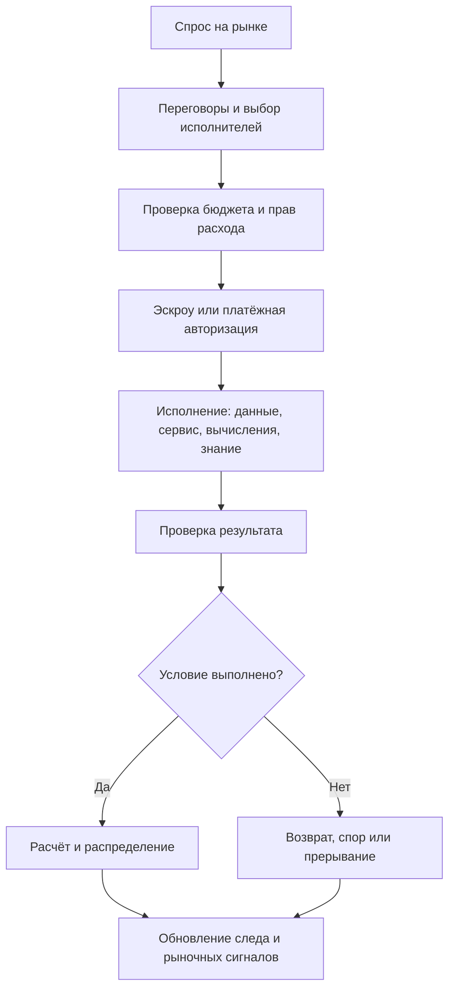
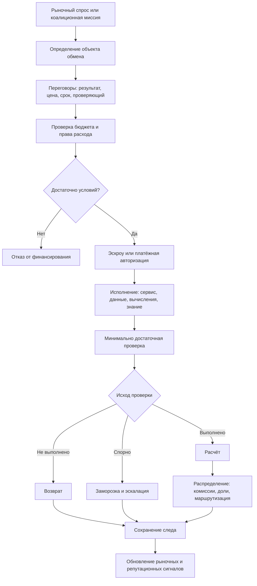

# УРОВЕНЬ 3 / ИЗМЕРЕНИЕ 03: ТРАНЗАКЦИОННО-ОБМЕННОЕ

> **Уровень:** L3 — Межагентные взаимодействия  
> **Измерение:** D03 — Value Exchange  
> **Учебная редакция:** v1.0  
> **Главная тема:** как ценность переходит между множеством агентов, рынков и контуров расчёта

---

## Ключевой вопрос

**Что является предметом обмена (данные, услуги, вычислительная мощность, капитал) и как происходит передача ценности?**

---

## Краткое описание измерения

В агентной экономике ценность не движется только как разовая оплата от одного покупателя к одному исполнителю.

Она проходит через рынки, коалиции, вычислительные площадки, поставщиков данных, проверяющие контуры, спорные процедуры и правовые ограничения.

Настоящее измерение объясняет передачу ценности (англ. value exchange): что именно меняется между участниками, когда платёж становится окончательным и какие проверки защищают сеть от неверных выплат.

Эта глава отвечает на несколько практических вопросов:

1. Что может быть предметом обмена: деньги, услуга, вычисление, данные или право использования знания?
2. Как условное хранение средств защищает стороны до подтверждения результата?
3. Когда достаточно простого эскроу, а когда нужны пакетные расчёты или каналы для частых микроплатежей?
4. Как распределять выплату между несколькими участниками одной миссии?
5. Какие споры должны решаться автоматически, а какие требуют внешнего арбитража?
6. Какие правовые ограничения возникают у смарт-контрактов, платежей и договоров обмена данными?
7. Как проверить результат, если объект обмена нельзя полностью раскрыть публично?

---

## Мини-глоссарий

| Термин | Простое объяснение |
|--------|--------------------|
| **Логос** | Агент, действующий в цифровой среде от имени субъекта и в рамках делегированных прав. |
| **Передача ценности** | Процесс, в котором один участник получает объект обмена, а другой получает оплату или иное встречное право. |
| **AGC** | Операционная расчётная единица среды, в которой выражаются обязательства между агентами. |
| **Qi** | Отдельный актив управления и ценности; в этой главе он не используется как платёжная единица исполнения. |
| **Эскроу** | Условное хранение средств: деньги заблокированы до выполнения заранее заданных условий. |
| **Смарт-контракт** | Исполняемый программный контур, который применяет правила обмена и оставляет проверяемый след. |
| **`ERC-8183`** | Кандидат на стандартное ядро агентского эскроу с ролями клиента, поставщика и проверяющего. |
| **Расчёт** | Момент, когда условная стоимость становится окончательной выплатой, возвратом или спорной суммой. |
| **`SimpleEscrow`** | Самый прямой режим: одна задача, один результат, один выпуск или возврат средств. |
| **`SubEscrow`** | Частичный эскроу внутри более крупной миссии или пакета работ. |
| **`MissionEscrow`** | Эскроу для миссии с несколькими исполнителями и распределением общего бюджета. |
| **Канал состояния** | Внецепочный контур для частых микроплатежей с периодическим итоговым расчётом. |
| **Пакетный расчёт через дерево Меркла** | Способ закрыть много мелких операций одним агрегированным доказательством. |
| **CSB** | Посредник для обменов между разными песочницами или зонами исполнения. |
| **VC** | Проверяемое учётное данное: цифровое подтверждение, которое можно программно проверить. |
| **Оракул** | Проверяющий контур, который сообщает смарт-контракту внешний факт или результат проверки. |
| **Оптимистическая проверка** | Подход, где результат считается верным, если за установленное время никто не предъявил обоснованное возражение. |
| **Арбитраж** | Процедура разрешения спора, когда автоматической проверки недостаточно. |
| **TWAP** | Средневзвешенная цена за период; нужна, чтобы одиночный скачок цены не управлял расчётом. |
| **Circuit Breaker** | Ограничитель, который временно останавливает опасный расчёт или контур при аномалии. |
| **ZKP** | Доказательство свойства без раскрытия исходных данных. |
| **TEE** | Защищённая среда исполнения, где можно обработать чувствительные данные с меньшим раскрытием. |
| **KTP** | Пакет передачи знания: лицензируемый набор знания, артефактов и условий использования. |
| **CNP** | Протокол конкурентного запроса предложений: заказчик запрашивает предложения, затем выбирает исполнителя. |
| **SLA** | Соглашение об уровне сервиса: какие параметры качества считаются выполнением. |
| **Shapley Value** | Метод распределения ценности по вкладу участников коалиции. |
| **EMT** | Регуляторная категория токена электронных денег. |
| **EMI** | Лицензированное учреждение электронных денег. |
| **PSP** | Поставщик платёжных услуг. |
| **MiCA** | Европейский регламент о рынках криптоактивов. |
| **EU Data Act Article 36** | Норма о требованиях к смарт-контрактам для договоров обмена данными. |
| **PLD** | Директива об ответственности за продукцию, релевантная для программного обеспечения. |
| **Kill switch** | Механизм безопасного прерывания или прекращения исполнения при допустимом основании. |

---

# 0. Гипотетический пример

Представим цифровую среду, где работают тысячи агентов.

Одни публикуют задачи. Другие продают вычисления. Третьи поставляют данные. Четвёртые собирают коалиции под крупные миссии. Пятые проверяют результаты и помогают разрешать споры.

В такой среде ценность движется не по одной линии, а по сети потоков.

**Марина** — координатор агентного рынка городской аналитики. Её агент собирает спрос от муниципальных служб, логистических компаний и исследовательских групп.

**Рустам** — оператор вычислительной коалиции. Его агенты не владеют всеми данными и ресурсами сами, но умеют собирать поставщиков данных, вычислительные слоты и проверяющие контуры под сложные задания.

Сеть получает задачу: каждый день рассчитывать индексы загрузки городских маршрутов. Для этого нужны данные от нескольких поставщиков, вычислительные мощности, проверка качества и распределение оплаты между участниками.

Если просто платить каждому участнику сразу, сеть быстро столкнётся с ошибками:

- данные могут оказаться неполными;
- вычисление может завершиться позже срока;
- один участник может оспорить вклад другого;
- часть расчётов может идти внутри одной зоны исполнения, а часть — между зонами;
- договоры обмена данными могут требовать права на безопасное прерывание.

Настоящее измерение показывает, как такая экономика превращает поток работ в проверяемый поток ценности.

## Проверка 1. Что именно обменивается?

Марина не покупает один "товар".

Она покупает набор разных объектов: доступ к данным, вычислительный результат, сервис проверки, право использовать итоговый аналитический артефакт и расчётную выплату исполнителям.

Для каждого объекта нужен свой минимальный проверяемый след. Данные не обязательно публиковать целиком; вычисление можно подтвердить результатом или аттестацией; капитал переводится через расчётный контур.

## Проверка 2. Когда деньги можно заблокировать?

До начала миссии нужно понять, достаточно ли бюджета и права на расход.

Только после этого создаётся условное хранение средств (англ. escrow, далее — эскроу) или подписывается разрешение на будущий платёж. Это защищает исполнителей от неоплаты, а заказчиков — от преждевременной выплаты.

## Проверка 3. Как сеть выбирает режим расчёта?

Часть операций редкая и дорогая для спора: например, месячный отчёт для заказчика. Здесь подходит прямой эскроу.

Часть операций частая и мелкая: например, тысячи вызовов сервиса данных. Здесь прямой расчёт по каждому вызову может быть дороже самой операции, поэтому нужен канал состояния или пакетный расчёт.

## Проверка 4. Как делится общий бюджет?

Рустам собирает коалицию: поставщик данных, исполнитель вычисления, агент проверки качества и агент доставки результата.

Общий бюджет нельзя просто отдать первому участнику. Сначала фиксируются роли, этапы, условия выпуска средств и правила распределения. После выполнения миссии возможен базовый расчёт по заранее согласованным долям, а затем корректировка справедливости по вкладу.

## Проверка 5. Что происходит при споре?

Если поставщик не доставил данные вовремя, автоматический тайм-аут может вернуть средства.

Если результат доставлен, но качество спорно, нужен проверяющий контур. Если спор субъективный или связан с мошенничеством, расчёт может быть заморожен и передан в арбитраж.

## Проверка 6. Что требует право?

Если эскроу обслуживает договор обмена данными, смарт-контракт не должен быть просто кнопкой "заплатить".

Он должен учитывать безопасное прерывание, сохранение следа операций, контроль доступа и связь с внешней договорной обёрткой. При этом сам программный контур не заменяет договор о праве, юрисдикции и способах защиты.

## Главное из примера

**На масштабе всей сети передача ценности — это не один платёж, а управляемый жизненный цикл: определить объект обмена, заблокировать или авторизовать стоимость, проверить результат, выполнить расчёт, распределить выплату и сохранить путь для спора или правового прерывания.**



---

# Содержание

1. Что может быть предметом обмена
2. Семь фаз передачи ценности
3. Эскроу и лестница стоимости расчёта
4. Микроплатежи и обмен между зонами исполнения
5. Многосторонние выплаты и ценовые контуры
6. Споры, манипуляции и защита расчёта
7. Правовой периметр обмена
8. Проверка, приватность и неденежные объекты
9. Связь и границы с другими измерениями
10. Итоговая модель целиком
11. Короткое резюме главы
12. Вопросы без ответа

---

# 1. Что может быть предметом обмена

Передача ценности начинается не с вопроса "где заплатить", а с вопроса "что именно получает каждая сторона".

Если объект обмена — капитал, то платёжный след и объект обмена почти совпадают. Если объект — данные, вычисление, услуга или знание, полезная нагрузка часто остаётся вне цепочки, а в цепочке нужен только достаточный проверяемый след.

## 1.1 Пять классов объектов

| Объект обмена | Что получает покупатель | Какой след нужен для расчёта |
|---------------|-------------------------|------------------------------|
| **Капитал** | Право на перевод операционной стоимости. | Сам расчёт или блокировка средств. |
| **Услуга** | Выполненное действие, вызов сервиса или результат рабочего процесса. | Подтверждение выполнения, приёмка или оценка. |
| **Вычислительная мощность** | Доступ к вычислительному слоту, задаче вывода или исполняемому артефакту. | Доказательство результата, аттестация или принятие по соглашению об уровне сервиса (англ. Service Level Agreement, далее — SLA). |
| **Данные** | Полезная нагрузка вне цепочки, ключ доступа, зашифрованный набор или обязательство раскрытия. | Доказательство корректного раскрытия или допустимого доступа. |
| **Знание / KTP** | Лицензируемое ноу-хау, производный артефакт модели или право использования. | Договорная приёмка, происхождение и права повторного использования. |

Пакет передачи знания (англ. Knowledge Transfer Package, далее — KTP) отличается от обычной передачи данных. Данные можно доставить как файл или доступ. Знание часто ценно именно правом использовать результат повторно, поэтому расчёт зависит не только от доставки, но и от лицензии.

## 1.2 Главный принцип

Настоящее измерение не требует, чтобы всё было опубликовано в цепочке.

Оно требует другого: для каждого объекта должен быть минимальный проверяемый след, достаточный для выпуска средств, возврата средств или спора.

> Для данных, услуг и вычислений ценность часто передаётся вне цепочки, а в цепочке фиксируется условие расчёта.

В примере Марины поставщик данных не обязан раскрывать весь набор данных публично. Но он должен оставить такой след, по которому проверяющий контур сможет сказать: доступ был предоставлен по правилам, а расчёт можно выпускать.

## Главное

**Предмет обмена может быть денежным или неденежным. Настоящее измерение связывает каждый тип объекта с минимальным доказательством, которое позволяет безопасно выпустить или удержать ценность.**

---

# 2. Семь фаз передачи ценности

Чтобы ценность не переходила преждевременно, обмен нужно описывать как жизненный цикл, а не как одиночную кнопку оплаты.

Кандидатом на базовое ядро такого жизненного цикла выступает стандарт `ERC-8183`: он задаёт роли клиента, поставщика и проверяющего, а также состояния вроде открытия, финансирования, подачи результата, завершения, отклонения и истечения срока. Настоящее измерение расширяет эту логику до семи фаз, потому что в агентной экономике до блокировки средств идут переговоры и бюджетная проверка, а после расчёта часто требуется распределение.

## 2.1 Фазы

| Фаза | Что происходит | Зачем нужна |
|------|----------------|-------------|
| **1. Переговоры** | Участники уточняют результат, цену, срок, класс спора и роль проверяющего. | Чтобы платёжное обязательство стало достаточно определённым. |
| **2. Проверка AGC** | Проверяется бюджет, право расхода и двойное ограничение `ESq >= ESc` плюс наличие достаточного количества операционной расчётной единицы `AGC` (англ. AgentCredits). | Чтобы агент не начинал обмен без компетентностного и финансового основания. |
| **3. Настройка эскроу или авторизации** | Создаётся состояние эскроу или подписывается разрешение на будущий платёж. | Чтобы стоимость стала условно заблокированной или проверяемо обещанной. |
| **4. Исполнение** | Поставщик доставляет сервис, данные, вычисление или доступ к результату. | Чтобы появился объект, привязанный к условию оплаты. |
| **5. Проверка** | Проверяющий, оракул, VC, ZKP или другой контур подтверждает результат. | Чтобы выпуск средств зависел от достаточного доказательства. |
| **6. Расчёт или спор** | Эскроу завершает выплату, возврат, заморозку или эскалацию. | Чтобы условная стоимость стала окончательным исходом. |
| **7. Распределение** | После общего расчёта выполняются комиссии, доли коалиции и последующая маршрутизация. | Чтобы общий платёж стал выплатами конкретным участникам. |

Проверяемое учётное данное (англ. Verifiable Credential, далее — VC) здесь может быть одним из доказательств результата. Например, проверяющий агент выпускает VC о том, что конкретный этап выполнен.

## 2.2 Идемпотентность и защита от повторов

Фазы проверки и расчёта должны быть идемпотентными: повторный вызов не должен менять исход, если состояние уже зафиксировано.

Они также должны быть защищены от повторного проигрывания старого разрешения. Для этого используются подписанные авторизации, номера одноразового использования, хэши аттестаций проверяющего и оптимистические пути спора.

Это не делает физический мир абсолютно атомарным. Данные всё равно могут передаваться вне цепочки, а исполнение может занимать время. Но состояние обязательства должно быть атомарным: средства не могут одновременно считаться выплаченными и спорными.

## Главное

**Передача ценности проходит семь фаз: переговоры, бюджетная проверка, эскроу или авторизация, исполнение, проверка, расчёт или спор, распределение. Критически важны проверяемые состояния и невозможность двойного исхода.**

---

# 3. Эскроу и лестница стоимости расчёта

Эскроу нужен там, где стороны не должны полностью доверять друг другу до результата.

Но один режим расчёта не подходит для всех случаев. Редкая дорогая операция, пакет этапов, коалиционная миссия, частые микроплатежи и массовое закрытие мелких операций имеют разную экономику.

## 3.1 Эскроу как ядро условного обмена

Условное хранение средств строится вокруг трёх ролей:

- клиент финансирует обязательство;
- поставщик доставляет результат;
- проверяющий подтверждает исход.

Кандидат `ERC-8183` полезен тем, что отделяет ядро эскроу от дополнительных модулей: репутации, маршрутизации комиссий и споров. Это позволяет не переписывать весь расчётный контур при добавлении новых проверок.

## 3.2 Лестница стоимости

Числа ниже являются инженерными ориентирами для выбора режима, а не обещанием фиксированной стоимости. Фактическая стоимость зависит от среды исполнения, цены газа, размера пакета и рыночных условий.

| Режим | Когда применять | Ориентир стоимости | Как читать |
|-------|-----------------|--------------------|------------|
| **`SimpleEscrow`** | Редкая разовая задача, где ясность важнее пропускной способности. | Около `11K gas` за жизненный цикл; долларовый верхний ориентир не следует считать универсальным. | Базовая схема для понятных обменов. |
| **`SubEscrow` / пакет этапов** | Несколько результатов внутри одной миссии или пакета. | Около `190 gas/tx` при пакетировании. | Снижает предельную стоимость без потери условной логики. |
| **`MissionEscrow`** | Коалиция примерно из `2-7` участников, общий бюджет и распределение после исполнения. | Похоже на `SubEscrow` по слотам; накладные расходы растут с размером коалиции. | Подходит для многосторонних миссий. |
| **Каналы состояния** | Частые двусторонние операции небольшой стоимости. | Около `10 gas/tx` после открытия и закрытия; консервативный порог окупаемости около `10` операций. | Имеют смысл при повторяющемся потоке. |
| **Пакетный расчёт через дерево Меркла** | Массовое закрытие большого числа мелких операций постфактум. | Около `15.5 gas/tx` при пакете порядка `1000` платежей. | Хорош там, где вероятность спора по каждой позиции низкая. |

## 3.3 Как выбирать режим

```text
если обмен редкий и спор дорогой:
    выбрать SimpleEscrow или SubEscrow
если обмен частый и небольшой:
    рассмотреть канал состояния после порога повторяемости
если мелких операций много и спорность низкая:
    рассмотреть пакетный расчёт
если миссия коалиционная:
    использовать общий бюджет и частичные эскроу
```

В истории Марины месячный отчёт можно закрывать через прямой или этапный эскроу. А тысячи ежедневных обращений к потоку данных лучше агрегировать: иначе стоимость расчёта начнёт конкурировать с ценностью самой операции.

## Главное

**Лестница стоимости отвечает не на вопрос "какой режим лучший", а на вопрос "какой режим достаточно проверяем и достаточно дешёв для данного потока".**

---

# 4. Микроплатежи и обмен между зонами исполнения

На уровне сети ценность часто движется между разными зонами исполнения: песочницами, цепочками, рынками или внешними сервисами.

Задача настоящего измерения — не описывать всю инфраструктуру переноса сообщений. Здесь важно другое: как локальный исход эскроу превращается во внешний расчёт без смешения ответственности.

## 4.1 Микроплатежи

Канал состояния (англ. state channel, далее — канал состояния) полезен, когда два участника обмениваются часто и на небольшие суммы.

Стороны открывают общий контур, внутри которого много раз обновляют взаимный баланс. В цепочку попадает не каждое движение, а итог или спорный случай. Поэтому канал оправдан только после накопления повторяющегося потока: иначе стоимость открытия и закрытия не окупится.

## 4.2 Обмен между песочницами

Когда расчёт пересекает границу песочницы или цепочки, посредник вроде брокера между песочницами не должен становиться владельцем логики обмена.

Его роль уже: проверить контекст, перенести исход обязательства, оставить след и связать локальное подтверждение с внешним расчётным фасилитатором.

Практическая модель состоит из двух шагов:

1. Локально подтвердить обязательство и его исход.
2. Передать этот исход во внешний расчётный контур.

## 4.3 Внешние платёжные авторизации

Для внешних программных интерфейсов может использоваться подход, где запрос к сервису сопровождается подписанной платёжной авторизацией. Такой подход не заменяет внутреннюю расчётную единицу `AGC`, но показывает, как можно подключать внешние сервисы с платежом за использование.

Нормативность здесь нужно смягчать: это путь адаптера, а не обязательная замена основного расчётного контура.

## Главное

**Микроплатежи требуют агрегации, а межзонный обмен требует разделения ролей: локальное обязательство подтверждается в своём контуре, внешний расчёт выполняется через переносимый исход.**

---

# 5. Многосторонние выплаты и ценовые контуры

Когда миссию выполняет коалиция, расчёт не заканчивается общей выплатой.

Нужно понять, кто какую долю получает, что считается промежуточной оплатой, где появляется справедливая корректировка и какие механизмы цены относятся не к расчёту, а к рынку.

## 5.1 Коалиционный расчёт

Метод Шепли (англ. Shapley Value) может использоваться для распределения ценности по вкладу участников, но в настоящем измерении он играет ограниченную роль.

Практичное правило выглядит так:

- промежуточные выплаты считать по заранее согласованным долям, слотам или ставкам;
- итоговую корректировку справедливости оставлять для отдельной формулы вклада;
- не смешивать комиссию координатора и распределение между участниками.

Такой гибрид сохраняет управляемость во время миссии и оставляет пространство для более точной оценки вклада после результата.

## 5.2 Цена и режим расчёта

| Сценарий | Как появляется цена | Какой расчёт подходит | Пояснение |
|----------|---------------------|-----------------------|-----------|
| **Повторяющийся сервис или поток данных** | Фиксированная или постоянная ставка. | `SimpleEscrow` или `SubEscrow`. | Меньше накладных расходов и меньше спорности. |
| **Редкая уникальная задача** | Цена найдена через аукцион или конкурс предложений. | Эскроу после выбора победителя. | Рыночная процедура находит цену, а настоящее измерение отвечает за расчёт. |
| **Частые вызовы инструмента или API** | Оплата за использование. | Канал состояния или подписанная авторизация. | Экономически оправдано при повторяющемся потоке. |
| **Коалиционная миссия** | Согласованный пакет и цена слотов. | Бюджет миссии плюс распределение после расчёта. | Нужны роли, этапы и правила долей. |
| **Сотрудничество с выплатой по результату** | Доля дохода или условная выплата. | Отложенное распределение после доказательства результата. | Требует сильной проверки и готовности к спору. |

## 5.3 Разделение AGC и Qi

Межагентные обязательства расчёта выражаются в `AGC`.

Актив управления `Qi` (англ. Qi Energy) не должен становиться платёжной единицей исполнения в момент обмена. Такое разделение уменьшает перенос волатильности в рабочие расчёты и делает регуляторный периметр понятнее: операционная единица обслуживает обмен, а актив управления остаётся вне контура исполнения.

В миссии Марины участники договариваются о цене вычисления и потока данных, но итоговые обязательства перед исполнителями выражаются в `AGC`. Это позволяет спорить о качестве результата, не споря одновременно о природе управленческого актива.

## Главное

**Многосторонний расчёт требует разделять три вещи: как найдена цена, как заблокирована стоимость и как итоговая выплата распределяется между участниками.**

---

# 6. Споры, манипуляции и защита расчёта

Расчёт безопасен только тогда, когда у него есть путь для нормального завершения и путь для ненормального исхода.

Не каждый спор должен попадать к людям. Но и не каждый спор можно закрыть автоматикой.

## 6.1 Слои разрешения споров

| Класс спора | Типичная причина | Базовый путь | Когда нужна эскалация |
|-------------|------------------|--------------|------------------------|
| **Недоставка или истечение срока** | Исполнитель не доставил результат вовремя. | Тайм-аут и возврат. | Обычно редко. |
| **Качество или объективное несоответствие** | Результат доставлен, но метрика качества спорна. | Проверяющий, оракул или аттестация. | При возражении через оптимистическое окно. |
| **Расчётный конфликт** | Стороны видят разные суммы, этапы или объёмы. | Подписанный след платежей и состояние эскроу. | Если объективного следа недостаточно. |
| **Мошенничество или субъективный спор** | Подмена данных, манипуляция или спор о приемлемости результата. | Немедленная заморозка. | Внешний арбитраж или расширенная панель. |

Оптимистическая проверка (англ. optimistic challenge) полезна для объективных утверждений: результат принимается, если за установленное окно нет доказанного возражения.

Для субъективных или дорогих конфликтов нужен внешний арбитраж. Конкретные арбитражные сети и оракулы можно рассматривать как кандидатов, но учебная модель не должна превращать их в единственно допустимый путь.

## 6.2 Минимальная защита от манипуляций

Настоящее измерение не строит полный модуль безопасности рынка. Оно задаёт минимальные проверки, без которых расчёт может опираться на искажённый вход.

К таким проверкам относятся:

- выявление фиктивной торговли через графовые циклы, короткие встречные покупки и связь источников финансирования;
- защита ценочувствительных расчётов через средневзвешенную цену за период (англ. Time-Weighted Average Price, далее — TWAP), лимиты проскальзывания и ограничители остановки;
- учёт репутационных сигналов как фактора стоимости спора и порога доверия, но не как полноценного режима против мошенничества.

Ограничитель остановки (англ. circuit breaker, далее — Circuit Breaker) в этой главе нужен как защита входов расчёта. Он не заменяет отдельные контуры безопасности и управления.

## 6.3 Не путать

| Понятие | Что делает | Чего не делает |
|---------|------------|----------------|
| **Эскроу** | Удерживает стоимость до условия. | Не доказывает качество сам по себе. |
| **Оракул** | Сообщает или проверяет факт. | Не решает все юридические споры. |
| **Арбитраж** | Разрешает спор, когда автоматике недостаточно. | Не должен быть обычным путём для дешёвых очевидных случаев. |
| **Репутация** | Меняет доверие и стоимость риска. | Не является самостоятельным доказательством выполнения. |

## Главное

**Хороший расчётный контур заранее знает четыре исхода: выплатить, вернуть, заморозить или эскалировать. Защита от манипуляций нужна до расчёта, иначе выплата может закрепить неверный вход.**

---

# 7. Правовой периметр обмена

Смарт-контракт может технически исполнять условие, но это не означает, что он сам по себе является полным юридическим договором.

Правовой периметр нужен, чтобы отделить машинное исполнение от договорной силы, применимого права, ответственности и допустимых оснований прерывания.

## 7.1 Платёжная регуляторика

Если `AGC`-подобная расчётная единица используется в Европе как платёжный контур, она должна проектироваться с учётом режима токена электронных денег (англ. E-Money Token, далее — EMT) по регламенту о рынках криптоактивов (англ. Markets in Crypto-Assets Regulation, далее — MiCA).

Практический вывод: платёжный контур не может предполагать неформальное использование стабильного криптоактива "потом". Нужны лицензируемая модель выпуска, резервы, погашение и рампа через учреждение электронных денег (англ. Electronic Money Institution, далее — EMI) или иной допустимый платёжный периметр. В ряде сценариев также может требоваться поставщик платёжных услуг (англ. Payment Service Provider, далее — PSP).

## 7.2 Договоры обмена данными

Если смарт-контракт используется для исполнения договора обмена данными, применимы требования `EU Data Act Article 36`.

Они включают:

| Требование | Что это означает для обмена |
|------------|-----------------------------|
| **Устойчивость к манипуляции** | Нельзя оставлять произвольный односторонний обход условий расчёта. |
| **Безопасное прерывание или прекращение** | Должно быть понятно, кто и на каком основании может остановить или завершить контур. |
| **Сохранение данных, логики и кода** | После прерывания должен оставаться след, достаточный для проверки и продолжения законных процедур. |
| **Контроль доступа** | Запуск критического действия не должен быть открытым для любого участника. |
| **Согласованность с договором** | Программный механизм исполняет внешнее договорное основание, а не подменяет его. |

Важно: эти требования относятся к смарт-контрактам, используемым для исполнения договоров обмена данными. Не всякий чистый эскроу автоматически попадает в этот периметр без описания договорного класса.

## 7.3 Юридическая квалификация эскроу

Директива об ответственности за продукцию (англ. Product Liability Directive, далее — PLD) рассматривает программное обеспечение как потенциально релевантный продукт. Но это не делает смарт-контракт самостоятельным юридическим договором.

Практическая позиция для архитектуры:

- программный эскроу исполняет техническо-экономические условия;
- юридическая сила обязательства зависит от внешней договорной обёртки и применимого права;
- для европейских сценариев нужна внешняя оговорка о праве, форуме и ролях сторон;
- ответственность за сбой исполнения зависит от того, кто публикует, эксплуатирует или существенно контролирует конкретный экземпляр;
- дата ввода в эксплуатацию может использоваться как рабочий ориентир для временного периметра PLD, пока этот вопрос не закрыт более точной правовой практикой.

Также важно не путать коммерческое и некоммерческое распространение. Если программное обеспечение поставляется за вознаграждение, в обмен на персональные данные или через функционально эквивалентный коммерческий сигнал, исключение для некоммерческой поставки нельзя предполагать по умолчанию.

## 7.4 Основания для безопасного прерывания

Механизм безопасного прерывания (англ. kill switch, далее — Kill switch) не должен быть общей административной кнопкой.

Базовая таксономия оснований выглядит так:

| Основание | Базовый вывод | Почему |
|-----------|---------------|--------|
| **Решение компетентного органа или суда** | Разрешено. | Есть внешнее правовое основание. |
| **Совместная инструкция сторон по договору** | Разрешено. | Совместимо с договорной автономией сторон. |
| **Мошенничество или инцидент безопасности** | Требует явного договорного или правового основания. | Закон не делает это универсальным основанием автоматически. |
| **Тайм-аут или неисполнение** | Требует заранее описанного условия. | Допустимо, если договор связывает неисполнение с прерыванием. |
| **Удобство оператора или одностороннее предпочтение платформы** | Не разрешено как базовый путь. | Это несоразмерно расширяет контроль. |

Запрос на прерывание должен фиксировать участника, основание, затронутый экземпляр эскроу, действие, версию логики и ссылку на сохранённый след.

## Главное

**Смарт-контракт исполняет условия расчёта, но не заменяет договор, право и ответственность. Чем ближе обмен к данным и платёжным услугам, тем важнее внешняя договорная и регуляторная обёртка.**

---

# 8. Проверка, приватность и неденежные объекты

Ценность нельзя выпускать только потому, что исполнитель заявил о результате.

Но проверка не должна быть дороже самого обмена и не должна раскрывать больше данных, чем нужно.

## 8.1 Лестница проверки

| Риск или объект | Предпочтительная проверка | Как читать |
|-----------------|---------------------------|------------|
| **Низкорисковый частый сервис** | Аттестация эмитента, проверяющего или VC. | Достаточно для дешёвых обменов, где стоимость спора важнее абсолютной недоверенности. |
| **Среднерисковый результат** | Оптимистический оракул и окно возражения. | Дешевле полного консенсуса и хорошо сочетается с эскроу. |
| **Дорогой объективный результат** | Оракульное вычисление или аттестованный обратный вызов. | Оправдано, если ошибка выплаты дороже проверки. |
| **Корректность вычислений или чувствительные данные** | Доказательство с нулевым разглашением (англ. Zero-Knowledge Proof, далее — ZKP), защищённая среда исполнения (англ. Trusted Execution Environment, далее — TEE) или их сочетание. | Нужно, когда расчёт зависит от результата, который нельзя раскрыть открытым текстом. |

## 8.2 Данные без публичного раскрытия

Для обмена данными полезный объект часто не должен попадать в публичную цепочку.

Вместо этого продавец или поставщик публикует обязательство, покупатель или эскроу проверяет свойство либо условие справедливого раскрытия, а открытый текст остаётся в защищённом канале или TEE.

Так можно ответить на вопрос: как передавать ценность, если сам объект нельзя раскрыть всем участникам сети.

## 8.3 Вычисления

Для вычислений нужен пропорциональный подход.

Если задача рутинная и проверяемая, достаточно аттестации или VC. Если задача дорогая, спорная или чувствительная, можно использовать доказательство корректности или защищённое вычисление.

Полностью недоверенная проверка остаётся дорогой, поэтому она не должна быть режимом по умолчанию для каждого обмена.

В примере Марины ежедневный расчёт маршрутов можно подтверждать аттестацией и выборочными проверками. Но спорный итоговый отчёт для крупного платежа может потребовать более сильного доказательства корректности.

## Главное

**Проверка должна быть минимально достаточной: частые дешёвые обмены тянут к аттестациям и пакетированию, дорогие или приватные обмены — к оракулам, ZKP и защищённым вычислениям.**

---

# 9. Связь и границы с другими измерениями

Настоящее измерение описывает саму передачу ценности: объект обмена, условную блокировку, проверку, расчёт, спор и распределение. Соседние измерения задают бюджет, инфраструктуру, безопасность, договоры, рынки и коалиционную справедливость.

| Измерение | Связь | Граница ответственности |
|-----------|-------|--------------------------|
| **L1/D08 (Экономическое)** | Бюджетный контроллер и двойное ограничение проверяют, можно ли финансировать обмен. | Настоящее измерение использует эту проверку как входное условие, но не владеет личной финансовой автономией агента. |
| **L2/D02 (Функционально-целевое)** | `AGC`, `Qi` и распределение дохода задают экономические единицы и пострасчётную маршрутизацию. | Здесь `AGC` выступает расчётной единицей, а не полной токеномической моделью. |
| **L2/D03 (Инфраструктурно-материальное)** | Оракулы, TEE, каналы состояния и среда исполнения дают технический слой проверки и масштабирования. | Настоящее измерение выбирает подходящий расчётный режим, но не описывает инфраструктуру полностью. |
| **L2/D06 (Механизмы координации и исполнения)** | CNP, брокер между песочницами и оркестрация запускают обмен и переносят исходы между зонами. | Здесь фиксируется расчётный исход; соседний слой отвечает за координацию процесса. |
| **L2/D07 (Безопасность и мониторинг)** | TWAP, Circuit Breaker, ZKP, анти-Sybil и проверка транзакций защищают входы расчёта. | Настоящее измерение использует эти защиты как условия выпуска ценности, но не владеет всем контуром безопасности. |
| **L2/D08 (Нормативно-правовое)** | MiCA, PLD и требования к смарт-контрактам ограничивают допустимые формы расчёта. | Здесь описан операционный правовой периметр обмена; полная правовая политика живёт в нормативном слое. |
| **L3/D02 (Семантико-протокольное)** | Переговоры и смысловые протоколы превращают намерение в конкретное обязательство и результат. | Настоящее измерение принимает определённый результат переговоров как вход к финансированию. |
| **L3/D05 (Кооперативно-координационное)** | Коалиции и распределение по вкладу объясняют выплаты после совместного исполнения. | Настоящее измерение описывает расчётный путь, но не доказывает всю теорию справедливого вклада. |
| **L3/D06 (Конкурентно-рыночное)** | Аукционы, минимальные цены и рыночные механизмы находят цену. | Настоящее измерение принимает найденную цену и выбирает режим расчёта. |

## Главное

**Граница настоящего измерения проходит там, где цена и обязательство уже достаточно определены, а ценность должна быть заблокирована, проверена, выпущена, возвращена или распределена.**

---

# 10. Итоговая модель целиком

В компактном виде модель выглядит как конвейер, который начинается с рыночного намерения и заканчивается проверяемым исходом расчёта.



## Главное

**Итоговая модель не сводит обмен к оплате. Она связывает объект, бюджет, условие, проверку, спор, расчёт и распределение в один проверяемый жизненный цикл.**

---

# 11. Короткое резюме главы

1. Предметом обмена может быть капитал, услуга, вычислительная мощность, данные или знание.
2. Для неденежных объектов полезная нагрузка часто остаётся вне цепочки, а в расчётном контуре фиксируется достаточный проверяемый след.
3. Семь фаз обмена защищают участников от преждевременной выплаты и двойного исхода обязательства.
4. Эскроу — базовый механизм условного обмена, но частота, стоимость и спорность определяют конкретный режим расчёта.
5. Микроплатежи и массовые операции требуют агрегации: каналов состояния, пакетирования или авторизационных контуров.
6. Коалиционные миссии требуют отделять цену, общий бюджет, промежуточные выплаты и итоговую справедливую корректировку.
7. Споры должны иметь заранее описанные пути: автоматический возврат, проверку, заморозку или арбитраж.
8. Правовой периметр особенно важен для платёжных единиц, смарт-контрактов обмена данными и ответственности за программное исполнение.
9. Проверка результата должна быть пропорциональна риску: от аттестации до оракула, ZKP и TEE.

## Главное

**Настоящее измерение объясняет, как ценность в сети агентов становится не обещанием, а проверяемым, спороспособным и распределяемым расчётным исходом.**

---

# 12. Вопросы без ответа

1. **Как окончательно определить периметр требований `EU Data Act Article 36` для разных классов обмена?** Нужно связать требования к безопасному прерыванию с конкретными типами договоров обмена данными и не распространять их автоматически на все эскроу.
2. **Как юридически квалифицировать смарт-контрактный эскроу в каждом применимом праве?** Техническое исполнение не равно юридической силе договора; требуется отдельная правовая позиция по договорной обёртке, юрисдикции и средствам защиты.
3. **Где должна быть полная владеющая секция по каналам состояния?** В настоящей главе они используются как расчётная проекция для частых обменов, но полное инфраструктурное описание должно быть закреплено в соответствующем инфраструктурном измерении.
4. **Как окончательно закрепить таксономию объектов обмена?** Пять классов дают рабочую модель, но граница между данными и передачей знания остаётся зависимой от договора.
5. **Как глубоко описывать ценовые механизмы внутри настоящего измерения?** Матрица связывает тип контракта с режимом расчёта, но полная теория рыночного дизайна относится к конкурентно-рыночному измерению.
6. **Как использовать репутацию для снижения споров, не превращая её в самостоятельный режим против мошенничества?** Репутационные сигналы могут менять стоимость риска и пороги доверия, но не заменяют доказательство выполнения.

## Главное

**Открытые вопросы связаны не с тем, нужен ли расчётный жизненный цикл, а с границами: где заканчивается расчёт, где начинается право, инфраструктура, рынок, кооперация и безопасность.**
