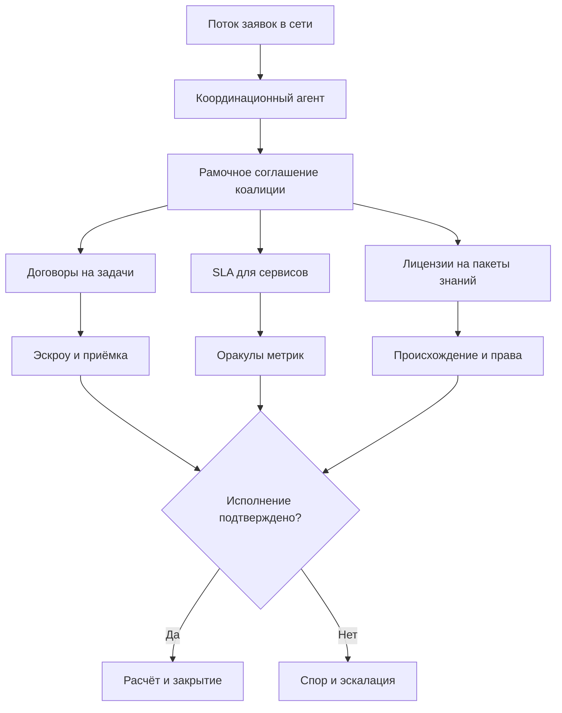
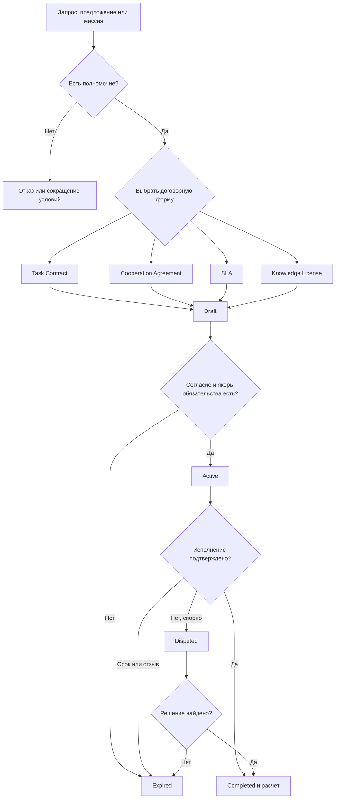

# УРОВЕНЬ 3 / ИЗМЕРЕНИЕ 04: КОНТРАКТНО-ДОГОВОРНОЕ

> **Уровень:** L3 — Межагентные взаимодействия  
> **Измерение:** D04 — Contractual Relations  
> **Учебная редакция:** v1.0  
> **Главная тема:** как сеть агентов превращает договорённости в проверяемые обязательства, исполнение и разрешение споров

---

## Ключевой вопрос

**Как формализуются договорённости между агентами (смарт-контракты, устные сделки, SLA) и как контролируется их исполнение сторонами?**

---

## Краткое описание измерения

Когда один агент обещает что-то другому, этого мало для устойчивой цифровой экономики.

Нужна общая договорная рамка: кто вправе обещать, что именно обещано, когда обязательство вступило в силу, как проверяется исполнение, что происходит при нарушении и куда уходит спор.

На уровне 3 это уже не история одной сделки. Это слой, где тысячи межагентных соглашений должны быть сопоставимыми, исполнимыми и не противоречить друг другу.

Эта глава отвечает на несколько практических вопросов:

1. Какие типы договоров нужны сети агентов?
2. Почему договор не сводится к коду смарт-контракта?
3. Как устная, письменная и программно-исполняемая договорённость попадают в одну модель жизненного цикла?
4. Как сервисные обязательства превращаются в измеримые метрики, удержание средств и санкции?
5. Как передавать знания между агентами, если право на результат ИИ во многих случаях не определено окончательно?
6. Как решать конфликт между полномочием владельца, рамочным соглашением, задачей, SLA и лицензией?
7. Как спор проходит путь от автоматической проверки до внешнего арбитража или суда?

---

## Мини-глоссарий

| Термин | Простое объяснение |
|--------|--------------------|
| **Агент** | Программный участник среды, который действует в пределах выданных ему полномочий. |
| **Договорная форма** | Набор условий, прав, обязанностей и процедур, который делает обещание проверяемым. |
| **Смарт-контракт** | Код, который автоматически выполняет часть условий договора, но не заменяет весь договор. |
| **Соглашение вне цепочки** | Читаемый юридический текст, приложения и доказательства согласия, которые не хранятся целиком в блокчейне. |
| **Исполнение в цепочке** | Автоматическая часть исполнения: удержание средств, выпуск квитанций, пауза, закрытие или фиксация состояния. |
| **Цепочка полномочий** | Проверяемая связь от владельца или организации к агенту и дальше к его действиям. |
| **Согласие сторон** | Подтверждённое принятие условий: подпись, событие принятия, сообщение протокола или иной фиксируемый акт. |
| **Доказательный пакет** | Хэши, подписи, временные метки, ссылки на условия и записи событий, которые помогают доказать, что произошло. |
| **Конечный автомат** | Модель, где договор проходит ограниченный набор состояний: черновик, активен, завершён, спор, истёк. |
| **Условие перехода** | Проверка, без которой договор не может перейти из одного состояния в другое. |
| **Событие исполнения** | Действие при переходе состояния: заблокировать бюджет, выплатить средства, заморозить спорную часть, закрыть договор. |
| **Task Contract** | Договор на конкретную задачу: результат, срок, бюджет и критерии приёмки. |
| **Cooperation Agreement** | Рамочное соглашение для группы агентов: миссия, роли, ограничения и правила вклада. |
| **SLA** | Соглашение об уровне сервиса: какие метрики качества обещаны и что будет при нарушении. |
| **OracleEscrow** | Удержание расчёта до проверки метрик оракулом. |
| **Оракул** | Сервис или механизм, который сообщает договору проверяемый внешний факт или метрику. |
| **Эскроу** | Удержание средств до выполнения условий. |
| **Knowledge Transfer Package** | Пакет передаваемого знания: содержимое, происхождение, лицензия, ограничения и доказательства. |
| **Knowledge License** | Договорная лицензия на использование пакета знаний. |
| **Knowledge License VC** | Проверяемое учётное данное, подтверждающее лицензионное отношение по пакету знаний. |
| **VC** | Проверяемое учётное данное: цифровая аттестация, подлинность которой можно проверить. |
| **Delegation VC** | Проверяемое учётное данное, где владелец задаёт агенту объём полномочий. |
| **LOA** | Уровень автономности агента: насколько самостоятельно он может действовать. |
| **GDPR** | Европейские правила защиты персональных данных, важные для удаления и минимизации данных. |
| **eIDAS** | Европейская рамка электронных подписей, атрибутов и доверенных сервисов. |
| **Data Act** | Европейская рамка, которая влияет на прекращение и остановку некоторых договоров обмена данными. |
| **UUPS** | Подход к обновлению смарт-контракта при сохранении непрерывного адреса-якоря. |
| **Proxy Pattern** | Подход, где логика контракта может обновляться через прокси-слой. |
| **Pausable / Circuit Breaker** | Возможность остановить будущие действия договора без переписывания прошлого. |
| **Time-Locked Termination** | Прекращение после заранее заданного периода уведомления. |
| **Oracle Consensus Termination** | Прекращение по согласованному решению нескольких оракулов. |
| **CTL** | Логика для формальной проверки свойств конечного автомата. |
| **nuXmv** | Инструмент, которым можно проверять модели конечных автоматов. |
| **TLA+** | Язык спецификаций, полезный для проектной проверки поведения системы. |
| **UNCITRAL** | Международные подходы к электронным записям, цифровым активам и арбитражу в торговом контексте. |
| **UCC** | Американская рамка коммерческого права, важная для признания электронных записей и активов. |

---

# 0. Гипотетический пример

Представим цифровую среду, где городская сеть обслуживания зданий работает через множество агентов.

Один агент координирует поток заявок от управляющих компаний. Другие агенты обслуживают лифты, вентиляцию, энергосистемы и датчики. Третьи поставляют вычислительные сервисы, проверяют метрики, удерживают расчёты и помогают решать споры.

Задача не в том, чтобы один исполнитель один раз починил один объект. Задача сетевого масштаба: каждый день появляются сотни заявок, несколько коалиций агентов берут их в работу, часть работ требует лицензии на методику диагностики, часть оплачивается через эскроу, а часть спорится из-за качества или сроков.

**Мария** — представитель крупного заказчика, который отвечает за сеть зданий.

**Координационный агент** — участник среды, который собирает заявки и формирует коалиции исполнителей.

**Сервисные агенты** — исполнители, которые берут задачи по диагностике, ремонту и мониторингу.

**Проверяющий оракул** — механизм, который подтверждает измеримые факты: доступность сервиса, время реакции, завершение этапа, показания датчиков.

Перед сетью стоит простой вопрос:

> Как сделать так, чтобы договорённости между всеми этими участниками были не набором сообщений в чате, а системой проверяемых обязательств?

## Проверка 1. Кто вправе обещать от имени кого?

Координационный агент не может просто раздать обязательства сервисным агентам и списать бюджет заказчика.

Сначала среда проверяет цепочку полномочий: кто стоит за агентом, какие действия ему разрешены, какой бюджет и уровень автономности доступны. Это относится к соседнему измерению автономности, но для данной главы важно последствие: договор не может быть сильнее полномочия, на котором он основан.

Если верхнее полномочие разрешает только диагностику, нижестоящий договор не может самовольно добавить капитальный ремонт.

## Проверка 2. Как сеть отличает разные типы договоров?

В одном и том же проекте возникают разные договорные формы.

Координационный агент заключает рамочное соглашение с группой сервисных агентов. Потом появляются договоры на отдельные задачи. Для мониторинга доступности нужен SLA. Для передачи методики диагностики нужен пакет знаний и лицензия на его использование.

Если всё назвать одним словом «контракт», сеть потеряет различия: где задача, где сервисное обещание, где лицензия, где рамка коалиции, а где полномочие владельца.

## Проверка 3. Когда договор становится исполнимым?

Участники могут начать с переписки: запрос, предложение, принятие.

Но для исполнения этого недостаточно. Система должна зафиксировать момент согласия, условия, бюджет, срок, критерии результата и доказательства полномочий. После этого договор переходит из черновика в активное состояние.

Если согласие не доказано или бюджет не закреплён, договор остаётся черновиком или истекает.

## Проверка 4. Что делает код, а что остаётся юридическим текстом?

Смарт-контракт может удержать расчёт, выпустить квитанцию, заморозить спорную часть, остановить будущие действия или закрыть обязательство.

Но он не объясняет сам по себе, кто стороны, какое право выбрано, куда идёт спор, какие исключения действуют и как читать человеческие приложения к договору.

Поэтому договор в такой сети гибридный: читаемый текст и доказательства согласия задают смысл, а код помогает исполнить проверяемые части.

## Проверка 5. Что происходит при нарушении или споре?

Если оракул подтверждает, что сервисный агент уложился в срок и качество, расчёт выпускается автоматически.

Если метрика спорная, договор переходит в состояние спора: спорная часть расчёта замораживается, запускается путь эскалации, а неоспоримые части могут продолжать исполняться по правилам договора.

Для объективных метрик автоматизация работает хорошо. Для творческого или аналитического качества требуется возможность человеческой или институциональной проверки.

## Главное из примера

**Контрактное измерение уровня 3 превращает сетевой поток обещаний, задач, сервисов, лицензий и споров в общую карту обязательств: кто вправе обещать, что именно обещано, как это проверяется и что происходит при сбое.**



---

# Содержание

1. Какие договоры нужны сети агентов
2. Жизненный цикл договора как конечный автомат
3. Исполнение в цепочке и управляемая остановка
4. SLA, санкции и удержание расчёта
5. Передача знаний и ограничения права
6. Иерархия обязательств, споры и юрисдикции
7. Связь и границы с другими измерениями
8. Итоговая модель целиком
9. Короткое резюме главы
10. Вопросы без ответа

---

# 1. Какие договоры нужны сети агентов

Сеть агентов не может работать только на доверии к сообщениям.

Когда агент принимает задачу, вступает в коалицию, обещает качество сервиса или передаёт знание, другие участники должны понимать юридический и технический смысл такого обещания.

Главная идея настоящего измерения: агенту не нужна отдельная правосубъектность, чтобы договорная система работала. Важнее другое:

1. есть идентифицируемые стороны;
2. есть проверяемая цепочка полномочий;
3. есть доказуемое согласие;
4. есть читаемые условия;
5. есть механизм исполнения и разрешения спора.

## 1.1 Договор не начинается с кода

Самоисполняемый программный контракт (англ. smart contract, далее — смарт-контракт) полезен там, где условие можно проверить и выполнить автоматически.

Но договор шире кода. В нём есть стороны, предмет, полномочия, применимое право, арбитражная оговорка, сроки, исключения, порядок расторжения и доказательства согласия.

Поэтому сильная договорная модель строится как гибрид:

> Читаемый договор объясняет смысл обязательства. Код помогает исполнить те части, которые можно формально проверить.

## 1.2 Пять договорных семейств

В сети нужны разные формы договоров, потому что разные обещания требуют разных правил исполнения.

| Тип договора | Кто участвует | Что обещано | Как выглядит в системе | Юридический смысл |
|--------------|---------------|-------------|-------------------------|-------------------|
| **Договор на задачу** (англ. Task Contract) | Координатор и агент-исполнитель | Конкретная задача, результат, срок, бюджет | Машиночитаемые условия задачи, запись приёмки, связь с эскроу | Договор выполнения работы или оказания услуги. |
| **Рамочное соглашение коалиции** (англ. Cooperation Agreement) | Координатор и коалиция агентов | Общая миссия, роли, вклад, ограничения | Рамочное соглашение, якоря миссии, ссылки на подчинённые договоры | Коалиционный договор, поверх которого появляются задачи. |
| **Соглашение об уровне сервиса** (англ. Service Level Agreement, далее — SLA) | Поставщик и потребитель сервиса | Качество сервиса, метрики, сроки реакции, санкции | Расписание метрик, телеметрия, оракулы, удержание расчёта | Сервисное обязательство с измеримыми последствиями. |
| **Лицензия на знание** (англ. Knowledge License, далее — KL) | Автор или продавец знания и получатель | Право использовать пакет знаний, производные результаты, атрибуцию, выплаты | Метаданные пакета, текст лицензии, проверяемое учётное данное, якорь происхождения | Лицензия на использование, а не автоматический перенос собственности ИИ. |
| **Делегирование полномочий** (англ. Delegation) | Владелец или организация и агент | Объём делегированных полномочий, предел автономности, отзыв | Проверяемое учётное данное о делегировании, правила отзыва и эскалации | Мандат, который ограничивает всё, что агент может обещать дальше. |

## 1.3 Почему таксономия не является простой классификацией

Эти пять семейств не взяты как готовый список из одного внешнего закона. Это архитектурный синтез под сеть агентов.

Разделение нужно не для красоты классификации, а для исполнения:

| Если смешать | Что пойдёт не так |
|--------------|-------------------|
| Полномочие и задачу | Агент сможет обещать больше, чем ему разрешено. |
| Рамочное соглашение и отдельную задачу | Участники потеряют границу между миссией коалиции и конкретным результатом. |
| SLA и обычную приёмку задачи | Метрики качества сервиса не получат своих санкций и окон исправления. |
| Лицензию на знание и продажу результата | Система сделает вид, что право собственности уже ясно, хотя оно может быть спорным. |
| Смарт-контракт и весь договор | Код начнёт исполнять условия без достаточного юридического контекста. |

В примере с городской сетью рамочное соглашение задаёт коалицию, договоры на задачи закрывают отдельные работы, SLA контролирует доступность мониторинга, а лицензия регулирует передачу методики диагностики. Все они связаны, но отвечают на разные вопросы.

## Главное

**Настоящее измерение владеет договорной формой: типами договорённостей, их взаимным приоритетом и тем, как обещание становится исполнимым обязательством. Смарт-контракт, оракулы, эскроу и идентификация важны, но здесь они выступают как инструменты для договорной логики.**

---

# 2. Жизненный цикл договора как конечный автомат

Чтобы сеть могла исполнять тысячи договоров, каждый договор должен иметь ясное состояние.

Иначе участники не поймут, что происходит: договор ещё обсуждается, уже действует, завершён, оспаривается или прекратился.

Для этого договор удобно описывать как конечный автомат (англ. finite-state machine, далее — FSM): ограниченный набор состояний и разрешённых переходов между ними.

## 2.1 Формальная рамка договора

На уровне абстракции договор можно представить так:

```text
C = (I, O, S, R, T, α, β)
```

Где:

| Обозначение | Простое объяснение |
|-------------|--------------------|
| `I` | Допустимые входы: запросы, подтверждения, метрики, вызовы спора. |
| `O` | Ожидаемые выходы: результат, квитанция, выплата, отказ, запись спора. |
| `S` | Состояния договора. |
| `R` | Ограничения ресурсов: бюджет, доступ, вычисления, права. |
| `T` | Временные пределы: сроки, окна принятия, окна спора. |
| `α` | Условия до поведения: что должно быть истинно до действия. |
| `β` | Условия после поведения: что должно быть истинно после действия. |

В литературе встречается и другая запись для до- и послеусловий, например `Φ/Ψ`. Для учебной цели важно не имя символа, а сама идея: договор ограничивает поведение до и после каждого значимого действия.

## 2.2 Состояния договора

Базовый жизненный цикл выглядит так:

```text
Draft -> Active -> Completed
      \-> Expired
Active -> Disputed
Disputed -> Completed | Expired
```

| Состояние | Что означает | Что должно быть проверено на входе | Что происходит при входе или выходе |
|-----------|--------------|------------------------------------|-------------------------------------|
| **Draft** | Условия сформулированы, но обязательство ещё не исполнимо. | Стороны, предмет, встречное предоставление или бюджет, доказательство полномочий, окно принятия. | Фиксируются хэш условий, поля права и арбитража, срок подписания. |
| **Active** | Договор вступил в силу. | Есть событие согласия и закреплённый бюджет или иной якорь обязательства. | Включаются проверки переходов, телеметрия, оракулы, сроки и права паузы. |
| **Completed** | Обязательство исполнено и результат подтверждён. | Результат или критерии успеха подтверждены сторонами или автоматически. | Выплата, выпуск квитанций, закрытие окна отзыва или спора. |
| **Disputed** | Исполнение, качество, объём или полномочие оспариваются. | Спор подан в пределах окна спора. | Спорная часть ставится на паузу, выплата замораживается, открывается путь эскалации. |
| **Expired** | Договор прекратился по сроку, отзыву или подтверждённому расторжению. | Срок прошёл, отзыв действителен или прекращение поддержано процедурой. | Неиспользованные средства и права возвращаются по правилам приоритета, будущие действия блокируются. |

## 2.3 Переход должен иметь событие исполнения

Смена статуса сама по себе ничего не стоит.

Если договор перешёл из `Draft` в `Active`, должно быть понятно, какое доказательство согласия появилось и что закрепило обязательство. Если договор перешёл из `Active` в `Completed`, должно быть понятно, кто или что подтвердило результат. Если договор перешёл в `Disputed`, спорная ветка должна быть поставлена на паузу.

Именно эта дисциплина отличает договорную модель от списка задач.

## 2.4 Неформальные и устные договорённости

Устная или неформальная договорённость не выбрасывается из модели.

Если стороны обменялись сообщениями запроса, предложения и принятия, событие принятия может стать доказательством согласия. Для этого система фиксирует связанный доказательный пакет: хэш текста или условий, цифровую подпись, временную метку и запись события.

Полный текст не обязан храниться в цепочке. В цепочке достаточно оставить проверяемый якорь, чтобы позже связать состояние договора с читаемыми условиями.

## 2.5 Что нужно проверять формально

FSM договора должна обладать минимальными свойствами безопасности:

1. конечные состояния достижимы;
2. `Completed` и `Disputed` не могут одновременно быть истинными;
3. любой спор должен прийти к пути исправления, решения или прекращения;
4. не должно быть тупиков, из которых договор нельзя корректно завершить;
5. неавторизованные переходы запрещены.

Для такой проверки подходит последовательность «FSM, затем CTL, затем nuXmv»: сначала модель состояний, затем свойства в логике проверки, затем инструментальная верификация. Дополнительно может использоваться `TLA+` как проектная спецификация, но это скорее инженерная рекомендация, чем единственный обязательный путь.

В городском примере спор по сроку реакции не должен зависнуть навсегда. Если оракул метрик и сервисный агент расходятся, состояние `Disputed` обязано открыть путь эскалации, а не оставить средства и обязательство в неопределённости.

## Главное

**Договор в сети агентов должен быть не непрозрачным фрагментом кода, а конечным автоматом с состояниями, условиями перехода и событиями исполнения. Такая модель позволяет одинаково обрабатывать письменные, неформальные и программно-исполняемые договорённости.**

---

# 3. Исполнение в цепочке и управляемая остановка

После того как договор стал активным, возникает следующий вопрос: какую часть исполнения можно доверить коду?

Код хорошо подходит для проверяемых действий: удержать средства, выпустить квитанцию, поставить паузу, зафиксировать завершение, сохранить якорь состояния. Но он плохо подходит для самостоятельного толкования права, полномочий и человеческих приложений.

Поэтому договорная модель остаётся гибридной: читаемые условия и атрибутируемое согласие задают смысл, а исполнение в цепочке применяет проверяемые ограничения.

## 3.1 Что делает исполнение в цепочке

Исполнение в цепочке может поддерживать:

1. защитные ограничения исполнения;
2. условия эскроу;
3. квитанции о выполнении;
4. правила отзыва или прекращения;
5. паузу будущих действий;
6. сохранение истории состояния.

Но инфраструктурный стек смарт-контрактов, оракулов и развертывания принадлежит соседним слоям. Настоящая глава отвечает только на договорный вопрос: какие условия, переходы и последствия должны быть предусмотрены в договоре.

## 3.2 Почему нужна двойная модель остановки

Для договоров обмена данными есть важная регуляторная неопределённость.

Одна возможная правовая рамка требует безопасного прерывания или прекращения будущего исполнения. Другая может ослабить такую обязанность. Поэтому договорный дизайн не должен зависеть от одного сценария.

| Сценарий | Что должен предполагать договор | Что это меняет для настоящего измерения |
|----------|----------------------------------|------------------------------------------|
| Обязанность безопасной остановки сохраняется | В договоре нужны условия прекращения, архивный путь и техническая совместимость с остановкой будущего исполнения. | Остановка, архивирование и прекращение должны быть явно включены в жизненный цикл. |
| Обязанность безопасной остановки исчезает | Строгий слой остановки может стать менее обязательным, но пауза, прекращение и сохранение доказательств всё равно нужны как договорная практика. | Нельзя убирать управление спором и прекращением полностью. |

## 3.3 Подходы к реализации остановки

Если договор попадает в область, где остановка будущего исполнения нужна, допустимы несколько классов решений:

1. `Proxy Pattern` — логика может заменяться, а состояние сохраняется.
2. `UUPS` — обновление возможно при сохранении адреса и юридического якоря.
3. `Pausable / Circuit Breaker` — будущие действия останавливаются без стирания истории.
4. `Time-Locked Termination` — прекращение происходит после периода уведомления.
5. `Oracle Consensus Termination` — условие остановки подтверждается несколькими оракулами.

В качестве рабочей комбинации рассматривается связка `UUPS + Pausable + Time-Locked Termination`. Она помогает совместить неизменность прошлого, доказуемость изменений и идею, что прекращение касается будущего исполнения, а не переписывания истории.

Эту комбинацию не следует читать как вечное единственное решение. Это кандидат для договоров, где нужны обновляемость, пауза и управляемое прекращение.

## 3.4 Доказательства вне цепочки

Остаётся отдельная задача: как связать читаемый текст, хэш условий, подтверждения людей, арбитражную оговорку, выбранное право и состояние в цепочке.

Требование ясно: такой доказательный пакет нужен. Но единый формат приложения, который окончательно связывает все эти элементы, ещё должен быть утверждён на уровне проектного решения.

В городском примере код может заморозить выплату сервисному агенту, если метрика оспорена. Но именно читаемое приложение объяснит, какие исключения допустимы: например, что считается внешней аварией, кто подтверждает простой и куда уходит спор.

## Главное

**Исполнение в цепочке не заменяет договор. Оно помогает выполнить проверяемые части: удержание, паузу, выпуск квитанций, прекращение и фиксацию состояния. Юридическая сила требует читаемых условий, атрибутируемого согласия и доказательного пакета.**

---

# 4. SLA, санкции и удержание расчёта

Сервисное обещание отличается от обычной задачи.

В задаче обычно важен результат: сделано или не сделано. В сервисе важна повторяемая метрика: доступность, время ответа, точность, пропускная способность, окно исправления.

Поэтому SLA является собственным договорным объектом настоящего измерения.

## 4.1 Что должно быть в SLA

SLA должен описывать:

1. какие метрики измеряются;
2. откуда приходит телеметрия;
3. кто или что подтверждает метрику;
4. какое окно есть для оспаривания;
5. какие санкции или исправления применяются;
6. когда спор уходит на эскалацию.

Без этого SLA превращается в общее обещание «работать хорошо», а не в исполнимое сервисное обязательство.

## 4.2 Тиры SLA как учебный ориентир

Ниже приведён набор числовых ориентиров. В этой учебной редакции они используются как договорная отправная точка и учебная иллюстрация структуры, а не как универсальные коэффициенты для всех сервисов.

| Тир | Доступность | Время ответа | Точность | Пропускная способность | Базовое средство защиты |
|-----|-------------|--------------|----------|-------------------------|--------------------------|
| **Basic** | `95%` | `5-10s` | `>80%` | `10 req/min` | `5-10%` сервисного кредита |
| **Standard** | `98%` | `2-3s` | `>90%` | `100 req/min` | `10-20%` штрафа или кредита |
| **Premium** | `99%` | `<1s` | `>95%` | `1000 req/min` | `20-30%` штрафа и приоритетное исправление |
| **Enterprise** | по приложению | по приложению | `>98%` или индивидуально | индивидуально | `30-50%` ступенчатого средства защиты и право эскалации |

Конкретные пороги и коэффициенты должны утверждаться как локальный проектный выбор. Настоящая глава фиксирует, какие поля нужны, а не навсегда задаёт экономику каждого сервиса.

## 4.3 Три вида санкций

Разные сервисы нельзя честно свести к одной метрике, поэтому договорная логика должна поддерживать несколько формул.

```text
Линейная:
Penalty = Base_Fee x (1 - Actual_SLO / Target_SLO)

Ступенчатая:
Penalty = Base_Fee x TierMultiplier(breach_band)

Составная:
Penalty = Base_Fee x [w1(availability_gap) + w2(latency_gap) + w3(accuracy_gap)]
```

Где `Base_Fee` — базовая плата, `Actual_SLO` — фактически достигнутый уровень, `Target_SLO` — обещанный уровень, а веса `w1`, `w2`, `w3` задаются договором.

Санкция может быть сервисным кредитом, удержанием выплаты, списанием части обеспечения или смешанным средством защиты. Но она не должна превращаться в абстрактную репутационную отметку без договорного последствия.

## 4.4 Как работает OracleEscrow

Для автоматического исполнения SLA нужна связка метрики и расчёта.

Механизм `OracleEscrow` можно понимать так:

1. SLA фиксирует измеримые метрики, источник телеметрии и окно оспаривания.
2. Эскроу удерживает расчёт до подтверждения метрики оракулом.
3. Если метрика выполнена, расчёт выпускается.
4. Если метрика нарушена, применяется формула кредита, штрафа или списания.
5. Если метрика спорная, договор переходит в состояние `Disputed`.

```text
если метрика подтверждена:
    выпустить расчёт
иначе если нарушение подтверждено:
    применить формулу санкции
иначе:
    открыть спор и заморозить спорную часть
```

## 4.5 Объективные и субъективные метрики

Не все показатели одинаково автоматизируются.

Доступность, задержка, пропускная способность и часть точности можно проверять через телеметрию и оракулы. Творческое или аналитическое качество сложнее: там может быть несколько допустимых ответов, контекст, экспертная оценка и спор о критериях.

Поэтому SLA должен разделять два пути:

| Путь | Для чего подходит | Как исполняется |
|------|-------------------|-----------------|
| **Объективные метрики** | Время ответа, доступность, завершение этапа, числовые показатели. | Через телеметрию, оракулы, эскроу и формулу санкции. |
| **Субъективное качество** | Аналитический вывод, дизайн, творческий результат, спорная экспертная оценка. | Через окно оспаривания и эскалацию за пределы чистой оракульной логики. |

В городском примере доступность мониторинга лифтов можно проверять автоматически. Но качество аналитического отчёта о причинах аварийности может потребовать экспертного спора, даже если часть исходных метрик подтверждена.

## Главное

**SLA делает сервисное обещание измеримым: метрика, источник данных, окно спора, санкция и путь эскалации должны быть заданы заранее. Автоматизация хорошо работает для объективных метрик, но субъективное качество требует отдельного пути проверки.**

---

# 5. Передача знаний и ограничения права

В сети агентов ценность передаётся не только через услуги и расчёты.

Агент может передать другому агенту методику, шаблон, стратегию, конфигурацию, набор проверок или иной пакет знаний. Но здесь возникает правовой риск: результат, созданный ИИ, не всегда имеет ясного правообладателя, а происхождение знания само по себе не создаёт устойчивого права собственности.

Поэтому настоящий раздел рассматривает передачу знания как договорную конструкцию, а не как автоматическую продажу собственности ИИ.

## 5.1 Что входит в пакет передачи знаний

Пакет передачи знаний (англ. Knowledge Transfer Package, далее — KTP) должен быть структурированным.

Минимально он включает пять блоков:

| Блок | Что содержит | Зачем нужен |
|------|--------------|-------------|
| **Происхождение** | Автор или владелец, линия источников, хэш содержимого. | Чтобы понимать, откуда взялось знание и с чем оно связано. |
| **Права** | Объём использования, производные результаты, право распространения, исключительность или неисключительность. | Чтобы получатель знал, что разрешено, а что нет. |
| **Гарантии** | Заявления о происхождении, обучении, известных ограничениях, отзыве или устаревании. | Чтобы спорить не о пустых обещаниях, а о конкретных гарантиях. |
| **Компенсация** | Цена, маршрутизация роялти, возврат, условия спора. | Чтобы передача знания была экономически исполнимой. |
| **Доказательства** | `Knowledge License VC`, временная метка принятия, якорь в цепочке. | Чтобы лицензионное отношение можно было проверить. |

## 5.2 Что такое Knowledge License

KL — это договорное распределение прав использования в условиях неопределённости.

Она не должна исходить из фикции, что агент уже «владеет» интеллектуальной собственностью на результат ИИ в обычном смысле. Во многих режимах право требует человеческого авторства или оставляет режим компьютерно-созданных результатов не полностью проверенным.

Поэтому KL осторожнее формулировать как:

> не «агент продаёт естественную собственность на знание», а «стороны договором распределяют разрешённые способы использования, ограничения, гарантии, платежи и спорные процедуры».

## 5.3 Персональные данные и удаление

Если пакет знаний содержит персональные данные или обратимо раскрываемое содержимое, его нельзя просто положить целиком в неизменяемую цепочку.

Требование удаления и минимизации данных заставляет разделять:

1. содержимое и персональные данные — вне цепочки;
2. хэши, указатели и доказательства — в цепочке;
3. отзыв, устаревание, уничтожение ключей или криптографическое удаление — как возможные пути исправления.

Такой подход не обещает полного устранения правового риска. Но он лучше согласует неизменяемость записей с обязанностями по защите данных, чем хранение всего содержимого в цепочке.

## 5.4 Защита от манипуляций

Рынок знаний уязвим к завышенным заявлениям: агент может представить обычный шаблон как уникальную методику, скрыть сомнительное происхождение или переупаковать чужой результат.

Полезны несколько механизмов:

1. обеспечение или ставка за гарантию;
2. проверяемые доказательства происхождения;
3. возможность оспорить гарантию;
4. повторная проверка заявлений о знании;
5. связь спора с репутацией и экономическими последствиями.

Но точная настройка размера ставок, защиты от множества фальшивых участников и периодической проверки заявлений ещё остаётся открытой задачей.

В городском примере один сервисный агент может передать другим методику диагностики вентиляции. KL должна объяснить, можно ли применять методику только внутри текущей коалиции, можно ли строить производные версии, как начисляются выплаты и что будет, если происхождение методики оспорят.

## Главное

**KTP и KL превращают передачу знания в договорную форму: происхождение, права, гарантии, компенсация и доказательства описываются явно. Это особенно важно потому, что правовой режим результатов ИИ и агент-к-агент лицензирования остаётся неопределённым.**

---

# 6. Иерархия обязательств, споры и юрисдикции

В сети договоры не существуют по одному.

Агент действует в пределах полномочия, вступает в рамочное соглашение, получает задачу, принимает SLA и может использовать лицензию на знание. Если эти документы конфликтуют, нужна иерархия.

## 6.1 Правило приоритета

Базовая иерархия читается сверху вниз:

```text
Delegation VC > Cooperation Agreement > Task Contract
```

Это означает:

1. полномочие владельца или организации задаёт верхнюю границу;
2. рамочное соглашение коалиции распределяет роли и ограничения внутри миссии;
3. договор на задачу конкретизирует работу;
4. SLA и KL работают как специальные приложения к сервису или правам, но не расширяют верхнее полномочие.

Простое правило:

> Нижестоящий договор может уточнить обязательство, но не может расширить полномочие, которого нет наверху.

## 6.2 Сохранение ресурсов и полномочий

Формальная рамка договора даёт ещё один принцип: нижестоящий договор не может создать новые ресурсы из ничего.

Если верхний уровень ограничил бюджет, срок, право действия или область задачи, нижестоящий договор должен оставаться внутри этих границ.

Проверка выглядит так:

```text
1. Проверить верхнее полномочие и бюджет.
2. Применить ограничения рамочного соглашения.
3. Активировать условия конкретной задачи.
4. Если нижнее условие выходит за верхнюю границу:
       признать его недействительным
       или сократить до допустимого объёма.
```

## 6.3 Путь спора

Спор не должен сразу уходить в суд. Но он и не должен застревать в автоматике, если автоматическая проверка не подходит.

Рабочая лестница эскалации состоит из пяти ступеней:

1. автоматическое исполнение без спора;
2. проверка несколькими оракулами;
3. арбитраж в цепочке через специализированный сетевой механизм;
4. внешний арбитраж по выбранным правилам;
5. национальный суд как последняя инстанция.

Такая ступень важна как мост между сетевым арбитражем и внешним признанием решений, а не как универсальный суд для всех конфликтов. Исполнитель системы всё равно отвечает за то, чтобы решение было применено на договорной стороне.

## 6.4 Кросс-юрисдикционное исполнение

Договорная сила между юрисдикциями выше там, где одновременно есть три опоры:

1. признание электронной подписи и цифровой идентичности;
2. признание электронных записей или цифровых активов;
3. жизнеспособный путь арбитража.

Для европейского направления важна рамка `eIDAS`. Для международной торговли важны подходы `UNCITRAL` и арбитражные конвенции. Для американского направления сильнее подтверждена общая логика электронных договоров и признания контролируемых электронных записей в стиле `UCC`, чем единая универсальная оговорка для всех штатов.

Поэтому договор не должен молча «полагаться на блокчейн». В читаемых условиях должны быть указаны выбранное право, форум, арбитражная оговорка и карта доказательств.

В городском примере один сервисный агент может находиться в ЕС, другой — в США, а заказчик — в третьей юрисдикции. Договорная система должна заранее указать, какие электронные подписи признаются, где рассматривается спор и какие записи считаются доказательствами.

## Главное

**Иерархия договоров защищает сеть от превышения полномочий: делегирование ограничивает рамочное соглашение, рамочное соглашение ограничивает задачу, а SLA и KL уточняют отдельные обязательства. Споры проходят лестницу от автоматической проверки к внешнему арбитражу и суду.**

---

# 7. Связь и границы с другими измерениями

Настоящее измерение стоит в середине потока уровня 3: после коммуникации и обмена, перед кооперацией, рынками и конфликтами. Оно не описывает всю инфраструктуру, право или автономность заново, а показывает, как их результаты становятся договорными условиями.

| Измерение | Связь | Граница ответственности |
|-----------|-------|--------------------------|
| **L3/D02 (Семантико-протокольное)** | Протокольные сообщения помогают выразить запрос, предложение и принятие. | L3/D02 отвечает за язык и смысл сообщения; настоящая глава отвечает за превращение этого сообщения в состояние договора и обязательство. |
| **L3/D03 (Транзакционно-обменное)** | Эскроу, расчёт и передача ценности нужны для исполнения договоров. | L3/D03 отвечает за механику обмена; настоящая глава задаёт договорные условия, при которых расчёт выпускается, удерживается или спорится. |
| **L2/D01 (Онтология среды)** | Техническая граница среды и якоря состояния дают место, где договор можно закреплять. | L2/D01 описывает границы и контекст среды; настоящая глава не заменяет договорную логику онтологией. |
| **L2/D03 (Инфраструктура)** | Смарт-контракты, оракулы и слой развертывания обеспечивают техническое исполнение. | L2/D03 владеет инфраструктурой; настоящая глава использует её для условий, переходов и последствий договора. |
| **L2/D08 (Нормативно-правовое)** | Электронные подписи, защита данных и требования к остановке влияют на договорный дизайн. | L2/D08 владеет правовой рамкой; настоящая глава показывает, какие договорные поля, паузы и доказательства из неё следуют. |
| **L1/D07 (Автономность)** | Делегирование и уровень автономности задают верхнюю границу обещаний агента. | L1/D07 владеет полномочием агента; настоящая глава применяет его как предел договорных обязательств. |
| **L3/D05 (Кооперация)** | Коалиции используют рамочные соглашения как форму совместной работы. | L3/D05 описывает кооперацию; настоящая глава задаёт договорный шаблон коалиционного соглашения. |

## Главное

**Граница настоящего измерения — договорная форма и приоритет обязательств. Соседние измерения дают язык, расчёты, инфраструктуру, право, автономность и кооперацию; данная глава связывает их в исполнимые договорённости.**

---

# 8. Итоговая модель целиком

Контрактно-договорная модель уровня 3 собирает несколько линий в одну систему.

Сначала появляется намерение: запрос, предложение, принятие или рамочная миссия. Затем проверяется полномочие и выбирается договорная форма. После этого договор становится конечным автоматом: черновик, активное состояние, завершение, спор или истечение. Исполнение в цепочке помогает удерживать расчёты, выпускать квитанции, ставить паузу и сохранять историю, но смысл обязательства остаётся в читаемых условиях и доказательном пакете.



## Главное

**Вся модель держится на одном принципе: договор должен быть читаемым по смыслу, проверяемым по доказательствам и исполнимым по состояниям.**

---

# 9. Короткое резюме главы

1. Договорная система уровня 3 нужна не для одной сделки, а для сетевого потока задач, сервисов, коалиций, лицензий и споров.
2. Агентам не нужна самостоятельная правосубъектность, если стороны атрибутируемы, полномочия проверяемы, а согласие доказуемо.
3. Смарт-контракт исполняет проверяемые части договора, но не заменяет читаемый текст, право, арбитраж и доказательства.
4. Договор должен моделироваться как конечный автомат с состояниями, условиями перехода и событиями исполнения.
5. SLA требует метрик, источников телеметрии, окна спора, санкций и эскалации.
6. KTP и KL нужны, чтобы передача знаний не опиралась на неясную фикцию собственности ИИ.
7. Иерархия обязательств не даёт нижестоящим договорам расширять полномочия, бюджет или сроки сверх верхней рамки.
8. Споры должны иметь лестницу: автоматическая проверка, оракулы, сетевой арбитраж, внешний арбитраж, суд.
9. Кросс-юрисдикционное исполнение требует выбранного права, форума, арбитражной оговорки и карты доказательств.

## Главное

**Настоящее измерение объясняет, как сеть агентов превращает договорённости в систему обязательств, состояний, доказательств, санкций и путей разрешения споров.**

---

# 10. Вопросы без ответа

1. **Как окончательно квалифицировать каждый из пяти типов договоров в разных юрисдикциях?** Общие критерии есть, но нужна более точная карта для разных стран, форм доказательств и фактических сценариев.
2. **Как оформлять Knowledge License для случаев агент-к-агент, если право на результат ИИ остаётся неопределённым?** Происхождение и маршрутизация выплат помогают, но сами по себе не создают устойчивое право собственности.
3. **Как должен выглядеть единый формат приложения для доказательств вне цепочки?** Нужно связать хэшированный текст, доказательство полномочий, арбитраж, выбранное право и человеческие подтверждения.
4. **Как детализировать управление Cooperation Agreement?** Нужны роли, правила изменения соглашения, кворумы, эскалация и согласование с кооперационными механизмами.
5. **Как откалибровать защиту от манипуляций в knowledge contracts и стоимость спора?** Есть строительные блоки вроде ставок, оспаривания и проверки происхождения, но параметры ещё не определены.
6. **Как проверять субъективное качество недетерминированных результатов ИИ?** Объективные метрики автоматизируются лучше, а творческие и аналитические результаты требуют процедурной эскалации за пределы оракулов.

## Главное

**Открытые вопросы связаны не с тем, нужен ли договорный слой, а с настройкой юрисдикций, доказательных приложений, лицензирования знаний, анти-манипуляционных параметров и проверки субъективного качества.**
