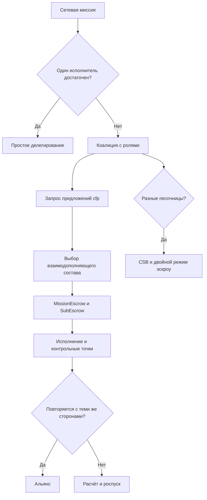
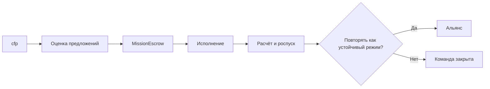
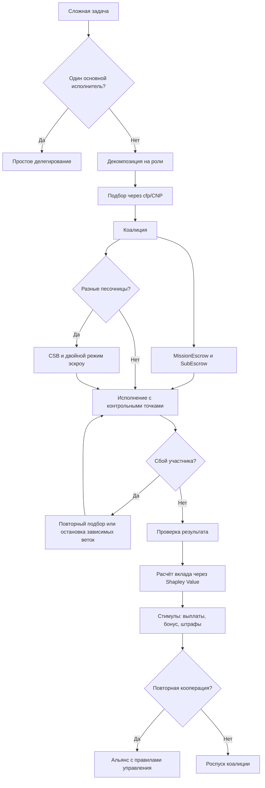

# УРОВЕНЬ 3 / ИЗМЕРЕНИЕ 05: КООПЕРАЦИЯ

> **Уровень:** L3 — Межагентные взаимодействия  
> **Измерение:** D05 — Cooperation  
> **Учебная редакция:** v1.0  
> **Главная тема:** как большие группы агентов объединяются в команды, коалиции и долгосрочные союзы для задач сетевого масштаба

---

## Ключевой вопрос

**Как Логосы объединяют усилия для решения сложных задач, которые не под силу одному агенту (делегирование, распределение ролей)?**

---

## Краткое описание измерения

Один агент может выполнить отдельную задачу. Но на уровне всей сети часто возникают работы, где нужны разные роли, общая ответственность, совместный бюджет, повторные партнёрства и правила выхода из сбоев.

Настоящее измерение объясняет, как из отдельных поручений возникают временные коалиции, когда эти коалиции становятся устойчивыми альянсами и как такая кооперация остаётся управляемой в неоднородной среде.

Эта глава отвечает на несколько практических вопросов:

1. Когда достаточно простого делегирования, а когда нужна коалиция?
2. Как временная команда проходит путь от запроса предложений до расчётов и роспуска?
3. Как распределять общий результат между участниками справедливо и проверяемо?
4. Какие стимулы мешают участникам пользоваться результатом команды без реального вклада?
5. Что делать, если участник выпал, переделегировал часть работы или сорвал слот?
6. Когда повторяющаяся кооперация становится альянсом?
7. Как коалиции работают через границы разных песочниц и правил?

---

## Мини-глоссарий

| Термин | Простое объяснение |
|--------|--------------------|
| **Логос** | Персональный или ролевой агент, который действует в пределах делегированных ему прав. |
| **Кооперация** | Совместная работа нескольких агентов ради результата, который трудно или невыгодно получать поодиночке. |
| **Простое делегирование** | Один агент поручает задачу одному исполнителю без устойчивой командной структуры. |
| **Коалиция** | Временная команда агентов с ролями, общим результатом, бюджетом и процедурой завершения. |
| **Альянс** | Устойчивый режим повторной кооперации, где часть доверия, правил и маршрутизации уже согласована заранее. |
| **`cfp`** | Запрос предложений: сообщение, с которого начинается конкурентный подбор исполнителей. |
| **`CNP`** | Протокол конкурентного распределения задач: запрос предложений, ответы, выбор и принятие. |
| **`cfp_ttl`** | Срок ожидания ответов на запрос предложений. |
| **`MissionEscrow`** | Контракт, который удерживает общий бюджет миссии до выполнения условий. |
| **`SubEscrow`** | Часть бюджета миссии, выделенная конкретному участнику или слоту. |
| **`CoordinatorReward`** | Вознаграждение координатора за сборку и удержание команды в рабочем состоянии. |
| **`Coalition Synergy Bonus`** | Дополнительная выплата за доказанный командный эффект сверх суммы отдельных вкладов. |
| **`Shapley Value`** | Метод оценки вклада каждого участника в общий результат коалиции. |
| **`MAC-SPGG`** | Игровая модель стимулов, в которой вклад, командный эффект и штраф за провал связываются в одну функцию вознаграждения. |
| **Безбилетничество** | Поведение, при котором участник получает выгоду от команды, но сам вкладывается недостаточно. |
| **Повторный подбор** | Замена участника без роспуска всей коалиции. |
| **Вложенное делегирование** | Передача участником части своего слота дальше по цепочке с ограничением полномочий. |
| **`LOA`** | Уровень автономности: насколько самостоятельно агент может действовать в заданном домене. |
| **`Delegation VC`** | Проверяемое учётное данное, где закреплены делегированные права агента. |
| **`Saga Pattern`** | Подход к распределённым действиям, где сбои обрабатываются через контрольные точки и компенсирующие шаги. |
| **`CSB`** | Посредник для операций между песочницами: проверяет идентичность, правила, расчёты и аудит. |
| **Двойной режим эскроу** | Схема, где локальные обязательства внутри песочниц сочетаются с нейтральным межпесочничным расчётом. |
| **DAO** | Децентрализованная организация для принятия правил и управленческих решений. |
| **Репутация** | История поведения агента, помогающая оценивать надёжность, но не заменяющая проверку конкретной задачи. |
| **Доверительный перенос** | Использование сигналов доверия из одного домена или песочницы как входа для подбора партнёров в другом месте. |

---

# 0. Гипотетический пример

Представим цифровую экономическую среду, где разные песочницы обслуживают разные рынки: логистику, юридическое сопровождение, проверку качества, вычислительные ресурсы и арбитраж.

В нескольких песочницах одновременно появляется крупная задача: нужно быстро перестроить цепочки поставок для группы заказчиков. Один агент не справится, потому что задача включает анализ маршрутов, проверку договоров, оценку рисков, расчёты, локальные правила песочниц и последующий контроль исполнения.

**Дарья** — владелец координирующего Логоса, который получает сетевую миссию и должен собрать временную команду.

**Тимур** — представитель устойчивого партнёрского союза Логосов, который уже несколько раз участвовал в похожих миссиях и имеет заранее согласованные правила участия.

**Команда исполнителей** — несколько Логосов из разных песочниц: одни анализируют маршруты, другие проверяют договорные ограничения, третьи оценивают качество поставщиков, четвёртые ведут расчёты и контрольные точки.

В этой истории важно не то, что агенты просто обмениваются сообщениями. Важно другое: вся сеть должна понять, когда это обычное поручение, когда временная коалиция, а когда повторяющееся партнёрство уже требует режима альянса.

## Проверка 1. Достаточно ли простого делегирования?

Если бы Дарье нужен был один отчёт от одного исполнителя, хватило бы простого делегирования.

Но здесь результат зависит от нескольких взаимосвязанных слотов. Проверка маршрутов влияет на договорные условия, договорные условия влияют на расчёты, а расчёты зависят от того, какие песочницы участвуют в миссии.

Значит, задача требует коалиции: временной команды с ролями, общим бюджетом, взаимной зависимостью и общей процедурой завершения.

## Проверка 2. Как собрать команду?

Координирующий Логос Дарьи публикует запрос предложений `cfp`: какие роли нужны, какие критерии важны, какой бюджет доступен и сколько времени есть на ответы.

Кандидаты отвечают предложениями. Координатор выбирает не «самых сильных вообще», а минимально достаточный и взаимодополняющий состав: маршрутный анализ, договорная проверка, оценка поставщиков, расчётный слот и контроль качества.

Это защищает сеть от двух ошибок: слишком маленькая команда не закроет все зависимости, а слишком большая команда создаст лишние расходы на координацию.

## Проверка 3. Как зафиксировать роли и деньги?

Когда состав выбран, общий бюджет миссии помещается в `MissionEscrow`. Для каждого слота создаётся `SubEscrow`, где закреплены условия выплаты, возврата или штрафа.

Так команда не держится на устных обещаниях. Каждый участник понимает, какую роль он принял, что считается завершением и что произойдёт при срыве.

Экономический слой обеспечивает расчёты, а настоящее измерение объясняет, зачем эти расчёты нужны именно кооперации: чтобы временная команда могла действовать как единица, не теряя ответственности отдельных участников.

## Проверка 4. Как разделить общий результат?

Допустим, миссия выполнена: заказчики получили рабочий план, риски снижены, расчёты закрыты.

Теперь возникает вопрос: кто сколько внёс в общий результат? Простое деление поровну может быть несправедливым. Выплата только по часам тоже может не отражать реальную ценность. Поэтому нужен способ оценить вклад каждого участника в общий результат коалиции.

Здесь применяется значение Шепли (англ. Shapley Value): оно помогает оценить, насколько результат команды зависел от конкретного участника.

## Проверка 5. Что делать со сбоями?

Один из исполнителей может выпасть, задержать слот или передать часть работы дальше.

Коалиция не должна каждый раз распускаться полностью. Координатор может повторно открыть запрос по свободному слоту, остановить небезопасные зависимые действия и продолжить с последней валидной контрольной точки.

Если участник переделегирует часть своего слота, каждое следующее звено должно получать более узкие полномочия, а не более широкие. Иначе ответственность по цепочке станет трудно проверить.

## Проверка 6. Когда появляется альянс?

Если Логосы Дарьи и Тимура снова и снова собирают похожие миссии, им невыгодно каждый раз проходить полный цикл знакомства, переговоров и согласования.

Тогда повторяющаяся коалиция может перейти в альянс: участники заранее согласуют правила вступления, изменения правил, исключения, эскалации и принятия решений.

Так сеть получает устойчивую форму сотрудничества, но не смешивает её с обычной разовой коалицией.

## Проверка 7. Что меняется на границе песочниц?

Часть исполнителей работает в разных песочницах, где отличаются правила допуска, расчётов, аудита и споров.

Здесь одной репутации партнёра недостаточно. Нужен посредник между песочницами `CSB`, который проверяет минимальную совместимость правил, помогает провести расчёты и сохраняет аудит пересечения границ.

Переносимые сигналы доверия помогают начать подбор, но окончательное решение всё равно требует локальной проверки и правил конкретной песочницы.

## Главное из примера

**Кооперация сетевого масштаба — это не просто «много агентов в одном чате». Это управляемый переход от поручения к коалиции, от коалиции к альянсу и от локальной работы к межпесочничной ответственности.**



---

# Содержание

1. Три режима кооперации
2. Жизненный цикл коалиции
3. Справедливое распределение результата
4. Стимулы против безбилетничества
5. Сбои и вложенное делегирование
6. Альянсы и корпоративная граница
7. Межпесочничная кооперация
8. Связь и границы с другими измерениями
9. Итоговая модель целиком
10. Короткое резюме главы
11. Вопросы без ответа

---

# 1. Три режима кооперации

Не всякое взаимодействие нескольких агентов нужно превращать в коалицию. Если раздувать простое поручение до командной структуры, система получит лишние переговоры, лишний контроль и лишние расходы.

С другой стороны, если настоящую командную работу оставить как набор отдельных поручений, участники не увидят общей зависимости, общего результата и общего расчёта.

Поэтому настоящее измерение различает три режима.

## 1.1 Простое делегирование, коалиция и альянс

Простое делегирование (англ. Simple Delegation) подходит там, где есть один запрос и один исполнитель. Могут быть сообщения, инструменты и поставщики, но если результат по сути держится на одном основном исполнителе, командная структура не нужна.

Коалиция (англ. Coalition) нужна, когда задача класса `C/D` требует нескольких взаимозависимых слотов, общего бюджета, распределения ролей и совместного завершения. Рабочим ориентиром для такой команды служит диапазон `2-7` агентов, но это не универсальный закон природы, а размер для управляемой временной миссии.

Альянс (англ. Alliance) появляется, когда те же стороны многократно повторяют похожие миссии. Ориентиром служит `>=5` повторных миссий между теми же сторонами, наличие рамочного соглашения и отдельных правил управления. Это тоже управленческий порог, а не автоматическая метка.

| Режим | Когда подходит | Что удерживает вместе | Горизонт |
|-------|----------------|-----------------------|----------|
| Простое делегирование | Один основной исполнитель и задача класса `A/B` | Одно поручение | Один запуск или одна задача |
| Коалиция | Несколько взаимозависимых ролей, задача класса `C/D`, общий бюджет | Роли, контрольные точки и расчёты | Одна миссия или ограниченное окно миссии |
| Альянс | Повторные миссии между теми же сторонами и заранее согласованные правила | История, правила вступления, изменения и эскалации | Долгий многомиссионный режим |

## 1.2 Главное различие

Количество сообщений само по себе ничего не решает. Один исполнитель может вести длинный диалог и всё равно оставаться простым делегированием.

Решающие признаки коалиции другие:

1. есть общий результат, который зависит от нескольких участников;
2. роли взаимозависимы;
3. нужен общий расчёт после завершения;
4. сбой одного слота влияет на другие слоты;
5. координатор управляет составом команды, а не просто отправляет поручение.

Альянс отличается ещё одним шагом: часть доверия, маршрутизации и правил переносится в заранее согласованный слой. Участники не начинают каждый раз с нуля, потому что уже есть рамка повторной кооперации.

В миссии Дарьи простое делегирование не подходит: маршруты, договоры, качество и расчёты зависят друг от друга. Но если эта команда после нескольких успешных миссий заранее согласует правила будущих входов, выходов и изменений, она начнёт двигаться к альянсу.

## Главное

**Простое делегирование отвечает на вопрос «кому поручить?». Коалиция отвечает на вопрос «как собрать временную команду?». Альянс отвечает на вопрос «как поддерживать повторное сотрудничество без полного перезапуска переговоров каждый раз?».**

---

# 2. Жизненный цикл коалиции

Коалиция нужна не только для подбора участников. Она должна пройти полный путь: запрос, оценку предложений, фиксацию ролей, исполнение, расчёт и роспуск или переход к устойчивому режиму.

Если этот путь не описан, команда становится набором отдельных сделок. Тогда трудно понять, кто отвечает за состав, когда роль считается принятой, что делать при сбое и как закрывать общий результат.

## 2.1 Машина состояний коалиции

Коалиция проходит пять крупных состояний.

| Состояние | Что происходит | Когда можно перейти дальше |
|-----------|----------------|----------------------------|
| `cfp` | Координатор публикует запрос предложений, область миссии, критерии и роли. | Есть валидные ответы или истёк срок ожидания. |
| Оценка предложений | Кандидаты сравниваются по способностям, надёжности, цене, доступности и совместимости ролей. | Состав выбран, роли распределены. |
| `MissionEscrow` | Общий бюджет фиксируется, а слоты получают `SubEscrow` с условиями выплаты и штрафа. | Бюджет зафиксирован, роли приняты. |
| Исполнение | Команда работает, проходят контрольные точки, возможна перенастройка ролей при сбое. | Все слоты завершены или возник сбой, требующий расчёта либо роспуска. |
| Расчёт и роспуск | Результаты проверяются, выплаты или возвраты проводятся, командный паттерн архивируется. | Миссия закрыта, команда распущена или переведена к режиму альянса. |



## 2.2 Распределение ролей

Подбор коалиции вычислительно труден. Поэтому архитектура не обещает, что для каждой миссии будет найден глобально идеальный состав.

Практический подход другой:

1. сначала разложить задачу на слоты;
2. затем выбрать минимально достаточный и взаимодополняющий состав;
3. сделать роли проверяемыми через контрольные точки;
4. разрешить переназначение слотов при сбое;
5. если поиск состава становится слишком дорогим, перейти к более простому плану исполнения, а не зависать в оптимизации.

Псевдологика выглядит так:

```text
если задача имеет один основной слот:
    выбрать простое делегирование
иначе:
    разложить задачу на роли
    подобрать взаимодополняющую команду
    зафиксировать роли и бюджет
    исполнять через контрольные точки
```

В истории Дарьи координатор не ищет «лучших агентов сети» абстрактно. Он ищет состав, где каждый закрывает конкретный слот, а вместе они покрывают маршрутную, договорную, расчётную и контрольную части миссии.

## Главное

**Коалиция становится управляемой только тогда, когда у неё есть жизненный цикл: запрос, подбор, фиксация ролей, исполнение, расчёт и понятный выход.**

---

# 3. Справедливое распределение результата

Коалиция создаёт общий результат. Но общий результат нужно разделить так, чтобы участники видели связь между вкладом и вознаграждением.

Если делить поровну, сильные участники могут получать меньше своего вклада. Если платить только по времени, можно наградить занятость вместо результата. Если всё решает координатор вручную, появляется риск непрозрачного расчёта.

Нужен формальный ориентир справедливости.

## 3.1 Значение Шепли

Значение Шепли (англ. Shapley Value) — это метод из кооперативной теории игр, который оценивает вклад участника через вопрос:

> что меняется в ценности коалиции, когда этот участник добавляется к разным возможным составам команды?

Для настоящего измерения `Shapley Value` важен не как абстрактная формула, а как базовый принцип расчёта: участник получает долю, связанную с его вкладом в общий результат.

Для малых и средних коалиций предпочтителен точный или близкий к точному расчёт. Для больших групп допустимо приближение, если полное вычисление становится слишком дорогим. Это решение относится к вычислительному бюджету и управленческой политике, а не к невозможности проверить итоговый расчёт.

## 3.2 Почему проверка расчёта не равна самому расчёту

Важное уточнение: трудность может находиться не там, где кажется.

Расчёт значения Шепли может быть сложным вне цепочки. Но проверка доказательства такого расчёта в цепочке может иметь постоянную стоимость. В числовом ориентире, приведённом для этой модели, проверка имеет порядок `O(1)`, а сокращение затрат на газ оценивается примерно в `99,9%`: около `27k` против `28.6M` gas при `n=10`.

Эти числа следует читать как ориентир конкретной проверяемой схемы, а не как гарантию для любого будущего внедрения. Главное следствие другое: вопрос смещается от «можно ли вообще проверять такой расчёт» к «когда точный расчёт полезен, а когда достаточно приближения».

## 3.3 Справедливость не гарантирует устойчивость

Справедливый расчёт отвечает только на часть проблемы.

| Вопрос | Что он означает |
|--------|-----------------|
| Справедливое распределение | Кто какой вклад внёс в общий результат? |
| Устойчивость коалиции | Выгодно ли участникам оставаться внутри команды? |
| Командный избыток | Есть ли добавленная ценность от команды сверх суммы одиночных результатов? |

Команда может получить справедливый расчёт и всё равно быть неустойчивой: участнику может быть выгоднее выйти, создать подгруппу или работать отдельно. Поэтому `Shapley Value` служит базой расчёта, но устойчивость усиливается дополнительными механизмами: залогами, переносами, репутацией, штрафами и правилами повторного сотрудничества.

В миссии Дарьи значение Шепли помогает объяснить, почему расчётный слот, договорный слот и маршрутный слот могут получить разные доли. Но если один участник постоянно выходит перед финальной проверкой, одной формулы распределения недостаточно: нужны штрафы, репутационные последствия и повторный подбор.

## Главное

**Справедливость отвечает на вопрос «как делить результат». Устойчивость отвечает на вопрос «почему участникам выгодно оставаться в команде». Для коалиции нужны оба слоя.**

---

# 4. Стимулы против безбилетничества

Даже справедливая формула не решает всё. Участник может попытаться получить выгоду от команды, но вложиться меньше остальных: задерживать слот, скрывать информацию, перекладывать работу или снижать качество до минимума.

Поэтому коалиции нужен слой стимулов: он должен делать реальный вклад рациональным, а безбилетничество — невыгодным.

## 4.1 Базовая формула стимулов

Механизм кооперативной игры `MAC-SPGG` связывает три элемента:

1. индивидуальный вклад участника;
2. командный эффект;
3. компонент, связанный с провалом задачи.

Формально это записывается так:

```text
R_i = rho * c_i + gamma * H_i + P * 1[task fails]
```

Где `R_i` — итоговое вознаграждение или штраф участника, `c_i` — его вклад, `H_i` — командный эффект, а последний компонент учитывает провал задачи.

Смысл формулы простой: участнику должно быть выгодно вносить вклад, а не пользоваться усилиями команды. При корректной настройке параметров безбилетничество перестаёт быть рациональной стратегией по умолчанию.

## 4.2 Практический набор выплат и штрафов

| Слой | Для чего нужен | Как относится к кооперации |
|------|----------------|----------------------------|
| Базовая выплата за слот | Компенсирует выполнение конкретной роли. | Нужна, чтобы участник понимал цену своего слота. |
| `CoordinatorReward` | Вознаграждает сборку команды, удержание состояния и координацию. | Объясняет, почему координатору выгодно поддерживать коалицию, а не только искать дешёвых исполнителей. |
| `Coalition Synergy Bonus` | Платит за доказанный командный эффект. | Стимулирует работать как команда, а не как набор изолированных исполнителей. |
| Залог и штраф | Наказывает выход, скрытие вклада или нарушение условий. | Защищает команду от безбилетничества и срыва зависимых слотов. |

`Coalition Synergy Bonus` нельзя выплачивать просто за сам факт существования команды. Если бонус не зависит от наблюдаемого командного избытка и вклада, он создаёт новый канал безбилетничества.

Поэтому командный бонус должен быть связан с результатом, а штрафы, репутационные последствия и переносы между участниками должны стабилизировать основное правило выплат.

В миссии Дарьи бонус получает смысл только если общая команда действительно дала результат лучше суммы отдельных работ: например, маршрутные решения, договорные ограничения и расчёты сошлись в единую исполнимую схему. Если команда просто существовала, но не создала добавленной ценности, бонус не должен срабатывать автоматически.

## Главное

**Хорошая коалиция платит не за присутствие в списке участников, а за вклад в общий результат. Командный бонус должен усиливать сотрудничество, а не вознаграждать пассивное участие.**

---

# 5. Сбои и вложенное делегирование

Коалиция сетевого масштаба не может строиться на предположении, что все участники всегда завершат свои слоты вовремя и без ошибок.

Сбои являются обычной веткой жизненного цикла: участник может выпасть, частично выполнить работу, неверно заявить успех, запустить небезопасную цепочку зависимых действий или передать часть слота дальше.

## 5.1 Базовая обработка сбоев

| Сценарий | Ответ коалиции | Зачем это нужно |
|----------|----------------|-----------------|
| Участник выпал до завершения | Повторно открыть запрос по свободному слоту. | Команда не распускается полностью из-за одного провала. |
| Есть частичное выполнение | Проводить выплату, возврат или штраф по условиям `SubEscrow`. | Частичный результат не смешивается с полным завершением. |
| Заявлен ложный успех или низкое качество | Проверять результат перед расчётом и направлять спор по предусмотренному пути. | Команда не платит за неподтверждённый результат. |
| Есть риск каскадного отказа | Остановить новые зависимые отправки и продолжить только с валидной контрольной точки. | Ошибка одного слота не распространяется бесконтрольно дальше. |

Из этого следует триада правил:

1. повторный подбор через новый `cfp`, а не полный перезапуск миссии;
2. компенсация через `SubEscrow`, а не ручной пересчёт после спора;
3. предотвращение каскада через координаторский прерыватель, а не ожидание, что зависимые ветки сами завершатся корректно.

## 5.2 Вложенное делегирование

Иногда участник коалиции не выполняет весь слот сам. Он разбивает его на подзадачи и привлекает других агентов.

Такой режим допустим, но только если он остаётся проверяемым:

1. сначала слот явно разлагается на подзадачи;
2. партнёры выбираются по доверию и соответствию конкретной подзадаче;
3. каждое следующее звено получает более узкие полномочия;
4. глубина цепи считается фактором риска, потому что с каждым шагом труднее объяснять ответственность.

Для этой редакции используется управленческий предел `max_depth = 4`. Это не универсально доказанный максимум, а правило управления риском: более глубокие цепочки требуют отдельного обоснования, потому что читаемость ответственности и управляемость снижаются.

В миссии Дарьи договорный участник может передать проверку части документов специализированному агенту. Но этот агент не должен получить больше прав, чем исходный слот, и цепочка не должна становиться настолько глубокой, что координатор уже не понимает, кто отвечает за результат.

## Главное

**Сбой не должен автоматически уничтожать коалицию. Но каждый повторный подбор, штраф и вложенное делегирование должны оставлять проверяемую цепочку ответственности.**

---

# 6. Альянсы и корпоративная граница

Повторяющаяся кооперация отличается от разовой команды. Если одни и те же агенты снова и снова собираются в похожие миссии, полный цикл знакомства, переговоров и согласования начинает создавать лишние издержки.

Альянс нужен, чтобы часть условий перенести в заранее согласованный слой: кто может вступать, как меняются правила, как исключают участника, как решаются спорные ситуации и какие решения требуют усиленного согласия.

## 6.1 Правила управления альянсом

Альянс не равен обычной повторной сделке. Для него нужны:

1. проверенная история совместной работы;
2. рамочное соглашение;
3. правила вступления и выхода;
4. порядок изменения базовых условий;
5. процедура эскалации;
6. правила голосования или другого принятия решений.

Операционные решения могут приниматься простым большинством или заранее согласованным лёгким процессом. Но изменения базовых правил, приём и исключение участников требуют более строгого режима. В модели используется ориентир `2/3` усиленного большинства.

Вес голоса лучше привязывать к репутации или роли, а не только к количеству токенов. Иначе управление может сместиться к участникам с большим экономическим весом, даже если их вклад в кооперацию меньше.

## 6.2 Корпоративная кооперация

Корпоративный участник не является просто «ещё одним заказчиком». В корпоративной миссии у агента могут одновременно быть личные и корпоративные рамки полномочий.

Для такой ситуации важны проверяемое учётное данное делегирования (`Delegation VC`) и уровень автономности (англ. Level of Autonomy, далее — LOA). Они задают, что агент вправе делать, в каком домене, с каким потолком автономности и когда требуется эскалация.

Безопасное правило выглядит так:

1. личные и корпоративные полномочия должны жить в разных цепочках учётных данных;
2. эффективная автономность корпоративной миссии не должна превышать более жёсткий из двух потолков;
3. отмена, запрет и эскалация должны оставлять явный след;
4. конфликт двух источников полномочий нельзя считать решённым только потому, что агент умеет выбирать приоритеты.

Готовый проектный дизайн корпоративного двойного делегирования ещё требует отдельного синтеза. Настоящее измерение фиксирует ограничения, но не объявляет этот участок полностью закрытым.

В истории Дарьи альянс с группой Тимура может работать быстрее, чем новая коалиция с нуля. Но если часть участников действует от корпоративных ролей, координатор обязан учитывать не только историю сотрудничества, но и пределы корпоративного и личного делегирования.

## Главное

**Альянс начинается там, где повторная кооперация получает собственные правила управления. Корпоративная кооперация требует отдельного учёта полномочий, потому что личная и организационная ответственность не должны смешиваться.**

---

# 7. Межпесочничная кооперация

Коалиция становится сложнее, когда участники находятся в разных песочницах. У них могут отличаться правила допуска, расчётов, аудита, споров и локальной политики.

Поэтому межпесочничная коалиция не сводится к поиску партнёров. Ей нужны переносимые сигналы доверия, маршрут через границу изоляции, совместимый путь расчётов и согласование правил.

## 7.1 Минимальная архитектура

Для такой коалиции нужен посредник между песочницами `CSB`. На уровне кооперации его роль можно описать так:

1. координатор подбирает состав из разных песочниц и проверяет минимальный уровень доверия;
2. `CSB` маршрутизирует взаимодействие через границу и применяет наиболее строгие ограничения;
3. расчёты идут через двойной режим эскроу: локальные обязательства внутри слотов и нейтральный межпесочничный путь расчёта;
4. команда продолжает работать только пока участники соответствуют правилам своих песочниц.

Такой режим нужен, потому что единая коалиция в неоднородной среде без посредника столкнётся с конфликтами правил выплат, аудита и юрисдикции спора.

## 7.2 Доверительный перенос полезен, но недостаточен

Репутация и доверительные сигналы из одной области помогают начать подбор партнёра. Но они не должны превращаться в окончательный вывод о надёжности.

Числовой ориентир из модели говорит, что перенесённые рейтинги между доменами могут сохранять лишь около `35%` объясняющей силы исходного контекста, если их не дополнять свежестью, ручательством, доменным контекстом и богатым происхождением доказательств.

Это значит: доверительный перенос является входным сигналом, но не заменяет локальную проверку, испытательный период и правила конкретной песочницы.

В миссии Дарьи высокий рейтинг участника в логистической песочнице помогает включить его в короткий список. Но если он должен работать в юридически другой песочнице, координатор всё равно проверяет локальные правила, свежесть подтверждений и условия расчёта через `CSB`.

## Главное

**Межпесочничная коалиция требует больше, чем поиск партнёра. Ей нужны переносимые сигналы доверия, локальная проверка, согласование правил и нейтральный путь расчётов.**

---

# 8. Связь и границы с другими измерениями

Настоящее измерение отвечает за смысл кооперации: когда агенты становятся временной командой, как распределяются роли, как поддерживается вклад, когда возникает альянс и как команда проходит через границы песочниц. Соседние измерения дают инфраструктуру, экономику, правовые рамки, безопасность и доверительные входы.

| Измерение | Связь | Граница ответственности |
|-----------|-------|--------------------------|
| **L3/D01 (Сетевая структура)** | Кооперация использует сетевые роли, подсети и границы песочниц. | Сетевая топология и ограничения мостов находятся у структурного измерения; настоящее измерение описывает, как поверх них собираются команды. |
| **L3/D02 (Семантика)** | Запросы `cfp`, предложения и принятие используются для подбора участников. | Смысл сообщений и протоколов принадлежит семантическому измерению; настоящее измерение собирает из них жизненный цикл команды. |
| **L3/D03 (Обмен ценностью)** | `MissionEscrow`, `SubEscrow`, выплаты, возвраты и споры обеспечивают расчёты. | Экономическая механика расчётов находится у обменного измерения; настоящее измерение объясняет, зачем она нужна коалиции. |
| **L3/D04 (Контракты)** | Разовый слот опирается на договор задачи, а альянс — на рамочное соглашение. | Договорные формы принадлежат контрактному измерению; настоящее измерение определяет кооперационный режим их использования. |
| **L1/D04 (Функциональность)** | Контрольные точки и `Saga Pattern` помогают продолжать работу после сбоев. | Техническое исполнение восстановления находится у функционального измерения; настоящее измерение задаёт кооперационный смысл повторного подбора и продолжения. |
| **L1/D07 (Автономность)** | `LOA` и `Delegation VC` ограничивают полномочия участников, особенно в корпоративных сценариях. | Правила автономности и делегирования принадлежат измерению автономности; настоящее измерение использует их как границы командной работы. |
| **L2/D06 (Координация и исполнение)** | Инфраструктура подбора и `CSB` помогают находить участников и связывать песочницы. | Общество-масштабная координационная инфраструктура находится на уровне среды; настоящее измерение описывает кооперацию между агентами поверх неё. |
| **L2/D07 (Безопасность)** | Прерыватели и карантин ограничивают распространение сбоев. | Безопасность владеет защитными механизмами; настоящее измерение решает, когда коалиция должна остановить или перенастроить работу. |
| **L2/D09 (Управление)** | Правила DAO, кворумы и изменение правил важны для альянсов. | Управление владеет процедурой принятия правил; настоящее измерение объясняет, какие правила нужны устойчивой кооперации. |
| **L1/D09 / L3/D09 (Репутация и доверие)** | Репутация и локальное доверие помогают выбирать партнёров. | Репутация и доверие дают входные сигналы; настоящее измерение не заменяет ими локальную проверку и правила коалиции. |

## Главное

**Граница настоящего измерения проходит по кооперационному смыслу: оно не владеет всеми протоколами, контрактами, платежами и правилами, но объясняет, как они соединяются в командную работу.**

---

# 9. Итоговая модель целиком

Вся модель начинается с вопроса о масштабе задачи. Если один исполнитель достаточен, применяется простое делегирование. Если нужны взаимозависимые роли, создаётся коалиция. Если кооперация повторяется и получает собственные правила, она переходит к альянсу. Если участники пересекают границы песочниц, добавляется межпесочничный контур.



## Главное

**Итоговая модель связывает четыре решения: выбрать режим кооперации, провести коалицию через жизненный цикл, справедливо распределить результат и удержать устойчивость через стимулы, правила и границы ответственности.**

---

# 10. Короткое резюме главы

1. Простое делегирование, коалиция и альянс отличаются не количеством сообщений, а степенью взаимной зависимости, горизонтом и правилами управления.
2. Коалиция должна иметь жизненный цикл: запрос предложений, оценку, фиксацию ролей, исполнение, расчёт и роспуск или переход к альянсу.
3. Распределение результата требует формального ориентира; `Shapley Value` служит базой справедливости, но не заменяет механизмы устойчивости.
4. Безбилетничество сдерживается не одним штрафом, а связкой вкладов, командного эффекта, бонусов, залогов и репутационных последствий.
5. Сбои являются нормальной веткой коалиции: нужен повторный подбор, условия частичного расчёта и остановка небезопасных зависимостей.
6. Вложенное делегирование допустимо только с сужением полномочий и понятной цепочкой ответственности.
7. Альянс требует проверенной истории, рамочного соглашения и правил управления.
8. Межпесочничная кооперация требует `CSB`, двойного режима эскроу, локальной проверки и осторожного отношения к перенесённой репутации.

## Главное

**Кооперация на уровне сети превращает разрозненные агентские действия в управляемые команды, устойчивые альянсы и проверяемые межпесочничные миссии.**

---

# 11. Вопросы без ответа

1. **Какая глубина вложенного делегирования безопасна в разных доменах?** В этой редакции используется управленческий предел `max_depth = 4`, но более глубокие цепочки требуют отдельной проверки по читаемости ответственности, управляемости и риску.
2. **Как окончательно спроектировать корпоративное двойное делегирование?** Нужно определить, как согласуются личные и корпоративные полномочия, как работает приоритет запретов, где фиксируется отмена и как сохраняется подотчётность.
3. **Когда переходить от точного расчёта `Shapley Value` к приближённому?** Проверка доказательства может быть дешёвой, но сам расчёт зависит от размера коалиции, вычислительного бюджета и политики качества. Нужны типовые пороги для реальных размеров команд.
4. **Как калибровать перенос доверия между доменами и песочницами?** Переносимые рейтинги помогают начинать подбор, но точные коэффициенты должны зависеть от домена, свежести, ручательства, происхождения доказательств и накопленных данных.

## Главное

**Открытые вопросы относятся не к самой идее кооперации, а к настройке пределов: глубины делегирования, корпоративных полномочий, вычислительного бюджета и переноса доверия между контекстами.**
