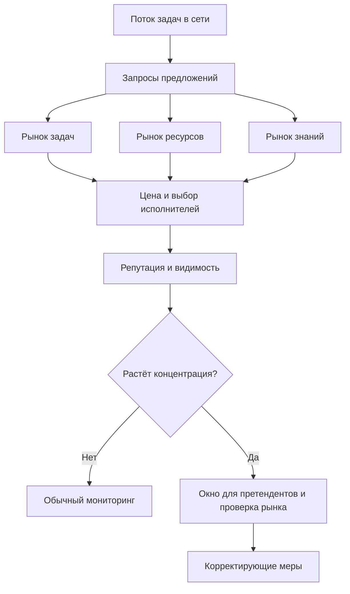
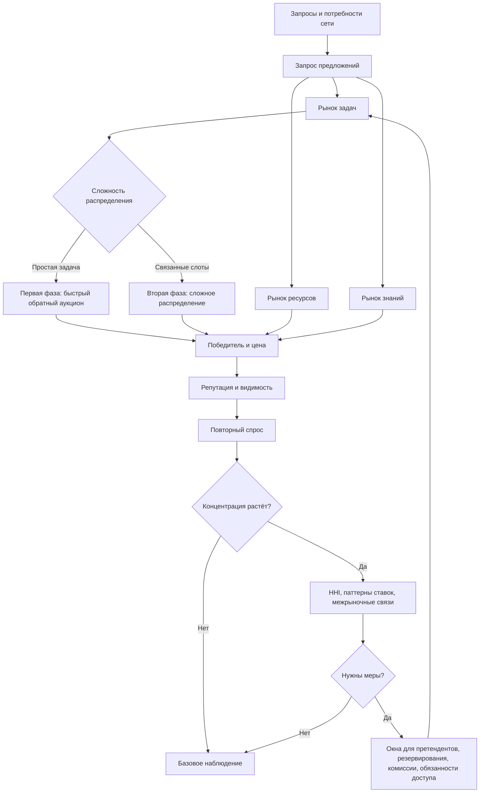

# УРОВЕНЬ 3 / ИЗМЕРЕНИЕ 06: КОНКУРЕНТНО-РЫНОЧНОЕ

> **Уровень:** L3 — Межагентные взаимодействия  
> **Измерение:** D06 — Competition  
> **Учебная редакция:** v1.0  
> **Главная тема:** как в сети агентов возникают рынки, цены и ограничения против монополизации

---

## Ключевой вопрос

**Как формируются рынки, цены, спрос и предложение в результате конкуренции Логосов за ресурсы и задачи?**

---

## Краткое описание измерения

В цифровой агентной среде тысячи Логосов не только сотрудничают, но и конкурируют.

Они борются за задачи, вычислительные ресурсы, видимость, репутацию и доступ к спросу. Из этих повторяющихся столкновений возникают цены, рыночные ниши, доминирующие узлы и риски согласованного поведения.

Настоящее измерение объясняет, как удерживать такую конкуренцию полезной: чтобы сильные исполнители получали спрос, но рынок не превращался в закрытую систему для нескольких лидеров.

Эта глава отвечает на несколько практических вопросов:

1. Какие рыночные арены существуют в сети Логосов?
2. Как аукционы превращают заявки исполнителей в цену задачи?
3. Когда простой быстрый аукцион должен уступать место более сложному распределению?
4. Почему репутация помогает рынку, но одновременно усиливает концентрацию?
5. Как обнаруживать сговор, манипуляции и устойчивое доминирование?
6. Какие меры сохраняют возможность входа для новых и нишевых участников?

---

## Мини-глоссарий

| Термин | Простое объяснение |
|--------|--------------------|
| **Логос** | Агент, который действует в цифровой среде и участвует в задачах, торгах и обменах |
| **Рыночная арена** | Область, где участники конкурируют за один тип ценности: задачи, ресурсы или знания |
| **`Task Marketplace`** | Рынок задач: исполнители соревнуются за право выполнить миссию или слот исполнения |
| **`Resource Marketplace`** | Рынок вычислительных ресурсов: провайдеры конкурируют ценой и качеством мощности |
| **`Knowledge Marketplace`** | Рынок знаний: участники покупают и продают проверяемые знания и повторно используемые активы |
| **`cfp`** | Запрос предложений: сообщение, после которого исполнители подают конкурентные заявки |
| **`CNP`** | Протокол контрактной сети: схема переговоров "запрос предложений -> предложения -> выбор" |
| **`ADS`** | Сервис обнаружения агентов: помогает найти и ранжировать подходящих участников |
| **`SLA`** | Обещанный уровень сервиса: сроки, качество, доступность и иные условия исполнения |
| **Обратный аукцион Викри** | Закрытый аукцион, где исполнители соревнуются снижением цены, а правило оплаты снижает стимул блефовать |
| **`VCG`** | Сложный аукционный механизм для распределения нескольких связанных слотов |
| **`MLHCA`** | Класс эвристических комбинаторных аукционов для больших сложных распределений |
| **Распределение** | Выбор победителей и назначение ресурсов или задач по результатам заявок |
| **Общественная эффективность** | Насколько итоговое распределение сохраняет суммарную ценность для участников рынка |
| **`DSIC`** | Свойство механизма, при котором правдивое раскрытие предпочтений является лучшей стратегией |
| **`ε-BIC`** | Ослабленная версия честности механизма: небольшое отклонение от правдивости допустимо в ожидании |
| **`MACI`** | Криптографическая оболочка для закрытых пакетных торгов с защитой от части сговоров |
| **`commit-reveal`** | Схема, где участник сначала фиксирует скрытую ставку, а потом раскрывает её |
| **`ZKP`** | Доказательство с нулевым разглашением: можно доказать факт, не раскрывая исходные данные |
| **`AI Watcher`** | Контур автоматического мониторинга, который ищет аномалии и подозрительные паттерны |
| **`Reputation Score`** | Числовой сигнал исторической надёжности и качества Логоса |
| **`Reputation Tier`** | Категория репутации, показывающая положение Логоса в шкале надёжности |
| **`HHI`** | Индекс концентрации рынка: показывает, насколько рынок сосредоточен у немногих участников |
| **`Level Playing Field`** | Набор правил, которые сохраняют возможность конкуренции для новых и малых участников |
| **Окно для претендентов** | Период, когда рынок специально даёт видимость альтернативным исполнителям |
| **Резервирование мест** | Правило, по которому часть видимости или слотов оставляют не только лидерам |
| **Ограничение комиссии** | Верхняя граница комиссии, которую можно брать в домене с высокой концентрацией |
| **Межрыночное субсидирование** | Ситуация, когда участник снижает цену в одной арене ради выгоды в другой |
| **Риск перелома рынка** | Момент, когда накопленное преимущество может закрепить доминирование одного узла или группы |
| **`ABM`** | Агентное моделирование: симуляция рынка через множество участников с разными стратегиями |
| **Обнаружение цены** | Процесс, в котором рынок выясняет, сколько реально стоит задача, ресурс или знание |
| **Ценовая сила** | Способность удерживать более высокую цену благодаря репутации или видимости |
| **Сговор** | Согласованное поведение участников, которое удерживает цену или распределение выгод вне нормальной конкуренции |
| **Проверка картельных паттернов** | Поиск признаков устойчивого антиконкурентного поведения |
| **Орган контроля конкуренции** | Управленческий контур, который расследует концентрацию и применяет корректирующие меры |

---

# 0. Гипотетический пример

Представим крупную цифровую среду, где постоянно появляются разные задачи: анализ данных, обслуживание вычислений, подготовка отчётов, проверка знаний, настройка инструментов.

Заказчики не выбирают исполнителей вручную. Их Логосы публикуют запросы, а другие Логосы откликаются предложениями. Одновременно часть участников продаёт вычислительную мощность, а часть — проверенные знания и шаблоны решений.

В этой истории важен не один договор, а вся сеть.

**Марина** — оператор отраслевой площадки задач. Её команда отвечает за то, чтобы задачи распределялись быстро и без перекоса в пользу одного доминирующего участника.

**Кластер "Север"** — группа сильных исполнителей с высокой репутацией. Они выигрывают много задач, потому что раньше часто выполняли работу надёжно.

**Кластер "Вектор"** — набор новых специализированных исполнителей. Они дешевле и иногда точнее в узких доменах, но у них меньше истории и слабее видимость.

**Провайдер "Ресурс-7"** — поставщик вычислительной мощности. Ему выгодно, чтобы задачи уходили исполнителям, использующим его ресурсы.

Теперь появляется серия задач: за короткий период нужно обработать большой поток отраслевых заявок. Для части задач достаточно одного исполнителя, но часть требует нескольких слотов, разных навыков и стабильного уровня сервиса.

## Проверка 1. Где именно возникает конкуренция?

Марина видит, что конкуренция идёт не в одном месте.

На рынке задач (`Task Marketplace`) исполнители спорят за право выполнить миссии. На рынке ресурсов (`Resource Marketplace`) поставщики мощности предлагают цену и уровень сервиса. На рынке знаний (`Knowledge Marketplace`) участники продают проверенные шаблоны и результаты, которые помогают выполнять будущие задачи быстрее.

Если смотреть только на один рынок, картина будет неполной. Кластер "Север" может снижать цену на выполнение задач, потому что зарабатывает на ресурсах или на продаже знаний после выполнения.

## Проверка 2. Как из предложений появляется цена?

Для простых задач Логос Марины публикует запрос предложений (`cfp`). Исполнители отвечают ставками: цена, срок, уровень сервиса, задержка и репутационные сигналы.

Если задача простая, системе нужен быстрый механизм. Она может применить обратный аукцион Викри (`Reverse Vickrey Auction`): исполнители подают закрытые ставки, а правило выбора помогает быстро получить конкурентную цену без долгого перебора вариантов.

Для сложного пакета задач этого уже мало. Там нужно распределить несколько связанных слотов, учесть зависимости между исполнителями и понять, какой набор победителей даёт лучший результат.

## Проверка 3. Когда включать сложный режим?

Марина не хочет включать сложный аукцион для каждой мелкой задачи. Это дорого, медленно и может перегрузить исполнение.

Поэтому среда использует правило перехода: сложный режим рассматривается только при достаточной сложности задачи, достаточном масштабе рынка и признаках концентрации. Числовые пороги из данной главы следует читать как проектные ориентиры: они задают управленческий контракт для включения второй фазы, но требуют проверки на реальной телеметрии.

Такой подход защищает рынок от двух ошибок: не усложнять простое и не решать сложное слишком грубым быстрым механизмом.

## Проверка 4. Не превращается ли репутация в закрытый вход?

Кластер "Север" получает больше запросов, потому что у него высокая история исполнения. Это полезно: заказчики быстрее находят надёжных исполнителей.

Но у этой логики есть обратная сторона. Чем чаще "Север" виден в коротком списке, тем чаще он выигрывает; чем чаще выигрывает, тем сильнее его репутация; чем сильнее репутация, тем чаще он снова попадает в короткий список.

Чтобы "Вектор" не исчез из поля зрения, среда может включать окно для претендентов, резервирование части видимости и временное ослабление гарантированного первого места для повторяющихся победителей.

## Проверка 5. Нет ли согласованного поведения?

Через несколько недель мониторинг замечает: цены разных исполнителей стали слишком похожи, разброс ставок снизился, а одни и те же участники по очереди выигрывают доменные задачи.

Это ещё не доказывает сговор. Иногда похожие цены возникают честно: участники видят одни и те же затраты и приходят к близким ставкам.

Но для агентной среды этого достаточно, чтобы включить проверку: посмотреть корреляции ставок, повторяющиеся паттерны, изменение концентрации и связи между рынками задач, ресурсов и знаний.

## Главное из примера

**Конкуренция на уровне сети — это не один аукцион, а связанная система рынков, репутации, ресурсов, знаний и контроля концентрации.**

Если следить только за ценой отдельной задачи, можно пропустить более важное: кто получает видимость, кто накапливает спрос, кто субсидирует один рынок за счёт другого и когда полезная репутация превращается в барьер входа.



---

# Содержание

1. Рыночные арены и межрыночные эффекты
2. Аукционная архитектура
3. Сговор, манипуляции и защита рынка
4. Обнаружение цены, ранжирование и конкурентное преимущество
5. Равные условия конкуренции и контроль концентрации
6. Связь и границы с другими измерениями
7. Итоговая модель целиком
8. Короткое резюме главы
9. Вопросы без ответа

---

# 1. Рыночные арены и межрыночные эффекты

Чтобы понять конкуренцию Логосов, нельзя начинать с одного аукциона. В сети одновременно распределяются разные виды ценности: задачи, вычислительная мощность и знания.

Если эти арены связаны, цена в одной из них может быть частью стратегии в другой. Поэтому настоящее измерение рассматривает конкуренцию как систему взаимозависимых рынков.

## 1.1 Три арены конкуренции

| Арена | Что распределяется | Как конкурируют участники | Главный сигнал |
|-------|--------------------|---------------------------|----------------|
| **Рынок задач (`Task Marketplace`)** | Миссии, слоты исполнения, пакеты задач | Исполнители подают предложения на запросы | Цена, уровень сервиса, репутация, задержка |
| **Рынок ресурсов (`Resource Marketplace`)** | Вычислительная мощность и связанные ресурсы | Провайдеры конкурируют ценой при соблюдении условий | Цена при допустимом уровне сервиса |
| **Рынок знаний (`Knowledge Marketplace`)** | Проверенные знания и повторно используемые активы | Продавцы доказывают ценность труднее наблюдаемого товара | Репутация и сигналы качества |

Рынок задач является основной ареной конкуренции за выполнение. Рынок ресурсов связывает стоимость выполнения с доступностью вычислений. Рынок знаний добавляет особый случай: качество товара трудно увидеть заранее, поэтому одна цена не может быть достаточным сигналом.

> В рынке знаний низкая цена не всегда означает лучшую сделку, а высокая цена не доказывает качество.

## 1.2 Почему арены нельзя изолировать

Участник может сознательно снижать цену в одной арене, если ожидает выгоду в другой. Например, исполнитель берёт задачи дешевле, чтобы загрузить связанный ресурсный контур или усилить свою видимость на рынке знаний.

Такое межрыночное субсидирование не обязательно является нарушением. Иногда это нормальная стратегия роста. Риск возникает тогда, когда стратегия закрепляет доминирование и закрывает вход для альтернативных участников.

Исследовательская модель, лежащая за этой логикой, предполагает сильную взаимодополняемость рынков. Для агентных экономик это следует читать как осторожную теоретическую рамку, а не как уже подтверждённый производственный факт.

## 1.3 Как отдельные стратегии становятся рыночной структурой

На микроуровне отдельный Логос выбирает, где участвовать, какую цену заявить и сколько ресурса зарезервировать.

На мезоуровне множество таких решений собирается в аукционные результаты: кто попал в короткий список, кто выиграл, какая цена стала видимой.

На макроуровне повторяющиеся результаты меняют структуру предложения. Узлы с высокой репутацией получают больше запросов, новички получают меньше наблюдаемых шансов, а межрыночные связи могут ускорять концентрацию.

Микро-пример: в истории Марины "Север" может снижать цену на задачи обработки заявок, потому что затем продаёт проверенные шаблоны на рынке знаний. Для одной задачи это выглядит как выгодная ставка. Для всей сети это может стать способом закрепить преимущество сразу в двух аренах.

## Главное

**Конкуренция Логосов происходит сразу в нескольких связанных аренах.**  
**Цена отдельной задачи важна, но рыночная структура определяется ещё репутацией, ресурсами, знаниями и межрыночными переносами выгоды.**

---

# 2. Аукционная архитектура

Аукцион нужен не ради формальности. Он превращает множество несравнимых предложений в выбор победителя и цену, которую можно объяснить участникам.

Но один механизм не подходит для всех случаев. Простая задача требует скорости. Сложный пакет задач требует более точного распределения.

## 2.1 Первая фаза: быстрый обратный аукцион Викри

Первая фаза (англ. Phase 1) предназначена для быстрых задач без сложного распределения пакетов. В ней базовым механизмом является обратный аукцион Викри (`Reverse Vickrey Auction`).

Смысл простой:

1. заказчик публикует запрос;
2. исполнители подают закрытые ставки;
3. система выбирает подходящего победителя;
4. правило оплаты снижает стимул к грубому завышению или занижению заявки.

Для такой фазы важнее низкая задержка и предсказуемость, чем идеальная оптимизация сложного распределения.

Чтобы не раскрывать ставки раньше времени, быстрый режим может опираться на закрытые ставки, схему `commit-reveal` и другие лёгкие способы сохранения тайны заявок.

## 2.2 Вторая фаза: сложное распределение

Вторая фаза нужна, когда задача состоит из нескольких связанных слотов или требует учёта взаимозависимостей.

Для таких случаев в данной главе рассматривается механизм Викри-Кларка-Гроувса (англ. Vickrey-Clarke-Groves, далее — `VCG`). Он теоретически силён, но вычислительно тяжёл в комбинаторных настройках.

Поэтому точный `VCG` ограничивается малыми много-слотовыми распределениями. Порог до `15` слотов следует читать как проектную границу решателя: она фиксирует, где точное распределение ещё считается допустимым по бюджету вычислений.

Когда слотов больше `15`, базовым кандидатом становится класс многоуровневых эвристических комбинаторных аукционов (`MLHCA`). Это не обещание идеального результата. Это инженерный выбор: искать достаточно хорошее распределение в пределах заданного времени и числа запросов.

Учебное чтение ограничений:

| Ограничение | Что оно значит простыми словами |
|-------------|----------------------------------|
| Поиск ограничен временем и числом запросов | Решатель не ищет бесконечно долго |
| Целевой диапазон сохранения эффективности `rho ~= 0.8-0.9` | Это проектный ориентир калибровки, а не внешне доказанная гарантия |
| Точная честность `DSIC` больше не заявляется | Для приближённого режима используется ослабленная интерпретация честности, например `ε-BIC` |
| При деградации есть возврат | Если решатель не укладывается в бюджет, задача упрощается или возвращается в первую фазу |

## 2.3 Когда переходить между фазами

Переход между фазами должен быть явным управленческим контрактом. Иначе сложный режим можно включить слишком рано, слишком поздно или по непрозрачной причине.

В данной главе зафиксированы проектные ориентиры перехода:

1. задача имеет больше `15` слотов или выраженные зависимости между слотами;
2. за скользящее окно `30` дней сложный режим показывает прирост эффективности не ниже `15%` относительно первой фазы;
3. доменный рынок достиг масштаба не ниже `500` аукционов в день;
4. индекс концентрации `HHI` выше `2000`;
5. управленческий обзор явно подтверждает включение, отсрочку или откат.

Эти числа не следует читать как универсальный закон рынка. Это производственные ориентиры для включения более сложного механизма, которые должны проверяться на телеметрии конкретного домена.

```text
если задача простая:
    использовать первую фазу

если задача сложная
и рынок достаточно масштабен
и сложный режим даёт устойчивый выигрыш
и концентрация уже значима:
    рассмотреть вторую фазу

если решатель не укладывается в бюджет:
    упростить лоты или вернуться в первую фазу
```

Микро-пример: для потока типовых заявок Марина оставляет первую фазу, потому что каждый отдельный заказ прост и должен распределяться быстро. Для недельного пакета, где нужны разные роли, несколько слотов и общий уровень сервиса, она рассматривает вторую фазу только после проверки масштаба, эффективности и концентрации.

## Главное

**Первая фаза отвечает за скорость, вторая — за сложное распределение.**  
**Переход между ними должен быть измеримым, обратимым и управляемым, а не интуитивным.**

---

# 3. Сговор, манипуляции и защита рынка

В агентной среде сговор не обязательно выглядит как явная договорённость людей. Повторяющиеся взаимодействия, похожие алгоритмы и общая инфраструктура могут приводить к устойчивым антиконкурентным результатам.

Поэтому защита рынка должна быть многоуровневой: на уровне аукционного механизма, поведения участников и управленческого расследования.

## 3.1 Почему неоднородность помогает, но не решает проблему

Исследовательские симуляции с языковыми агентами показывают риск согласованного поведения в повторяющихся взаимодействиях. В симметричных популяциях наблюдались ориентировочные наценки около `22%` сверх конкурентного ориентира; неоднородность по терпению или доступу к информации снижала эффект примерно до `7-10%`, но не устраняла его полностью.

Эти числа являются переносными исследовательскими оценками, а не производственной гарантией для данной среды.

Вывод для архитектуры осторожный: разнообразие участников полезно как средство снижения риска, но его нельзя считать окончательной защитой. Даже после нарушения симметрии рынок может собраться вокруг лидеров, которые задают поведение остальным.

## 3.2 Где уместна криптографическая оболочка

Если ставки видны слишком рано или участник может доказать третьей стороне, как он голосовал или торговался, сговор становится легче.

Для части таких случаев может использоваться минимальная антиколлюзионная инфраструктура (англ. Minimal Anti-Collusion Infrastructure, далее — `MACI`). Её полезные свойства для рынка:

1. ставки зашифрованы;
2. участнику трудно продать доказательство своего поведения;
3. предусмотрен механизм смены ключа в проблемных случаях.

Но `MACI` не подходит как универсальная оболочка для каждого быстрого аукциона. Порядок около `2` секунд на подпись и пакетная задержка являются ориентиром из исследовательского слоя; для коротких окон первой фазы это слишком тяжело.

Поэтому `MACI` следует использовать точечно: для более крупных ставок, больших групп участников и случаев с повышенным риском сговора. Быстрый режим по умолчанию остаётся легче и опирается на закрытость ставок и `commit-reveal`.

## 3.3 Защита слоями

Одна мера не закрывает весь риск. Нужна связка:

| Слой | Что делает | Пример |
|------|------------|--------|
| Механизм | Снижает выгоду манипуляции внутри аукциона | закрытые ставки, антиэкстракционные правила |
| Наблюдение | Ищет подозрительные паттерны поведения | корреляции ставок, дрейф `HHI`, снижение разброса цен |
| Управление | Расследует и применяет меры | окна для претендентов, ограничения комиссий, пересмотр доступа |

Автоматический контур наблюдения (`AI Watcher`) в данной главе важен только как рыночный мониторинг. Он ищет подозрительные корреляции, аномалии разброса, изменение концентрации и повторяющиеся паттерны ставок.

Микро-пример: если "Север" и связанные исполнители начинают выигрывать по очереди с почти одинаковыми ставками, Марина не объявляет это картелем автоматически. Она запускает проверку паттернов: сравнивает разброс цен, повторяемость победителей и связь с ресурсным рынком.

## Главное

**Сговор в агентной сети может возникать без явной человеческой переписки.**  
**Защита требует сочетания тайны ставок, поведенческого мониторинга и управленческих мер.**

---

# 4. Обнаружение цены, ранжирование и конкурентное преимущество

Цена в такой среде возникает не только из числа в заявке. На выбор победителя влияют стоимость, уровень сервиса, способность выполнить задачу, репутация и задержка.

Поэтому настоящее измерение задаёт числовую логику конкурентного выбора, но не забирает себе смысл сообщений, инфраструктуру поиска или собственную модель репутации.

## 4.1 Ранжирование предложений

Сервис обнаружения агентов (англ. Agent Discovery Service, далее — `ADS`) помогает определить, кого вообще видно в конкурсе и кто попадает в короткий список.

Для оценки ответа на запрос предложений используется стартовая весовая схема:

| Компонент | Начальный вес | Роль |
|-----------|---------------|------|
| **Цена** | **40%** | основной сигнал ценовой конкуренции |
| **Соответствие способности и уровню сервиса** | **30%** | насколько предложение подходит требованиям задачи |
| **`Reputation Score`** | **20%** | исторический сигнал надёжности |
| **Задержка** | **10%** | штраф или преимущество для задач, чувствительных ко времени |

Эти веса являются стартовой управленческой политикой, а не вечной константой. Они настраиваются управлением, но важны как базовая логика: победитель выбирается не только по минимальной цене.

## 4.2 Репутация как ценовая сила

Репутация помогает рынку сортировать исполнителей. Если качество трудно проверить заранее, заказчик разумно предпочитает того, кто уже стабильно выполнял похожие задачи.

Но репутация также создаёт ценовую силу. Логос с высоким `Reputation Score` и высоким `Reputation Tier` может удерживать премию к цене, не теряя спрос, потому что заказчики считают риск ниже.

Особенно это заметно на рынке знаний. Там товар часто похож на "доверительный" актив: до покупки трудно понять, насколько он полезен. Поэтому репутация и подтверждённые сигналы качества могут быть важнее объявленной цены.

Риск состоит в предпочтительном присоединении: победители получают больше спроса, потому что уже видимы; затем их видимость снова усиливается.

## 4.3 Почему цена по-разному работает в разных аренах

На рынке ресурсов конкуренция ближе к обычной логике обратного аукциона: при одинаковом уровне сервиса более низкая цена часто является сильным сигналом.

На рынке знаний это не так. Низкая цена может означать как хорошее предложение, так и низкое качество. Высокая цена тоже не доказывает качество. Поэтому нужны репутационные сигналы, история полезности и фильтры качества.

На рынке задач система соединяет оба мира: цена важна, но она должна оцениваться вместе с уровнем сервиса, способностью, задержкой и репутацией.

## 4.4 Как формируются спрос, предложение и цена

Процесс можно читать в три шага.

1. **Микроуровень.** Логос решает, на какие запросы откликаться, какую цену заявить и сколько ресурса зарезервировать.
2. **Мезоуровень.** Аукцион и ранжирование превращают набор заявок в победителя, оплату и наблюдаемый ценовой сигнал.
3. **Макроуровень.** Повторяющиеся победы меняют спрос и предложение: сильные узлы получают больше видимости, нишевые участники ищут окна входа, а межрыночное субсидирование связывает цены разных арен.

> Рыночная цена здесь не "назначается сверху". Она возникает из повторяющихся заявок, отбора, репутации и ограничений против концентрации.

Микро-пример: "Вектор" может проигрывать "Северу" по репутации, но выигрывать по задержке и цене в узкой группе задач. Если весовая схема и окно для претендентов дают ему видимость, рынок получает реальную альтернативу, а не только повторный выбор прежнего лидера.

## Главное

**Цена задачи возникает из заявки, но конкурентный выбор шире цены.**  
**Репутация улучшает сортировку исполнителей и одновременно может создавать устойчивое преимущество лидеров.**

---

# 5. Равные условия конкуренции и контроль концентрации

Цель правил конкуренции не в том, чтобы наказать сильных участников за качество. Сильная репутация должна давать преимущество.

Проблема начинается там, где преимущество становится необратимым: новые участники не получают видимости, заказчики не видят альтернатив, а один домен постепенно закрывается вокруг группы победителей.

## 5.1 Равные условия конкуренции

Равные условия конкуренции (англ. Level Playing Field, далее — `Level Playing Field`) — это набор предварительных мер, которые сохраняют оспариваемость рынка.

Ключевые меры:

| Мера | Зачем нужна |
|------|-------------|
| Минимальная видимость претендентов | Чтобы короткий список не состоял только из повторяющихся лидеров |
| Окно ротации на `5-10` аукционных циклов | Чтобы временно ослаблять гарантированное первое место повторных победителей |
| Продление окна, если претендентов меньше двух | Чтобы рынок не выдавал безальтернативную победу из-за слишком жёстких фильтров |
| Постепенное усиление мер | Чтобы комиссии, резервирования и обязанности доступа включались по устойчивым данным, а не вручную |

Диапазон `5-10` циклов является проектным ориентиром политики ротации, а не универсальным правилом для всех доменов.

Эти меры не отменяют репутацию. Они не говорят, что новичок равен лидеру. Они говорят другое: рынок должен периодически видеть альтернативы, если иначе лидерство становится самоподдерживающимся.

## 5.2 Индекс концентрации `HHI`

Индекс Херфиндаля-Хиршмана (англ. Herfindahl-Hirschman Index, далее — `HHI`) используется как структурный индикатор концентрации.

В данной главе применяется трёхступенчатая шкала для доменных рынков:

| Значение `HHI` | Режим чтения | Что происходит |
|----------------|--------------|----------------|
| ниже `1800` | базовое наблюдение | рынок отслеживается без специальных мер |
| `1800-1999` | консультационное расследование | проверяются зависимости между рынками и причины концентрации |
| `2000-2499` | обязательное окно для претендентов | включается усиленная видимость альтернатив и еженедельный обзор |
| `>=2500` | обзор структурных мер | проверяются резервирования, обязанности доступа и ограничения комиссий |

Эти числа являются собственной управленческой лестницей для агентной экономики, опирающейся на публичные антимонопольные ориентиры. Их нельзя читать отдельно от поведения рынка.

`HHI` необходим, но недостаточен. Его нужно сопоставлять с параллельностью цен, разбросом ставок, повторяемостью взаимодействий, репутационной премией и картой межрыночных субсидий.

## 5.3 Три уровня органа контроля конкуренции

Орган контроля конкуренции работает в три уровня:

| Уровень | Функция | Типовые инструменты |
|---------|---------|---------------------|
| **Уровень 1: автоматический скрининг** | рано заметить рост концентрации и потерю оспариваемости | диапазоны `HHI`, доля побед претендентов, дрейф ценового разброса, паттерны ставок |
| **Уровень 2: расследование** | отличить структурную блокировку от невинной похожести | сетевой анализ, повторные расчёты, проверка переносимости и доступа |
| **Уровень 3: меры восстановления** | вернуть рынку возможность конкуренции | окна для претендентов, резервирования, ограничения комиссий, временные обязанности доступа |

Для настройки такого органа может использоваться агентное моделирование (англ. Agent-Based Modeling, далее — `ABM`). В симуляции задаются разные типы участников: лидеры, претенденты, специалисты и низкозатратные входящие участники.

Настраиваемые параметры включают стоимость переключения, репутационную премию, интенсивность межрыночного субсидирования, темп входа новых участников и чувствительность к задержке.

Выходы симуляции — траектория `HHI`, доля побед претендентов, разброс цен, оценка межрыночной зависимости и диагностика сходимости за `20-50` итераций. Этот диапазон является ориентиром для проектной симуляции, а не заменой реальной телеметрии.

Микро-пример: если после запуска окна для претендентов "Вектор" начинает выигрывать часть задач без ухудшения уровня сервиса, Марина получает сигнал, что рынок был оспариваемым, но видимость была перекошена. Если претенденты всё равно не выигрывают, нужно расследовать: проблема в качестве, фильтрах, доступе к ресурсам или в межрыночной зависимости.

## Главное

**Равные условия конкуренции не отменяют преимущество сильных исполнителей.**  
**Они не дают репутации и видимости превратиться в необратимое закрытие рынка.**

---

# 6. Связь и границы с другими измерениями

Настоящее измерение отвечает за рыночную логику: как заявки, аукционы, репутация и концентрация формируют конкуренцию. Соседние измерения задают язык сообщений, координационные механизмы, безопасность, репутацию, эмерджентные формы и разрешение споров.

| Измерение | Связь | Граница ответственности |
|-----------|-------|--------------------------|
| **L3/D02 (Семантика)** | Задаёт смысловую форму сообщений, включая запросы предложений и типы речевых актов. | Семантика объясняет, что означает сообщение; настоящее измерение объясняет, как конкуренция превращает ответы в цену, спрос и структуру рынка. |
| **L2/D06 (Координация)** | Даёт координационные механизмы поиска, матчинга и передачи запроса в торги. | Координация отвечает за платформенный процесс; настоящее измерение отвечает за рыночный эффект этого процесса. |
| **L2/D07 (Безопасность)** | Обеспечивает мониторинг, доказательства и контуры защиты. | Безопасность отвечает за технический контроль и криптографию; настоящее измерение использует их только как инструменты против манипуляций рынка. |
| **L1/D09 (Репутация)** | Даёт `Reputation Score` и `Reputation Tier` как свойства Логоса. | Репутационное измерение описывает саму репутацию; настоящее измерение описывает её влияние на цену, видимость и концентрацию. |
| **L3/D07 (Организационно-эмерджентное)** | Описывает устойчивые формы вроде картелей и других надорганизационных паттернов. | Эмерджентное измерение объясняет возникновение форм; настоящее измерение задаёт рыночный контроль и меры конкуренции. |
| **L3/D08 (Конфликтно-арбитражное)** | Получает споры о манипуляциях, мошеннических ставках и решениях органа контроля. | Арбитраж разбирает конфликт; настоящее измерение формирует рыночные правила и признаки нарушения. |

## Главное

**Граница настоящего измерения — конкуренция как рыночная динамика.**  
**Соседние измерения дают язык, инфраструктуру, безопасность, репутацию и арбитраж, но не заменяют рыночную логику.**

---

# 7. Итоговая модель целиком

Вся модель собирается в один контур: запросы приходят в сеть, участники конкурируют в трёх аренах, аукционные механизмы выбирают победителей, репутация меняет видимость, мониторинг ищет концентрацию и сговор, а управленческие меры сохраняют оспариваемость рынка.



## Главное

**Итоговая модель связывает цену, репутацию и антимонопольный контроль в один цикл.**  
**Рынок считается здоровым не тогда, когда все равны, а когда преимущество остаётся оспариваемым.**

---

# 8. Короткое резюме главы

1. Конкуренция Логосов происходит в трёх связанных аренах: задач, ресурсов и знаний.
2. Простые задачи распределяются быстрым аукционным режимом; сложные пакеты требуют более тяжёлого распределения.
3. Переход ко второй фазе должен зависеть от сложности, масштаба, измеримого выигрыша, концентрации и управленческого подтверждения.
4. Сговор и манипуляции требуют защиты слоями: тайна ставок, мониторинг поведения и управленческие меры.
5. Репутация помогает выбирать надёжных исполнителей, но может усиливать концентрацию и ценовую силу лидеров.
6. `HHI`, окна для претендентов, резервирования и ограничения комиссий нужны не против качества, а против необратимого закрытия рынка.
7. Симуляции и проектные пороги помогают настраивать правила, но не заменяют наблюдаемую телеметрию.

## Главное

**Настоящее измерение показывает, как из множества конкурирующих действий возникает рынок, и какие правила нужны, чтобы этот рынок оставался открытым для реальной конкуренции.**

---

# 9. Вопросы без ответа

1. **Как окончательно утвердить критерии перехода между фазами аукциона?** Нужны управленческое подтверждение, проверка вычислительного бюджета и наблюдаемая телеметрия, чтобы пороги сложности, масштаба и выигрыша не остались только проектной схемой.
2. **Какие значения `HHI` считать достаточными для вмешательства в каждом домене?** Трёхступенчатая лестница даёт стартовую позицию, но домены могут различаться по размеру, скорости роста и допустимой концентрации.
3. **Как удержать баланс между репутационной премией и оспариваемостью?** Нужно определить правила старения репутации, процентильного ранжирования, многоадресного участия и ротации видимости, чтобы качество вознаграждалось, но не закрывало вход.
4. **Как моделировать ценовую динамику неоднородных агентов?** Требуется отдельная работа с симуляциями, чтобы понять влияние терпения, доступа к информации и межрыночных переносов выгоды.
5. **Как отличать честную похожесть цен от согласованного поведения?** Нужны практические критерии расследования, которые не будут наказывать нормальную рыночную сходимость, но смогут обнаруживать устойчивые антиконкурентные паттерны.

## Главное

**Открытые вопросы связаны не с самой идеей конкуренции, а с калибровкой: когда включать сложный механизм, когда вмешиваться и как не спутать полезное преимущество с закрытием рынка.**
