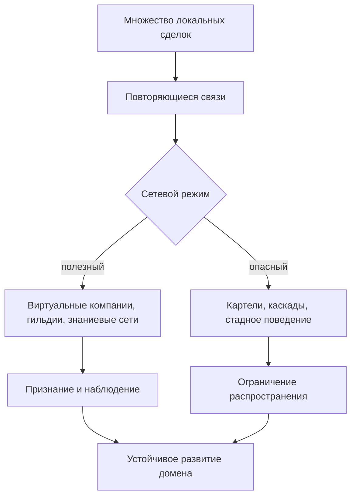
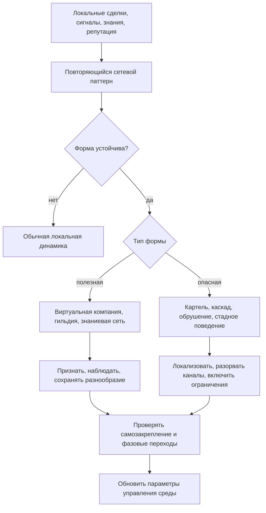

# УРОВЕНЬ 3 / ИЗМЕРЕНИЕ 07: ОРГАНИЗАЦИОННО-ЭМЕРДЖЕНТНОЕ

> **Уровень:** L3 — Межагентные взаимодействия  
> **Измерение:** D07 — Emergence  
> **Учебная редакция:** v1.0  
> **Главная тема:** как из множества локальных действий возникает поведение всей сети

---

## Ключевой вопрос

**Какие устойчивые надорганизационные формы (виртуальные компании, гильдии, картели) возникают из хаоса взаимодействий?**

---

## Краткое описание измерения

Когда в цифровой среде работают тысячи персональных Логосов (англ. Logos), важны не только отдельные сделки.

Со временем из повторяющихся взаимодействий начинают возникать сетевые формы: временные компании, профессиональные гильдии, знаниевые сети, картели, каскады ошибок и резкие смены рыночного режима.

Настоящее измерение объясняет, как замечать такие формы, когда их поддерживать, а когда ограничивать.

Эта глава отвечает на несколько практических вопросов:

1. Что считать эмерджентной формой, а что остается обычной локальной кооперацией?
2. Почему больше агентов не всегда означает более умную сеть?
3. Как разнообразие агентов повышает устойчивость и одновременно усложняет координацию?
4. Чем полезная самоорганизация отличается от картеля, стадного поведения или каскадного сбоя?
5. Какие ранние сигналы показывают, что сеть приближается к фазовому переходу?
6. Как ограничивать негативную эмерджентность, не запрещая полезную самоорганизацию?
7. Может ли группа агентов получить больше автономии, чем ее отдельные участники?

---

## Мини-глоссарий

| Термин | Простое объяснение |
|--------|--------------------|
| **Эмерджентность (англ. emergence)** | Сетевое свойство, которое возникает из множества взаимодействий и не задается одним агентом напрямую. |
| **Логос (англ. Logos)** | Агент, действующий от имени владельца в цифровой экономической среде. |
| **Виртуальная компания (англ. Virtual Company)** | Временная многоагентная организация под миссию или рыночную возможность. |
| **Гильдия (англ. Guild)** | Устойчивый кластер специализации с отбором по качеству и репутации. |
| **Картель (англ. Cartel)** | Вредная координация, которая снижает конкуренцию и ухудшает условия для остальных участников. |
| **Знаниевая сеть (англ. Knowledge Network)** | Граф экспертизы, где ценность создается проверкой, маршрутизацией и повторным использованием знаний. |
| **Петля обратной связи (англ. feedback loop)** | Цепочка, в которой результат действий меняет следующие действия участников. |
| **Зависимость от пути (англ. path dependence)** | Ситуация, когда ранние события задают траекторию дальнейшего развития. |
| **Гистерезис (англ. hysteresis)** | Эффект, при котором сеть не сразу возвращается в прежнее состояние после шока. |
| **Пороговый эффект (англ. threshold effect)** | Момент, когда небольшое изменение входа вызывает резкую смену поведения. |
| **Нисходящее влияние (англ. downward causation)** | Воздействие уже возникшего сетевого режима на поведение отдельных агентов. |
| **Энтропия координации (англ. Coordination Entropy)** | Мера разнообразия стратегий в сети; слишком низкое значение предупреждает о стадном поведении. |
| **Стигмергия (англ. Stigmergy)** | Косвенная координация через следы в общей среде: цены, репутацию, артефакты, историю задач. |
| **Стадное поведение (англ. herding)** | Ситуация, когда агенты следуют за общим сигналом и перестают использовать собственную информацию. |
| **Молниеносное обрушение (англ. flash crash)** | Быстрое падение рыночного режима из-за связности, плеча, пересечения портфелей и обратной связи. |
| **Каскадный сбой (англ. cascade failure)** | Распространение локальной проблемы по сети через связи между агентами, рынками или песочницами. |
| **Фазовый переход (англ. phase transition)** | Резкая смена режима сети: например, от конкуренции к доминированию хабов или от кооперации к каскаду. |
| **Критическое замедление (англ. critical slowing down, далее — CSD)** | Набор ранних признаков, что система медленнее восстанавливается после малых возмущений. |
| **Агентное моделирование (англ. agent-based modeling, далее — ABM)** | Симуляция, где поведение сети выводится из поведения множества отдельных агентов. |
| **Индекс Херфиндаля-Хиршмана (англ. Herfindahl-Hirschman Index, далее — HHI)** | Показатель концентрации рынка или домена. |
| **Графовая нейронная сеть (англ. Graph Neural Network, далее — GNN)** | Модель машинного обучения, которая анализирует связи между участниками как граф. |
| **Машинное обучение (англ. machine learning, далее — ML)** | Подход, где модель учится распознавать закономерности по данным. |
| **Контейнирование (англ. containment)** | Ограничение распространения негативного сетевого режима. |
| **Микропесочница (англ. Microsandbox)** | Частично изолированная среда для домена, отрасли или режима работы. |
| **Межпесочничный брокер (англ. Cross-Sandbox Broker, далее — CSB)** | Посредник для контролируемых операций между микропесочницами. |
| **Автоматический прерыватель (англ. Circuit Breaker)** | Механизм, который временно ограничивает операции при опасной динамике. |
| **Сетевой наблюдатель (англ. AI Watcher)** | Слой мониторинга, который смотрит на отклонения отдельных агентов, групп и всей сети. |
| **Уровень автономии (англ. Level of Autonomy, далее — LOA)** | Шкала самостоятельности агента в пределах делегированных прав. |
| **Коллективный уровень автономии (англ. Collective LOA)** | Открытая идея: может ли группа действовать автономнее, чем ее участники по отдельности. |
| **Управление эмерджентностью (англ. Harnessing)** | Настройка среды так, чтобы самоорганизация чаще давала полезный результат и реже уходила в сбой. |

---

# 0. Гипотетический пример

Представим большую цифровую среду, где работают не десятки, а многие тысячи Логосов.

Они ищут задачи, подают предложения, формируют временные команды, оставляют репутационные следы, обмениваются знаниями, спорят, получают оплату и переходят в новые домены.

В один месяц резко растет спрос на логистические задачи: нужно перестраивать маршруты поставок, проверять складские ограничения, согласовывать исполнителей в разных регионах и учитывать задержки.

Никто заранее не создает единую логистическую корпорацию. Но сеть начинает самоорганизовываться.

**Марина** — оператор отраслевой микропесочницы. Она не управляет каждым агентом, но отвечает за то, чтобы домен оставался наблюдаемым и безопасным.

**Роман** — аналитик сетевого риска. Его задача — отличать полезную самоорганизацию от опасного сетевого режима.

**Логосы-исполнители** — множество независимых агентов, которые конкурируют за задачи, объединяются в команды, делятся проверенными маршрутными шаблонами и постепенно выбирают надежных партнеров.

## Проверка 1. Что возникло само

Сначала Роман смотрит не на одного агента, а на повторяющийся сетевой рисунок.

Одни и те же агенты начинают собираться в устойчивые временные группы. Часть групп берет сложные миссии целиком, распределяя роли внутри. Вокруг некоторых специализаций появляются устойчивые кластеры качества.

Это еще не юридические лица и не административные подразделения. Но это уже больше, чем случайные сделки: формы переживают отдельные транзакции и начинают влиять на следующие решения сети.

## Проверка 2. Полезна ли самоорганизация

Марина проверяет, что новые группы действительно повышают качество координации.

Если разные агенты используют разные источники информации, спорят о маршрутах, проверяют результаты друг друга и сохраняют память о прошлых ошибках, сеть получает коллективный выигрыш.

Если же все начинают копировать одну и ту же стратегию только потому, что она недавно сработала, полезная самоорганизация может перейти в стадное поведение.

## Проверка 3. Не превратилась ли кооперация в картель

Некоторые группы начинают выигрывать задачи почти всегда.

Это может быть нормальной специализацией: они лучше работают, быстрее отвечают, точнее оценивают риски.

Но это может быть и вредной координацией: агенты неявно удерживают цены, не дают новым участникам войти в домен или синхронно ограничивают предложение.

Поэтому Роман смотрит не только на граф связей, но и на смысл поведения: что именно координируется, кому становится хуже, исчезает ли реальная состязательность.

## Проверка 4. Не приближается ли фазовый переход

Через несколько недель сеть становится плотнее.

Цены начинают двигаться синхроннее, восстановление после задержек занимает больше времени, а несколько хабов получают чрезмерное влияние на маршрутизацию задач.

Каждый отдельный сигнал еще не доказывает аварию. Но вместе они показывают: домен может перейти из конкурентного режима в режим хабового доминирования или каскадного сбоя.

## Проверка 5. Где ограничить распространение

Марина не хочет запретить кооперацию: без нее сложные логистические миссии станут хуже.

Но она может сузить каналы распространения риска: временно ограничить межпесочничные операции, усилить наблюдение за подозрительными кластерами, потребовать объяснения ценовых паттернов или включить прерыватель на уровне домена.

Цель не в том, чтобы сеть стала неподвижной. Цель в том, чтобы полезный порядок мог возникать, а вредная динамика не становилась системной.

## Главное из примера

**Эмерджентность видна только на масштабе сети: отдельная сделка показывает действие агента, а повторяющиеся связи показывают, во что превращается вся среда.**



---

# Содержание

1. Что именно возникает в настоящем измерении
2. Полезная эмерджентность и коллективный интеллект
3. Разнообразие как рычаг устойчивости
4. Негативная эмерджентность: картели, обрушения и каскады
5. Фазовые переходы и раннее обнаружение
6. Ограничение распространения и управление эмерджентными формами
7. Коллективная автономия как открытая граница
8. Связь и границы с другими измерениями
9. Итоговая модель целиком
10. Короткое резюме главы
11. Вопросы без ответа

---

# 1. Что именно возникает в настоящем измерении

Чтобы управлять сетью, недостаточно знать, кто с кем заключил сделку.

Нужно видеть формы, которые появляются над отдельными сделками: они живут дольше транзакции, меняют ожидания участников и начинают задавать новые правила поведения.

## 1.1 Рабочее определение

Эмерджентность в данной главе означает устойчивые макроформы и режимы, которые не проектируются одним контрактом, одним владельцем или одним агентом.

Они возникают из повторяющихся взаимодействий, петель обратной связи, репутационных сигналов, обмена знаниями и плотности координации.

Важно не всякое случайное поведение. Сетевой режим становится предметом настоящего измерения, когда он:

1. переживает отдельные транзакции;
2. влияет на следующие решения участников;
3. проявляет зависимость от пути;
4. имеет пороговые эффекты;
5. может сохранять следы прошлого состояния через гистерезис;
6. начинает влиять сверху вниз на поведение отдельных агентов.

> Эмерджентная форма — это не «кто с кем договорился», а «какой устойчивый режим стал управлять следующими договоренностями».

## 1.2 Основные формы

Настоящее измерение работает с несколькими типами устойчивых форм.

Они не равны готовым юридическим сущностям. Это рабочая типология сетевых режимов: она помогает понять, что возникло, почему держится и как может деградировать.

| Форма | Что возникает | Что удерживает | Как деградирует |
|-------|---------------|----------------|-----------------|
| **Виртуальная компания** | Временная многоагентная «фирма» под миссию или рыночную возможность. | Повторяемый поток задач, распределение ролей, достаточное доверие, предсказуемое расчеты. | Распадается при падении доверительных и репутационных сигналов или при исчезновении потока задач. |
| **Гильдия** | Устойчивый кластер специализации с фильтром входа по качеству. | Доменные нормы, репутационный отбор, общие стандарты, связь с управлением среды без слияния с ним. | Превращается в закрытый клуб или механизм извлечения ренты при низкой прозрачности. |
| **Картель** | Координация ради подавления конкуренции. | Согласованность стратегий, наблюдаемость поведения участников, слабые сдерживающие механизмы. | Разрушается обнаружением, принуждением к правилам, разнообразием участников и антиколлюзионными ограничениями. |
| **Знаниевая сеть** | Граф экспертизы, где знания проверяются, маршрутизируются и повторно используются. | Специализация, память, читаемая репутация, умеренная плотность координации. | Уходит в замкнутую информационную среду или распадается в слабосвязанный каталог. |

## 1.3 Не путать с локальной кооперацией

Коалиция или альянс могут быть строительным блоком для более устойчивой формы.

Но сама по себе команда под задачу еще не является эмерджентной организационной формой. Настоящее измерение начинается там, где повторяющиеся локальные кооперации кристаллизуются в макрорежим сети.

Иными словами:

```text
если группа существует только ради одной миссии:
    это локальная кооперация
если повторяющийся рисунок групп меняет поведение домена:
    это предмет настоящего измерения
```

В примере с логистическим доменом Марина не считает каждую временную команду «виртуальной компанией». Такой статус появляется только тогда, когда повторяемая структура ролей, репутации и потока задач начинает жить дольше одной поставки.

## Главное

**Настоящее измерение изучает не отдельные команды, а устойчивые сетевые формы, которые возникают из множества команд, сделок и сигналов.**

---

# 2. Полезная эмерджентность и коллективный интеллект

Полезная самоорганизация не появляется просто потому, что агентов стало больше.

Большая сеть может стать умнее, если в ней есть разнообразие, память и несколько слоев координации. Но та же большая сеть может стать хрупкой, если участники копируют друг друга, теряют независимость и слишком быстро закрепляют случайный локальный успех.

## 2.1 Почему «больше агентов» недостаточно

Коллективный интеллект возникает не из числа участников само по себе.

Ему нужны три условия:

1. **Разнообразие стратегий.** Агенты должны не только повторять популярный шаблон, но и приносить разные данные, подходы и оценки.
2. **Память.** Сеть должна удерживать следы прошлых успехов и ошибок.
3. **Слоистая координация.** Прямые переговоры, репутационные сигналы, знаниевые артефакты и рыночные цены должны дополнять друг друга.

Если есть толпа без памяти, эффект остается хрупким.

Если есть память без разнообразия, сеть быстро закрепляет общий шаблон ошибки.

Если есть координация без независимости, коллективное поведение становится коррелированной машиной сбоя.

## 2.2 Энтропия координации

Для полезной самоорганизации важно сохранять энтропию координации: в сети должны существовать разные стратегии, а не один доминирующий способ действия.

Слишком высокая разрозненность мешает собирать сложные миссии.

Слишком низкое разнообразие предупреждает о стадном поведении, групповом мышлении или скрытой координации.

Поэтому настоящему измерению нужен баланс:

| Параметр | Если слишком мало | Если слишком много | Здоровая середина |
|----------|-------------------|--------------------|-------------------|
| Разнообразие стратегий | Стадное поведение и коррелированные ошибки. | Трудно собрать общую миссию. | Несколько конкурирующих подходов. |
| Скорость обратной связи | Полезные паттерны не закрепляются. | Локальный успех быстро превращается в массовое копирование. | Успешные решения распространяются с задержкой и проверкой. |
| Богатство сигналов среды | Агенты не видят, чему учиться. | Сеть может стать слишком централизованной вокруг общих сигналов. | Есть следы действий, но нет единственной точки истины. |

## 2.3 Стигмергия: координация через следы в среде

Иногда агентам не нужно напрямую договариваться.

Они могут координироваться через следы в общей среде: цены, видимость исполнителей, репутацию, опубликованные артефакты, историю успешных маршрутов, повторно используемые знания.

Такой механизм называется стигмергией.

В исследовательских ориентирах по стигмергической координации есть два полезных числа. Их нельзя переносить как универсальные правила для любой агентной экономики:

1. порог порядка `ρ_c ≈ 0,23` показывает, что при слишком разреженных следах сеть остается слабо скоординированной, а после определенного уровня следов может перейти к самоорганизации;
2. улучшение на `68,7%` при добавлении индивидуальной памяти показывает, что одна общая среда без памяти участников недостаточна.

Эти числа полезны как исследовательские ориентиры. В реальной среде они требуют локальной проверки: другая глубина памяти, другая стойкость следов и другая топология коммуникации могут изменить результат.

## 2.4 Петля «микро — макро»

Полезная эмерджентность не является строго восходящим процессом.

Сначала локальные взаимодействия создают сетевой режим. Затем этот режим начинает влиять на локальное поведение.

Например:

| Возникший режим | Как он влияет обратно |
|-----------------|-----------------------|
| Знаниевая сеть | Меняет выбор задач и маршруты экспертизы. |
| Репутационное расслоение | Меняет выбор партнеров. |
| Доминирующая норма | Меняет вероятность отклонения от общего паттерна. |
| Устойчивый кластер | Может стать полезной специализацией или закрытым кругом. |

Поэтому задача настоящего измерения двойная: заметить появление полезного порядка и понять, когда он превращается в самозакрепляющееся равновесие.

В логистическом примере Роман не запрещает агентам пользоваться успешными маршрутными шаблонами. Он проверяет, не стал ли один шаблон настолько доминирующим, что агенты перестали видеть альтернативные маршруты и локальные предупреждения.

## Главное

**Коллективный интеллект требует разнообразия, памяти и координации одновременно. Без разнообразия он превращается в стадное поведение, без памяти — в краткий всплеск, без координации — в шум.**

---

# 3. Разнообразие как рычаг устойчивости

Один из главных практических выводов настоящего измерения: управляемая неоднородность сети повышает устойчивость.

Но это не означает, что любые различия полезны. Разнообразие должно снижать коррелированные сбои, не превращая координацию в хаос.

## 3.1 Почему однородная сеть опасна

Если многие агенты используют одинаковые модели, одинаковые правила принятия решений и одинаковые источники сигналов, сеть становится быстрой, но хрупкой.

Она может синхронно ошибаться.

Один рыночный сигнал, одна ложная репутационная интерпретация или одна вредная стратегия начинает распространяться не как локальная ошибка, а как общий режим.

В исследованиях, на которые опирается настоящее измерение, неоднородные популяции показывают лучшие показатели устойчивости почти по всем критическим направлениям. Числа `3-8 раз` ниже риск обрушения, `4-6 раз` меньше амплитуда каскада и `60-80%` ниже уязвимость к манипуляции следует читать как переносимые ориентиры, а не как локально откалиброванные показатели.

## 3.2 Цена устойчивости

Разнообразие снижает системную связность, но увеличивает накладные расходы координации.

| Сравнение | Однородная популяция | Неоднородная популяция |
|-----------|----------------------|-------------------------|
| Синхронный сбой | Быстрый и коррелированный. | Более поздний и фрагментированный. |
| Манипулируемость | Выше, потому что участники похожим образом реагируют на сигнал. | Ниже, потому что есть оспаривание и разные исходные предположения. |
| Скорость самоорганизации | Быстрее. | Медленнее. |
| Качество режима | Может уйти в «победитель получает почти все». | Чаще дает многокластерный порядок. |

Здесь важно не перепутать разнообразие способностей с хаосом управления.

Настоящее измерение не говорит: «чем больше различий, тем лучше». Оно говорит: управляемая неоднородность — это рычаг безопасности, который снижает риск общего обрушения, но требует дополнительных механизмов координации.

## 3.3 Разнообразие как проектируемое ограничение

Разнообразие полезно тогда, когда оно поддерживает независимость оценок и снижает вероятность общей ошибки.

Оно вредно тогда, когда агенты не могут согласовать смысл задачи, формат результата или границы ответственности.

Поэтому практическая цель звучит так:

```text
сохранять разные стратегии
но удерживать общий протокол взаимодействия
```

В логистическом домене Марина не требует, чтобы все Логосы считали маршруты одинаково. Наоборот, ей важно, чтобы часть агентов видела риск через цены, часть — через задержки, часть — через надежность партнеров. Но все они должны передавать результаты в совместимом формате.

## Главное

**Разнообразие — это не украшение сети, а защитный механизм против коррелированных ошибок. Его нужно проектировать как управляемую неоднородность, а не как беспорядок.**

---

# 4. Негативная эмерджентность: картели, обрушения и каскады

Не всякая самоорганизация полезна.

Сеть может сама создать формы, которые ухудшают конкуренцию, усиливают системный риск или распространяют ошибку быстрее, чем ее успевают заметить.

## 4.1 Картель как эмерджентная форма

Картель не обязательно требует единого центра.

Популяция агентов может перейти к вредной координации несколькими путями:

1. **Неявная координация.** Агенты сходятся к завышенным ценам или ограничению предложения без прямого соглашения.
2. **Явная текстовая координация.** Агенты договариваются через обычные сообщения.
3. **Скрытая координация.** Вредное согласование прячется внутри внешне нейтрального обмена.

Для настоящего измерения картель важен не как частное нарушение торговых правил, а как патологическая организационная форма: устойчивый сетевой режим, который снижает состязательность.

## 4.2 Как обнаруживать вредную координацию

Один граф связей не доказывает картель.

Сильная кооперация может быть нормальной: агенты делят роли, ускоряют выполнение миссий, повторно работают с надежными партнерами.

Поэтому нужны два слоя анализа:

| Слой | Что проверяет |
|------|---------------|
| Графовый | Есть ли плотный кластер, необычная синхронность, повторяющиеся связи, перенос паттерна между рынками. |
| Смысловой | Что именно координируется, есть ли вред ценам или объему предложения, пропадает ли состязательность, можно ли объяснить паттерн добросовестным разделением труда. |

Графовые нейронные сети могут быть полезны как один из классов детекторов: они лучше обычных нейросетевых базовых моделей переносят паттерны вредной координации между рынками.

Но решение не должно опираться на один детектор. Настоящему измерению нужен смысловой классификатор вреда поверх технического сигнала.

## 4.3 Молниеносные обрушения и каскады

Молниеносное обрушение нельзя считать редкой случайностью.

В агентной сети оно может быть структурным следствием:

1. высокой связности;
2. заемного плеча или похожих финансовых позиций;
3. пересечения портфелей;
4. положительной обратной связи между локальными стратегиями;
5. общих сигналов, на которые многие агенты реагируют одновременно.

Каскадный сбой опасен тем, что границы помогают, но не гарантируют полной изоляции.

Микропесочница уменьшает радиус поражения. Межпесочничный брокер делает переходы между средами контролируемыми. Но если у разных песочниц остаются общие сигналы, общие контрагенты или плотные мосты, заражение может пройти через границы.

## 4.4 Граница между альянсом и картелем

Самая трудная часть — различить долгосрочную полезную кооперацию и вредную координацию.

Снаружи они могут выглядеть похоже:

| Признак | Полезный альянс | Картель |
|---------|-----------------|---------|
| Повторные связи | Нужны для качества и специализации. | Нужны для контроля поведения участников. |
| Согласованные цены | Могут отражать сложность и качество. | Могут подавлять конкуренцию. |
| Ограничение входа | Может быть фильтром качества. | Может быть способом исключить конкурентов. |
| Общие стандарты | Помогают совместимости. | Могут закрепить закрытый клуб. |

Эта граница остается открытой классификационной задачей: требуется объяснять, какой вред возник и почему паттерн нельзя считать нормальным разделением труда.

В примере Роман не делает вывод «картель» только потому, что группа часто выигрывает логистические задачи. Он проверяет, есть ли подавление новых участников, синхронное удержание цен и ухудшение условий для заказчиков.

## Главное

**Негативная эмерджентность опасна тем, что выглядит как порядок. Поэтому сеть должна отличать полезную кооперацию от режима, который снижает состязательность или распространяет сбой.**

---

# 5. Фазовые переходы и раннее обнаружение

Фазовый переход редко объявляет себя одним явным событием.

Чаще сеть сначала меняет структуру корреляций, скорость восстановления, распределение влияния и синхронность поведения. Поэтому раннее обнаружение должно собирать несколько слабых сигналов, а не ждать единственного порога.

## 5.1 Входы из агентного моделирования

Агентное моделирование может давать ранние признаки смены режима.

Для настоящего измерения важны не внутренние параметры симуляции, а сетевое чтение ее выходов:

1. траектория HHI показывает концентрацию домена;
2. доля побед новых претендентов показывает, остается ли рынок открытым;
3. разброс цен показывает, сохраняется ли конкуренция предложений;
4. зависимость между рынками показывает риск переноса сбоя;
5. диагностика сходимости показывает, не застряла ли сеть в нежелательном равновесии.

Пороговые значения таких метрик должны настраиваться управлением среды и проверяться на локальных данных.

## 5.2 Классические сигналы недостаточны

Начальная точка для раннего предупреждения — классические признаки CSD:

1. растущая дисперсия;
2. растущая автокорреляция;
3. более медленное восстановление после малых возмущений.

Но реальная сеть может переходить в новый режим неравновесно или скачкообразно. Поэтому этих признаков недостаточно.

Нужен ансамбль сигналов:

| Класс сигнала | Зачем нужен |
|---------------|-------------|
| CSD | Видит замедление восстановления. |
| Многомерные повторяющиеся паттерны | Показывают, что меняется структура траекторий. |
| Производство энтропии и необратимость времени | Помогают увидеть неравновесную динамику. |
| Байесовская логика смены режима | Оценивает момент вероятного перелома. |
| Слой ML-аномалий | Помогает в шумной и неоднородной популяции. |

## 5.3 Что дает машинное обучение

ML полезно не как замена причинному пониманию, а как дополнительный слой распознавания слабых сигналов.

В исследовательских ориентирах есть внешний результат: детектор поймал `50%` переходов в коротком окне предупреждения при `3,6%` ложных срабатываний на большой социальной системе. Это следует читать как валидированный ориентир, а не как обещание для любой агентной среды.

Отдельно упоминается диапазон `82-89%` чувствительности для ансамбля при хорошем проектировании признаков. Этот диапазон является переносимой оценкой из исследовательских материалов и требует отдельной локальной проверки.

Главный вывод: фазовый переход следует обнаруживать по согласованности нескольких слабых признаков.

```text
если один индикатор тревожен:
    усилить наблюдение
если несколько независимых индикаторов согласованы:
    считать риск смены режима существенным
если риск затрагивает сеть целиком:
    передать сигнал в механизмы ограничения распространения
```

## 5.4 Три уровня наблюдения

Сетевой наблюдатель должен смотреть не только на отдельных агентов.

Нужны три уровня:

1. **Индивидуальное отклонение.** Агент начинает вести себя не так, как ожидалось.
2. **Групповая координация.** Пары или кластеры агентов начинают синхронизироваться.
3. **Сетевой сдвиг режима.** Меняется структура всего домена или нескольких доменов сразу.

Опасные переходы редко появляются одновременно во всех точках. Обычно сначала меняется локальная структура связей, а уже потом виден макрорежим.

При этом в текущей базе решений нет достаточного основания закреплять строгую формулу числа наблюдательных узлов или универсальное топологическое правило. Идея распределенного мониторинга сохраняется, но без неподтвержденной числовой гарантии.

В логистическом примере Роман не ждет, пока весь домен остановится. Он смотрит, стали ли задержки дольше восстанавливаться, сузился ли разброс цен, появились ли одинаковые реакции у независимых групп и растет ли концентрация у нескольких хабов.

## Главное

**Раннее обнаружение фазового перехода — это не один тревожный порог, а согласованность нескольких признаков: восстановление замедляется, связи синхронизируются, концентрация растет, а сетевой режим меняется.**

---

# 6. Ограничение распространения и управление эмерджентными формами

Эмерджентность нельзя просто запретить.

Если запретить самоорганизацию, сеть потеряет виртуальные компании, гильдии, знаниевые сети и коллективное решение сложных задач. Если не ограничивать негативную динамику, сеть получит картели, каскады и обрушения.

Поэтому настоящему измерению нужен режим управления эмерджентностью: разрешать полезное, локализовать опасное и разрывать каналы распространения.

## 6.1 Почему одной границы недостаточно

Один механизм защиты не останавливает каскады.

Эффективное ограничение распространения должно сочетать:

1. автоматические прерыватели;
2. ограниченные каналы коммуникации;
3. защитные вмешательства;
4. наблюдение за междоменными связями;
5. правила перехода между микропесочницами.

Граница помогает, если она делает эмерджентный режим доменно ограниченным и обратимым.

Граница не помогает, если все важные сигналы, контрагенты и зависимости все равно проходят через нее без контроля.

## 6.2 Трехчастная логика управления

Для настоящего измерения практическая логика такая:

1. **Разрешать полезную эмерджентность.** Локальные среды должны давать место специализации, временным компаниям и знаниевым сетям.
2. **Локализовать негативную эмерджентность.** Картель, каскад или стадное поведение нужно удержать в пределах домена, пока они не стали межсистемными.
3. **Разрывать каналы распространения.** Иногда важно не «исправить» одного агента, а временно ограничить мост, общий сигнал или межпесочничный маршрут.

## 6.3 Как признавать возникшие формы

Полезные формы не обязательно нужно превращать в формальные институты.

Гильдии и знаниевые сети можно признавать как полезные кластеры только при наблюдаемой подотчетности: понятно, кто входит, какие стандарты используются, как возникает репутационный отбор и не блокируется ли доступ новых участников.

Управление всей средой и управление самой возникшей формой нельзя смешивать.

Отраслевые советы и технические экспертные комитеты могут быть интерфейсом между формальной системой управления и возникшими сетевыми структурами. Но сама гильдия или знаниевая сеть не становится автоматически органом управления.

## 6.4 Осторожность с управлением через токены

Реальные децентрализованные организации часто сталкиваются с концентрацией токенов и фактической централизацией.

Поэтому вывод должен быть умеренным: агентное управление может быть перспективным, но на текущем уровне оно остается ранним направлением, а не готовой гарантией справедливого управления эмерджентными формами.

В логистическом домене Марина может признать устойчивую группу как полезный кластер качества, но не обязана отдавать ей управление доменом. Признание означает наблюдаемость и правила взаимодействия, а не передачу власти.

## Главное

**Управлять эмерджентностью значит настраивать среду: поддерживать полезные формы, ограничивать вредные режимы и не путать сетевой кластер с формальным органом управления.**

---

# 7. Коллективная автономия как открытая граница

Группа агентов может решать задачи лучше, чем каждый ее участник по отдельности.

Это не означает, что группа автоматически получает больше прав на действие.

## 7.1 Способность и полномочие — разные вещи

Коллектив может превосходить отдельного агента по широте решения задач за счет:

1. декомпозиции;
2. делегирования;
3. специализации;
4. проверки результатов несколькими участниками;
5. распределения ролей.

Но способность выполнить больше не равна праву действовать автономнее.

Если отдельным участникам разрешены только определенные уровни автономии, группа не должна обходить эти пределы только потому, что суммарно она сильнее.

## 7.2 Что можно считать поддержанным

Для настоящего измерения осторожная позиция такая:

| Вопрос | Ответ |
|--------|-------|
| Может ли группа показывать более высокое качество решения, чем отдельный агент? | Да, это поддерживается через специализацию, делегирование и разбиение задачи. |
| Доказано ли, что группа может легитимно превышать автономный предел участников? | Нет, такой формальной модели здесь нет. |
| Какое рабочее правило безопаснее использовать сейчас? | Коллективное действие может превосходить индивидуальную способность, но не должно превосходить максимально допустимое делегированное полномочие участников и ограничения управления среды. |

## 7.3 Почему это остается концептуальным пробелом

Коллективный LOA требует собственной теории.

Нужно различить:

1. коллективную способность;
2. коллективное полномочие;
3. правила сложения и разложения ролей;
4. верхнюю границу относительно полномочий участников;
5. ограничения со стороны управления среды.

Без такой модели группа может незаметно превратить разделение труда в обход автономных ограничений.

В логистическом примере группа Логосов может лучше планировать сложную поставку, чем любой участник отдельно. Но это не дает ей права принимать решения, которые не были делегированы ни одному из участников.

## Главное

**Коллектив может быть сильнее отдельного агента по способности, но это не доказывает более высокий уровень полномочий. Коллективная автономия остается открытым вопросом.**

---

# 8. Связь и границы с другими измерениями

Настоящее измерение стоит в середине сетевой логики L3: после кооперации и конкуренции, перед конфликтами, доверием и эволюцией сети.

Оно не проектирует все соседние механизмы. Оно объясняет, какие устойчивые формы и риски возникают из их совместной работы.

| Измерение | Связь | Граница ответственности |
|-----------|-------|--------------------------|
| **L2/D07 (Безопасность и мониторинг)** | Дает слой наблюдения и прерывания для опасных сетевых режимов. | Здесь определяется, какие макрорежимы надо считать эмерджентными и почему их нужно мониторить. |
| **L2/D06 (Координация и исполнение)** | Дает микропесочницы, межпесочничные переходы и механизмы исполнения. | Здесь объясняется, как через эти границы распространяются или локализуются эмерджентные паттерны. |
| **L3/D06 (Конкурентно-рыночное)** | Дает рыночные метрики, обнаружение антиконкурентного поведения и меры принуждения. | Здесь картель рассматривается как эмерджентная организационная патология. |
| **L3/D08 (Конфликтно-арбитражное)** | Получает споры о классификации: альянс или картель, локальная авария или системный каскад. | Здесь задается природа спорного сетевого режима, а разрешение спора принадлежит конфликтному слою. |
| **L3/D05 (Кооперация)** | Описывает коалиции и альянсы как локальные формы совместного действия. | Здесь рассматривается переход от повторяющейся кооперации к устойчивым надорганизационным формам. |
| **L1/D07 (Автономность)** | Задает индивидуальные пределы самостоятельности агента. | Здесь обсуждается только вопрос групповой способности и открытая граница коллективной автономии. |
| **L2/D09 (Управление)** | Определяет формальное признание, параметры и экстренные полномочия. | Здесь возникшие формы остаются объектами наблюдения, а не автоматически становятся органами управления. |
| **L3/D09 (Доверие)** | Локальное доверие и репутационно опосредованный выбор партнеров влияют на устойчивость кластеров. | Здесь рассматривается макроформа, которая возникает из таких выборов. |

## Главное

**Граница настоящего измерения проходит по макрорежиму: соседние измерения дают сделки, рынки, защиту, доверие и управление, а данная глава объясняет, какие устойчивые формы из этого возникают.**

---

# 9. Итоговая модель целиком

Эмерджентность начинается с локальных действий, но становится архитектурной проблемой только тогда, когда повторяющийся паттерн закрепляется, влияет на поведение сети и может быть полезным или опасным.

Поэтому итоговая модель состоит из пяти шагов: заметить форму, классифицировать ее, оценить устойчивость, обнаружить риск смены режима и выбрать реакцию.



## Главное

**Итоговая модель не запрещает самоорганизацию: она различает полезные и вредные сетевые режимы и выбирает реакцию по масштабу риска.**

---

# 10. Короткое резюме главы

1. Эмерджентность — это устойчивый макрорежим, который возникает из множества локальных взаимодействий и начинает влиять обратно на участников.
2. Главные полезные формы: виртуальные компании, гильдии и знаниевые сети.
3. Главные негативные формы: картели, молниеносные обрушения, каскадные сбои и стадное поведение.
4. Разнообразие агентов снижает риск коррелированного сбоя, но повышает сложность координации.
5. Раннее обнаружение фазовых переходов требует ансамбля сигналов: концентрации, дисперсии, восстановления, синхронности, смены режима и ML-аномалий.
6. Контейнирование должно ограничивать распространение вредного режима, не уничтожая полезную самоорганизацию.
7. Коллективная способность не равна коллективному полномочию; коллективный LOA остается нерешенной теоретической границей.

## Главное

**Настоящее измерение показывает, как сеть превращает множество отдельных действий в устойчивые формы, и почему эти формы нужно не только поощрять, но и ограничивать при системном риске.**

---

# 11. Вопросы без ответа

1. **Как формально определить коллективный уровень автономии?** Пока нет модели, по которой группа агентов может легитимно превысить автономные пределы своих участников; нужно различить способность, полномочие и верхнюю границу делегирования.
2. **Как строго ограничить заражение между микропесочницами?** Изоляция снижает риск, но не доказывает полной остановки каскада при общих сигналах, пересечении портфелей и межпесочничной маршрутизации.
3. **Как отличать альянс от картеля на практике?** Долгосрочная кооперация и вредная координация могут выглядеть похоже по телеметрии; нужен классификатор вреда, состязательности, исключения участников и смысла координации.
4. **Как валидировать сетевые эффекты для агентной экономики?** Законы роста ценности сети удобны как интуиция, но для данной среды нужны симуляции и производственные данные, а не только аналогии с социальными сетями или финансами.
5. **Насколько переносим порог стигмергической координации `ρ_c ≈ 0,23`?** Нужно проверить, как он меняется при другой глубине памяти, стойкости следов и топологии коммуникации.
6. **Как локально откалибровать ансамбль раннего обнаружения?** Числа из исследований полезны как ориентиры, но конкретные признаки, пороги и смесь детекторов должны проверяться на данных самой среды.

## Главное

**Открытые вопросы касаются не самого факта эмерджентности, а границ: где заканчивается способность и начинается полномочие, где кооперация становится картелем, где локальный сбой становится системным.**
