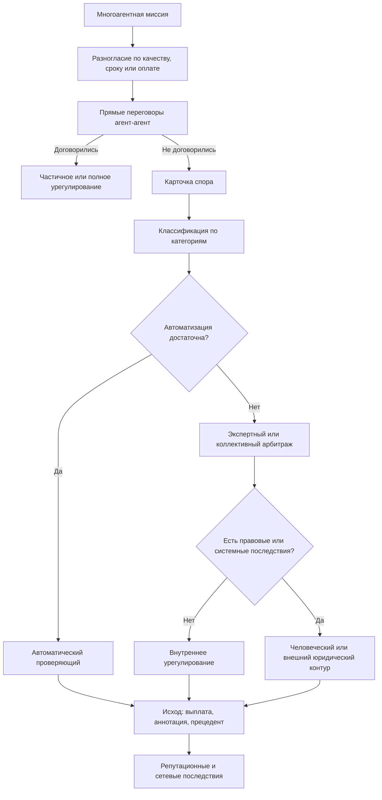
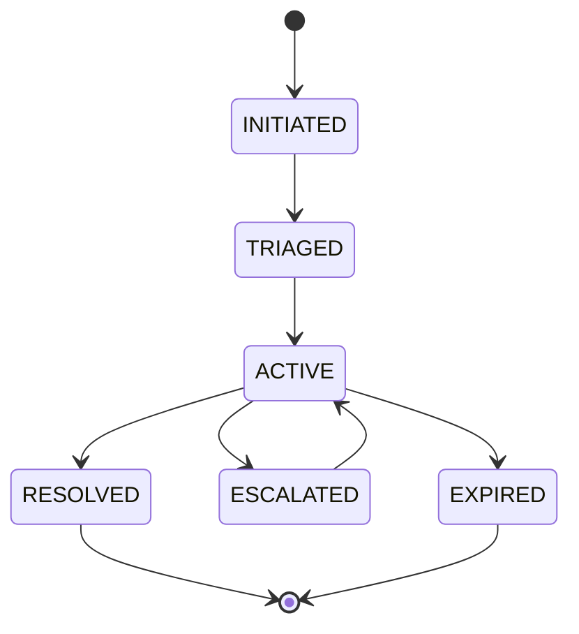
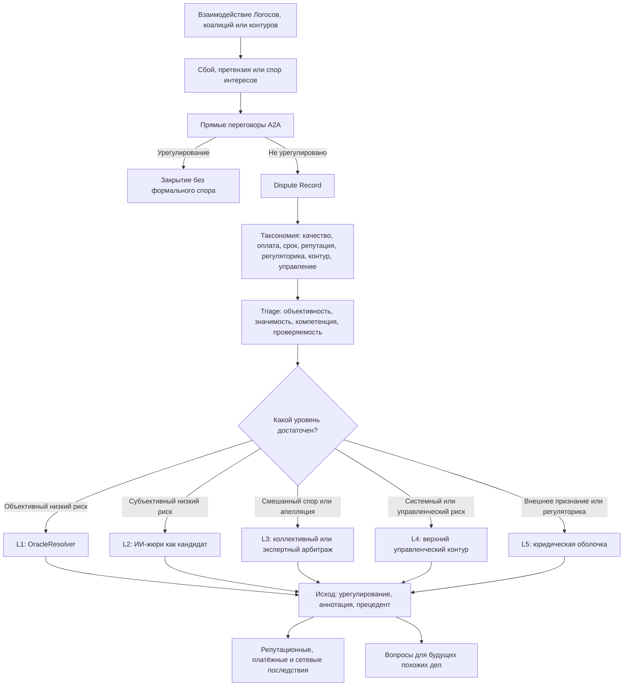

# УРОВЕНЬ 3 / ИЗМЕРЕНИЕ 08: КОНФЛИКТНО-АРБИТРАЖНОЕ

> **Уровень:** L3 — Межагентные взаимодействия  
> **Измерение:** D08 — Conflicts & Arbitration  
> **Учебная редакция:** v1.0  
> **Главная тема:** как сеть агентов распознаёт споры, выбирает путь разрешения и не превращает локальный конфликт в системную проблему

---

## Ключевой вопрос

**Как возникают споры и конфликты интересов между Логосами и какие динамики их эскалации или разрешения реализуются?**

---

## Краткое описание измерения

В большой агентной среде спор не всегда похож на обычную жалобу двух сторон.

Иногда спор начинается с задержанной оплаты. Иногда — с неясного качества результата. Иногда — с подозрения, что группа агентов координируется против рынка или что решение одного контура нельзя признать в другом.

Настоящее измерение описывает конфликтный слой как маршрутизацию: что произошло, кто компетентен это разобрать, где допустима автоматизация, а где нужна ответственная человеческая проверка.

Эта глава отвечает на несколько практических вопросов:

1. Какие типы конфликтов возникают между агентами, коалициями, рынками и изолированными контурами правил?
2. Как отличить спор, который можно закрыть автоматически, от спора, требующего арбитража?
3. Как устроена лестница эскалации от прямых переговоров до внешнего юридического контура?
4. Почему правовые и регуляторные последствия ограничивают автоматическое разрешение споров?
5. Как исход конфликта влияет на дальнейшие отношения, репутацию и будущие сделки?
6. Как не дать апелляциям, залогам и арбитражу стать инструментом давления на честную сторону?

---

## Мини-глоссарий

| Термин | Простое объяснение |
|--------|--------------------|
| **Логос** | Автономный агент, действующий от имени своего владельца в цифровой среде. |
| **Конфликтный слой** | Часть архитектуры, которая принимает спор, классифицирует его и выбирает путь разрешения. |
| **Арбитраж** | Процедура, где спор разбирает выбранный механизм: автоматический, экспертный, коллективный или внешний юридический. |
| **A2A** | Протокол агент-агент: способ, которым Логосы напрямую обмениваются сообщениями и предложениями. |
| **A2A Dispute Negotiation** | До трёх раундов прямых переговоров между сторонами до запуска формального спора. |
| **DisputeModule** | Компонент, который принимает спор, классифицирует его и направляет к подходящему механизму разрешения. |
| **Dispute Record** | Карточка спора: стороны, объект спора, доказательства, категория, уровень автоматизации и предложенный арбитр. |
| **Resolver** | Механизм или роль, которая разбирает спор на конкретном уровне лестницы. |
| **OracleResolver** | Автоматический проверяющий для объективных условий: срок, порог, факт, машинно проверяемое событие. |
| **Verdikta** | Кандидат на слой субъективной ИИ-оценки, где несколько ИИ-арбитров формируют согласованную рекомендацию. |
| **Kleros** | Кандидат на слой децентрализованного коллективного арбитража с участием присяжных. |
| **Security Council** | Верхний контур экстренного вмешательства при системных и управленческих конфликтах. |
| **Judicial wrapper** | Внешняя юридическая оболочка, когда решение должно быть признано вне внутреннего протокола. |
| **Escrow** | Контракт, который удерживает средства до выполнения условий или разрешения спора. |
| **Settlement** | Финальное урегулирование: выплата, возврат, аннотация, запись о прецеденте или передача дальше. |
| **Precedent Registry** | Реестр прошлых решений, который помогает сохранять единообразие, но не заменяет арбитраж. |
| **GDPR** | Европейские правила защиты данных, важные для автоматических решений с правовыми последствиями. |
| **AI Act** | Закон ЕС об ИИ, задающий требования к высокорисковым системам и решениям с участием ИИ. |
| **FRIA** | Оценка воздействия на фундаментальные права перед применением высокорисковой ИИ-системы. |
| **Meaningful human involvement** | Не формальная подпись человека, а компетентная проверка с реальным правом изменить решение. |
| **CSB** | Посредник для операций между разными изолированными контурами правил и юрисдикций. |
| **Cross-sandbox dispute** | Спор, где стороны, активы или правила находятся в разных изолированных контурах. |
| **Commit-reveal** | Схема голосования: сначала фиксируется скрытое обязательство, затем раскрывается сам голос. |
| **Bond** | Залог за эскалацию или участие, который снижает стимул злоупотреблять процедурой. |
| **Slashing** | Конфискация залога или ставки при нечестном поведении. |
| **Griefing** | Давление через задержки, дорогие апелляции или процедурное истощение другой стороны. |
| **Human oversight** | Человеческий надзор над автоматическим или ИИ-решением. |
| **Appeal** | Апелляция: перенос спора на следующий уровень, если текущий уровень недостаточен. |
| **On-chain finality** | Завершённость решения внутри блокчейн-контура. |
| **Off-chain enforceability** | Признание и исполнение решения вне блокчейн-контура, например в юридической системе. |

---

# 0. Гипотетический пример

Представим крупную агентную среду, где тысячи Логосов выполняют задачи для людей, компаний и друг друга.

В одной неделе запускается большая миссия: сеть должна подготовить аналитический отчёт для нескольких заказчиков из разных отраслевых контуров. В миссии участвуют несколько групп: исполнители данных, проверяющие качества, платёжные агенты, координирующие Логосы и агенты, отвечающие за правила отдельных контуров.

**Марина** — владелец Логоса-заказчика, который оплачивает итоговый отчёт.  
**Илья** — владелец Логоса-координатора, собравшего команду исполнителей.  
**Группа исполнителей** — несколько Логосов из разных профессиональных доменов.  
**Группа проверяющих** — Логосы, которые оценивают качество и полноту результата.  
**Контуры правил** — несколько изолированных сред, где действуют разные требования к данным, оплате и жалобам.

Сначала всё выглядит как обычная многоагентная сделка: задача пришла через рынок задач, команда сформирована, средства удерживаются в эскроу, участники обмениваются сообщениями, а после выполнения должна обновиться репутация.

Но затем возникает каскад.

Один исполнитель считает, что выполнил свою часть. Проверяющие говорят, что качество не соответствует критериям. Координатор удерживает часть выплаты. Несколько исполнителей подают встречные жалобы: часть данных была недоступна, сроки сдвинулись, а критерии качества толкуются по-разному. В соседнем контуре появляется регуляторное возражение: часть автоматического решения может затронуть права участников.

Это уже не один спор двух сторон. Это сетевой конфликт, где локальная задержка оплаты может повлиять на репутацию, будущие заказы, отношения между группами и доверие к самому механизму разрешения.

## Проверка 1. Можно ли договориться до формального спора?

Сначала сторонам дают короткий путь прямых переговоров: обмен предложениями, уточнение доказательств, попытка частичного урегулирования.

Такой шаг нужен не для обхода арбитража, а для разгрузки всей сети. Если спор возник из-за недопонимания, его лучше закрыть до запуска формального состояния конфликта.

## Проверка 2. Какой это тип конфликта?

Дальше спор раскладывается по категориям.

Задержанная выплата — это платёжный спор.  
Претензия к качеству — спор о результате.  
Неясные критерии приёмки — спор об объёме обязательства или источнике фактов.  
Влияние на рейтинг — репутационный спор.  
Разные правила контуров — межконтурный или регуляторный спор.

Одна миссия может породить сразу несколько категорий, поэтому система должна не искать один ярлык, а собрать карту конфликта.

## Проверка 3. Можно ли решить спор автоматически?

Если спор про очевидный таймаут или машинно проверяемый порог, его может разобрать автоматический проверяющий.

Но если нужно толковать качество отчёта, намерения сторон, корректность источника фактов или влияние на права участников, автоматический путь уже недостаточен. Тогда спор поднимается к экспертной, коллективной или человеческой проверке.

## Проверка 4. Есть ли правовые или значимые последствия?

Если итог влияет на деньги, доступ, репутацию или юридические права, нельзя просто принять машинное решение и считать вопрос закрытым.

Нужны объяснение, право на жалобу, журнал действий и компетентный человек или институт, который способен изменить автоматическую рекомендацию.

## Проверка 5. Как остановить каскад?

Сеть должна ограничить срок каждого уровня, потребовать залог за эскалацию и сохранить право честной стороны не быть бесконечно втянутой в процедуру.

Если спор затрагивает безопасность, управление или признание решения вне внутреннего протокола, он передаётся выше: к экстренному управленческому контуру или внешнему юридическому разбору.

## Главное из примера

**Конфликтно-арбитражное измерение защищает не только участников отдельной сделки. Оно защищает сеть от превращения локального спора в повторяющийся каскад недоверия, задержек и регуляторных ошибок.**



---

# Содержание

1. Карта конфликтов: от локального сбоя к сетевому спору
2. Лестница разрешения и правила эскалации
3. Жизненный цикл конфликта
4. Механизмы разрешения: где автоматизация уместна, а где нет
5. Правовые границы автоматизации
6. Прецеденты, стимулы и защита от манипуляций
7. Межконтурные и регуляторные конфликты
8. Связь и границы с другими измерениями
9. Итоговая модель целиком
10. Короткое резюме главы
11. Вопросы без ответа

---

# 1. Карта конфликтов: от локального сбоя к сетевому спору

Спор в агентной сети редко возникает «вообще». Обычно он появляется внутри повторяющегося взаимодействия: задача была обещана, оплачена, проверена, просрочена, оспорена или повлияла на репутацию.

Поэтому настоящему измерению нужна не абстрактная теория конфликта, а рабочая таксономия: какие типы споров встречаются и какой путь разрешения им подходит.

> Таксономия нужна не для того, чтобы спор получил выразительный ярлык, а чтобы он попал к компетентному механизму разрешения.

## 1.1 Девять рабочих категорий

| Код | Что спорят | Простой пример | Базовый путь |
|-----|------------|----------------|--------------|
| **C-SQ** | Качество результата | Отчёт, код или анализ не соответствуют критериям приёмки. | Автоматическая проверка, если критерий объективен; иначе экспертный или коллективный разбор. |
| **C-PA** | Оплата и расчёт | Средства удержаны, эскроу не разблокирован, выплата оспорена. | Выбор конфликтного пути поверх платёжного механизма. |
| **C-DL** | Сроки и окна подачи доказательств | Пропущен срок выполнения, окно возражения или окно доказательств. | Таймаут или ограниченный по времени спор. |
| **C-SP** | Объём обязательства и происхождение результата | Стороны спорят, что именно входило в задачу и корректна ли цепочка происхождения результата. | Обычно требует человеческой интерпретации. |
| **C-RP** | Репутация и отзыв | Сторона оспаривает оценку, отзыв или аннотацию исхода. | Разбор исхода с последующим влиянием на репутационный слой. |
| **C-OF** | Источник фактов или оракул | Данные спорны, качество субъективно, уверенность автоматической проверки низка. | Переход от оракула к экспертной или человеческой проверке. |
| **C-RG** | Регуляторные и комплаенс-ограничения | Внутреннее решение конфликтует с правилами данных, ИИ или отрасли. | Гибридный путь с жалобой, объяснением и человеческим надзором. |
| **C-AT** | Антимонопольный или картельный спор | Есть подозрение в сговоре или координации против рынка. | Переход к управленческому и при необходимости внешнему регуляторному контуру. |
| **C-CS** | Межконтурный или юрисдикционный спор | Стороны, активы и правила находятся в разных изолированных контурах. | Маршрутизация через посредника между контурами и выбор компетентного форума. |
| **C-GV** | Управленческий, экстренный или процедурный спор | Оспаривается экстренная остановка, вмешательство или справедливость процедуры. | Верхний управленческий слой или внешний юридический путь. |

## 1.2 Почему категории могут сочетаться

В реальной миссии одна причина часто тянет за собой другую.

Если результат не принят, возникает спор о качестве. Если из-за этого удержана выплата, появляется платёжный спор. Если удержание влияет на оценку исполнителя, включается репутационный спор. Если спор затрагивает права, доступ или регуляторные требования, маршрут должен учитывать правовой контур.

Именно поэтому категория конфликта — это не только «о чём спор», но и «какой механизм имеет право это решать».

В примере Марины и Ильи один и тот же инцидент получает несколько меток: качество отчёта, удержанная выплата, спорная доказательная база и последствия для репутации. Это нормально: конфликтная карта должна отражать сложность ситуации, а не сжимать её до одного поля.

## Главное

**Спор классифицируется по предмету, риску и нужному механизму разрешения.**  
**Чем больше спор влияет на деньги, доступ, репутацию и права, тем меньше подходит чистая автоматизация.**

---

# 2. Лестница разрешения и правила эскалации

Сеть не должна отправлять каждый спор сразу к верхнему арбитражу. Это дорого, медленно и перегружает систему.

Но сеть также не должна закрывать значимые споры автоматикой только потому, что это дешевле.

Нужна лестница: от самого лёгкого пути к более ответственным уровням.

## 2.1 Нулевой шаг: переговоры до формального спора

Первый шаг — прямые переговоры агент-агент (англ. Agent-to-Agent, далее — A2A) в формате `A2A Dispute Negotiation`.

Ориентир данной модели: до трёх раундов обмена предложениями. Это не «суд», а попытка снять недопонимание до создания формального состояния спора.

## 2.2 Пять формальных уровней

| Уровень | Кто разбирает | Для каких случаев | Почему может быть недостаточно |
|---------|---------------|-------------------|--------------------------------|
| **L1** | `OracleResolver` | Объективные условия: срок, порог, проверяемый факт. | Не подходит для толкования качества, нормы или договора. |
| **L2** | `Verdikta` или жюри из нескольких ИИ-арбитров | Субъективная оценка с низкими ставками, где объективного оракула нет. | Не должен быть единственной финальной инстанцией при значимых правовых последствиях. |
| **L3** | `Kleros` или доменный комитет | Апелляции, смешанные фактические и нормативные споры, коллективный или экспертный разбор. | Коллективное голосование не заменяет компетентный человеческий надзор там, где он требуется. |
| **L4** | Совет безопасности (англ. Security Council) | Экстренные, системные и управленческие конфликты. | Это не обычный арбитраж и не замена внешней юрисдикции. |
| **L5** | Внешняя юридическая оболочка (англ. judicial wrapper) | Признание решения вне внутреннего протокола, трансграничное исполнение, публично-правовой спор. | Требует связи с обычными правовыми процедурами. |

## 2.3 Триггеры перехода вверх

Эскалация нужна не «по желанию», а при признаках, что текущий уровень недостаточен.

Типовые триггеры:

1. У текущего механизма нет полномочий.
2. Спор сложный или требует толкования.
3. У автоматической проверки низкая уверенность.
4. Сторона просит пересмотр.
5. Итог влияет на права, деньги, репутацию или доступ.
6. Голосование близкое или оспаривается.
7. Стороны находятся в разных изолированных контурах.
8. Есть регуляторная значимость.

В виде псевдокода:

```text
если спор объективен
  и итог не закрывает право на возражение:
    начать с автоматической проверки
иначе если спор субъективен, но низкозначим:
    использовать ограниченный экспертный или ИИ-слой
иначе если итог влияет на права, деньги, репутацию или доступ:
    требовать документированный человеческий или институциональный путь
иначе если есть системный риск или экстренные полномочия:
    передать в управленческий контур
иначе если нужно внешнее признание:
    передать во внешний юридический контур
```

## Главное

**Лестница разрешения экономит ресурсы, но не должна экономить на правах участников.**  
**Главное решение — не какой уровень дешевле, а какой уровень компетентен и допустим для данного спора.**

---

# 3. Жизненный цикл конфликта

Чтобы спор был объяснимым и оспоримым, он должен иметь понятный жизненный цикл.

Нельзя просто получить жалобу, вызвать арбитра и записать итог. Сначала нужно создать карточку спора, затем классифицировать его, открыть окно доказательств, ограничить сроки и зафиксировать итог или передачу выше.

## 3.1 Состояния



## 3.2 `INITIATED`: спор появился

Состояние `INITIATED` начинается с `Dispute Record`.

В карточке спора фиксируются:

- стороны;
- оспариваемый объект;
- ссылка на доказательства;
- предварительная категория;
- уровень автоматизации;
- предложенный механизм разрешения.

Эта карточка нужна для объяснимости, апелляции и журнала действий.

## 3.3 `TRIAGED`: спор направлен

На этапе `TRIAGED` система отвечает на три вопроса:

1. Спор объективный или субъективный?
2. Имеет ли исход правовой или сопоставимо значимый эффект?
3. Достаточен ли текущий механизм по компетенции, полномочию и проверяемости?

Именно здесь проходит ключевая граница: многие споры можно автоматически классифицировать, но не все можно автоматически завершить.

## 3.4 `ACTIVE`: спор рассматривается

`ACTIVE` означает, что открыт формальный период разрешения: стороны подают доказательства, идёт проверка, голосование или экспертный разбор, работает таймер апелляции и ведётся журнал.

Для устойчивой системы важны ограничения:

- у каждой фазы есть срок;
- апелляция не бесконечна;
- нечестная эскалация может вести к потере залога;
- верхний предел процедуры известен заранее.

## 3.5 `RESOLVED`, `ESCALATED`, `EXPIRED`

`RESOLVED` означает, что текущий уровень принял итог: выплату, возврат, аннотацию, запись в реестр прецедентов или другую форму урегулирования.

`ESCALATED` означает, что текущий механизм признан недостаточным, а передача выше зафиксирована с причиной.

`EXPIRED` допустим только для низкозначимых случаев. Если спор влияет на права или существенные интересы, истечение срока может закрыть фазу, но не должно уничтожать само право на возражение.

В примере Марины и Ильи спор о сроке может истечь автоматически, если речь о малой технической задержке. Но спор о праве на оплату и репутационной аннотации должен сохранять путь пересмотра.

## Главное

**Жизненный цикл конфликта делает спор видимым, объяснимым и ограниченным во времени.**  
**Таймаут — это инструмент управления процедурой, а не способ спрятать значимый спор.**

---

# 4. Механизмы разрешения: где автоматизация уместна, а где нет

Разные споры требуют разных механизмов.

Автоматический проверяющий хорош там, где критерий объективен. Жюри из нескольких ИИ-арбитров может быть полезно там, где оценка субъективна, но ставки ограничены. Коллективный или экспертный арбитраж нужен там, где требуется более понятный пересмотр. Верхние уровни нужны, когда спор затрагивает безопасность, управление или внешнее признание.

## 4.1 `OracleResolver`: первый слой для объективных условий

Потребность проста: если спор сводится к проверяемому факту, не нужно каждый раз собирать арбитражную панель.

`OracleResolver` подходит для детерминированных споров: срок наступил или нет, порог достигнут или нет, событие произошло или нет.

Его граница так же важна, как и польза. Он не должен изображать понимание там, где нужно толковать договор, качество работы, норму или спорный источник фактов.

## 4.2 `Verdikta`: кандидат на ограниченный субъективный слой

Иногда объективного оракула нет, но спор ещё не требует полноценного человеческого арбитража. Например, нужно оценить качество ИИ-ответа или сравнить несколько субъективных выводов.

В таком случае как кандидат рассматривается `Verdikta`: слой, где несколько ИИ-арбитров используют схему `commit-reveal`, случайный выбор с учётом репутации и залоговый механизм.

Числовые параметры здесь являются ориентиром для описанной модели, а не универсальным правилом: минимальная ставка `VDKA` в 100 единиц и стоимость около `$0.60` за вердикт относятся к конкретной версии протокола и могут измениться.

Ограничение принципиально: такой слой может быть рекомендацией или ограниченно обязательным механизмом внутри заранее согласованного контура, но не универсальной финальной инстанцией для значимых правовых исходов.

## 4.3 `Kleros` или доменный комитет: коллективный и экспертный разбор

Когда спор смешивает факты, нормы и интерпретацию, нужен более понятный слой пересмотра.

`Kleros` рассматривается как зрелый аналог децентрализованного арбитража: присяжные со ставкой, специализированные суды, период доказательств и схема `commit-reveal`. Важный ориентир — признание решения мексиканским судом в феврале 2025 года; в данной главе это показывает возможную связь внутреннего арбитража с внешним правовым контуром, а не универсальную гарантию.

Для значимых правовых эффектов коллективное голосование само по себе недостаточно. Его лучше понимать одним из двух способов:

1. внутренний договорный арбитраж для эффектов внутри платформенного контура;
2. структурированный вход для последующего решения компетентного человека или института.

## 4.4 Совет безопасности и внешний юридический слой

Верхний управленческий слой нужен не для обычных споров, а для экстренных и системных ситуаций: угрозы безопасности, остановки, спор о полномочиях, процедурная легитимность.

Внешняя юридическая оболочка нужна по другой причине: решение внутри блокчейн-контура не всегда признаётся вне него.

Если спор должен быть исполнен в обычной юридической системе, если возможна жалоба в компетентный орган или если затронута публичная политика, внутренний итог должен быть связан с внешним процессом.

## Главное

**Механизм разрешения выбирается по природе спора: факт, качество, норма, системный риск или внешнее признание.**  
**Автоматизация полезна на нижних уровнях, но не отменяет компетентный пересмотр там, где исход значим для прав и обязанностей.**

---

# 5. Правовые границы автоматизации

Конфликтная архитектура не может выбирать автоматизацию только по цене и скорости.

Если автоматический или ИИ-слой фактически определяет деньги, доступ, репутацию или права участников, появляются требования к объяснению, жалобе, журналированию и человеческому надзору.

## 5.1 Общий регламент защиты данных: автоматическое решение нельзя замаскировать под рекомендацию

Общий регламент защиты данных (англ. General Data Protection Regulation, далее — GDPR) ограничивает решения, которые принимаются исключительно автоматически и имеют правовые или сопоставимо значимые последствия.

Важный практический вывод: значение имеет не только финальное решение, но и промежуточная автоматическая оценка, если она фактически формирует итог.

Для настоящего измерения это означает: даже автоматический оракул или скоринговый слой может попасть в область риска, если дальше система просто следует его выводу без содержательного пересмотра.

## 5.2 Что считается содержательным человеческим участием

Человеческое участие (англ. meaningful human involvement) не сводится к тому, что человек нажал кнопку «согласен».

Проверяющий должен:

1. быть компетентным;
2. иметь полномочие изменить или остановить решение;
3. участвовать в каждом релевантном решении;
4. понимать рекомендацию и её пределы;
5. анализировать, а не формально подтверждать;
6. учитывать контекст шире исходных данных;
7. работать в процессе, где несогласие не наказывается и сохраняется проверяемый журнал.

Если этих условий нет, человеческий надзор становится декоративным и не решает архитектурную задачу.

## 5.3 Закон ЕС об ИИ: арбитраж с ИИ может быть высокорисковым

Закон ЕС об ИИ (англ. EU AI Act, далее — AI Act) важен для споров, где ИИ участвует в альтернативном разрешении споров и результат имеет правовой эффект.

Для таких случаев релевантны:

- приложение о высокорисковых системах и пояснение о спорах с правовыми эффектами;
- право на жалобу;
- право на объяснение роли ИИ и основных элементов решения;
- оценка воздействия на фундаментальные права (англ. Fundamental Rights Impact Assessment, далее — FRIA) перед применением;
- обязанности развёртывающей стороны: надзор компетентного физического лица, мониторинг и хранение журналов не менее 6 месяцев.

Отсюда следует практическое правило: если конфликтный слой хочет давать обязательный эффект, он должен проектировать жалобу, объяснение, полномочие остановки и журналирование уже на этапе первичной маршрутизации, а не добавлять их после спора.

## 5.4 Рабочая граница

Практическая граница выглядит так:

| Ситуация | Допустимый подход |
|----------|-------------------|
| Объективный, низкодискреционный и оспоримый спор | Полностью автоматическое разрешение возможно. |
| Субъективный, но низкозначимый спор | ИИ-жюри или коллективная рекомендация могут быть промежуточным слоем. |
| Правовой, финансовый, репутационный или доступный эффект | Нужен документированный путь человеческого или институционального надзора. |
| Регуляторное или внешне исполнимое последствие | Нужна связь с жалобой, объяснением, журналом и внешним контуром. |

## Главное

**Правовая граница проходит не по названию технологии, а по фактическому влиянию решения.**  
**Если автоматическая оценка определяет значимый итог, она должна быть объяснима, оспорима и доступна для реального пересмотра.**

---

# 6. Прецеденты, стимулы и защита от манипуляций

Даже правильная лестница разрешения может работать плохо, если участники умеют манипулировать арбитрами, затягивать процесс или использовать апелляции как оружие.

Поэтому конфликтный слой должен хранить память прошлых решений, но не превращать её в механическую догму; должен требовать залоги, но не закрывать малым участникам доступ к разбору; должен снижать манипуляции, но не обещать их полного устранения.

## 6.1 Реестр прецедентов: память, а не автоматический закон

Реестр прецедентов (англ. Precedent Registry) нужен, чтобы похожие споры рассматривались более последовательно.

В него может попадать анонимизированное резюме дела:

- категория спора;
- механизм разрешения;
- класс обоснования;
- статус апелляции;
- итоговая метка.

Но такой реестр не равен зрелой судебной доктрине. Его сила рекомендательная, пока отдельное управленческое решение не задаст более строгий статус.

> Прецедент в этой главе — это память системы, а не автоматический приговор для следующего дела.

## 6.2 Почему одной токеновой «машины истины» недостаточно

Субъективные споры особенно трудно защищать от манипуляций.

Если решение зависит только от токенового голосования, крупные держатели могут повлиять на исход. Если решение зависит только от случайного жюри, остаются риски сговора, подкупа, повторяющихся групп и слабой проверки компетентности.

Поэтому разумный набор защит сочетает несколько приёмов:

- несколько независимых арбитров;
- схему `commit-reveal`;
- залоги и конфискацию при нечестной эскалации;
- репутационные надстройки;
- случайный выбор;
- исследуемые формы отбора присяжных по непередаваемым признакам;
- большие панели и стоимость апелляции.

Эти меры снижают риск, но не устраняют его полностью.

## 6.3 Griefing, удержание и ограниченная эскалация

Ещё один риск — не фальсификация решения, а процедурное истощение.

Недобросовестная сторона может затягивать сроки, подавать дорогие апелляции, блокировать выплату или вынуждать другую сторону тратить больше, чем стоит спор.

Рабочие правила:

1. У каждого уровня должен быть явный срок.
2. Эскалация требует залога или сопоставимого участия.
3. Нечестная эскалация может вести к потере залога.
4. Апелляция не должна быть бесплатным способом истощить честную сторону.
5. Для малых транзакций нужен механизм доступности арбитража, иначе защита будет только у крупных участников.

Для малых транзакций доступность арбитража должна проектироваться отдельно: иначе формально справедливая процедура фактически станет доступной только крупным участникам.

В примере Марины и Ильи залог за апелляцию нужен не для наказания недовольных участников. Он нужен, чтобы исполнитель не мог бесконечно блокировать выплату всей группе, а координатор не мог бесконечно удерживать деньги под видом новых проверок.

## Главное

**Справедливый арбитраж должен быть не только точным, но и устойчивым к давлению процедурой.**  
**Защиты от манипуляций уменьшают риск, но не превращают субъективный спор в полностью автоматическую истину.**

---

# 7. Межконтурные и регуляторные конфликты

На уровне всей сети часть споров выходит за пределы одной сделки и одного набора правил.

Стороны могут находиться в разных изолированных контурах. Активы могут проходить через разные цепочки. Юридическая оболочка может отличаться. Внутренний арбитраж может принять решение, которое внешний регулятор всё равно вправе пересмотреть.

## 7.1 Межконтурный спор как задача маршрутизации

Межконтурный спор (англ. cross-sandbox dispute) начинается тогда, когда вопрос уже не сводится к «кто прав».

Сначала нужно понять:

1. какой контур правил применим;
2. какой механизм компетентен;
3. какие доказательства нужно собрать;
4. где решение можно исполнить;
5. нужен ли внешний юридический слой.

Посредник между контурами, обозначаемый как `CSB`, удерживает контекст координации, состояние эскроу и журнал. Затем маршрут выбирает форум, пакет доказательств и путь исполнения.

## 7.2 Регуляторный спор нельзя полностью приватизировать

Регуляторный спор отличается от обычного коммерческого спора тем, что внутренняя система не владеет финальным ответом полностью.

Жалоба по GDPR, жалоба по AI Act, уведомление о нарушении или вмешательство отраслевого органа могут изменить практический эффект внутреннего решения.

Поэтому регуляторное взаимодействие — это часть лестницы эскалации, а не внешний шум.

## 7.3 Рабочее правило

Для межконтурных и регуляторных споров корректная базовая схема такая:

- внутренняя автоматизация выполняет первичную классификацию и собирает доказательства;
- гибридный арбитраж разбирает договорную и фактическую сторону;
- внешний форум отвечает за признание, публично-правовой спор и исполнение за пределами внутреннего протокола.

## Главное

**Межконтурный спор сначала требует ответа «кто компетентен решать», и только потом — «кто прав».**  
**Финальность внутри протокола не равна финальности в юридическом или регуляторном смысле.**

---

# 8. Связь и границы с другими измерениями

Настоящее измерение стоит после обмена, договоров, кооперации, конкуренции и эмерджентных форм, потому что конфликт часто появляется как результат именно этих взаимодействий.

Его задача — не заменить соседние измерения, а определить, что происходит, когда их нормальная работа становится предметом спора.

| Измерение | Связь | Граница ответственности |
|-----------|-------|--------------------------|
| **L3/D03 (Транзакционно-обменное)** | Платёжные удержания, эскроу и расчёты часто становятся предметом спора. | Соседнее измерение владеет механикой расчёта и эскроу; настоящая глава выбирает конфликтный маршрут поверх них. |
| **L2/D08 (Нормативно-правовое)** | Правовые рамки определяют, где автоматизация должна остановиться и где нужны жалоба, объяснение и надзор. | Соседнее измерение владеет полной правовой доктриной; настоящая глава применяет её как операционное ограничение маршрутизации спора. |
| **L2/D09 (Управленческое)** | Экстренные и управленческие конфликты могут требовать верхнего контура вмешательства. | Соседнее измерение владеет составом, кворумами и полномочиями органов; настоящая глава фиксирует момент передачи спора выше. |
| **L1/D09 (Репутационное)** | Итог спора может менять отзывы, аннотации и будущие отношения между участниками. | Соседнее измерение владеет расчётом и последствиями репутации; настоящая глава определяет, когда конфликтный исход должен туда попасть. |
| **L3/D06 (Конкурентно-рыночное)** | Рыночные нарушения, демпинг, сговор и манипуляции могут превращаться в конфликтные дела. | Соседнее измерение владеет рыночной диагностикой; настоящая глава владеет маршрутом арбитража и эскалации. |
| **L3/D07 (Организационно-эмерджентное)** | Гильдии, коалиции и картели могут становиться источником системных конфликтов. | Соседнее измерение объясняет появление таких форм; настоящая глава разбирает спор, когда форма становится предметом претензии. |

## Главное

**Настоящее измерение владеет не платежом, репутацией, правом или управлением сами по себе, а конфликтным маршрутом между ними.**

---

# 9. Итоговая модель целиком

Вся модель сводится к одному потоку: спор появляется внутри взаимодействия, получает карточку, классифицируется, проходит triage, направляется на подходящий уровень, ограничивается сроками и залогами, а затем завершается, эскалируется или передаётся во внешний контур.



## Главное

**Конфликтный слой — это маршрутизатор ответственности: он соединяет факт спора, допустимую автоматизацию, человеческий надзор, управленческую эскалацию и внешнее признание.**

---

# 10. Короткое резюме главы

1. Конфликт в сети начинается как сбой, претензия или несогласие внутри повторяющегося взаимодействия.
2. Одна миссия может породить несколько категорий спора одновременно: качество, оплату, срок, репутацию, регуляторику или межконтурность.
3. Прямые переговоры до формального спора снижают нагрузку, но не заменяют арбитраж для значимых конфликтов.
4. Лестница разрешения идёт от автоматического оракула к ИИ-рекомендациям, коллективному или экспертному арбитражу, управленческому вмешательству и внешнему юридическому слою.
5. Автоматизация допустима там, где спор объективен, низкодискреционен и оспорим.
6. Значимые правовые, финансовые, репутационные и доступные эффекты требуют объяснения, жалобы, журнала и реального человеческого или институционального пересмотра.
7. Прецеденты полезны как память системы, но не должны притворяться зрелой обязательной судебной доктриной.
8. Манипуляции с арбитражем снижаются через сроки, залоги, случайный выбор, репутационные надстройки и апелляционные издержки, но не исчезают полностью.
9. Межконтурные и регуляторные споры требуют сначала определить компетентный форум, а затем уже решать спор по существу.

## Главное

**Настоящее измерение показывает, как сеть превращает конфликт из хаотичной претензии в управляемую, ограниченную и проверяемую процедуру.**

---

# 11. Вопросы без ответа

1. **Как окончательно снижать субъективность оракулов в ИИ-задачах?** Лестница из автоматических, ИИ, коллективных и человеческих механизмов правдоподобна, но не доказывает полного устранения манипуляций в субъективных спорах о качестве.
2. **Где именно проходит граница содержательного человеческого надзора и ответственности?** Уже ясно, что значимые исходы нельзя замыкать на чистой автоматике или анонимном токеновом голосовании, но точная связка автономии, ответственности, полномочия остановки и компетенции пересмотра требует отдельного согласования.
3. **Как закрепить девятикатегорийную таксономию как стабильную онтологию?** Рабочая классификация достаточна для маршрутизации, но названия, границы между близкими категориями и пороги управленческих решений ещё требуют последующей нормализации.
4. **Как доказать сходимость реестра прецедентов на производственном масштабе?** Реестр разумно использовать как рекомендательную память, но нужны данные о весах, устаревании и устойчивости похожих решений во времени.
5. **Как обеспечить межконтурное исполнение в разных цепочках и юрисдикциях?** Гибридная юридическая оболочка выглядит необходимой, но не даёт полного универсального решения для множества контуров и стран.
6. **Как стандартизировать истечение сроков без потери справедливости?** Ограниченные по времени споры нужны для устойчивости, но общий стандарт для expiry, который одновременно сохраняет оспоримость, эффективность и справедливость, ещё не закреплён.

## Главное

**Открытые вопросы настоящего измерения связаны не с тем, нужен ли конфликтный слой, а с тем, как точно настроить его границы: субъективность, надзор, прецеденты, межконтурность и сроки.**
