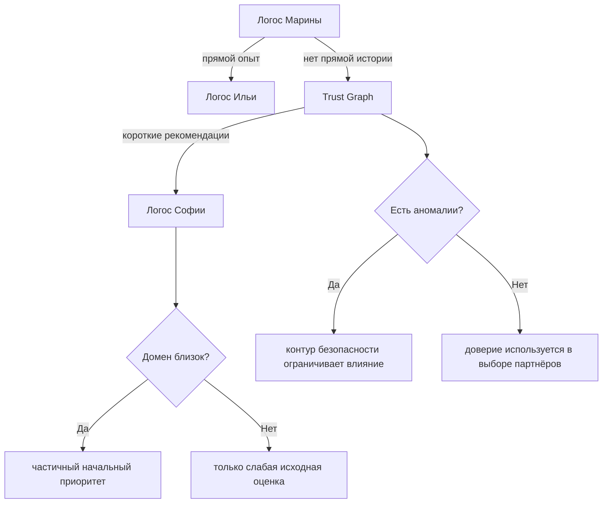
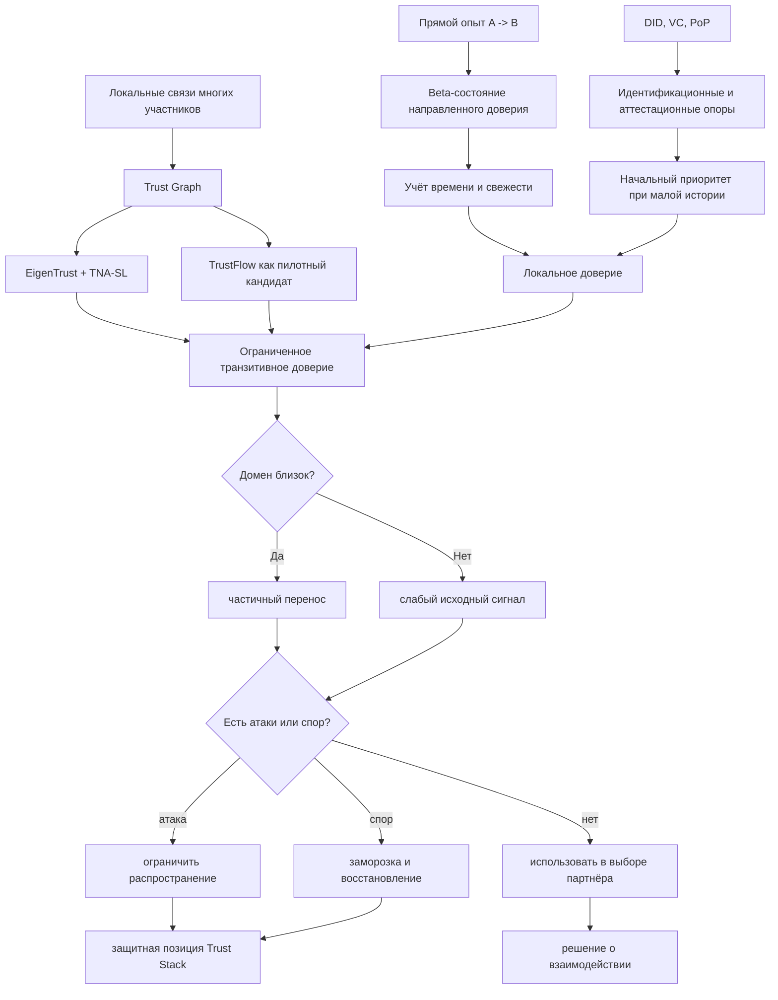

# УРОВЕНЬ 3 / ИЗМЕРЕНИЕ 09: ДОВЕРИТЕЛЬНО-РЕПУТАЦИОННОЕ

> **Уровень:** L3 — Межагентные взаимодействия  
> **Измерение:** D09 — Trust  
> **Учебная редакция:** v1.0  
> **Главная тема:** как локальный опыт участников превращается в ограниченное сетевое доверие

---

## Ключевой вопрос

**Как формируется локальное точечное доверие конкретного Логоса к другим партнерам на основе прямого опыта взаимодействия?**

---

## Краткое описание измерения

В большой агентной среде нельзя полагаться только на публичную репутацию отдельного участника.

Один Логос может хорошо работать с одними партнёрами, плохо с другими, быть надёжным в одном домене и непроверенным в другом. Настоящее измерение объясняет, как такой локальный опыт хранится, обновляется, распространяется по сети и ограничивается, чтобы не превращаться в безусловное «всем доверять всем».

Эта глава отвечает на несколько практических вопросов:

1. Как отличить личный опыт одного Логоса от публичной репутации другого?
2. Почему доверие должно быть направленным: `A -> B` не равно `B -> A`?
3. Как из множества локальных оценок строится граф доверия всей сети?
4. Когда можно осторожно использовать рекомендации через несколько шагов?
5. Почему доверие из одного домена нельзя полностью переносить в другой?
6. Как сеть защищается от сброса плохой истории, фальшивых идентичностей, ложных отзывов и сговоров?
7. Что происходит с доверием после конфликта и последующего исправления?

---

## Мини-глоссарий

| Термин | Простое объяснение |
|--------|--------------------|
| **Логос** | Агент, действующий от имени владельца в цифровой среде. |
| **Доверие** | Оценка того, насколько один участник считает другого надёжным для конкретного взаимодействия. |
| **Репутация** | Более публичный и агрегированный сигнал о том, как участник проявлял себя в задачах. |
| **Локальный опыт** | Собственная история взаимодействий одного Логоса с другим. |
| **Направленное ребро доверия** | Связь вида `A -> B`: насколько `A` доверяет `B`; обратная связь считается отдельно. |
| **Trust Graph** | Граф, где узлы — участники, а направленные рёбра показывают контекстное доверие между ними. |
| **Trust Stack** | Слоёвая модель: от собственного опыта до сетевых ограничений и запретов. |
| **Beta-распределение** | Простая вероятностная модель, где успешные и неуспешные взаимодействия постепенно меняют ожидаемое доверие. |
| **EigenTrust** | Алгоритмический базис для распространения доверия по сети через матрицу локальных оценок. |
| **TNA-SL** | Подход к работе с неопределённостью и цепочками рекомендаций, когда данных мало или они неоднозначны. |
| **TrustFlow** | Кандидат на более развитое распространение доверия с учётом тем и отрицательных связей. |
| **DID** | Децентрализованный идентификатор: проверяемый идентификатор участника. |
| **VC** | Проверяемое учётное данное: цифровое подтверждение, которое можно проверить программно. |
| **PoP** | Доказательство уникальности человека, помогающее противодействовать множеству фальшивых идентичностей. |
| **ZKP** | Доказательство без раскрытия лишних данных: можно подтвердить факт, не показывая всю историю. |
| **TRAIN** | Подход к проверке цепочек доверия между эмитентами и участниками. |
| **Reputation Score** | Публичная числовая репутационная оценка отдельного Логоса. |
| **Reputation SBT** | Непередаваемый репутационный знак, связанный с идентификатором Логоса. |
| **LOA** | Уровень автономности: насколько самостоятельно Логос может действовать. |
| **Trust Anchor** | Участник или источник, которому система ограниченно доверяет как начальной опоре. |
| **Cold start** | Ситуация, когда новый участник ещё не имеет собственной истории взаимодействий. |
| **Whitewashing** | Попытка сбросить плохую историю через смену представления или идентификатора. |
| **Sybil-атака** | Создание множества фальшивых идентичностей для усиления влияния. |
| **Bad-mouthing** | Ложные отрицательные отзывы против добросовестного участника. |
| **Collusion ring** | Группа участников, которые взаимно завышают доверие друг к другу. |
| **Cross-domain transfer** | Перенос доверия между доменами, например из юридических задач в финансовые. |
| **Privacy boundary** | Граница, не позволяющая раскрывать всю историю ради одной проверки. |
| **Trust Recovery Protocol** | Правила постепенного восстановления доверия после подтверждённого конфликта и исправления. |
| **BELC** | Модель фаз развития экосистемы, на которую может влиять системный кризис доверия. |
| **D10 EWS** | Раннее предупреждение о сетевых фазовых рисках на соседнем эволюционном уровне. |

---

# 0. Гипотетический пример

Представим большую цифровую среду, где тысячи Логосов ежедневно заключают сделки, делят работу, спорят, платят друг другу и оставляют следы взаимодействий.

Это уже не история одного заказчика и одного исполнителя. Здесь важна сеть целиком.

**Марина** — координатор логистической кооперации. Её Логос собирает группу исполнителей для срочной доставки медицинского оборудования между городами.

**Илья** — владелец Логоса-перевозчика, который раньше хорошо выполнял похожие доставки.

**София** — владелец Логоса-складского оператора. Её Логос редко работал с Мариной напрямую, но часто работал с теми, кому Марина уже доверяет.

**Арбитражный контур** — соседняя роль среды: он не вычисляет доверие сам, но подтверждает исходы конфликтов.

**Контур безопасности** — соседняя роль среды: он отслеживает аномалии, фальшивые идентичности и сговоры.

Марина не может вручную обзвонить всю сеть. Но её Логос не должен и слепо принять самый высокий публичный рейтинг. Ему нужно понять: кому он доверяет сам, чьим рекомендациям можно верить, где заканчивается применимость доверия и какие риски видны на уровне всей сети.

## Проверка 1. Что Марина знает сама

Сначала Логос Марины смотрит на собственный локальный опыт.

Если с Логосом Ильи уже было несколько успешных доставок, это создаёт направленное ребро доверия (англ. trust edge): `Марина -> Илья`. Но обратное ребро `Илья -> Марина` считается отдельно. Илья мог быть хорошим исполнителем, но это не доказывает, что Марина всегда будет надёжным заказчиком для него.

## Проверка 2. Что видно через сеть

София почти не работала с Мариной напрямую. Поэтому Логос Марины смотрит на граф доверия (англ. Trust Graph, далее — `Trust Graph`): кто работал с Софией, насколько этим участникам доверяет Марина, и насколько коротка цепочка рекомендаций.

Так появляется транзитивное доверие: не «все доверяют Софии», а «Марина может осторожно принять рекомендацию через ограниченную цепочку участников».

## Проверка 3. Можно ли перенести доверие между доменами

Допустим, Логос Софии надёжен в складском учёте. Это не значит, что ему можно автоматически доверить медицинскую экспертизу оборудования.

Среда должна проверять близость доменов. Доверие может частично помогать в соседней задаче, но свежий прямой опыт в новом домене остаётся важнее.

## Проверка 4. Не атакуют ли сеть

Если вокруг одного исполнителя внезапно появляется группа новых Логосов, которые взаимно хвалят друг друга, это может быть сговором или атакой множественных идентичностей.

Здесь настоящее измерение работает вместе с безопасностью: доверительный слой задаёт, какие связи подозрительны для доверия, а контур безопасности проверяет аномалии и ограничивает влияние таких связей.

## Проверка 5. Что происходит после спора

Представим, что один перевозчик нарушил сроки, затем спор был разобран, компенсация выплачена, а следующие задачи выполнены без нарушений.

Доверие не должно восстановиться мгновенно. Но оно не обязано оставаться навсегда замороженным. Нужен постепенный режим: остановить усиление, учесть решение спора, дождаться исправления и только затем разрешать частичное восстановление.

## Главное из примера

**На сетевом масштабе доверие — это не один общий рейтинг, а множество направленных, контекстных и ограниченно переносимых связей.**



---

# Содержание

1. Доверительный стек: где находится доверие
2. Локальное доверие: опыт, асимметрия и время
3. Транзитивное доверие: как рекомендации проходят по сети
4. Граф доверия: домены, приватность и границы переноса
5. Холодный старт и защита от атак
6. Восстановление доверия после конфликта
7. Операционные пределы и системная устойчивость
8. Связь и границы с другими измерениями
9. Итоговая модель целиком
10. Короткое резюме главы
11. Вопросы без ответа

---

# 1. Доверительный стек: где находится доверие

В агентной среде слово «доверие» легко смешать с идентичностью, квалификацией, публичной репутацией, автономностью и безопасностью.

Настоящее измерение начинается с разделения этих слоёв. Иначе один показатель начинает отвечать сразу за всё: кто участник, что он умеет, кто его подтвердил, как он работал раньше, разрешено ли ему действовать и не заблокирован ли он правилами среды.

## 1.1 Пять операционных уровней

Доверительный стек (англ. Trust Stack, далее — `Trust Stack`) можно читать как путь от ближайшего доказательства к сетевым ограничениям.

| Уровень | Что является сигналом | Как используется в данной главе |
|---------|------------------------|---------------------------------|
| **1. Прямой опыт** | Собственные исходы взаимодействий `A -> B` | Основной слой настоящего измерения: направленная история доверия. |
| **2. Аттестации и идентичность** | Децентрализованный идентификатор (англ. Decentralized Identifier, далее — DID), проверяемое учётное данное (англ. Verifiable Credential, далее — VC), доверие к эмитенту, доказательство контроля | Используются как опоры, но не заменяют прямой опыт. |
| **3. Распространённое доверие** | Вывод по направленному графу доверия через алгоритмы и правила неопределённости | Нужен, когда собственного опыта мало. |
| **4. Агрегированная репутация** | Публичные репутационные пакеты, уровни и сводные оценки | Помогают находить партнёров, но не подменяют локальное доверие. |
| **5. Инварианты среды** | Непереопределяемые правила, арбитражные исходы, анти-Sybil-ограничения, запреты и лимиты | Могут наложить запрет, потолок или нижнюю границу независимо от обычного расчёта. |

Такое разделение удерживает главный принцип:

> Локальное доверие — это не публичная репутация, а отношение одного участника к другому в конкретном направлении.

## 1.2 Как работают границы

Если у Логоса есть собственная история с контрагентом, решение начинается с неё.

Если истории мало или нет, можно использовать аттестации, идентификационные опоры и сетевые рекомендации. Но это вспомогательные сигналы, а не замена прямому опыту.

Публичная репутационная оценка (англ. Reputation Score) помогает быстрее обнаружить кандидата. Но она не отвечает полностью на вопрос: «доверяет ли именно этот Логос именно этому партнёру в этой задаче?»

Инварианты среды работают иначе: они не являются ещё одним «баллом доверия». Они могут остановить действие, если нарушены правила идентичности, безопасности, арбитража или допустимой автономности.

## 1.3 Не путать слои

| Что часто смешивают | Почему это ошибка |
|---------------------|------------------|
| Доверие и идентичность | Проверенный DID говорит, кто участник, но не доказывает, что он надёжно выполнит задачу. |
| Доверие и компетентность | Аттестация способности говорит, что агент умеет, но не заменяет историю взаимодействий. |
| Доверие и репутацию | Репутация публичнее и шире; локальное доверие направлено и зависит от конкретного опыта. |
| Доверие и автономность | Уровень автономности задаёт право действовать, но не является доказательством надёжности партнёра. |
| Доверие и безопасность | Безопасность ограничивает атаки и аномалии; доверительный слой объясняет, какие связи и сигналы учитывать. |

В примере Марины публичная репутация помогает составить список исполнителей, но выбор Ильи начинается с её собственной истории. Для Софии прямой истории мало, поэтому включается сетевой слой, но он не даёт Софии такого же статуса, как уже проверенному партнёру.

## Главное

**Настоящее измерение владеет локальной и сетевой физикой доверия: прямым опытом, направленными связями, ограниченным распространением и реакцией на конфликты.**

**Идентичность, публичная репутация, безопасность, арбитраж и оплата важны, но они не должны подменять сам расчёт доверия.**

---

# 2. Локальное доверие: опыт, асимметрия и время

Самый надёжный источник доверия — не чужой общий рейтинг, а собственная история взаимодействий.

Но эту историю нужно хранить так, чтобы она не теряла направление. Если `A` доверяет `B`, это ещё не означает, что `B` доверяет `A`.

## 2.1 Базовая модель прямого опыта

Для каждой направленной пары хранится отдельное вероятностное состояние.

Простая форма:

```text
Начало: B_A->B ~ Beta(1, 1)
Успех: B_A->B := Beta(alpha + 1, beta)
Сбой:   B_A->B := Beta(alpha, beta + 1)

Ожидаемое доверие:
E[p_A->B] = alpha / (alpha + beta)
```

Это учебная запись формулы, а не предложение вручную считать доверие в таблице. Смысл в том, что успешные взаимодействия постепенно повышают ожидание, а сбои понижают его.

`Beta(1, 1)` означает нейтральное начальное состояние без опыта. Оно не равно «участник плохой» и не равно «участник хороший». Оно означает: данных ещё нет.

## 2.2 Асимметрия обязательна

Минимальная структура доверия для пары участников выглядит так:

```text
(alpha_A->B, beta_A->B)
(alpha_B->A, beta_B->A)
```

Это два разных состояния.

Логос заказчика может доверять Логосу исполнителя как перевозчику. Исполнитель при этом может не доверять заказчику как плательщику или источнику корректных требований.

Поэтому в настоящем измерении нельзя заменять две направленные связи одной общей оценкой пары.

## 2.3 Почему важна давность событий

Доверие должно учитывать время.

Успешная работа год назад полезна, но свежие события обычно важнее для текущего решения. Для прямого опыта предпочтительной учебной формой является гиперболическое затухание:

```text
R(t) = R0 / (1 + beta * t)
```

Коэффициент `beta` остаётся настраиваемым. Число `R² = 0.89` из исследовательской проверки можно читать только как ориентир качества такой формы затухания, а не как универсальный закон для всех доменов.

Для распространённого доверия по графу может использоваться более простое ослабление по времени или числу шагов, если эксплуатационная простота важнее точной подгонки.

## 2.4 Что не входит в этот слой

Настоящее измерение не задаёт публичные уровни репутации, непередаваемые репутационные знаки и политику публикации репутации.

Прямой опыт может позже стать входом для более публичных агрегатов. Но сам по себе он остаётся приватным двусторонним слоем.

В истории Марины это различие принципиально: её успешный опыт с Ильёй усиливает связь `Марина -> Илья`, но не обязан автоматически стать публичным знаком качества Ильи для всей сети.

## Главное

**Локальное доверие хранится по направлению: `A -> B` и `B -> A` являются разными состояниями.**

**Время имеет значение: старые события должны терять вес, но параметры затухания требуют настройки и не являются вечным законом.**

---

# 3. Транзитивное доверие: как рекомендации проходят по сети

Прямого опыта часто недостаточно.

Новый заказчик может не знать исполнителя. Исполнитель может быть надёжен для нескольких партнёров, но ещё не иметь истории с конкретным заказчиком. В такой ситуации нужна осторожная транзитивность: доверие можно частично выводить через сеть, но нельзя распространять без границ.

## 3.1 Консервативная база

Для сетевого распространения доверия используются два разных типа инструмента.

`EigenTrust` даёт базовый способ агрегировать направленные локальные оценки по сети. Его удобно мыслить как расчёт устойчивого сетевого сигнала из множества локальных отношений.

`TNA-SL` помогает работать с неопределённостью и цепочками рекомендаций, особенно когда граф разрежен, данных мало, а доверие нельзя свести к одному числу.

Вместе они дают осторожную базу: один механизм собирает сетевой сигнал, другой помогает не потерять неопределённость.

## 3.2 Почему нужен кандидат на развитие

Обычная сетевая агрегация не закрывает все задачи.

В реальной среде есть отрицательные связи, разные темы, перенос доверия между доменами и риск чрезмерного распространения. Поэтому рассматривается `TrustFlow` как кандидат на развитие базовой модели.

Его нужно подавать осторожно: это предварительная исследовательская работа без статуса полностью подтверждённого производственного стандарта.

Что важно в этой модели:

1. Сходимость к единственной фиксированной точке заявлена при ограниченном операторе переноса и `alpha` в диапазоне `(0, 1)`.
2. При отрицательных рёбрах требуется дополнительное условие `alpha(1 + beta) < 1`.
3. Семейство операторов переноса включает проекцию, квадратичное ограничение, скалярное ограничение и гибридные формы.
4. Есть сигналы на малых разреженных тестах, но крупная проверка для сети большого размера ещё не закрыта.

Практическая позиция:

```text
если нужен базовый производственный режим:
    использовать EigenTrust + TNA-SL

если нужен экспериментальный режим:
    тестировать TrustFlow в ограниченном пилоте

если пилот не подтверждён:
    сохранять возврат к EigenTrust + TNA-SL
```

## 3.3 Глубина цепочек

Чем длиннее цепочка рекомендаций, тем больше шума.

В качестве архитектурного ориентира:

| Глубина | Как читать сигнал |
|---------|-------------------|
| **До 3 шагов** | Обычный практический предел для автоматического использования. |
| **4-й шаг** | Допустим только для ценных или вручную проверяемых случаев. |
| **5 и более шагов** | Слабое свидетельство, а не обычное производственное доверие. |

Эти числа нужно читать как ориентиры из канона, а не как доказанные универсальные константы для любого рынка.

## 3.4 Цена предварительно доверенных опор

Алгоритмы распространения часто используют начальный набор доверенных опор (англ. Trust Anchors).

Это повышает устойчивость, но создаёт риск централизации и компрометации. Если такие опоры существуют, они должны быть ограниченным корневым набором, а не привилегированным классом без контроля.

В истории Марины рекомендации к Софии проходят через ограниченные цепочки. Если цепочка слишком длинная или опирается на один подозрительно сильный узел, Логос Марины не должен принимать её как обычный прямой опыт.

## Главное

**Транзитивное доверие полезно, когда прямой истории мало, но оно должно ослабляться по длине цепочки, времени, теме и неопределённости.**

**`EigenTrust` + `TNA-SL` образуют осторожную базу; `TrustFlow` остаётся кандидатом для пилота, а не безусловной заменой.**

---

# 4. Граф доверия: домены, приватность и границы переноса

Граф доверия нужен не для того, чтобы всем показать всю историю всех взаимодействий.

Его задача другая: дать проверяемую форму вопросу «кто кому доверяет, через какие пути и в каком контексте», не раскрывая лишнего.

## 4.1 Trust Graph как форма

`Trust Graph` — это направленный и контекстный граф отношений доверия.

Он не является простым реестром аттестаций. Реестр может сказать, что у участника есть учётное данное. Граф доверия показывает, как это учётное данное, эмитент, история взаимодействий и рекомендации участвуют в конкретном решении.

Для такого графа нужна проверяемая связь с идентификаторами и цепочками эмитентов. Подходы на базе DID и проверки цепочек доверия, включая `TRAIN`, могут использоваться как кандидаты на эту роль.

При этом настоящее измерение не выбирает конкретное хранилище или индекс. Нет основания утверждать, что граф обязательно должен жить в одном заранее заданном типе базы данных. Выбор хранилища остаётся вопросом реализации и масштабных испытаний.

## 4.2 Перенос между доменами

Доверие редко переносится полностью.

Если участник надёжен в складском учёте, это может немного помочь при логистической задаче. Но это не доказывает, что он надёжен в медицинской диагностике, финансовом аудите или арбитраже.

Поэтому перенос доверия между доменами (англ. cross-domain transfer) должен быть:

1. тематически ограниченным;
2. зависящим от смысловой близости доменов;
3. ниже по весу, чем свежий прямой опыт;
4. настраиваемым, а не навсегда зашитым в фиксированную матрицу.

`TrustFlow` усиливает эту идею через операторы, которые ограничивают утечку доверия между темами. Но конкретные коэффициенты и процедуры настройки для среды ещё требуют отдельной работы.

## 4.3 Приватность доверия

Проверяющему часто нужно знать не всю историю, а только достаточный факт.

Например:

> «Для этой задачи порог доверия выполнен».

Это не должно автоматически раскрывать:

- всех контрагентов участника;
- все прошлые сделки;
- все конфликтные эпизоды;
- все приватные двусторонние оценки;
- всю структуру его сети.

Для этого могут использоваться доказательства с нулевым разглашением (англ. Zero-Knowledge Proof, далее — ZKP), а также схемы избирательного раскрытия и анонимных репутационных доказательств. Настоящее измерение задаёт требование: что нужно доказать о доверии. Криптографический слой задаёт, как именно это доказать без лишнего раскрытия.

## 4.4 Публикация рёбер не равна публикации истории

Даже если часть рёбер доверия доступна для расчёта, это не означает раскрытие полной двусторонней истории.

Система должна различать:

| Что можно проверять | Что не должно раскрыться автоматически |
|---------------------|-----------------------------------------|
| Выполнен ли порог доверия | Полная история взаимодействий |
| Есть ли доверенный путь | Все промежуточные причины и детали |
| Достаточно ли близок домен | Частные оценки по другим доменам |
| Не выглядит ли граф аномальным | Коммерчески чувствительные связи |

В истории Марины Логосу достаточно понять, можно ли осторожно включить Софию в цепочку поставки. Ему не нужно видеть весь список клиентов Софии и каждую прошлую оценку.

## Главное

**`Trust Graph` нужен для контекстного вывода доверия, а не для тотального раскрытия истории.**

**Перенос между доменами должен быть ограниченным, тематически обоснованным и всегда слабее свежего прямого опыта.**

---

# 5. Холодный старт и защита от атак

Новая сеть не может ждать, пока у каждого участника появится длинная история. Но она не должна выдавать новым участникам синтетическую высокую репутацию.

Поэтому холодный старт (англ. cold start) означает не «доверять по умолчанию», а «явно показать неопределённость и разрешить только ограниченное наращивание доверия».

## 5.1 Два пути начального допуска

Есть два канала начального включения.

Первый канал — без истории. Новый Логос начинает с нулевого или очень низкоуверенного доверия, получает доступ только к ограниченным по риску взаимодействиям и постепенно набирает прямой опыт.

Второй канал — с сильной идентификационной и аттестационной поддержкой. DID, VC и доказательство уникальности человека (англ. Proof-of-Personhood, далее — PoP) могут дать начальный приоритет, но всё равно с низкой уверенностью, пока не накопится прямой опыт.

Такой подход не уничтожает неопределённость. Он делает её видимой.

## 5.2 Основные атаки

| Атака | Риск | Логика защиты |
|-------|------|---------------|
| **Сброс плохой истории** | Участник пытается уйти от плохой истории через смену представления или экземпляра. | Проверять непрерывность идентичности и не стирать отрицательную историю автоматически. |
| **Sybil-атака** | Один актор создаёт много идентичностей, чтобы усилить своё влияние. | Делать идентичность затратной и проверяемой, ограничивать распространение, искать графовые аномалии. |
| **Ложное очернение** | Участники оставляют ложные отрицательные оценки честному контрагенту. | Взвешивать оценщиков, искать аномалии и ограничивать влияние одиночных атакующих. |
| **Сговор** | Группа взаимно завышает доверие внутри себя. | Проверять циклы, диверсификацию путей и подозрительно плотные взаимные связи. |

## 5.3 Защита слоями

Один механизм не закрывает всю модель угроз.

Нужна совместная работа нескольких контуров:

1. Идентификационная непрерывность помогает против сброса истории.
2. Мониторинг аномалий помогает обнаруживать сговоры и искусственные группы.
3. Ограниченное распространение по графу не даёт одной группе быстро заразить всю сеть ложным доверием.
4. Приватные доказательства позволяют предъявлять достаточные факты без раскрытия всей истории.

## 5.4 Частичный перенос после смены представления

Если участник меняет внешний профиль или технический экземпляр, отрицательная история не должна исчезать автоматически.

Положительный перенос, если он разрешён, должен быть частичным и зависеть от проверенной непрерывности идентичности и закрытия связанных споров.

Это особенно важно против сброса плохой истории: новый идентификатор не должен превращаться в бесплатный сброс доверительного состояния.

В истории Марины внезапная группа новых перевозчиков, которые взаимно подтверждают друг друга, не должна получить такую же силу, как разнородная история от давно проверенных участников.

## Главное

**Новый участник начинает не с высокой репутации, а с явно показанной неопределённости.**

**Защита доверия строится слоями: идентичность, графовые ограничения, мониторинг аномалий и приватное предъявление доказательств работают вместе.**

---

# 6. Восстановление доверия после конфликта

Конфликт не всегда должен навсегда исключать участника из сети.

Но мгновенное восстановление доверия после извинения или компенсации также небезопасно. Нужен промежуточный путь: доверие останавливается, спор разбирается, исправление подтверждается, а затем доверие возвращается постепенно.

## 6.1 Почему этот слой менее зрелый

Восстановление доверия — самый менее зрелый участок настоящего измерения.

Есть основания считать, что восстановление нужно. Есть формы арбитража, компенсации, приватного разрешения споров и репутационно управляемого восстановления. Но одного полностью подтверждённого протокола, который можно без изменений принять для всех доменов, нет.

Поэтому правила восстановления нужно читать как осторожный проектный синтез, а не как окончательно закрытую формулу.

## 6.2 Минимальный жизненный цикл восстановления

| Фаза | Условие | Эффект на доверие |
|------|---------|-------------------|
| **Сдерживание** | Инцидент подтверждён или спор открыт. | Останавливается дальнейшее положительное усиление доверия. |
| **Оценка** | Арбитраж определяет ответственность и необходимые действия. | Уточняется, какие рёбра доверия затронуты. |
| **Испытательный период** | Компенсация или исправление завершены, повторных нарушений нет. | Разрешается только частичное восстановление. |
| **Реабилитация** | После закрытия спора идут устойчивые корректные взаимодействия. | Доверие постепенно растёт. |
| **Полное восстановление** | Достаточно долгий период без повторных нарушений. | Возвращается обычная пригодность к распространению доверия. |

## 6.3 Что здесь принадлежит доверию

Арбитраж решает, кто прав и какие действия нужны.

Расчёты, эскроу и завершение обмена отражают финансовую и транзакционную сторону.

Настоящее измерение отвечает за другое: как доверие реагирует на эти внешние события. Оно определяет, когда заморозить усиление, когда разрешить частичный возврат и когда снова позволить обычное распространение.

## 6.4 Что остаётся неопределённым

Пока не закрыты вопросы:

- какую долю доверия замораживать;
- как быстро разрешать восстановление;
- загрязняет ли инцидент один домен или несколько;
- кто может вручную отменить автоматическое восстановление;
- какие признаки считать достаточным исправлением.

В истории Марины перевозчик после подтверждённого нарушения не должен сразу вернуться в обычный пул критических задач. Но если спор закрыт, компенсация проведена, а последующие взаимодействия стабильны, доверие может восстанавливаться поэтапно.

## Главное

**Восстановление доверия должно быть постепенным: конфликт сначала ограничивает усиление, затем требует оценки, исправления и испытательного периода.**

**Точная скорость и глубина восстановления остаются вопросом политики управления, домена и реализации.**

---

# 7. Операционные пределы и системная устойчивость

Не все идеи доверительного графа одинаково готовы к применению.

Настоящее измерение разделяет то, что уже достаточно прочно для архитектурного базиса, и то, что требует пилотов, настройки или масштабной проверки.

## 7.1 Что достаточно сильно

Можно закреплять как базовую архитектурную позицию:

- направленное двустороннее доверие через обновления `Beta`;
- обязательную асимметрию `A -> B` и `B -> A`;
- `EigenTrust` как базовый механизм сетевого распространения;
- `TNA-SL` как способ учитывать неопределённость и цепочки рекомендаций;
- `TrustFlow` как кандидат на развитие, но не как утверждённую замену;
- тематически ограниченный перенос между доменами;
- защиту от атак как многослойную систему, а не как один общий балл.

## 7.2 Что не закрыто

Пока недостаточно оснований, чтобы окончательно зафиксировать:

- параметры `EigenTrust-Logos` и критерии повышения `TrustFlow` до базового режима;
- матрицу коэффициентов переноса между доменами;
- хранилище и индексацию для очень больших графов доверия;
- проверку работы на сети порядка `100K+` агентов;
- точные этапы восстановления доверия и полномочия ручного вмешательства.

Число `100K+` здесь является ориентиром масштаба из канона: оно обозначает класс производственной проверки, а не обещание конкретной нагрузки.

## 7.3 Практическая позиция внедрения

Рациональная позиция выглядит так:

```text
базовый режим:
    EigenTrust-Logos + TNA-SL

пилотный режим:
    TrustFlow в ограниченной экспериментальной зоне

жёсткое правило:
    прямой опыт и публичная репутация не смешиваются

ещё одно жёсткое правило:
    коэффициенты переноса между доменами остаются предварительными,
    пока нет данных настройки и управленческого решения
```

## 7.4 Каскад доверительного сбоя

На сетевом масштабе проблема может стать системной.

Если атаки множественных идентичностей или сговоры достигают критической плотности, возможен каскад падения доверия. Ориентир `~0.23` из соседней модели системного риска нужно читать именно как ориентир, а не как универсальный порог для всех сетей.

При таком каскаде раннее предупреждение соседнего эволюционного слоя должно усиливать защитную позицию доверительного стека: жёстче проверять Sybil-риски, активнее мониторить аномалии и ограничивать положительное усиление доверия.

Формальный протокол обратной связи между доверительным слоем и эволюционным предупреждением ещё не закрыт.

## Главное

**Базовый режим должен быть консервативным: направленное доверие, ограниченная транзитивность, осторожный перенос между доменами и многослойная защита.**

**Крупномасштабные графы, точные коэффициенты и системные каскады требуют дополнительных проверок и управленческих решений.**

---

# 8. Связь и границы с другими измерениями

Настоящее измерение встроено в общую агентную среду как слой доверительных отношений. Оно получает входы от идентичности, репутации, безопасности, обмена и арбитража, но не забирает их внутреннюю механику.

| Измерение | Связь | Граница ответственности |
|-----------|-------|--------------------------|
| **L1/D09 (Социальное / Репутационное)** | Публичная репутация и репутационные уровни помогают обнаруживать кандидатов и формировать агрегированные сигналы. | Настоящее измерение не описывает анатомию публичной репутационной оценки; оно использует её как вход, но сохраняет локальное доверие отдельно. |
| **L1/D01 (Идентификационное)** | DID, VC, PoP и проверка цепочек учётных данных служат опорами доверия. | Идентификационный слой отвечает за то, кто участник и как это проверяется; настоящая глава отвечает за то, как это влияет на доверие. |
| **L1/D07 (Автономность)** | Уровень автономности может быть контекстным сигналом или политическим ограничением. | Автономность не является доверием; она определяет допустимость действий, а не надёжность партнёра. |
| **L2/D07 (Безопасность)** | Мониторинг аномалий, анти-Sybil-контуры и приватные доказательства поддерживают защиту доверия. | Безопасность реализует обнаружение и криптографические механизмы; настоящая глава задаёт доверительные требования к ним. |
| **L3/D03 (Ценностный обмен)** | Эскроу, расчёты и завершение обмена влияют на восстановление доверия после спора. | Обменный слой определяет расчётную и транзакционную сторону; настоящая глава определяет доверительную реакцию. |
| **L3/D08 (Конфликтно-арбитражное)** | Арбитражные исходы становятся событиями для заморозки, восстановления или ограничения доверия. | Арбитраж решает спор; доверительный слой обновляет состояние доверия после решения. |
| **L3/D10 (Эволюционно-сетевое)** | Ранние предупреждения о фазовых рисках могут усиливать защитную позицию доверительного стека. | Эволюционный слой описывает фазовую динамику сети; настоящая глава отвечает за доверительную сторону реакции. |
| **L3/D05 (Кооперация)** | Выбор партнёров и повторная кооперация используют локальные и распространённые сигналы доверия. | Кооперационные модели остаются отдельным слоем; настоящее измерение выдаёт доверительные входы для выбора партнёров. |

## Главное

**Граница настоящего измерения проходит там, где вопрос звучит так: «как один участник должен обновить и ограничить доверие к другому?»**

**Соседние слои дают идентичность, публичную репутацию, безопасность, арбитраж, расчёты и эволюционное предупреждение, но не заменяют доверительный расчёт.**

---

# 9. Итоговая модель целиком

Вся модель складывается в один конвейер: сначала локальный опыт, затем вспомогательные аттестации и сетевые рекомендации, затем ограничения домена, приватности, атак и конфликтов.



Ключевая идея: доверие не появляется в одном месте. Оно собирается из прямого опыта, сетевых путей, ограничений домена, приватности и реакции на риски.

## Главное

**Итоговая модель превращает множество локальных направленных связей в ограниченное сетевое доверие, не стирая различия между прямым опытом, репутацией, идентичностью и безопасностью.**

---

# 10. Короткое резюме главы

1. Локальное доверие начинается с пары `A -> B`, а не с общего рейтинга участника.
2. Обратное направление `B -> A` считается отдельно, потому что роли и риски сторон различаются.
3. Прямой опыт можно моделировать через `Beta`-обновления и ослаблять по времени.
4. Если прямого опыта мало, помогают аттестации, идентификационные опоры и ограниченное распространение по `Trust Graph`.
5. `EigenTrust` и `TNA-SL` образуют осторожную базу для сетевого распространения.
6. `TrustFlow` является кандидатом на развитие, но требует пилотов и возврата к базовой модели при недостаточной проверке.
7. Доверие между доменами переносится только частично и только при смысловой близости.
8. Новый участник начинает с явной неопределённости, а не с искусственно высокой репутации.
9. Защита от атак требует сочетания идентичности, графовой аналитики, ограниченной транзитивности и мониторинга аномалий.
10. После конфликта доверие должно восстанавливаться постепенно и с учётом арбитража, исправления и испытательного периода.

## Главное

**Настоящее измерение показывает, как сеть сохраняет доверие без наивного общего рейтинга: через направленный опыт, ограниченное распространение, доменные границы и осторожное восстановление после сбоев.**

---

# 11. Вопросы без ответа

1. **Когда `TrustFlow` можно повысить до базового режима?** Нужны критерии пилотной проверки, сравнение с `EigenTrust` и понятные условия возврата к консервативной модели.
2. **Как настраивать перенос доверия между доменами?** Требуются данные о близости доменных пар, допустимой утечке доверия и управленческие пороги.
3. **Какое хранилище и индекс нужны для очень большого `Trust Graph`?** Необходимо проверить задержку обновлений, время сходимости и устойчивость к атакам на реалистичных нагрузках.
4. **Как именно восстанавливать доверие после подтверждённого конфликта?** Нужно определить график восстановления, испытательные пороги, правила загрязнения соседних доменов и полномочия ручного вмешательства.
5. **Какой криптографический стек выбрать для доверительных запросов?** Можно уже задать требования к раскрытию, но конкретный набор ZKP- и избирательных механизмов требует отдельного сравнения по производительности и удобству.
6. **Как формализовать обратную связь при каскаде доверительного сбоя?** Нужно определить, какие сигналы от эволюционного предупреждения усиливают защитную позицию доверительного стека и как долго действует такой режим.

## Главное

**Открытые вопросы касаются не смысла доверительной модели, а её производственной настройки: параметров, масштабирования, криптографического выбора, восстановления после конфликтов и системной реакции на каскады.**
