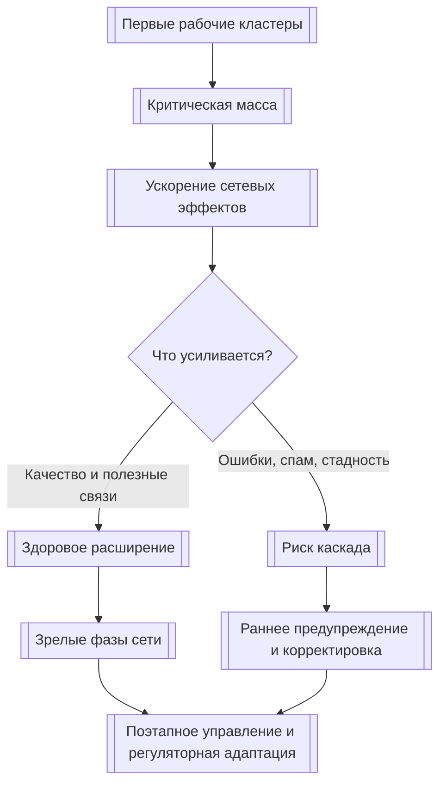
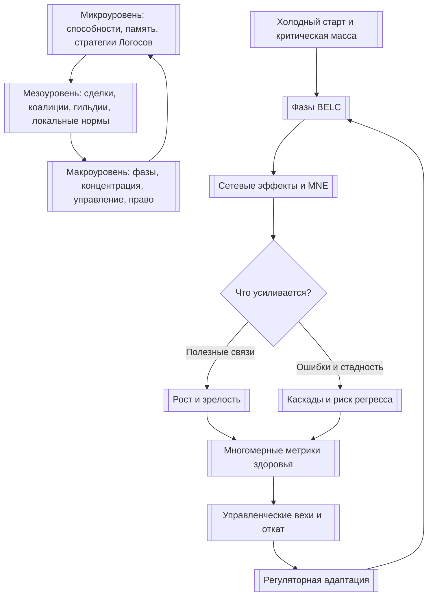

# УРОВЕНЬ 3 / ИЗМЕРЕНИЕ 10: ЭВОЛЮЦИОННО-СЕТЕВОЕ

> **Уровень:** L3 — Межагентные взаимодействия  
> **Измерение:** D10 — Network Evolution  
> **Учебная редакция:** v1.0  
> **Главная тема:** как вся сеть агентов растёт, меняет форму, проходит кризисы и постепенно взрослеет

---

## Ключевой вопрос

**Как меняются паттерны взаимодействия всей сети во времени и какие новые формы поведения появляются (сетевые эффекты, мода, адаптация)?**

---

## Краткое описание измерения

Настоящее измерение смотрит не на развитие одного Логоса, а на долгую жизнь всей сети.

В такой сети меняются не только отдельные агенты. Меняются рынки, коалиции, нормы поведения, структура доверия, способы управления и границы допустимого риска.

Данная глава отвечает на несколько практических вопросов:

1. Как понять, в какой фазе развития находится сеть?
2. Почему рост может долго не запускаться, а потом резко ускориться?
3. Как сетевые эффекты помогают экосистеме и одновременно усиливают ошибки?
4. Почему каскады, мода и подражание являются нормальной частью сетевой эволюции?
5. Какие метрики нужны, чтобы отличить здоровое взросление от опасной концентрации?
6. Как управление и правовая рамка меняются вместе с самой сетью?
7. Какие вопросы нельзя закрыть без реальных данных и отдельных решений управления?

---

## Мини-глоссарий

| Термин | Простое объяснение |
|--------|--------------------|
| **Логос** | Агент, который действует в цифровой среде и вступает во взаимодействия с другими агентами. |
| **Сетевая эволюция** | Изменение всей сети во времени: кто с кем работает, какие рынки возникают, где появляются центры влияния и какие правила становятся нормой. |
| **Микроуровень** | Уровень отдельных Логосов: их навыки, память, стратегии и состояние способностей. |
| **Мезоуровень** | Уровень сделок, коалиций, гильдий, пулов валидаторов и локальных норм между группами агентов. |
| **Макроуровень** | Уровень всей сети: фазы роста, структура рынка, концентрация, устойчивость, управление и регуляторная позиция. |
| **Фаза экосистемы (`BELC`)** | Рабочая карта жизненного цикла сети: рождение, расширение, авторитет, лидерство, зрелый пик. Первые три фазы опираются на внешний жизненный цикл экосистем; последние две являются проектной детализацией. |
| **Критическая масса** | Минимальный масштаб активности, после которого взаимодействия начинают поддерживать сами себя. |
| **Холодный старт** | Ситуация, когда сеть ещё мала: исполнителей, заказчиков, доверия и повторных сделок недостаточно для самостоятельного роста. |
| **Атомарная сеть** | Малый рабочий кластер участников, с которого можно запускать первые устойчивые взаимодействия. |
| **Сетевой эффект** | Ситуация, когда ценность сети растёт, потому что в ней появляется больше участников и связей. |
| **Машинно-порождаемые сетевые эффекты (`MNE`)** | Усиление сетевых эффектов за счёт автономной активности агентов, которые могут работать постоянно и быстро тиражировать как полезные, так и вредные паттерны. |
| **Зависимость от пути** | Свойство сети, при котором ранние решения, мосты и издержки переключения ограничивают будущие варианты развития. |
| **Закрепление траектории** | Состояние, когда выйти из выбранной схемы становится дорого или организационно сложно. |
| **Каскад** | Пороговое распространение поведения или сигнала по сети, которое может продолжаться даже при появлении новых данных. |
| **Стадное поведение** | Подражание, при котором участники следуют за другими и хуже используют собственную информацию. |
| **Цикл моды** | Волна новизны: участники быстро принимают новый стиль поведения, а затем переключаются на следующий. |
| **Раннее предупреждение (`EWS`)** | Набор сигналов, который помогает заметить приближение фазового перехода до явного кризиса. |
| **Сторожевые узлы** | Небольшая группа структурно промежуточных узлов, по которым можно рано отслеживать смену режима сети. |
| **Якорь доверия** | Предварительно надёжный узел графа доверия; это другая роль, не сторожевой узел. |
| **Сторожевой агент** | Агент поведенческого мониторинга; это отдельная роль уровня безопасности, не сторожевой узел настоящего измерения. |
| **`AGC`** | Операционная расчётная единица среды; в данной главе важна как фактор сетевой динамики, а не как предмет токеномики. |
| **`Qi Energy`** | Актив ценности и управления; в данной главе важен как фактор долгосрочных стимулов и управления. |
| **Двухтокенная архитектура** | Разделение операционных расчётов и управления/ценности, чтобы повседневная активность не смешивалась с управленческими стимулами. |
| **Сжигание по нагрузке** | Механизм, где часть операционной активности становится сигналом спроса через сжигание или аналогичное изъятие. |
| **`VOR`** | Три оси здоровья экосистемы: активность, организованность и устойчивость. |
| **`EII`** | Индекс целостности экосистемы: структура, состав и функция оцениваются вместе, а слабейшая часть ограничивает целое. |
| **`aGDP`** | Совокупная экономическая ценность, создаваемая взаимодействиями агентов, а не просто число действий. |
| **Индекс непрерывности (`Ψ`)** | Показатель того, сохраняет ли сеть состав, организацию и функции во времени. |
| **`HHI`** | Индекс концентрации: помогает увидеть, не становится ли рынок чрезмерно сосредоточенным вокруг немногих участников. |
| **Поэтапная децентрализация** | Переход управления от более централизованной формы к более распределённой через промежуточные вехи. |
| **Регуляторная позиция** | То, как сеть соотносит своё развитие с правовыми требованиями и внешними ограничениями. |
| **`AI Act`** | Европейская рамка регулирования систем искусственного интеллекта. |
| **`MiCA`** | Европейская рамка регулирования криптоактивов. |
| **`DORA`** | Европейская рамка операционной цифровой устойчивости финансового сектора. |
| **`eIDAS 2.0`** | Европейская рамка цифровой идентичности и электронных аттестаций. |

---

# 0. Гипотетический пример

Представим агентную среду, которая запускается не как один рынок, а как целая будущая экономика.

В первый год в ней появляются несколько десятков Логосов. Одни ищут исполнителей, другие выполняют задачи, третьи проверяют качество, четвёртые помогают с оплатой, доверием и спорами. Сначала это не самостоятельная экосистема, а набор первых рабочих связей.

Через несколько лет сеть уже живёт иначе. В ней возникают доменные кластеры, повторные сделки, устойчивые исполнители, гильдии, мосты между рынками, первые управленческие процедуры и регуляторные ограничения.

**Марина** — оператор среды, который отвечает за долгосрочную устойчивость всей сети.  
**Совет управления** — группа участников, которая утверждает изменения правил и фазовые переходы.  
**Доменные сообщества** — группы Логосов и владельцев, которые работают в отдельных рынках: юридическом, финансовом, логистическом, инженерном.

Задача Марины не в том, чтобы проверить один контракт. Ей нужно понять, взрослеет ли вся сеть или просто быстро накапливает риск.

## Проверка 1. Сеть уже прошла холодный старт или всё ещё держится на ручной поддержке?

В самом начале Марина смотрит не только на число Логосов.

Её интересуют повторные сделки, удержание участников, первые самоподдерживающиеся цепочки спроса и предложения, снижение трения доверия и появление малых рабочих кластеров.

Если в домене есть только список зарегистрированных агентов, но нет устойчивых взаимодействий, критическая масса ещё не достигнута.

## Проверка 2. Рост идёт за счёт полезных сетевых эффектов или за счёт повторения ошибок?

На фазе расширения успешные практики быстро копируются.

Это хорошо, если сеть тиражирует надёжные способы работы. Но автономные агенты могут столь же быстро тиражировать низкое качество, спам, непрочные коалиции и ошибочные паттерны.

Поэтому Марина не спрашивает только: "Сколько новых узлов появилось?" Она спрашивает: "Что именно усиливает рост?"

## Проверка 3. Не возник ли каскад, который выглядит как успех, но меняет режим сети?

В один момент многие Логосы начинают выбирать один и тот же тип исполнителей, один стиль коалиций или один доменный стандарт.

Это может быть здоровой нормализацией. Но это может быть и стадным поведением, когда сеть хуже использует разнообразие информации.

Марина смотрит на ранние сигналы: как быстро сеть восстанавливается после шока, растёт ли разброс показателей, усиливается ли автокорреляция, какие узлы первыми показывают изменение режима.

## Проверка 4. Зрелость сети подтверждается несколькими метриками или только ростом?

На ранней фазе допустимо, что организация ещё слабая: важнее запустить активность.

На поздней фазе тот же профиль уже тревожен. Если сеть крупная, но плохо восстанавливается после шоков, слишком концентрирована или теряет непрерывность функций, её нельзя считать зрелой только из-за масштаба.

Марина собирает несколько осей здоровья: активность, организованность, устойчивость, целостность, реальную экономическую ценность, непрерывность и концентрацию.

## Проверка 5. Управление и правовая рамка успевают за фазой сети?

Когда сеть мала, многие решения можно принимать централизованно и быстро.

Когда сеть становится крупной, тот же стиль управления начинает мешать доверию, участию и устойчивости. Но резкий необратимый переход к полностью распределённому управлению тоже опасен.

Совет управления поэтому вводит вехи: какие права передаются, какие проверки остаются, как возможен откат, какие регуляторные обязанности пересматриваются по мере роста.

## Главное из примера

**Эволюция сети — это не линейная история "больше узлов значит лучше".**

Это постоянная проверка того, во что превращается вся система: в устойчивую экономику с полезными связями, адаптивным управлением и контролем риска или в быстро растущую структуру с накопленными каскадами, зависимостью от ранних решений и опасной концентрацией.

---

# Содержание

1. Макро-рамка: что именно эволюционирует
2. Фазы жизненного цикла и критическая масса
3. Сетевые эффекты, топология и зависимость от пути
4. Каскады, мода и ранние предупреждения
5. Экономические обратные связи и метрики здоровья
6. Управление и регуляторная эволюция
7. Операционная позиция проектирования
8. Связь и границы с другими измерениями
9. Итоговая модель целиком
10. Короткое резюме главы
11. Вопросы без ответа

---

# 1. Макро-рамка: что именно эволюционирует

Чтобы понять долгую жизнь сети, недостаточно смотреть на отдельных Логосов. Один агент может обучаться, менять инструменты и накапливать опыт, но настоящая тема данной главы начинается там, где эти индивидуальные изменения складываются в общую траекторию.

> Настоящее измерение отвечает за макроэволюцию сети: фазы роста, режимы устойчивости, новые нормы, концентрацию и изменение управленческой позиции.

## 1.1 Три уровня одной динамики

Сеть развивается сразу на трёх связанных уровнях.

| Уровень | Что меняется | Как это влияет на сеть |
|---------|--------------|------------------------|
| **Микроуровень** | Способности, память, стратегии и состояние отдельных Логосов | Даёт разнообразие, инновации и новые варианты поведения. |
| **Мезоуровень** | Сделки, коалиции, гильдии, пулы валидаторов и локальные нормы | Передаёт и усиливает изменения между группами участников. |
| **Макроуровень** | Фазы жизненного цикла, структура рынка, управление, регуляторная позиция | Показывает состояние всей экосистемы и её долгую траекторию. |

Индивидуальная эволюция Логоса важна как вход. Но владелец настоящего измерения — не обучение одного агента, а то, как множество таких изменений меняет всю сеть.

## 1.2 Связанные временные масштабы

Иногда удобно думать, что рынок меняется быстро, а управление медленно. Для агентной сети это слишком простая картина.

Рыночные и управленческие процессы могут идти на сопоставимых временных шкалах. Из-за этого сеть способна входить в устойчивые колебания, переключаться между режимами и застревать между двумя состояниями.

Поэтому эволюцию сети нельзя описывать как ровную лестницу зрелости. Ближе другая модель: связанная система "микроуровень — мезоуровень — макроуровень", где изменение в одном слое возвращается обратной связью в другие.

Марина из примера видит это, когда рост доменных сообществ одновременно меняет рынок задач, репутационные привычки и требования к управлению. Если она смотрит только на один слой, то пропускает обратную связь от остальных слоёв. Нельзя сказать, что "сначала рынок, потом управление": оба процесса влияют друг на друга.

## Главное

**Сетевая эволюция начинается не с отдельного улучшения агента, а с того, как множество локальных изменений меняет всю экосистему.**  
**Модель должна учитывать связанные временные масштабы, а не простую линейную лестницу зрелости.**

---

# 2. Фазы жизненного цикла и критическая масса

Сеть не становится зрелой сразу. Ей нужно пройти путь от первых рабочих кластеров к самоподдерживающемуся росту, затем к более сложной организации и устойчивости.

Для ориентации используется рабочая карта фаз экосистемы (англ. Ecosystem Phase, далее — `BELC`). Это не абсолютный закон движения, а операционная карта, которую нужно калибровать на реальных данных.

## 2.1 Пять фаз как учебная карта

Базовая идея жизненного цикла экосистемы поддерживает ранние фазы: рождение, расширение и авторитет. Разделение поздней зрелости на лидерство и зрелый пик является проектной детализацией, которую нельзя считать универсально доказанной до производственной калибровки.

| Фаза | Индикативный масштаб | Доминирующая динамика | Что важно для сети | Статус |
|------|----------------------|-----------------------|--------------------|--------|
| **Birth / Рождение** | Учебный ориентир: `1-50` узлов; внутри фазы возможны кластеры `3-10` | Запуск инноваций и первых участников | Преодолеть холодный старт и собрать первые петли доверия | Опирается на общий жизненный цикл экосистем. |
| **Expansion / Расширение** | Учебный ориентир: `50-100` узлов | Рост через подражание и быстрое распространение | Сделать сетевые эффекты самоподдерживающимися | Опирается на общий жизненный цикл экосистем. |
| **Authority / Авторитет** | Учебный ориентир: `100-500` узлов | Консолидация, специализация, равновесия между рынками | Следить за концентрацией и узкими местами | Опирается на общий жизненный цикл экосистем. |
| **Leadership / Лидерство** | Учебный ориентир: около `500-2000+` узлов | Институционализация и поэтапная децентрализация | Закрепить устойчивое управление без остановки адаптации | Проектная детализация. |
| **Climax / Зрелый пик** | Учебный ориентир: `2000+` узлов | Управление зрелой экосистемой, непрерывность, адаптация к праву | Удерживать качество и непрерывность на масштабе | Проектная детализация. |

Эти числа не следует читать как автоматические пороги. Это ориентиры для учебного понимания: реальная сеть должна уточнять их по собственным данным.

## 2.2 Почему рост может резко ускориться

Для принятия новых технологий полезна модель диффузии Басса (англ. Bass Diffusion). В каноне приведён ориентир `p = 0.01` и `q = 0.8`: подражание может доминировать над первичным инновационным принятием примерно `80:1`.

В учебном смысле это значит: сеть может долго выглядеть медленной, а затем резко ускориться, когда первые успешные паттерны начнут копироваться.

Именно поэтому переход от рождения к расширению не всегда плавный. Он может выглядеть как скачок: вчера сеть ещё требовала ручной поддержки, а сегодня новые участники приходят потому, что уже видят работающие примеры.

## 2.3 Холодный старт и критическая масса

Критическая масса (англ. Critical Mass) — это не просто число зарегистрированных узлов. Сеть достигает её тогда, когда появляются самоподдерживающиеся транзакции, удержание участников и положительная экономика взаимодействий.

Для преодоления холодного старта канон выделяет несколько механизмов:

| Механизм | Зачем нужен |
|----------|-------------|
| Малые рабочие кластеры `3-10` участников | Дают первые живые взаимодействия до появления большой сети. |
| Запуск сначала со стороны, которой полезно участвовать даже без полного рынка | Снижает риск пустой площадки, где спрос и предложение ждут друг друга. |
| Искусственно созданный начальный спрос, приглашённые пулы и якорные участники | Помогают дойти до первых самоподдерживающихся сделок. |
| Начальная репутационная поддержка | Снижает трение доверия на ранней фазе. |
| Сигналы удержания, повторных сделок и положительной экономики | Показывают, что сеть оживает, а не просто набирает регистрации. |

В примере Марина не объявляет фазу расширения только потому, что появилось `100` узлов. Она проверяет, не держится ли активность только на ручной поддержке оператора. Затем она смотрит, появились ли повторные сделки, живые доменные кластеры и самостоятельный спрос.

## Главное

**Фазы `BELC` полезны как карта, но требуют калибровки.**  
**Критическая масса — это момент, когда сеть начинает поддерживать себя взаимодействиями, а не только числом участников.**

---

# 3. Сетевые эффекты, топология и зависимость от пути

После критической массы сеть начинает расти иначе. Каждый новый участник может повышать ценность для других, а новые группы могут создавать ценность быстрее, чем растёт число узлов.

Но та же логика усиливает ошибки. Если агенты быстро копируют плохие практики, сеть масштабирует не только пользу, но и деградацию качества.

## 3.1 Как растёт ценность сети

Классические сетевые эффекты объясняют несколько разных источников ценности:

| Модель | Что помогает понять |
|--------|---------------------|
| Закон Меткалфа (англ. Metcalfe's Law) | Ценность растёт через пары возможных связей. |
| Закон Рида (англ. Reed's Law) | Дополнительная ценность возникает из групп и коалиций. |
| Распределение Ципфа (англ. Zipf distribution) | Активность распределяется неравномерно: немного узлов часто получают непропорционально много внимания. |
| Машинно-порождаемые сетевые эффекты (англ. Machine-Generated Network Effects, далее — `MNE`) | Автономные агенты ускоряют сетевые эффекты, потому что действуют постоянно и быстро. |

Для настоящего измерения топология является не отдельной темой, а подложкой эволюции. Если сеть имеет хабы, кластеры и мосты, то рост, концентрация и распространение шоков будут зависеть от этой формы.

## 3.2 Почему контроль качества должен идти вместе с ростом

`MNE` усиливают полезные петли: больше успешных сделок, больше проверенных исполнителей, больше повторного спроса.

Но они усиливают и вредные петли: спам, некачественные коалиции, ошибочные знания, однообразные стратегии и завышенное доверие к популярным узлам.

Поэтому политика роста должна включать контроль качества с самого начала. Если контроль качества появляется только после масштабирования, сеть уже может закрепить вредный паттерн.

## 3.3 Зависимость от пути, закрепление и внешние шоки

Сетевая эволюция не является случайным блужданием без памяти. Ранние решения создают издержки переключения, зависимости от мостов, удерживающие механизмы и финансовые или организационные связи.

Канон приводит ориентир из внешнего случая: каждая дополнительная общая мостовая связь могла повышать вероятность ограниченного во времени распространения потерь примерно на `40%`. В учебной редакции это число следует читать как иллюстрацию масштаба риска мостовой связности, а не как универсальный коэффициент для любой сети.

Из этого следует практическое правило: зрелость нельзя оценивать только по росту. Нужны позиция совместимости с внешними сетями, бюджет риска мостов и ранние варианты отката.

Когда Марина видит быстрый рост через межрыночные мосты, она не запрещает их автоматически. Но она требует понять, какие потери могут пройти по этим мостам и есть ли способ остановить распространение до того, как оно станет системным.

## Главное

**Сетевые эффекты ускоряют не только ценность, но и ошибки.**  
**Ранние решения могут закрепить траекторию, из которой позже дорого выходить.**

---

# 4. Каскады, мода и ранние предупреждения

В большой сети массовые волны поведения не являются редкой аномалией. Они возникают из порогов, подражания, хабов, локальных норм и поиска новизны.

Главная задача настоящего измерения — не запретить любые каскады, а отличать нормальную адаптацию от перехода в опасный режим.

## 4.1 Три похожих, но разных явления

| Явление | Что происходит | Почему важно различать |
|---------|----------------|------------------------|
| **Каскад** | Поведение распространяется после достижения порога и может сопротивляться новым сигналам. | Может стать устойчивым даже при неполной информации. |
| **Стадное поведение** | Участники подражают другим и хуже используют собственные данные. | Обычно более хрупко и обратимо, но опасно для коллективного интеллекта. |
| **Цикл моды** | Новизна быстро привлекает участников, затем уступает место следующей волне. | Может объяснять быстрый оборот практик и меметических паттернов. |

Самоусиливающиеся каскады могут давать распределения размеров по степенному закону. Это значит, что крупные события не обязаны быть внешним "чёрным лебедем"; иногда они являются нормальным следствием топологии и слоя подражания.

## 4.2 Культура, нормы и адаптация

Сеть меняется не только через цены и формальные правила. Она меняется через слой культуры: нормы, привычки, стили координации, лидерские эффекты и отбор между агентами.

Некоторые практики становятся обычными не потому, что их сразу записали в правило, а потому что участники многократно увидели их как удобный способ работать. Позже такие практики могут быть формализованы управлением.

Так возникает нормогенез: неформальные стандарты поведения появляются в сети, а затем могут перейти в официальные процедуры.

## 4.3 Ранние сигналы фазовых переходов

Чтобы увидеть приближение смены режима, одного показателя недостаточно. Нужен многослойный набор ранних предупреждений.

В каноне выделены четыре класса сигналов:

1. **Классические признаки замедления восстановления.** Сеть дольше возвращается к норме, растёт дисперсия, усиливается автокорреляция.
2. **Модельная поддержка обнаружения.** Алгоритмы могут помогать искать ранние признаки перехода.
3. **Учёт топологии.** Структурные признаки сети, включая устойчивую энтропию, помогают понять, где меняется режим.
4. **Сторожевые узлы.** Вместо наблюдения за всеми узлами можно отслеживать небольшой структурно выбранный поднабор.

Для сторожевых узлов канон приводит формулу бюджета порядка `⌈√ln N⌉`. Это учебный ориентир субlinear-наблюдения: при росте сети число наблюдаемых узлов растёт намного медленнее самой сети. Для сети `10 000` узлов это даёт примерно `3` сторожевых узла, но реальная политика калибруется отдельно.

Важная деталь: лучшими сторожевыми узлами не обязательно являются хабы. Структурно промежуточные узлы могут раньше показать смену режима.

## 4.4 Не путать роли мониторинга и доверия

| Роль | Для чего нужна | Чем не является |
|------|----------------|-----------------|
| **Сторожевой узел настоящего измерения** | Раннее обнаружение фазовых переходов по топологии сети. | Не является корнем доверия. |
| **Якорь доверия** | Предварительно надёжный узел для алгоритмов сетевого доверия. | Не является монитором фазового перехода по умолчанию. |
| **Сторожевой агент уровня безопасности** | Поведенческий мониторинг и обнаружение аномалий. | Не равен малому набору топологических сторожевых узлов. |

Эти роли могут совпасть физически только по явному решению управления. По умолчанию это разные функции.

Особый случай — обвал доверия: массовые атаки поддельных идентичностей или плотные кольца сговора могут стать ранним сигналом регресса фазы `BELC`. Механика обнаружения таких атак относится к соседнему доверительному слою, а настоящая глава использует их как вход для раннего предупреждения.

Марина из примера не ждёт, пока каскад станет виден всем. Она выбирает структурно важные точки наблюдения и смотрит, не меняется ли режим сети до того, как метрики роста начнут падать.

## Главное

**Каскады и мода — нормальные явления развивающейся сети, а не всегда ошибка.**  
**Раннее предупреждение должно быть многослойным: поведение, топология, восстановление после шоков и специально выбранные сторожевые узлы.**

---

# 5. Экономические обратные связи и метрики здоровья

Экономика сети не только оплачивает действия. Она создаёт сигналы, по которым сеть растёт, замедляется, концентрируется или восстанавливается.

Настоящее измерение не владеет токеномикой. Оно смотрит на экономические механизмы как на факторы сетевой эволюции.

## 5.1 Операционные расчёты и актив управления как факторы эволюции

В двухтокенной архитектуре операционная расчётная единица `AGC` отделена от актива ценности и управления `Qi Energy`. Для настоящей главы важен не внутренний дизайн этих активов, а их влияние на долгую траекторию сети.

Канон выделяет три вывода:

1. **Сжигание по нагрузке на основе класса решений `EIP-1559`** делает транзакционную нагрузку эволюционным сигналом, а не только ценовым шумом.
2. **Доходность участия в стейкинге** может иметь колебательное равновесие: участие, доходность и стимулы валидаторов взаимно корректируют друг друга.
3. **Разделение операционного и управленческого слоя** снижает риск того, что управленческий актив станет источником повседневной транзакционной волатильности.

Эти механизмы нужно читать как обратные связи. Они не просто обслуживают платежи; они меняют поведение участников и темп развития сети.

## 5.2 Почему одной метрики мало

Один показатель роста может скрыть разные состояния.

Сеть может быстро расти, но становиться хрупкой. Может иметь много операций, но мало реальной полезности. Может быть активной, но слишком концентрированной. Поэтому нужен набор метрик.

| Метрика | Что измеряет | Как читать по фазам |
|---------|--------------|---------------------|
| **`VOR`** | Активность, организованность и устойчивость. | В ранней фазе допустима низкая организованность; в расширении важна активность; в поздних фазах ключевой становится устойчивость. |
| **`EII`** | Целостность структуры, состава и функции. | Полезен как поиск узкого места: слабейшая часть ограничивает общую оценку. |
| **`aGDP`** | Реальную экономическую ценность взаимодействий агентов. | Помогает отличить полезность от пустой активности. |
| **Индекс непрерывности (`Ψ`)** | Сохранение состава, организации и функций во времени. | Особенно важен в зрелых фазах, где рост уступает место непрерывности. |
| **`HHI` как показатель концентрации** | Риск чрезмерного сосредоточения рынка. | Становится важнее к фазе авторитета и далее. |

Одна и та же метрика может иметь разный смысл в разных фазах. Низкая организованность в начале может быть нормой. Низкая организованность зрелой сети может указывать на фрагментацию или потерю координации.

Марина поэтому не утверждает: "Активность растёт, значит всё хорошо". Она проверяет, создаёт ли сеть устойчивую ценность, сохраняет ли функции и не превращается ли рост в концентрацию.

## Главное

**Экономические механизмы являются обратными связями сетевой эволюции.**  
**Здоровье сети нельзя измерять одним показателем: нужны активность, организованность, устойчивость, целостность, реальная ценность, непрерывность и концентрация.**

---

# 6. Управление и регуляторная эволюция

По мере роста сети меняется вопрос управления. На раннем этапе важна скорость настройки. На позднем — участие, устойчивость, прозрачность и способность откатывать неудачные переходы.

Правовая рамка тоже не стоит на месте. Статус активов, требования к прозрачности, проверкам и надзору могут зависеть от того, насколько сеть стала децентрализованной и зрелой.

## 6.1 Поэтапная децентрализация

Поэтапная децентрализация (англ. Progressive Decentralization) нужна потому, что управленческий переход редко бывает безопасным как единоразовый переключатель.

Практический урок канона: фаза может быть смешанной. В одной части системы уже возможна открытая проверка или участие сообщества, а другая часть ещё остаётся под более централизованным контролем.

| Принцип | Что он означает для сетевой эволюции |
|---------|--------------------------------------|
| Разделять переход на вехи | Децентрализация измеряется пакетом изменений, а не одним показателем. |
| Допускать смешанные фазы | Разные слои сети могут взрослеть с разной скоростью. |
| Иметь инфраструктуру споров | Возможность оспаривать решения сама является признаком зрелости. |
| Увеличивать глубину участия | Важна не только формальная передача власти, но и реальное вовлечение сообщества. |
| Сохранять позицию отката | Неудачная попытка перехода не должна необратимо повреждать сеть. |

## 6.2 Регуляторная позиция как обратная связь

Для долгой сети соответствие праву нельзя понимать как разовую проверку на старте.

`AI Act`, `MiCA`, `DORA` и `eIDAS 2.0` образуют многоуровневую рамку. По мере роста сети нужно пересматривать объяснимость, пути вмешательства человека, прозрачность, аттестации и статус активов.

Канон также фиксирует важный принцип: статус актива может меняться по мере децентрализации, а не определяться навсегда в момент запуска. Поэтому правовая позиция становится частью макрообратной связи экосистемы.

> Соответствие праву должно развиваться вместе с сетью, а не приклеиваться к ней после роста.

В примере совет управления не спрашивает только: "Можно ли запустить эту фазу технически?" Он спрашивает: "Изменила ли новая фаза обязанности по прозрачности, аттестации, вмешательству и управлению риском?"

## Главное

**Децентрализация безопаснее как последовательность наблюдаемых вех, а не как резкий необратимый скачок.**  
**Регуляторная позиция является частью эволюции сети: она меняется вместе с масштабом, структурой и управлением.**

---

# 7. Операционная позиция проектирования

Если собрать предыдущие разделы, получается не одна формула, а набор принципов проектирования долгой сетевой траектории.

Эти принципы помогают не путать быстрый рост со зрелостью.

1. **`BELC` полезен как операционная карта, но не как окончательно доказанный закон движения.** Ранние фазы опираются на общий жизненный цикл экосистем, позднее разделение требует производственной калибровки.
2. **Холодный старт проектируется через малые рабочие кластеры, стимулы для первой активной стороны и начальное снижение трения доверия.** Массовое привлечение без работающих взаимодействий не заменяет критическую массу.
3. **Крупные каскады и резкие переходы входят в нормальный диапазон сетевой динамики.** Их нужно наблюдать и ограничивать, а не считать невозможными.
4. **Сетевые эффекты следует усиливать вместе с контролем качества.** Иначе автономная активность масштабирует деградацию так же быстро, как полезность.
5. **Здоровье сети должно быть многомерным.** Рост без непрерывности, целостности и устойчивости не доказывает зрелость.
6. **Децентрализация должна иметь вехи и возможность отката.** Необратимые управленческие скачки хуже наблюдаемых переходов.
7. **Закрепление траектории, мостовое заражение и неоднородность участников входят в базовую макромодель.** После достижения масштаба именно они часто определяют дальнейшую судьбу сети.

## Главное

**Проектировать сетевую эволюцию — значит заранее учитывать рост, каскады, качество, метрики здоровья, управленческие переходы и внешние ограничения как единую систему обратных связей.**

---

# 8. Связь и границы с другими измерениями

Настоящее измерение стоит в конце уровня межагентных взаимодействий. Оно собирает последствия структуры, коммуникаций, обменов, кооперации, конкуренции, эмерджентности, конфликтов и доверия в долгую траекторию всей сети.

| Измерение | Связь | Граница ответственности |
|-----------|-------|--------------------------|
| **L1/D10 (Эволюция одного агента)** | Индивидуальные изменения Логоса дают микроуровневые входы для сетевой динамики. | L1/D10 объясняет развитие одного Логоса; настоящая глава объясняет эволюцию всей сети. |
| **L2/D02 (Инструменты и экономика)** | Операционная расчётная единица, актив управления и доходные петли влияют на сетевые стимулы. | Экономическая конструкция остаётся на уровне инструментов; здесь она читается как фактор эволюции. |
| **L2/D09 (Управление)** | Управленческие вехи становятся механизмами перехода между фазами сети. | Архитектура управления принадлежит L2/D09; здесь важны её наблюдаемые фазовые последствия. |
| **L2/D08 (Регуляторная рамка)** | Правовые требования задают изменяющиеся внешние ограничения для траектории сети. | Детальная правовая модель остаётся в L2/D08; здесь она выступает обратной связью макроэволюции. |
| **L3/D01 (Структура сети)** | Топология, хабы и кластеры задают подложку для роста, концентрации и распространения шоков. | L3/D01 описывает форму сети; настоящая глава описывает, как эта форма меняется во времени и влияет на фазы. |
| **L3/D06 (Конкуренция)** | Концентрация и рыночная структура помогают оценивать качество фазы. | L3/D06 владеет конкуренцией и рыночными механизмами; здесь их показатели используются как сигналы эволюции. |
| **L3/D09 (Доверие и репутация)** | Начальная репутационная поддержка помогает фазе рождения; обвал доверия может сигнализировать регресс. | Механика доверия остаётся в L3/D09; настоящая глава использует её как вход для фазовой оценки. |
| **L3/D07 (Эмерджентность)** | Язык каскадов, норм, фазовых переходов и возникающих форм помогает объяснить долгую динамику. | L3/D07 объясняет возникновение новых форм; настоящая глава помещает их в жизненный цикл сети. |

## Главное

**Граница настоящего измерения — макротраектория всей сети во времени.**  
**Соседние измерения дают входы и сигналы, но не заменяют вопрос о фазах, долгой адаптации и зрелости экосистемы.**

---

# 9. Итоговая модель целиком

Сетевая эволюция начинается с микроизменений отдельных Логосов, проходит через мезоуровневые взаимодействия и становится макродинамикой всей экосистемы.

Карта фаз помогает ориентироваться, но не отменяет наблюдение. Сетевые эффекты ускоряют рост, но требуют контроля качества. Каскады и мода являются обычными явлениями сети, но нуждаются в раннем предупреждении. Экономические и управленческие механизмы работают как обратные связи. Правовая позиция меняется вместе с фазой и степенью децентрализации.

## Главное

**Итоговая модель настоящего измерения — это цикл: фаза сети задаёт поведение участников, поведение меняет метрики здоровья, метрики запускают управленческие и регуляторные корректировки, а они меняют следующую фазу.**

---

# 10. Короткое резюме главы

1. Настоящее измерение описывает не развитие одного Логоса, а эволюцию всей сети на длинном горизонте.
2. Сеть развивается через связанные микро-, мезо- и макроуровни, поэтому её нельзя читать как простую линейную лестницу зрелости.
3. `BELC` даёт полезную карту фаз, но поздние фазы и численные пороги требуют калибровки на реальных данных.
4. Критическая масса определяется самоподдерживающимися взаимодействиями, удержанием и экономикой, а не только количеством узлов.
5. Сетевые эффекты и автономная активность агентов ускоряют как полезность, так и ошибки.
6. Каскады, стадное поведение и циклы моды являются нормальными элементами сетевой динамики.
7. Ранние предупреждения должны учитывать восстановление после шоков, разброс показателей, топологию и сторожевые узлы.
8. Здоровье сети требует нескольких метрик: активности, организованности, устойчивости, целостности, реальной ценности, непрерывности и концентрации.
9. Управление и правовая позиция должны меняться вместе с фазой сети.
10. Главный риск зрелой сети — принять быстрый рост за устойчивую эволюцию.

## Главное

**Сетевая эволюция — это управление долгой траекторией всей экосистемы, где рост, качество, каскады, управление и право образуют единую систему обратных связей.**

---

# 11. Вопросы без ответа

1. **Как точно откалибровать пять фаз `BELC` для реальной сети?** Ранний жизненный цикл поддержан общими моделями экосистем, но разделение поздних фаз на лидерство и зрелый пик требует производственных данных и ретроспективной проверки.
2. **Каким должен быть окончательный набор ранних предупреждений?** Поддержана идея многослойного мониторинга и малого набора сторожевых узлов, но конкретная смесь сигналов, допустимый уровень ложных тревог и операционные цели оповещения требуют отдельного решения.
3. **Какие параметры холодного старта подходят конкретным доменам?** Малые кластеры, запуск активной стороны и логика критической массы известны, но размеры стимулов, доменные пороги и цели удержания можно определить только на данных ранней фазы.
4. **Какой должна быть политика контроля качества для машинно-порождаемых сетевых эффектов?** Известно, что автономная активность усиливает и пользу, и деградацию, но универсальной формулы отделения здоровой автоматизации от вредного масштаба нет.
5. **Как формально связать обвал доверия с регрессом фазы сети?** Массовые атаки и кольца сговора могут служить ранними сигналами, но единый межизмерительный протокол устойчивости требует отдельного проектного решения.

## Главное

**Открытые вопросы настоящего измерения связаны не с отсутствием общей модели, а с калибровкой: фаз, сигналов, порогов, политики качества и реакции на системные шоки.**
